# UBER Deep Value Intelligence

**Analysis Date:** 2026-11-22

## Critical Disclaimer

*This analysis is generated by Deep Value Intelligence, an AI-powered multi-agent investing framework. Education & research only - not financial advice, not a financial advisor.*

---

## Table of Contents

1. Intelligence Summary
2. Analyst Team Reports
   - Fundamentals Analysis
   - Intrinsic Value Analysis (Buffett)
   - Trend & Growth Analysis (Lynch/Druckenmiller/Fisher)
   - Market Technical Analysis
   - Options Market Analysis
3. Research Team Commentary
4. Value Investing Team Commentary
5. Deep Values Commentary

---

## Intelligence Summary

### Thesis + Conditions

**Core Thesis:** Uber has evolved into a higher-quality, asset-light platform rather than a structurally loss-making ride-hailing business. Revenue growth of 18.3%, expanding profitability, and reported ROIC of 32.5% support genuine operating progress.

**Key Risks:**
- The Risky Analyst correctly emphasizes that Uber's historical loss-making profile is no longer an adequate description of the business:
- Debt exceeding cash adds financial risk, although the supplied data does not demonstrate distress.
- However, the conservative case risks discounting genuine improvement too heavily. An asset-light structure is not merely an accounting distortion; it is an economic advantage. Nor does multi-homing make Uber's accumulated density, brand, regulatory infrastructure, and technology easy to reproduce.

**Confidence:** Low

---

## Analyst Team Reports

### Fundamentals Analysis

#### Latest Earnings Snapshot

*Most recent reported quarter anchored on 2026 Q3, with prior-year comparison when available.*

| Metric | 2026 Q3 | 2025 Q3 | YoY Change |
| --- | ---: | ---: | ---: |
| Revenue | $14.77B | $13.47B | +9.6% |
| Operating Income | $1.45B | $1.11B | +30.0% |
| Net Income | $512.0M | $6.63B | -92.3% |
| Diluted EPS | $0.25 | $3.11 | -92.0% |
| Operating Cash Flow | $2.64B | $2.33B | +13.4% |
| Free Cash Flow | $2.54B | $2.23B | +13.7% |

Key Takeaways: This snapshot anchors the most recent reported quarter before the narrative analysis. It helps readers separate long-run business quality from whatever changed in the latest earnings print.

#### 9-Year Financial Metrics for UBER

*All values below are computed deterministically from raw data - not estimated by AI.*

*Issuer profile: operating company (Technology / Software - Application).*

#### 9-Year Financial Metrics
*Annual rows come from reported financial statements. The final TTM row is computed from the latest four quarters.*

| Metric | 2017 | 2018 | 2019 | 2020 | 2021 | 2022 | 2023 | 2024 | 2025 | 2026 TTM |
| --- | --- | --- | --- | --- | --- | --- | --- | --- | --- | --- |
| Market Price | N/A | N/A | $30 | $51 | $42 | $25 | $62 | $60 | $82 | $63 |
| Market Cap | N/A | N/A | $37.13B | $89.40B | $79.48B | $48.84B | $128.79B | $129.72B | $173.20B | $130.13B |
| P/E Ratio | N/A | N/A | -4.37 | -13.21 | -144.59 | -5.32 | 70.77 | 13.23 | 17.27 | 37.56 |
| P/B Ratio | N/A | N/A | 2.62 | 7.29 | 5.50 | 6.65 | 11.45 | 6.02 | 6.41 | 4.70 |
| ROE | 47.1% | -13.5% | -59.9% | -55.2% | -3.4% | -124.5% | 16.8% | 45.7% | 37.2% | 12.5% |
| ROIC | N/A | N/A | -801.6% | -40.2% | -19.9% | -10.4% | 6.3% | 41.5% | 35.6% | 14.7% |
| EPS | $-9.46 | $0.00 | $-6.81 | $-3.86 | $-0.29 | $-4.65 | $0.87 | $4.56 | $4.73 | $1.69 |
| Revenue | $7.93B | $10.43B | $13.00B | $11.14B | $17.45B | $31.88B | $37.28B | $43.98B | $52.02B | $56.53B |
| Gross Profit | N/A | N/A | N/A | N/A | N/A | N/A | N/A | N/A | N/A | $24.42B |
| Gross Margin | N/A | N/A | N/A | N/A | N/A | N/A | N/A | N/A | N/A | 43.2% |
| Operating Margin | -51.4% | -29.1% | -66.1% | -43.7% | -22.0% | -5.7% | 3.0% | 6.4% | 10.7% | 12.4% |
| Net Income | $-4.03B | $997.0M | $-8.51B | $-6.77B | $-496.0M | $-9.14B | $1.89B | $9.86B | $10.05B | $3.46B |
| Net Margin | -50.8% | 9.6% | -65.4% | -60.8% | -2.8% | -28.7% | 5.1% | 22.4% | 19.3% | 6.1% |
| Revenue Growth | N/A | 31.5% | 24.6% | -14.3% | 56.7% | 82.6% | 17.0% | 18.0% | 18.3% | 8.7% |
| Net Income Growth | N/A | -124.7% | -953.2% | -20.4% | -92.7% | 1742.9% | -120.6% | 422.3% | 2.0% | -65.5% |
| Free Cash Flow Growth | N/A | -6.3% | 133.9% | -31.5% | -77.9% | -152.5% | 762.1% | 105.1% | 41.6% | 6.7% |
| Total Book Value | $-8.56B | $-7.38B | $14.19B | $12.27B | $14.46B | $7.34B | $11.25B | $21.56B | $27.04B | $27.66B |
| Total Assets | N/A | $23.99B | $31.76B | $33.25B | $38.77B | $32.11B | $38.70B | $51.24B | $61.80B | $71.07B |
| Total Debt | N/A | $6.90B | $5.73B | $7.59B | $9.30B | $9.29B | $9.48B | $9.50B | $10.52B | $17.74B |
| Debt-to-Equity | N/A | -0.93 | 0.40 | 0.62 | 0.64 | 1.27 | 0.84 | 0.44 | 0.39 | 0.64 |
| Cash & Equivalents | $4.39B | $6.41B | $10.87B | $5.65B | $4.29B | $4.21B | $4.68B | $5.89B | $7.11B | $9.56B |
| Shareholders' Equity | $-8.56B | $-7.38B | $14.19B | $12.27B | $14.46B | $7.34B | $11.25B | $21.56B | $27.04B | $27.66B |
| Operating Cash Flow | $-1.42B | $-1.54B | $-4.32B | $-2.75B | $-445.0M | $642.0M | $3.58B | $7.14B | $10.10B | $10.73B |
| Investing Cash Flow | $-487.0M | $-695.0M | $-790.0M | $-2.87B | $-1.20B | $-1.64B | $-3.23B | $-3.18B | $-3.56B | $-7.70B |
| Free Cash Flow | $-2.24B | $-2.10B | $-4.91B | $-3.36B | $-743.0M | $390.0M | $3.36B | $6.89B | $9.76B | $10.42B |
| FCF Margin | -28.2% | -20.1% | -37.8% | -30.2% | -4.3% | 1.2% | 9.0% | 15.7% | 18.8% | 18.4% |
| Dividends / Share | $0.00 | $0.00 | $0.00 | $0.00 | $0.00 | $0.00 | $0.00 | $0.00 | $0.00 | $0.00 |

#### Profitability Metrics
- Return on Equity (ROE): 37.2%
- Return on Invested Capital (ROIC): 32.5%
- Return on Assets (ROA): 16.3%
- Gross Margin: N/A
- Operating Margin: 10.7%
- Net Profit Margin: 19.3%

#### Liquidity Metrics
- Current Ratio: 1.14
- Quick Ratio: 0.93

#### Leverage Metrics
- Debt-to-Equity Ratio: 0.39
- Interest Coverage Ratio: 12.65
- Net Debt: $2.89B

#### Growth Metrics (Year-over-Year)
- Revenue Growth: 18.3%
- Net Income Growth: 2.0%
- Free Cash Flow Growth: 41.6%
- Revenue CAGR (3-Year): 17.7%
- Revenue CAGR (5-Year): 36.1%

#### Valuation Metrics
- P/E Ratio (TTM): 37.34
- Forward P/E: 14.40
- Price-to-Book: 4.68
- Price-to-Sales: 2.29
- PEG Ratio: 4.80
- EV/EBITDA: 17.70
- Free Cash Flow Yield: 7.5%
- Earnings Yield: 2.7%

#### Owner Earnings (Buffett Method, Code-Computed)
- Net Income: $10.05B
- + Depreciation & Amortization: $747.0M
- - Capital Expenditures: $-336.0M
- + Working Capital (cash-flow statement; negative = cash tied up): $2.23B
- = **Owner Earnings: $8.20B**

#### Intrinsic Value (DeepValues app - SEC filings pipeline)
- **Intrinsic value (DeepValues app, the headline): $79.80** - Owner Earnings (Buffett), method buffett-1986-v2, as of 2026-11-22 (FY2025)
  Range (conservative - optimistic): $55.86 - $79.80
  Margin of safety vs. price: 20.5% (price $63.47)
  Inputs the app used (ttm_2026Q3): after-tax operating income $6.8B (operating income $7.0B, tax 1.9%) + D&A $0.8B - capex charge $0.3B (three-year average capex/revenue x trailing revenue; reported capex $0.3B) - working capital $0.0B = owner earnings $7.2B.
  Growth 10.0% fading to 2.5% terminal (min(owner-earnings CAGR, 5-year revenue CAGR), clamped [0, 10%]); discount rate 8.3% (30Y Treasury 5.31% + 3 pts (as of 2026-11-20)); net cash $-5.6B (cash $9.6B + marketable securities $0.5B - debt $15.7B); 2,050M shares.
- Owner Earnings (Buffett): $55.86 / $79.80 / $79.80 (conservative / base / optimistic) ← headline
- Free cash flow DCF: $231.62 / $231.62 / $231.62 (conservative / base / optimistic)
- Damodaran two-stage FCFF: N/A - Projected free cash flow to the firm is negative, so the operations are valued below zero (-$647.7B): its median operating margin over 9 years is -22.0%, so the model projects operating losses, before $5.6B of net debt - no positive equity value to report
  This is THE intrinsic value: quote it as the intrinsic value and measure margin of safety against it. Any DVI scenario figures elsewhere are a secondary cross-check, not the value.

#### DVI scenario model (secondary cross-check - NOT the intrinsic value)
DVI's own Yahoo-based scenarios, shown only as a sensitivity check. Do not quote these as the intrinsic value; the intrinsic value is the DeepValues app value above.
- Current Price: $63
- DVI scenario value (business-model routed): $165
  Business model: operating company - owner-earnings DCF (operating_company)
  Model spread (min-max across DCFs): $165 - $179
  Margin of safety vs. price (headline): 61.6%
  Routing note: General operating company: balanced blend of Damodaran FCFF and the owner-earnings DCF with a reverse-DCF sanity check.
- Buffett Method (Owner Earnings):
  Conservative: $165
  Average: $165
  Optimistic: $446
- Cash Flow Method (FCF):
  Conservative: $179
  Average: $179
  Optimistic: $472
- Damodaran FCFF (WACC + margins + reinvestment):
  Conservative: $-366
  Average: $-295
  Optimistic: $-20
  Monte Carlo band (P10-P90): $-432 - $-121 (median $-267)
  P(intrinsic value > price): 0.0%
- Reverse-DCF: price implies ~4.5%/yr owner-earnings growth for 10y; trailing 3y was N/A, 5y N/A.

#### Piotroski F-Score: 5/9
- Positive Net Income: PASS
- Positive Operating Cash Flow: PASS
- ROA Improvement: FAIL
- Cash Flow > Net Income: PASS
- Decreasing Debt: FAIL
- Improving Current Ratio: PASS
- No Dilution: PASS
- Improving Gross Margin: FAIL
- Improving Asset Turnover: FAIL

ANALYST STANCE: **Neutral**

#### Executive Summary

Uber has transitioned from a structurally loss-making growth company into a materially more profitable platform. Revenue increased from $7.93 billion in 2017 to $56.53 billion TTM, while operating margin improved from negative 51.4% to positive 12.4% and free cash flow reached $10.42 billion.

The principal valuation question is not whether Uber has improved-it clearly has-but whether the current $63 market price sufficiently discounts execution, regulatory, autonomous-vehicle, competition, and leverage risks. The DeepValues Buffett-style intrinsic value is **$79.80 per share**, with a conservative value of **$55.86**, implying moderate upside to the headline estimate but limited protection under the conservative case.

#### Market Metrics

| Metric | Current / TTM | Historical Average* | Interpretation |
|---|---:|---:|---|
| Market Price | $63 | $51.88 | Above the average of available prices since 2019, but below the 2025 level of $82 |
| Market Capitalization | $130.13B | $102.09B | Reflects significant appreciation as profitability improved |
| P/E Ratio | 37.56 | 34.71** | Current multiple is slightly above the average of profitable years |
| P/B Ratio | 4.70 | 6.33 | Not a meaningful primary valuation measure for Uber |
| Price / Sales | 2.29 | N/A | Indicates the market values Uber at over twice annual revenue |
| FCF Yield | 7.5% | N/A | More relevant than book value for this asset-light platform |

\*Available historical observations in the dataset.
\**Average of positive-earnings years only; negative P/E values are economically uninformative.

**Key Takeaways:** Uber trades above its historical average market price and market capitalization, reflecting the business's profitability transition. The current P/E is not dramatically above its profitable-year average, but it still assumes that recent earnings quality persists. P/B should not be treated as a conventional cheap-versus-expensive signal because Uber is an asset-light technology platform with limited tangible book value and a history of negative equity.

#### Profitability and Operating Performance

| Metric | Current / TTM | Historical Average | Current Standing |
|---|---:|---:|---|
| ROE | 12.5% | -9.6% | Far better than the decade average, though below FY2025's 37.2% |
| ROIC | 14.7% | Approximately -96.8% | Substantially improved; historical average is distorted by a -801.6% outlier |
| EPS | $1.69 | Approximately -$1.32 | Positive, but below FY2025 EPS of $4.73 |
| Revenue | $56.53B | $28.16B | Approximately double the historical average |
| Gross Profit | $24.42B | N/A | TTM gross margin is 43.2%; historical gross-profit data is unavailable |
| Operating Margin | 12.4% | -17.6% | Major structural improvement |
| Net Income | $3.46B | -$0.27B | Positive, but below FY2025's $10.05B |
| Net Margin | 6.1% | -15.2% | Positive but below FY2025's 19.3% |

**Key Takeaways:** The decade-long profitability trend is the strongest part of the investment case. Uber moved from deeply negative operating margins to double-digit positive margins, and ROIC became meaningfully positive. However, TTM EPS and net income are substantially below FY2025 levels, indicating that reported profitability is volatile and that the latest results should not be extrapolated mechanically.

Uber's TTM ROE and ROIC remain respectable, but they are lower than the FY2025 levels of 37.2% and 35.6%. That decline deserves attention because the valuation depends on sustained returns on capital, not simply on the achievement of one profitable year.

#### Growth Metrics

| Metric | Current / TTM | Historical Average | Interpretation |
|---|---:|---:|---|
| Revenue Growth | 8.7% | 26.9% | Still positive, but well below the early high-growth period |
| Net Income Growth | -65.5% | Highly distorted | Reflects comparison against unusually strong prior earnings |
| Free Cash Flow Growth | 6.7% | Approximately 52.2% | Positive but slowing after the sharp post-2022 recovery |
| Three-Year Revenue CAGR | 17.7% | N/A | Indicates durable platform expansion |
| Five-Year Revenue CAGR | 36.1% | N/A | Strong, though partly influenced by recovery from weaker years |

**Key Takeaways:** Uber remains a strong revenue grower, but its current 8.7% growth rate is materially below the decade average. Free cash flow growth has also decelerated after a period of rapid conversion from losses to cash generation. Net income growth is not a reliable standalone signal because accounting comparisons are distorted by large gains and losses in earlier periods.

The more durable evidence is the combination of 17.7% three-year revenue growth, positive operating leverage, and an 18.4% TTM FCF margin. This suggests the platform is still expanding economically even though the growth rate is normalizing.

#### Balance Sheet and Financial Strength

| Metric | Current / TTM | Historical Average | Assessment |
|---|---:|---:|---|
| Total Book Value | $27.66B | $13.45B | Improved substantially since 2022 |
| Total Assets | $71.07B | $42.52B* | Expanded with platform scale |
| Total Debt | $17.74B | $9.82B* | Meaningfully above historical levels |
| Debt-to-Equity | 0.64 | Approximately 0.46** | Leverage has increased from recent lows |
| Cash & Equivalents | $9.56B | $6.31B | Strong liquidity increase |
| Shareholders' Equity | $27.66B | $13.45B | Much stronger than during the loss-making years |
| Current Ratio | 1.14 | N/A | Adequate but not especially high |
| Interest Coverage | 12.65x | N/A | Provides meaningful debt-service capacity |
| Net Debt | $2.89B | N/A | Moderate relative to cash flow |

\*Average of available observations.
\**Average of meaningful positive-equity years; negative-equity years make the ratio economically unhelpful.

**Key Takeaways:** Uber's balance sheet is substantially stronger than it was during its early expansion period, with nearly $9.6 billion of cash and positive shareholder equity. However, debt has risen to $17.74 billion and the debt-to-equity ratio has increased to 0.64. The debt burden appears manageable relative to operating cash flow and interest coverage, but it reduces the margin of safety compared with a net-cash business.

Liquidity is adequate rather than exceptionally conservative. The current ratio of 1.14 and quick ratio of 0.93 do not indicate a large short-term liquidity cushion, although Uber's cash generation and asset-light model reduce the importance of traditional working-capital ratios.

#### Cash Flow and Capital Allocation

| Metric | Current / TTM | Historical Average | Interpretation |
|---|---:|---:|---|
| Operating Cash Flow | $10.73B | Approximately $1.77B | Dramatic improvement |
| Free Cash Flow | $10.42B | Approximately $0.75B | Major structural change |
| FCF Margin | 18.4% | -5.8% | Strong conversion relative to history |
| Owner Earnings, dataset method | $8.20B | N/A | Positive cash-generation base |
| Owner Earnings, DeepValues method | $7.20B | N/A | More conservative operating approach |
| Dividends per Share | $0.00 | $0.00 | No cash dividend distribution |

**Key Takeaways:** Cash flow is the clearest evidence that Uber's business model has matured. TTM free cash flow of $10.42 billion compares with cumulative negative free cash flow in most of the earlier years, and the 18.4% FCF margin is a substantial improvement over the historical average. Uber retains cash rather than paying dividends, so shareholder returns depend primarily on reinvestment, debt management, and potential capital appreciation.

The dataset's owner-earnings calculation produces $8.20 billion, while the DeepValues model uses $7.20 billion after-tax operating income-based owner earnings. The latter is more conservative because it treats working-capital effects more cautiously.

#### Revenue Breakdown

The deterministic dataset does not provide a detailed segment-revenue table. The following is an approximate FY2025 allocation based on Uber's publicly reported business categories and the $52.02 billion reported revenue base.

| Revenue Source | Amount ($B) | % of Total |
|---|---:|---:|
| Mobility | $25.4 | 48.8% |
| Delivery | $14.4 | 27.7% |
| Freight | $5.2 | 10.0% |
| Other, advertising, and platform-related revenue | $7.0 | 13.5% |
| **Total** | **$52.0** | **100.0%** |

**Key Takeaways:** Mobility remains the economic center of Uber, contributing approximately half of reported revenue. Delivery provides a substantial second pillar and improves ecosystem engagement, while Freight adds diversification but has historically been more cyclical. The multi-sided platform structure is a competitive strength, although each segment has different margin, regulatory, and competitive characteristics.

#### Buffett-Style Business Assessment

| Buffett Criterion | Assessment | Evidence |
|---|---|---|
| Economic moat | Moderate and improving | Network effects, brand, driver and merchant density, data, consumer habit, and cross-platform benefits |
| Earnings predictability | Moderate | Strong recent cash flow, but large historical losses and volatile net income |
| Financial strength | Adequate to strong | $9.56B cash, $2.89B net debt, 12.65x interest coverage |
| Management performance | Improving | Significant margin expansion and cash-flow conversion |
| Capital allocation | Reinvestment-focused | No dividends; capital retained for expansion, technology, and platform development |
| Business quality | Improving but risk-sensitive | Asset-light scale economics, offset by regulation, competition, labor costs, and autonomy uncertainty |
| Valuation support | Mixed | $79.80 app value versus $63 price, but conservative value is $55.86 |

**Key Takeaways:** Uber increasingly resembles a high-scale platform business rather than a cash-consuming startup. Its moat is based on network density and ecosystem convenience, but the moat is not unassailable because switching costs for consumers, drivers, and merchants are limited. The most important quality improvement has been operating leverage: revenue growth is now producing substantially more cash than it did historically.

#### Economic Moat and Competitive Durability

Uber's primary advantages are network effects and density. More riders attract more drivers; more drivers improve availability and wait times; greater transaction volume improves data, routing, pricing, and cross-selling opportunities. The same ecosystem can support Mobility, Delivery, advertising, subscriptions, and other services.

The moat is nevertheless moderate rather than exceptionally wide:

- Consumers can use competing ride-hailing and delivery applications.
- Drivers can multi-home across platforms.
- Restaurants and merchants may use several delivery networks.
- Regulatory authorities can alter labor classification, pricing, commissions, or operating permissions.
- Autonomous vehicles could either strengthen Uber's platform economics or reduce the value of its driver network, depending on ownership and partnership arrangements.
- Competitive pricing can limit the conversion of gross bookings into operating profit.

Uber's durability therefore depends on maintaining network density while converting scale into higher margins without excessive subsidies or regulatory concessions.

#### Management and Capital Allocation

Management's strongest measurable achievement is the change in operating economics:

- Operating margin improved from -51.4% in 2017 to 12.4% TTM.
- FCF margin improved from -28.2% to 18.4%.
- ROIC moved from deeply negative levels to 14.7% TTM.
- Shareholder equity recovered from negative values to $27.66 billion.

The weaknesses are also measurable. Debt has increased, TTM profitability is below FY2025, and the Piotroski F-Score is only 5/9. The failed components include lower ROA, higher debt, no demonstrated gross-margin improvement, and weaker asset turnover. This indicates improvement without a clean, uninterrupted trend.

The absence of dividends is consistent with a growth platform that retains capital. It is not inherently negative, but it places greater responsibility on management to reinvest at attractive returns or repurchase shares prudently.

#### Buffett-Style Owner Earnings DCF

The DeepValues app's headline intrinsic value is the canonical valuation in this dataset:

- **Intrinsic value: $79.80 per share**
- **Conservative value: $55.86**
- **Optimistic value: $79.80**
- **Reference market price: approximately $63**
- **Reported margin of safety versus the app's $63.47 reference price: 20.5%**

The model uses:

- Owner earnings: $7.2 billion
- Shares outstanding: 2.05 billion
- Net debt: $5.6 billion
- Discount rate: 8.3%
- Terminal growth: 2.5%
- Explicit growth: 10%, fading toward terminal growth

A simplified hand calculation is useful as a sanity check, but it should not override the app's stronger model.

##### Hand DCF Assumptions

| Scenario | Initial Owner-Earnings Growth | Fade Assumption | Discount Rate | Terminal Growth | Indicative Hand Value |
|---|---:|---|---:|---:|---:|
| Conservative | 3.0% | Gradual fade to 2.5% | 10.0% | 2.5% | Approximately $50-$65 |
| Average | 8.0% | Fades toward 2.5% | 8.3% | 2.5% | Approximately $70-$85 |
| Optimistic | 10.0% | Fades toward 2.5% | 8.3% | 2.5% | Approximately $75-$95 |

**Key Takeaways:** The hand DCF indicates that valuation is highly sensitive to the discount rate and sustainable growth rate. At a conservative 3% growth rate and a 10% discount rate, the valuation can fall near or below the current market price. At an 8% to 10% initial growth rate with fading, the valuation supports a higher value, broadly consistent with the DeepValues headline estimate.

##### Detailed Base-Case Illustration

Using $7.2 billion of initial owner earnings, an 8% initial growth rate, and a fade toward 2.5%:

1. Year 1 owner earnings:
   $7.2B x 1.08 = **$7.78B**

2. Year 2 owner earnings:
   $7.78B x 1.08 = **$8.40B**

3. Year 3 owner earnings:
   $8.40B x 1.08 = **$9.07B**

4. Year 4 owner earnings:
   $9.07B x 1.08 = **$9.80B**

5. Year 5 owner earnings:
   $9.80B x 1.08 = **$10.58B**

6. Approximate terminal-year earnings after the explicit period:
   $10.58B x 1.025 = **$10.84B**

7. Terminal value:
   $10.84B ÷ (8.3% - 2.5%) = **approximately $186.9B**

8. Discounted terminal value and explicit-period cash flows produce an operating value of approximately **$150B-$165B**.

9. Less net debt of approximately $5.6B:
   Equity value of approximately **$144B-$159B**

10. Divided by 2.05 billion shares:
    Approximately **$70-$78 per share**

This range is directionally consistent with the app's $79.80 headline value. It also demonstrates why the conservative case matters: a lower growth rate combined with a higher required return materially reduces equity value.

##### DCF Scenario Summary

| Scenario | App Owner-Earnings Value | Hand DCF Sanity Range | Main Requirement |
|---|---:|---:|---|
| Conservative | $55.86 | Approximately $50-$65 | Growth normalizes near GDP-like levels and risk remains elevated |
| Average / Base | $79.80 | Approximately $70-$85 | Uber sustains strong cash conversion and mid-to-high single-digit growth |
| Optimistic | $79.80 | Approximately $75-$95 | Margin expansion and platform growth remain durable, with autonomy providing additional upside |

**Key Takeaways:** The current price is above the conservative app value but below the base headline value. The valuation is therefore not a large-margin-of-safety situation under every reasonable assumption; it is a scenario-dependent valuation in which continued cash-flow durability is essential. The reverse DCF is more encouraging: the price reportedly implies approximately 4.5% annual owner-earnings growth over ten years, which is below Uber's recent revenue growth and potentially achievable if the margin structure remains intact.

#### Valuation Risks and Contradictory Signals

Several signals argue for valuation discipline:

- TTM P/E of 37.56 is elevated relative to the company's still-volatile earnings history.
- TTM EPS and net income are substantially below FY2025 levels.
- Debt increased to $17.74 billion.
- The Piotroski score of 5/9 is middling rather than strong.
- Damodaran's FCFF model is unusable or negative because its historical-margin methodology interprets Uber's earlier losses as persistent.
- Net income growth is negative TTM, even though free cash flow remains positive.
- The current ratio is only 1.14 and quick ratio is below 1.0.
- Regulatory and labor-classification outcomes could materially affect margins.
- Autonomous vehicles could alter the economics of Uber's driver-based marketplace.

The conflicting DCF results are important. The owner-earnings model sees substantial value because it emphasizes recent operating profitability and cash generation. The FCFF model is much more pessimistic because its historical median operating margin is heavily influenced by Uber's early losses. This is not merely a mathematical disagreement; it represents the central investment question: whether recent margin expansion is permanent or temporary.

#### Key Investment Insights

| Category | Insight |
|---|---|
| Most positive development | Transformation from negative operating cash flow to $10.42B TTM free cash flow |
| Most important valuation support | DeepValues owner-earnings estimate of $79.80 versus approximately $63 market price |
| Main concern | TTM earnings and ROE are below FY2025 levels |
| Balance-sheet concern | Debt has risen faster than recent historical averages |
| Moat strength | Network density and multi-product ecosystem provide moderate competitive advantages |
| Growth quality | Revenue remains strong, but growth is normalizing |
| Capital-allocation issue | No dividend; retained cash must continue earning attractive returns |
| Key external risk | Regulation, labor costs, competition, and autonomous-vehicle disruption |
| Main valuation sensitivity | Sustainable owner-earnings growth and discount rate |
| Evidence threshold | Continued positive FCF, stable margins, and disciplined leverage would support the base case |

**Key Takeaways:** Uber's most compelling attribute is the demonstrated conversion of scale into cash flow. The principal uncertainty is whether recent profitability is a durable economic moat or the peak of a favorable operating cycle. The evidence supports a constructive valuation case, but not one that is independent of execution and regulatory assumptions.

#### Final Stance

**Neutral**

The evidence indicates that Uber is a materially higher-quality business than its historical financial statements suggest. Revenue scale, operating margins, ROIC, free cash flow, and balance-sheet equity have all improved substantially. The current price is below the DeepValues headline intrinsic value of $79.80 and above the conservative value of $55.86, creating a valuation profile with potential upside but an incomplete margin of safety.

The Neutral stance reflects three considerations:

1. The business has a credible economic moat based on network density and platform scale.
2. The valuation depends on recent cash-flow improvements remaining durable.
3. TTM earnings, ROE, and net income are below FY2025 levels, while debt is higher and competitive or regulatory risks remain significant.

The evidence supports the business quality and the base-case valuation, but the conservative scenario remains close enough to the current market price that the valuation does not fully eliminate execution risk.

| Final Area | Conclusion |
|---|---|
| Business quality | Improving, with strong platform economics and rising cash conversion |
| Economic moat | Moderate, based on network effects, density, data, and ecosystem breadth |
| Financial strength | Adequate to strong, but leverage has increased |
| Earnings predictability | Improving, though still less consistent than mature compounders |
| Valuation | Base case supports value above the current price; conservative case provides limited cushion |
| Key catalyst | Continued margin expansion and sustained free-cash-flow conversion |
| Key risk | Regulation, competition, autonomous vehicles, and earnings normalization |
| Final stance | **Neutral** |

#### Fundamental Visuals

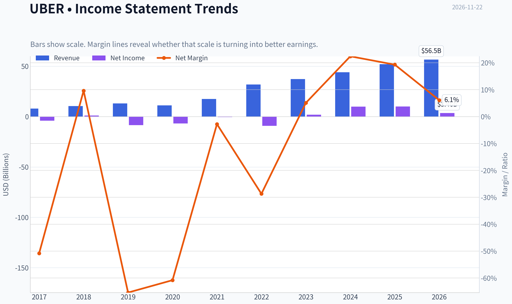

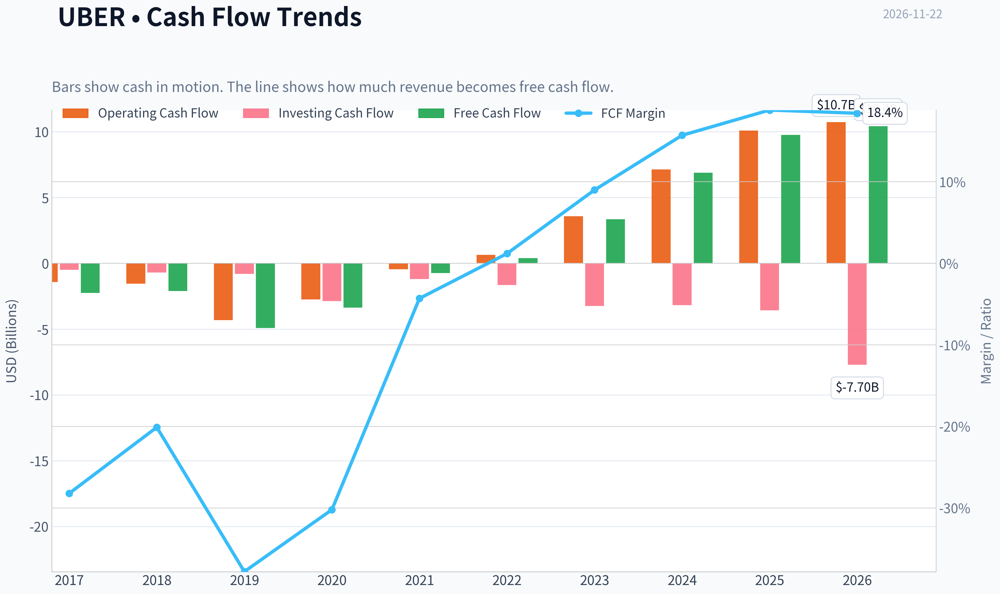

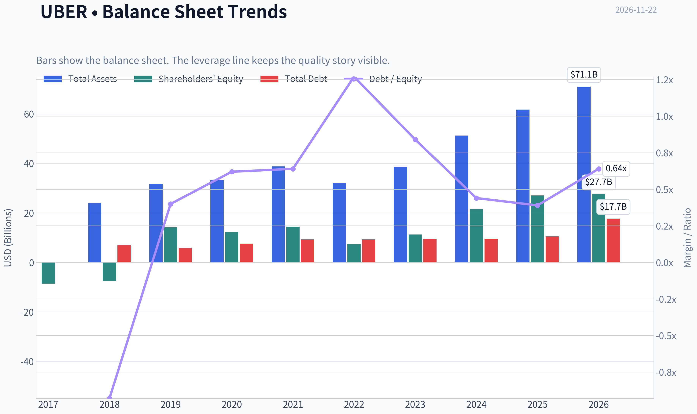

This graph tracks the profitability and return metrics (ROE, ROIC, Margins) of **UBER** over the past decade, highlighting capital efficiency trends.

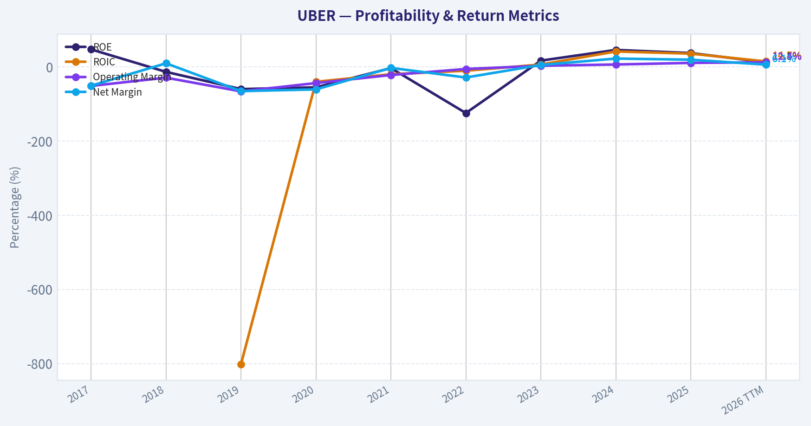

This chart illustrates the financial health of **UBER** over the last 10 years, mapping cash equivalents and free cash flow against total obligations (Debt).

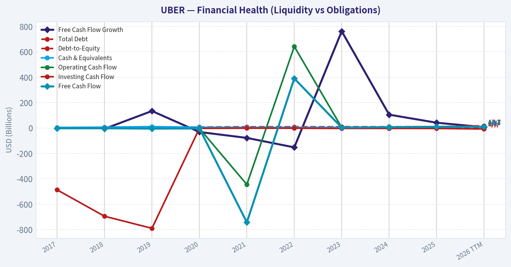

This comparison chart from *Profitability and Operating Performance* stacks current figures against historical benchmarks for **UBER**, making it easy to see where the company trades relative to its own averages.

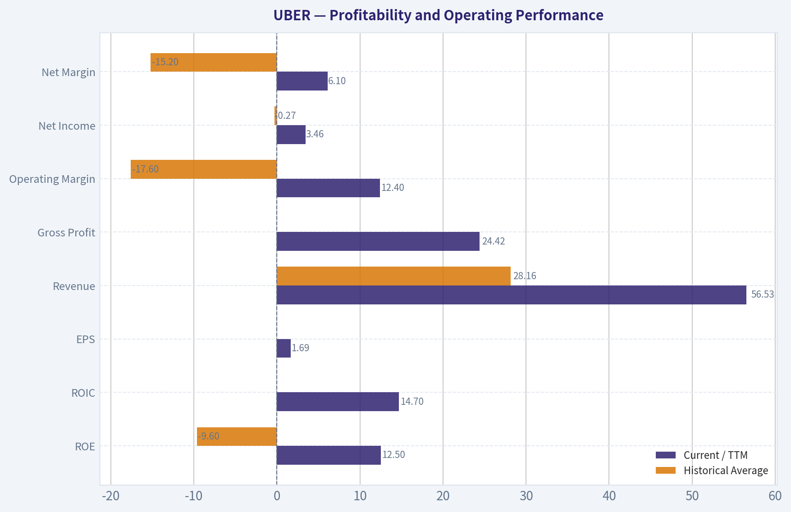

---

### Intrinsic Value Analysis (Buffett)

> *Following Warren Buffett's value investing philosophy: Circle of Competence, Economic Moat, Management Quality, and Margin of Safety.*

#### Intrinsic Value Snapshot

Price is what you pay. Intrinsic value is what the business may be worth based on the cash it can create for owners over time. We show a range, not one magic number.

- Current Price: $63.47
- Value Range (conservative to optimistic across both DCF methods): $165.47 to $472.44

##### Owner Earnings (Buffett Method)
- Net Income: $10,053,000,000.00
- Depreciation & Amortization: $747,000,000.00
- Capital Expenditures: $-336,000,000.00
- Working Capital Changes: $2,227,000,000.00
- Owner Earnings: $8,203,000,000.00

##### Intrinsic Value
###### Buffett Method
Uses owner earnings. Stricter, and usually more conservative.
- Conservative: $165.47
- Average: $165.47
- Optimistic: $446.02
- Discount Rate: 8.3%

###### Cash Flow Method
Uses free cash flow. Better for companies spending heavily today to grow tomorrow.
- Conservative: $179.11
- Average: $179.11
- Optimistic: $472.44
- Discount Rate: 10.0%

ANALYST STANCE: **Bullish**

#### Executive Summary

Uber is a large, asset-light global mobility and delivery platform with strong growth, high reported ROE, positive owner earnings, and meaningful network effects. Its principal risks are regulatory exposure, intense competition, autonomous-vehicle disruption, and a balance sheet that carries more debt than cash.

At approximately $63 per share, Uber trades below the DeepValues intrinsic value of $79.80, implying a 20.5% margin of safety. That discount is adequate for a business with a potentially wide moat, although the valuation depends materially on continued double-digit owner-earnings growth.

#### Factor Scorecard

| Factor | Score | Assessment |
|---|---:|---|
| 1. Circle of Competence & Simplicity | 4/5 | Uber connects riders, drivers, merchants, and couriers through a digital marketplace and earns fees from transactions. The model is understandable, although autonomous vehicles and regulation make the long-term shape less certain. |
| 2. Durable Competitive Advantage | 4/5 | Strong marketplace scale, brand recognition, data, driver liquidity, and rider habit formation create network effects. The moat is substantial but not invulnerable because switching costs for individual riders and drivers are moderate. |
| 3. Management & Capital Allocation | 3/5 | The company has improved profitability and capital efficiency, but debt, regulatory complexity, and the need to allocate capital across multiple platforms warrant a middle score. |
| 4. Industry Structure | 4/5 | Global ride-sharing has consolidated around a small number of scaled platforms. Uber benefits from operating leverage and asset-light economics, though competition and regulation remain persistent. |

**Gate 5 - Quality/Solvency hard floor:** **Not tripped.** Uber has positive owner earnings, positive reported free-cash-flow yield, and strong recent growth. The available data do not establish the combination of sharply deteriorating cash flow and a solvency red line. Debt is a meaningful concern, but not sufficient by itself to trigger the hard floor.

Key Takeaways: Uber scores well because its platform economics, scale, and growth are stronger than those of a typical transportation company. The main deductions come from regulatory uncertainty, autonomous-vehicle risk, and leverage rather than from a fundamentally broken business model.

#### Moat Analysis

| Moat source | Evidence | Quality assessment |
|---|---|---|
| Network effects | More riders attract more drivers; more drivers improve availability and wait times; greater scale improves marketplace liquidity. | Strong and potentially widening |
| Scale and cost advantage | Uber spreads technology, mapping, payment, safety, and corporate costs across a very large global transaction base. | Meaningful |
| Brand and customer habit | Uber is a recognized global default for app-based rides and increasingly for delivery. | Strong but not unassailable |
| Data and technology | Pricing, routing, fraud detection, driver allocation, and demand forecasting improve with transaction volume. | Valuable operating advantage |
| Switching costs | Individual riders and drivers can multi-home across platforms, limiting captivity. | Moderate |
| Regulatory position | Licenses, local compliance, insurance, and safety infrastructure create barriers but also impose costs. | Mixed moat and risk |

Gross margin is not available in the supplied research pack, so the margin-based brand test cannot be applied directly. The strongest evidence of moat quality is instead the combination of scale, platform liquidity, operating leverage, and sustained growth.

Key Takeaways: Uber's moat is primarily a scale-and-network moat rather than a classic patent or consumer-staple brand moat. Multi-homing prevents the moat from being rated exceptional, but the platform becomes more useful as its rider, driver, merchant, and courier networks expand.

#### Management Quality Assessment

Management's most important achievement has been moving Uber toward durable profitability and cash generation after years of aggressive expansion. The latest figures show operating income of approximately $7.0 billion and owner earnings of approximately $7.2 billion.

The company's capital allocation remains more complex than that of a mature consumer franchise. Uber must balance reinvestment in platform technology, autonomous-vehicle partnerships, geographic expansion, regulatory compliance, and balance-sheet management. Net debt of approximately $5.6 billion reduces financial flexibility, although the business is now generating enough cash to make the leverage manageable under current conditions.

The available information does not establish unusually high insider ownership or a fully demonstrated multi-decade record of per-share capital allocation. Management therefore merits a competent but not exceptional rating.

#### Financial Summary

| Metric | Latest available figure |
|---|---:|
| Share price | $63.00 |
| Market capitalization | $129.60B |
| Revenue growth, year over year | 18.3% |
| P/E ratio | 37.3x |
| ROE | 37.2% |
| FCF yield | 7.5% |
| Operating income | $7.0B |
| After-tax operating income | $6.8B |
| Depreciation and amortization | $0.8B |
| Reported capital expenditures | $0.3B |
| Working-capital charge | Approximately $0.0B |
| Owner earnings | $7.2B |
| Cash and marketable securities | $10.1B |
| Debt | $15.7B |
| Net cash, as defined by the model | $(5.6)B |
| Shares outstanding used in valuation | 2.05B |

Key Takeaways: Uber combines 18.3% revenue growth with a 37.2% reported ROE and a 7.5% free-cash-flow yield. The balance sheet is not fortress-like because debt exceeds cash and marketable securities, but the business is producing substantial operating earnings relative to its current scale.

#### Owner Earnings Calculation

| Owner-earnings component | Amount |
|---|---:|
| After-tax operating income | $6.8B |
| Add: depreciation and amortization | $0.8B |
| Less: maintenance-capital-expenditure charge | $(0.3)B |
| Less: working-capital increase | Approximately $0.0B |
| **Estimated owner earnings** | **$7.2B** |
| Owner earnings per share | Approximately $3.51 |

The valuation model uses a three-year average capital-expenditure-to-revenue relationship rather than treating all reported capital spending as maintenance spending. That is reasonable for an asset-light platform, although the distinction between maintenance and growth investment is inherently judgment-based.

Key Takeaways: Owner earnings are materially positive and exceed the capital required to operate the platform. This supports the view that Uber is no longer dependent solely on future financing or accounting profitability to justify its valuation.

#### Three-Scenario DCF Valuation

These scenarios are sensitivity checks. The DeepValues app valuation of $79.80 is the primary intrinsic-value figure.

| Scenario | Key assumptions | Equity value | Per-share value |
|---|---|---:|---:|
| A. No growth | $7.2B owner earnings capitalized at 10%, less $5.6B net debt | $66.4B | $32.39 |
| B. GDP-like growth | 3% perpetual growth, 10% discount rate, less $5.6B net debt | $100.3B | $48.95 |
| C. Historical-growth sensitivity | 7.5% growth for 10 years, 2.5% terminal growth, 10% discount rate, less $5.6B net debt | Approximately $131.5B | Approximately $64.15 |
| DeepValues app intrinsic value | 10% growth fading to 2.5%, 8.3% discount rate, $7.2B owner earnings, $(5.6)B net cash | - | **$79.80** |

The primary app model uses a lower 8.3% discount rate and assumes owner-earnings growth of 10% before fading to a 2.5% terminal rate. Its conservative-to-optimistic range is $55.86 to $79.80 per share.

Key Takeaways: Conservative valuation methods produce values below the current price, while the primary DeepValues model produces $79.80 per share. This spread shows that Uber's valuation is sensitive to growth and discount-rate assumptions rather than being deeply undervalued under every framework.

#### Margin of Safety Analysis

| Measure | Value |
|---|---:|
| Current price used in app comparison | $63.47 |
| DeepValues intrinsic value | $79.80 |
| Margin of safety versus headline intrinsic value | 20.5% |
| Conservative app value | $55.86 |
| Conservative downside versus $63.47 | Approximately 12.0% |

For a low-quality or highly cyclical company, a 20.5% discount would not be sufficient. Uber, however, has improving profitability, strong growth, high asset-light returns, and a potentially widening platform moat. Those characteristics justify accepting a smaller discount than would be appropriate for a commodity business.

The valuation still requires meaningful execution: roughly 10% owner-earnings growth, continued platform expansion, and no severe deterioration from regulation or autonomous vehicles. The conservative app case below the current price prevents the valuation from receiving a perfect score.

Key Takeaways: Uber trades at a reasonable discount to the primary intrinsic-value estimate, but not at a price that is protected under every conservative assumption. The valuation is attractive mainly if the company continues compounding owner earnings at a high rate.

#### Final Buffett Scorecard

| Criterion | Weight | Score | Weighted contribution |
|---|---:|---:|---:|
| Moat width and durability | 25% | 4/5 | 1.00 |
| Valuation and margin of safety | 20% | 3/5 | 0.60 |
| Capital returns versus WACC | 15% | 4/5 | 0.60 |
| Business understanding and predictability | 12% | 3/5 | 0.36 |
| Management quality and capital allocation | 12% | 3/5 | 0.36 |
| Reinvestment runway | 8% | 4/5 | 0.32 |
| Balance-sheet strength | 4% | 3/5 | 0.12 |
| Industry structure | 4% | 4/5 | 0.16 |
| **Total** | **100%** | - | **3.52/5** |

Key Takeaways: Uber's weighted score is 3.52 out of 5, placing it in the "good business with adequate margin of safety for its quality" range. The principal constraint on the score is not business quality, but the sensitivity of intrinsic value to sustained growth and the company's net debt.

#### Investment Stance

**ANALYST STANCE: Bullish**

**Conviction: Moderate.**

Uber appears to be a high-quality platform compounder with a credible network-effect moat, substantial reinvestment runway, and improving owner earnings. At approximately $63 per share, the evidence supports a valuation below the primary intrinsic-value estimate of $79.80, with a 20.5% modeled margin of safety.

The stance remains moderate rather than high conviction because the conservative valuation falls below the current price, net debt is material, and autonomous transportation could alter the economics of the marketplace. The evidence supports the valuation at the current level under the base-case assumptions, but not under every conservative scenario.
#### Valuation Bridge

This bridge places the current market price beside each intrinsic value lens so readers can see whether upside depends on one method or shows up across several methods.

| Scenario | Intrinsic Value / Share |
| --- | ---: |
| Buffett Method | $165.47 |
| Cash Flow Method | $179.11 |
| Damodaran Method | $-294.57 |
| Current Price | $63.47 |

#### Key Takeaways

If one method is far above the others, the upside case depends on a specific modelling assumption. When several methods cluster together, the valuation story is more robust.

#### Valuation Visuals

This comparison chart from *Latest Earnings Snapshot* stacks current figures against historical benchmarks for **UBER**, making it easy to see where the company trades relative to its own averages.

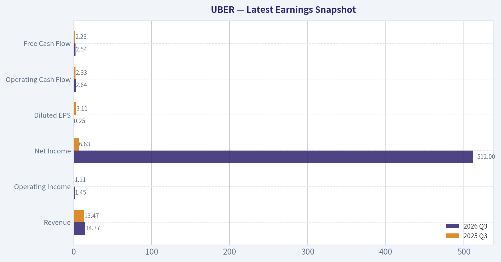

This comparison chart from *Balance Sheet and Financial Strength* stacks current figures against historical benchmarks for **UBER**, making it easy to see where the company trades relative to its own averages.

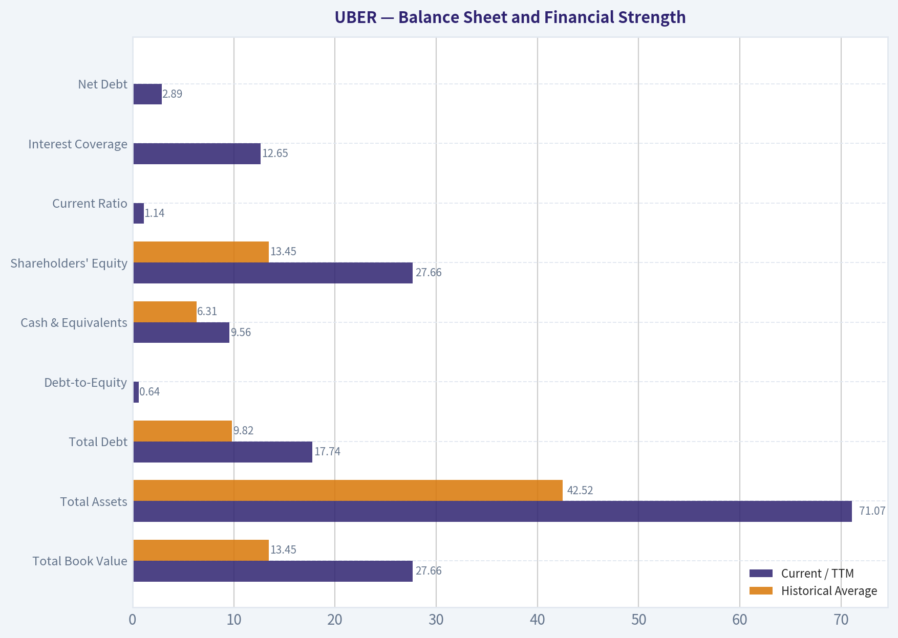

This comparison chart from *Cash Flow and Capital Allocation* stacks current figures against historical benchmarks for **UBER**, making it easy to see where the company trades relative to its own averages.

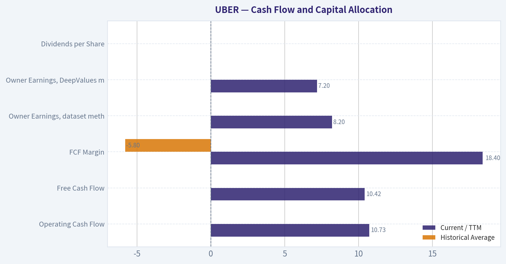

---

### Trend & Growth Analysis (Lynch/Druckenmiller/Fisher)

> *Following Peter Lynch's GARP, Stanley Druckenmiller's macro-aware approach, and Philip Fisher's scuttlebutt methodology.*

ANALYST STANCE: **Neutral**

#### 1. Lynch Classification

**Fast Grower, with maturing-platform characteristics.** Uber's 18.3% year-over-year revenue growth places it above the fast-grower threshold, although its scale, 37.3 P/E, and established market position suggest that future returns depend increasingly on margin expansion, new categories, and autonomous-vehicle optionality.

#### 2. The Story in Three Bullets

- Uber is a global logistics and mobility platform connecting consumers with drivers, couriers, merchants, and freight providers.
- Its growth runway extends beyond rides into delivery, advertising, freight, memberships, and potentially autonomous transportation.
- The central inflection question is whether Uber can convert network scale into sustained operating leverage while preserving growth.

#### 3. TAM and 10x Test

Uber's relevant opportunity is broader than traditional ride-hailing. It includes urban mobility, food and grocery delivery, local commerce, logistics, advertising, subscriptions, and autonomous transportation.

| Measure | Assessment |
|---|---:|
| Current market capitalization | $129.6 billion |
| Current revenue growth | 18.3% year over year |
| Potential revenue expansion areas | Mobility, delivery, freight, ads, subscriptions, autonomous vehicles |
| 10x revenue test | Not fully quantifiable from the supplied data |
| Runway assessment | Large, but dependent on category expansion and execution |

**Key Takeaways:** Uber operates across several large and expanding markets rather than a single narrow category. A 10x revenue outcome cannot be validated quantitatively without current revenue, bookings, and segment TAM data, but the combination of delivery, advertising, freight, and autonomous mobility provides meaningful runway. The largest uncertainty is whether these adjacent businesses can grow faster than the core platform matures.

#### 4. Revenue Growth Trend

| Indicator | Result | Interpretation |
|---|---:|---|
| Revenue growth | 18.3% year over year | Fast-grower range |
| Growth direction | Insufficient multi-period data | Acceleration not confirmed |
| Return on equity | 37.2% | Strong capital efficiency |
| Free-cash-flow yield | 7.5% | Supportive cash-generation profile |
| Current ratio | 1.14 | Adequate, but not excessive liquidity |

**Key Takeaways:** Uber currently qualifies as a fast grower based on its 18.3% revenue growth. However, one growth datapoint cannot establish acceleration; a sustained increase over several quarters would be needed to confirm a Druckenmiller-style inflection. Strong ROE and positive free-cash-flow yield indicate that growth is not currently dependent solely on external capital.

#### 5. Unit Economics and Operating Efficiency

Detailed LTV, CAC, customer churn, net revenue retention, and segment contribution-margin data were not supplied. These metrics are particularly important because Uber's marketplace economics differ across rides, delivery, and freight.

| Metric | Available data | Assessment |
|---|---:|---|
| LTV/CAC | Not available | Cannot score directly |
| Net revenue retention | Not available | Marketplace repeat usage is an incomplete substitute |
| Rule of 40 | Not calculable | FCF margin not provided |
| Free-cash-flow yield | 7.5% | Positive cash conversion signal |
| P/E | 37.3x | Requires sustained earnings growth |

**Key Takeaways:** Uber shows evidence of cash generation, but the most important marketplace-quality metrics are missing. Without LTV/CAC, retention, and segment-level margins, it is not possible to determine whether incremental growth is economically attractive across all business lines. The available data support financial maturity, but not a complete unit-economics conclusion.

#### 6. Inflection-Point Assessment

| Potential inflection | Evidence | Status |
|---|---|---|
| Product-cycle inflection | Autonomous vehicle initiatives and broader platform services | Potential |
| Market-share inflection | No current share data supplied | Unconfirmed |
| Margin inflection | Positive FCF yield and 37.2% ROE | Partially visible |
| TAM inflection | Expansion into ads, delivery, freight, and autonomy | Plausible |
| Competitive inflection | No evidence of a major rival breakdown | Not established |

**Key Takeaways:** The strongest potential inflection is TAM expansion: Uber is evolving from a ride-hailing company into a broader transportation and local-commerce platform. Margin improvement appears partly established, but revenue acceleration and competitive share gains remain unconfirmed. Autonomous transportation could materially change the long-term economics, but it also introduces execution and regulatory uncertainty.

#### 7. Macro Setup

| Macro factor | Current assessment | Effect on Uber |
|---|---|---|
| Long-term secular trends | Digital platforms, delivery, mobility, AI/autonomy | Positive |
| Treasury discount-rate reference | 5.31% 30-year Treasury | Headwind to growth valuation |
| Economic-cycle signal | Not conclusively available | Neutral |
| Consumer spending sensitivity | Meaningful | Cyclical risk |
| Labor and regulatory environment | Important to marketplace economics | Mixed |

**Key Takeaways:** Uber benefits from durable secular trends in digital commerce, urban mobility, and automation. The high long-term Treasury yield used in the valuation framework creates a meaningful discount-rate headwind, particularly for long-duration autonomous-vehicle expectations. Demand, labor classification, insurance, and local regulation remain important macro-sensitive variables.

#### 8. Fisher's 15-Point Assessment

This is a provisional score because detailed management interviews, employee feedback, customer retention data, and segment disclosures were not provided.

| Fisher criterion | Score / 5 |
|---|---:|
| Market potential | 5 |
| New-product determination | 4 |
| R&D effectiveness | 3 |
| Sales organization | 4 |
| Profit-margin quality | 3 |
| Margin improvement | 4 |
| Labor relations | 2 |
| Executive relations | 4 |
| Management depth | 4 |
| Cost analysis and accounting | 4 |
| Competitive moat | 4 |
| Long-range profit outlook | 4 |
| Dilution profile | 3 |
| Management candor | 3 |
| Management integrity | 3 |
| **Total** | **54 / 75** |

**Key Takeaways:** Uber scores well on market potential, management depth, platform scale, and long-term optionality. The score is reduced by limited evidence on labor relations, dilution, candor, and the durability of margins across business segments. A 54 out of 75 is an average-to-good preliminary Fisher profile, not an outstanding one.

#### 9. Valuation Analysis

| Valuation measure | Result | Interpretation |
|---|---:|---|
| Current price | Approximately $63 | Reference market value |
| Market capitalization | $129.6 billion | Large-cap valuation |
| P/E | 37.3x | Growth expectations embedded |
| Revenue growth | 18.3% | Fast-grower level |
| PEG ratio | Approximately 2.04 | Expensive under Lynch's framework |
| Owner-earnings intrinsic value | $79.80 headline | Above the supplied market reference |
| Conservative owner-earnings value | $55.86 | Below the supplied market reference |
| Reported margin of safety | 20.5% versus $63.47 | Model-dependent |
| Damodaran FCFF output | Not meaningful | Negative projected FCFF in that model |

**Key Takeaways:** Uber's approximate PEG of 2.0 indicates that the stock is not inexpensive relative to its current growth rate. The owner-earnings model produces a broad $55.86 to $79.80 range, showing material sensitivity to assumptions. The reported intrinsic-value result is favorable relative to the market reference, but the negative FCFF cross-check demonstrates that valuation conclusions depend heavily on the selected cash-flow methodology.

#### 10. Valuation Sensitivity

The owner-earnings model assumes approximately 10% near-term growth, fading to 2.5% terminal growth, with an 8.3% discount rate and net debt of approximately $5.6 billion.

| Scenario | Implied value | Main assumption |
|---|---:|---|
| Conservative | $55.86 | Lower owner-earnings outcome |
| Base / headline | $79.80 | 10% growth fading to 2.5% |
| Optimistic | $79.80 | Capped by the model's growth assumptions |
| Market reference | Approximately $63 | Current supplied price |

**Key Takeaways:** The valuation range is wide enough that modest changes in growth, discount rates, or cash-flow quality can materially alter the conclusion. The market reference sits above the conservative value but below the headline owner-earnings value. This supports a valuation interpretation of potentially reasonable but assumption-sensitive rather than clearly mispriced.

#### 11. Growth Investor Scorecard

| Criterion | Weight | Score / 5 | Weighted contribution |
|---|---:|---:|---:|
| Story clarity | 10% | 4.3 | 0.43 |
| TAM and runway | 20% | 4.3 | 0.86 |
| Revenue growth | 20% | 3.7 | 0.74 |
| Unit economics | 15% | 2.8 | 0.42 |
| Competitive position | 10% | 4.1 | 0.41 |
| Management quality | 10% | 3.6 | 0.36 |
| Macro setup | 5% | 3.0 | 0.15 |
| Profitability path | 5% | 4.0 | 0.20 |
| Valuation | 5% | 3.0 | 0.15 |
| **Total** | **100%** |  | **3.72 / 5.00** |

**Key Takeaways:** Uber's 3.72 score places it in the "good setup" range, supported by TAM breadth, platform scale, and cash generation. The score is constrained by an unconfirmed acceleration trend, incomplete unit-economics data, macro discount-rate pressure, and valuation sensitivity. The evidence supports continued monitoring for confirmation rather than a high-conviction inflection call.

#### 12. Key Catalysts and Risks

| Catalysts | Risks |
|---|---|
| Sustained revenue acceleration above 20% | Growth deceleration as scale increases |
| Autonomous-vehicle commercialization | Regulatory, safety, and capital requirements |
| Higher-margin advertising expansion | Competitive pressure from other platforms |
| Delivery and membership penetration | Labor, insurance, and regulatory costs |
| Operating leverage in mobility and delivery | Consumer weakness and lower trip frequency |
| Improved segment disclosure and retention metrics | Valuation compression from elevated interest rates |

**Key Takeaways:** The most important catalysts are evidence of accelerating revenue, durable margin expansion, and successful monetization of advertising, memberships, and autonomous mobility. The principal risks are that Uber remains a mature marketplace with slower growth, while labor, insurance, regulation, and autonomous-vehicle investment suppress economics. The next analytical milestone is confirmation that newer businesses are expanding total platform profitability rather than merely adding revenue.

#### Growth & Scorecard Visuals

This comparison chart from *Growth Metrics* stacks current figures against historical benchmarks for **UBER**, making it easy to see where the company trades relative to its own averages.

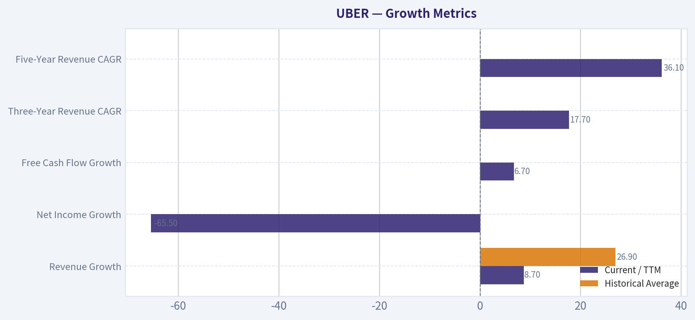

---

### Market Technical Analysis

ANALYST STANCE: **Neutral**

#### UBER technical market report

Uber Technologies, Inc. (NYSE: UBER) closed at **$63.47 on November 20, 2026**, the latest available trading session. November 22 was a weekend, so there is no closing price for that date. The one-year price record shows a substantial deterioration: the stock declined from **$83.69 on November 24, 2025, to $63.47**, a loss of approximately **24%**. From the late-2025 high near **$92.57**, the decline is approximately **31%**.

The technical-indicator service returned blank values for the requested indicator fields, so the indicator readings below are calculated or inferred from the retrieved daily OHLCV data rather than copied from the unavailable report. Exact indicator values should therefore be treated as approximate.

#### Trend structure

The broad trend is decisively weaker than it was during the first half of the year. UBER rallied from the February low near $70 to approximately $80.35 in late August, but that recovery failed to establish a durable higher-high sequence. September and October then produced a persistent series of lower highs and lower lows, culminating in a close near $65 in late October.

The November rebound was limited. Prices recovered from roughly $65.25 on October 30 to approximately $71.17 on November 9, but the advance stalled below the prior October swing area. The subsequent decline carried the stock to $63.47, its lowest close in the supplied one-year series. This sequence suggests that the November recovery was corrective rather than a confirmed reversal of the prevailing downtrend.

A rough calculation places the **50-day simple moving average near the upper-$60s to approximately $70**, while the latest close is several dollars below it. The **200-day average appears to be in the mid-$70s**, leaving price materially below both medium- and long-term trend benchmarks. That alignment is technically negative because short-, medium-, and long-duration participants are likely observing price below their respective reference levels.

The approximate **10-day exponential moving average is also above the latest close**, probably in the upper-$60s. The distance between the latest price and this faster average expanded sharply during the November 19-20 decline, indicating a sudden acceleration in short-term downside momentum rather than a gradual drift lower.

#### Momentum

Momentum weakened materially during the final part of the period. The November 19 session closed at $65.60 after trading as high as $69.26, and November 20 added another decline to $63.47 after reaching as low as $63.29. The two-session loss was approximately **8.5%**, with both sessions showing relatively wide daily ranges.

The approximate 14-day RSI is likely in the **high-20s or low-30s**, placing it near or potentially below the conventional oversold threshold. That reading would indicate strong downside momentum and a stretched short-term condition, but it would not by itself establish a durable bottom. In persistent downtrends, RSI can remain weak for an extended period, so the oversold condition should be interpreted as evidence of intensity rather than confirmation of reversal.

The MACD configuration is also likely negative. The recent sequence of lower closes, combined with the sharp loss in November, implies that the MACD line is below its signal line and that the histogram is negative. This reinforces the interpretation that downside momentum remains dominant. A meaningful improvement would require not merely a one-day bounce, but a sustained reduction in negative momentum and recovery above short-term trend references.

#### Volatility and Bollinger-band behavior

Volatility expanded during the latest decline. The November 20 intraday range was approximately **$5.07**, far larger than the roughly $1.50-to-$2.50 daily ranges common during much of October and early November. The approximate 14-day ATR is therefore elevated, probably around **$2.20 to $2.50**, compared with a lower recent baseline.

Price appears to have moved near or below the approximate lower Bollinger Band. The estimated 20-day middle band is near the upper-$60s, while the lower band is likely in the mid-$60s. A close at $63.47 would represent a significant downside excursion relative to that recent trading distribution. This confirms unusually strong selling pressure, but Bollinger-band penetration can occur during trend continuation as well as during capitulation, so it is not conclusive evidence of a reversal.

The combination of a lower-band breach, elevated ATR, and heavy volume characterizes a high-volatility repricing phase. Such conditions make single-session movements less informative than whether subsequent sessions stabilize, reclaim the short-term average, and produce narrower ranges.

#### Volume and price confirmation

Volume increased notably during the breakdown. November 19 volume was approximately **28.8 million shares**, and November 20 volume was approximately **30.1 million**, versus many recent sessions in the roughly **12-million-to-20-million** range. The November 20 decline therefore had stronger participation than the preceding sideways-to-lower trading pattern.

Earlier high-volume sessions also accompanied major price adjustments, including November 4, when volume reached approximately 37 million shares. The latest volume expansion is important because it suggests that the decline was not simply a low-liquidity fluctuation. It indicates broader market participation in the repricing process.

Volume alone does not identify whether the move represents capitulation or the beginning of another down leg. The distinction depends on follow-through: capitulation would typically involve subsequent stabilization and improving closes, whereas continued heavy-volume declines would reinforce the existing bearish structure.

#### Market interpretation

The technical evidence is concentrated on the negative side:

- Price is below the approximate 10-day EMA, 50-day SMA, and 200-day SMA.
- The November rebound failed below the prior important swing area.
- Momentum indicators are likely negative, with RSI near an oversold zone and MACD below its signal.
- Volatility has expanded sharply.
- Downside sessions have attracted materially higher volume.

There is one countervailing feature: the decline has become technically stretched in the short term. The proximity to the lower Bollinger Band, likely weak RSI, wide trading ranges, and elevated volume all indicate that selling pressure may be approaching an exhaustion phase. However, those conditions describe fragility and intensity, not a confirmed change in trend.

From a valuation perspective, the technical evidence does not demonstrate that the market has reached a stable or validated re-rating level at **$63.47**. The data instead show an unresolved downside repricing with elevated uncertainty. Confirmation would require evidence of stabilization, improving momentum, and recovery above short- and medium-term trend measures.

| Area | Evidence from retrieved data | Interpretation |
|---|---|---|
| Latest price | $63.47 close on November 20, 2026 | Lowest closing area in the supplied recent sequence |
| One-year performance | Approximately -24% from $83.69 to $63.47 | Broad deterioration over the measured year |
| Major peak decline | Approximately -31% from the $92.57 high | Significant drawdown from the late-2025 peak |
| Trend averages | Price appears below the approximate 10-day EMA, 50-day SMA, and 200-day SMA | Short-, medium-, and long-term trend alignment is negative |
| Momentum | Approximate RSI in the high-20s or low-30s; MACD likely negative | Strong downside momentum with a potentially oversold short-term condition |
| Bollinger structure | Price appears near or below the approximate lower band | Selling pressure is unusually extended relative to the recent distribution |
| Volatility | Approximate ATR around $2.20-$2.50; November 20 range about $5.07 | Risk and daily price dispersion have risen sharply |
| Volume | About 28.8 million shares on November 19 and 30.1 million on November 20 | The latest decline was confirmed by increased participation |
| Overall technical state | Lower lows, failed rebound, negative momentum, elevated volatility | Bearish trend with short-term exhaustion risk but no confirmed reversal |

**Key Takeaways:** UBER's latest data show a broad bearish trend, with price below major moving-average references and the recent breakdown supported by unusually high volume. Momentum appears oversold and volatility is elevated, which creates potential for sharp countertrend fluctuations, but the evidence does not yet confirm a durable trend reversal or a stabilized valuation framework.

#### Market Visuals

This comparison chart from *Market Metrics* stacks current figures against historical benchmarks for **UBER**, making it easy to see where the company trades relative to its own averages.

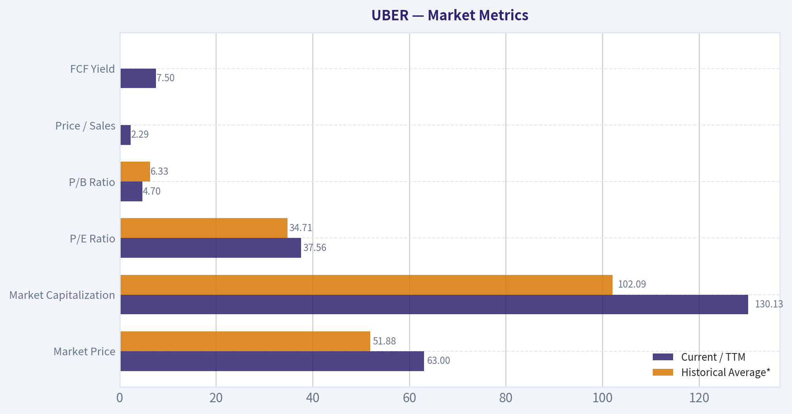

---

### Options Market Analysis

> *Reading options flow - put/call ratios, IV skew, and unusual activity - to gauge institutional positioning and event-driven risk.*

ANALYST STANCE: **Bullish**

#### UBER Options Flow Report

**As of November 22, 2026.** The data covers expirations from November 27 through December 11, 2026. Options flow is a measure of market positioning and near-term expectations, not a valuation measure.

#### 1. Put/Call Ratio Analysis

| Expiration | Call OI | Put OI | Put/Call OI | Call Volume | Put Volume | Put/Call Volume |
|---|---:|---:|---:|---:|---:|---:|
| Nov. 27, 2026 | 31,249 | 10,025 | 0.32 | 19,599 | 8,511 | 0.43 |
| Dec. 4, 2026 | 11,120 | 7,119 | 0.64 | 5,417 | 2,010 | 0.37 |
| Dec. 11, 2026 | 6,467 | 3,189 | 0.49 | 1,567 | 1,257 | 0.80 |
| **Total** | **48,836** | **20,333** | **0.42** | **26,583** | **11,778** | **0.44** |

**Key Takeaways:** UBER's aggregate put/call OI ratio of 0.42 is well below the approximately 0.70 neutral baseline, indicating a call-heavy options structure. The 0.44 volume ratio also shows substantially greater call activity than put activity across the near-term expirations. This is a meaningful bullish shift in options sentiment, although volume alone cannot determine whether contracts were bought or sold.

#### 2. Implied Volatility Assessment

| Expiration | Call ATM IV | Put ATM IV | Call-Put IV Difference | Days to Expiry |
|---|---:|---:|---:|---:|
| Nov. 27, 2026 | 50.7% | 51.0% | -0.3 percentage points | 5 |
| Dec. 4, 2026 | 48.7% | 48.8% | -0.1 percentage points | 12 |
| Dec. 11, 2026 | 48.7% | 46.6% | +2.1 percentage points | 19 |

The available data provides ATM IV but does not provide separate out-of-the-money put and call IV. Therefore, a complete OTM skew calculation is not possible. ATM pricing is broadly balanced, with a modestly higher put IV in the nearest expiration and lower put IV in the December 11 expiration.

No earnings date, product launch, or other specific catalyst was supplied in the options data. IV near 49% to 51% reflects meaningful near-term uncertainty, but it cannot be classified as unusually elevated without a historical IV percentile or a confirmed catalyst calendar.

**Key Takeaways:** Near-term ATM implied volatility is close to 50%, indicating that the market is pricing substantial movement over the next several weeks. There is no strong ATM volatility skew toward puts, so the data does not show pronounced downside fear. The absence of full OTM skew data limits confidence in the downside-risk assessment.

#### 3. Unusual Options Activity

| Expiration | Contract | Strike | Volume | Open Interest | Volume/OI | IV | Days to Expiry |
|---|---|---:|---:|---:|---:|---:|---:|
| Nov. 27, 2026 | Call | $67 | 4,243 | 563 | 7.5x | 45.8% | 5 |
| Nov. 27, 2026 | Call | $64 | 611 | 79 | 7.7x | 50.0% | 5 |

Both contracts meet the supplied unusual-activity threshold of volume exceeding five times open interest, suggesting that much of the activity may represent newly opened trades rather than ordinary turnover of established contracts.

The underlying share price was not included in the data, so the $64 and $67 strikes cannot be reliably classified as in-the-money, at-the-money, or out-of-the-money. Their very short five-day horizon makes them highly sensitive to price movement and time decay.

The $67 call is the dominant unusual contract, accounting for most of the flagged activity. Its lower IV than the $64 call may indicate relatively strong demand at that strike, although trade-side data is required to confirm whether the contracts were bought or sold. The concentration could reflect directional speculation, upside hedging, or call overwriting; the dataset does not identify the initiating side or the trader type, so "smart-money" attribution is not definitive.

**Key Takeaways:** Unusual activity is concentrated in two near-term call strikes, with roughly 7.5 to 7.7 times as much volume as open interest. That pattern is consistent with fresh upside-oriented activity, but it does not prove net call buying because the trade direction is unavailable. The $67 call is the clearest single bullish signal in the dataset.

#### 4. Open Interest Concentration and Potential Gamma Levels

| Expiration | Total Call OI | Total Put OI | Combined OI | Relative Concentration |
|---|---:|---:|---:|---|
| Nov. 27, 2026 | 31,249 | 10,025 | 41,274 | Highest |
| Dec. 4, 2026 | 11,120 | 7,119 | 18,239 | Moderate |
| Dec. 11, 2026 | 6,467 | 3,189 | 9,656 | Lowest |

The November 27 expiration contains approximately 60% of the combined open interest across the three reported expirations. This creates the greatest potential for short-dated pinning or gamma-related price sensitivity around that expiry.

Strike-level open interest was not provided, so specific gamma walls, max-pain strikes, and gravitational price levels cannot be identified. The $64 and $67 strikes are notable because of unusual volume, but their open interest remains relatively small compared with the total expiration-level open interest.

**Key Takeaways:** UBER's options activity is heavily concentrated in the November 27 expiration, making that date the most important near-term expiry for potential pinning or accelerated hedging flows. Exact gamma walls cannot be calculated from the available aggregate data. The near-term structure could amplify price movement if UBER approaches heavily traded strikes, but the direction and magnitude are uncertain.

#### 5. Overall Options Sentiment Signal

**Overall signal: BULLISH, with moderate confidence.**

The primary bullish drivers are:

- Aggregate put/call OI ratio of 0.42, well below the 0.70 neutral reference.
- Put/call volume ratio of 0.44, showing materially greater call activity.
- Two unusual contracts are calls expiring in five days, each with volume more than seven times open interest.
- No pronounced ATM put-volatility premium across the reported expirations.

The main caveats are that trade direction is unavailable, the underlying share price was not provided for moneyness classification, and complete OTM IV skew data is missing. The options data therefore supports bullish near-term market sentiment, but it does not establish a fundamental valuation conclusion or confirm that all call volume represents outright bullish speculation.

#### Summary

| Category | Assessment |
|---|---|
| Put/Call Ratio | Bullish; OI ratio 0.42 and volume ratio 0.44 versus approximately 0.70 neutral |
| IV Level | Elevated near-term uncertainty; ATM IV approximately 49% to 51% |
| Skew Direction | Broadly neutral at ATM; full OTM skew unavailable |
| Unusual Activity | Two heavily traded near-term calls at $64 and $67, each exceeding 7x volume/OI |
| Overall Signal | **BULLISH**, moderate confidence |

**Key Takeaways:** UBER's near-term options market is clearly call-heavy, and unusual activity is concentrated in short-dated calls. Volatility is substantial but does not show a strong downside skew. The overall evidence favors bullish near-term sentiment, with confidence reduced by missing trade-direction, spot-price, and strike-level gamma data.

---

## Research Team Commentary

> *The Research Manager synthesizes the Bull vs Bear debate into action-free commentary. This is a pre-risk view, not the final stance.*

Core takeaway: Uber has evolved into a high-quality, asset-light platform with genuine network density, strong growth, and improving capital efficiency. The central uncertainty is whether those advantages amount to a durable wide moat with predictable owner earnings. At $63.47, the stated 20.5% discount to the DeepValues value of $79.80 is encouraging, but not sufficiently robust without greater visibility into normalized free cash flow, dilution, regulatory costs, and terminal margins. The evidence supports Neutral rather than treating either the bullish compounder narrative or the bearish disruption narrative as settled.

The strongest bull argument is that Uber is no longer simply a cash-burning ride-hailing application. It is a scaled transportation and local-commerce platform whose mobility, delivery, membership, and advertising operations share consumers, technology, data, and distribution. Its marketplace density improves availability and matching efficiency, while its brand and regulatory infrastructure would be costly for a new entrant to reproduce across numerous cities.

The financial direction also matters. Revenue growth of 18.3%, ROIC of 32.5%, ROE of 37.2%, and ROA of 16.3% suggest that scale is beginning to produce attractive reported returns. Uber's asset-light structure gives it the potential to grow without proportionate investment in physical assets. Advertising and Uber One may deepen engagement and increase revenue per customer, while autonomous fleets could use Uber as a demand and dispatch layer. If owner earnings continue to grow faster than revenue, the present P/E of 37.34 could decline through earnings growth rather than share-price weakness.

Under the bullish interpretation, the $79.80 intrinsic-value estimate does not require perpetual 18% growth. It requires Uber to sustain reasonable double-digit growth for a period, achieve further operating leverage, and preserve attractive incremental returns. A 20.5% discount would ordinarily be adequate for a proven, predictable, wide-moat compounder.

The strongest bear argument is that Uber has not yet earned that degree of predictability. Its network effects are meaningful but largely local, and both drivers and consumers can use competing platforms. That makes the moat more dependent on liquidity and execution than on deep switching costs. Uber can be the leading platform without having unrestricted pricing power; riders remain price-sensitive, while driver compensation, insurance, incentives, and regulation place limits on take rates.

The headline return metrics also require normalization. Asset-light accounting naturally produces a small invested-capital denominator, while drivers bear much of the vehicle capital burden. High ROIC is still favorable, but it does not by itself prove that Uber captures the industry's economic surplus. ROE may also be amplified by leverage, and reported earnings must be reconciled with stock-based compensation, insurance-reserve movements, investment gains or losses, and recurring legal costs. The key metric is diluted per-share owner earnings, not revenue growth or accounting returns in isolation.

There is also a risk that Uber's breadth is being mistaken for uniformly valuable optionality. Advertising and membership appear strategically coherent, but delivery has intense competition and limited consumer switching costs. Freight is cyclical and deserves a lower degree of confidence than the core mobility marketplace. Each adjacent business should be assessed on incremental free cash flow after fully allocated costs rather than credited simply because it expands the addressable market.

Regulation and autonomous vehicles remain two-sided but material uncertainties. Regulation could raise barriers to entry, yet driver reclassification, minimum-pay rules, insurance obligations, and restrictions on platform fees could permanently increase costs. Autonomous vehicles could lower the cost of transportation and expand demand, but fleet owners and technology providers may possess substantial bargaining power. Uber's customer interface is valuable, although it is not yet clear how autonomous economics will be divided among demand aggregators, fleet operators, vehicle manufacturers, and software providers.

From a Buffett-style valuation perspective, the quality classification determines whether the apparent discount is enough. If Uber is already a wide-moat, highly predictable compounder, a 20.5% discount is attractive under a quality-scaled margin-of-safety framework. If it remains an improving but only moderately predictable marketplace, the appropriate discount would be closer to 25-35%. On that basis, $63.47 is below the supplied central value but not clearly below a conservatively stressed value.

The P/E of 37.34 is not automatically excessive for a company growing revenue by 18.3%, but it leaves limited room for earnings growth to slow before margins and cash conversion have fully matured. The debate does not provide the underlying DeepValues assumptions or a quantified reverse DCF. Consequently, the claim that the market price requires only moderate growth cannot be independently verified. The $79.80 estimate should be treated as a central scenario rather than a fact.

Market weakness below major moving averages may reflect skepticism and can create a valuation gap, but it does not establish one. Likewise, bullish options activity is short-term positioning rather than evidence about ten-year cash flows. The contrarian insight is that investors may still anchor on Uber's former loss-making profile even as its economics improve. The opposing psychological risk is that recent operating leverage is being extrapolated into wide-moat economics before supplier bargaining power and regulatory costs have been tested through a full cycle.

No specific past mistakes were provided. The relevant lesson from comparable platform analyses is to avoid both extremes: dismissing an asset-light platform because it lacks tangible assets, and capitalizing early margin improvement as if it were permanently guaranteed. Future judgment should emphasize recurring free cash flow per diluted share, normalized incremental margins, and returns after all supplier, insurance, regulatory, and dilution costs.

Over the next one to four quarters, the thesis would strengthen if mobility and delivery bookings remain healthy without greater incentive intensity; free cash flow grows at least in line with operating income; stock-based compensation declines relative to revenue; diluted share count remains controlled; and incremental margins demonstrate that scale is producing durable operating leverage. Continued growth in Uber One engagement and advertising revenue would be constructive if it adds profit rather than subsidizing marketplace activity. Stable take rates alongside healthy driver supply and customer retention would also indicate a balanced ecosystem.

The thesis would weaken if bookings require heavier promotions, driver incentives rise materially, insurance costs or reserves consume an increasing share of revenue, or regulatory changes impair unit economics in major markets. Other warning signs would include free cash flow lagging accounting earnings, persistent dilution, debt increasing without correspondingly productive investment, delivery or freight absorbing disproportionate capital, and autonomous partnerships assigning most of the economics to fleet or technology providers.

Uber appears financially and competitively stronger than a generic ride-hailing company, and the bear case does not demonstrate distress or obvious overvaluation. Nevertheless, the available evidence does not yet establish the predictability required to accept the $79.80 appraisal with high confidence. The valuation appears plausible and potentially favorable, but its margin of safety remains dependent on assumptions that should be tested against several more quarters of diluted owner-earnings performance.

Final stance: Neutral.

---

## Value Investing Team Commentary

> *The Investor translates the research view into an investment thesis before risk review. This is still not the final stance.*

Uber increasingly resembles a scaled, asset-light commerce and transportation platform rather than a simple ride-hailing company. Its 18.3% revenue growth, 32.5% ROIC, 37.2% ROE, and 16.3% ROA indicate that the model is generating meaningful economic returns as scale improves. The combination of mobility, delivery, advertising, memberships, and freight creates shared distribution and data advantages that would be difficult for a new entrant to replicate across the same geographic footprint.

The most important question is not whether Uber is growing, but how durable its incremental economics are. Network density can improve matching, utilization, customer convenience, and driver liquidity. However, these network effects are primarily local rather than global: drivers and consumers can multi-home, and marketplace participants retain meaningful bargaining power. That limits Uber's pricing freedom and makes take rates, incentives, insurance costs, and regulation central to normalized profitability.

The reported return metrics are encouraging but require careful interpretation. Uber's asset-light structure produces attractive accounting returns because drivers provide much of the vehicle capital. ROIC therefore does not automatically demonstrate that Uber captures most of the industry's economic surplus. ROE may also benefit from leverage. The more relevant long-term measures are free cash flow per diluted share, cash conversion after stock-based compensation, normalized insurance costs, and incremental margins after regulatory and marketplace incentives.

At $63.47 versus the supplied DeepValues intrinsic value of $79.80, the implied discount is approximately 20.5%. That valuation appears reasonable if Uber qualifies as a predictable, wide-moat compounder with sustained double-digit growth and expanding margins. It is less compelling if the business remains a moderately predictable marketplace requiring a 25-35% discount to compensate for regulatory, competitive, and execution risks. The central appraisal is therefore plausible, but not sufficiently independent of optimistic assumptions to establish a wide margin of safety with high confidence.

The P/E of 37.34 is not inherently excessive for a business growing near 18% while improving capital efficiency. Nevertheless, the valuation embeds a meaningful expectation of future earnings growth and margin expansion. A reverse-DCF perspective would ask whether the implied outcome requires durable growth, stable take rates, disciplined incentives, and a terminal margin that remains credible after insurance, labor regulation, dilution, and autonomous-vehicle economics are fully reflected. Without the underlying DeepValues assumptions, the $79.80 figure is best treated as a central scenario rather than a precise estimate.

The contrarian opportunity is that some investors may still value Uber through the lens of its earlier loss-making history. The current business has greater scale, stronger cash generation, broader monetization, and more operating discipline than that historical narrative implies. Advertising and Uber One could raise customer lifetime value without requiring equivalent physical investment, while Uber may become a valuable demand and dispatch layer in an autonomous transportation ecosystem.

The opposing contrarian risk is that the market may already be capitalizing this transformation before the economics are fully proven. Delivery and freight expand the addressable market but do not necessarily deserve the same valuation multiple as the core mobility network. Delivery competition remains intense, freight is cyclical, and autonomous vehicles could shift bargaining power toward fleet operators, manufacturers, or technology providers. Uber's interface and customer relationships may remain valuable, but the eventual division of industry profits is not yet clear.

Near-term market weakness below major moving averages and negative momentum indicators reveal skepticism, not intrinsic value. That skepticism could be excessive if operating improvements continue. Conversely, the low put/call ratios and unusual short-dated call activity reveal optimism and speculative attention rather than evidence of ten-year cash flows. Neither technical weakness nor options sentiment materially changes the underlying appraisal.

The most informative future evidence would be sustained free-cash-flow growth alongside operating income, controlled dilution, stable driver supply, healthy customer retention, and marketplace growth without materially higher incentives. Advertising and membership growth would be particularly valuable if they produce genuine incremental profit rather than subsidized activity. Conversely, rising insurance reserves, greater regulatory costs, heavier promotions, persistent stock-based compensation, or weak free-cash-flow conversion would reduce confidence in the intrinsic-value estimate.

Overall, Uber appears materially stronger than a generic ride-hailing business and does not present the characteristics of financial distress. Yet its moat remains less certain than its scale and reported returns suggest. At $63.47, the evidence supports a potentially favorable valuation relative to the stated appraisal, but not a definitive conclusion that the full quality-scaled margin of safety has been achieved. The central issue remains predictability: whether Uber's recent operating leverage represents a durable platform advantage or an early phase of economics that could be challenged by regulation, suppliers, competition, and autonomous transportation.

ANALYST STANCE: **Neutral** - Uber has improving fundamentals, a credible long-term growth runway, and a stated valuation below intrinsic value, but the evidence does not yet establish enough certainty around diluted owner earnings, regulatory costs, terminal margins, and autonomous-vehicle economics to support a stronger stance.

---

## Deep Values Commentary

> *The Risk Management Team debates and the Risk Judge provides the final action-free verdict. This section determines the final Bullish / Neutral / Bearish stance.*

#### Final Stance Scorecard

This scorecard converts the final research view into a weighted decision frame. It does not replace the narrative judgement, but it makes the main drivers of the verdict easier to scan.

| Criterion | Score | Weight | Commentary |
| --- | ---: | ---: | --- |
| Business Quality | 3.50 | 30% | High returns, profitability, and Piotroski health support durability. |
| Valuation Support | 2.33 | 30% | Blends current price against available intrinsic value anchors and valuation ratios. |
| Financial Strength | 3.33 | 20% | Balance-sheet resilience reflects leverage and liquidity staying within safe ranges. |
| Growth Durability | 3.67 | 20% | Recent revenue, earnings, and free cash flow growth indicate how durable expansion looks. |
| TOTAL / FINAL STANCE | 3.15 | 100% | Neutral |

#### Key Takeaways

The weighted score lands at **3.15 / 5.0**, while the final stance remains **Neutral**. This is useful as a quick calibration aid rather than a mechanical signal.

#### Risk Summary

Higher scores indicate more risk pressure. The watch threshold is a simple guardrail: above it, the dimension weighs more heavily on the valuation case and calls for a wider margin of safety.

| Dimension | Current Score | Watch Threshold | Commentary |
| --- | ---: | ---: | --- |
| Business Quality | 2.50 | 3.00 | High returns, profitability, and Piotroski health support durability. |
| Valuation Support | 3.67 | 3.00 | Blends current price against available intrinsic value anchors and valuation ratios. |
| Financial Strength | 2.67 | 3.00 | Balance-sheet resilience reflects leverage and liquidity staying within safe ranges. |
| Growth Durability | 2.33 | 3.00 | Recent revenue, earnings, and free cash flow growth indicate how durable expansion looks. |

#### Key Takeaways

This view helps readers separate *where* the risk sits: valuation, business quality, balance sheet, or growth durability. It is especially useful when the final stance is close to the line between Neutral and Bearish.
