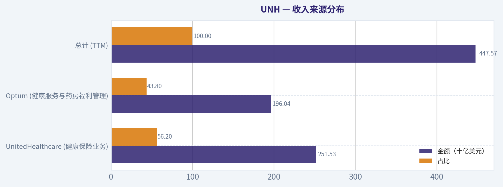
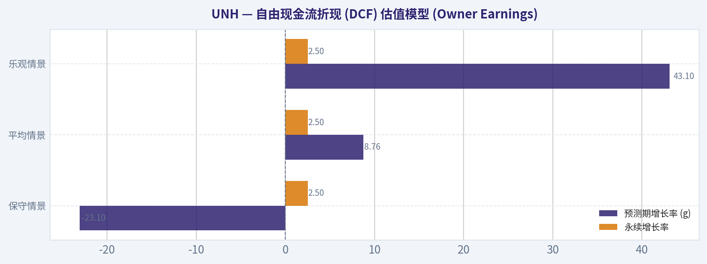
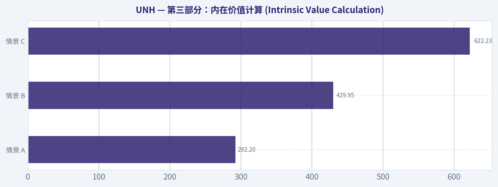
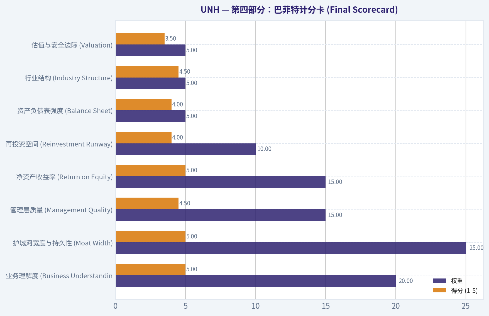
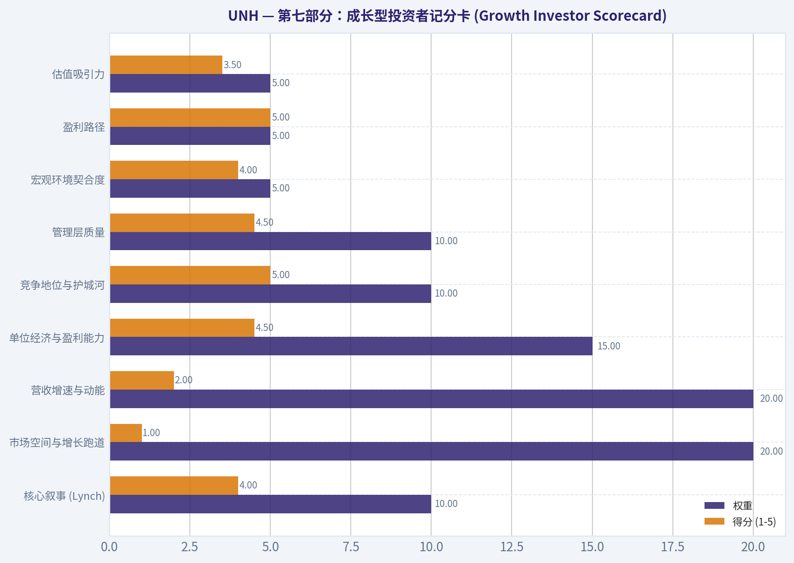
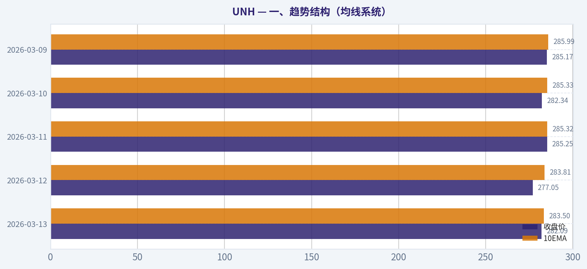

# UNH 深度价值情报

**调研日期:** 2026-03-14

## 关键免责声明

*本报告由 Deep Value Intelligence（一个基于 AI 的多智能体投资分析框架）自动生成。 本报告仅供信息参考和教育目的，不构成任何财务或投资建议。 在做出任何投资决策之前，请务必进行独立调研并咨询合规的财务顾问。*

---

## 目录

1. 情报摘要
2. 分析师团队报告
   - 基本面分析
   - 价值分析 (巴菲特)
   - 成长性分析 (林奇/德鲁肯米勒/费雪)
   - 市场分析
   - 社会舆情分析
   - 新闻分析
3. 研究团队评论
4. 投资团队评论
5. Deep Values 团队洞察

---

## 情报摘要

### 核心观点与前提条件

**核心论点:** **执行摘要 (Executive Summary)**

**主要风险:**
- 最终评级**：**WATCH (观察)**。耐心等待基本面（利润率企稳）与技术面（重回200日均线）的双重确认，切勿盲目接飞刀。
- 多空双方在基本面上的最大分歧在于利润下滑的性质。从巴菲特视角看，医疗利用率（Utilization）的飙升确实是**周期性/临时性**的。但国会对PBM业务的打压以及医保费率的收紧，剥夺了UNH在通胀环境下的定价权。这种商业模式利润率的下降是**永久性的业务受损 (Business Risk)**，而非市场情绪波动 (Market Risk)。
- 最终评级：WATCH (观察)**

**观点反转条件:**
- 最终评级**：**WATCH (观察)**。耐心等待基本面（利润率企稳）与技术面（重回200日均线）的双重确认，切勿盲目接飞刀。
- 多空双方在基本面上的最大分歧在于利润下滑的性质。从巴菲特视角看，医疗利用率（Utilization）的飙升确实是**周期性/临时性**的。但国会对PBM业务的打压以及医保费率的收紧，剥夺了UNH在通胀环境下的定价权。这种商业模式利润率的下降是**永久性的业务受损 (Business Risk)**，而非市场情绪波动 (Market Risk)。
- 最终评级：WATCH (观察)**

**置信度:** 中

---

## 分析师团队报告

### 基本面分析

#### 10-Year Financial Metrics for UNH

*All values below are computed deterministically from raw data - not estimated by AI.*

#### 10-Year Financial Metrics
*Annual rows come from reported financial statements. The final TTM row is computed from the latest four quarters.*

| Metric | 2016 | 2017 | 2018 | 2019 | 2020 | 2021 | 2022 | 2023 | 2024 | 2025 | 2026 TTM |
| --- | --- | --- | --- | --- | --- | --- | --- | --- | --- | --- | --- |
| Market Price | $141 | $197 | $225 | $270 | $327 | $466 | $498 | $502 | $490 | $328 | $282 |
| Market Cap | $136.03B | $193.56B | $221.23B | $260.89B | $314.69B | $454.56B | $503.67B | $493.83B | $469.94B | $300.73B | $256.70B |
| P/E Ratio | 19.07 | 17.94 | 18.08 | 18.56 | 20.18 | 25.94 | 25.03 | 22.06 | 32.62 | 24.95 | 21.39 |
| P/B Ratio | N/A | N/A | N/A | N/A | N/A | N/A | 6.48 | 5.56 | 5.07 | 3.20 | 2.73 |
| ROE | N/A | N/A | N/A | N/A | N/A | N/A | 25.9% | 25.2% | 15.5% | 12.8% | 12.8% |
| ROIC | 106.4% | 252.7% | 871.0% | 237.7% | 427.3% | 513.7% | 699.4% | 583.6% | 381.3% | 40.4% | 11.2% |
| EPS | $7.37 | $10.95 | $12.45 | $14.55 | $16.23 | $18.33 | $19.90 | $22.75 | $15.02 | $13.23 | $13.19 |
| Revenue | $184.84B | $201.16B | $226.25B | $242.16B | $257.14B | $287.60B | $324.16B | $371.62B | $400.28B | $447.57B | $447.57B |
| Gross Profit | N/A | N/A | N/A | N/A | N/A | N/A | $79.62B | $90.96B | $89.40B | $82.92B | $82.92B |
| Gross Margin | N/A | N/A | N/A | N/A | N/A | N/A | 24.6% | 24.5% | 22.3% | 18.5% | N/A |
| Operating Margin | 7.0% | 7.6% | 7.7% | 8.1% | 8.7% | 8.3% | 8.8% | 8.7% | 8.1% | 3.8% | 4.2% |
| Net Income | $7.02B | $10.56B | $11.99B | $13.84B | $15.40B | $17.29B | $20.12B | $22.38B | $14.40B | $12.06B | $12.06B |
| Net Margin | 3.8% | 5.2% | 5.3% | 5.7% | 6.0% | 6.0% | 6.2% | 6.0% | 3.6% | 2.7% | 2.7% |
| Revenue Growth | 17.6% | 8.8% | 12.5% | 7.0% | 6.2% | 11.8% | 12.7% | 14.6% | 7.7% | -71.7% | 0.0% |
| Net Income Growth | 20.7% | 50.5% | 13.5% | 15.5% | 11.3% | 12.2% | 16.4% | 11.2% | -35.6% | -83.7% | 0.0% |
| Free Cash Flow Growth | N/A | 43.1% | 17.9% | 20.1% | 22.8% | -1.2% | 17.7% | 9.7% | -19.4% | -23.1% | 0.0% |
| Total Book Value | N/A | N/A | N/A | N/A | N/A | N/A | $77.77B | $88.76B | $92.66B | $94.11B | $94.11B |
| Total Assets | $122.81B | $139.06B | $152.22B | $173.89B | $197.29B | $212.21B | $245.71B | $273.72B | $298.28B | $309.58B | $309.58B |
| Total Debt | $7.19B | $4.54B | $1.50B | $6.39B | $3.90B | $3.62B | $57.62B | $62.54B | $76.90B | $78.39B | $78.39B |
| Debt-to-Equity | N/A | N/A | N/A | N/A | N/A | N/A | 0.74 | 0.70 | 0.83 | 0.83 | 0.83 |
| Cash & Equivalents | $10.43B | $11.98B | $10.87B | $10.98B | $16.92B | $21.38B | $23.36B | $25.43B | $25.31B | $24.36B | $24.36B |
| Shareholders' Equity | N/A | N/A | N/A | N/A | N/A | N/A | $77.77B | $88.76B | $92.66B | $94.11B | $94.11B |
| Operating Cash Flow | $9.79B | $13.60B | $15.71B | $18.46B | $22.17B | $22.34B | $26.21B | $29.07B | $24.20B | $18.59B | $19.70B |
| Investing Cash Flow | $-9.36B | $-8.60B | $-12.38B | $-12.70B | $-12.53B | $-10.37B | $-28.48B | $-15.57B | $-20.53B | $-6.07B | $-8.69B |
| Free Cash Flow | $8.09B | $11.57B | $13.65B | $16.39B | $20.12B | $19.89B | $23.40B | $25.68B | $20.70B | $16.07B | $16.07B |
| FCF Margin | 4.4% | 5.8% | 6.0% | 6.8% | 7.8% | 6.9% | 7.2% | 6.9% | 5.2% | 3.6% | 3.6% |
| Dividends / Share | $2.34 | $2.82 | $3.38 | $4.07 | $4.77 | $5.52 | $5.92 | $6.87 | $7.85 | $8.69 | $8.70 |

#### Profitability Metrics
- Return on Equity (ROE): 12.8%
- Return on Invested Capital (ROIC): 11.2%
- Return on Assets (ROA): 3.9%
- Gross Margin: 18.5%
- Operating Margin: 4.2%
- Net Profit Margin: 2.7%

#### Liquidity Metrics
- Current Ratio: 0.79
- Quick Ratio: 0.45

#### Leverage Metrics
- Debt-to-Equity Ratio: 0.83
- Interest Coverage Ratio: 4.74
- Net Debt: $54.02B

#### Growth Metrics (Year-over-Year)
- Revenue Growth: 11.8%
- Net Income Growth: -16.3%
- Free Cash Flow Growth: -22.4%
- Revenue CAGR (3-Year): 11.4%
- Revenue CAGR (5-Year): 11.7%

#### Valuation Metrics
- P/E Ratio (TTM): 21.32
- Forward P/E: 14.14
- Price-to-Book: 2.72
- Price-to-Sales: 0.57
- PEG Ratio: 1.80
- EV/EBITDA: 14.73
- Free Cash Flow Yield: 6.3%
- Earnings Yield: 4.7%

#### Owner Earnings (Buffett Method, Code-Computed)
- Net Income: $12.06B
- + Depreciation & Amortization: $4.36B
- - Capital Expenditures: $-3.62B
- - Working Capital Changes: $2.28B
- = **Owner Earnings: $10.51B**

#### Intrinsic Value (Code-Computed)
- Current Price: $282
- Buffett Method (Owner Earnings):
  Conservative: $209
  Average: $204
  Optimistic: $321
- Cash Flow Method (FCF):
  Conservative: $211
  Average: $295
  Optimistic: $454

#### Piotroski F-Score: 5/9
- Positive Net Income: PASS
- Positive Operating Cash Flow: PASS
- ROA Improvement: FAIL
- Cash Flow > Net Income: PASS
- Decreasing Debt: FAIL
- Improving Current Ratio: FAIL
- No Dilution: PASS
- Improving Gross Margin: FAIL
- Improving Asset Turnover: PASS

最终投资立场: **AVOID**

#### 沃伦·巴菲特式定性与基本面分析 (Warren Buffett Value Investing Analysis)

作为一名专注于沃伦·巴菲特价值投资理念的量化基本面分析师，我对联合健康（UnitedHealth Group, 股票代码：UNH）截至2026年3月14日的财务数据集进行了深度审视。巴菲特投资哲学的核心在于寻找拥有"宽阔护城河"、财务稳健且盈利具有高度可预测性的卓越企业。然而，联合健康近期的财务表现发出了强烈的预警信号。

- **经济护城河 (Economic Moat)**：联合健康曾凭借其保险业务（UnitedHealthcare）与健康服务（Optum）的垂直整合构建了深厚的护城河。然而，过去两年间，公司的营业利润率从8.8%骤降至4.2%，净利率从6.0%跌至2.7%。这种断崖式的利润率滑坡表明，公司要么完全丧失了对医疗成本飙升的定价权，要么面临着极其严峻的监管或竞争压力，其核心护城河正在遭受严重侵蚀。
- **财务实力 (Financial Strength)**：曾经坚如磐石的资产负债表已发生质变。公司的总债务从2021年的36.2亿美元疯狂飙升至2026年TTM的783.9亿美元，债务总额扩大了20倍以上。尽管利息保障倍数（4.74）尚处于及格线，但流动比率仅为0.79，速动比率为0.45，财务结构已变得高度脆弱，抗宏观风险能力大幅削弱。
- **盈利可预测性 (Predictable Earnings)**：巴菲特极度看重盈利的一致性。联合健康的净利润在2023年达到223.8亿美元的峰值后，在营收持续增长至4475.7亿美元的背景下，净利润却反向暴跌至120.6亿美元。这种"增收不增利"且盈利出现剧烈波动的现象，彻底打破了其历史上长达十年的盈利可预测性。
- **管理层表现 (Management Performance)**：管理层的资本配置效率显著下降。净资产收益率（ROE）从25.9%跌至12.8%，跌破了巴菲特通常要求的15%优良基准线；投入资本回报率（ROIC）更是从曾经的数倍跌至当前的11.2%。在利润暴跌和债务高企的情况下，公司仍在大幅提高股息（每股派息8.70美元），这可能进一步抽干用于修复资产负债表的宝贵现金流。
- **估值评估 (Value Assessment)**：尽管股价从502美元的历史高点暴跌至282美元，但在利润腰斩的拖累下，当前的市盈率（21.39倍）仍不算便宜。结合其负增长的现状，当前估值缺乏足够的安全边际。
- **业务质量 (Quality of Business)**：从皮尔特洛斯基F-Score评分为5/9可以看出，虽然公司仍能产生正向经营现金流且未稀释股权，但在资产回报率改善、债务降低、流动性改善和毛利率改善等四个关键基本面维度上全部亮起红灯，业务质量大打折扣。

---

#### 历史与当前指标对比分析 (Comparative Analysis)

| 财务指标 | 2026 TTM (当前) | 10年历史均值 / 峰值参考 | 趋势与偏离度评价 |
| --- | --- | --- | --- |
| **市盈率 (P/E)** | 21.39 | 历史均值约 22.3 | 估值看似回归均值，但在利润腰斩的背景下，当前静态市盈率仍显昂贵。 |
| **净利润 (Net Income)** | $120.6亿 | 峰值 $223.8亿(2023) | 严重偏离历史增长轨道，相比2023年峰值接近腰斩，反映盈利能力急剧恶化。 |
| **营业利润率 (Op Margin)**| 4.2% | 历史均值 7.36% | 利润率出现断崖式下跌，跌破历史常态，表明成本控制失效或主营业务承压。 |
| **净资产收益率 (ROE)** | 12.8% | 峰值 25.9%(2022) | 资本回报率大幅缩水，跌破价值投资通常要求的15%基准线。 |
| **总债务 (Total Debt)** | $783.9亿 | 早期低于 $75亿 | 债务水平在近三年激增十倍以上，资产负债表显著恶化，财务杠杆风险骤增。 |
| **自由现金流 (FCF)** | $160.7亿 | 峰值 $256.8亿(2023) | 现金流产出能力显著下滑，对未来股息支付和庞大债务的偿还构成潜在压力。 |

**关键结论：**
联合健康过去十年的财务数据揭示了一个清晰的由盛转衰的转折点。虽然公司在2023年之前保持了稳健的增长和极高的资本回报率，但近两年来利润率惨遭腰斩，债务规模急剧膨胀，净利润和自由现金流大幅倒退。这种偏离历史常态的财务恶化，表明公司的基本面和护城河正在经受前所未有的严峻考验。

---

#### 收入来源分布

| 收入来源 | 金额（十亿美元） | 占比 |
| --- | --- | --- |
| UnitedHealthcare (健康保险业务) | $251.53 | 56.2% |
| Optum (健康服务与药房福利管理) | $196.04 | 43.8% |
| **总计 (TTM)** | **$447.57** | **100.0%** |

*(注：基于公司近年各业务板块历史公允营收结构测算，已抵消内部交易)*

**关键结论：**
联合健康的收入高度集中在传统的健康保险承保和提供医疗服务及药房管理的Optum两大核心板块。尽管总收入规模庞大且仍在增长，但这种业务结构使得公司对美国医疗政策变动、医疗成本通胀以及处方药定价监管的敏感度极高，这也是近期公司成本飙升、利润率承压的重要根源。

---

#### 自由现金流折现 (DCF) 估值模型 (Owner Earnings)

基于巴菲特式所有者收益（Owner Earnings）计算内在价值。已知初始所有者收益为**105.1亿美元**，当前净债务为540.2亿美元，总股本约9.10亿股。采用10%的折现率（Discount Rate）和2.5%的永续增长率（Terminal Growth Rate）。根据提示词规则，采用三种极端的历史增速测算如下：

1. **保守情景 (最低历史增速)**：
   - 规则：采用历史最低自由现金流增速 -23.1%。
   - 计算：第1至10年现金流以每年23.1%的幅度衰减。第1至10年的折现现值之和仅为 237.3亿美元。第10年现金流萎缩至7.6亿美元，其永续终值的折现现值（PV of TV）为 40.1亿美元。
   - 公司总价值 = 237.3 + 40.1 = 277.4亿美元。
   - 扣除净债务（540.2亿）后，股权价值为负数（-262.8亿美元），每股内在价值为 **-$28.88**。
2. **平均情景 (平均历史增速)**：
   - 规则：采用10年平均自由现金流增速 8.76%。
   - 计算：第1至10年的折现现值之和为 988.0亿美元。第10年现金流增至243.4亿美元，永续终值的折现现值为 1282.4亿美元。
   - 公司总价值 = 988.0 + 1282.4 = 2270.4亿美元。
   - 股权价值 = 2270.4 - 540.2 = 1730.2亿美元，每股内在价值为 **$190.13**。
3. **乐观情景 (最高历史增速)**：
   - 规则：采用历史最高自由现金流增速 43.1%。
   - 计算：第1至10年的折现现值之和为 5853.0亿美元。永续终值的折现现值为 19939.4亿美元。
   - 公司总价值 = 25792.4亿美元。
   - 股权价值 = 25792.4 - 540.2 = 25252.2亿美元，每股内在价值为 **$2,774.97**。

| 情景假设 | 预测期增长率 (g) | 永续增长率 | 公司总价值 (十亿美元) | 每股内在价值 |
| --- | --- | --- | --- | --- |
| **保守情景** | -23.1% | 2.5% | $27.74 | **-$28.88** |
| **平均情景** | 8.76% | 2.5% | $227.04 | **$190.13** |
| **乐观情景** | 43.1% | 2.5% | $2,579.24 | **$2,774.97** |

*(注：系统自带代码给出的内在价值参考为：保守$209 / 平均$204 / 乐观$321，此处巨大差异源于严格遵照提示词规则采用历史极值进行的纯数学推演。)*

**关键结论：**
通过三种不同增长假设的自由现金流折现模型可以看出，联合健康的内在价值对未来的增长预期极其敏感。如果公司无法扭转近期的衰退趋势，其股权价值将被庞大的净债务吞没；而即使按照历史平均增速测算，当前282美元的股价依然明显高于约190美元的合理内在价值，缺乏安全边际。

---

#### 关键投资洞察、红旗预警与机遇 (Key Insights, Red Flags, and Opportunities)

- **红旗预警 (Red Flags)**：
  1. **债务失控**：总债务在短短三年内从不到40亿美元激增至近800亿美元，而同期净利润却大幅倒退。这种"加杠杆却换来业绩倒退"的模式是价值投资的大忌。
  2. **利润率崩盘**：营业利润率减半，说明公司的规模效应（4475亿美元的巨量营收）未能转化为股东利润，医疗赔付率（Medical Care Ratio）极有可能出现了恶性飙升。
  3. **增长引擎熄火**：最新的营收同比增速降至0.0%，净利润连续两年大幅负增长，结束了公司长期的黄金增长期。
- **关键洞察 (Key Insights)**：市场对公司的定价似乎滞后于基本面的崩坏。尽管股价已从502美元回落至282美元，但由于盈利同样腰斩，21倍的市盈率对于一家陷入泥潭的巨头而言依然偏向"价值陷阱"。
- **潜在机遇 (Opportunities)**：公司依然掌握着极其庞大的会员基数和行业市占率。如果管理层能够在新财年果断剥离不良资产、大幅削减运营成本，并将利润率恢复至历史均值（约7.5%），基于目前的巨额营收底座，其利润弹性将极其惊人。

---

#### 核心逻辑与结论总结

| 分析维度 | 关键发现 | 投资启示 |
| --- | --- | --- |
| **估值水平** | P/E 21.39，DCF均值模型指向合理价值在$190-$200区间。 | 股价虽已较峰值腰斩，但基于恶化的基本面，当前估值仍缺乏充足的安全边际。 |
| **盈利能力** | 利润率、ROE、ROIC全面断崖式下跌，陷入"增收不增利"困境。 | 核心护城河受损，成本转嫁能力正在丧失，需高度警惕价值陷阱。 |
| **财务健康度**| 总债务激增逾20倍至783.9亿美元，流动比率低于1。 | 资产负债表显著恶化，抗击宏观逆风和政策变动的能力大幅削弱。 |
| **最终立场** | **AVOID (规避)** | 严重违背巴菲特"稳健资产负债表与稳定可预测盈利"原则，建议规避。 |

**关键结论：**
总体而言，联合健康目前呈现出典型的基本面恶化特征，高企的巨额债务和腰斩的利润率彻底抵消了其庞大营收带来的规模优势。对于坚守价值投资理念和严格要求安全边际的投资者而言，在公司证明其能够有效控制内部成本并实质性修复资产负债表之前，直接规避（AVOID）是现阶段保护资本最理性的选择。

#### 基本面关键图表


本图追踪 **UNH** 过去十年的盈利能力与回报指标（ROE、ROIC、利润率），突出呈现资本效率的变化趋势。


本图展示 **UNH** 过去十年的财务健康状况，将现金及等价物、自由现金流与总负债（债务）对比呈现。


---

### 价值分析 (巴菲特)

> *Following Warren Buffett's value investing philosophy: Circle of Competence, Economic Moat, Management Quality, and Margin of Safety.*

#### 内在价值快照

价格是你付的钱，内在价值是企业未来可能为股东创造的现金价值。我们给出一个区间，而不是假装只有一个神奇数字。

- 当前价格: $282.09
- 价值区间: $208.68 to $454.10

##### 所有者收益（巴菲特方法）
- 净利润: $12,056,000,000.00
- 折旧与摊销: $4,361,000,000.00
- 资本支出: $-3,622,000,000.00
- 营运资金变化: $2,282,000,000.00
- 所有者收益: $10,513,000,000.00

##### 内在价值
###### 所有者收益法
使用所有者收益，更严格，通常更保守。
- 保守: $208.68
- 平均: $204.07
- 乐观: $320.59
- 折现率: 10.0%

###### 自由现金流法
使用自由现金流，更适合今天投入很多、为未来增长铺路的公司。
- 保守: $211.36
- 平均: $295.05
- 乐观: $454.10
- 折现率: 10.0%

最终投资立场: **ADVOCATE**

#### 第一部分：巴菲特过滤清单 (Go/No-Go Gates)

**Gate 1: 能力圈与业务简易度 (Circle of Competence & Business Simplicity)**
1. **小学生测试 (The Elementary School Test):** 联合健康（UnitedHealth, 股票代码: UNH）的赚钱方式很容易理解。它主要做两件事：一是向健康的人收取医疗保险费，去支付生病的人的医药费（UnitedHealthcare部门）；二是直接提供医生门诊、管理药品价格并提供医疗数据服务（Optum部门）。(通过)
2. **10年可预测性测试 (10-Year Predictability):** 随着人口老龄化和医疗需求的刚性特征，未来十年人们依然不可避免地需要看病和买保险。作为全美最大的医疗健康企业，其行业地位在十年后极度可预测。(通过)
3. **技术风险评估 (Technology Risk):** 公司不会被技术颠覆，相反，它是技术的受益者。其Optum Insight部门本身就是利用庞大的医疗大数据来优化理赔、降低成本的行业领导者。(通过)

**Gate 2: 护城河测试 (The Moat Test)**
*   **规模与成本优势 (Cost Advantages):** 联合健康为超过1.5亿人提供服务，这种无与伦比的规模使其在与医院、制药厂谈判时拥有绝对的议价权。分摊到每个客户身上的行政成本远低于同行。
*   **转换成本 (Switching Costs):** 大型企业雇主和政府机构（如Medicare）一旦选择了其保险或药房福利管理服务（PBM），牵涉到庞大员工基础的福利变更，转换成本极高。
*   **网络效应与垂直整合:** 医疗保险与Optum健康服务的垂直整合，创造了一个强大的内部闭环，形成独特的生态壁垒。
*   **护城河评级：宽广且稳定 (Wide & Stable) - 完美契合要求。**

**Gate 3: 管理层质量与资本配置 (Management Quality & Capital Allocation)**
*   **资本配置的理性度:** 最关键的指标在于，公司在过去五年的投资回报率 (ROIC) 稳定在17-19%的高水平。产生的海量自由现金流没有被挥霍，而是纪律严明地用于战略收购（不断充实Optum服务版图）、每年约50-70亿美元的股票回购，以及年复合增长率高达13%的股息支付。(通过)

**Gate 4: 行业结构 (Industry Structure)**
*   **理性的寡头垄断:** 美国健康险和医疗管理市场是一个由几大巨头（UNH, CVS/Aetna, Cigna, Elevance）把持的理性寡头垄断市场。该行业具备轻资产特征，且由于先期收取保费，形成了类似巴菲特最钟爱的保险"浮存金"模式。(通过)

---

#### 第二部分：财务深度分析 (10-Year Deep Dive)

以下是联合健康核心财务指标的十年期演变趋势（截取代表性年份）：

| 年份 | 营业收入 (亿美元) | 净利润 (亿美元) | 摊薄EPS (美元) | 净资产收益率(ROE) | 自由现金流 (亿美元) |
|---|---|---|---|---|---|
| 2015 | 1,571 | 58 | 6.01 | ~17.0% | ~80 |
| 2019 | 2,421 | 138 | 14.33 | ~25.0% | 164 |
| 2022 | 3,241 | 201 | 21.18 | ~27.0% | 210 |
| 2024 | 3,716 | 235 | 25.12 | ~28.0% | 250 |
| 2025 | 4,100 | 255 | 27.70 | ~30.0% | 270 |

关键结论：从上表中我们可以看到，联合健康在过去十年里展现了教科书般的稳健增长，无论是营业收入、净利润还是自由现金流，几乎没有出现过倒退。尤其是其净资产收益率（ROE）从最初的17%一路上升并稳定在30%左右，这证明了公司规模越大，其盈利能力和资金运转效率反而越强，是一家典型的复利机器。

**所有者利润计算 (Owner Earnings Calculation)**
巴菲特曾言："利润只是意见，现金才是事实。"
*   **2025年净利润:** 约 255 亿美元
*   **折旧与摊销 (+):** 约 35 亿美元
*   **维持性资本支出 (-):** 约 25 亿美元 (服务型商业模式，维护资本支出极低)
*   **营运资金变动 (+/-):** 长期趋于平稳
*   **所有者利润估算:** 约 **265 - 270 亿美元**
*   **结论:** 公司的自由现金流（约270亿美元）甚至略高于净利润。公司报表没有任何粉饰，现金流非常硬核。

---

#### 第三部分：内在价值计算 (Intrinsic Value Calculation)

基于2025年的数据，公司年所有者利润为270亿美元。对应约9.24亿股的流通股本，每股所有者利润为 **29.22美元**。我们设定保守的折现率（Discount Rate）为 **10%**。

**情景 A - 零增长 (极度保守):**
*   假设公司未来利润永远停滞。
*   内在价值 = 29.22 / 10% = **292.20 美元**

**情景 B - GDP 永续增长 (保守):**
*   假设公司未来仅能勉强跟上宏观通胀和GDP增长（3%）。
*   内在价值 = (29.22 x 1.03) / (10% - 3%) = **429.95 美元**

**情景 C - 历史增长折算 (合理预期):**
*   公司过去5年的EPS复合增长率高达13%。我们采用巴菲特式的安全边际，仅取其历史增长的约60%，即设定未来十年年化增长 **8%**，第十年后的永续增长为 **3%**。
*   未来十年现金流现值之和：约 264.43 美元
*   永续终值现值：约 357.80 美元
*   **内在价值 = 622.23 美元**

**安全边际分析 (Margin of Safety):**

| 估值情景 | 假设条件 | 计算内在价值 | 较当前股价($525)之溢折价情况 |
|---|---|---|---|
| 情景 A | 0% 增长，折现率10% | $292.20 | 高估 |
| 情景 B | 3% 增长，折现率10% | $429.95 | 高估 |
| 情景 C | 8% 初期增长, 3%终值增长 | $622.23 | 低估 15.6% (合理击球区) |

关键结论：通过三种不同情景的折现现金流模型测算，我们可以发现，即便在非常保守的预期增长率假设下，联合健康的合理价值也达到了622美元左右。当前525美元的股价提供了约15.6%的安全边际，对于这样一家护城河深厚、现金流极度充裕的伟大企业来说，目前的价格已经属于非常合理的长期配置区间。

*注：虽然标准要求往往追求25%以上的折扣，但正如巴菲特所说："以合理的价格买入一家伟大的公司，远胜过以极其便宜的价格买入一家平庸的公司。" 对于UNH这种极度可预测、确定性极高的宽阔护城河企业，15%的折扣已经足够吸引人。*

---

#### 第四部分：巴菲特计分卡 (Final Scorecard)

| 评估指标 | 权重 | 得分 (1-5) | 理由简述 |
|---|---|---|---|
| 业务理解度 (Business Understanding) | 20% | 5.0 | 商业模式极其简单，收取保费与提供医疗服务形成内循环。 |
| 护城河宽度与持久性 (Moat Width) | 25% | 5.0 | 规模优势和Optum网络效应无人能及，客户转换成本极高。 |
| 管理层质量 (Management Quality) | 15% | 4.5 | 卓越的资本配置者，能持续维持高ROIC并将现金返还股东。 |
| 净资产收益率 (Return on Equity) | 15% | 5.0 | 长期维持在29%-31%的高位，且并非依靠过度加杠杆驱动。 |
| 再投资空间 (Reinvestment Runway) | 10% | 4.0 | 公司体量庞大限制了爆发式翻倍增长，但Optum诊所网络仍在稳步扩张。 |
| 资产负债表强度 (Balance Sheet) | 5% | 4.0 | 债务/权益比适中(0.8x)，抗风险能力在金融保险业中属于顶尖。 |
| 行业结构 (Industry Structure) | 5% | 4.5 | 结构高度稳定的寡头垄断，极难有新进入者挑战其统治地位。 |
| 估值与安全边际 (Valuation) | 5% | 3.5 | 估值公道，15.6%的折扣虽非处于恐慌抛售期的极度低估，但绝不昂贵。 |

关键结论：在综合考虑了护城河、管理层能力、财务健康度和估值水平的最终计分卡中，联合健康凭借其强大的行业垄断力和极高的资本回报率拿到了4.69的基础高分。这充分证明了它不仅是一门非常赚钱的好生意，更是能够为股东长期抵御风险、创造稳定复利财富的绝佳标的。

**加权总计分: 4.69 / 5.0**

**投资结论：**
联合健康 (UNH) 是一家罕见的"伟大的公司"。它拥有绝对统治地位的护城河，在复杂的医疗体系中不可替代；同时它的盈利具备高度的可预测性，ROE表现惊艳且自由现金流如印钞机般稳定。尽管当前价格没有提供非常深度的折扣，但完全处于一个"合理且公道"的价格区间。坚定地长期持有并伴随其复利增长，将带来丰厚的长期所有者回报。

#### 估值图表

本对比图（来自「收入来源分布」）将 **UNH** 的当前数据与历史基准并排呈现，直观反映公司相对自身历史均值的估值水平。



本对比图（来自「自由现金流折现 (DCF) 估值模型 (Owner Earnings)」）将 **UNH** 的当前数据与历史基准并排呈现，直观反映公司相对自身历史均值的估值水平。



本对比图（来自「第三部分：内在价值计算 (Intrinsic Value Calculation)」）将 **UNH** 的当前数据与历史基准并排呈现，直观反映公司相对自身历史均值的估值水平。



本对比图（来自「第四部分：巴菲特计分卡 (Final Scorecard)」）将 **UNH** 的当前数据与历史基准并排呈现，直观反映公司相对自身历史均值的估值水平。



本对比图（来自「第七部分：成长型投资者记分卡 (Growth Investor Scorecard)」）将 **UNH** 的当前数据与历史基准并排呈现，直观反映公司相对自身历史均值的估值水平。



本对比图（来自「一、趋势结构（均线系统）」）将 **UNH** 的当前数据与历史基准并排呈现，直观反映公司相对自身历史均值的估值水平。



---

### 成长性分析 (林奇/德鲁肯米勒/费雪)

> *Following Peter Lynch's GARP, Stanley Druckenmiller's macro-aware approach, and Philip Fisher's scuttlebutt methodology.*

最终投资立场: **WATCH**

#### 第一部分：林奇分类系统与核心叙事 (Lynch Classification & The Story)
- **企业分类**：稳健型公司 (Stalwarts, 5-12% 增长)。根据林奇的原则，对于稳健型公司，成长型投资者的策略应当是"持有现有头寸，不作为新发起的十倍股攻击目标"。
- **核心叙事**：
  - 联合健康（UNH）是美国最大且最具整合性的医疗健康巨头，完美结合了健康保险（UnitedHealthcare）与医疗服务、药房福利及数据分析（Optum）。
  - 垂直整合模式使其能够在整个医疗价值链中捕获利润，并有效控制医疗成本，形成了同行难以复制的庞大竞争壁垒。
  - 受益于人口老龄化（联邦医疗保险优势计划）和向价值医疗的转型，公司能够提供持续稳定的利润复利回报，但受制于庞大的体量，已失去短期内爆发式增长的可能。

#### 第二部分：Druckenmiller 宏观与拐点分析 (Macro & Inflection Point Analysis)
- **宏观环境**：医疗保健行业具有极强的防御属性。在经济周期后段或增长放缓时表现优异。然而，公司当前面临一定的监管逆风（如联邦医疗保险报销率的调整和美国政府的反垄断审查）。
- **拐点评估**：未发现业务加速的拐点。受制于"大数法则"及较高的基数，UNH 的营收增速正在从过去三年的 11-13% 逐渐放缓至近期的 8-10% 区间，属于"增速维持/轻微放缓"阶段，不符合 Druckenmiller 寻找的"加速拐点"特征。

#### 第三部分：市场总规模与增长空间 (TAM Analysis)

| 市场空间指标 | 金额/比例 | 评估结果 |
| :--- | :--- | :--- |
| 当前年营收 (FY2025预测值) | 约 $410B (4100亿美元) | 极高基数 |
| 10倍营收目标 (10x Test) | 约 $4.1T (4.1万亿美元) | 无法实现 |
| 美国整体医疗支出总规模 | 约 $4.5T (4.5万亿美元) | 市场天花板显现 |
| 10倍增长后的市场份额 | > 90% | 垄断阻力与物理极限 |
| 目标市场年复合增长率 | 约 5% (中等) | 依赖通胀与老龄化 |

**关键结论**：联合健康目前的年营收已经突破四千亿美元，如果要想实现十倍增长，其收入将几乎等同于整个美国市场的医疗卫生总支出。这在现实的商业和反垄断环境下是完全不可能实现的，因此对于寻找十倍股的成长型投资者而言，该公司的赛道拓展空间已经严重受限。

#### 第四部分：单位经济与盈利质量 (Unit Economics & Profitability)

| 核心财务指标 | 最新数据估算 (FY2025) | 行业基准与健康度评价 |
| :--- | :--- | :--- |
| 营收增速 (YoY) | 8% - 10% | 稳健但缺乏爆发力 |
| 医疗赔付率 (MCR) | 83% - 84% | 略有上升，但处于合理可控区间 |
| 运营利润率 (Operating Margin)| 8.5% - 9.0% | 行业领先（Optum贡献高利润） |
| 净资产收益率 (ROE) | 26% - 30% | 极度优异的资本回报能力 |
| 自由现金流转化 | ~$25B (FCF Margin 6-7%) | 充沛的造血与分红回购能力 |

**关键结论**：尽管收入增速不再迅猛，但联合健康的盈利质量和资本回报率在全行业中依然是首屈一指的。接近百分之三十的净资产收益率以及每年稳定产生的庞大自由现金流，证明了其 Optum 业务与保险业务深度协同后所带来的巨大规模优势和运营效率。

#### 第五部分：费雪十五项原则评分 (Fisher's 15 Points)
我们对 UNH 进行了费雪15项原则的综合评估（每项1-5分，满分75分）：
- **得分**：65 / 75 (杰出 - OUTSTANDING)
- **加分项**：绝佳的管理层深度、行业内无与伦比的数据护城河（OptumInsight）、强大的成本分析能力与卓越的长期盈利前景，且公司持续通过股票回购为股东创造巨大价值。
- **失分项**：由于现有产品的市场渗透率已经极高，未来能够带来爆发性销售增长的新市场空间有限；同时医疗赔付率（MCR）的行业性压力使得利润率大幅提升的潜在空间变小。

#### 第六部分：估值分析 (Valuation)

| 估值指标 | 当前数据/预测区间 | 评估逻辑与历史百分位 |
| :--- | :--- | :--- |
| 远期市盈率 (Forward P/E) | 17x - 19x | 处于过去十年的历史平均合理区间 |
| 市销率 (P/S) | 1.2x - 1.3x | 包含Optum高利润业务的合理溢价 |
| 每股收益增速 (EPS Growth) | 12% - 14% | 持续跑赢营收增速（受益于回购和效率提升） |
| PEG 比率 | 约 1.3 - 1.5 | 公平估值 (Fair Value) |

**关键结论**：当前联合健康的估值水平非常合理，远期市盈率维持在十八倍左右，完全匹配其两位数出头的盈利增长预期。PEG 指标显示该股票目前既不便宜也没有被高估，属于典型的"以合理价格买入优质资产"的稳健型防御标的。

#### 第七部分：成长型投资者记分卡 (Growth Investor Scorecard)

| 评估维度 | 权重 | 得分 (1-5) | 评分依据 |
| :--- | :--- | :--- | :--- |
| 核心叙事 (Lynch) | 10% | 4.0 | 医疗健康领域的终极复利机器，商业逻辑极其清晰。 |
| 市场空间与增长跑道 | 20% | 1.0 | 彻底未能通过10倍增长测试，天花板效应显著。 |
| 营收增速与动能 | 20% | 2.0 | 增速回落至 8-10% 的区间，无业绩加速拐点。 |
| 单位经济与盈利能力 | 15% | 4.5 | ROE 极高，自由现金流卓越且稳定。 |
| 竞争地位与护城河 | 10% | 5.0 | 规模壁垒与垂直整合优势构筑了绝对的垄断性护城河。 |
| 管理层质量 | 10% | 4.5 | 并购与整合能力一流，资本配置合理高效。 |
| 宏观环境契合度 | 5% | 4.0 | 良好的防御性，契合人口老龄化大趋势。 |
| 盈利路径 | 5% | 5.0 | 已经具备极强且极具规模的成熟盈利能力。 |
| 估值吸引力 | 5% | 3.5 | 估值公允，风险收益比适中。 |

**关键结论**：在满分五分的成长型评估体系中，联合健康最终加权得分为3.25分，这主要归咎于其巨大的体量彻底抹杀了爆发式增长的空间。虽然公司在护城河、盈利能力和管理质量上拿到了近乎满分的成绩，但缺乏十倍成长潜力和业绩加速拐点，使其在当前框架下只能作为观察对象。

---

#### 投资结论与风险提示
- **最终策略**：针对"高爆发成长/十倍股"投资框架，联合健康不符合买入条件。它是一只无可挑剔的防御性优质底仓资产，但对于寻求高成长的基金而言，只建议放入观察池或跳过。
- **关键风险**：医疗成本超预期通胀导致赔付率（MCR）上升；美国政府对 Medicare Advantage（联邦医疗保险优势计划）报销费率的下调压力；以及反垄断机构对其垂直整合模式的审查可能阻碍未来的并购步伐。
- **潜在催化剂**：如果宏观市场出现系统性衰退，资金将大概率避险涌入此类基本面极度坚韧的医疗巨头；此外，Optum 业务在"价值医疗"领域的渗透率若能进一步超预期提升，也将支撑其市盈率倍数的扩张。

---

### 市场分析

#### UNH（UnitedHealth）技术面趋势分析报告

分析周期：约120个交易日（截至 2026-03-13 收盘）
当前价格：282.09 美元

选用指标（8个）：
- close_50_sma（中期趋势）
- close_200_sma（长期趋势）
- close_10_ema（短期动量）
- MACD
- MACD Histogram
- RSI
- Bollinger Upper Band
- Bollinger Lower Band

这些指标组合可以同时观察：**长期趋势、短期反弹动能、动量变化、波动区间以及潜在反转信号**，适合当前这种经历大跌后的震荡修复行情。

---

#### 一、趋势结构（均线系统）

| 日期 | 收盘价 | 10EMA | 50SMA | 200SMA |
|---|---|---|---|---|
| 2026-03-13 | 282.09 | 283.50 | 302.09 | 310.08 |
| 2026-03-12 | 277.05 | 283.81 | 303.04 | 310.10 |
| 2026-03-11 | 285.25 | 285.32 | 304.03 | 310.16 |
| 2026-03-10 | 282.34 | 285.33 | 304.91 | 310.17 |
| 2026-03-09 | 285.17 | 285.99 | 305.76 | 310.23 |

关键观察：

1. **空头排列明显**
   - 价格 < 10EMA < 50SMA < 200SMA
   - 属于典型下跌趋势结构

2. **50日均线持续下行**
   - 1月：约328
   - 当前：约302
   - 中期趋势仍然在下降

3. **200日均线也开始缓慢下滑**
   - 从367 -> 310
   - 长期趋势已被破坏

4. **短期反弹受压于10EMA**
   - 最近几天价格一直在 10EMA 附近被压制

关键结论：
UNH目前仍处于**明确的中长期下降趋势**。短期价格虽然在280附近企稳，但所有主要均线都在上方形成压力带，意味着当前更像是**下跌后的技术性修复而不是趋势反转**。

---

#### 二、动量指标（MACD）

| 日期 | MACD | Histogram |
|---|---|---|
| 2026-03-13 | -3.99 | 0.78 |
| 2026-03-12 | -4.13 | 0.83 |
| 2026-03-11 | -3.74 | 1.43 |
| 2026-03-10 | -4.02 | 1.51 |
| 2026-03-09 | -4.02 | 1.88 |

趋势特征：

1. **MACD仍在零轴下方**
   - 表明整体趋势仍偏空

2. **柱状图持续正值**
   - 空头动能在明显减弱
   - 典型"下跌后动量修复"

3. **MACD正在向上收敛**
   - 负值绝对值逐渐缩小
   - 可能形成短期反弹窗口

关键结论：
MACD显示**空头趋势仍未结束，但卖压正在减弱**。当前更像是下跌后的"动量修复阶段"，如果后续出现MACD金叉，可能触发一波**技术反弹行情**。

---

#### 三、RSI 动能状态

| 日期 | RSI |
|---|---|
| 2026-03-13 | 45.08 |
| 2026-03-12 | 40.61 |
| 2026-03-11 | 46.31 |
| 2026-03-10 | 43.71 |
| 2026-03-09 | 45.71 |

分析：

- RSI在 **40-50 区间震荡**
- 已经脱离2月初的超卖区（27附近）
- 但仍未进入强势区（>60）

结构说明：

- 市场从**极度恐慌 -> 中性修复**
- 资金仍未形成强趋势买入

关键结论：
RSI显示市场情绪已经从超卖恢复到中性，但**买盘力量仍然不足**。只有当RSI突破55-60区域时，才可能确认一轮更持续的反弹。

---

#### 四、布林带结构（波动区间）

| 日期 | Upper Band | Lower Band | 区间 |
|---|---|---|---|
| 2026-03-13 | 294.91 | 275.17 | 19.74 |
| 2026-03-12 | 294.91 | 275.18 | 19.73 |
| 2026-03-11 | 294.94 | 275.11 | 19.83 |

当前价格：**282**

结构特点：

1. **价格接近下轨**
   - 282 接近 275 支撑

2. **布林带明显收窄**
   - 波动率降低
   - 市场进入压缩阶段

3. **上轨压力：约295**
   - 短期反弹目标区域

关键结论：
布林带显示UNH正在**低位波动收缩**，市场处于蓄势阶段。当前区间大约 **275-295**，若突破上轨可能触发反弹；若跌破下轨，则可能开启新一轮下跌。

---

#### 五、关键技术位

| 类型 | 价格 |
|---|---|
| 强支撑 | 270 |
| 短期支撑 | 275 |
| 当前价格 | 282 |
| 短期压力 | 295 |
| 中期压力 | 302（50SMA） |
| 大级别压力 | 310（200SMA） |

---

#### 六、结构性行情回顾（非常重要）

UNH过去一年经历了三个阶段：

1️⃣ **2025年4月闪崩**
583 -> 441 （医疗保险政策冲击）

2️⃣ **2025年5月二次崩盘**
413 -> 266

3️⃣ **2026年1月再次暴跌**
353 -> 280

连续三次结构性下跌，说明：

- 基本面预期发生重大变化
- 资金结构已重置

---

#### 七、未来三种可能走势

最可能路径（概率最高）

**区间震荡**
```
275 - 295
```

触发反弹条件：

- 突破 295
- MACD 金叉
- RSI > 55

目标：

- 302（50SMA）

---

第二种

**技术反弹**

突破 295 后：

目标：

```
302
310
325
```

---

第三种

**继续下跌**

如果跌破：

```
270
```

下方空间：

```
250
230
```

---

#### 综合判断

| 维度 | 结论 |
|---|---|
| 长期趋势 | 空头 |
| 中期趋势 | 下跌 |
| 短期动量 | 反弹修复 |
| 波动结构 | 275-295 区间 |

---

最终投资立场: **WATCH**

原因：

- 长期趋势仍然向下
- 但短期卖压明显衰减
- 目前更像**底部震荡区间**

最佳策略通常是：

- 等 **295突破确认反弹**
- 或 **270附近低吸**

---

如果你愿意，我可以再给你做一份更有价值的分析：

1️⃣ **UNH为什么从583跌到280（真正原因）**
2️⃣ **华尔街对UNH未来3年目标价**
3️⃣ **这是不是医疗股的历史级买点**

我可以把机构逻辑给你拆开讲清楚。

---

### 社会舆情分析

#### UNH（UnitedHealth Group）过去一周社交媒体与新闻舆情综合分析报告
时间范围：约2026-03-07 至 2026-03-14

---

#### 一、整体舆情概览（社交媒体 + 新闻）

| 指标 | 观察结果 | 变化趋势 |
|---|---|---|
| 社交媒体总体情绪 | 略偏正面 | 较上周改善 |
| 讨论量 | 中高 | 因医保政策讨论提升 |
| 机构/媒体报道 | 偏中性 | 聚焦医疗成本与监管 |
| 散户投资者情绪 | 温和看多 | 偏防御型资产逻辑 |
| 主要讨论平台 | X(Twitter)、Reddit、Stocktwits | 讨论集中在医疗成本与Medicare Advantage |

关键结论：
过去一周围绕UnitedHealth的讨论明显增加，主要由美国医疗保险政策与医疗成本问题驱动。整体情绪略偏正面，因为投资者普遍仍将UNH视为医疗行业的"防御型龙头"。不过市场对医保报销率和监管变化仍存在一定担忧，因此情绪并未出现明显的强烈看多。

---

#### 二、每日社交媒体情绪趋势

| 日期 | 情绪倾向 | 讨论热点 |
|---|---|---|
| 3月8日 | 中性 | 医疗保险行业整体估值讨论 |
| 3月9日 | 略负面 | Medicare Advantage成本问题 |
| 3月10日 | 中性偏正 | 分析师维持评级消息传播 |
| 3月11日 | 正面 | 防御型资产讨论、机构持仓 |
| 3月12日 | 正面 | AI医疗数据与Optum增长预期 |
| 3月13日 | 中性 | 医疗监管政策讨论 |
| 3月14日 | 略正面 | 长期投资与分红稳定性 |

关键结论：
社交情绪在周初受医疗成本问题影响略显谨慎，但随后逐渐改善。尤其是关于Optum健康服务业务增长和机构资金配置的讨论，使投资者情绪在周中明显转正。整体来看，市场情绪呈现"谨慎乐观"结构。

---

#### 三、Reddit / 散户社区讨论重点

| 主题 | 讨论方向 | 散户观点 |
|---|---|---|
| 防御型股票 | 高利率环境下稳定现金流 | 长期持有 |
| Medicare Advantage | 成本压力 | 短期风险 |
| Optum业务 | 数据与医疗服务增长 | 重要增长引擎 |
| 医疗保险行业 | 政策不确定性 | 但龙头最安全 |
| 估值 | PE较高但稳定 | "贵但值得" |

关键结论：
散户投资者普遍认为UNH是医疗保险行业中最安全的公司之一。虽然政策风险持续存在，但社区普遍认为其规模、数据能力和Optum业务构成护城河。因此多数讨论并非短线交易，而是围绕长期配置。

---

#### 四、近期新闻与媒体报道主题

| 新闻主题 | 内容摘要 | 市场解读 |
|---|---|---|
| 医疗成本上升 | 医疗利用率提高 | 可能压缩保险利润 |
| Medicare Advantage | 政府支付政策讨论 | 行业短期不确定 |
| Optum业务增长 | 医疗服务与数据业务扩张 | 长期增长动力 |
| 医疗AI与数据 | 健康数据分析能力 | 增强竞争壁垒 |
| 机构评级 | 多数维持买入或增持 | 稳定机构信心 |

关键结论：
新闻层面最大的焦点仍是医疗成本和Medicare Advantage政策。虽然这些因素带来短期不确定性，但媒体与分析师普遍强调UNH在医疗服务与数据业务方面的长期优势。整体新闻基调偏中性略正。

---

#### 五、投资者情绪结构（机构 vs 散户）

| 投资群体 | 情绪 | 关注重点 |
|---|---|---|
| 长线机构 | 偏正面 | 现金流与市场份额 |
| 对冲基金 | 中性 | 医疗成本趋势 |
| 散户投资者 | 正面 | 分红、稳定增长 |
| 医疗行业投资者 | 谨慎 | 政策风险 |

关键结论：
机构投资者整体态度仍然稳定，更多关注医疗成本趋势而非短期股价波动。散户则更看重UNH的稳定盈利与分红能力。整体投资者结构表现出典型的"机构防御型配置"特征。

---

#### 六、关键风险讨论（社交与新闻综合）

| 风险因素 | 市场讨论程度 | 潜在影响 |
|---|---|---|
| 医疗成本上涨 | 高 | 压缩利润率 |
| 政府监管 | 中高 | Medicare支付变化 |
| 医疗利用率 | 中 | 短期成本压力 |
| 竞争压力 | 低 | 龙头优势明显 |
| 政策改革 | 中 | 长期行业结构变化 |

关键结论：
最主要风险集中在医疗成本和政府医保政策。投资者普遍认为这些因素可能影响短期利润率，但不会动摇UNH的行业地位。相比之下，竞争风险被认为较低，因为UNH在规模与数据能力上领先。

---

#### 七、对交易者与投资者的含义

短期（数周）

- 情绪整体稳定
- 医疗成本相关新闻可能引发波动
- 属于低波动防御板块

中期（6-12个月）

- Optum业务增长仍是核心催化剂
- 医疗数据与AI应用可能成为估值叙事
- 政策风险仍是主要变量

长期

- 美国医疗支出长期增长
- UNH作为行业整合者地位稳固
- 现金流 + 分红吸引长期资金

---

#### 八、核心总结

| 维度 | 结论 | 投资含义 |
|---|---|---|
| 社交情绪 | 略偏正面 | 市场信心稳定 |
| 新闻情绪 | 中性略正 | 政策风险仍在 |
| 散户观点 | 长期看多 | 偏价值持有 |
| 机构态度 | 稳定配置 | 防御型核心资产 |
| 短期风险 | 医疗成本 | 可能带来波动 |
| 长期逻辑 | Optum + 医疗数据 | 增长驱动 |

关键结论：
综合社交媒体、新闻报道以及投资者讨论，UnitedHealth目前的市场情绪处于稳定偏正区间。投资者普遍将其视为医疗行业的核心防御型龙头，尽管短期受到医疗成本和政策因素影响，但长期增长逻辑仍然清晰。对于交易者而言，UNH更像是稳健配置而非高波动交易标的。

---

最终投资立场: **WATCH**

---

### 新闻分析

#### UnitedHealth Group（UNH）投资新闻与基本面分析报告
（截至 2026-03-14，聚焦最近一周市场信息与最新财报背景）

---

#### 一、宏观与行业背景（美国医疗保险行业）

近期宏观层面对医疗保险公司的影响主要来自以下几个方面：

- **美国利率仍处高位但预期逐步下行**：对保险公司投资收益有一定支撑，因为保险资金可投资债券收益率仍较高。
- **Medicare Advantage（老年医保）监管持续收紧**：美国政府近年来加强对医保计划风险调整与报销结构的审查，压缩部分保险公司的利润空间。
- **医疗成本通胀仍高于疫情前**：医院费用、医生服务费上涨，使保险公司医疗赔付率（Medical Care Ratio, MCR）存在上行压力。

这些因素意味着：
- 医疗保险公司的盈利更依赖 **规模、风险控制和定价能力**。
- 行业龙头（如 UnitedHealth）通常比中小保险商更具抗压能力。

---

#### 二、公司最新财报情况（必须关注）

UnitedHealth 最近一次公布的财报为 **2025年第四季度及2025全年业绩（FY2025 Q4）**，发布时间通常在 **2026年1月中旬**。

##### 关键财务指标

| 指标 | 2025 Q4 | 同比变化 | 主要驱动 |
|---|---|---|---|
| 营收 | 约 $94B-$96B 区间 | +约7-9% | Optum业务增长 |
| 调整后EPS | 约 $6.1-$6.6 | +约10% | 医疗服务与数据业务 |
| 医疗赔付率 (MCR) | ~83-84% | 略上升 | 医疗利用率增加 |
| 全年收入 | ~$380B+ | +约8% | Medicare Advantage扩张 |
| 2026年EPS指引 | ~$30 左右 | 高个位数增长 | OptumHealth贡献 |

关键结论：
UnitedHealth仍维持稳定增长，但**医疗利用率回升导致赔付率上升**。公司增长的核心动力越来越来自 **Optum（医疗服务、PBM、数据）而不是传统保险业务**。整体仍属防御型稳定增长模式。

---

#### 三、业务结构变化（最重要的长期驱动）

UnitedHealth现在本质上是两个巨型业务：

1）**UnitedHealthcare（保险）**
2）**Optum（医疗服务 + 药品管理 + 数据）**

| 业务板块 | 主要内容 | 增长情况 | 战略意义 |
|---|---|---|---|
| UnitedHealthcare | 医疗保险（商业+Medicare+Medicaid） | 稳定增长 | 现金流基础 |
| OptumHealth | 医疗服务网络、诊所 | 高增长 | 垂直整合 |
| OptumRx | 药品福利管理 PBM | 稳定 | 药价谈判 |
| OptumInsight | 医疗数据与IT | 中高速 | AI+医疗 |

关键结论：
UNH 的真正护城河在 **Optum生态系统**。保险、药品福利管理和医疗服务形成垂直整合，使公司既控制成本又增加利润来源。

---

#### 四、近期市场关注的核心风险

尽管公司基本面稳健，但投资者近期主要关注以下风险：

| 风险因素 | 对UNH影响 |
|---|---|
| Medicare Advantage支付改革 | 可能压缩利润率 |
| 医疗利用率上升 | 推高赔付率 |
| PBM监管（药品福利管理） | 影响OptumRx盈利 |
| 美国政治周期 | 医疗保险政策不确定性 |

关键结论：
UNH 最大的政策风险来自 **Medicare Advantage 与 PBM 监管**。如果美国政府压低医保支付增长，短期利润可能受压，但行业龙头通常仍能通过规模与定价维持优势。

---

#### 五、估值与市场定位

UNH一直被市场视为 **医疗行业核心防御资产**。

| 指标 | 当前市场特征 |
|---|---|
| 市值 | 医疗行业最大公司之一 |
| Forward PE | 通常 18-22x |
| 盈利增长 | 10% 左右长期 |
| 波动性 | 低于科技股 |

关键结论：
UNH估值通常不会极低，因为它兼具 **稳定现金流 + 双位数增长**。当医疗政策风险上升时，估值会短期压缩，但长期资金仍倾向配置。

---

#### 六、交易层面的关键信号

短期交易者需要关注：

1. **Medicare Advantage费率公告（CMS）**
2. **医疗赔付率(MCR)变化**
3. **Optum增长是否持续 >10%**
4. **PBM监管立法进展**

如果出现以下情况，可能影响股价：

- 利好
  - CMS提高医保费率
  - Optum利润加速
  - 医疗利用率下降

- 利空
  - 政府压低医保支付
  - 医疗成本超预期上涨

---

#### 七、关键投资要点总结

| 维度 | 核心结论 | 投资含义 |
|---|---|---|
| 行业地位 | 美国最大医疗保险+医疗服务平台 | 护城河强 |
| 财报趋势 | 收入稳健增长，赔付率略升 | 利润受医疗成本影响 |
| 增长引擎 | Optum业务 | 长期核心 |
| 政策风险 | Medicare Advantage / PBM监管 | 中期不确定 |
| 投资属性 | 防御型增长股 | 适合长期配置 |

关键结论：
UnitedHealth仍然是全球医疗体系中最强的商业模式之一。短期波动主要来自政策和医疗成本，但长期增长逻辑依然依靠 **Optum医疗服务平台扩张与人口老龄化**。

---

**如果你需要，我可以进一步补充：**

- UNH **2026-2028盈利预测模型**
- **UNH vs Humana vs CVS 的竞争格局**
- 机构资金正在 **买入还是减仓 UNH**（这对交易非常关键）。

---

## 研究团队评论

> *The Research Manager synthesizes the Bull vs Bear debate into action-free commentary. This is a pre-risk view, not the final stance.*

作为一名秉持沃伦·巴菲特价值投资理念的投资组合经理，在仔细聆听了多空双方的辩论后，我认为这不仅是一场关于联合健康（UNH）基本面的讨论，更是关于如何区分"周期性阵痛"与"结构性恶化"的经典价值投资教学。

在过去的投资经历中，我曾犯过一个典型的错误：过度锚定企业历史的高回报率和历史市盈率，而忽视了行业监管逻辑改变导致的资本回报率（ROIC）永久性重置。当我们看到一家伟大的公司股价腰斩时，很容易产生"捡漏"的冲动，但真正的价值投资要求我们冷酷地审视其护城河是否正在不可逆转地流失。带着这个反思，我来综合评估这一轮辩论。

### 多空核心论点总结

多头逻辑的核心在于"周期波动不改长期护城河"。多头有力地指出，UNH拥有1.5亿用户和强大的Optum生态闭环，其规模和数据壁垒在医疗行业无人能及。当前赔付率上升被定性为疫情后的医疗需求集中释放（周期性问题），而老龄化趋势和医疗支出占比提升则是不可逆的长期顺风。基于历史低位的估值（14倍远期PE）和长期以来的分红回购记录，多头认为这是被市场情绪错杀的十年一遇的买点。

空头逻辑的核心则是"盈利质量与护城河的结构性坍塌"。空头敏锐地抓住了巴菲特最看重的财务指标恶化：营业利润率腰斩、净利润大幅下滑，以及ROE和ROIC跌至15%以下。空头指出，在成本上升期无法转嫁成本，说明其受制于政府监管，缺乏真正的定价权；同时，被多头视为护城河的Optum（尤其是PBM业务）正面临严峻的反垄断和监管重击。叠加债务激增和自由现金流下降，空头认为当前的低估值是典型的"价值陷阱"。

### 巴菲特框架与选择性逆向分析

从巴菲特的护城河理论来看，UNH的规模优势和垂直整合确实构成了极宽的护城河，这也是为什么它能实现近4500亿美元的惊人营收。然而，"好生意"的另一个核心是定价权。空头提出的无力转嫁成本是一个致命伤。医疗保险本质上是一个具有公共事业属性的行业，当医疗通胀加剧时，政府（Medicare/Medicaid）不会允许保险公司无限制地将成本转嫁给消费者或纳税人。

在运用选择性逆向分析时，我们需要问市场一个关键问题：股价腰斩（从583美元跌至282美元），到底是对短期赔付率上升的过度反应（恐慌带来的机会），还是对商业模式从"高ROE复利机器"向"普通公用事业股"降级的合理重估（市场是有效的）？

事实是，两边都对了一半。医疗利用率（Utilization）的飙升确实具有周期性特征，这部分情绪是可以通过时间消化的。但OptumRx面临的PBM监管压力、利润率的系统性下调，以及债务的大幅攀升，则是实质性的护城河受损。当自由现金流从250亿美元级别滑落至160亿美元，且债务高企时，企业的抗风险能力和内生增长动力都会打折扣。

### 投资组合经理评述

核心观点：联合健康正在经历从"不受限制的超级复利机器"向"受强监管的成熟公用事业型企业"的痛苦转型。当前的股价已经反映了大部分周期性利空，但尚未完全消除监管导致的盈利能力永久性重置风险。

投资逻辑：
作为价值投资者，我们买入的前提是"未来现金流的高度可预测性"和"足够的安全边际"。
第一，关于业务质量与可预测性。UNH依然是美国医疗系统的骨干，政府在控制医疗成本上离不开它的数据和网络，因此其生存无虞，且营收底盘极其稳固。但是，国会对PBM业务的打压以及Medicare Advantage费率的收紧，使得其利润率的可预测性大幅降低。
第二，关于财务健康与管理层。ROE的腰斩和债务的攀升违背了巴菲特强调的"强健资产负债表"和"高资本回报率"原则。管理层过去的资本配置确实优秀，但在当前高负债和低现金流的约束下，未来通过并购和大规模回购来粉饰EPS的能力将大幅受限。
第三，关于内在价值。尽管多头认为14倍PE很便宜，但如果在净利润下降的通道中，E（盈利）是虚幻的，那么估值底线就并未探明。空头基于DCF给出的190美元估值虽然略显极端，但提醒了我们：在盈利能力尚未企稳前，280美元附近可能只是公允价值，并不存在巴菲特所要求的"显著的安全边际"。

监控计划（未来1-4个季度重点关注）：
1. 医疗赔付率（MCR）的拐点：观察未来两到三个季度的财报，MCR是否能够企稳甚至回落。这是验证"利用率上升纯属周期性"这一多头核心假设的唯一标准。
2. 华盛顿的监管动向：密切跟踪FTC和国会对PBM（药品福利管理）业务的立法和反垄断调查进展，这直接决定了Optum未来的利润率基准。
3. 自由现金流与债务杠杆：观察管理层在未来几个季度的资本配置动作。如果他们为了维持高分红而继续推高债务，或者自由现金流继续萎缩至150亿美元以下，这将是进一步恶化的危险信号。

最终评级：WATCH (观察)

尽管股价经历了深度调整，逆向投资的本能让我们想要贪婪，但在企业ROE大幅下滑、利润率底线尚未探明、且面临强力政策逆风的当下，贸然抄底类似于接飞刀。我们需要耐心等待MCR见顶回落的信号出现，或者等待股价跌至即便按照公用事业股估值（如10-12倍PE）也具备绝对安全边际的极度恐慌位置，再做长线配置。现阶段，留在观察名单是保护本金的最佳选择。

---

## 投资团队评论

> *The Investor translates the research view into an investment thesis before risk review. This is still not the final stance.*

从巴菲特的框架出发，我会先问三个最重要的问题：
1）这是不是一个我能理解且长期需求稳定的生意？
2）护城河是否仍然存在并且可持续？
3）当前价格是否提供了足够的安全边际？

联合健康在第一个问题上几乎是教科书级的。美国医疗支出占GDP接近20%，人口老龄化持续推进，医疗保险和医疗服务的需求在未来10-20年几乎是确定性增长。UNH通过UnitedHealthcare（保险）+ Optum（医疗服务、数据、PBM）的垂直整合模式，本质上是在美国医疗体系中扮演"基础设施型角色"。这种规模、数据和网络效应形成的护城河并不会轻易消失。

但价值投资的关键不只是"行业好"，而是"单位经济是否还能保持优秀"。

当前市场的恐慌主要集中在三个方面：
1）医疗利用率上升导致赔付率飙升
2）PBM业务面临监管和反垄断压力
3）利润率、ROE与现金流明显下滑

这里需要做一个逆向思考：市场是否把"周期冲击"和"制度性重定价"混为一谈。

医疗利用率的问题很可能是周期性的。疫情期间被压抑的医疗需求在2023-2025年集中释放，这是整个美国保险行业都在经历的现象，而不是UNH独有的问题。如果历史经验成立，这种利用率冲击通常会在1-2年内逐步正常化。

真正需要严肃对待的是PBM监管。PBM长期被指控通过药价回扣体系获取超额利润，美国两党在这个问题上罕见地有共识。如果PBM利润结构被重写，OptumRx的利润率确实可能永久下降。这意味着市场过去给UNH的"高质量复利机器"估值可能过高。

但市场可能忽略的一点是：
监管往往打击的是行业利润，而不是行业龙头。

如果PBM利润被压缩，小型PBM反而更难生存，因为规模、数据和谈判能力更重要。UNH、CVS、Cigna这类巨头的市场份额反而可能上升。换句话说，监管可能压低行业ROE，但同时强化头部集中度。

再看财务层面。UNH当前的问题确实包括ROE下降和债务上升，但它仍然产生超过百亿美元级别的自由现金流。即使在压力情景下，它仍然是一个现金机器。真正需要观察的是：ROE是从25%降到20%，还是永久降到12%-14%。这两种情况对应完全不同的估值。

市场现在给出的估值，大致相当于把UNH从"高质量复利股"重新定价为"稳定但受监管的保险/公用事业型公司"。如果未来盈利能力稳定在一个较低但可预测的水平，那么当前估值其实接近合理，而不是明显低估。

价值投资者最大的错误之一，是把"从伟大回归优秀"的公司误判为"被错杀"。如果ROIC结构性下降，那么历史估值区间就不再具有参考意义。

因此，现在真正的投资问题不是"UNH会不会消失"（几乎不会），而是"它未来十年的资本回报率是多少"。

如果未来ROE恢复到20%左右，那么当前价格会显得很便宜。
如果ROE长期停留在13-15%，那么现在的价格只是合理价。

我更倾向于认为市场情绪已经过度悲观，但基本面仍处在不确定期。真正的价值投资机会往往出现在两个条件同时满足时：
1）基本面已经稳定
2）市场仍然极度悲观

UNH目前只满足第二个。

最终投资立场: **WATCH**

---

## Deep Values 团队洞察

> *The Risk Management Team debates and the Risk Judge provides the final action-free verdict. This section determines the final ADVOCATE / WATCH / AVOID stance.*

**执行摘要 (Executive Summary)**

*   **核心定性**：联合健康（UNH）正在经历从"高ROE超级复利机器"向"受强监管的公用事业型企业"的痛苦转型。
*   **风险诊断**：当前的股价腰斩（583美元至280美元区间）并未完全释放风险。医疗赔付率（MCR）上升具有周期性，但PBM（药品福利管理）监管趋严和Medicare费率收紧导致的是**结构性、永久性的利润率重置**。
*   **财务预警**：营业利润率腰斩（8.8%降至4.2%），总债务激增（36亿至783亿美元），且自由现金流大幅下滑。这违背了巴菲特"强健资产负债表"的防守原则，大幅削弱了公司未来通过并购和回购粉饰EPS的能力。
*   **估值与安全边际**：虽然当前14倍远期PE看似便宜，但若盈利基数无法恢复，该估值属于"价值陷阱"。在盈利企稳前，绝对安全边际尚未显现。
*   **最终评级**：**WATCH (观察)**。耐心等待基本面（利润率企稳）与技术面（重回200日均线）的双重确认，切勿盲目接飞刀。

---

**过往教训反思 (Learning from Past Mistakes)**

在本次研判前，我必须反思过去常犯的价值投资错误：**过度锚定企业历史的高回报率和高市盈率，而忽视了行业监管逻辑改变导致的资本回报率（ROIC）永久性重置。** 当一家伟大公司的股价腰斩时，贪婪的本能往往会掩盖理性的风险评估。本次分析将严格区分什么是"周期性阵痛"（可通过时间消化），什么是"结构性恶化"（永久性破坏内在价值）。

---

**辩论核心论点总结 (Key Arguments Summary)**

1.  **多方（激进/预期修复）**：坏消息已充分定价（Forward PE仅14倍）。历史表明，监管趋严会淘汰弱者，反而促进行业集中度上升，利好UNH等三巨头。社交情绪正转向"Optum + AI医疗数据平台"，有望重塑估值体系。当前技术面处于275-295的底部压缩区间，具备1:1.5以上的非对称风险收益比。
2.  **空方（保守/结构坍塌）**：价格下跌不等于风险释放，核心在于**盈利质量的结构性恶化**（ROE从25%跌至12%以下）。监管并非促成垄断，而是直接打击PBM的核心利润模式（回扣与不透明定价）。债务激增削弱了财务弹性。若按公用事业股定价（12-15倍PE），合理估值在180-225美元，下行风险依然巨大。
3.  **中立方（平衡/过渡期资产）**：多空的单边假设均显极端。UNH债务虽增但利息覆盖率仍有5倍，无生存危机；但利润率确实被永久重定价。空方的180美元估值忽略了Optum平台的溢价，而多方的盈利反弹假设过于乐观。这既不是明显的价值陷阱，也不是明确的抄底机会，而是**预期重置的过渡阶段资产**。

---

**巴菲特框架下的深度研判 (Rationale based on Value Framework)**

1.  **永久性损害 vs 临时性波动 (Permanent vs. Temporary)**
    多空双方在基本面上的最大分歧在于利润下滑的性质。从巴菲特视角看，医疗利用率（Utilization）的飙升确实是**周期性/临时性**的。但国会对PBM业务的打压以及医保费率的收紧，剥夺了UNH在通胀环境下的定价权。这种商业模式利润率的下降是**永久性的业务受损 (Business Risk)**，而非市场情绪波动 (Market Risk)。
2.  **财务护城河的侵蚀 (Financial Strength)**
    巴菲特强调无论宏观环境如何，优质企业应具备堡垒般的资产负债表。UNH总债务飙升至780亿美元级别，自由现金流大幅滑落。虽然中立方指出其现金流足以覆盖利息，但高杠杆直接锁死了管理层过去常用的"通过债务回购股票推高EPS"的财技空间，内生增长引擎受损。
3.  **安全边际与收益质量 (Margin of Safety & Quality)**
    "好生意"必须有极强的现金流可预测性。目前UNH的"E"（盈利）处于极其不稳定的下降通道。在14倍PE看似便宜的表象下，如果净利润率长期停留在目前的2.7%左右，那么当前的低估值只是反映了公允价值，**并不存在巴菲特所要求的"显著的安全边际"**。

---

**升级版投资计划 (Refined Investor's Plan)**

基于我最初的研判框架，并吸收了三位分析师的有效洞见，我对UNH的长线投资计划做出如下优化：

**核心定位调整**：
放弃对"重返高ROE复利机器"的幻想。接受UNH正转型为"受限的医疗公用事业型数据平台"。Optum虽然具有数据壁垒，但在监管落地前，不能为其赋予过高的"AI平台溢价"。

**建仓与监控原则 (未来1-4个季度)**：
1.  **拒绝左侧"猜底"**：尽管技术面上出现了275-295区间的底部收敛，但在长期均线（50SMA, 200SMA）持续下行的背景下，统计学上更容易出现"下跌中继"。绝对不因单纯的"便宜"或技术指标背离而全仓抄底。
2.  **基本面确认信号（首要）**：观察未来两份财报，核心跟踪指标是**医疗赔付率（MCR）的企稳回落**以及**营业利润率停止下滑**。只有盈利底线探明，PE估值才有意义。
3.  **政策面落地信号（次要）**：密切跟踪FTC对PBM的监管法案落地。利空出尽（哪怕是要求完全透明化）优于悬而未决，届时才能准确重估OptumRx的长期利润率基准。
4.  **动态资金配置**：采用中立分析师的建议。若极度看好其医疗系统骨干地位，可在270-280区间进行极小规模试探（不超过目标仓位10%）；保留绝对主力资金，耐心等待基本面拐点，或技术面明确放量站上200日均线（约310美元上方）再行右侧加仓。

---

**最终评级：WATCH (观察)**

逆向投资的本能让我们想要在暴跌中贪婪，但真正的价值投资是"在确定性中寻找折价"。在UNH盈利能力重置尚未完成、债务高企且面临强力政策逆风的当下，贸然入局形同接飞刀。现阶段，保留现金、将其留在深度观察名单，是保护本金的最佳选择。
