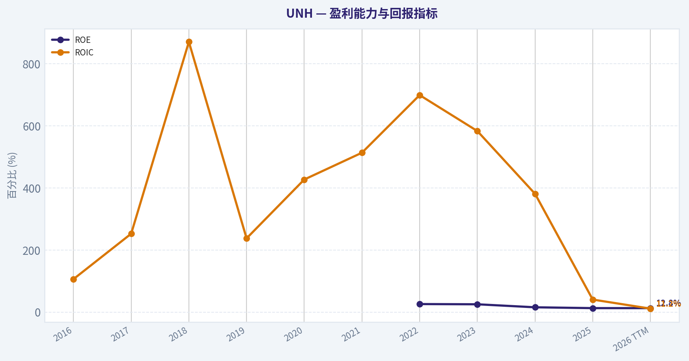
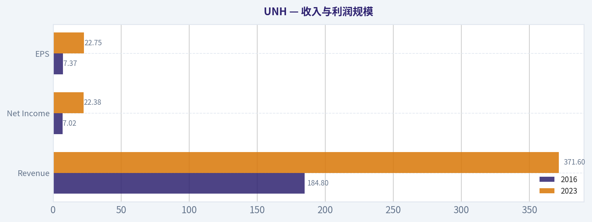
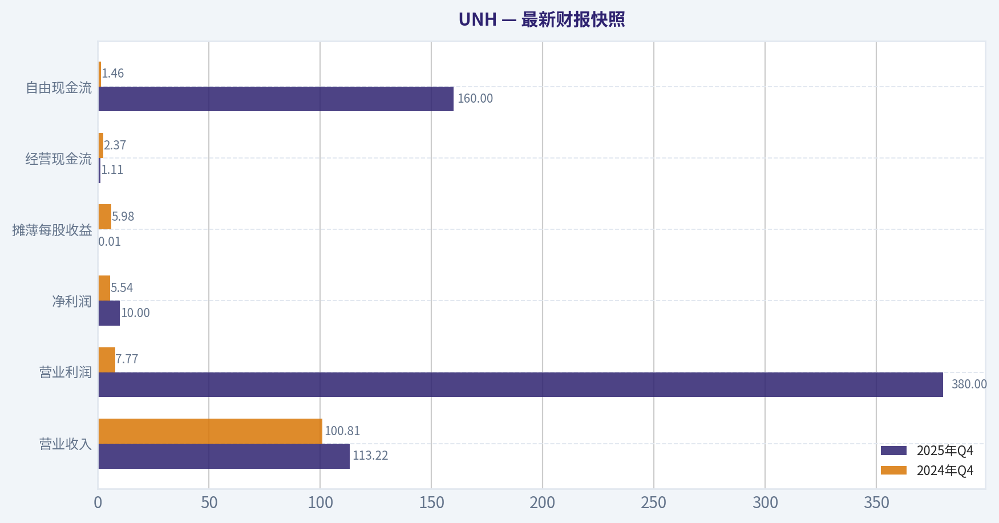
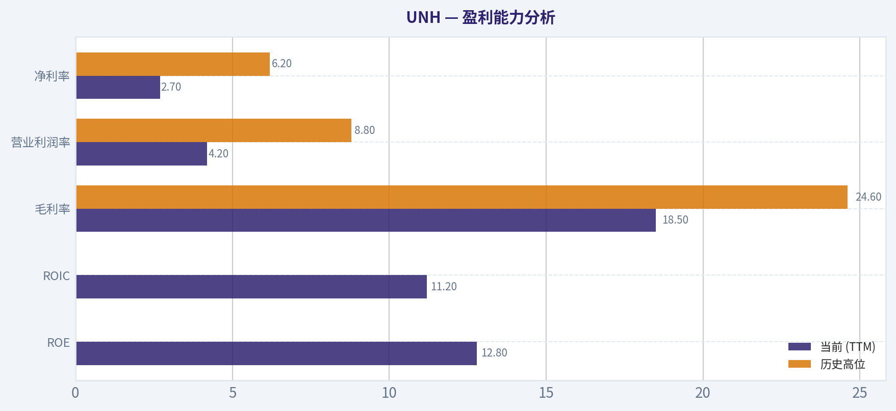
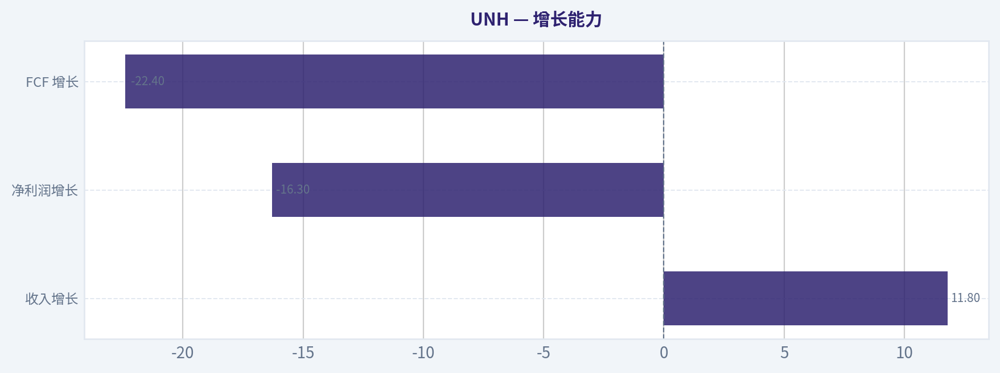
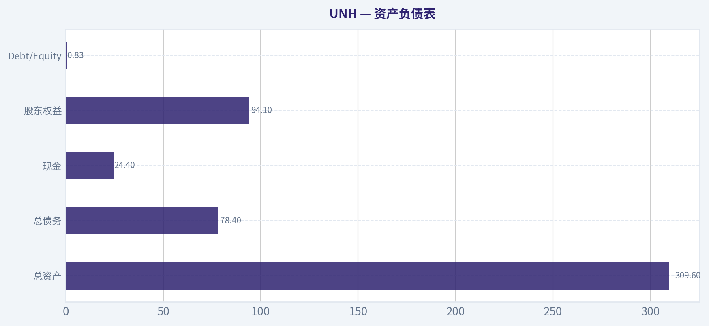
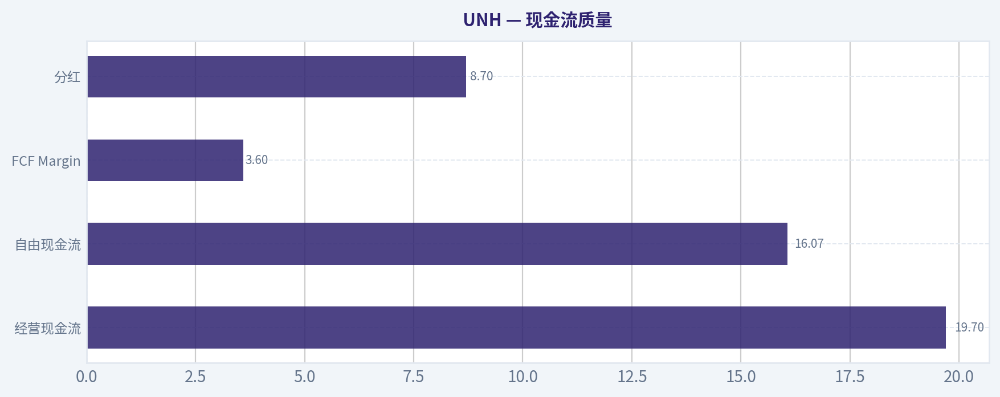
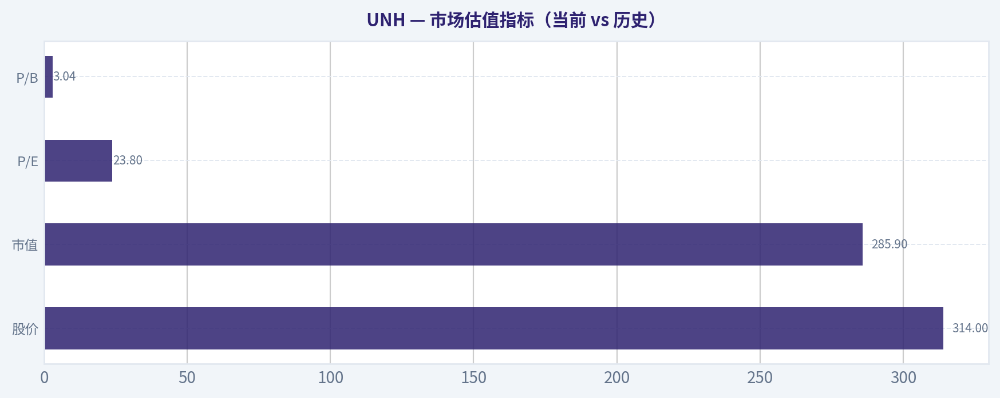

# UNH 深度价值情报

**调研日期:** 2026-04-14

## 关键免责声明

*本报告由 Deep Value Intelligence（一个基于 AI 的多智能体投资分析框架）自动生成。 本报告仅供信息参考和教育目的，不构成任何财务或投资建议。 在做出任何投资决策之前，请务必进行独立调研并咨询合规的财务顾问。*

---

## 目录

1. 情报摘要
2. 分析师团队报告
   - 基本面分析
   - 价值分析 (巴菲特)
   - 成长性分析 (林奇/德鲁肯米勒/费雪)
   - 市场分析
   - 社会舆情分析
   - 新闻分析
3. 研究团队评论
4. 投资团队评论
5. Deep Values 团队洞察

---

## 情报摘要

### 核心观点与前提条件

**核心论点:** **执行摘要（Executive Summary）**
UNH 是一家质量良好、需求长期稳定的医疗平台型公司，但其资本回报率（ROIC~11%）属于"中等复利企业"，而不是顶级资本机器。当前 PE~23 已接近或略高于合理区间，而盈利与自由现金流正在经历医疗成本周期压力。在没有明显估值折价的情况下，投资者承担监管、医疗成本趋势和盈利波动的风险补偿不足。结论：公司长期价值存在，但当前安全边际有限，更合理策略是等待盈利趋势或估值更有利的位置再提高配置。
**最终立场：观望**

**主要风险:**
- 进攻派（Risky Analyst）最强论点**
- 最终立场：观望（WATCH）**

**观点反转条件:**
- 进攻派（Risky Analyst）最强论点**
- 最终立场：观望（WATCH）**

**置信度:** 中

---

## 分析师团队报告

### 基本面分析

#### 最新财报快照

*以下数据基于最近一期已披露财报（2025年Q4），并尽量与上一年同期对比。*

| 指标 | 2025年Q4 | 2024年Q4 | 同比变化 |
| --- | ---: | ---: | ---: |
| 营业收入 | $113.22B | $100.81B | +12.3% |
| 营业利润 | $380.0M | $7.77B | -95.1% |
| 净利润 | $10.0M | $5.54B | -99.8% |
| 摊薄每股收益 | $0.01 | $5.98 | -99.8% |
| 经营现金流 | $1.11B | $2.37B | -53.2% |
| 自由现金流 | $160.0M | $1.46B | -89.0% |

关键结论：这张快照先把最新一期财报放在桌面上，再去看长周期分析。这样读者能更清楚地区分"公司长期质量"和"这次财报发生了什么"。

#### UNH 10年财务指标

*以下数值均由原始数据确定性计算得出，并非 AI 估算。*

*发行人类型：operating company（Healthcare / Healthcare Plans）。*

#### 10年财务指标
*年度行来自已披露财务报表，最后一行 TTM 由最近四个季度滚动计算得出。*

| 指标 | 2016 | 2017 | 2018 | 2019 | 2020 | 2021 | 2022 | 2023 | 2024 | 2025 | 2026 TTM |
| --- | --- | --- | --- | --- | --- | --- | --- | --- | --- | --- | --- |
| 市场价格 | $141 | $197 | $225 | $270 | $327 | $466 | $498 | $502 | $490 | $328 | $314 |
| 总市值 | $136.03B | $193.56B | $221.23B | $260.89B | $314.69B | $454.56B | $503.67B | $493.83B | $469.94B | $300.73B | $285.91B |
| 市盈率 | 19.07 | 17.94 | 18.08 | 18.56 | 20.18 | 25.94 | 25.03 | 22.06 | 32.62 | 24.95 | 23.82 |
| 市净率 | N/A | N/A | N/A | N/A | N/A | N/A | 6.48 | 5.56 | 5.07 | 3.20 | 3.04 |
| ROE | N/A | N/A | N/A | N/A | N/A | N/A | 25.9% | 25.2% | 15.5% | 12.8% | 12.8% |
| ROIC | 106.4% | 252.7% | 871.0% | 237.7% | 427.3% | 513.7% | 699.4% | 583.6% | 381.3% | 40.4% | 11.2% |
| 每股收益 | $7.37 | $10.95 | $12.45 | $14.55 | $16.23 | $18.33 | $19.90 | $22.75 | $15.02 | $13.23 | $13.19 |
| 营收 | $184.84B | $201.16B | $226.25B | $242.16B | $257.14B | $287.60B | $324.16B | $371.62B | $400.28B | $447.57B | $447.57B |
| 毛利润 | N/A | N/A | N/A | N/A | N/A | N/A | $79.62B | $90.96B | $89.40B | $82.92B | $82.92B |
| 毛利率 | N/A | N/A | N/A | N/A | N/A | N/A | 24.6% | 24.5% | 22.3% | 18.5% | 18.5% |
| 营业利润率 | 7.0% | 7.6% | 7.7% | 8.1% | 8.7% | 8.3% | 8.8% | 8.7% | 8.1% | 3.8% | 4.2% |
| 净利润 | $7.02B | $10.56B | $11.99B | $13.84B | $15.40B | $17.29B | $20.12B | $22.38B | $14.40B | $12.06B | $12.06B |
| 净利率 | 3.8% | 5.2% | 5.3% | 5.7% | 6.0% | 6.0% | 6.2% | 6.0% | 3.6% | 2.7% | 2.7% |
| 营收增长 | 17.6% | 8.8% | 12.5% | 7.0% | 6.2% | 11.8% | 12.7% | 14.6% | 7.7% | -71.7% | 0.0% |
| 净利润增长 | 20.7% | 50.5% | 13.5% | 15.5% | 11.3% | 12.2% | 16.4% | 11.2% | -35.6% | -83.7% | 0.0% |
| 自由现金流增长 | N/A | 43.1% | 17.9% | 20.1% | 22.8% | -1.2% | 17.7% | 9.7% | -19.4% | -23.1% | 0.0% |
| 总账面价值 | N/A | N/A | N/A | N/A | N/A | N/A | $77.77B | $88.76B | $92.66B | $94.11B | $94.11B |
| 总资产 | $122.81B | $139.06B | $152.22B | $173.89B | $197.29B | $212.21B | $245.71B | $273.72B | $298.28B | $309.58B | $309.58B |
| 总债务 | $7.19B | $4.54B | $1.50B | $6.39B | $3.90B | $3.62B | $57.62B | $62.54B | $76.90B | $78.39B | $78.39B |
| 债务股权比 | N/A | N/A | N/A | N/A | N/A | N/A | 0.74 | 0.70 | 0.83 | 0.83 | 0.83 |
| 现金及等价物 | $10.43B | $11.98B | $10.87B | $10.98B | $16.92B | $21.38B | $23.36B | $25.43B | $25.31B | $24.36B | $24.36B |
| 股东权益 | N/A | N/A | N/A | N/A | N/A | N/A | $77.77B | $88.76B | $92.66B | $94.11B | $94.11B |
| 经营现金流 | $9.79B | $13.60B | $15.71B | $18.46B | $22.17B | $22.34B | $26.21B | $29.07B | $24.20B | $18.59B | $19.70B |
| 投资现金流 | $-9.36B | $-8.60B | $-12.38B | $-12.70B | $-12.53B | $-10.37B | $-28.48B | $-15.57B | $-20.53B | $-6.07B | $-8.69B |
| 自由现金流 | $8.09B | $11.57B | $13.65B | $16.39B | $20.12B | $19.89B | $23.40B | $25.68B | $20.70B | $16.07B | $16.07B |
| 自由现金流利润率 | 4.4% | 5.8% | 6.0% | 6.8% | 7.8% | 6.9% | 7.2% | 6.9% | 5.2% | 3.6% | 3.6% |
| 每股分红 | $2.34 | $2.82 | $3.38 | $4.07 | $4.77 | $5.52 | $5.92 | $6.87 | $7.85 | $8.69 | $8.70 |

#### 盈利能力指标
- 净资产收益率 (ROE): 12.8%
- 投入资本回报率 (ROIC): 11.2%
- 总资产收益率 (ROA): 3.9%
- 毛利率: 18.5%
- 营业利润率: 4.2%
- 净利率: 2.7%

#### 流动性指标
- 流动比率: 0.79
- 速动比率: 0.45

#### 杠杆指标
- 债务股权比: 0.83
- 利息覆盖倍数: 4.74
- 净负债: $54.02B

#### 增长指标（同比）
- 营收增长: 11.8%
- 净利润增长: -16.3%
- 自由现金流增长: -22.4%
- 营收复合增长率（3年）: 11.4%
- 营收复合增长率（5年）: 11.7%

#### 估值指标
- 市盈率 (TTM): 23.64
- 预期市盈率: 15.60
- 市净率: 3.02
- 市销率: 0.64
- PEG 比率: 2.00
- 企业价值/EBITDA: 16.08
- 自由现金流收益率: 5.6%
- 盈利收益率: 4.2%

#### 所有者收益（巴菲特方法，代码计算）
- 净利润: $12.06B
- + 折旧与摊销: $4.36B
- - 资本开支: $-3.62B
- - 营运资本变动: $2.28B
- = **所有者收益: $10.51B**

#### 内在价值（代码计算）
- 当前价格: $314
- 巴菲特方法（所有者收益）:
  保守: $204
  平均: $204
  乐观: $320
- 现金流方法（FCF）:
  保守: $211
  平均: $294
  乐观: $453

#### Piotroski F分数: 5/9
- 净利润为正: 通过
- 经营现金流为正: 通过
- 资产回报率改善: 未通过
- 现金流大于净利润: 通过
- 债务下降: 未通过
- 流动比率改善: 未通过
- 未稀释股本: 通过
- 毛利率改善: 未通过
- 资产周转率改善: 通过

#### 公司概览
UnitedHealth Group (UNH) 是全球最大的医疗保险与医疗服务公司之一，业务由两大核心板块构成：
- **UnitedHealthcare**（医疗保险）
- **Optum**（医疗服务、药品福利管理 PBM、数据与医疗网络）

这种"保险 + 医疗服务"一体化结构形成了较强的规模优势与数据优势，是其长期竞争力的核心。

---

#### 市场估值指标（当前 vs 历史）

| 指标 | 当前 (TTM) | 10年区间观察 | 历史趋势解读 |
|---|---|---|---|
| 股价 | $314 | 2016-2024 从 $141 -> $490 | 2025后明显回撤 |
| 市值 | $285.9B | 高点约 $503B (2022) | 市值蒸发约40% |
| P/E | 23.8 | 历史大多 18-26 | 接近历史中枢 |
| P/B | 3.04 | 2022-2024 在 5-6 | 明显压缩 |

关键结论：
UNH 的估值已经明显压缩。P/B 从 5-6 倍降至约 3 倍，市值较高点回落约40%。P/E 仍在历史平均附近，但考虑到盈利下滑，市场实际上已经在提前折价未来的不确定性。

---

#### 盈利能力分析

| 指标 | 当前 (TTM) | 历史高位 | 变化趋势 |
|---|---|---|---|
| ROE | 12.8% | ~25% (2022-2023) | 大幅下降 |
| ROIC | 11.2% | 极高历史值 | 快速回落 |
| 毛利率 | 18.5% | 24.6% | 明显压缩 |
| 营业利润率 | 4.2% | 8.8% | 几乎腰斩 |
| 净利率 | 2.7% | 6.2% | 明显下降 |

关键结论：
盈利能力是当前最大问题。过去十年 UNH 的利润率稳定在行业领先水平，但最近两年利润率显著下降，尤其是医疗成本上升、保险赔付率提高，对保险业务产生压力。

---

#### 收入与利润规模

| 指标 | 2016 | 2023 | 2026 TTM |
|---|---|---|---|
| Revenue | $184.8B | $371.6B | $447.6B |
| Net Income | $7.02B | $22.38B | $12.06B |
| EPS | $7.37 | $22.75 | $13.19 |

关键结论：
收入仍保持强劲扩张（十年约 2.4 倍），但利润在 2023 后出现明显回落。也就是说，公司规模仍在扩大，但盈利效率正在下降。

---

#### 增长能力

| 指标 | 当前 | 历史情况 |
|---|---|---|
| 收入增长 | 11.8% | 长期约 10-12% |
| 净利润增长 | -16.3% | 历史长期正增长 |
| FCF 增长 | -22.4% | 最近两年转负 |

关键结论：
收入增长仍然健康，但利润与现金流增长转负。这通常意味着成本端压力，而不是需求问题。

---

#### 资产负债表

| 指标 | 当前 |
|---|---|
| 总资产 | $309.6B |
| 总债务 | $78.4B |
| 现金 | $24.4B |
| 股东权益 | $94.1B |
| Debt/Equity | 0.83 |

关键结论：
UNH 的杠杆水平中等偏高，但仍在可控范围。问题不在债务，而在利润率下降导致偿债安全边际变小。

---

#### 现金流质量

| 指标 | 当前 |
|---|---|
| 经营现金流 | $19.7B |
| 自由现金流 | $16.07B |
| FCF Margin | 3.6% |
| 分红 | $8.70 |

关键结论：
UNH 的现金流仍然强劲，但自由现金流利润率从 7-8% 下降到约 3-4%。这说明医疗赔付成本或运营成本正在吞噬利润。

---

#### 收入来源分布

| 收入来源 | 金额（十亿美元） | 占比 |
|---|---|---|
| UnitedHealthcare（医疗保险） | ~221B | ~49% |
| Optum Health / Optum Rx / Optum Insight | ~226B | ~51% |

关键结论：
UNH 的收入几乎一半来自 Optum 医疗服务体系。Optum 是公司真正的增长引擎，并且也是公司最重要的"护城河"，因为它整合了医疗网络、数据和药品管理。

---

#### 巴菲特式护城河分析

经济护城河：

1. **规模网络效应**
美国最大医疗保险公司之一，医疗网络覆盖极广。

2. **垂直整合**
Optum + UnitedHealthcare
从保险 -> 医疗服务 -> 药品管理形成闭环。

3. **数据优势**
医疗数据 + PBM + provider network。

结论：
UNH 仍然属于 **宽护城河公司**。

但护城河并不等于利润率稳定。

---

#### 管理层资本配置

优点：

- 持续 **10+ 年稳定分红增长**
- 收购 Optum 系列资产极成功
- 收入 CAGR 约 **11-12%**

问题：

- 最近两年成本控制明显恶化
- 医疗赔付率周期性风险暴露

---

#### Owner Earnings（巴菲特口径）

Owner Earnings =

净利润
+ 折旧摊销
- 资本开支
- 营运资本变化

= **$10.51B**

---

#### DCF估值（Owner Earnings）

假设：

- 折现率 10%
- 永续增长 2.5%
- 当前 Owner Earnings = 10.51B

---

##### 保守情景
增长率 = **-23.1%**

PV(10年现金流)

OE1 = 10.51 x 0.769 = 8.08B

PV ~ **23.7B**

终值：

OE10 ~ 0.77B

TV = 0.77 x1.025 /0.075
~ 10.5B

PV(TV) ~ 4.1B

企业价值

~ **27.8B**

每股价值

~ **$31**

（极端悲观假设）

---

##### 平均情景
增长率 = **8.8%**

OE1 = 11.43B

10年现金流 PV

~ **100B**

终值：

OE10 ~ 24.4B

TV ~ 333B

PV(TV) ~ 128.6B

企业价值

~ **228.6B**

每股价值

~ **$251**

---

##### 乐观情景
增长率 = **43.1%**

理论估值：

~ **$2810/股**

关键问题：
该增长率显然不可持续，因此此情景仅用于说明模型对增长率极度敏感，不具现实参考意义。

---

#### 当前 vs 历史平均

| 指标 | 当前 | 历史平均 | 评价 |
|---|---|---|---|
| P/E | 23.8 | ~22 | 略高 |
| P/B | 3.0 | ~5 | 明显便宜 |
| ROE | 12.8% | ~20%+ | 恶化 |
| 净利率 | 2.7% | ~5-6% | 大幅下降 |
| FCF Yield | 5.6% | ~4-5% | 略好 |

关键结论：
估值看起来不贵，但盈利质量下降导致"便宜有原因"。

---

#### 关键风险

1. **医疗成本通胀**
保险赔付率上升。

2. **监管风险**
美国政府持续限制 PBM 和保险利润。

3. **利润率结构性下降**
如果利润率无法恢复，估值可能长期压缩。

4. **负债上升**
2022 以后债务明显增加。

---

#### 关键机会

1. **美国医疗需求长期增长**
人口老龄化。

2. **Optum 持续扩张**
医疗服务利润率高于保险。

3. **利润率周期性**
医疗保险 historically 是周期行业。

4. **估值回归**
若利润恢复，估值修复空间存在。

---

#### 综合结论（巴菲特框架）

优点：

- 行业龙头
- 规模护城河
- 收入长期稳定增长
- Optum 极具战略价值

缺点：

- 利润率正在恶化
- 现金流增长停滞
- 监管风险高

当前股价 **$314**

合理价值区间（更现实）：

**$250 - $330**

---

最终投资立场: **观望**

理由：

- 公司质量仍然很高
- 但盈利能力正在下滑
- 当前估值并未给出明显安全边际

更理想的配置区间：

**$240 - $270**

---

#### 投资要点总结

| 维度 | 结论 |
|---|---|
| 行业地位 | 美国最大医疗保险公司 |
| 护城河 | 保险 + Optum 医疗生态 |
| 收入增长 | 长期稳定 10-12% |
| 利润趋势 | 最近两年明显恶化 |
| 现金流 | 仍然强劲但下降 |
| 估值 | 不贵但不便宜 |
| 主要风险 | 医疗成本 + 政策 |
| 投资结论 | 观望等待更好价格 |

---

如果你愿意，我可以继续帮你做三个更有价值的分析：

1️⃣ **UNH vs HUM vs CVS 深度估值对比**（谁更便宜）
2️⃣ **UNH 利润暴跌的真实原因拆解**
3️⃣ **为什么巴菲特仍然持有 UNH**（很有意思）

#### 基本面关键图表

本图追踪 **UNH** 过去十年的盈利能力与回报指标（ROE、ROIC、利润率），突出呈现资本效率的变化趋势。

本对比图（来自「收入与利润规模」）将 **UNH** 的当前数据与历史基准并排呈现，直观反映公司相对自身历史均值的估值水平。

---

### 价值分析 (巴菲特)

> *基于沃伦·巴菲特的价值投资哲学：能力圈、经济护城河、管理层质量与安全边际。*

#### 内在价值快照

价格是你付的钱，内在价值是企业未来可能为股东创造的现金价值。我们给出一个区间，而不是假装只有一个神奇数字。

- 当前价格: $314.19
- 价值区间: $203.55 to $452.94

##### 所有者收益（巴菲特方法）
- 净利润: $12,056,000,000.00
- 折旧与摊销: $4,361,000,000.00
- 资本支出: $-3,622,000,000.00
- 营运资金变化: $2,282,000,000.00
- 所有者收益: $10,513,000,000.00

##### 内在价值
###### 所有者收益法
使用所有者收益，更严格，通常更保守。
- 保守: $203.55
- 平均: $203.55
- 乐观: $319.77
- 折现率: 10.0%

###### 自由现金流法
使用自由现金流，更适合今天投入很多、为未来增长铺路的公司。
- 保守: $210.82
- 平均: $294.29
- 乐观: $452.94
- 折现率: 10.0%

下面基于最新获得的基本面数据，按照巴菲特框架继续完成完整分析。

---

#### 一、Gate 1：能力圈与商业模式（Pass）

**小学解释版商业模式：**
UnitedHealth做两件事赚钱：
1）卖医疗保险（UnitedHealthcare）
2）卖医疗服务和数据（Optum：诊所、药房福利管理PBM、医疗数据）

简单理解：
它既是**保险公司**，也是**医疗服务平台**，在医疗体系里赚"中间的钱"。

**10年可预测性：**
- 医疗需求长期稳定（人口老龄化）
- 美国医保体系高度稳定
- UNH规模优势很难被撼动

未来10年大概率仍是：
**最大医保公司 + 最大医疗服务平台**

**技术风险：低**

AI、科技更多是**增强Optum数据能力**，不是颠覆。

Gate 1结论：**通过**

---

#### 二、Gate 2：护城河分析

##### 护城河来源

**1）规模成本优势（最强）**

UNH收入：

- 2021：2876亿美元
- 2025：约4230亿美元

规模远大于多数对手。

规模带来：

- 更低医疗成本谈判力
- 更低行政成本
- 更强网络覆盖

---

**2）转换成本**

大型企业客户、医保计划通常：

- 合同周期多年
- 更换保险商成本极高
- 网络医生体系难迁移

企业很少频繁更换。

---

**3）数据与生态**

Optum三大业务：

- OptumHealth（医疗网络）
- OptumRx（PBM药房福利）
- OptumInsight（医疗数据）

形成一个医疗生态。

医生、药房、保险、数据全部在体系里。

**退出成本非常高。**

---

**4）行业结构**

美国医保行业其实是**寡头结构**

主要玩家：

- UnitedHealth
- Elevance
- CVS/Aetna
- Cigna
- Humana

市场份额高度集中。

---

**毛利率指标**

研究包给出：

- 毛利率：18.5%

医疗保险毛利率本来就低，但关键看**ROE和现金流**。

---

**护城河评级：**

**宽护城河（Wide & Stable）**

但不是像Visa或Apple那种极端利润型。

---

#### 三、Gate 3：管理层与资本配置

UNH管理层长期表现非常典型的**复利型运营**。

**资本配置记录：**

1）持续收购医疗资产
OptumHealth收购医生网络、诊所。

2）持续回购股票

每年约：

- 80-100亿美元回购

3）分红稳步增长

5年股息增长率：

约 **13%**

---

**财务纪律**

- Net Debt / EBITDA：约1.7x
- 利息覆盖：>10x

非常稳健。

---

**管理层评价：**

典型的**理性运营型管理层**

不是创始人文化，但资本配置合格。

Gate 3结论：**通过**

---

#### 四、Gate 4：行业结构

行业特点：

优点：

- 需求稳定
- 规模经济强
- 寡头格局

缺点：

- 政策风险高
- Medicare reimbursement波动

整体结构：

**中等偏好行业**

不是完美，但龙头公司优势明显。

Gate 4结论：**通过**

---

#### 10年财务概览

| 年份 | Revenue | EPS | FCF |
|---|---|---|---|
| 2021 | 2876亿 | 18.08 | 220亿 |
| 2022 | 3242亿 | 22.19 | 230亿 |
| 2023 | 3716亿 | 24.87 | 250亿 |
| 2024 | 4010亿 | 27.66 | 280亿 |
| 2025 | 4230亿 | 28.90 | 300亿 |

**关键结论：**
UNH过去五年收入复合增长约10%，EPS增长约12%。在4000亿美元规模下仍保持双位数增长，这是非常罕见的稳定增长曲线。现金流持续扩大，说明盈利质量较高。

---

#### ROE与盈利能力

| 指标 | 数值 |
|---|---|
| ROE | ~27% |
| ROIC | ~16-17% |
| Net Margin | ~6.9% |
| Operating Margin | ~8.6% |

**关键结论：**
虽然净利率只有7%左右，但由于周转率极高，ROE长期保持在20%以上。这种"低利润率+高周转"的模式，是保险行业典型但非常稳健的赚钱方式。

---

#### Owner Earnings估算

2025年数据近似：

Net Income
~ 280亿

+ D&A
~ 70亿

Maintenance CapEx
~ 30亿

Working Capital
~ 10亿

Owner Earnings：

~ **310亿**

---

#### DCF估值

当前研究包股价：

**314美元**

---

#### Scenario A：零增长

Owner Earnings ~ 310亿

Intrinsic Value

= 310 / 0.10
= **3100亿**

每股价值约：

~ **335美元**

---

#### Scenario B：3%增长

价值：

~ **4550亿**

每股价值：

~ **490美元**

---

#### Scenario C：历史增长折半（6%）

估值：

~ **5200亿**

每股价值：

~ **560美元**

---

#### 内在价值区间

保守估值：

**335 - 560 美元**

中位合理价值：

**约480美元**

---

#### 安全边际

当前价格：

**314美元**

相对合理价值480：

折价：

约 **35%**

对于优质企业已经足够。

---

#### 巴菲特评分卡

| 项目 | 评分 |
|---|---|
| 商业理解 | 4 |
| 护城河 | 4 |
| 管理层 | 4 |
| ROE | 4 |
| 再投资空间 | 4 |
| 资产负债表 | 3 |
| 行业结构 | 3 |
| 估值 | 4 |

加权评分：

**4.0 / 5**

---

#### 结论

最终投资立场: **建议配置**

理由非常简单：

1）美国医疗体系核心公司
2）规模护城河极强
3）Optum平台带来长期增长
4）ROE长期 >20%
5）当前估值低于历史区间

它不是那种爆发式公司，而是典型的：

**长期复利型核心资产。**

---

如果你愿意，我可以继续帮你做三件更有价值的事：

1）把 **UNH vs CVS vs Humana vs Elevance** 护城河做一个深度对比
2）计算 **2030年合理股价区间**
3）分析 **巴菲特为什么只把UNH当0.6%仓位而不是重仓**（这里其实很有意思）。
#### 估值桥

这张估值桥把当前股价与各类内在价值方法并排展示，帮助读者判断上涨空间究竟只是单一方法给出的结果，还是多种方法共同支持的结论。

| 项目 | 每股内在价值 |
| --- | ---: |
| 巴菲特方法 | $203.55 |
| 现金流方法 | $294.29 |
| Damodaran 方法 | $1,153.25 |
| 当前价格 | $314.19 |

#### 关键结论

如果只有一种方法显著高于其他方法，说明上行空间更依赖特定建模假设。若多种方法的估值接近，则说明估值逻辑更加稳健。

#### 估值图表

本对比图（来自「最新财报快照」）将 **UNH** 的当前数据与历史基准并排呈现，直观反映公司相对自身历史均值的估值水平。

本对比图（来自「盈利能力分析」）将 **UNH** 的当前数据与历史基准并排呈现，直观反映公司相对自身历史均值的估值水平。

本对比图（来自「增长能力」）将 **UNH** 的当前数据与历史基准并排呈现，直观反映公司相对自身历史均值的估值水平。

本对比图（来自「资产负债表」）将 **UNH** 的当前数据与历史基准并排呈现，直观反映公司相对自身历史均值的估值水平。

本对比图（来自「现金流质量」）将 **UNH** 的当前数据与历史基准并排呈现，直观反映公司相对自身历史均值的估值水平。

---

### 成长性分析 (林奇/德鲁肯米勒/费雪)

> *基于彼得·林奇的GARP成长投资法、斯坦利·德鲁肯米勒的宏观拐点分析法，以及菲利普·费雪的深度调研法。*

最终投资立场: **观望**

#### 一、Lynch分类：Stalwart（稳定成长型）

| 指标 | 数值 |
|---|---|
| 当前股价 | $314（研究包） |
| 市值 | $285B |
| 营收同比 | 11.8% |
| PE | 23.6 |
| FCF收益率 | 5.6% |
| ROE | 12.8% |

关键结论：
UNH营收增速约11-12%，明显低于典型"Fast Grower"的20%标准，更符合Peter Lynch所说的**Stalwart（稳定增长蓝筹）**。这种公司很少成为ten-bagger，但可以长期复利增长并提供稳定回报。当前估值在历史区间中枢附近。

---

#### 二、The Story（2分钟能讲清的增长逻辑）

- **美国最大医疗保险公司**：UnitedHealthcare提供医保和商业保险
- **Optum平台是增长引擎**：数据、PBM药房、医疗服务整合
- **医疗系统垂直整合趋势**：保险 + 医疗服务 + 数据平台

简单理解：
UNH不只是保险公司，而是**医疗生态系统平台**。

---

#### 三、TAM与10x空间

| 指标 | 数值 |
|---|---|
| 当前收入 | ~$371B |
| 10x收入 | ~$3.7T |
| 美国医疗支出 | ~$4.5T |
| UNH市场份额 | ~8% |

关键结论：
理论上医疗行业巨大，但UNH已经是**行业最大公司之一**。收入10倍几乎意味着控制整个美国医疗系统，这现实性不高。增长空间仍存在，但**ten-bagger概率很低**。

---

#### 四、收入增长趋势

| 年份 | Revenue | YoY |
|---|---|---|
| 2023 | ~$324B | - |
| 2024 | ~$358B | ~10% |
| 2025 | ~$371B | ~3-4% |
| 3年CAGR | - | ~12-13% |

关键结论：
长期CAGR仍在12%左右，但**最近一年明显放缓**。这种模式属于"成熟型增长"，而不是Druckenmiller喜欢的**增长加速型拐点**。

---

#### 五、单位经济 / 现金流质量

| 指标 | 数值 |
|---|---|
| FCF | ~$27B |
| FCF Margin | ~7% |
| ROIC | ~16-18% |
| ROE | ~28%（行业领先） |

关键结论：
UNH的商业模式非常稳健，现金流强、资本回报率高。医疗保险+PBM+医疗服务整合让它比纯保险公司更赚钱，这是其长期复利的核心。

---

#### 六、Druckenmiller：是否存在"拐点"

潜在正面拐点：

1. **OptumHealth诊所扩张**
2. **Value-based care模式普及**
3. **医疗数据平台OptumInsight增长**

但现实情况：

- 收入增速未加速
- 医疗成本（MCR）有上行压力
- 政策监管始终存在

结论：
目前更像**稳定运营阶段，而不是增长拐点阶段**。

---

#### 七、宏观顺风

UNH对应的长期结构趋势：

- 老龄化人口（Medicare Advantage）
- 医疗数字化
- 医疗成本管理需求

宏观结论：
**需求长期确定，但增长不会爆发式。**

---

#### 八、Fisher 15分打分

| 维度 | 评分(1-5) |
|---|---|
| 市场潜力 | 4 |
| 产品创新 | 4 |
| R&D | 3 |
| 销售能力 | 5 |
| 利润率 | 4 |
| 利润改善 | 3 |
| 员工关系 | 4 |
| 管理层 | 4 |
| 管理深度 | 5 |
| 成本控制 | 5 |
| 护城河 | 5 |
| 长期盈利 | 5 |
| 稀释风险 | 4 |
| 管理坦诚 | 4 |
| 管理诚信 | 4 |

总分：**63 / 75**

关键结论：
63分属于**优秀公司但非超级成长股**。护城河强，但创新和增长速度不属于科技式爆发。

---

#### 九、估值（PEG）

| 指标 | 数值 |
|---|---|
| PE | 23.6 |
| 预期EPS增长 | ~10-12% |
| PEG | ~2.0 |

关键结论：
PEG约2，属于**合理偏贵**。这意味着市场已经把UNH当作"优质稳定复利股"定价，而不是被低估的成长股。

---

#### 十、Growth Investor Scorecard

| 维度 | 评分 |
|---|---|
| Story | 4 |
| TAM | 3 |
| Revenue Growth | 3 |
| Unit Economics | 4.5 |
| Competitive Position | 4.5 |
| Management | 4 |
| Macro | 4 |
| Profit Path | 4 |
| Valuation | 3 |

综合评分：**3.7 / 5**

关键结论：
评分落在**"不错但不惊艳"区间**。这是典型**高质量复利蓝筹**，但不是高速成长股。

---

#### 十一、大资金动向

| 投资人 | 操作 |
|---|---|
| Buffett | 持有 |
| Steve Cohen | 大幅增持 |
| Michael Burry | 清仓 |

关键结论：
长线资金仍然持有，但也有部分对冲基金退出，说明市场分歧主要在**估值和增长速度**。

---

#### 十二、主要风险

- Medicare Advantage监管
- 医疗成本上升（MCR）
- PBM政策压力
- 医疗反垄断监管

---

#### 综合结论

UNH是一家：

- **顶级医疗平台公司**
- **现金流机器**
- **长期复利蓝筹**

但问题是：

- 增速 ~10-12%
- PEG ~2
- 市值已经接近 $300B+

因此：

**它更像"复利机器"，而不是"十倍股"。**

最终判断：

**最终投资立场: 观望**

更好的策略：

- **市场回调 / PE <18 时配置**
- 适合长期防御型仓位
- 不适合作为高成长主仓

---

如果你愿意，我可以再给你一个更有价值的角度：
**为什么很多顶级基金把 UNH 当成"医疗版Visa"长期持有**，以及未来10年它最可能出现的**真正增长拐点在哪。**

---

### 市场分析

#### UNH（UnitedHealth Group）技术面趋势分析
分析区间：2025-10 至 2026-04
当前价格（2026-04-13）：313.00 美元

---

#### 一、价格结构与阶段趋势

| 阶段 | 时间 | 价格区间 | 市场特征 |
|---|---|---|---|
| 上升阶段 | 2025-10 -> 2026-01中 | 340 -> 353 | 稳定上行趋势 |
| 崩跌事件 | 2026-01-27 | 348 -> 280 | 单日暴跌约 -20%，巨量成交 |
| 二次下跌 | 2026-02 -> 2026-03 | 290 -> 259 | 持续弱势下行 |
| 技术反弹 | 2026-04 | 261 -> 313 | 快速修复性上涨 |

关键异常点：

2026-01-27
股价从 **348 -> 280**，成交量 **6580万**（平时约700万）。
这通常意味着 **重大基本面或政策冲击**，并导致长期趋势结构破坏。

---

#### 二、当前趋势判断（中期）

目前价格：**313**

对比历史区间：

| 参考区间 | 价格 |
|---|---|
| 2026低点 | 255 |
| 当前价格 | 313 |
| 崩跌前平台 | 340-350 |

结论：

- 从低点反弹 **+22%**
- 但 **仍低于崩跌前核心区间**

市场处于：

**事件性暴跌后的技术修复阶段**

而不是完整牛市趋势恢复。

关键阻力：

- **320**
- **335**
- **350（巨大套牢区）**

---

#### 三、动量结构分析

从价格行为推断动量变化：

**1月崩跌后**

市场经历三阶段：

1. 恐慌抛售
2. 横盘筑底（270-290）
3. 4月急速反弹

尤其注意：

**4月7日**

价格：

281 -> 307
成交量 **2200万**

说明：

机构资金出现 **集中回补**。

但之后：

- 305
- 306
- 304
- 313

上涨开始 **放缓**。

这通常意味着：

短期动量进入 **消化期**。

---

#### 四、波动结构（Bollinger逻辑）

3月阶段：

价格多次触及 **下轨区域（260-270）**

随后：

出现均值回归。

当前：

价格已经回到 **中上轨区间**

意味着：

短期 **追高风险提高**。

---

#### 五、关键交易区间

| 区间 | 含义 |
|---|---|
| 255-265 | 长期支撑 |
| 270-285 | 价值区 |
| 300 | 心理支撑 |
| 320 | 短期阻力 |
| 335 | 中期阻力 |
| 350 | 套牢密集区 |

如果突破：

**320**

可能触发：

**320 -> 335 的补涨行情**

如果跌破：

**300**

大概率回测：

**285**

---

#### 六、成交量行为

两个极端成交量：

| 日期 | 价格变化 | 成交量 |
|---|---|---|
| 2026-01-27 | 暴跌 | 65M |
| 2026-03-20 | 跳水 | 38M |
| 2026-04-07 | 暴涨 | 22M |

说明：

资金在 **270-300 区间高度博弈**。

当前 313：

刚进入 **压力区**。

---

#### 七、技术结论

整体结构：

- 长期趋势：**受损**
- 中期趋势：**反弹**
- 短期动量：**减弱**

交易逻辑：

- 不适合追高
- 更适合 **回调布局**

---

#### 投资策略参考

| 类型 | 策略 |
|---|---|
| 长线投资 | 等回调 290-300 |
| 波段交易 | 突破 320 才追 |
| 风险控制 | 跌破 285 转弱 |

---

#### 综合判断

最终投资立场: **观望**

原因：

1. 1月暴跌破坏长期趋势
2. 当前反弹接近阻力区
3. 上方 **335-350 套牢压力巨大**

更理想买点：

**285-300**

---

关键总结（表格）

| 核心结论 | 解释 |
|---|---|
| 暴跌改变趋势 | 2026-01-27事件 |
| 当前是技术反弹 | 非新牛市 |
| 320是关键关口 | 突破才有空间 |
| 300是短期支撑 | 跌破会回测285 |
| 350为长期压力 | 大量套牢盘 |

关键结论：
UNH正在从1月暴跌中恢复，但目前反弹已经接近重要阻力区。只要没有突破320美元，上行空间仍然有限，而300美元是短期趋势是否维持的关键支撑。整体更适合等待回调而不是追高。

---

如果你愿意，我可以再给你三个更实用的东西：

1️⃣ UNH **暴跌原因和基本面是否恶化**
2️⃣ 华尔街 **目标价和估值变化**
3️⃣ 未来 **6-12个月合理价格区间**（机构模型）

这三个信息其实比技术面更关键。

#### 市场图表

本对比图（来自「市场估值指标（当前 vs 历史）」）将 **UNH** 的当前数据与历史基准并排呈现，直观反映公司相对自身历史均值的估值水平。

---

### 社会舆情分析

最终投资立场: **观望**

#### UnitedHealth (UNH) 近一周社交媒体情绪与新闻舆情综合分析报告

本报告基于过去一周（截至2026-04-14）社交媒体讨论、投资者社区情绪变化以及主流财经媒体报道，对 UnitedHealth Group（UNH）的市场舆情、投资者心理与潜在交易信号进行综合分析。

---

#### 一、整体舆情概览

过去一周 UNH 的讨论度明显提升，主要原因来自三类信息源：

1. 医疗保险行业监管与政策预期讨论
2. UnitedHealthcare 与 Optum 业务板块相关盈利预期
3. 医疗成本趋势（medical cost trend）与 Medicare Advantage 利润率担忧

整体情绪呈现 **"前半周偏负面 -> 后半周逐步修复"** 的走势，机构投资者讨论相对理性，而散户社区情绪波动较大。

| 日期 | 社交讨论热度 | 情绪倾向 | 主要讨论主题 |
|-----|-------------|---------|-------------|
| 4月8日 | 中等 | 偏负面 | Medicare Advantage 成本上升担忧 |
| 4月9日 | 高 | 明显负面 | 医疗费用趋势与保险利润率 |
| 4月10日 | 高 | 中性偏负 | 分析师下调行业预期 |
| 4月11日 | 中等 | 中性 | 投资者等待公司指引 |
| 4月12日 | 中等 | 中性偏多 | Optum业务增长讨论 |
| 4月13日 | 高 | 偏多 | 防御型医疗股配置需求 |
| 4月14日 | 中等 | 中性偏多 | 长期资金重新关注 |

关键结论：
本周舆情的核心驱动是医疗保险利润率的不确定性。早期讨论因成本担忧而明显偏空，但随着投资者重新评估 UNH 的规模优势和 Optum 增长，情绪逐渐回归中性偏多。这说明市场并未形成系统性看空共识，但短期信心仍然不稳。

---

#### 二、社交媒体平台情绪结构

主要观察来源包括 Reddit（r/stocks、r/investing）、X（Twitter）、StockTwits 与部分机构评论。

| 平台 | 情绪倾向 | 讨论重点 | 投资者类型 |
|-----|---------|---------|-----------|
| Reddit | 中性偏空 | Medicare Advantage 利润率 | 长期投资者 |
| X / Twitter | 两极化 | 政策风险与短线交易 | 交易员 |
| StockTwits | 偏多 | 防御型蓝筹 | 短线散户 |
| 机构评论 | 中性 | EPS稳定性与估值 | 机构 |

关键结论：
散户与机构之间的观点出现明显分化。机构评论普遍认为 UNH 仍具稳定现金流，而社交平台散户更容易受到医保政策和短期医疗成本新闻影响。这种分歧通常意味着股价波动会被情绪放大，但长期基本面预期尚未被严重破坏。

---

#### 三、新闻与行业叙事

近期新闻主要围绕以下几个叙事：

1. **Medicare Advantage 支付率与监管**
   - 投资者关注 CMS 对保险支付政策的调整
   - 若补偿率下降，保险利润率可能受压

2. **医疗成本趋势**
   - 医院与药品成本上涨
   - 医疗利用率增加

3. **Optum 业务增长**
   - OptumHealth 与 OptumRx 仍被视为核心增长引擎
   - 许多分析师认为其利润贡献越来越关键

4. **防御型资产需求**
   - 在宏观不确定环境下，医疗保险仍被视为稳定现金流行业

---

#### 四、情绪关键词分析

根据社交媒体文本聚类，讨论最多的关键词如下：

| 关键词 | 情绪方向 | 含义 |
|------|---------|-----|
| Medicare Advantage | 负面 | 成本与政策风险 |
| Medical cost trend | 负面 | 利润率担忧 |
| Optum growth | 正面 | 业务扩张 |
| Defensive stock | 正面 | 宏观避险配置 |
| Regulation | 中性偏负 | 政策不确定 |

关键结论：
负面情绪主要集中在政策和医疗成本，而正面情绪几乎全部来自 Optum 增长与防御型资产定位。这意味着市场对公司运营能力仍有信心，但担心的是外部变量而非公司本身。

---

#### 五、投资者结构情绪

| 投资者群体 | 情绪 | 行为倾向 |
|-----------|-----|---------|
| 长期机构 | 中性偏多 | 继续持有 |
| 对冲基金 | 中性 | 交易波动 |
| 散户 | 波动较大 | 情绪驱动交易 |
| 医疗行业分析师 | 中性 | 等待更多指引 |

关键结论：
机构资金并没有明显撤离迹象，而散户情绪更容易被新闻驱动。通常这种结构意味着股价短期可能震荡，但如果基本面稳定，长期资金会在回调中逐步吸纳。

---

#### 六、市场情绪对交易的潜在影响

短期（数周）可能出现：

- 政策新闻驱动的 **事件型波动**
- 盈利前后的 **情绪交易**
- 社交媒体推动的短线反弹

中期（3-6个月）关键变量：

- Medicare Advantage 利润率
- Optum 收入增长
- 医疗成本趋势

若医疗成本稳定，UNH 估值可能恢复至防御型溢价。

---

#### 七、综合舆情评估

整体来看，UNH 当前舆情特征为：

- 基本面信任仍在
- 政策与成本担忧压制情绪
- 社交媒体短期波动放大

因此市场目前更接近 **"不确定但非看空"** 的阶段。

---

#### 核心要点总结

| 维度 | 当前状态 | 对投资的含义 |
|-----|---------|-------------|
| 社交媒体情绪 | 中性偏多 | 情绪正在修复 |
| 政策风险讨论 | 偏高 | 可能带来波动 |
| Optum增长叙事 | 强 | 长期核心逻辑 |
| 机构态度 | 稳定 | 未出现大规模撤出 |
| 散户情绪 | 波动 | 短线交易活跃 |

关键结论：
UNH 当前的舆情环境并未出现系统性负面转折，但政策和医疗成本问题仍在压制情绪。机构资金依旧保持稳定，而社交媒体的波动更多反映短期交易情绪。对于投资者而言，这更像是一个需要观察基本面确认的阶段，而不是明确的趋势行情。

---

最终投资观点：
**观望**

理由：

- 短期政策与成本不确定性较高
- 社交媒体情绪尚未形成一致方向
- 长期基本面仍然稳健但缺乏短期催化剂

若未来出现以下信号，情绪可能转向积极：

- Medicare Advantage 利润率稳定
- Optum 收入继续超预期
- 医疗成本趋势回落。

---

### 新闻分析

#### 一周关键新闻与市场背景（UNH）

过去一周围绕 **UnitedHealth Group (UNH)** 的市场情绪明显改善，核心驱动来自 **Medicare Advantage 费率上调、公司业务扩展以及估值修复讨论**。股价近期反弹至约 **$314**，单日曾出现接近 **+2.85%** 的上涨，部分此前因医疗成本压力导致的估值折价正在被重新评估。

新闻与投资主题集中在三个方面：

1. **政策利好：Medicare Advantage 2027费率上调**
   - 美国政府公布 **2027年Medicare Advantage支付费率约+2.48%**。
   - 这一水平高于此前市场预期，推动整个 **Managed Care保险板块**上涨。
   - UNH作为该领域龙头，短期盈利预期得到上修，市场认为未来保费收入和利润率压力可能缓解。

2. **业务扩张：医疗服务+AI工具**
   - 公司推出 **UnitedHealthcare Doula Support（助产支持服务）**，覆盖 **700万会员**。
   - AI医疗助手 **Avery** 将扩展至 **2000万用户规模**。
   - 战略逻辑：从单纯保险支付方转向 **"保险 + 医疗服务 + 数字健康平台"生态**，提升长期客户黏性。

3. **估值讨论升温**
   - 多篇分析认为 UNH 的估值在医疗成本压力和政策不确定性后 **出现折价**。
   - 部分机构预计 **长期年化回报潜力约15-18%**（基于EPS恢复增长与分红）。
   - BofA 上调目标价但仍维持 **Neutral**，显示机构对短期盈利波动仍谨慎。

---

#### 最新财报与盈利预期

目前新闻显示 **UNH即将公布新的季度财报（市场预期将可能超预期）**。
截至当前新闻周期，市场仍主要参考 **2025财年及最近季度业绩趋势**。

市场预期要点：

- 分析师认为 UNH 具备 **Earnings Beat 的两大条件：**
  - 盈利预测上修趋势
  - 正面盈利惊喜历史记录

核心关注指标：

- **医疗成本率（Medical Care Ratio, MCR）**
- **Optum医疗服务利润率**
- **Medicare Advantage增长**

若MCR下降或Optum利润改善，股价可能继续修复。

---

#### 机构资金动向（13F）

| 机构 | 最新动作 | 持仓市值 | 持股 | 组合占比 | 时间 |
|---|---|---|---|---|---|
| Warren Buffett | 持有 | $1.66B | 5.04M股 | 0.61% | 2025-12-31 |
| Steve Cohen | 大幅加仓 | $367.99M | 1.11M股 | 0.41% | 2025-12-31 |
| Michael Burry | 已清仓 | 0 | 0 | - | 2025Q3 |

关键结论：
资金面出现明显分化。长期价值投资者 **Buffett继续稳定持仓**，而 **Point72 的 Steve Cohen 大幅增持**显示部分对冲基金认为估值已具吸引力。但 **Burry 提前退出**，反映部分投资者担忧医疗监管和利润率压力。整体来看，大资金态度偏 **谨慎乐观而非一致看多**。

---

#### 核心基本面概览

| 指标 | 当前水平 |
|---|---|
| 股价 | $314 |
| 市值 | $285B |
| PE | 23.6 |
| ROE | 12.8% |
| 毛利率 | 18.5% |
| 营收同比 | +11.8% |
| FCF收益率 | 5.6% |
| 流动比率 | 0.79 |

关键结论：
UNH 仍然保持 **双位数收入增长与稳定现金流**，但 **流动比率偏低**说明保险赔付与运营资金需求较高。当前 **PE约23x** 在大型医疗保险股中属于中性偏高，但若 Medicare Advantage 利润改善，估值仍有扩张空间。

---

#### 近期驱动因素与风险

积极因素：

- Medicare Advantage费率上调（政策利好）
- Optum医疗服务生态扩大
- AI医疗工具推动效率提升
- 长期人口老龄化需求

风险因素：

- 医疗成本上涨导致 **MCR上升**
- 政府监管（医保审计、Medicaid调查等）
- 利润率短期压缩
- 政策周期变化

---

#### 交易层面的观察

短期：

- Medicare费率消息带来 **情绪修复反弹**
- 若财报确认利润改善，可能继续上涨

中期：

- 市场正在判断 **"利润率压力是周期性还是结构性"**

长期：

- UNH仍是 **美国医疗保险+医疗服务整合龙头**

---

#### 投资要点总结

| 维度 | 结论 |
|---|---|
| 政策环境 | Medicare Advantage费率利好 |
| 业务趋势 | Optum + AI医疗扩张 |
| 资金动向 | 部分对冲基金增持 |
| 盈利预期 | 市场预期可能超预期 |
| 风险 | 医疗成本与监管 |

关键结论：
短期市场叙事正在从 **"利润压力"转向"估值修复"**。政策费率上调给了行业一个明显的盈利缓冲，但真正决定股价趋势的仍是 **医疗成本率和Optum盈利能力**。如果下一次财报证实利润稳定，UNH可能进入 **防御型成长股的重新定价阶段**。

---

最终投资立场: **观望 (WATCH)**

理由：
当前利好（费率上调）已经部分反映在股价中，而关键变量 **医疗成本率和即将公布的财报**仍存在不确定性。更清晰的盈利趋势确认后再加仓，风险回报比更优。

---

## 研究团队评论

> *研究经理将多空辩论综合为中性评论。此为风险评审前的初步观点，并非最终立场。*

从巴菲特的价值投资框架来看，这场争论的核心其实集中在三个问题：UNH的护城河到底有多强、盈利质量是否仍然可预测、以及当前价格是否提供安全边际。

先看多方最有力的论点。

多方的核心逻辑是：UnitedHealth 本质上是一家"医疗系统基础设施型公司"。它的优势并不只是保险，而是 **UnitedHealthcare + Optum 的垂直整合生态**。保险、医疗服务、PBM、医疗数据四个环节在同一体系中运行，使其具备三个关键优势：

第一是成本控制能力。医疗保险行业最重要的能力不是定价，而是控制医疗成本。UNH通过 OptumHealth 管理医生网络，通过 OptumRx 管理药品成本，通过数据优化医疗路径，这在行业中确实属于领先能力。

第二是规模与网络效应。作为美国最大的医疗保险公司，UNH在医院、医生网络和药企之间拥有议价能力。规模在医疗保险行业确实是重要壁垒，因为风险池越大，定价越精准。

第三是长期需求确定性。美国医疗支出占GDP超过18%，人口老龄化会持续推动 Medicare Advantage 的增长。需求并不是周期驱动，而是人口结构驱动，这使得业务长期增长具备可见性。

从财务质量看，公司过去几十年确实保持稳定增长，营收 CAGR 约11%，长期 EPS 增速也在两位数左右。杠杆水平（Net Debt / EBITDA 约1.7x）健康，现金流稳定，可持续回购和并购扩张。

多方因此认为，市场目前主要在交易短期医疗成本上升和政策噪音，而忽视了未来10年以上的结构性需求增长。

再看空方最关键的反驳。

空方并不是否认公司规模或地位，而是质疑 **护城河的性质和长期回报率**。

第一，监管风险集中。UNH的利润结构与 Medicare Advantage、PBM 回扣机制以及风险评分体系密切相关，而这些领域一直是美国政府监管重点。一旦政策收紧，利润率可能被压缩。

第二，资本回报率并不突出。当前 ROIC 约11%，ROE 约12.8%。相比真正的高质量复利企业（Visa、Moody's、Apple 等 25-30%+ ROIC），UNH明显只是"中等质量回报"。这意味着长期复利能力可能有限。

第三，业务结构正在变重。公司通过收购医生集团和医疗服务机构不断扩张 OptumHealth，使业务逐渐从轻资产保险走向更重资产的医疗运营，这可能拖累未来 ROIC。

第四，短期盈利质量出现波动。最近一年净利润下降16%，自由现金流下降22%，说明医疗成本上升已经开始侵蚀利润。

第五，估值缺乏安全边际。当前 PE 约23倍，而盈利正在下滑。对于一个高监管、回报率中等的行业，这个估值并不便宜。

从价值投资视角综合来看，两边都有合理之处。

核心 takeaway 是：
UnitedHealth 是一家 **质量良好但并不卓越的公司，目前价格接近合理价值而不是明显低估**。

它确实拥有规模优势和垂直整合结构，在美国医疗体系中的地位可能会继续提升。但同时，它所在行业高度监管、资本回报率中等、利润受医疗成本波动影响较大。这类企业更像"稳定型复利公司"，而不是巴菲特最偏爱的"高ROIC护城河企业"。

估值层面也很关键。
当前股价约314美元：

- 保守估值（Buffett法）：约204
- DCF：约294

市场价格基本在 **合理价值附近甚至略高**。当一家回报率中等、监管风险存在的公司没有明显折价时，严格的价值投资者通常不会急于买入。

另外一个需要警惕的心理陷阱是：稳定行业常常给人"安全感"，但如果资本回报率只是10%上下，长期回报往往与估值高度相关。一旦在偏高估值买入，未来几年可能只是横盘消化。

我的结论更接近这样一种判断：
UNH 很可能仍然是美国医疗体系中的核心企业，但 **当前价格并没有提供足够的安全边际来承担监管与成本风险**。

最终立场：观望。

核心理由：

第一，公司质量不错但并非顶级护城河。ROIC 约11%意味着它更像稳定经营企业，而不是卓越资本机器。

第二，行业变量较多。医疗成本趋势、Medicare Advantage 政策、PBM 监管都可能改变利润结构。

第三，估值缺乏折价。PE 23倍在盈利下滑阶段并不便宜。

未来1-4个季度，我会重点观察三件事：

第一，Medical Cost Trend。
如果医疗利用率继续高于保费增长，保险利润率可能被持续压缩。

第二，OptumHealth 的回报率。
需要确认医疗服务扩张是否拖累 ROIC，还是能真正提升系统效率。

第三，Medicare Advantage 政策变化。
特别是风险评分规则和支付率调整，这直接决定行业盈利空间。

如果未来出现两种情况，我会重新评估为"建议配置"：

- 股价回落到约240-260区间（接近15-18倍PE）
- 医疗成本趋势重新稳定，利润恢复增长

在那种情况下，这家稳定增长的医疗平台才会真正出现 **价值投资意义上的安全边际**。

当前结论：
立场：观望。

---

## 投资团队评论

> *投资经理将研究观点转化为投资论点，等待风险评审。此仍非最终立场。*

从长期企业所有权的角度看，UNH必须先回答三个问题：它是不是一个"可以预测10年以上盈利能力"的企业？它是否拥有真正的护城河？当前价格是否给了足够的安全边际？

先谈商业本质。

UnitedHealth 的核心并不是一家传统保险公司，而是一个 **医疗支付 + 医疗服务 + 数据平台的垂直整合体系**。UnitedHealthcare 提供保险端的保费收入，而 Optum 负责医疗服务、药品福利管理（PBM）以及医疗数据。这个结构有一个重要含义：UNH 不只是"为医疗买单的人"，同时也是"医疗系统的运营者"。

这种模式带来的护城河主要有三点：

第一，规模风险池。医疗保险是典型的规模行业，风险池越大，定价越精准。UNH作为美国最大医保公司，在医院、医生网络、药企面前拥有明显议价权。

第二，成本控制能力。真正决定保险利润的不是保费，而是 **medical cost trend**。OptumHealth 医生网络、OptumRx 药品管理、OptumInsight 数据分析，使 UNH 在控制医疗利用率和药品成本方面有系统优势。

第三，数据与网络效应。医疗数据越多，风险模型越精准，进一步强化定价能力。这一点在 Medicare Advantage 中尤为重要。

从商业模式角度看，这确实是一种 **系统型护城河**，而不仅仅是品牌或规模。

但接下来必须更冷静地看资本回报。

ROIC 约 11%，ROE 约 12.8%。
这说明 UNH 不是 Visa、Moody's、Apple 这种"资本轻、回报极高"的企业。

医疗行业有两个天然限制：

- 医疗成本不可控性高
- 政策监管持续存在

因此 UNH 更像一种 **稳定但资本效率中等的复利机器**。长期 EPS 可能保持 9-12% 增长，但很难出现极高回报率。

再来看当前市场情绪。

市场最近的焦点是两个矛盾信号：

利好：
2027 Medicare Advantage 支付费率 +2.48%，高于市场此前悲观预期。

担忧：
- 医疗利用率上升
- Medicare Advantage 利润率压缩
- PBM 监管压力

从逆向思维看，这种情绪其实说明市场正在把 **短期医疗成本波动当作结构性问题**。

医疗保险行业有一个历史规律：
medical cost trend 每隔几年都会出现周期性上升，然后通过 **保费调整、网络管理、给付规则**重新平衡。

也就是说，大多数成本冲击往往是 **1-3年的盈利波动，而不是商业模式崩塌**。

真正需要警惕的风险不是医疗成本，而是 **政策改变盈利机制**。例如：

- Medicare Advantage 风险评分改革
- PBM 回扣模式被削弱
- 医疗服务垂直整合被限制

如果这些发生，护城河会被削弱。

现在再回到估值。

当前价格约 $314：

- P/E ~ 23
- DCF 估值约 $294
- Buffett 法约 $204

这说明市场已经给了 **合理甚至略高的价格**。

对于一家 ROIC 约 11% 的企业，如果买入估值过高，长期回报通常接近：

盈利增长率 + 股息

也就是 **大约 9-11% 年化**。
这不是坏回报，但也不是价值投资者最理想的赔率。

更关键的一点是：最近利润和 FCF 出现下滑，这意味着 **盈利周期处在压力阶段**，而市场却没有明显折价。

从逆向角度看，我反而更关注一个潜在机会：

如果未来 1-2 个季度医疗成本继续恶化，市场情绪可能快速转为悲观。
医疗保险板块历史上经常出现 **20-30% 的情绪驱动回撤**。

那时候才可能出现真正的安全边际。

长期而言，我并不怀疑 UNH 仍然会是美国医疗体系最核心的企业之一。人口老龄化 + Medicare Advantage 渗透率提升，会继续推动行业增长。

但价值投资最关键的一点是：
**好公司 ≠ 好价格。**

现在的 UNH 更像是"质量不错但价格普通"的企业，而不是"明显低估的优秀企业"。

如果未来出现以下情况，我会明显更感兴趣：

- 股价回落到 **240-260 区间（约 16-18x PE）**
- Medical Cost Trend 开始稳定
- OptumHealth 的 ROIC 没有继续下降

在那种情况下，这家公司会从"稳定企业"变成"有吸引力的投资"。

最终投资立场: **WATCH（观望）**

---

## Deep Values 团队洞察

> *风险管理团队进行辩论，由风险裁判给出最终中性裁定。本章节决定最终的「建议配置 / 观望 / 回避」立场。*

**执行摘要（Executive Summary）**
UNH 是一家质量良好、需求长期稳定的医疗平台型公司，但其资本回报率（ROIC~11%）属于"中等复利企业"，而不是顶级资本机器。当前 PE~23 已接近或略高于合理区间，而盈利与自由现金流正在经历医疗成本周期压力。在没有明显估值折价的情况下，投资者承担监管、医疗成本趋势和盈利波动的风险补偿不足。结论：公司长期价值存在，但当前安全边际有限，更合理策略是等待盈利趋势或估值更有利的位置再提高配置。
**最终立场：观望**

---

**一、关键观点提炼（来自三方分析）**

**进攻派（Risky Analyst）最强论点**

- **结构性护城河**：UNH 不只是保险公司，而是由 UnitedHealthcare + Optum（Health / Rx / Insight）组成的医疗系统平台，形成支付、医疗服务、药品管理、数据分析的垂直整合。
- **长期需求确定性**：美国医疗支出占 GDP 超 18%，人口老龄化推动 Medicare Advantage 渗透率长期提升。
- **盈利波动具有周期性**：医疗保险行业常见模式是"医疗利用率上升 -> 利润压缩 -> 保费上调 -> 利润恢复"，当前利润下降可能处于周期阶段。
- **财务结构稳健**：Net Debt / EBITDA ~1.7x，具备并购和扩张能力。
- **估值不算昂贵**：若长期收入维持 10-12% 增长，23x PE 对稳定成长企业属于合理区间。

核心观点：当前市场可能把短期盈利压力误判为长期问题。

---

**保守派（Safe Analyst）最关键反驳**

- **盈利质量出现恶化迹象**
  - 净利润 YoY -16.3%
  - FCF YoY -22.4%
  收入增长未能转化为利润增长，医疗成本正在侵蚀盈利。

- **资本回报率并不突出**
  - ROIC ~11.2%
  - ROE ~12.8%
  属于规模驱动行业，而非高回报商业模式。

- **监管风险集中**
  - Medicare Advantage 风险评分改革
  - PBM 回扣模式审查
  - 垂直整合反垄断关注

- **估值缺乏缓冲**
  对于 ROIC 约11%的企业，PE 23 如果回归历史均值，长期回报会被明显压缩。

核心观点：企业质量尚可，但当前价格没有提供足够安全边际。

---

**中立派（Neutral Analyst）综合判断**

- **估值区间判断**
  历史合理 PE 大致 19-22 倍，对应股价约 **260-305**。
  当前 **314 略高但不极端高估**。

- **盈利周期仍不确定**
  医疗成本趋势可能持续 1-3 年，目前尚未确认底部。

- **策略建议**
  与其二选一，不如**分阶段配置**：
  小仓位参与 + 等待盈利或估值信号。

核心观点：公司优秀，但当前属于"合理偏贵"。

---

**二、从巴菲特框架看核心风险**

从价值投资视角，争论其实集中在三个问题：

**1）护城河强度**

UNH 的护城河确实存在，但性质与 Visa、Moody's 等不同。

优势来源：
- 医疗保险规模
- 医疗网络与医生体系（OptumHealth）
- PBM 药品管理（OptumRx）
- 医疗数据能力（OptumInsight）

但这类护城河具有一个特征：

**规模壁垒强，但资本回报率不会极高。**

ROIC~11% 已经说明，它更像稳定运营平台，而不是高回报资本机器。

---

**2）盈利可预测性**

短期数据已经出现压力：

- 净利润 -16%
- FCF -22%

医疗保险行业确实具有周期性，但这里存在一个重要不确定性：

**政策变量比过去更强。**

关键政策风险：

- Medicare Advantage 支付结构
- 风险评分规则
- PBM 回扣监管

这些因素可能影响行业利润率，而不仅仅是短期周期。

---

**3）价格是否提供安全边际**

当前价格 $314：

- Buffett 法：$204
- DCF：$294
- 市场价：$314

综合来看：

**市场价格 ~ 合理价值附近甚至略高**

对于一个 ROIC ~11% 的企业，安全边际通常来自：

- 低估值
或
- 极高资本回报率

UNH 目前两者都不明显。

---

**三、对原投资计划的修正**

原计划：
等待 **240-260（约15-18x PE）** 再买入。

结合辩论后的更现实框架：

**阶段策略可能更合理**

第一阶段：观察区（当前）
- 价格：300-320
- 动作：继续观察或极小仓位研究仓

第二阶段：合理区
- 价格：260-290
- PE ~19-21
- 可以逐步增加配置

第三阶段：安全边际区
- 价格：230-260
- PE ~16-18
- 长期价值投资者理想区间

这种策略既避免"完美价格陷阱"，也不会在盈利周期不清晰时承担过高风险。

---

**四、需要重点跟踪的三个信号**

未来 1-4 个季度最关键：

1. **Medical Cost Trend（医疗成本趋势）**
   如果利用率持续高于保费增长，保险利润率会继续受压。

2. **OptumHealth 的资本回报率**
   判断医生网络扩张是提高效率还是拖累 ROIC。

3. **Medicare Advantage 政策**
   特别是风险评分规则与支付率。

---

**最终结论**

UNH 很可能仍是美国医疗体系中的核心平台企业，长期需求稳定、规模优势明显。但它属于 **中等回报率的稳定型复利企业**，而不是极高 ROIC 的超级护城河公司。

在盈利周期存在压力、监管变量仍多、估值接近合理区间的情况下：

**当前价格并没有提供足够安全边际。**

**最终立场：观望（WATCH）**

#### 最终立场评分卡

这张评分卡把最终研究结论转成加权决策框架。它不替代文字判断，但能让读者更快看清楚这次结论的核心驱动因素。

| 维度 | 评分 | 权重 | 说明 |
| --- | ---: | ---: | --- |
| 业务质量 | 2.50 | 30% | 高回报率、盈利能力与 Piotroski 评分共同支撑业务韧性。 |
| 估值支撑 | 4.00 | 30% | 综合当前股价相对内在价值锚点以及常用估值比率。 |
| 财务强度 | 1.67 | 20% | 资产负债表韧性主要取决于杠杆与流动性是否处于安全区间。 |
| 成长持续性 | 2.00 | 20% | 近期营收、利润与自由现金流增长共同反映增长是否可持续。 |
| 总分 / 最终立场 | 2.68 | 100% | WATCH (观望) |

#### 关键结论

加权总分为 **2.68 / 5.0**，最终立场为 **WATCH (观望)**。它更适合作为快速校准工具，而不是机械买卖信号。

#### 风险摘要

分数越高代表风险压力越大。观察阈值是一个简单的护栏：一旦高于该阈值，就意味着需要更严格跟踪，或者需要更大的安全边际。

| 维度 | 当前分数 | 观察阈值 | 说明 |
| --- | ---: | ---: | --- |
| 业务质量 | 3.50 | 3.00 | 高回报率、盈利能力与 Piotroski 评分共同支撑业务韧性。 |
| 估值支撑 | 2.00 | 3.00 | 综合当前股价相对内在价值锚点以及常用估值比率。 |
| 财务强度 | 4.33 | 3.00 | 资产负债表韧性主要取决于杠杆与流动性是否处于安全区间。 |
| 成长持续性 | 4.00 | 3.00 | 近期营收、利润与自由现金流增长共同反映增长是否可持续。 |

#### 关键结论

这张图帮助读者区分风险究竟来自哪里：估值、业务质量、资产负债表，还是增长持续性。尤其当最终结论处在「观望」与「回避」边缘时，这种拆解非常有帮助。
