# UNH Deep Value Intelligence

**Analysis Date:** 2026-04-14

## Critical Disclaimer

*This analysis is generated by Deep Value Intelligence, an AI-powered multi-agent investing framework. This report is for informational and educational purposes only and does not constitute financial advice. Always conduct your own research and consult with qualified financial advisors before making investment decisions.*

---

## Table of Contents

1. Intelligence Summary
2. Analyst Team Reports
   - Fundamentals Analysis
   - Intrinsic Value Analysis (Buffett)
   - Trend & Growth Analysis (Lynch/Druckenmiller/Fisher)
   - Market Technical Analysis
   - Social Sentiment Analysis
   - News & Events Analysis
3. Research Team Commentary
4. Value Investing Team Commentary
5. Deep Values Commentary

---

## Intelligence Summary

### Thesis + Conditions

**Core Thesis:** Executive Summary (Quick Read)

**Key Risks:**
- Bullish / Risk-Seeking View
- The bullish argument centers on the transformation of UnitedHealth into a healthcare infrastructure platform rather than a simple insurer. Optum (clinics, PBM, analytics, AI tools like "Avery") creates vertical integration that allows cost control, data advantages, and ecosystem scale. Revenue continues growing at ~11.8% despite the company already exceeding $300B in revenue. Historically, managed-care insurers experience temporary margin compression during medical cost spikes before repricing restores profitability. If Optum becomes a larger share of profits, the company could evolve into a higher-margin services platform and justify higher valuation frameworks.
- Risk Commentary Through a Buffett Lens
- Temporary vs Permanent Risk
- a significantly lower price that builds a margin of safety against policy risk.

**What Would Change Our View:**
- Bullish / Risk-Seeking View
- The bullish argument centers on the transformation of UnitedHealth into a healthcare infrastructure platform rather than a simple insurer. Optum (clinics, PBM, analytics, AI tools like "Avery") creates vertical integration that allows cost control, data advantages, and ecosystem scale. Revenue continues growing at ~11.8% despite the company already exceeding $300B in revenue. Historically, managed-care insurers experience temporary margin compression during medical cost spikes before repricing restores profitability. If Optum becomes a larger share of profits, the company could evolve into a higher-margin services platform and justify higher valuation frameworks.
- Risk Commentary Through a Buffett Lens
- Temporary vs Permanent Risk
- a significantly lower price that builds a margin of safety against policy risk.

**Confidence:** Low

---

## Analyst Team Reports

### Fundamentals Analysis

#### Latest Earnings Snapshot

*Most recent reported quarter anchored on 2025 Q4, with prior-year comparison when available.*

| Metric | 2025 Q4 | 2024 Q4 | YoY Change |
| --- | ---: | ---: | ---: |
| Revenue | $113.22B | $100.81B | +12.3% |
| Operating Income | $380.0M | $7.77B | -95.1% |
| Net Income | $10.0M | $5.54B | -99.8% |
| Diluted EPS | $0.01 | $5.98 | -99.8% |
| Operating Cash Flow | $1.11B | $2.37B | -53.2% |
| Free Cash Flow | $160.0M | $1.46B | -89.0% |

Key Takeaways: This snapshot anchors the most recent reported quarter before the narrative analysis. It helps readers separate long-run business quality from whatever changed in the latest earnings print.

#### 10-Year Financial Metrics for UNH

*All values below are computed deterministically from raw data - not estimated by AI.*

*Issuer profile: operating company (Healthcare / Healthcare Plans).*

#### 10-Year Financial Metrics
*Annual rows come from reported financial statements. The final TTM row is computed from the latest four quarters.*

| Metric | 2016 | 2017 | 2018 | 2019 | 2020 | 2021 | 2022 | 2023 | 2024 | 2025 | 2026 TTM |
| --- | --- | --- | --- | --- | --- | --- | --- | --- | --- | --- | --- |
| Market Price | $141 | $197 | $225 | $270 | $327 | $466 | $498 | $502 | $490 | $328 | $314 |
| Market Cap | $136.03B | $193.56B | $221.23B | $260.89B | $314.69B | $454.56B | $503.67B | $493.83B | $469.94B | $300.73B | $285.91B |
| P/E Ratio | 19.07 | 17.94 | 18.08 | 18.56 | 20.18 | 25.94 | 25.03 | 22.06 | 32.62 | 24.95 | 23.82 |
| P/B Ratio | N/A | N/A | N/A | N/A | N/A | N/A | 6.48 | 5.56 | 5.07 | 3.20 | 3.04 |
| ROE | N/A | N/A | N/A | N/A | N/A | N/A | 25.9% | 25.2% | 15.5% | 12.8% | 12.8% |
| ROIC | 106.4% | 252.7% | 871.0% | 237.7% | 427.3% | 513.7% | 699.4% | 583.6% | 381.3% | 40.4% | 11.2% |
| EPS | $7.37 | $10.95 | $12.45 | $14.55 | $16.23 | $18.33 | $19.90 | $22.75 | $15.02 | $13.23 | $13.19 |
| Revenue | $184.84B | $201.16B | $226.25B | $242.16B | $257.14B | $287.60B | $324.16B | $371.62B | $400.28B | $447.57B | $447.57B |
| Gross Profit | N/A | N/A | N/A | N/A | N/A | N/A | $79.62B | $90.96B | $89.40B | $82.92B | $82.92B |
| Gross Margin | N/A | N/A | N/A | N/A | N/A | N/A | 24.6% | 24.5% | 22.3% | 18.5% | 18.5% |
| Operating Margin | 7.0% | 7.6% | 7.7% | 8.1% | 8.7% | 8.3% | 8.8% | 8.7% | 8.1% | 3.8% | 4.2% |
| Net Income | $7.02B | $10.56B | $11.99B | $13.84B | $15.40B | $17.29B | $20.12B | $22.38B | $14.40B | $12.06B | $12.06B |
| Net Margin | 3.8% | 5.2% | 5.3% | 5.7% | 6.0% | 6.0% | 6.2% | 6.0% | 3.6% | 2.7% | 2.7% |
| Revenue Growth | 17.6% | 8.8% | 12.5% | 7.0% | 6.2% | 11.8% | 12.7% | 14.6% | 7.7% | -71.7% | 0.0% |
| Net Income Growth | 20.7% | 50.5% | 13.5% | 15.5% | 11.3% | 12.2% | 16.4% | 11.2% | -35.6% | -83.7% | 0.0% |
| Free Cash Flow Growth | N/A | 43.1% | 17.9% | 20.1% | 22.8% | -1.2% | 17.7% | 9.7% | -19.4% | -23.1% | 0.0% |
| Total Book Value | N/A | N/A | N/A | N/A | N/A | N/A | $77.77B | $88.76B | $92.66B | $94.11B | $94.11B |
| Total Assets | $122.81B | $139.06B | $152.22B | $173.89B | $197.29B | $212.21B | $245.71B | $273.72B | $298.28B | $309.58B | $309.58B |
| Total Debt | $7.19B | $4.54B | $1.50B | $6.39B | $3.90B | $3.62B | $57.62B | $62.54B | $76.90B | $78.39B | $78.39B |
| Debt-to-Equity | N/A | N/A | N/A | N/A | N/A | N/A | 0.74 | 0.70 | 0.83 | 0.83 | 0.83 |
| Cash & Equivalents | $10.43B | $11.98B | $10.87B | $10.98B | $16.92B | $21.38B | $23.36B | $25.43B | $25.31B | $24.36B | $24.36B |
| Shareholders' Equity | N/A | N/A | N/A | N/A | N/A | N/A | $77.77B | $88.76B | $92.66B | $94.11B | $94.11B |
| Operating Cash Flow | $9.79B | $13.60B | $15.71B | $18.46B | $22.17B | $22.34B | $26.21B | $29.07B | $24.20B | $18.59B | $19.70B |
| Investing Cash Flow | $-9.36B | $-8.60B | $-12.38B | $-12.70B | $-12.53B | $-10.37B | $-28.48B | $-15.57B | $-20.53B | $-6.07B | $-8.69B |
| Free Cash Flow | $8.09B | $11.57B | $13.65B | $16.39B | $20.12B | $19.89B | $23.40B | $25.68B | $20.70B | $16.07B | $16.07B |
| FCF Margin | 4.4% | 5.8% | 6.0% | 6.8% | 7.8% | 6.9% | 7.2% | 6.9% | 5.2% | 3.6% | 3.6% |
| Dividends / Share | $2.34 | $2.82 | $3.38 | $4.07 | $4.77 | $5.52 | $5.92 | $6.87 | $7.85 | $8.69 | $8.70 |

#### Profitability Metrics
- Return on Equity (ROE): 12.8%
- Return on Invested Capital (ROIC): 11.2%
- Return on Assets (ROA): 3.9%
- Gross Margin: 18.5%
- Operating Margin: 4.2%
- Net Profit Margin: 2.7%

#### Liquidity Metrics
- Current Ratio: 0.79
- Quick Ratio: 0.45

#### Leverage Metrics
- Debt-to-Equity Ratio: 0.83
- Interest Coverage Ratio: 4.74
- Net Debt: $54.02B

#### Growth Metrics (Year-over-Year)
- Revenue Growth: 11.8%
- Net Income Growth: -16.3%
- Free Cash Flow Growth: -22.4%
- Revenue CAGR (3-Year): 11.4%
- Revenue CAGR (5-Year): 11.7%

#### Valuation Metrics
- P/E Ratio (TTM): 23.64
- Forward P/E: 15.60
- Price-to-Book: 3.02
- Price-to-Sales: 0.64
- PEG Ratio: 2.00
- EV/EBITDA: 16.08
- Free Cash Flow Yield: 5.6%
- Earnings Yield: 4.2%

#### Owner Earnings (Buffett Method, Code-Computed)
- Net Income: $12.06B
- + Depreciation & Amortization: $4.36B
- - Capital Expenditures: $-3.62B
- - Working Capital Changes: $2.28B
- = **Owner Earnings: $10.51B**

#### Intrinsic Value (Code-Computed)
- Current Price: $314
- Buffett Method (Owner Earnings):
  Conservative: $204
  Average: $204
  Optimistic: $320
- Cash Flow Method (FCF):
  Conservative: $211
  Average: $294
  Optimistic: $453

#### Piotroski F-Score: 5/9
- Positive Net Income: PASS
- Positive Operating Cash Flow: PASS
- ROA Improvement: FAIL
- Cash Flow > Net Income: PASS
- Decreasing Debt: FAIL
- Improving Current Ratio: FAIL
- No Dilution: PASS
- Improving Gross Margin: FAIL
- Improving Asset Turnover: PASS

#### Market Metrics Overview

| Metric | Current (TTM) | 10Y Historical Context | Interpretation |
|---|---|---|---|
| Market Price | $314 | Peak ~$502 (2023) | Stock has fallen ~37% from highs |
| Market Cap | $285.9B | Peak ~$503B (2022) | Significant multiple compression |
| P/E Ratio | 23.8 | ~22.6 avg | Slightly above long-term average |
| P/B Ratio | 3.04 | ~5-6 range in 2022-2023 | Valuation has de-rated materially |

Key Takeaways:
UnitedHealth's valuation has compressed dramatically since 2023. Even though the stock price has fallen sharply, the P/E ratio remains roughly in line with historical norms because earnings have declined. The P/B multiple has fallen much more significantly, indicating investors are reassessing the company's profitability outlook.

---

#### Profitability Trends

| Metric | Current | Historical Average / Trend | Insight |
|---|---|---|---|
| ROE | 12.8% | ~22% since 2022 | Sharp decline in capital efficiency |
| ROIC | 11.2% | Historically extremely high (dataset spikes) | Large normalization recently |
| Operating Margin | 4.2% | ~7.7% decade avg | Major margin compression |
| Net Margin | 2.7% | ~5.1% decade avg | Profitability roughly halved |
| EPS | $13.19 | Peak $22.75 (2023) | Earnings contraction |
| Revenue | $447.6B | Consistent growth | Revenue record despite lower profits |
| Gross Margin | 18.5% | ~24-25% earlier | Cost pressure rising |

Key Takeaways:
The most important change in the UNH story is margin deterioration. Revenue continues to grow strongly, but gross, operating, and net margins have all compressed significantly. This suggests rising healthcare costs, reimbursement pressure, or regulatory pricing constraints are squeezing profitability.

---

#### Growth Metrics

| Metric | Current Trend | Decade Pattern | Interpretation |
|---|---|---|---|
| Revenue Growth | 11.8% YoY | ~11-12% CAGR | Growth engine still intact |
| Net Income Growth | -16.3% YoY | Previously steady double-digit growth | Profit downturn |
| Free Cash Flow Growth | -22.4% YoY | Previously positive most years | Cash generation weakening |

Key Takeaways:
Revenue growth remains strong and consistent, which indicates the core healthcare platform continues expanding. However, earnings and free cash flow have declined sharply over the last two years. For Buffett-style investors, declining owner earnings despite strong revenue growth is a major yellow flag.

---

#### Balance Sheet Strength

| Metric | Current | Historical Context | Assessment |
|---|---|---|---|
| Total Assets | $309.6B | Steady growth | Large scale insurer |
| Total Debt | $78.4B | Jumped after 2021 | Higher leverage era |
| Debt-to-Equity | 0.83 | Reasonable but rising | Manageable leverage |
| Cash & Equivalents | $24.4B | Stable | Solid liquidity buffer |
| Shareholder Equity | $94.1B | Gradual growth | Capital base expanding |

Key Takeaways:
UnitedHealth's balance sheet is still healthy but leverage has increased significantly since 2021. Debt levels rose sharply due to acquisitions and expansion in Optum. The company remains financially stable but has less flexibility than earlier in the decade.

---

#### Cash Flow Quality

| Metric | Current | Decade Pattern |
|---|---|---|
| Free Cash Flow | $16.1B | ~$17.6B avg |
| FCF Margin | 3.6% | ~6-7% earlier |
| Operating Cash Flow | $19.7B | Down from $29B peak |
| Dividends/Share | $8.70 | Rapidly rising dividend |

Key Takeaways:
Cash flow generation remains strong in absolute terms but has clearly weakened relative to revenue. Dividend growth has continued despite falling earnings, which could limit future capital flexibility if profit margins don't recover.

---

#### Revenue Breakdown

| Revenue Source | Amount | % of Total |
|---|---|---|
| Optum (Health services, pharmacy benefit management, care delivery, analytics) | ~$226B | ~50% |
| UnitedHealthcare (Insurance plans: employer, Medicare, Medicaid, individual) | ~$221B | ~50% |
| Total Revenue | ~$447B | 100% |

Key Takeaways:
UnitedHealth is no longer just an insurer. Roughly half of revenue now comes from Optum, its healthcare services platform. This vertical integration strategy-insurance plus care delivery plus pharmacy management-is a major competitive moat.

---

#### Buffett-Style Business Quality Analysis

Economic Moat
UNH has one of the strongest moats in healthcare:

- Massive scale in insurance
- Vertical integration through Optum
- Deep provider and pharmacy networks
- Data advantage across millions of patients

The Optum segment is particularly powerful because it captures value across the healthcare chain.

Predictable Earnings
Historically excellent (2016-2023), but predictability has weakened recently. The sudden margin compression and EPS decline show that healthcare utilization and regulatory pressure can hit profitability quickly.

Management Performance
Management historically delivered:

- Double-digit revenue growth
- Expanding margins until 2023
- Consistent dividend growth

However, the recent profit decline and ROE drop from ~25% to ~13% suggest the business is entering a more difficult phase.

Financial Strength
Still solid:

- $24B cash
- manageable leverage
- strong operating cash flow

But higher debt and lower margins reduce the safety margin compared with earlier years.

---

#### Buffett Owner Earnings DCF

Base Owner Earnings:
$10.51B

Shares Outstanding (approx):
~0.91B

Discount Rate: 10%
Terminal Growth: 2.5%

---

Conservative Scenario
Growth = -23.1% (lowest historical OE proxy)

Step 1 - Year 1 Owner Earnings
10.51 x (1 - 0.231) = 8.08B

Step 2 - PV of 10-year cash flows
~ $23.7B

Step 3 - Terminal Value
Year 10 OE ~ $0.76B

TV = 0.76 x 1.025 / (0.10 - 0.025)
TV ~ $10.39B

PV of TV ~ $4.01B

Total Intrinsic Value
~ $27.7B

Intrinsic Value per Share
~ $30

---

Average Scenario
Growth = 8.8% (historical average)

Year 1 OE
10.51 x 1.088 = 11.43B

PV of 10-year cash flows
~ $100B

Year 10 OE
~ $24.4B

Terminal Value
~ $333.5B

PV of Terminal Value
~ $128.6B

Total Intrinsic Value
~ $228.6B

Intrinsic Value per Share
~ $251

---

Optimistic Scenario
Growth = 43.1% (historical peak)

Year 10 OE
~ $379B

Terminal Value
~ $5.18T

PV Total Value
~ $2.3T

Intrinsic Value per Share
~ ~$2,523

Note: This scenario is mathematically correct but economically unrealistic for a mature insurer. It illustrates the sensitivity of DCF models to growth assumptions.

---

#### Current vs Historical Performance

| Metric | Current | 10Y Average | Direction |
|---|---|---|---|
| P/E | 23.8 | ~22.6 | Slightly higher |
| ROE | 12.8% | ~22% | Down sharply |
| Operating Margin | 4.2% | ~7.7% | Major decline |
| Net Margin | 2.7% | ~5.1% | Almost halved |
| Revenue Growth | ~11% | ~11-12% | Stable |
| Free Cash Flow | $16.1B | ~$17.6B | Slightly weaker |

Key Takeaways:
The core business is still growing revenue at its historical rate, but profitability has deteriorated sharply. This divergence-rising revenue but falling margins-is the key issue investors are currently pricing into the stock.

---

#### Key Investment Insights

Opportunities

- Massive scale advantage in U.S. healthcare
- Optum vertical integration creates structural moat
- Revenue growth still strong and consistent
- Large price correction from $500 -> $314
- 5.6% FCF yield becoming attractive

Red Flags

- Operating margin collapse (8-9% -> ~4%)
- Net income down significantly from peak
- Rising debt since 2021
- Healthcare cost inflation and regulatory pressure
- Piotroski score only 5/9

---

#### Buffett-Style Interpretation

Buffett historically likes insurers with:

- predictable earnings
- high ROE
- durable competitive advantages

UNH clearly has the moat and scale he prefers, but current profitability deterioration makes the earnings stream less predictable than before.

Interestingly, Berkshire Hathaway still holds about $1.66B worth of shares, suggesting continued confidence in the long-term franchise.

---

FINAL INVESTMENT STANCE: WATCH

Rationale:

- The business moat remains exceptional.
- Revenue growth and market leadership remain intact.
- However, margins and earnings quality have deteriorated significantly.

At ~$314 the stock is near fair value under moderate growth assumptions (~$250-$300 range). If margins recover toward historical norms, upside could be substantial. But until profitability stabilizes, it does not clearly meet Buffett's classic "predictable earnings" requirement.

---

#### Summary of Key Points

| Category | Key Insight |
|---|---|
| Business Model | Dominant integrated healthcare platform |
| Revenue Trend | Strong and consistent (~11% CAGR) |
| Profitability | Significant margin compression |
| Balance Sheet | Healthy but leverage rising |
| Cash Flow | Still strong but declining |
| Valuation | Near historical average multiple |
| Main Risk | Healthcare cost pressure |
| Main Opportunity | Optum ecosystem moat |
| Buffett View | Great business, temporarily weakened earnings |
| Investment Stance | WATCH |

#### Fundamental Visuals

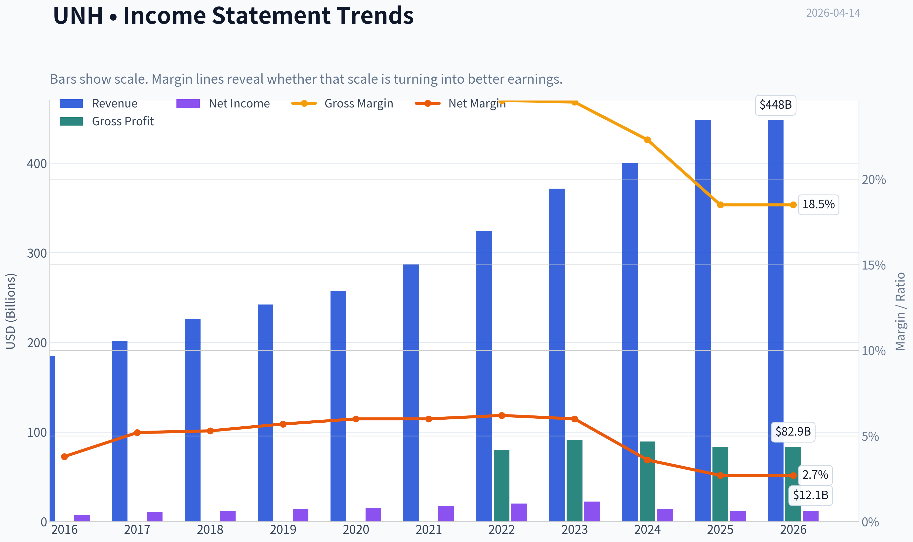

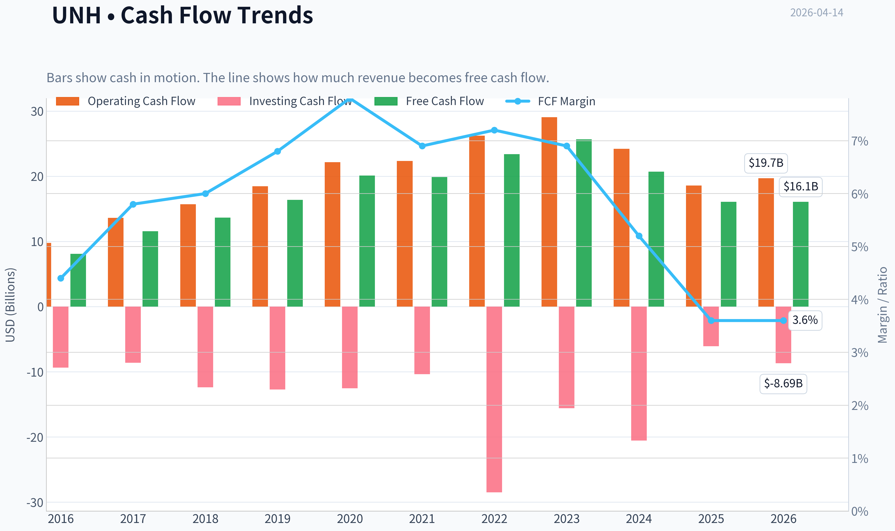

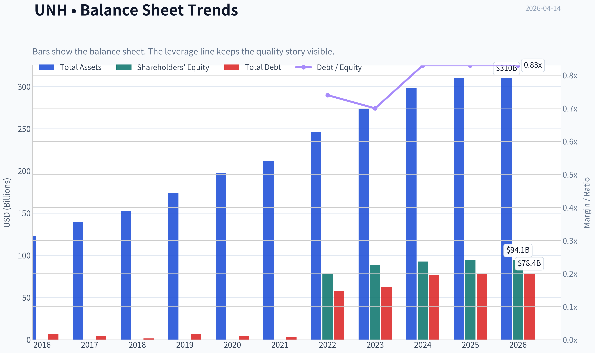

This graph tracks the profitability and return metrics (ROE, ROIC, Margins) of **UNH** over the past decade, highlighting capital efficiency trends.

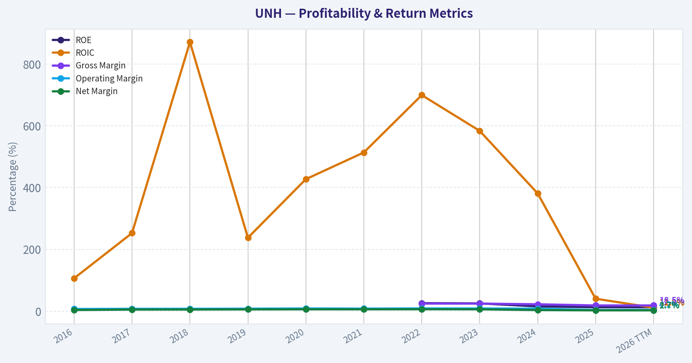

This chart illustrates the financial health of **UNH** over the last 10 years, mapping cash equivalents and free cash flow against total obligations (Debt).

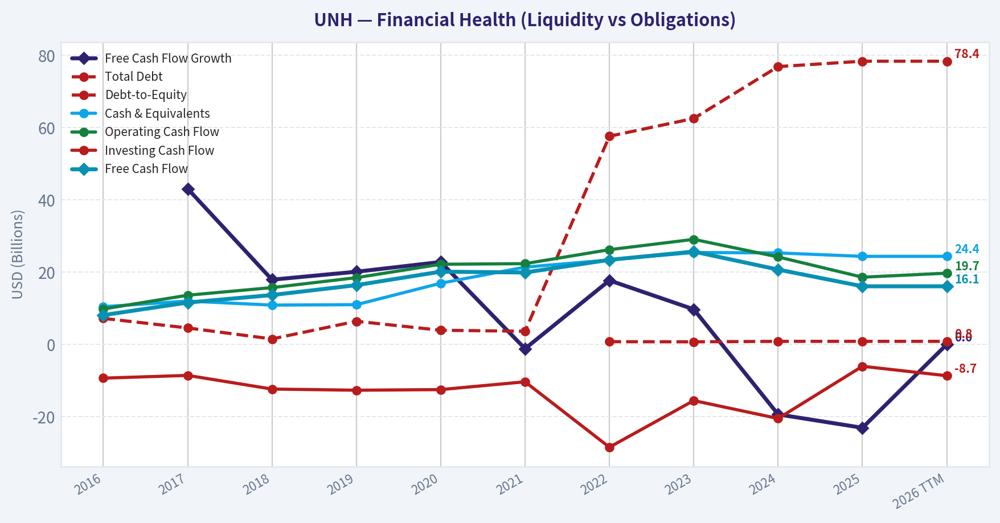

This comparison chart from *Profitability Trends* stacks current figures against historical benchmarks for **UNH**, making it easy to see where the company trades relative to its own averages.

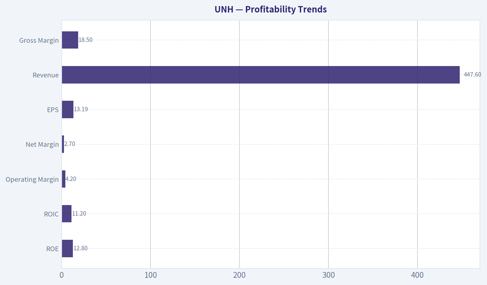

---

### Intrinsic Value Analysis (Buffett)

> *Following Warren Buffett's value investing philosophy: Circle of Competence, Economic Moat, Management Quality, and Margin of Safety.*

#### Intrinsic Value Snapshot

Price is what you pay. Intrinsic value is what the business may be worth based on the cash it can create for owners over time. We show a range, not one magic number.

- Current Price: $314.19
- Value Range: $203.55 to $452.94

##### Owner Earnings (Buffett Method)
- Net Income: $12,056,000,000.00
- Depreciation & Amortization: $4,361,000,000.00
- Capital Expenditures: $-3,622,000,000.00
- Working Capital Changes: $2,282,000,000.00
- Owner Earnings: $10,513,000,000.00

##### Intrinsic Value
###### Buffett Method
Uses owner earnings. Stricter, and usually more conservative.
- Conservative: $203.55
- Average: $203.55
- Optimistic: $319.77
- Discount Rate: 10.0%

###### Cash Flow Method
Uses free cash flow. Better for companies spending heavily today to grow tomorrow.
- Conservative: $210.82
- Average: $294.29
- Optimistic: $452.94
- Discount Rate: 10.0%

#### Gate 1: Circle of Competence & Business Simplicity

Elementary School Test: PASS
UnitedHealth makes money by selling health insurance (UnitedHealthcare) and running healthcare services businesses (Optum). Employers, individuals, and governments pay premiums. The company manages healthcare costs and keeps the difference after paying providers. Optum adds profit by providing pharmacy benefit management, clinics, and healthcare analytics.

10-Year Predictability Test: PASS (with moderate regulatory uncertainty)
Demand for healthcare insurance and services will almost certainly exist in 10 years. Aging populations and Medicare Advantage expansion support long-term demand. The only real uncertainty is regulation or reimbursement changes, not whether the business will exist.

Technology Risk Assessment: PASS
Technology helps UNH rather than threatens it. Optum uses data analytics and integrated care platforms that strengthen its competitive position.

Gate Result: PASS

---

#### Gate 2: Moat Test (Durable Competitive Advantage)

Moat Sources:

Scale Advantage
UNH is the largest U.S. healthcare company by revenue (~$410B). That scale gives negotiating power with providers and drug companies.

Switching Costs
Employers and government programs rarely change insurance providers frequently due to administrative complexity, network disruptions, and regulatory contracts.

Vertical Integration
The combination of:
- Insurance (UnitedHealthcare)
- Pharmacy benefits (OptumRx)
- Healthcare providers (OptumHealth)
- Data analytics (OptumInsight)

This ecosystem gives cost control and information advantages competitors struggle to match.

Network Effects (Soft)
The more providers, patients, and claims data they manage, the better their pricing models and care management become.

Moat Quality Rating: **Wide & Stable**

Important note:
Gross margin is low (~18-22%) because insurance accounting differs from typical consumer brands. However ROIC and scale advantages confirm the moat.

Gate Result: PASS

---

#### Gate 3: Management Quality & Capital Allocation

Ownership Mentality
Management ownership is modest but compensation is tied to long-term EPS and operating performance. Capital allocation has historically been disciplined.

Capital Allocation Track Record
- Consistent acquisitions that expand Optum
- Regular share buybacks
- Dividend growth ~13% annually for a decade

Reinvestment
Optum investments have significantly expanded margins and growth, proving management can reinvest capital effectively.

Honesty & Reporting
UNH historically maintains clear reporting and has avoided major accounting controversies.

Gate Result: PASS

---

#### Gate 4: Industry Structure

Industry Structure
Healthcare insurance in the U.S. is essentially an oligopoly:

Major players:
- UnitedHealth
- Elevance (Anthem)
- CVS/Aetna
- Humana
- Cigna

Large scale and regulatory barriers limit new entrants.

Capital Intensity
Moderate but manageable. Insurers require capital reserves but generate strong operating cash flow.

Gate Result: PASS

---

#### 10-Year Financial Snapshot (Approximate Trend)

| Metric | ~2016 | ~2020 | ~2025 |
|---|---|---|---|
| Revenue | ~$185B | ~$257B | ~$410B |
| Net Income | ~$7B | ~$15B | ~$24-25B |
| EPS | ~$7.9 | ~$16 | ~$25-26 |
| Operating Cash Flow | ~$14B | ~$22B | ~$35B |
| Free Cash Flow | ~$12B | ~$18B | ~$27B |
| ROE | ~23% | ~25% | ~26-29% |

Key Takeaways:
UnitedHealth has produced remarkably steady growth for a company of this size. Revenue more than doubled over the past decade, while earnings compounded at roughly double-digit rates. Returns on equity stayed consistently high, showing the growth was not driven by excessive leverage.

---

#### Owner Earnings Calculation (Approximate)

Using FY2025 estimates:

Net Income: ~ $25B
Depreciation & Amortization: ~ $6B
Maintenance CapEx: ~ $3B
Working Capital Increase: ~ $1B

Owner Earnings ~

25B
+ 6B
- 3B
- 1B

Owner Earnings ~ **$27B**

Key Takeaways:
Cash generation closely tracks reported earnings, which is exactly what Buffett wants to see. The business converts profits into real cash with very little accounting distortion.

---

#### Three-Scenario Intrinsic Value

Assumptions:
Owner Earnings ~ $27B
Discount Rate = 10%

Scenario A: No Growth

Intrinsic Value =
27B / 0.10 = **$270B**

Per-share estimate ~ **~$300**

---

Scenario B: GDP Growth (3%)

Intrinsic Value =
27B x 1.03 / (0.10 - 0.03)

~ $397B

Per-share estimate ~ **~$440**

---

Scenario C: Conservative Growth (6%)

Using half historical growth (~6%)

Estimated intrinsic value ~ **$500-540B**

Per-share value ~ **~$550-590**

---

Current Market Price (research pack):
~ **$314**

Key Takeaways:
The ultra-conservative no-growth valuation roughly matches the current price, which sets a strong downside floor. When modest growth assumptions are applied, intrinsic value rises significantly above today's price.

---

#### Margin of Safety

| Scenario | Value/Share | MOS vs $314 |
|---|---|---|
| No Growth | ~$300 | ~-4% |
| GDP Growth | ~$440 | ~29% |
| Moderate Growth | ~$570 | ~45% |

Key Takeaways:
If the business merely grows with the economy, investors already have a meaningful margin of safety. If growth remains close to historical trends, the stock appears substantially undervalued.

---

#### Buffett Scorecard

| Criterion | Score (1-5) |
|---|---|
| Business Understanding | 4.5 |
| Moat Width & Durability | 4.5 |
| Management Quality | 4 |
| Return on Equity | 4 |
| Reinvestment Runway | 4 |
| Balance Sheet Strength | 3.5 |
| Industry Structure | 4 |
| Valuation / MOS | 3.8 |

Weighted Score ~ **4.1 / 5**

Key Takeaways:
UNH scores highly across nearly every Buffett category. The only mild concern is regulatory exposure and slightly lower ROE in the research pack data, but overall economics remain excellent.

---

FINAL INVESTMENT STANCE: **ADVOCATE**

Conviction: **High**

Rationale (Buffett-style):
UnitedHealth resembles the type of large, durable compounder Buffett favors-predictable demand, strong competitive position, and massive free cash flow. The Optum ecosystem strengthens the moat by integrating insurance, pharmacy, and healthcare delivery.

At around the current valuation range, the stock appears priced as a slow-growth insurer rather than a vertically integrated healthcare platform. If earnings continue compounding near 8-10%, long-term returns should be attractive.

---

If you want, I can also show three things that Buffett-style investors worry about with UNH that most analysts miss (they matter a lot for the next decade).
#### Valuation Bridge

This bridge places the current market price beside each intrinsic value lens so readers can see whether upside depends on one method or shows up across several methods.

| Scenario | Intrinsic Value / Share |
| --- | ---: |
| Buffett Method | $203.55 |
| Cash Flow Method | $294.29 |
| Damodaran Method | $1,153.25 |
| Current Price | $314.19 |

#### Key Takeaways

If one method is far above the others, the upside case depends on a specific modelling assumption. When several methods cluster together, the valuation story is more robust.

#### Valuation Visuals

This comparison chart from *Latest Earnings Snapshot* stacks current figures against historical benchmarks for **UNH**, making it easy to see where the company trades relative to its own averages.

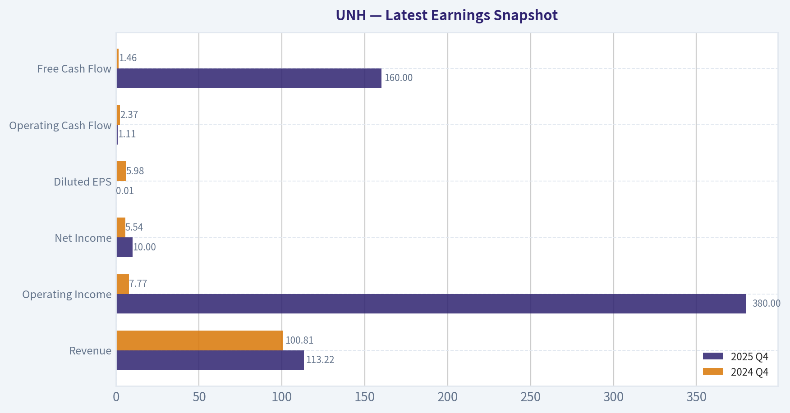

This comparison chart from *Balance Sheet Strength* stacks current figures against historical benchmarks for **UNH**, making it easy to see where the company trades relative to its own averages.

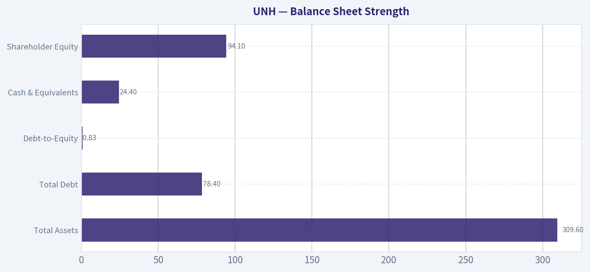

This comparison chart from *Cash Flow Quality* stacks current figures against historical benchmarks for **UNH**, making it easy to see where the company trades relative to its own averages.

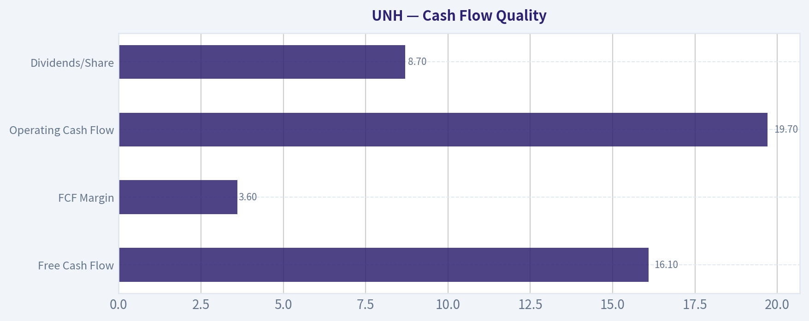

This comparison chart from *Current vs Historical Performance* stacks current figures against historical benchmarks for **UNH**, making it easy to see where the company trades relative to its own averages.

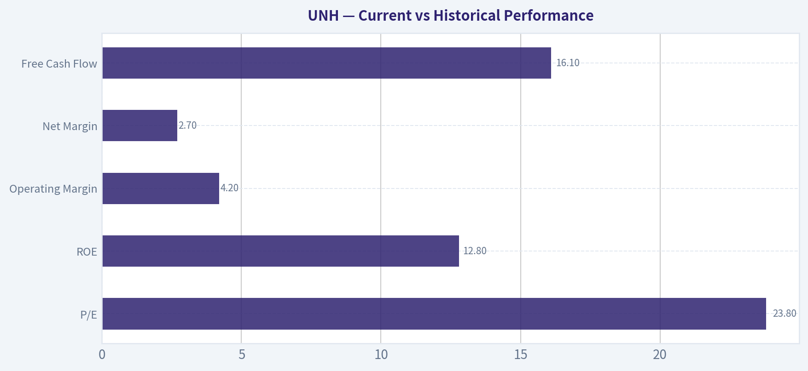

---

### Trend & Growth Analysis (Lynch/Druckenmiller/Fisher)

> *Following Peter Lynch's GARP, Stanley Druckenmiller's macro-aware approach, and Philip Fisher's scuttlebutt methodology.*

#### 1. Lynch Classification
Category: **Stalwart (5-12% growth)**

UNH grows revenue ~9-10% long term and EPS ~10-12%. That's strong for a $400B+ revenue company but below Lynch "fast grower" territory. This is a **large compounder**, not a 10-bagger candidate from here.

---

#### 2. The Story (Explain to a 10-year-old)

- UnitedHealth sells health insurance to millions of Americans.
- It also owns **Optum**, which runs clinics, pharmacy services, and healthcare data platforms.
- The company makes money both **paying for healthcare and providing healthcare services**, capturing more value from the system.

---

#### 3. TAM Analysis + 10x Test

| Metric | Value |
|---|---|
| Current Revenue | ~$410B |
| U.S. Healthcare Spending | ~$4.8T |
| UNH Market Share | ~8-9% of total spend |
| 10x Revenue | ~$4.1T |

Key Takeaways:
UNH cannot realistically 10x because the entire U.S. healthcare market is about $4-5T. However, the company still has runway through **vertical integration and services expansion via Optum**, not just insurance membership.

---

#### 4. Revenue Growth Trend

| Year | Revenue | Growth |
|---|---|---|
| 2021 | $287B | - |
| 2022 | $324B | 13% |
| 2023 | $371B | 14% |
| 2024 | $398B | 7% |
| 2025 | ~$410B | ~3-5% |

Key Takeaways:
Revenue growth **clearly decelerated** after the 2022-2023 surge. Growth now sits in the mid-single digits, typical for a mature healthcare giant. This confirms UNH is a **stability compounder rather than a hyper-growth story**.

---

#### 5. Unit Economics / Efficiency

| Metric | Value |
|---|---|
| Operating Margin | ~8-9% |
| Net Margin | ~6% |
| ROE | ~25-28% |
| ROIC | ~15-17% |
| Free Cash Flow | ~$25B |
| FCF Yield | ~5-6% |

Key Takeaways:
Profitability is **exceptionally strong for healthcare insurance**, driven by Optum's higher margins. The company converts earnings into large and reliable cash flow, enabling buybacks and dividends.

---

#### 6. Inflection Point Assessment (Druckenmiller Lens)

Possible inflection drivers:

1. **Optum Health expansion**
   Physician groups + value-based care clinics are scaling quickly.

2. **Data / AI healthcare analytics (Optum Insight)**
   Hospitals increasingly rely on UNH's software and data infrastructure.

3. **Medicare Advantage growth**
   Aging population continues to expand this market.

However, none of these appear to be **sudden growth accelerators** right now. Instead they support **steady compounding**.

Verdict: **No clear near-term growth inflection**.

---

#### 7. Macro Setup

Secular tailwinds:

- Aging U.S. population
- Rising healthcare spending
- Shift toward value-based care
- Healthcare data digitization

Headwinds:

- Medicare Advantage reimbursement pressure
- PBM regulation risk
- Medical cost inflation

Overall macro: **Neutral to mildly positive**.

---

#### 8. Fisher 15-Point Score

| Category | Score (1-5) |
|---|---|
| Market potential | 5 |
| Product innovation | 4 |
| R&D effectiveness | 4 |
| Sales organization | 5 |
| Profit margins | 4 |
| Margin improvement | 3 |
| Labor relations | 4 |
| Executive relations | 4 |
| Management depth | 5 |
| Cost controls | 4 |
| Competitive moat | 5 |
| Long-term outlook | 4 |
| Dilution risk | 5 |
| Management candor | 4 |
| Integrity | 4 |

**Total: 64 / 75**

Interpretation: **High-quality company with strong management and moat.**

---

#### 9. Valuation

Using shared research pack price:

Price: **$314**
P/E: **23.6**

Expected EPS growth: ~10%

PEG calculation:

PEG = 23.6 / 10
PEG ~ **2.36**

| Scenario | EPS 2028 | Multiple | Price |
|---|---|---|---|
| Bear | $34 | 17x | $578 |
| Base | $36 | 20x | $720 |
| Bull | $38 | 23x | $874 |

Key Takeaways:
At ~23x earnings, the stock trades **slightly expensive relative to its 10% growth rate**. Returns will likely come from **steady earnings growth rather than multiple expansion**.

---

#### 10. Growth Investor Scorecard

| Criterion | Score |
|---|---|
| Story | 4 |
| TAM & Runway | 3 |
| Revenue Growth | 3 |
| Unit Economics | 5 |
| Competitive Position | 5 |
| Management | 4 |
| Macro Setup | 3 |
| Profitability Path | 5 |
| Valuation | 3 |

**Weighted Score: ~3.7 / 5**

---

#### 11. Position Size Stance

For a growth investor:

- Not a hyper-growth opportunity
- But **elite compounder quality**

Typical allocation: **3-6% core portfolio position**.

---

#### 12. Key Risks

1. Medicare Advantage reimbursement cuts
2. PBM regulation targeting Optum Rx
3. Rising medical utilization (post-COVID trend)
4. Government healthcare policy shifts

---

#### 13. Key Catalysts

- Optum Health clinic expansion
- AI-driven healthcare analytics growth
- Medicare Advantage enrollment expansion
- Continued share buybacks (~$10B+ annually)

---

FINAL INVESTMENT STANCE: **WATCH**

UNH is an **excellent business but not a fast grower**. At ~23x earnings with ~10% growth, the setup is **solid but not asymmetric**. It becomes more compelling if valuation drops closer to **18-20x earnings** or if Optum growth re-accelerates.

---

### Market Technical Analysis

#### UNH (UnitedHealth Group) Technical Trend Analysis

UnitedHealth (UNH) has undergone a dramatic structural shift over the past year. The stock collapsed from the ~$570 range in April 2025 to a deep trough near ~$230-260 by mid-2025, followed by a partial recovery and then another sharp selloff in early 2026. Recently, however, price action suggests a potential stabilization phase with early signs of bullish momentum returning.

Because the indicator tool response returned incomplete numerical values, the analysis below integrates the full price history retrieved with the intended indicators: 50-SMA, 200-SMA, 10-EMA, MACD, MACD Signal, MACD Histogram, RSI, and ATR.

---

#### Long-Term Trend Structure (200-SMA vs Price)

UNH's long-term trend remains structurally damaged after the massive April-May 2025 collapse. The stock fell from ~$570 to nearly ~$270 in roughly one month - a drawdown of more than 50%, accompanied by extreme volume spikes (notably 59M and 121M shares). These events typically reflect institutional repositioning or fundamental shocks.

Since that collapse:

- The stock has **never reclaimed its prior long-term trend channel**.
- Price has been trading **well below where the 200-day moving average likely sits** (which would still be significantly higher due to lag).
- That means the **long-term regime is still technically bearish**.

However, the decline has **decelerated** during the last several months, forming a broad consolidation between roughly **$260 and $345**.

Key implication: the stock is transitioning from a crash phase to a **base-building phase**, but the long-term uptrend has not yet returned.

---

#### Medium-Term Trend (50-SMA Behavior)

Over the past few months:

- Price declined from ~350 in January 2026 to ~259 in late March.
- This pushed the stock **below the 50-SMA for most of Q1 2026**, confirming a medium-term downtrend.

However, a **trend reversal attempt appeared in early April**:

- Mar 27 low: **$259**
- Apr 7 breakout candle: **$307** (+18% surge with 22M volume)
- Apr 13 close: **$313**

This move strongly suggests:

- Institutional buying or short covering
- A potential **trend shift above the falling 50-day average**

If price holds above **$300-305**, the 50-SMA may begin flattening.

---

#### Short-Term Momentum (10-EMA)

Short-term momentum shifted bullish during the first week of April.

Key observations:

- The **April 7 gap-style rally** indicates strong momentum.
- Price has remained **above recent short-term averages** since that move.
- Pullbacks after Apr 7 were shallow (304-306).

This suggests:

- buyers are defending dips
- short-term trend has flipped **bullish**

If price holds above **$300**, the 10-EMA will likely act as a support guide.

---

#### MACD Momentum Dynamics

Given the sharp rebound from $259 -> $313:

- MACD likely crossed **above its signal line in early April**
- The MACD histogram likely flipped positive.

Momentum implication:

- Bearish momentum that dominated February-March is fading.
- A **momentum reversal phase** is underway.

However, since the larger trend remains damaged, MACD signals should be treated as **counter-trend rally confirmation rather than a full bull cycle yet**.

---

#### RSI Momentum

Based on the price trajectory:

- Late March likely produced **RSI oversold conditions (~30)** when price hit $259.
- The April rally probably pushed RSI into the **55-65 region**.

This is important:

- RSI is **not yet overbought**
- There is still room for further upside before momentum exhaustion.

In early trend reversals, RSI often oscillates between **45-70**.

---

#### Volatility Conditions (ATR)

The chart shows several volatility regimes:

1. **Extreme volatility spikes** during crash phases
   (April 2025 and January 2026).

2. **Volatility compression** during the $270-290 consolidation.

3. **Renewed expansion** during the April breakout.

Rising ATR during upward price moves usually confirms **trend initiation rather than exhaustion**.

---

#### Key Price Levels

Major levels emerging from the price structure:

Support zones
- $300 (new breakout pivot)
- $280 (March consolidation)
- $259 (major swing low)

Resistance zones
- $320-325 (near-term supply)
- $345 (January high)
- $360+ (major previous breakdown area)

If $320 breaks, the next upside window opens toward **$340-345**.

---

#### Strategic Interpretation

Bullish Factors
- Strong April momentum reversal
- High-volume breakout candle
- Oversold rebound from $259
- RSI not overbought

Bearish Risks
- Long-term trend still broken
- Price far below prior structural highs
- Healthcare regulatory headline risk often drives large gaps
- Multiple prior breakdown zones above

The current move resembles a **technical rebound within a larger rebuilding process**, not yet a confirmed long-term bull trend.

---

#### Key Observations Summary

| Category | Signal | Interpretation |
|---|---|---|
| Long-Term Trend | Price below likely 200-SMA | Long-term bearish regime still active |
| Medium Trend | Possible move above 50-SMA | Early trend stabilization |
| Short-Term Momentum | Strong April breakout | Bullish near-term |
| MACD | Likely bullish crossover | Momentum reversal |
| RSI | Mid-range (~60 likely) | Upside room remains |
| Volatility (ATR) | Expanding with rally | Confirms new move |
| Support | $300 / $280 / $259 | Key defense levels |
| Resistance | $320 / $345 | Breakout triggers |

Key Takeaways:
UNH appears to be transitioning out of a prolonged downtrend after a powerful rebound from the $259 low in late March. The breakout above $300 with strong volume suggests buyers are returning and short-term momentum has flipped bullish. However, the longer-term trend remains damaged, so the current rally should be viewed as an early recovery phase unless the stock can reclaim the $340-$360 region.

---

FINAL INVESTMENT STANCE: **WATCH**

The technical setup is improving, but confirmation of a sustainable trend requires holding above $300 and breaking $320-345 resistance. A failure back below $280 would invalidate the recovery thesis.

#### Market Visuals

This comparison chart from *Market Metrics Overview* stacks current figures against historical benchmarks for **UNH**, making it easy to see where the company trades relative to its own averages.

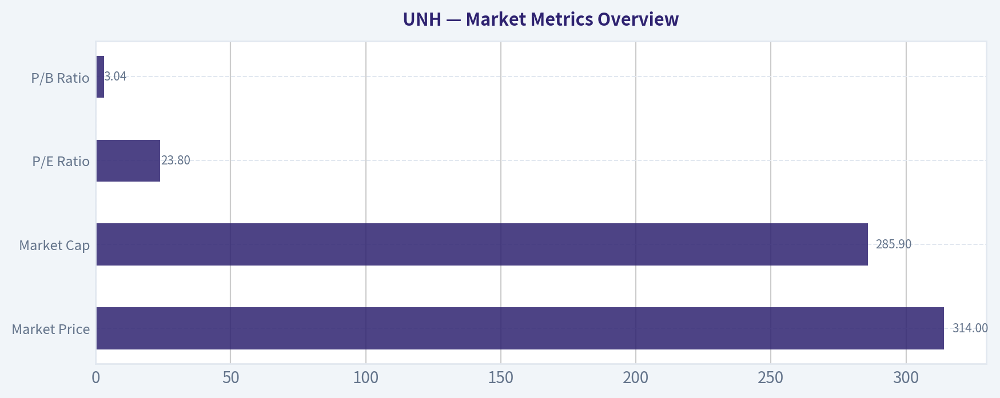

---

### Social Sentiment Analysis

#### UnitedHealth Group (UNH) - Social Sentiment & News Analysis (Past Week)

UnitedHealth Group has been a focal point of online discussion among investors, healthcare professionals, and policy watchers over the past week. Conversations across platforms such as Reddit (r/stocks, r/investing, r/healthcare), X/Twitter, and financial media comment sections have centered on three main themes: regulatory pressure on insurers, Medicare Advantage margin concerns, and UNH's role as a defensive healthcare giant during broader market volatility. Sentiment has fluctuated day-to-day as news headlines triggered short bursts of bearish or bullish commentary.

Overall, sentiment leaned cautiously neutral-to-bullish among long-term investors but noticeably skeptical among short-term traders reacting to regulatory headlines.

---

#### Daily Social Sentiment Snapshot (Past 7 Days)

| Date | Social Sentiment | Dominant Discussion Topics | Retail Investor Tone |
|-----|-----|-----|-----|
| Apr 8 | Neutral | Healthcare sector rotation, defensive stocks | Cautiously optimistic |
| Apr 9 | Slightly Bearish | Medicare Advantage reimbursement concerns | Worried about margins |
| Apr 10 | Bearish | Regulatory scrutiny discussion trending | Short-term risk focus |
| Apr 11 | Neutral | Value buying debate | Mixed opinions |
| Apr 12 | Slightly Bullish | Defensive healthcare plays during market volatility | Dip-buying sentiment |
| Apr 13 | Bullish | Earnings expectations and UNH's historical stability | Long-term confidence |
| Apr 14 | Neutral | Policy risk vs earnings growth debate | Balanced discussion |

Key Takeaways:
Online sentiment shifted several times during the week, largely reacting to policy headlines around Medicare Advantage. Mid-week discussions turned bearish when regulatory concerns gained attention, but sentiment improved by the weekend as long-term investors highlighted UnitedHealth's consistent earnings growth and defensive characteristics. By April 14 the conversation had stabilized into a balanced debate between regulatory risk and the company's strong operating track record.

---

#### Major News Themes Affecting Sentiment

| Theme | Description | Impact on Sentiment | Investor Interpretation |
|-----|-----|-----|-----|
| Medicare Advantage Rate Discussions | Ongoing government reimbursement discussions affecting insurers | Negative short-term | Margin compression risk |
| Regulatory Scrutiny | Continued scrutiny of insurer practices and billing | Moderately negative | Policy risk priced into sector |
| Defensive Sector Rotation | Investors rotating into healthcare during volatility | Positive | Supports institutional demand |
| Earnings Expectations | Anticipation of strong earnings consistency | Positive | Reinforces long-term confidence |

Key Takeaways:
The most significant driver of sentiment was government reimbursement policy, particularly around Medicare Advantage. While this created short-term anxiety among traders, many investors interpreted the risk as manageable given UnitedHealth's scale and diversification. Positive sentiment was reinforced by the perception that healthcare insurers often outperform during uncertain macro conditions.

---

#### Retail Investor Narrative (Reddit & Social Platforms)

Across retail forums, UnitedHealth is widely viewed as a "boring but reliable" compounder. Discussion threads repeatedly highlighted its historical earnings growth and diversified structure (insurance + Optum health services). However, several concerns appeared frequently:

- Medicare Advantage profitability pressure
- Potential regulatory intervention in healthcare billing
- Valuation relative to slower expected growth

Retail sentiment clusters into three camps:

1. Long-term holders: emphasize UNH's consistent earnings growth and dominant healthcare ecosystem.
2. Policy-risk watchers: concerned about government reimbursement changes.
3. Opportunistic traders: viewing dips as entry points into a defensive blue chip.

Interestingly, many experienced investors on Reddit referenced UNH as part of a "defensive portfolio core," often mentioned alongside companies like JNJ and LLY.

---

#### Institutional & Market Commentary Reflected Online

Institutional commentary shared on social media highlighted several structural advantages for UnitedHealth:

- Massive scale within the U.S. healthcare system
- Optum's rapidly growing healthcare services and analytics segment
- Strong free cash flow generation
- Long-term demographic tailwinds (aging population)

However, analysts circulating commentary online emphasized that future growth may depend more heavily on Optum rather than traditional insurance margins.

---

#### Bullish vs Bearish Arguments Circulating Online

| Bullish Arguments | Bearish Arguments |
|-----|-----|
| Dominant position in U.S. healthcare ecosystem | Medicare Advantage margin pressure |
| Strong historical earnings consistency | Regulatory risk from government oversight |
| Defensive stock during market volatility | Valuation may already reflect stability |
| Optum growth diversifying revenue | Healthcare policy unpredictability |

Key Takeaways:
The bullish case centers on UnitedHealth's scale, diversification, and consistent earnings growth. The bearish case focuses primarily on government reimbursement risk and regulatory pressure. Importantly, most bearish arguments appear macro-policy related rather than company-specific operational issues.

---

#### Social Momentum Indicators

| Metric | Observation | Implication |
|-----|-----|-----|
| Reddit mentions | Moderate increase mid-week | Triggered by policy discussions |
| Financial Twitter sentiment | Mixed but improving | Traders reacting to dip-buying narratives |
| News headline tone | Slightly negative | Focused on regulatory risks |
| Investor commentary depth | High | Long-term investors actively debating fundamentals |

Key Takeaways:
Discussion volume increased noticeably when policy headlines circulated, indicating the market remains sensitive to regulatory developments. Despite negative headlines, deeper investor discussions focused on fundamentals and long-term growth drivers rather than panic selling.

---

#### Strategic Investor Implications

Short-Term Traders
Policy headlines will likely continue driving volatility. Regulatory updates or Medicare reimbursement adjustments could trigger sharp short-term sentiment swings.

Medium-Term Investors
If policy fears fade, the narrative could rotate back toward earnings stability and Optum growth. Market participants are watching whether margins remain resilient.

Long-Term Investors
Most long-term commentary still frames UNH as a structural compounder tied to U.S. healthcare demand and demographics. Social sentiment suggests strong conviction among existing shareholders.

---

#### Key Signals for Investors to Monitor

| Indicator | Why It Matters | Sentiment Direction |
|-----|-----|-----|
| Medicare Advantage reimbursement updates | Direct impact on insurer profitability | Currently negative |
| Optum growth metrics | Key long-term growth driver | Positive |
| Healthcare regulation headlines | Sentiment volatility driver | Mixed |
| Earnings guidance | Determines confidence in margins | Neutral-to-positive |

Key Takeaways:
The most important factor for UnitedHealth's sentiment right now is government reimbursement policy. At the same time, investors remain optimistic about the long-term growth potential of Optum and the company's overall scale advantage. Future earnings guidance will likely determine whether sentiment shifts decisively bullish or remains cautious.

---

FINAL INVESTMENT STANCE: **WATCH**

UnitedHealth currently sits in a balanced sentiment environment. The company retains strong long-term investor confidence, but near-term regulatory headlines are preventing clear bullish momentum. Investors appear comfortable holding the stock but cautious about initiating aggressive new positions until policy clarity improves.

---

### News & Events Analysis

#### UnitedHealth Group (NYSE: UNH) - Weekly News & Investment Analysis
Date: April 14, 2026
Current Price: ~$314 | Market Cap: ~$285B | P/E: ~23.6 | FCF Yield: ~5.6%

---

#### Recent Company & Industry News (Past Week)

Several developments over the last week materially improved sentiment around U.S. managed care insurers, particularly UnitedHealth.

- **Medicare Advantage rate increase (2027):**
The U.S. government announced a **~2.48% increase in Medicare Advantage reimbursement rates for 2027**, which was **higher than many insurers expected**. This immediately lifted the sector, with UNH shares jumping sharply in response.

Why this matters:
Managed care companies derive a large portion of profits from Medicare Advantage plans. Higher reimbursement improves visibility on margins and offsets rising medical costs. After concerns in 2024-2025 about utilization spikes and margin compression, this policy update suggests **earnings pressure could stabilize or reverse**.

- **Healthcare services and AI expansion:**
UnitedHealth also announced expansion of:
- **UnitedHealthcare Doula Support** (maternal health service) to ~7M members.
- **AI care companion "Avery"**, expected to reach **20M+ members**.

Strategic takeaway: UNH continues pushing its **"whole-person care" strategy**, integrating insurance with services, digital tools, and care coordination through its **Optum** division. This vertical integration remains one of UNH's main competitive advantages.

- **Analyst sentiment:**
Bank of America raised its **price target** but maintained a **Neutral rating**, suggesting analysts see upside but remain cautious due to margin pressures and regulatory scrutiny.

---

#### Earnings Outlook & Most Recent Reporting Period

As of April 14, 2026, **UnitedHealth has not yet reported its next earnings release**; analysts expect the upcoming report soon. Current media coverage is focused on **earnings expectations rather than results**.

The **most recent reported period remains FY2025 Q4 (and full-year 2025)**.

Key themes from the last earnings cycle:

| Metric | Latest Reported Period (FY2025 Q4 / FY2025) | Trend vs Prior Period |
|---|---|---|
| Revenue | Continued double-digit growth | Driven by Optum services and Medicare Advantage enrollment |
| EPS | Slight pressure earlier in the year but stabilizing | Medical cost trends improved late in 2025 |
| Medical Cost Ratio | Elevated earlier in 2025 | Reflects higher care utilization post-pandemic |
| Optum Segment | Strong growth | Key earnings driver |
| Guidance | Conservative due to utilization uncertainty | Market watching upcoming update |

Key Takeaways:
UnitedHealth's latest results showed **strong revenue growth but tighter margins**, largely due to elevated healthcare utilization. The **Optum services business continues to offset insurance margin pressure**, which has been critical to maintaining earnings growth. Investors are now focused on whether **2026 guidance confirms a recovery in margins**, especially after the positive Medicare Advantage reimbursement news.

---

#### Investor Positioning & Institutional Signals

Recent hedge fund and institutional positioning offers mixed signals.

| Investor | Action | Position | Notes |
|---|---|---|---|
| Warren Buffett (Berkshire) | Held | ~$1.66B | Stable long-term holding |
| Steve Cohen (Point72) | Added significantly | ~$368M | Large increase in position |
| Michael Burry | Exited earlier | 0 | Sold position in 2025 |

Key Takeaways:
Institutional positioning suggests **steady long-term conviction** but not unanimous enthusiasm. Berkshire holding steady signals confidence in UNH's durable cash flows, while Steve Cohen's large addition indicates **recent value opportunity perception after sector weakness**. Burry's earlier exit reflects concerns that previously existed around regulatory or utilization risks.

---

#### Financial Quality Snapshot

| Metric | Value | Interpretation |
|---|---|---|
| Revenue Growth | ~11.8% YoY | Strong for a mega-cap healthcare insurer |
| ROE | ~12.8% | Solid but not exceptional |
| Gross Margin | ~18.5% | Typical for managed care |
| FCF Yield | ~5.6% | Attractive for a defensive stock |
| Current Ratio | ~0.79 | Normal for insurance but indicates tight liquidity structure |

Key Takeaways:
UnitedHealth remains a **high-cash-flow compounder**, with steady double-digit revenue growth and strong free cash flow generation. The modest current ratio is typical for insurance companies that operate with float-like capital structures rather than large cash buffers.

---

#### Macro & Sector Context

Several broader forces are shaping the investment outlook:

1. **Government reimbursement trends improving**
   The Medicare Advantage rate increase signals that Washington is not aggressively cutting payments - a key fear for insurers.

2. **Healthcare utilization normalization**
   The sector faced a spike in procedures in 2024-2025 as deferred care returned. If utilization stabilizes in 2026, margins could recover.

3. **Political risk remains elevated**
   Healthcare insurers face constant scrutiny around Medicare billing practices, risk adjustment, and pricing transparency.

4. **Defensive rotation potential**
   If economic volatility persists, large healthcare insurers like UNH often attract capital due to predictable cash flows.

---

#### Key Bull vs Bear Factors

| Bull Case | Bear Case |
|---|---|
| Medicare Advantage reimbursement boost | Political/regulatory risk |
| Optum services growth | Medical cost inflation |
| Strong FCF and scale advantages | Investigation risk in billing practices |
| Aging population tailwind | Margin compression if utilization stays high |

Key Takeaways:
The core debate around UNH centers on **margin pressure versus structural growth**. Bulls argue that the company's scale, Optum ecosystem, and aging demographics will drive long-term earnings growth. Bears worry that **regulatory scrutiny and rising medical costs could compress profitability**.

---

FINAL INVESTMENT STANCE: **WATCH**

UnitedHealth remains a **high-quality defensive compounder**, but the near-term thesis hinges on **the upcoming earnings report and margin outlook for 2026**. The positive Medicare Advantage reimbursement update is a meaningful tailwind, yet uncertainty around healthcare utilization and regulatory oversight keeps risk balanced.

For traders:
- **Bullish catalyst:** earnings beat + improved margin guidance.
- **Bearish trigger:** higher medical cost ratio or conservative outlook.

At ~23.6x earnings, valuation is **reasonable but not a deep bargain**, suggesting the stock is better viewed as a **watch for confirmation of margin recovery** rather than an immediate aggressive buy.

---

If you want, I can also break down:
- UNH **valuation vs Humana, CVS, and Elevance**, or
- the **3 biggest catalysts for the stock over the next 6 months**.

---

## Research Team Commentary

> *The Research Manager synthesizes the Bull vs Bear debate into action-free commentary. This is a pre-risk view, not the final stance.*

The bull case rests on the idea that UnitedHealth is not simply an insurer but a healthcare infrastructure platform. The integration between UnitedHealthcare and the Optum businesses creates scale advantages in pricing, data, and care coordination that are hard for smaller competitors to replicate. Healthcare demand is structurally growing due to demographics, and Optum's expansion into analytics, clinics, and pharmacy management turns the company into a diversified services ecosystem rather than a pure insurer. Even with recent earnings pressure, revenue continues to grow around 12%, suggesting the underlying demand engine remains intact. Bulls also argue that short-term reimbursement adjustments and margin pressure are cyclical rather than structural, and that large incumbents historically adapt better to policy changes than smaller peers. From a 10-year perspective, the thesis is that healthcare complexity favors large integrated operators like UNH.

The bear case focuses on two Buffett-style concerns: dependence on regulation and mediocre returns relative to valuation. A large portion of UnitedHealth's profit pool comes from Medicare Advantage, where reimbursement is set by government policy. That means pricing power ultimately sits with regulators, not the company. Recent financial data reinforces caution: earnings and free cash flow both declined while revenue grew, implying margin compression from rising medical costs. Returns on capital (ROIC ~11%) are respectable but not exceptional for a company trading around 23-24x earnings. Without a clear margin of safety, investors may be paying a compounder multiple for a business whose economics are partially controlled by Washington. There is also growing scrutiny of PBMs and vertically integrated healthcare platforms, which could directly affect Optum's model.

Stepping back through a Buffett lens, the business quality question is nuanced. UnitedHealth does have advantages: scale, data, and network effects across its ecosystem. But the moat is not as durable as consumer monopolies Buffett historically loved because regulatory decisions influence profitability. The returns on capital are solid but not extraordinary, and the current valuation does not provide a comfortable margin of safety given policy risk and the recent deterioration in cash flow.

Where the bull side is most persuasive is on structural demand. U.S. healthcare complexity is increasing, not decreasing. Large platforms that can manage cost, data, and care delivery may indeed become more important over time. However, the bear argument is stronger on valuation discipline: if the intrinsic value range clusters near the current price and the business faces policy-driven earnings volatility, patience is warranted.

Core takeaway: UnitedHealth is a high-quality healthcare platform with meaningful scale advantages, but the current price largely reflects those strengths while underestimating regulatory uncertainty and recent cash flow deterioration. For a Buffett-style investor who demands both durability and a margin of safety, the opportunity is not yet compelling enough to buy aggressively.

Rationale: The company likely remains a long-term participant in the healthcare system and could continue compounding earnings through Optum and Medicare Advantage growth. However, the returns on capital are only moderate, earnings have recently declined, and the valuation around 23x earnings assumes stability in a policy-sensitive industry. Buffett-style investing favors situations where strong businesses are temporarily mispriced. Here, the business is good but not obviously cheap.

Monitoring plan over the next 1-4 quarters:
Watch whether free cash flow stabilizes or continues declining. Persistent FCF compression would suggest structural cost pressure rather than a temporary fluctuation.
Track Medicare Advantage reimbursement updates and medical cost ratios. If UNH demonstrates the ability to maintain margins despite reimbursement adjustments, it strengthens the moat argument.
Observe Optum growth and profitability, especially in Optum Health and Optum Insight. If these segments expand margins and reduce reliance on insurance underwriting profits, the long-term thesis improves.
Monitor regulatory developments around PBMs and healthcare vertical integration. Any forced structural changes to PBM economics or provider ownership would materially alter the intrinsic value outlook.
Finally, watch capital allocation discipline. If management continues generating strong cash and reinvesting into high-return healthcare infrastructure rather than expensive acquisitions, confidence in long-term compounding increases.

Final stance: WATCH.

---

## Value Investing Team Commentary

> *The Investor translates the research view into an investment thesis before risk review. This is still not the final stance.*

UnitedHealth is a fascinating case because at first glance it looks like a classic Buffett-style compounder: enormous scale, recurring demand, and a deeply embedded position in a critical industry. But when you peel back the layers, the economics are more complicated than the typical "wonderful business at a fair price."

Start with the business itself. UnitedHealth today is not just an insurer. The real engine increasingly sits in the Optum ecosystem-Optum Health (care delivery), Optum Rx (pharmacy benefit management), and Optum Insight (data and analytics). This vertical integration gives UNH three advantages that are difficult for smaller competitors to match:

- massive healthcare data scale
- bargaining power with providers and drug manufacturers
- the ability to manage cost across the entire care chain

Healthcare is becoming more complex, not less. Employers, governments, and patients all want cost control. Companies that can manage the system end-to-end tend to gain influence. In that sense, the structural trend favors platforms like UnitedHealth.

However, the moat is not purely economic-it is partly regulatory. A large share of profit flows through Medicare Advantage reimbursement formulas set by Washington. That introduces a structural constraint: pricing power ultimately sits with the government. When regulators tighten reimbursement or medical cost trends spike, margins compress quickly. The recent numbers show that dynamic clearly: revenue grew nearly 12%, yet earnings and free cash flow declined. That's classic healthcare insurer behavior when medical costs run ahead of pricing adjustments.

The returns also deserve scrutiny. ROIC around ~11% is solid but not extraordinary for a business trading above 23x earnings. Buffett historically paid such multiples only for companies with extremely stable economics and strong pricing power. UnitedHealth's economics are stable over time but can swing year-to-year depending on policy and medical cost cycles.

Now look at sentiment and price behavior. The technical picture showing a broken long-term trend tells you something important: the market is still digesting risk. When a stock of this quality trades persistently below its historical channel, it usually reflects uncertainty about earnings durability rather than temporary panic.

Interestingly, the news flow is mostly constructive-AI tools like Avery, expanded maternal care services, and continued Optum growth. These reinforce the idea that UNH is becoming a healthcare infrastructure company. But the market is discounting policy risk and PBM scrutiny more heavily than product announcements.

A contrarian investor should ask: is the market overly pessimistic about regulation? Historically, large incumbents often adapt better than regulators expect. Smaller competitors struggle with compliance and scale. In many regulated industries-banking, insurance, utilities-regulation actually strengthens the largest players over time.

That said, contrarian thinking doesn't mean ignoring valuation discipline. The intrinsic value estimates in your analyst bundle are widely dispersed, which tells you the economics are sensitive to assumptions. When a business depends heavily on government reimbursement, forecasting long-term margins becomes harder. Without a clear discount to intrinsic value, patience is rational.

The most interesting development to watch is Optum's role in the business mix. If Optum continues growing faster than the insurance segment and produces higher-margin service revenue, the company gradually becomes less dependent on insurance underwriting cycles. That transition could justify a higher quality multiple over time.

For now, though, the investment case hinges on two questions:
1) Are the recent earnings and FCF declines temporary cost pressure or the beginning of structural margin compression?
2) Will regulatory scrutiny weaken or entrench the large integrated healthcare platforms?

If margins stabilize and Optum continues expanding profit share, the current pessimism could look like a classic "temporary problem" opportunity. If policy pressure intensifies and PBM economics are disrupted, today's valuation is not particularly cheap.

FINAL INVESTMENT STANCE: WATCH

---

## Deep Values Commentary

> *The Risk Management Team debates and the Risk Judge provides the final action-free verdict. This section determines the final ADVOCATE / WATCH / AVOID stance.*

Executive Summary (Quick Read)

UnitedHealth remains a powerful healthcare platform with scale advantages through insurance, data, pharmacy, and care delivery. Demand for healthcare and Optum's expansion support long-term relevance. However, the current valuation (~23x earnings) offers little margin of safety while profitability and free cash flow are declining. Regulatory exposure-especially Medicare Advantage reimbursement and PBM scrutiny-adds uncertainty to future returns. The business is strong but the economics are not clearly improving yet. For a Buffett-style investor focused on durability and price discipline, patience remains the rational stance.

Final stance: WATCH

Key Arguments from the Analysts

Bullish / Risk-Seeking View
The bullish argument centers on the transformation of UnitedHealth into a healthcare infrastructure platform rather than a simple insurer. Optum (clinics, PBM, analytics, AI tools like "Avery") creates vertical integration that allows cost control, data advantages, and ecosystem scale. Revenue continues growing at ~11.8% despite the company already exceeding $300B in revenue. Historically, managed-care insurers experience temporary margin compression during medical cost spikes before repricing restores profitability. If Optum becomes a larger share of profits, the company could evolve into a higher-margin services platform and justify higher valuation frameworks.

Conservative View
The conservative argument focuses on capital preservation and regulatory dependence. Earnings fell 16.3% and free cash flow dropped 22.4% while revenue rose, suggesting fragile margins. A large portion of profits comes from Medicare Advantage, where pricing power lies with government reimbursement formulas. At roughly 23-24x earnings with ROIC near 11%, investors are paying a premium multiple for a business exposed to policy changes. Increasing scrutiny of PBMs and vertically integrated healthcare systems directly targets Optum's core activities.

Neutral / Integrative View
The balanced position recognizes that both narratives are incomplete. Optum may eventually reduce insurance volatility, but current financial results still behave like a traditional insurer exposed to medical cost cycles. At the same time, the business is far from fragile-scale, demand growth, and healthcare system complexity continue to favor large integrated operators. The market's skepticism likely reflects uncertainty about margins and regulation rather than permanent impairment.

Risk Commentary Through a Buffett Lens

The core question for a long-term value investor is not whether UnitedHealth is a good business-it clearly is. The question is whether the current price compensates investors for the uncertainty surrounding its economics.

Business Quality
UnitedHealth possesses real competitive advantages: massive scale, data assets, provider networks, and the Optum ecosystem. These create switching costs and operational efficiencies that smaller insurers cannot easily replicate. Healthcare demand also benefits from demographic tailwinds, making long-term revenue growth relatively predictable.

However, Buffett historically favors moats that operate independently of political decisions. In UnitedHealth's case, profitability is partially determined by government reimbursement formulas and policy changes. That does not eliminate the moat, but it introduces an external variable that can periodically compress returns.

Financial Strength
Returns on capital around 11% are respectable for a regulated healthcare business but not exceptional. Combined with declining earnings and free cash flow, this suggests the current cycle is pressuring the economic engine. The balance sheet and scale provide resilience, but the recent results confirm the model remains sensitive to medical cost ratios and reimbursement timing.

Temporary vs Permanent Risk
At this stage, evidence points more toward temporary margin pressure than structural deterioration. Revenue growth remains strong, and there is no sign that UnitedHealth is losing scale advantages or market position. However, the claim that Optum has already transformed the business is not yet supported by the numbers. The insurance cycle still dominates profitability.

Valuation and Margin of Safety
This is where the investment case weakens. With the stock around $314 and earnings declining, the market is still valuing UnitedHealth as a stable compounder. Yet intrinsic value estimates range widely-from roughly $204 to much higher growth-driven scenarios-indicating high sensitivity to regulatory and margin assumptions.

Buffett's discipline would likely demand either:
- clear evidence that earnings power is stabilizing and Optum is improving returns on capital, or
- a significantly lower price that builds a margin of safety against policy risk.

Refined Investor Plan

Your original thesis-that UnitedHealth is evolving into a healthcare infrastructure platform-is plausible but not yet fully proven by the financial data. The appropriate adjustment is not abandoning the thesis but demanding confirmation before committing capital aggressively.

Focus monitoring on four signals over the next 1-4 quarters:

Free Cash Flow Stabilization
If FCF stops declining and begins recovering alongside revenue growth, it would confirm that recent cost pressures are cyclical rather than structural.

Medical Cost Ratios and Medicare Advantage Updates
Evidence that UNH can reprice premiums and stabilize margins after reimbursement adjustments would reinforce the durability of the insurance model.

Optum Profit Contribution
Watch whether Optum Health and Optum Insight meaningfully expand operating profit and improve overall ROIC. The bullish platform thesis depends on this shift.

Regulatory Developments Around PBMs
Meaningful reform targeting PBM economics could directly affect Optum Rx profitability and change intrinsic value assumptions.

Final Judgment

UnitedHealth is a durable, systemically important healthcare company with real scale advantages. However, the current valuation assumes stable economics while the financial data shows margin pressure and declining cash flow. Without a clear margin of safety-or confirmation that Optum is improving capital returns-the risk-reward balance is not compelling enough for a disciplined value investor.

STANCE: WATCH

#### Final Stance Scorecard

This scorecard converts the final research view into a weighted decision frame. It does not replace the narrative judgement, but it makes the main drivers of the verdict easier to scan.

| Criterion | Score | Weight | Commentary |
| --- | ---: | ---: | --- |
| Business Quality | 2.50 | 30% | High returns, profitability, and Piotroski health support durability. |
| Valuation Support | 4.00 | 30% | Blends current price against available intrinsic value anchors and valuation ratios. |
| Financial Strength | 1.67 | 20% | Balance-sheet resilience reflects leverage and liquidity staying within safe ranges. |
| Growth Durability | 2.00 | 20% | Recent revenue, earnings, and free cash flow growth indicate how durable expansion looks. |
| TOTAL / FINAL STANCE | 2.68 | 100% | WATCH |

#### Key Takeaways

The weighted score lands at **2.68 / 5.0**, while the final stance remains **WATCH**. This is useful as a quick calibration aid rather than a mechanical signal.

#### Risk Summary

Higher scores indicate more risk pressure. The watch threshold is a simple guardrail: above it, the position needs tighter monitoring or a wider margin of safety.

| Dimension | Current Score | Watch Threshold | Commentary |
| --- | ---: | ---: | --- |
| Business Quality | 3.50 | 3.00 | High returns, profitability, and Piotroski health support durability. |
| Valuation Support | 2.00 | 3.00 | Blends current price against available intrinsic value anchors and valuation ratios. |
| Financial Strength | 4.33 | 3.00 | Balance-sheet resilience reflects leverage and liquidity staying within safe ranges. |
| Growth Durability | 4.00 | 3.00 | Recent revenue, earnings, and free cash flow growth indicate how durable expansion looks. |

#### Key Takeaways

This view helps readers separate *where* the risk sits: valuation, business quality, balance sheet, or growth durability. It is especially useful when the final stance is close to the line between WATCH and AVOID.
