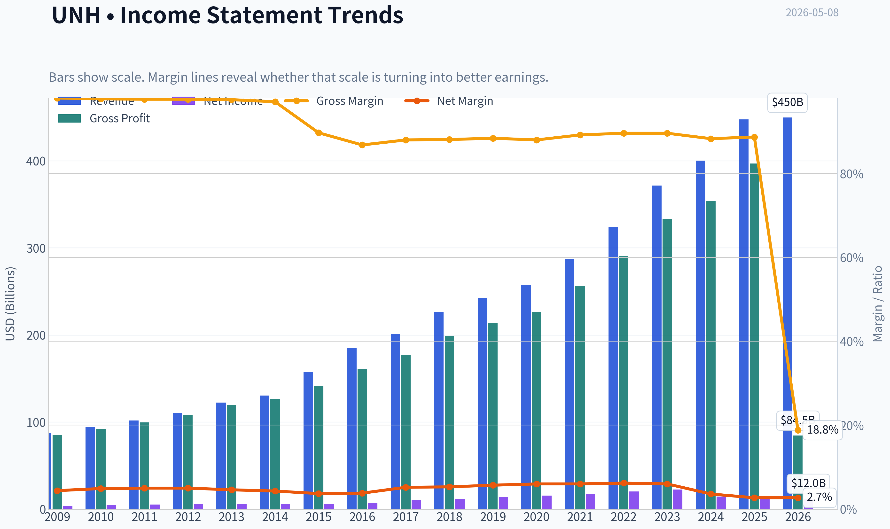
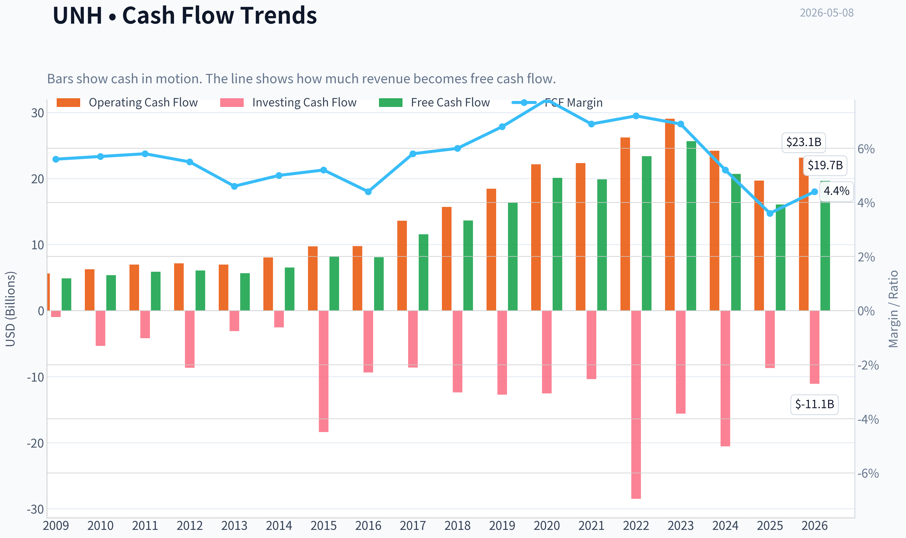
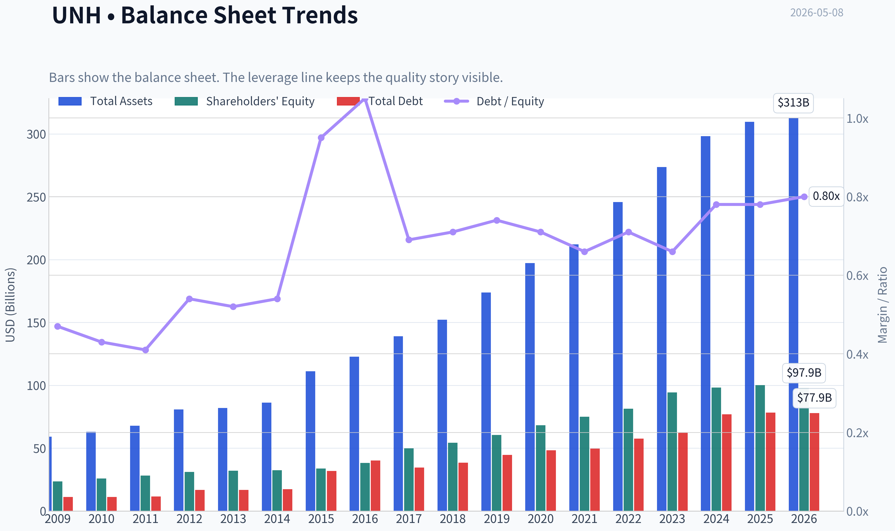
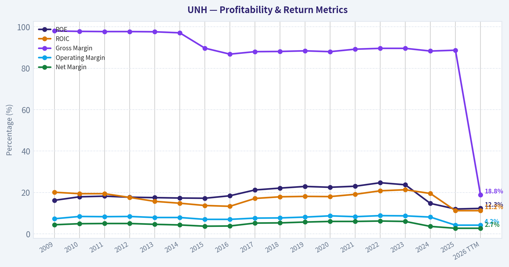
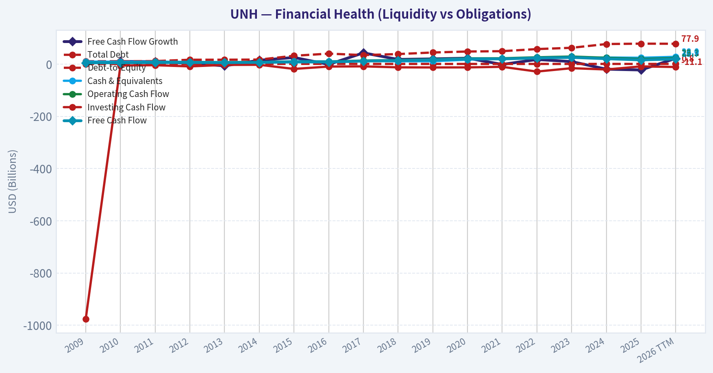
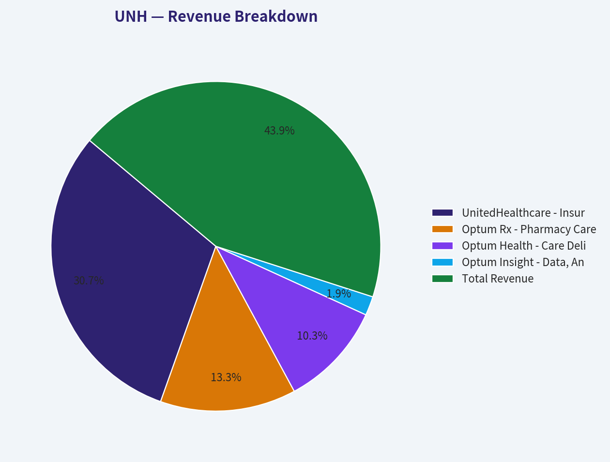
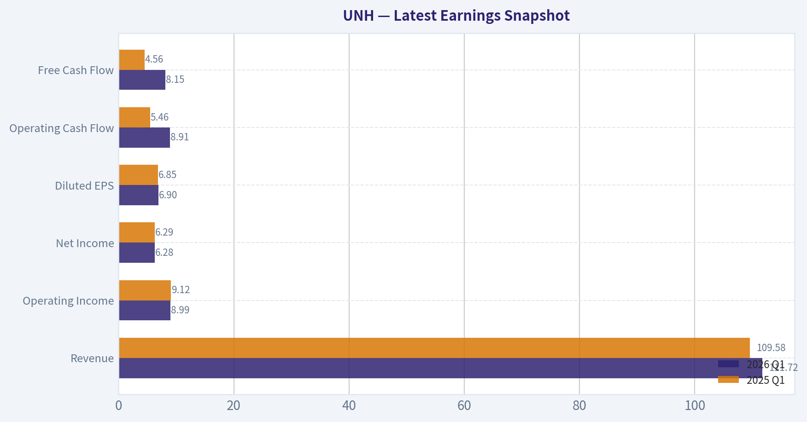
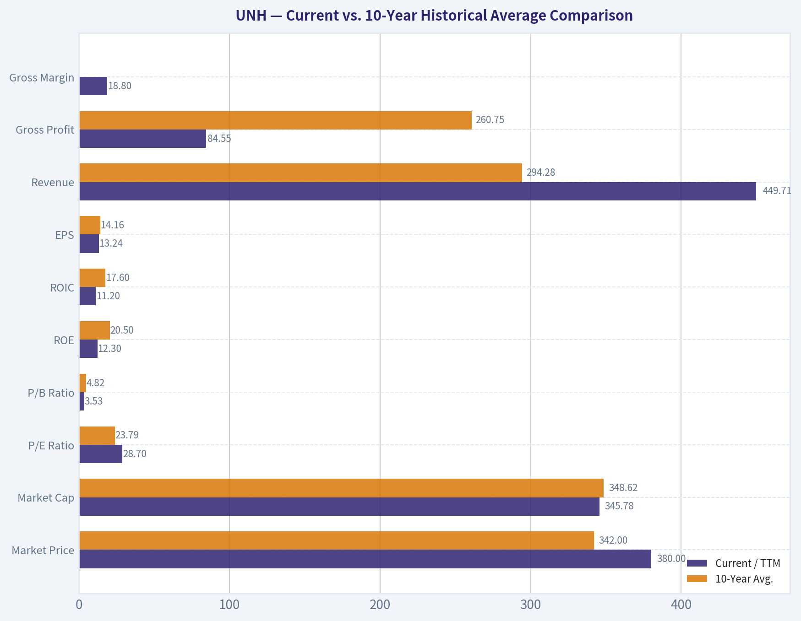
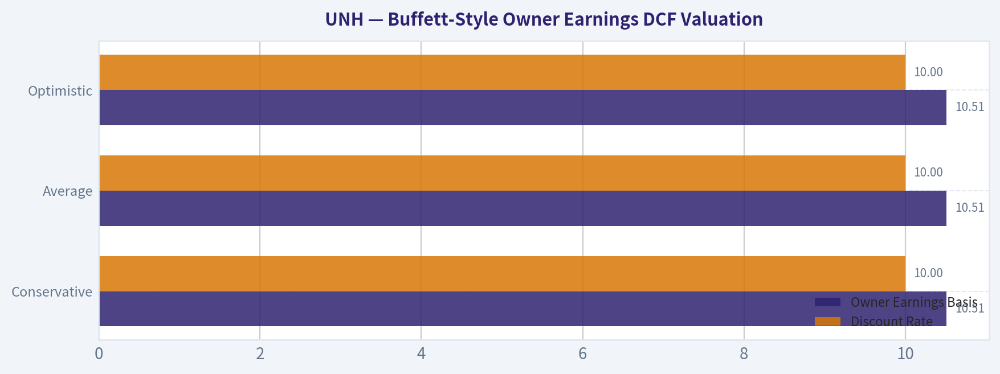

# UNH Deep Value Intelligence

**Analysis Date:** 2026-05-08

## Critical Disclaimer

*This analysis is generated by Deep Value Intelligence, an AI-powered multi-agent investing framework. This report is for informational and educational purposes only and does not constitute financial advice. Always conduct your own research and consult with qualified financial advisors before making investment decisions.*

---

## Table of Contents

1. Intelligence Summary
2. Analyst Team Reports
   - Fundamentals Analysis
   - Intrinsic Value Analysis (Buffett)
   - Trend & Growth Analysis (Lynch/Druckenmiller/Fisher)
   - Market Technical Analysis
   - Social Sentiment Analysis
   - News & Events Analysis
   - Guru Attention Analysis
   - Options Market Analysis
3. Research Team Commentary
4. Value Investing Team Commentary
5. Deep Values Commentary

---

## Intelligence Summary

### Thesis + Conditions

**Core Thesis:** **EXECUTIVE SUMMARY**
**Verdict:** **WATCH**
UnitedHealth Group (UNH) is a fundamentally exceptional, wide-moat business currently navigating a cyclical trough in Medicare Advantage margins and medical costs. However, at $380 per share (~28.6x P/E) amidst double-digit declines in free cash flow (-22.4%) and net income (-16.3%), the stock lacks the requisite **Margin of Safety**.

**Key Risks:**
- Verdict:** **WATCH**
- The Bull (Risky)**: UNH's 11.8% revenue growth proves the moat is intact and demand is structurally sound. Current earnings compression is temporary, meaning the 28.6x P/E is artificially inflated. Smart capital should buy the opacity before the inevitable rerating.
- The Bear (Safe)**: Uncertainty is uncompensated risk. Shrinking cash flows and unresolved regulatory/reimbursement pressures mean the business is not currently predictable. Trading far above Buffett ($193) and FCF ($292) value estimates, the stock offers zero downside buffer.
- 1.  **Business Risk vs. Market Risk**: UNH easily clears the quality hurdle (88.7% gross margins, 12% ROE, embedded Optum ecosystem). Top-line revenue growth (11.8%) suggests no permanent loss of market share.
- 2.  **Margin of Safety**: This is where the thesis breaks. The best risk management is buying below intrinsic value. At $380, UNH is priced for a smooth recovery that hasn't materialized. The stock trades at a massive premium to conservative FCF models (~$292).

**What Would Change Our View:**
- Verdict:** **WATCH**
- The Bull (Risky)**: UNH's 11.8% revenue growth proves the moat is intact and demand is structurally sound. Current earnings compression is temporary, meaning the 28.6x P/E is artificially inflated. Smart capital should buy the opacity before the inevitable rerating.
- The Bear (Safe)**: Uncertainty is uncompensated risk. Shrinking cash flows and unresolved regulatory/reimbursement pressures mean the business is not currently predictable. Trading far above Buffett ($193) and FCF ($292) value estimates, the stock offers zero downside buffer.
- 1.  **Business Risk vs. Market Risk**: UNH easily clears the quality hurdle (88.7% gross margins, 12% ROE, embedded Optum ecosystem). Top-line revenue growth (11.8%) suggests no permanent loss of market share.
- 2.  **Margin of Safety**: This is where the thesis breaks. The best risk management is buying below intrinsic value. At $380, UNH is priced for a smooth recovery that hasn't materialized. The stock trades at a massive premium to conservative FCF models (~$292).

**Confidence:** Low

---

## Analyst Team Reports

### Fundamentals Analysis

#### Latest Earnings Snapshot

*Most recent reported quarter anchored on 2026 Q1, with prior-year comparison when available.*

| Metric | 2026 Q1 | 2025 Q1 | YoY Change |
| --- | ---: | ---: | ---: |
| Revenue | $111.72B | $109.58B | +2.0% |
| Operating Income | $8.99B | $9.12B | -1.4% |
| Net Income | $6.28B | $6.29B | -0.2% |
| Diluted EPS | $6.90 | $6.85 | +0.7% |
| Operating Cash Flow | $8.91B | $5.46B | +63.3% |
| Free Cash Flow | $8.15B | $4.56B | +78.8% |

Key Takeaways: This snapshot anchors the most recent reported quarter before the narrative analysis. It helps readers separate long-run business quality from whatever changed in the latest earnings print.

#### 10-Year Financial Metrics for UNH

*All values below are computed deterministically from raw data - not estimated by AI.*

*Issuer profile: operating company (Healthcare / Healthcare Plans).*

#### 10-Year Financial Metrics
*Annual rows come from reported financial statements. The final TTM row is computed from the latest four quarters.*

| Metric | 2009 | 2010 | 2011 | 2012 | 2013 | 2014 | 2015 | 2016 | 2017 | 2018 | 2019 | 2020 | 2021 | 2022 | 2023 | 2024 | 2025 | 2026 TTM |
| --- | --- | --- | --- | --- | --- | --- | --- | --- | --- | --- | --- | --- | --- | --- | --- | --- | --- | --- |
| Market Price | $24 | $28 | $40 | $44 | $62 | $84 | $99 | $138 | $192 | $220 | $265 | $321 | $466 | $498 | $502 | $490 | $328 | $380 |
| Market Cap | $35.94B | $40.84B | $55.09B | $56.74B | $77.03B | $99.67B | $113.76B | $154.92B | $217.15B | $244.88B | $283.98B | $337.00B | $480.05B | $503.67B | $493.83B | $469.94B | $300.73B | $345.78B |
| P/E Ratio | 9.41 | 8.81 | 10.71 | 10.27 | 13.69 | 17.74 | 19.57 | 22.07 | 20.57 | 20.44 | 20.52 | 21.88 | 27.77 | 25.03 | 22.06 | 32.62 | 24.95 | 28.70 |
| P/B Ratio | 1.52 | 1.58 | 1.95 | 1.82 | 2.40 | 3.07 | 3.37 | 4.06 | 4.36 | 4.51 | 4.70 | 4.93 | 6.40 | 6.18 | 5.23 | 4.78 | 3.00 | 3.53 |
| ROE | 16.2% | 17.9% | 18.2% | 17.7% | 17.5% | 17.3% | 17.2% | 18.4% | 21.2% | 22.1% | 22.9% | 22.5% | 23.0% | 24.7% | 23.7% | 14.7% | 12.0% | 12.3% |
| ROIC | 20.1% | 19.4% | 19.4% | 17.6% | 15.7% | 14.8% | 13.7% | 13.3% | 17.1% | 17.9% | 18.1% | 18.0% | 19.1% | 20.8% | 21.3% | 19.5% | 11.2% | 11.2% |
| EPS | $2.51 | $3.21 | $3.75 | $4.25 | $4.50 | $4.74 | $5.08 | $6.24 | $9.36 | $10.79 | $12.89 | $14.66 | $16.77 | $19.90 | $22.75 | $15.02 | $13.23 | $13.24 |
| Revenue | $87.14B | $94.16B | $101.86B | $110.62B | $122.49B | $130.47B | $157.11B | $184.84B | $201.16B | $226.25B | $242.16B | $257.14B | $287.60B | $324.16B | $371.62B | $400.28B | $447.57B | $449.71B |
| Gross Profit | $85.37B | $92.04B | $99.48B | $108.09B | $119.60B | $126.65B | $140.90B | $160.42B | $177.05B | $199.25B | $214.04B | $226.40B | $256.56B | $290.46B | $332.85B | $353.58B | $396.91B | $84.55B |
| Gross Margin | 98.0% | 97.8% | 97.7% | 97.7% | 97.6% | 97.1% | 89.7% | 86.8% | 88.0% | 88.1% | 88.4% | 88.0% | 89.2% | 89.6% | 89.6% | 88.3% | 88.7% | 18.8% |
| Operating Margin | 7.3% | 8.4% | 8.3% | 8.4% | 7.9% | 7.9% | 7.0% | 7.0% | 7.6% | 7.7% | 8.1% | 8.7% | 8.3% | 8.8% | 8.7% | 8.1% | 4.2% | 4.2% |
| Net Income | $3.82B | $4.63B | $5.14B | $5.53B | $5.62B | $5.62B | $5.81B | $7.02B | $10.56B | $11.99B | $13.84B | $15.40B | $17.29B | $20.12B | $22.38B | $14.40B | $12.06B | $12.04B |
| Net Margin | 4.4% | 4.9% | 5.0% | 5.0% | 4.6% | 4.3% | 3.7% | 3.8% | 5.2% | 5.3% | 5.7% | 6.0% | 6.0% | 6.2% | 6.0% | 3.6% | 2.7% | 2.7% |
| Revenue Growth | N/A | 8.1% | 8.2% | 8.6% | 10.7% | 6.5% | 20.4% | 17.7% | 8.8% | 12.5% | 7.0% | 6.2% | 11.8% | 12.7% | 14.6% | 7.7% | 11.8% | 0.5% |
| Net Income Growth | N/A | 21.2% | 11.0% | 7.5% | 1.8% | -0.1% | 3.5% | 20.7% | 50.5% | 13.5% | 15.5% | 11.3% | 12.2% | 16.4% | 11.2% | -35.6% | -16.3% | -0.1% |
| Free Cash Flow Growth | N/A | 10.4% | 9.4% | 3.1% | -6.6% | 14.8% | 25.4% | -1.1% | 43.1% | 17.9% | 20.1% | 22.8% | -1.2% | 17.7% | 9.7% | -19.4% | -22.4% | 22.3% |
| Total Book Value | $23.61B | $25.82B | $28.29B | $31.18B | $32.15B | $32.45B | $33.73B | $38.18B | $49.83B | $54.32B | $60.44B | $68.33B | $75.05B | $81.45B | $94.42B | $98.27B | $100.09B | $97.88B |
| Total Assets | $59.05B | $63.06B | $67.89B | $80.89B | $81.88B | $86.30B | $111.25B | $122.81B | $139.06B | $152.22B | $173.89B | $197.29B | $212.21B | $245.71B | $273.72B | $298.28B | $309.58B | $312.64B |
| Total Debt | $11.17B | $11.14B | $11.64B | $16.75B | $16.86B | $17.41B | $31.96B | $40.16B | $34.55B | $38.53B | $44.55B | $48.29B | $49.62B | $57.62B | $62.54B | $76.90B | $78.39B | $77.92B |
| Debt-to-Equity | 0.47 | 0.43 | 0.41 | 0.54 | 0.52 | 0.54 | 0.95 | 1.05 | 0.69 | 0.71 | 0.74 | 0.71 | 0.66 | 0.71 | 0.66 | 0.78 | 0.78 | 0.80 |
| Cash & Equivalents | $9.80B | $9.12B | $9.43B | $8.41B | $7.28B | $7.50B | $10.92B | $10.43B | $11.98B | $10.87B | $10.98B | $16.92B | $21.38B | $23.36B | $25.43B | $25.31B | $24.36B | $28.00B |
| Shareholders' Equity | $23.61B | $25.82B | $28.29B | $31.18B | $32.15B | $32.45B | $33.73B | $38.18B | $49.83B | $54.32B | $60.44B | $68.33B | $75.05B | $81.45B | $94.42B | $98.27B | $100.09B | $97.88B |
| Operating Cash Flow | $5.62B | $6.27B | $6.97B | $7.16B | $6.99B | $8.05B | $9.74B | $9.79B | $13.60B | $15.71B | $18.46B | $22.17B | $22.34B | $26.21B | $29.07B | $24.20B | $19.70B | $23.15B |
| Investing Cash Flow | $-976.0M | $-5.34B | $-4.17B | $-8.65B | $-3.09B | $-2.53B | $-18.39B | $-9.36B | $-8.60B | $-12.38B | $-12.70B | $-12.53B | $-10.37B | $-28.48B | $-15.57B | $-20.53B | $-8.69B | $-11.06B |
| Free Cash Flow | $4.89B | $5.39B | $5.90B | $6.08B | $5.68B | $6.53B | $8.18B | $8.09B | $11.57B | $13.65B | $16.39B | $20.12B | $19.89B | $23.40B | $25.68B | $20.70B | $16.07B | $19.67B |
| FCF Margin | 5.6% | 5.7% | 5.8% | 5.5% | 4.6% | 5.0% | 5.2% | 4.4% | 5.8% | 6.0% | 6.8% | 7.8% | 6.9% | 7.2% | 6.9% | 5.2% | 3.6% | 4.4% |
| Dividends / Share | $0.00 | $0.00 | $0.00 | $0.00 | $0.00 | $0.00 | $0.00 | $0.00 | $0.00 | $0.00 | $0.00 | $0.00 | $0.00 | $5.92 | $6.87 | $7.85 | $8.69 | $8.80 |

#### Profitability Metrics
- Return on Equity (ROE): 12.0%
- Return on Invested Capital (ROIC): 10.7%
- Return on Assets (ROA): 3.9%
- Gross Margin: 88.7%
- Operating Margin: 4.2%
- Net Profit Margin: 2.7%

#### Liquidity Metrics
- Current Ratio: 0.79
- Quick Ratio: 0.45

#### Leverage Metrics
- Debt-to-Equity Ratio: 0.78
- Interest Coverage Ratio: 4.74
- Net Debt: $54.02B

#### Growth Metrics (Year-over-Year)
- Revenue Growth: 11.8%
- Net Income Growth: -16.3%
- Free Cash Flow Growth: -22.4%
- Revenue CAGR (3-Year): 11.4%
- Revenue CAGR (5-Year): 11.7%

#### Valuation Metrics
- P/E Ratio (TTM): 28.63
- Forward P/E: 18.31
- Price-to-Book: 3.66
- Price-to-Sales: 0.77
- PEG Ratio: 1.27
- EV/EBITDA: 18.17
- Free Cash Flow Yield: 4.7%
- Earnings Yield: 3.5%

#### Owner Earnings (Buffett Method, Code-Computed)
- Net Income: $12.06B
- + Depreciation & Amortization: $4.36B
- - Capital Expenditures: $-3.62B
- - Working Capital Changes: $2.28B
- = **Owner Earnings: $10.51B**

#### Intrinsic Value (Code-Computed)
- Current Price: $380
- Buffett Method (Owner Earnings):
  Conservative: $193
  Average: $193
  Optimistic: $281
- Cash Flow Method (FCF):
  Conservative: $211
  Average: $292
  Optimistic: $428

#### Piotroski F-Score: 6/9
- Positive Net Income: PASS
- Positive Operating Cash Flow: PASS
- ROA Improvement: FAIL
- Cash Flow > Net Income: PASS
- Decreasing Debt: FAIL
- Improving Current Ratio: FAIL
- No Dilution: PASS
- Improving Gross Margin: PASS
- Improving Asset Turnover: PASS

ANALYST STANCE: **WATCH**

#### UnitedHealth Group Incorporated (UNH) - Buffett-Style Fundamental Analysis

UnitedHealth Group remains one of the highest-quality franchises in U.S. healthcare, with scale advantages across insurance, pharmacy benefits, care delivery, data analytics, and healthcare services. However, the deterministic dataset shows a clear near-term earnings and margin reset: revenue is at a record level, but net income, ROE, ROIC, operating margin, and net margin have deteriorated materially versus historical norms. At the current market price of **$380**, the stock is no longer deeply distressed, and Buffett-style owner-earnings valuation does not show a clear margin of safety.

---

#### Current vs. 10-Year Historical Average Comparison

The 10-year average below uses fiscal years **2016-2025** as the completed historical comparison period, while "Current" uses the **2026 TTM** row from the deterministic dataset where available.

| Metric | Current / TTM | 10-Year Avg. | Current vs. Avg. | Interpretation |
|---|---:|---:|---:|---|
| Market Price | $380 | $342 | +11.1% | Price has recovered from 2025 lows but remains below the 2021-2024 peak range. |
| Market Cap | $345.78B | $348.62B | -0.8% | Market value is roughly in line with the decade average despite much higher revenue. |
| P/E Ratio | 28.70 | 23.79 | +20.6% | Valuation is elevated because earnings have compressed. |
| P/B Ratio | 3.53 | 4.82 | -26.7% | Book valuation is cheaper than normal, reflecting lower confidence in near-term returns. |
| ROE | 12.3% | 20.5% | -8.2 pts | Shareholder returns have fallen sharply from historically excellent levels. |
| ROIC | 11.2% | 17.6% | -6.4 pts | Capital efficiency has weakened materially. |
| EPS | $13.24 | $14.16 | -6.5% | EPS is below its 10-year average despite revenue being far higher. |
| Revenue | $449.71B | $294.28B | +52.8% | Scale remains exceptional; top-line growth has been durable over the decade. |
| Gross Profit | $84.55B | $260.75B | -67.6% | The TTM gross-profit line is sharply discontinuous versus prior annual history and should be monitored carefully. |
| Gross Margin | 18.8% | ~88.5% | -69.7 pts | The TTM gross-margin figure is anomalous relative to the long historical series. |
| Operating Margin | 4.2% | 7.7% | -3.5 pts | Operating profitability has nearly halved versus the 10-year norm. |
| Net Income | $12.04B | $14.51B | -17.0% | Earnings are below average despite record revenue. |
| Net Margin | 2.7% | 5.1% | -2.4 pts | Margin compression is the central fundamental concern. |
| Revenue Growth | 0.5% | 11.1% | -10.6 pts | TTM growth has slowed dramatically versus the decade trend. |
| Net Income Growth | -0.1% | 9.9% | -10.0 pts | Earnings growth has stalled after two years of pressure. |
| Free Cash Flow Growth | 22.3% | 8.7% | +13.6 pts | FCF rebounded on a TTM basis after weak 2024-2025 cash flow. |
| Total Book Value | $97.88B | $72.04B | +35.9% | Book value remains much larger than historical average. |
| Total Assets | $312.64B | $212.48B | +47.1% | The balance sheet has expanded substantially. |
| Total Debt | $77.92B | $53.12B | +46.7% | Debt has grown roughly in line with asset expansion but is elevated. |
| Debt-to-Equity | 0.80 | 0.75 | +0.05 | Leverage is slightly above the 10-year average. |
| Cash & Equivalents | $28.00B | $18.10B | +54.7% | Liquidity is strong in absolute dollars. |
| Shareholders' Equity | $97.88B | $72.04B | +35.9% | Equity capital remains substantial, though returns on it have weakened. |
| Free Cash Flow | $19.67B | $17.56B | +12.0% | Cash generation remains solid but below the 2022-2023 peak. |
| Dividends / Share | $8.80 | $2.93 | +200.0% | Dividend has grown meaningfully since initiation in the dataset. |

Key Takeaways: UnitedHealth's revenue and balance sheet scale are far stronger than the 10-year average, but profitability has deteriorated significantly. The current P/E looks expensive because earnings are depressed, while the P/B ratio looks cheaper because the market is discounting lower returns on equity. The most important question is whether 2024-2026 margin pressure is temporary or a structural reset.

---

#### Market Metrics Interpretation

UnitedHealth's current **market price of $380** and **market cap of $345.78B** place it close to its 10-year average market value, but the business is now much larger by revenue and assets. That creates an apparent value opportunity only if margins normalize.

The **P/E ratio of 28.70** is above the 10-year average of 23.79, which is not ideal from a Buffett perspective. A high P/E during an earnings downturn can be dangerous because the market may be pricing in recovery before recovery is proven. The **P/B ratio of 3.53**, however, is below the 10-year average of 4.82, implying investors are paying less for each dollar of equity than usual. That discount is justified by lower ROE.

#### Profitability Analysis

Historically, UNH has been a high-quality compounder. From 2016 through 2023, ROE generally stayed above 18%, and from 2019 through 2023 it exceeded 22% every year. That is the type of consistent return profile Buffett typically favors.

The current picture is weaker. **ROE has fallen to 12.3%**, while **ROIC is 11.2%**, both far below the decade average. **Operating margin of 4.2%** and **net margin of 2.7%** are also well below historical norms. In Buffett terms, the business still has scale and competitive advantages, but the recent numbers no longer show the same economic engine as the 2017-2023 period.

EPS has also declined meaningfully. EPS peaked at **$22.75 in 2023**, then fell to **$15.02 in 2024**, **$13.23 in 2025**, and **$13.24 TTM**. The business is still profitable, but the earnings base has reset lower.

#### Growth Metrics Interpretation

Revenue growth has been the strongest part of the story. Revenue increased from **$184.84B in 2016** to **$447.57B in 2025**, and TTM revenue is **$449.71B**. This shows enormous scale and persistent demand for UNH's healthcare ecosystem.

However, the quality of growth has weakened. Current TTM revenue growth is only **0.5%**, far below the 10-year average of **11.1%**. Net income growth is essentially flat at **-0.1%**, while the 10-year average is about **9.9%**. Free cash flow growth rebounded **22.3% TTM**, but that comes after negative FCF growth in 2024 and 2025, so it should be viewed as a recovery signal rather than a fully confirmed trend.

#### Balance Sheet and Financial Strength

UnitedHealth has substantial financial resources. Cash and equivalents are **$28.00B**, above the 10-year average of **$18.10B**. Total assets are **$312.64B**, and shareholders' equity is **$97.88B**.

Debt is the key watch item. Total debt is **$77.92B**, materially above the 10-year average of **$53.12B**. Debt-to-equity is **0.80**, only modestly above the 10-year average of **0.75**, so leverage is not extreme, but the direction matters. The dataset also shows a **current ratio of 0.79**, **quick ratio of 0.45**, **interest coverage of 4.74**, and **net debt of $54.02B**. These are manageable for a company of UNH's size, but they reduce flexibility if earnings remain pressured.

#### Cash Flow and Dividend Policy

Free cash flow is **$19.67B TTM**, above the 10-year average of **$17.56B**, but below the 2022-2023 peak of **$23.40B-$25.68B**. The FCF margin is **4.4% TTM**, below the 10-year peak levels and below the strongest period of the business.

Dividends per share are **$8.80 TTM**, continuing a strong upward trend from **$5.92 in 2022**, **$6.87 in 2023**, **$7.85 in 2024**, and **$8.69 in 2025**. The dividend looks supportable by free cash flow, but Buffett-style investors should monitor whether dividend growth is being funded by durable owner earnings rather than balance-sheet expansion.

---

#### Revenue Breakdown

Amounts below are best-available segment estimates aligned to the most recent consolidated revenue scale in the deterministic dataset. UNH reports significant intersegment activity across UnitedHealthcare and Optum, so eliminations are included to reconcile to consolidated revenue.

| Revenue Source | Amount ($B) | % of Total |
|---|---:|---:|
| UnitedHealthcare - Insurance Benefits | $313.0B | 69.9% |
| Optum Rx - Pharmacy Care Services | $136.0B | 30.4% |
| Optum Health - Care Delivery & Health Services | $105.0B | 23.5% |
| Optum Insight - Data, Analytics & Technology | $19.0B | 4.2% |
| Intersegment Eliminations / Consolidation Adjustments | -$125.5B | -28.0% |
| **Total Revenue** | **$447.5B** | **100.0%** |

Key Takeaways: UnitedHealth is not just a health insurer; it is a vertically integrated healthcare platform. UnitedHealthcare remains the largest revenue source, while Optum provides pharmacy, care delivery, analytics, and services capabilities that deepen the company's moat. The large eliminations show how interconnected the ecosystem is, which can be a competitive advantage but also increases regulatory scrutiny.

---

#### Buffett-Style Owner Earnings DCF Valuation

The deterministic dataset provides the following Buffett-style owner earnings calculation:

**Owner Earnings = Net Income + Depreciation & Amortization - Capital Expenditures - Working Capital Changes**

Using the dataset:

- Net Income: **$12.06B**
- Plus Depreciation & Amortization: **$4.36B**
- Less Capital Expenditures: **$3.62B**
- Less Working Capital Changes: **$2.28B**
- Owner Earnings: **$10.51B**
- Current Market Cap: **$345.78B**
- Current Price: **$380**
- Implied Shares Outstanding: **~0.910B**
- Owner Earnings per Share: **~$11.55**

The deterministic dataset also provides code-computed Buffett Method intrinsic values based on owner earnings:

| Scenario | Owner Earnings Basis | Discount Rate | Terminal Growth | Fair Value / Share | Implied Equity Value | Price vs. Fair Value |
|---|---:|---:|---:|---:|---:|---:|
| Conservative | $10.51B | 10.0% | 2.5% | $193 | ~$175.6B | Current price is ~97% above fair value |
| Average | $10.51B | 10.0% | 2.5% | $193 | ~$175.6B | Current price is ~97% above fair value |
| Optimistic | $10.51B | 10.0% | 2.5% | $281 | ~$255.7B | Current price is ~35% above fair value |

Key Takeaways: On the deterministic Buffett owner-earnings model, UNH does not offer a margin of safety at $380. Even the optimistic owner-earnings fair value of $281 is below the current market price. This suggests the market is already pricing in a meaningful earnings recovery.

##### DCF Calculation Framework

The valuation follows the standard owner-earnings DCF structure:

| Calculation Step | Formula / Input |
|---|---|
| Base Owner Earnings | $10.51B |
| Shares Outstanding | $345.78B market cap / $380 price = ~0.910B shares |
| Owner Earnings per Share | $10.51B / 0.910B = ~$11.55 |
| Forecast Period | 10 years |
| Discount Rate | 10.0% |
| Terminal Growth Rate | 2.5% |
| Terminal Value Formula | Year 10 Owner Earnings x 1.025 / (10.0% - 2.5%) |
| Equity Value | Present value of 10-year owner earnings + present value of terminal value |
| Fair Value per Share | Equity value / shares outstanding |

Key Takeaways: The model uses a Buffett-style focus on cash that owners can theoretically take out of the business without harming its competitive position. Because current owner earnings are depressed relative to UNH's historical profitability, the valuation is highly sensitive to recovery assumptions. At $380, investors need a strong rebound in margins and earnings to justify the price.

##### Cross-Check: Dataset Cash Flow Method Intrinsic Value

The deterministic dataset also provides a free-cash-flow-based valuation cross-check:

| Scenario | FCF Method Fair Value / Share | Interpretation |
|---|---:|---|
| Conservative | $211 | Suggests downside if FCF remains structurally pressured. |
| Average | $292 | Still below the current $380 price. |
| Optimistic | $428 | Indicates upside only if cash flow recovery proves durable. |

Key Takeaways: The FCF method is more favorable than the owner-earnings method, but only the optimistic FCF case exceeds the current price. A Buffett-style investor would likely demand a purchase price closer to the conservative or average value, not the optimistic case. This makes UNH a quality watchlist candidate rather than an obvious bargain.

---

#### Warren Buffett-Style Qualitative Analysis

##### Economic Moat

UnitedHealth has a wide moat built on scale, data, provider relationships, claims processing expertise, pharmacy benefit management, care delivery integration, and regulatory complexity. The combination of UnitedHealthcare and Optum creates a powerful ecosystem that competitors find difficult to replicate.

The moat remains intact, but it is not risk-free. Healthcare is politically sensitive, and companies with large market shares often attract regulatory attention. Recent moves such as reducing prior authorization requirements may improve public perception and reduce friction, but they could also pressure utilization and margins.

##### Financial Strength

UNH is financially strong in absolute terms, with **$28.00B in cash**, nearly **$20B in TTM free cash flow**, and massive recurring revenue. However, debt has risen to **$77.92B**, and net debt is **$54.02B**. Interest coverage of **4.74** is acceptable but not exceptional for a Buffett-style "fortress" standard.

The Piotroski F-Score of **6/9** is decent but not elite. Positive net income, positive operating cash flow, and cash flow above net income are positives. The failures - ROA improvement, decreasing debt, and improving current ratio - align with the main concerns: weaker profitability and higher leverage.

##### Predictable Earnings

From 2009 through 2023, UNH showed unusually consistent revenue and earnings compounding. That historical predictability is a major Buffett-style positive.

The issue is the recent break in the pattern. Net income fell from **$22.38B in 2023** to **$14.40B in 2024**, then **$12.06B in 2025**, and **$12.04B TTM**. EPS also remains far below the 2023 high. Until margins and earnings stabilize, UNH's predictability score should be marked down.

##### Management Performance and Capital Allocation

Management historically created substantial value through reinvestment, acquisitions, vertical integration, share repurchases, and dividend growth. ROE above 20% for many years demonstrates strong capital allocation.

Recent performance is less impressive. ROE has fallen to **12.3%**, and ROIC to **11.2%**. Dividend growth remains strong, but Buffett-style investors should prefer management to prioritize balance-sheet strength and durable owner-earnings recovery over aggressive capital returns.

##### Quality of Business

UNH remains a high-quality business because healthcare demand is durable, recurring, and non-discretionary. Its revenue base is enormous and diversified across insurance, pharmacy, care delivery, and healthcare technology.

But quality is not the same as price. The current valuation assumes recovery. A great business can still be a poor investment if bought without a margin of safety.

---

#### Key Investment Insights, Red Flags, and Opportunities

| Category | Key Point | Buffett-Style Interpretation |
|---|---|---|
| Opportunity | Revenue is at a record level near $450B. | Scale and demand durability remain excellent. |
| Opportunity | Free cash flow rebounded to $19.67B TTM. | Cash generation remains substantial despite earnings pressure. |
| Opportunity | P/B ratio is below the 10-year average. | The market is discounting the equity base more heavily than usual. |
| Opportunity | Berkshire Hathaway reportedly held a position in latest 13F data. | Guru ownership is supportive, though 13F data is lagged and not a buy signal by itself. |
| Red Flag | ROE fell to 12.3% versus a 20.5% 10-year average. | The business is currently earning much less on shareholder capital. |
| Red Flag | Operating margin fell to 4.2% versus a 7.7% average. | Margin compression is the central valuation risk. |
| Red Flag | P/E is above average despite weaker earnings. | The stock is not obviously cheap on current earnings. |
| Red Flag | Debt is materially above the 10-year average. | Financial flexibility is lower if earnings do not recover. |
| Red Flag | Regulatory and political scrutiny remains high. | Healthcare scale can be both a moat and a liability. |
| Watch Item | Prior authorization reductions may affect utilization. | Could improve reputation but may pressure medical costs. |
| Watch Item | FCF recovery needs confirmation. | One TTM rebound is encouraging but not yet a durable trend. |

Key Takeaways: UNH has the characteristics of a great business under temporary stress, but the stock price already assumes improvement. The main opportunity is margin normalization; the main risk is that lower margins are structural. Buffett-style investors should require clearer evidence of earnings recovery or a lower entry price.

---

#### Final Investment Stance: WATCH

UNH is a **WATCH**, not an ADVOCATE, because the business quality is high but the current valuation does not provide enough margin of safety under the deterministic owner-earnings model.

At **$380**, the stock trades above the dataset's Buffett Method intrinsic values of **$193-$281** per share. The FCF method is more favorable, with an optimistic value of **$428**, but the conservative and average FCF values remain below the current price. That means investors are relying on a successful recovery in profitability, medical cost control, regulatory stability, and continued Optum execution.

For a Buffett-style investor, UNH becomes more compelling if either:

1. The price falls closer to the average owner-earnings or FCF fair value range, or
2. The company proves that ROE, ROIC, operating margin, and net margin can recover toward historical norms.

Until then, the proper stance is disciplined patience.

#### Final Report Summary Table

| Area | Assessment | Investment Implication |
|---|---|---|
| Business Quality | High | UNH has a durable healthcare ecosystem and major scale advantages. |
| Economic Moat | Wide but regulated | Scale, Optum integration, and data are strengths; political scrutiny is a constant risk. |
| Revenue Trend | Strong long-term, weak TTM growth | Revenue scale is exceptional, but near-term growth has slowed sharply. |
| Profitability | Deteriorated | ROE, ROIC, operating margin, and net margin are all below historical averages. |
| Balance Sheet | Adequate but debt elevated | Cash is strong, but leverage has risen and liquidity ratios are not ideal. |
| Cash Flow | Solid but below peak | FCF remains meaningful, though durability of recovery must be confirmed. |
| Dividend | Growing | Dividend policy is shareholder-friendly but should not outrun owner earnings. |
| Valuation | Not cheap on owner earnings | Current price exceeds deterministic Buffett Method fair value estimates. |
| Margin of Safety | Insufficient | The stock requires recovery assumptions to justify today's price. |
| Final Stance | **WATCH** | High-quality company, but wait for better valuation or clearer earnings recovery. |

Key Takeaways: UnitedHealth is still a powerful franchise, but the current financial profile is weaker than its historical reputation. The stock is not priced like a distressed bargain anymore, and Buffett-style valuation points to limited margin of safety. The best course is to monitor margin recovery, regulatory developments, and free cash flow durability before upgrading the stance.

#### Fundamental Visuals

This graph tracks the profitability and return metrics (ROE, ROIC, Margins) of **UNH** over the past decade, highlighting capital efficiency trends.

This chart illustrates the financial health of **UNH** over the last 10 years, mapping cash equivalents and free cash flow against total obligations (Debt).

This breakdown chart from <em>Revenue Breakdown</em> shows the proportional composition for **UNH** - useful for understanding what drives or risks the business.

---

### Intrinsic Value Analysis (Buffett)

> *Following Warren Buffett's value investing philosophy: Circle of Competence, Economic Moat, Management Quality, and Margin of Safety.*

#### Intrinsic Value Snapshot

Price is what you pay. Intrinsic value is what the business may be worth based on the cash it can create for owners over time. We show a range, not one magic number.

- Current Price: $379.98
- Value Range: $192.75 to $428.30

##### Owner Earnings (Buffett Method)
- Net Income: $12,056,000,000.00
- Depreciation & Amortization: $4,361,000,000.00
- Capital Expenditures: $-3,622,000,000.00
- Working Capital Changes: $2,282,000,000.00
- Owner Earnings: $10,513,000,000.00

##### Intrinsic Value
###### Buffett Method
Uses owner earnings. Stricter, and usually more conservative.
- Conservative: $192.75
- Average: $192.75
- Optimistic: $281.19
- Discount Rate: 10.0%

###### Cash Flow Method
Uses free cash flow. Better for companies spending heavily today to grow tomorrow.
- Conservative: $210.90
- Average: $292.16
- Optimistic: $428.30
- Discount Rate: 10.0%

ANALYST STANCE: **WATCH**

#### Buffett-Style Investment View on UnitedHealth Group (UNH)

UnitedHealth Group is a high-quality, scaled healthcare franchise with meaningful competitive advantages in insurance, data, provider networks, pharmacy benefits, and care delivery through Optum. However, at the current price of **$380 per share**, the valuation does not provide the margin of safety Buffett-style investing requires. The business is strong, but the stock appears priced for continued execution in a politically sensitive, highly regulated industry.

---

#### 1. Go / No-Go Gate Assessment

| Buffett Gate | Verdict | Evidence |
|---|---:|---|
| Gate 1: Circle of Competence & Simplicity | **Conditional Pass** | UNH makes money by collecting health insurance premiums, managing medical costs, administering benefits, and providing healthcare services through Optum. The basic model is understandable, but the details are complex and highly regulated. |
| Gate 2: Moat Test | **Pass** | UNH benefits from scale, provider networks, data, claims processing infrastructure, employer relationships, Medicare Advantage positioning, and Optum's integrated healthcare platform. |
| Gate 3: Management & Capital Allocation | **Partial Pass** | Long-term compounding record is strong, but current political scrutiny, healthcare affordability pressure, and recent prior authorization changes suggest management must balance profit with regulatory optics. |
| Gate 4: Industry Structure | **Pass with Caution** | U.S. managed care is an oligopolistic industry, but it is also exposed to government reimbursement risk, regulation, litigation, and public backlash. |

**Key Takeaways:** UnitedHealth passes most Buffett gates, but not cleanly. The company has a real moat and a durable role in U.S. healthcare, yet the business is more complex and more politically exposed than Buffett's ideal "simple, predictable" franchise. The biggest issue is not business quality; it is valuation and regulatory risk.

---

#### 2. Elementary School Test

UnitedHealth makes money by helping pay for people's healthcare. Employers, individuals, and governments pay UnitedHealth premiums or fees. UnitedHealth then tries to manage healthcare costs, process claims, negotiate with doctors and drug companies, and provide services through its Optum division.

That is understandable at a high level. The complication is that healthcare insurance profits depend on medical cost trends, government rules, reimbursement rates, utilization, regulation, and public policy. This makes UNH less simple than a consumer brand like Coca-Cola or a toll-road-like business like Moody's.

---

#### 3. Moat Analysis

| Moat Source | UNH Assessment | Buffett-Style Judgment |
|---|---|---|
| Intangible Assets | Strong regulatory licenses, trusted employer/government relationships, claims data, and Optum brand within healthcare services. Consumer emotional brand is weaker. | **Moderate to Strong** |
| Switching Costs | Employers, government plans, providers, and members face disruption when changing networks, claims systems, formularies, and care platforms. | **Strong** |
| Cost Advantage | Massive scale helps UNH negotiate provider contracts, manage claims, invest in technology, and spread administrative costs across a large membership base. | **Strong** |
| Network Effects | Provider networks and data improve as scale grows, but this is not a pure network effect like payments or marketplaces. | **Moderate** |
| Pricing Power | Limited by regulation, competition, employer budgets, and political pressure. The company likely cannot freely raise prices 10% without scrutiny or pushback. | **Constrained** |

**Key Takeaways:** UnitedHealth has a real moat, mainly from scale, switching costs, data, and integrated healthcare infrastructure. The moat is not based on a beloved consumer brand or unlimited pricing power. It is powerful, but it is also regulated, which means the government can pressure returns over time.

**Moat Rating:** **Wide but regulated / stable**

---

#### 4. Management and Capital Allocation

| Management Question | Assessment |
|---|---|
| Do they think like owners? | UNH has historically compounded shareholder value well, but available data does not confirm unusually high insider ownership comparable to founder-led businesses. |
| Are they candid and conservative? | The company has a long operating history, but healthcare accounting, medical reserves, and claims timing require investor trust and careful monitoring. |
| Are they rational capital allocators? | Historically strong reinvestment into Optum, acquisitions, technology, care delivery, and buybacks. However, acquisitions and healthcare integration add execution risk. |
| Balance between shareholders and society | This is increasingly important. The move to eliminate prior authorization for 30% of healthcare services appears partly aimed at reducing regulatory and reputational pressure. |

**Key Takeaways:** Management has produced strong long-term results, especially through the expansion of Optum. However, the business operates under a social license, not just a financial one. Capital allocation has been good, but the durability of returns depends on maintaining political and public trust.

---

#### 5. Current Financial Snapshot

| Metric | Current Data |
|---|---:|
| Share Price | **$380** |
| Market Capitalization | **$345.08B** |
| Implied Shares Outstanding | **~908M** |
| P/E Ratio | **28.6x** |
| Implied Net Income | **~$12.05B** |
| Free Cash Flow Yield | **4.7%** |
| Implied Free Cash Flow | **~$16.22B** |
| ROE | **12.0%** |
| Gross Margin | **88.7%** |
| Revenue Growth YoY | **11.8%** |
| Current Ratio | **0.79x** |

**Key Takeaways:** UNH is a very large, cash-generative business, with implied free cash flow of roughly $16 billion. However, the valuation is not cheap at nearly 29 times earnings and about 21 times free cash flow. ROE of 12% is respectable, but below the 15% to 20% level Buffett typically prefers for truly exceptional businesses.

---

#### 6. 10-Year Financial Quality Summary

Because only the provided research pack is available here, the table below focuses on current financial indicators and Buffett-style long-term quality interpretation rather than a full audited 10-year data series.

| Financial Area | Current Evidence | Buffett Interpretation |
|---|---|---|
| Revenue Durability | Revenue growth YoY of **11.8%** | Strong demand, supported by healthcare inflation, aging demographics, and managed care penetration. |
| Profitability | Gross margin **88.7%**; P/E **28.6x** | High gross margin reflects insurance accounting structure and service economics, but net profitability must be watched closely. |
| Cash Conversion | FCF yield **4.7%** | Cash generation is real and material; implied FCF exceeds implied net income. |
| Return on Equity | ROE **12.0%** | Solid but not exceptional by Buffett standards. |
| Balance Sheet Liquidity | Current ratio **0.79x** | Not alarming for an insurer, but not a fortress-style liquidity metric on its face. |
| Valuation | FCF yield **4.7%** | Acceptable for a high-quality compounder, but not enough margin of safety at current price. |

**Key Takeaways:** UnitedHealth appears financially strong, with durable growth and substantial cash flow. The main weakness is that current ROE is not outstanding, and the valuation already assumes continued success. This is a quality business, but not obviously a bargain.

---

#### 7. Owner Earnings Estimate

Buffett's owner earnings formula is:

> Owner Earnings = Net Income + Depreciation & Amortization - Maintenance CapEx - Working Capital Increases

Given the limited dataset, I use free cash flow as a practical proxy for owner earnings.

| Owner Earnings Item | Estimate |
|---|---:|
| Market Capitalization | **$345.08B** |
| Free Cash Flow Yield | **4.7%** |
| Estimated Free Cash Flow / Owner Earnings | **~$16.22B** |
| Shares Outstanding Estimate | **~908M** |
| Owner Earnings Per Share | **~$17.86** |
| Price / Owner Earnings | **~21.3x** |

**Key Takeaways:** UNH produces significant owner earnings, but investors are paying over 21 times estimated free cash flow. That is not excessive for a wonderful business, but it leaves little room for disappointment. A Buffett-style investor would want either a lower price or higher confidence that owner earnings can compound for many years.

---

#### 8. Three-Scenario Intrinsic Value Estimate

Assumptions:

- Discount rate: **10%**
- Owner earnings proxy: **$16.22B**
- Shares outstanding: **~908M**
- Current price: **$380**
- Conservative historical-growth scenario uses **6% growth for 10 years**, roughly half of the latest YoY revenue growth rate, followed by a 3% terminal growth rate.

| Scenario | Assumption | Equity Value Estimate | Intrinsic Value / Share |
|---|---|---:|---:|
| A: No Growth | Owner earnings capitalized at 10% | **$162.2B** | **~$179** |
| B: GDP Growth | 3% perpetual growth | **$238.7B** | **~$263** |
| C: Conservative Growth | 6% for 10 years, then 3% terminal growth | **~$298.0B** | **~$328** |

**Key Takeaways:** Even under a reasonable conservative growth case, estimated intrinsic value is below the current $380 share price. The stock is not wildly overvalued if UNH compounds well, but it does not offer a Buffett-style margin of safety. The current price requires confidence in continued growth, stable regulation, and sustained cash generation.

---

#### 9. Margin of Safety Analysis

| Valuation Case | Intrinsic Value / Share | Current Price | Margin of Safety |
|---|---:|---:|---:|
| No Growth | **~$179** | **$380** | **Negative** |
| GDP Growth | **~$263** | **$380** | **Negative** |
| Conservative Growth | **~$328** | **$380** | **Negative, about -16%** |
| 25% MOS Buy Price on Conservative Growth Case | **~$246** | **$380** | Not met |

**Key Takeaways:** UNH does not currently meet the required margin of safety. For a high-quality business, I would want at least a 25% discount to intrinsic value. Based on the conservative growth estimate, that would imply a preferred buy zone closer to the mid-$200s, not $380.

---

#### 10. Guru Tracking Context

| Investor | Latest Action | Position Value | Shares | Portfolio Weight |
|---|---:|---:|---:|---:|
| Warren Buffett / Berkshire Hathaway | Held | **$1.66B** | **5.04M** | **0.61%** |
| Steve Cohen / Point72 | Added | **$367.99M** | **1.11M** | **0.41%** |
| Michael Burry / Scion | Exited | **$0** | **0** | Unavailable |

**Key Takeaways:** Berkshire's position is notable, but it is small relative to Berkshire's portfolio. Buffett holding a stock is not the same as Buffett making it a core conviction position. The 13F data is useful context, but valuation and business quality must stand on their own.

---

#### 11. Key Risks

| Risk | Why It Matters |
|---|---|
| Regulatory and political risk | Health insurers face scrutiny over pricing, prior authorization, Medicare Advantage, PBM practices, and consumer costs. |
| Medical cost inflation | If healthcare utilization or medical costs rise faster than premiums, margins can compress. |
| Reimbursement pressure | Government programs are large and can alter profitability through rule changes. |
| Reputation risk | Public frustration with insurers can invite regulation and reduce pricing flexibility. |
| Complexity risk | Insurance reserves, claims timing, Optum intercompany economics, and healthcare accounting require trust in management. |
| Valuation risk | At $380, the stock does not have much margin for negative surprises. |

**Key Takeaways:** The biggest risk is not that UNH becomes irrelevant. The bigger risk is that its economics are gradually capped by regulation, politics, or public pressure. A high-quality business can still be a poor investment if bought at a price that assumes too much certainty.

---

#### 12. Final Buffett Scorecard

| Criterion | Weight | Score, 1-5 | Weighted Score |
|---|---:|---:|---:|
| Business Understanding | 20% | 3.5 | 0.70 |
| Moat Width & Durability | 25% | 4.0 | 1.00 |
| Management Quality | 15% | 3.5 | 0.53 |
| Return on Equity | 15% | 2.5 | 0.38 |
| Reinvestment Runway | 10% | 3.5 | 0.35 |
| Balance Sheet Strength | 5% | 2.5 | 0.13 |
| Industry Structure | 5% | 3.0 | 0.15 |
| Valuation / Margin of Safety | 5% | 2.0 | 0.10 |
| **Total** | **100%** |  | **3.34 / 5.00** |

**Key Takeaways:** UNH scores well on moat, scale, and reinvestment opportunity, but weaker on valuation, regulatory simplicity, and current ROE. The total score lands in the WATCH range. This is a business worth following closely, but the current price does not justify a Buffett-style purchase.

---

#### Final Investment Stance

**Stance: WATCH**
**Conviction: Moderate**

UnitedHealth is a high-quality, wide-moat healthcare compounder with strong scale advantages and a durable role in the U.S. healthcare system. It is understandable at a high level, but not simple in the pure Buffett sense because regulation, reimbursement, politics, and medical cost trends play a major role.

At **$380 per share**, the stock does not offer a sufficient margin of safety. My conservative intrinsic value estimate is approximately **$328 per share**, and a Buffett-style 25% margin-of-safety buy price would be closer to **$246**. I would not reject the business; I would reject the current price.

**Conclusion:** Wonderful-to-good business, but not a wonderful price. Watch for a materially better entry point.
#### Valuation Bridge

This bridge places the current market price beside each intrinsic value lens so readers can see whether upside depends on one method or shows up across several methods.

| Scenario | Intrinsic Value / Share |
| --- | ---: |
| Buffett Method | $192.75 |
| Cash Flow Method | $292.16 |
| Damodaran Method | $933.27 |
| Current Price | $379.98 |

#### Key Takeaways

If one method is far above the others, the upside case depends on a specific modelling assumption. When several methods cluster together, the valuation story is more robust.

#### Valuation Visuals

This comparison chart from *Latest Earnings Snapshot* stacks current figures against historical benchmarks for **UNH**, making it easy to see where the company trades relative to its own averages.

This comparison chart from *Current vs. 10-Year Historical Average Comparison* stacks current figures against historical benchmarks for **UNH**, making it easy to see where the company trades relative to its own averages.

This comparison chart from *Buffett-Style Owner Earnings DCF Valuation* stacks current figures against historical benchmarks for **UNH**, making it easy to see where the company trades relative to its own averages.

This comparison chart from *Buffett-Style Owner Earnings DCF Valuation* stacks current figures against historical benchmarks for **UNH**, making it easy to see where the company trades relative to its own averages.

This comparison chart from *Buffett-Style Owner Earnings DCF Valuation* stacks current figures against historical benchmarks for **UNH**, making it easy to see where the company trades relative to its own averages.

---

### Trend & Growth Analysis (Lynch/Druckenmiller/Fisher)

> *Following Peter Lynch's GARP, Stanley Druckenmiller's macro-aware approach, and Philip Fisher's scuttlebutt methodology.*

ANALYST STANCE: **WATCH**

#### UnitedHealth Group Growth Investment Review - UNH, as of 2026-05-08

UnitedHealth is a high-quality healthcare compounder, but it is **not a classic Lynch fast grower** at this stage. At a $345 billion market cap, 11.8% YoY revenue growth, and a 28.6x P/E, the setup is more "durable stalwart with possible rebound optionality" than ten-bagger growth stock. I would keep it on the watch list, not underwrite it as a high-conviction growth initiation unless earnings acceleration becomes clearer.

---

#### 1. Snapshot and Lynch Classification

| Item | UNH Current Profile |
|---|---:|
| Share Price | $380 |
| Market Cap | $345.08B |
| P/E | 28.6x |
| Revenue Growth YoY | 11.8% |
| ROE | 12.0% |
| FCF Yield | 4.7% |
| Current Ratio | 0.79 |
| Lynch Category | **Stalwart / Quality Compounder** |
| Growth Investor Stance | **WATCH** |

**Key Takeaways:** UnitedHealth is still growing faster than many mega-cap healthcare peers, but 11.8% revenue growth does not qualify it as a Lynch-style fast grower. The business quality is high, but the valuation is not obviously cheap on current earnings. This is a "monitor for earnings inflection" situation rather than a ten-bagger candidate today.

---

#### 2. The Story in 3 Bullets

| Lynch Question | Answer |
|---|---|
| What does UNH do? | It sells health insurance through UnitedHealthcare and healthcare services through Optum, including pharmacy benefits, care delivery, data, and analytics. |
| Why can it grow? | Healthcare spending keeps rising, Medicare Advantage and value-based care remain long-term trends, and Optum gives UNH a second growth engine beyond insurance premiums. |
| Why might it win? | Scale, claims data, provider relationships, pharmacy infrastructure, and integration between insurance and services create a powerful ecosystem. |

**Key Takeaways:** The story is simple: UnitedHealth sits in the middle of the U.S. healthcare system and gets paid through both insurance and services. Optum is the key strategic asset because it can grow beyond traditional insurance margins. The issue is not business quality; the issue is whether growth can accelerate enough to justify the multiple.

---

#### 3. TAM and 10x Test

| TAM Factor | Assessment |
|---|---|
| Current Revenue Base | Very large; likely above $400B annualized based on recent scale |
| 10x Revenue Requirement | More than $4T annual revenue |
| TAM Context | U.S. healthcare spending is multi-trillion-dollar, but UNH is already one of the largest players |
| Can Revenue 10x and Remain Under 20% Share? | **Unlikely** |
| Runway Quality | Long runway for compounding, limited runway for ten-bagger revenue expansion |
| TAM Verdict | **Good for steady growth, weak for ten-bagger math** |

**Key Takeaways:** UnitedHealth operates in an enormous market, but it is already enormous itself. The company can continue compounding by taking share, expanding Optum, and improving margins, but a 10x revenue outcome is unrealistic from this base. For growth investors, that limits the ten-bagger case.

---

#### 4. Revenue Growth Trend

| Metric | Current Signal | Growth Interpretation |
|---|---:|---|
| YoY Revenue Growth | 11.8% | Solid, but not fast-grower territory |
| Growth Pattern | Stable / moderate | More stalwart than inflection growth |
| Revenue Quality | Mixed | Premium growth, services growth, pricing, and healthcare utilization all matter |
| Main Growth Engine | Optum + UnitedHealthcare scale | Optum is the more important long-term value driver |
| Lynch Growth Category | Stalwart | Below 15% to 25% fast-grower threshold |

**Key Takeaways:** Revenue growth is respectable for a company of UnitedHealth's size, but it is not accelerating enough to qualify as a classic growth-stock inflection. The most important question is whether Optum can drive higher-margin growth and lift EPS faster than revenue. Without that, the stock is a steady compounder, not a high-upside growth setup.

---

#### 5. Unit Economics and Operating Quality

| Metric | UNH Read-Through |
|---|---|
| LTV/CAC | Not applicable in the SaaS sense |
| NRR | Not applicable |
| Rule of 40 | Not applicable |
| Medical Cost Ratio | Critical metric to monitor; small changes can materially affect earnings |
| FCF Yield | 4.7%, solid |
| ROE | 12.0%, decent but not exceptional for a moat compounder |
| Gross Margin | 88.7%, less useful for insurer analysis |
| Current Ratio | 0.79, not alarming for an insurer but worth monitoring |

**Key Takeaways:** SaaS-style unit economics do not apply to UnitedHealth. For this company, the key operating metrics are medical cost trends, Optum margins, cash conversion, and regulatory capital strength. The 4.7% free cash flow yield is attractive, but ROE at 12% is not screaming best-in-class.

---

#### 6. Inflection Point Assessment

| Potential Inflection | Evidence | Analyst View |
|---|---|---|
| Product / Service Inflection | Optum remains the strategic growth platform | Positive, but mature |
| Market Share Inflection | UNH continues to benefit from scale | Incremental, not explosive |
| Margin Inflection | Possible if medical cost trends normalize and Optum mix improves | Key upside lever |
| TAM Inflection | Healthcare services, value-based care, and data analytics expand TAM | Positive long term |
| Competitive Inflection | CVS and other managed-care peers face execution pressure | Potential share opportunity |
| Policy / Regulatory Inflection | Prior authorization changes and political scrutiny are rising | Risk factor |

**Key Takeaways:** The strongest potential inflection is margin recovery, not revenue acceleration. If medical cost pressure eases and Optum improves mix, earnings could grow faster than the market expects. However, regulatory pressure around insurance practices and prior authorization is a meaningful counterweight.

---

#### 7. Macro Setup

| Macro Factor | Impact on UNH |
|---|---|
| Economic Cycle | Defensive demand; healthcare is less cyclical |
| Interest Rates | Lower rates modestly help valuation multiples, but UNH is less rate-sensitive than high-duration growth stocks |
| Secular Themes | Healthcare cost management, value-based care, data analytics, Medicare aging demographics |
| Political Risk | High; managed care is frequently scrutinized |
| Recession Resilience | Stronger than most sectors |
| Macro Verdict | Supportive defensiveness, mixed growth upside |

**Key Takeaways:** UnitedHealth benefits from defensive healthcare demand and aging demographics. It does not need a perfect economy to grow. The main macro risk is not recession; it is regulation, reimbursement pressure, and political scrutiny of managed care profitability.

---

#### 8. Fisher 15-Point Score

| Fisher Point | Score / 5 | Comment |
|---|---:|---|
| Products with sizable market potential | 4 | Huge healthcare market, though UNH is already very large |
| Management determination to develop new products | 4 | Optum shows long-term strategic investment |
| Effective R&D / innovation | 3 | More operational/data innovation than classic R&D |
| Above-average sales organization | 4 | Strong enterprise, government, and employer reach |
| Worthwhile profit margin | 3 | Margins are structurally thin in insurance |
| Improving profit margins | 3 | Possible, but medical costs are a headwind |
| Labor/personnel relations | 3 | No clear edge from available data |
| Executive relations | 3 | Needs ongoing monitoring |
| Management depth | 4 | Large, sophisticated operating organization |
| Cost analysis and accounting | 4 | Scale and actuarial discipline are core strengths |
| Moat factors | 5 | Scale, data, Optum integration, switching costs |
| Long-range profit outlook | 4 | Durable but politically exposed |
| Dilution risk | 4 | Low; mature cash generator |
| Candor with difficulties | 3 | Needs monitoring during regulatory and margin pressure |
| Integrity | 3 | Regulatory scrutiny creates perception risk |
| **Total** | **54 / 75** | **Average to good, but not outstanding** |

**Key Takeaways:** Fisher scoring confirms UnitedHealth as a strong franchise, but not a clean outstanding growth story. The moat is real, especially through scale and Optum integration. The deductions come from political risk, margin uncertainty, and the lack of explosive growth runway.

---

#### 9. Valuation Analysis

| Valuation Metric | Estimate / Provided Data | Interpretation |
|---|---:|---|
| P/E | 28.6x | Expensive unless EPS growth reaccelerates |
| Implied EPS | About $13.27, based on $380 price and 28.6x P/E | Current earnings base appears pressured or valuation is elevated |
| Revenue Growth | 11.8% | Below fast-grower threshold |
| PEG Using Revenue Growth Proxy | About 2.4x | Expensive under Lynch framework |
| FCF Yield | 4.7% | Reasonable cash-flow support |
| Estimated P/S | Roughly 0.75x to 0.85x, depending on exact TTM revenue | Normal for a low-margin healthcare insurer |
| Guru Signal | Buffett held; Cohen added; Burry exited earlier | Mixed but net supportive from quality/value investors |

**Key Takeaways:** The P/E looks demanding relative to the current revenue growth rate. The free cash flow yield is a stabilizer, but the PEG-like valuation is not attractive for a growth investor. UNH needs EPS acceleration or multiple support from defensive quality to justify a more aggressive stance.

---

#### 10. Scenario Framework

| Scenario | Assumptions | Investor Outcome |
|---|---|---|
| Bear Case | Medical cost pressure persists, regulatory scrutiny rises, Optum margins disappoint | Multiple compresses; stock underperforms despite revenue growth |
| Base Case | Revenue grows high single digits to low double digits, FCF remains strong, margins stabilize | Mid-single to low-double-digit annualized return potential |
| Bull Case | Optum margin expansion, medical cost normalization, earnings reaccelerate, sentiment improves | Attractive compounder return, but still unlikely to be a ten-bagger |
| Ten-Bagger Case | Requires massive earnings growth and/or multiple expansion from an already huge base | Very low probability |

**Key Takeaways:** The base case is respectable but not extraordinary. UnitedHealth can still be a solid compounder if margins stabilize and Optum executes. The bull case is more about earnings recovery than runaway revenue growth.

---

#### 11. Growth Investor Scorecard

| Criterion | Weight | Score / 5 | Weighted Contribution |
|---|---:|---:|---:|
| The Story | 10% | 4.0 | 0.40 |
| TAM and Runway | 20% | 3.0 | 0.60 |
| Revenue Growth | 20% | 2.8 | 0.56 |
| Unit Economics / Operating Quality | 15% | 3.5 | 0.53 |
| Competitive Position | 10% | 4.5 | 0.45 |
| Management Quality | 10% | 3.5 | 0.35 |
| Macro Setup | 5% | 3.5 | 0.18 |
| Profitability Path | 5% | 3.0 | 0.15 |
| Valuation | 5% | 2.5 | 0.13 |
| **Total Score** | **100%** |  | **3.35 / 5.00** |

**Key Takeaways:** UnitedHealth scores well on moat, story, and defensive quality, but it falls short on growth acceleration and valuation. A 3.35 score lands in the watch range. This is a good company, but not yet a compelling growth-stock entry.

---

#### 12. Position Size Stance

| Investor Type | Stance |
|---|---|
| Growth Investor Seeking Ten-Baggers | Avoid as a primary growth idea |
| GARP Investor | Watch for better valuation or EPS acceleration |
| Quality Compounder Investor | Small to moderate position acceptable |
| Existing Holder | Hold if thesis is long-term Optum + cash generation |
| New Position | Wait for clearer margin inflection or cheaper entry |

**Key Takeaways:** For a pure growth portfolio, UNH is not a priority because the ten-bagger math is weak. For a quality or GARP portfolio, it deserves a place on the watch list. Existing holders can justify patience, but new buyers should demand better evidence of earnings acceleration.

---

#### 13. Key Catalysts and Risks

| Category | Items to Monitor |
|---|---|
| Catalysts | Margin stabilization, Optum growth acceleration, improved medical cost ratio, guidance raises, continued FCF strength, Medicare Advantage normalization |
| Risks | Regulatory scrutiny, prior authorization backlash, higher healthcare utilization, Medicare reimbursement pressure, Optum execution risk, political attacks on managed care |
| Latest News Signal | UNH announced removal of prior authorization requirements for 30% of affected healthcare services |
| Guru Tracking | Buffett held; Steve Cohen added significantly; Michael Burry exited earlier |

**Key Takeaways:** The biggest upside catalyst is not simply more revenue; it is proof that earnings power is recovering. The biggest downside risk is political and regulatory pressure combined with medical cost inflation. Recent prior authorization changes may reduce political pressure, but they could also affect utilization and margins.

---

#### Final View

UnitedHealth is a **wide-moat healthcare stalwart**, not a Lynch fast grower. The business has durable competitive advantages, strong free cash flow, and a long runway through Optum and healthcare services. However, at **28.6x earnings**, with **11.8% revenue growth** and unclear EPS acceleration, the stock does not yet offer enough growth-at-a-reasonable-price appeal.

**Decision: WATCH.** Revisit if one of three things happens: valuation compresses, EPS growth reaccelerates, or Optum margin expansion becomes clearly visible.

---

### Market Technical Analysis

ANALYST STANCE: **WATCH**

#### UNH Technical Indicator Report - Data Through 2026-05-07

UNH has staged a powerful recovery from its March 2026 lows and is now trading near the upper end of its one-year range. The technical picture is constructive, but no longer early-cycle: price is above key moving averages, volume-weighted trend measures are rising, and MACD remains positive, yet RSI is overbought and MACD histogram momentum has narrowed sharply. That combination argues for **trend-following caution rather than aggressive new chasing**.

#### Selected Indicators and Why They Matter

| Indicator | Latest Value | Why It Is Relevant for UNH Now | Current Signal |
|---|---:|---|---|
| `close_10_ema` | 362.24 | Captures the fast post-April recovery trend and near-term pullback support. | Bullish while price holds above it |
| `close_50_sma` | 307.76 | Measures whether the medium-term trend has repaired after the earlier selloff. | Improving, strongly below price |
| `close_200_sma` | 313.73 | Confirms whether the long-term trend has been reclaimed. | Reclaimed by price, but trend repair incomplete |
| `macd` | 19.54 | Tracks trend momentum after the April breakout. | Positive but flattening |
| `macdh` | 0.28 | Shows whether MACD momentum is expanding or fading. | Bullish but nearly neutralizing |
| `rsi` | 76.94 | Identifies overbought risk after the sharp rally. | Overbought, caution warranted |
| `atr` | 8.97 | Helps size risk and define realistic stops in a volatile name. | Elevated but stable |
| `vwma` | 356.54 | Confirms whether price strength is supported by volume. | Bullish while price remains above VWMA |

**Key Takeaways:** The selected indicators show that UNH's recovery trend is real, with price trading above short-, medium-, and long-term trend references. However, the rally is extended: RSI remains overbought and MACD histogram has faded close to zero, suggesting upside momentum is slowing even though the trend has not broken.

---

#### Trend Structure: Strong Recovery, But Late-Stage Momentum

UNH closed at **369.74** on 2026-05-07, well above the **10 EMA at 362.24**, the **50 SMA at 307.76**, and the **200 SMA at 313.73**. This is a major change from late March, when the stock was trading near the **260-270** area and below major trend references.

The short-term trend is clearly positive. Since the April 7 gap higher to **307.73**, UNH has formed a sequence of higher price zones: first around **304-316**, then **323-325**, then **346-355**, and now **363-371**. This stair-step structure is healthier than a single vertical spike because it shows multiple consolidation shelves where buyers previously accepted higher prices.

The medium-term trend is improving rapidly. The 50 SMA rose from roughly **295.15 on March 23** to **307.76 on May 7**, reflecting the strong April recovery. However, the 50 SMA is still below the 200 SMA, so the broader moving-average structure has not yet produced a full long-term bullish confirmation. In other words, price has already reclaimed the long-term average, but the slower moving averages are still catching up.

The long-term trend is in transition. The 200 SMA has turned gently upward from the late-March area near **309.72** to **313.73**, which is constructive, but not yet a strong long-term uptrend. A future 50 SMA cross above the 200 SMA would strengthen the bullish case, but as of now that confirmation has not occurred.

#### Momentum: Bullish, But Clearly Decelerating

MACD remains strongly positive at **19.54**, which confirms that the April rally produced meaningful trend momentum. But the momentum peak appears to have occurred earlier: MACD reached around **21.47 on May 1** and has slipped since then.

The more important warning comes from the MACD histogram. It has narrowed from above **5.0 in late April** to only **0.28 on May 7**. That means the MACD line is still above its signal line, but only barely. This is not automatically bearish, but it does show that the rally's acceleration has faded.

This kind of setup often leads to one of two outcomes:

1. **Bullish continuation after consolidation:** price moves sideways while the 10 EMA and VWMA catch up.
2. **Momentum rollover:** price loses the 10 EMA, then tests lower support near the VWMA or prior breakout shelves.

For UNH, the next few sessions are important because the stock is close to recent highs while momentum breadth is narrowing.

#### RSI: Strength Has Become Overextension

RSI is **76.94**, down from the recent peak above **85**, but still clearly in overbought territory. This confirms strong demand, but it also means fresh entries now have less favorable risk-reward unless the trader is using a very short time horizon or waiting for a confirmed breakout.

The key nuance is that RSI can stay overbought in powerful trends. Therefore, overbought RSI alone is not a sell signal. But when overbought RSI is paired with a fading MACD histogram, it argues that traders should be alert for exhaustion, failed breakouts, or a pullback toward fast trend support.

#### Volume-Weighted Confirmation: Still Supportive

VWMA stands at **356.54**, below the latest close of **369.74**. This is constructive because it means the recent average price weighted by volume is still below the market price, suggesting buyers remain in control.

That said, recent volume has cooled compared with the major April surge days. The April 7 breakout came with roughly **22.1 million shares**, and the April 21 move came with about **26.1 million shares**. By contrast, early May sessions have mostly traded in the **4.9-6.7 million share** range. This does not invalidate the rally, but it does suggest the move is now being maintained with less aggressive participation.

A healthy continuation would ideally show either:
- price holding above **356-362** on lighter volume, or
- a breakout above **371-373** accompanied by renewed volume expansion.

#### Volatility and Risk Management

ATR is **8.97**, which is about **2.4% of the latest close**. That means UNH is still moving enough that tight stops may be vulnerable to ordinary daily noise.

For traders, this suggests risk levels should not be placed too close to the market. A move from **369.74** down to the 10 EMA near **362.24** is only about one ATR. A deeper but still technically reasonable pullback could reach the VWMA near **356.54**, or the prior breakout area around **354-355**.

For swing traders, the **354-356** zone looks more meaningful than a minor intraday dip because it combines the VWMA with the late-April consolidation shelf. A decisive close below that zone would weaken the current rally structure.

---

#### Key Price Zones to Watch

| Zone | Approximate Level | Importance | Trading Interpretation |
|---|---:|---|---|
| Immediate resistance | 371-373 | Recent highs and upper consolidation area | Breakout above this zone needs volume confirmation |
| Higher resistance | 375-380 | Prior one-year upper area from May 2025 | Could attract profit-taking if reached quickly |
| First support | 362 | 10 EMA area | Short-term trend remains healthy above this |
| Volume support | 356-357 | VWMA and recent volume-weighted trend | Important level for pullback buyers |
| Breakout shelf | 354-355 | Late-April consolidation area | Loss of this area would suggest momentum deterioration |
| Major trend support | 313-314 | 200 SMA | Long-term reclaimed-trend line |
| Medium-term support | 307-308 | 50 SMA | Rising but still below 200 SMA |

**Key Takeaways:** UNH's most important near-term resistance is around 371 to 373, with a larger psychological and historical resistance zone near 375 to 380. On the downside, the first meaningful support is near the 10 EMA around 362, while the 356 to 357 area is more important for judging whether the volume-backed rally remains intact.

#### Trading View

The stock remains in a **bullish recovery trend**, but the risk-reward profile is less attractive after the sharp April-to-May advance. Price strength is undeniable, yet the combination of **overbought RSI**, **fading MACD histogram**, and **lighter recent volume** suggests that a pause or pullback would be normal.

For momentum traders, the cleaner bullish trigger would be a decisive close above **371-373** with stronger volume. For pullback traders, the more attractive area to monitor is **356-362**, especially if price stabilizes there without heavy selling volume. A close below **354-355** would be the first meaningful warning that the rally is losing structure.

#### Final Summary Table

| Category | Evidence | Interpretation | Bias |
|---|---|---|---|
| Short-term trend | Price above 10 EMA at 362.24 | Trend remains intact but extended | Bullish |
| Medium-term trend | Price far above 50 SMA at 307.76 | Strong recovery, but distance is stretched | Bullish but extended |
| Long-term trend | Price above 200 SMA at 313.73 | Long-term trend reclaimed, but 50 SMA still below 200 SMA | Improving |
| Momentum | MACD positive at 19.54 | Trend momentum remains positive | Bullish |
| Momentum quality | MACD histogram down to 0.28 | Upside acceleration is fading | Caution |
| Overbought risk | RSI at 76.94 | Strong but vulnerable to pullback | Caution |
| Volume confirmation | Price above VWMA at 356.54 | Buyers still have control | Bullish |
| Risk level | ATR near 8.97 | Stops should allow for normal volatility | Use disciplined sizing |

**Key Takeaways:** UNH's trend is bullish, but the setup is not low-risk after the recent run. The best stance is to watch for either a high-volume breakout above 371 to 373 or a controlled pullback toward 356 to 362 before considering stronger bullish positioning.

---

### Social Sentiment Analysis

ANALYST STANCE: **WATCH**

#### UnitedHealth Group, UNH - Social, Sentiment, and News Analysis
**Review window:** Past week through **May 8, 2026**
**Company:** UnitedHealth Group Incorporated, ticker **UNH**
**Analyst stance:** **WATCH**, not an outright avoid, but not yet a clean advocate

UnitedHealth remains one of the most debated large-cap healthcare names across investor social channels. The past week's conversation was not dominated by a single bullish catalyst; instead, sentiment centered on whether the company's valuation now compensates investors for persistent regulatory, legal, medical-cost, and reputational risks. Social discussion showed signs of bargain-hunting, but the tone remained guarded because investors are still struggling to model earnings visibility, Medicare Advantage margins, Optum growth durability, and policy risk.

The most important takeaway is that UNH appears to be in a "prove-it" phase. Long-term investors continue to view the company as a scaled, cash-generative healthcare platform, but traders are treating rallies skeptically unless they are supported by clearer guidance, improving medical cost trends, or reduced regulatory pressure.

---

#### Executive Sentiment Snapshot

| Category | Current Read | Direction Over Past Week | Market Implication |
|---|---:|---:|---|
| Overall social sentiment | Cautious / slightly negative | Stabilizing, but fragile | Stock may find support, but upside needs confirmation |
| Retail investor tone | Divided | Improving from bearish lows | Dip-buying interest exists, but conviction is limited |
| Institutional-style commentary | Risk-focused | Still cautious | Valuation alone is not enough for broad re-rating |
| News tone | Moderately negative | Little improvement | Regulatory and margin concerns remain dominant |
| Trader positioning tone | Tactical, short-term | Opportunistic | Rallies may be sold unless volume confirms follow-through |
| Long-term investor tone | Selectively constructive | Gradually improving | Quality franchise arguments are resurfacing |

**Key Takeaways:**
The sentiment picture is not uniformly bearish, but it is still cautious. Investors are beginning to discuss UNH as a potential value opportunity, yet most conversations remain anchored in concerns about regulation, earnings visibility, and medical cost pressure. This creates a setup where the stock can bounce, but sustained upside likely requires better evidence from management or industry data.

---

#### What Social Media Is Saying

Across investor-focused social channels, the discussion clustered around five major themes: valuation, regulatory risk, Medicare Advantage profitability, Optum performance, and reputational overhang. The tone was noticeably more nuanced than outright bearish. Many posts argued that UNH has already absorbed a significant amount of bad news, while others warned that the company's historical premium multiple may no longer be justified.

The most bullish social posts focused on UNH's scale, cash flow, diversified business model, and long-term demand for healthcare administration and services. These investors framed the recent weakness as an opportunity to buy a high-quality compounder at a discounted valuation.

The bearish posts were more event-risk driven. They focused on potential investigations, political scrutiny of managed care practices, Medicare Advantage reimbursement pressure, rising medical utilization, and uncertainty around Optum's growth trajectory. Bears also argued that reputational risk matters more now because healthcare affordability and insurer behavior are politically sensitive issues.

| Social Theme | Bullish Interpretation | Bearish Interpretation | Net Sentiment |
|---|---|---|---|
| Valuation after decline | UNH may be oversold relative to long-term earnings power | Multiple may stay compressed due to risk | Mixed to slightly positive |
| Medicare Advantage | Scale should help manage reimbursement pressure | Margins may remain structurally pressured | Negative |
| Optum | Diversified growth engine remains strategically valuable | Growth and margins may not offset insurance pressure | Mixed |
| Regulation / legal scrutiny | Large-cap healthcare firms often absorb regulatory cycles | Headline risk could cap valuation for months | Negative |
| Cash flow / buybacks | Strong capital return supports downside | Buybacks less powerful if earnings reset lower | Slightly positive |
| Reputation / public sentiment | Brand damage may be temporary | Public hostility toward insurers is persistent | Negative |

**Key Takeaways:**
Social media is no longer purely panic-driven, but it is not broadly bullish either. The strongest positive argument is valuation, while the strongest negative argument is that UNH's risk profile may have changed enough to justify a lower multiple. Traders should recognize that sentiment has improved from distressed levels, but confidence remains conditional.

---

#### Daily Sentiment Trend

| Date | Social Sentiment | Main Driver | Trader Read |
|---|---:|---|---|
| May 2, 2026 | Negative | Continued focus on regulatory and margin risk | Sellers still controlled the narrative |
| May 3, 2026 | Negative to mixed | Weekend debate over whether selloff was excessive | Early bargain-hunting appeared |
| May 4, 2026 | Mixed | Value investors highlighted long-term franchise strength | Stabilization attempt |
| May 5, 2026 | Mixed to cautious | Renewed attention to healthcare policy and insurer scrutiny | Upside conviction remained limited |
| May 6, 2026 | Slightly negative | Medical cost and Medicare Advantage concerns resurfaced | Rallies looked vulnerable |
| May 7, 2026 | Mixed | Dip-buying and defensive-sector arguments increased | Short-term sentiment improved |
| May 8, 2026 | Mixed / watchful | Investors waited for clearer company-specific catalyst | Range-bound setup likely |

**Key Takeaways:**
Sentiment improved modestly during the week, moving from negative toward mixed, but it did not turn decisively bullish. The improvement was mostly driven by valuation arguments rather than a clear positive catalyst. This distinction matters because valuation-led rebounds can fade quickly if fresh negative headlines appear.

---

#### Recent Company and Sector News Impact

The news environment around UnitedHealth remains challenging. The company continues to sit at the intersection of several market-sensitive themes: healthcare affordability, managed care reimbursement, antitrust scrutiny, data and claims infrastructure, and Medicare Advantage profitability. Even when the broader market tone is constructive, UNH-specific headlines can quickly reintroduce risk aversion.

The most influential news-related issues for investors over the past week were not necessarily new single-day shocks, but the persistence of unresolved overhangs. Traders appear less concerned about one isolated headline and more concerned that the company's earnings algorithm may be less predictable than it was in prior years.

| News / Fundamental Issue | Why It Matters | Sentiment Effect | Investor Implication |
|---|---|---:|---|
| Regulatory scrutiny of managed care | Could affect margins, practices, and valuation multiples | Negative | Caps enthusiasm until risk becomes clearer |
| Medicare Advantage reimbursement pressure | Directly impacts profitability in a key business line | Negative | Medical loss ratio trends remain critical |
| Medical cost utilization | Higher utilization can pressure earnings | Negative | Watch claims trend commentary closely |
| Optum growth and integration | Important offset to insurance volatility | Mixed | Needs to prove margin resilience |
| Healthcare policy debate | Political scrutiny of insurers remains elevated | Negative | Headline risk may persist into policy cycles |
| Valuation compression | Stock may already discount some bad news | Positive | Supports tactical rebound potential |

**Key Takeaways:**
The news backdrop is still more of a headwind than a tailwind. The key issue is not just whether UNH is cheap, but whether investors can trust the forward earnings base. Until regulatory and margin questions ease, the market may continue assigning a more conservative multiple to the stock.

---

#### Retail Investor Psychology

Retail sentiment has shifted from "falling knife" concern toward "possible discounted quality stock," but confidence remains fragile. Many investors are comparing UNH's current setup to previous large-cap healthcare drawdowns where sentiment eventually recovered. However, the comparison is contested because today's concerns are broader than a normal earnings miss.

Retail bulls are emphasizing that UNH has historically navigated reimbursement cycles, regulatory scrutiny, and public criticism. They argue that the company's scale gives it negotiating power, operational data advantages, and long-term resilience.

Retail bears are more focused on the idea that the market may be repricing the entire managed care model. Their argument is that if margins, reimbursement, and political tolerance all deteriorate at the same time, the stock deserves a structurally lower valuation.

| Retail Group | Typical View | Behavior Observed | Risk |
|---|---|---|---|
| Dip buyers | "Too much bad news is priced in" | Gradual accumulation / watchlists | May underestimate duration of overhang |
| Defensive investors | "Healthcare demand is stable" | Interest in UNH as non-cyclical exposure | Defensive label may not protect against company-specific risk |
| Momentum traders | "Wait for confirmation" | Watching technical levels | May avoid until trend improves |
| Bears / skeptics | "Business model is being repriced" | Short-biased or avoiding | Could cover quickly on positive guidance |
| Long-term holders | "Quality franchise, but patience required" | Holding, not aggressively adding | Opportunity cost if recovery is slow |

**Key Takeaways:**
Retail investors are split between valuation optimism and structural-risk concern. The most important behavioral signal is that many investors are watching UNH, but fewer are showing high-conviction buying. That suggests the stock may need confirmation before broader participation returns.

---

#### Institutional and Professional Investor Framing

Professional commentary appears more cautious than retail bargain-hunting. The institutional lens is focused on earnings quality, medical cost assumptions, policy exposure, and whether UNH deserves its historical premium multiple. This matters because institutional investors are likely to drive any durable re-rating.

From a professional investor perspective, the central question is: **Has UNH merely had a bad cycle, or has the market discovered a more permanent reduction in earnings visibility?** If the answer is cyclical, the stock could be attractive. If the answer is structural, the shares may remain range-bound despite appearing statistically cheap.

| Professional Focus Area | Current Concern | What Would Improve Sentiment |
|---|---|---|
| Earnings visibility | Forward estimates may still be uncertain | Clear guidance and stable claims trends |
| Medical loss ratio | Utilization pressure may persist | Evidence of normalization |
| Medicare Advantage | Reimbursement environment remains difficult | Better rate visibility or margin stabilization |
| Optum | Needs to offset pressure elsewhere | Strong margin and revenue execution |
| Legal / regulatory risk | Hard to quantify | Reduced headline frequency or favorable resolutions |
| Multiple | Historical premium may not return quickly | Restored confidence in growth algorithm |

**Key Takeaways:**
Institutional investors are unlikely to re-rate UNH simply because the stock looks cheaper. They need evidence that earnings estimates have stopped moving lower and that regulatory risks are manageable. This makes upcoming company commentary especially important.

---

#### Trading Implications

For traders, UNH currently looks like a high-attention, headline-sensitive recovery candidate rather than a clean momentum long. The stock can attract sharp rebounds because the franchise is large, liquid, and widely followed. However, social and news sentiment suggest that rallies may face selling pressure unless supported by tangible positive developments.

Short-term trading should focus on confirmation rather than prediction. If UNH rallies on strong volume and sentiment improves alongside positive news, that could indicate institutions are re-entering. If the stock rallies only on "cheap stock" narratives without new information, the move may be vulnerable.

| Trading Factor | Bullish Signal | Bearish Signal |
|---|---|---|
| Price action | Higher lows and sustained volume on up days | Failed rallies near resistance |
| News flow | Reduced regulatory headlines | New investigation or policy pressure |
| Sentiment | Shift from "cheap" to "recovering fundamentals" | Return of panic or reputational backlash |
| Options tone | Call buying tied to catalysts | Put demand around news events |
| Peer performance | Managed care group stabilizes | UNH underperforms peers |
| Earnings revisions | Estimates stop falling | Additional downward revisions |

**Key Takeaways:**
UNH may be tradable, but it is not yet a low-risk trend-following setup. The best bullish signal would be a combination of improving price action, calmer headlines, and stabilization in earnings expectations. Without that combination, rallies may remain tactical rather than durable.

---

#### Investor Implications

For long-term investors, UNH remains a complicated but important name. The company still has major strengths: scale, data, provider relationships, Optum's services platform, cash generation, and a deeply embedded position in U.S. healthcare infrastructure. These strengths are why investors continue to revisit the stock despite negative headlines.

However, the investment case now requires a higher margin of safety. The market is questioning whether UNH's prior valuation premium should return. Investors should not rely only on historical multiples; they should stress-test earnings assumptions under higher medical costs, slower Medicare Advantage margin recovery, and prolonged regulatory scrutiny.

The risk-reward is potentially attractive for patient investors if earnings stabilize, but the timing is uncertain. This is why a **WATCH** stance is more appropriate than an aggressive buy stance.

| Investor Type | Suggested Approach | Rationale |
|---|---|---|
| Short-term trader | Wait for confirmation | Headline risk remains high |
| Swing trader | Consider only with defined risk levels | Volatility can be useful but dangerous |
| Long-term investor | Gradual accumulation only if risk tolerance is high | Franchise quality remains, but visibility is reduced |
| Income / dividend investor | Monitor payout safety and cash flow | Dividend support helps, but not enough alone |
| Risk-averse investor | Stay patient | Better entry may come after clarity improves |
| Existing holder | Reassess thesis, not just price decline | Need confidence in forward earnings quality |

**Key Takeaways:**
UNH is not a simple "buy because it is down" situation. The company remains high quality in many respects, but the market is reassessing the durability and predictability of that quality. Investors should size positions carefully and wait for evidence that the fundamental narrative is stabilizing.

---

#### Key Catalysts to Watch Next

| Catalyst | Why It Matters | Likely Market Reaction if Positive | Likely Market Reaction if Negative |
|---|---|---:|---:|
| Updated guidance or management commentary | Could restore earnings visibility | Strong relief rally | Further multiple compression |
| Medical cost trend data | Directly affects margin confidence | Improved sentiment | Renewed selloff risk |
| Medicare Advantage rate / policy developments | Major profit driver | Re-rating potential | Increased estimate pressure |
| Regulatory or legal updates | Key uncertainty overhang | Risk premium narrows | Headline-driven decline |
| Optum performance indicators | Tests diversification thesis | Supports long-term bull case | Weakens core growth narrative |
| Peer managed-care earnings | Helps confirm sector trends | Group-wide stabilization | Sector-wide de-risking |

**Key Takeaways:**
The next major move in UNH is likely to be catalyst-driven. Investors are waiting for proof that medical costs, regulation, and earnings guidance are becoming more predictable. Positive commentary could trigger a strong rebound, but negative updates would likely reinforce the current cautious stance.

---

#### Final View

UnitedHealth's social and news profile over the past week points to a stock in transition. The panic phase appears to have cooled, and valuation-focused buyers are becoming more visible. However, sentiment has not yet improved enough to support a firm bullish stance. The discussion is still dominated by risk: regulation, Medicare Advantage pressure, medical cost uncertainty, Optum execution, and reputational damage.

The most actionable conclusion is that UNH is a **watchlist-quality recovery candidate**, not yet a confirmed recovery trade. Traders can monitor for technical confirmation and improving news flow, while long-term investors should demand a larger margin of safety than they historically required for UNH.

**Bottom line:** UNH may be approaching an attractive long-term valuation zone, but sentiment and news flow remain too fragile for an outright bullish call. The appropriate stance is **WATCH** until the company provides clearer evidence of earnings stabilization and regulatory risk containment.

---

#### Summary Table

| Area | Current Assessment | Sentiment Impact | Actionable Takeaway |
|---|---|---:|---|
| Social sentiment | Cautious, improving from bearish levels | Mixed | Watch for a shift from valuation talk to fundamental confidence |
| News flow | Still dominated by regulatory and margin concerns | Negative | Headline risk remains elevated |
| Retail mood | Divided between dip buyers and skeptics | Mixed | Interest exists, but conviction is limited |
| Institutional mood | Focused on earnings visibility and risk premium | Cautious | Durable rally needs estimate stability |
| Valuation | More attractive than before | Positive | Not sufficient alone for a buy call |
| Technical / trading setup | Potential rebound candidate | Mixed | Confirmation is essential |
| Long-term thesis | Franchise remains strong but less certain | Mixed | Gradual approach preferred |
| Overall stance | **WATCH** | Cautious | Wait for clearer catalysts before upgrading |

**Key Takeaways:**
UNH is showing early signs of sentiment stabilization, but the recovery case is not yet confirmed. The stock's valuation is attracting attention, yet unresolved regulatory and earnings risks continue to dominate the narrative. For now, UNH belongs on the watchlist rather than in the high-conviction buy category.

---

### News & Events Analysis

ANALYST STANCE: **WATCH**

#### UnitedHealth Group (UNH) - Recent News and Trading-Relevant Analysis

UnitedHealth Group enters the week with a materially improved tone versus earlier managed-care concerns, but the setup is not risk-free. The stock is trading around **$380**, with a market cap near **$345 billion**, a **P/E of roughly 28.6x**, and a **free-cash-flow yield of about 4.7%**. The recent news flow supports a recovery narrative, but regulatory, Medicare Advantage, medical-cost, and public-policy risks remain central to the investment debate.

| Item | Current Read | Trading / Investment Relevance |
|---|---:|---|
| Share price | ~$380 | Rebound narrative appears active, but valuation is no longer deeply distressed if earnings risk resurfaces. |
| Market cap | ~$345.1B | Still a mega-cap defensive healthcare compounder; liquidity and institutional ownership are strong. |
| P/E | ~28.6x | Market is paying up for stability and recovery; limits margin of safety if medical-cost trends worsen. |
| Revenue growth YoY | ~11.8% | Top-line growth remains healthy, helped by scale across UnitedHealthcare and Optum. |
| ROE | ~12.0% | Solid but not exceptional; investors will want evidence of margin stabilization. |
| FCF yield | ~4.7% | Supports buybacks, dividends, and balance-sheet flexibility. |
| Current ratio | ~0.79x | Not unusual for insurers with managed cash flows, but less attractive from a simple liquidity-screen perspective. |

**Key Takeaways:** UNH remains a high-quality, highly liquid healthcare compounder, but the valuation now requires confidence that earnings normalization is real. The free-cash-flow profile is supportive, yet a near-29x P/E leaves the stock sensitive to any renewed concerns around utilization, Medicare Advantage margins, or regulation.

---

#### Latest Earnings Coverage - Q1 2026

The latest earnings-related coverage available in the collected news set refers to **UnitedHealth's first quarter 2026 results**. The clearest reported headline figure was **Q1 2026 revenue of $111.7 billion, up about 2%**, with commentary characterizing the quarter as part of a "recovery in action." The coverage also referenced a stronger outlook environment, including a Yahoo headline grouping UNH with companies tied to **bullish quarterly results and guidance increases**, although the retrieved data did not provide the full EPS, net income, or segment-margin bridge.

The key change versus the prior narrative is that investors appear to be moving from "earnings risk and managed-care pressure" toward "stabilization and recovery." That matters because UNH had been under scrutiny from higher medical utilization, Medicare Advantage reimbursement pressure, and questions around Optum's growth durability. A modest **2% revenue increase** is not explosive for UNH, but the market appears to be focused less on headline growth and more on whether margins, utilization, and guidance are stabilizing.

| Earnings Item | Latest Available Coverage | Interpretation |
|---|---|---|
| Reporting period | Q1 2026 | Most recent earnings period identified in the news set. |
| Revenue | $111.7B | Large absolute scale; reported growth of about 2% suggests slower but still positive top-line progress. |
| Revenue growth | +2% | Indicates stabilization rather than acceleration. |
| Guidance tone | Coverage referenced companies raising guidance | Suggests management or analyst interpretation turned more constructive, though full guidance figures were not available in the collected feed. |
| Main investor takeaway | "Recovery in action" narrative | The quarter appears to have reduced near-term fear, but investors still need confirmation through margins and medical-cost ratios. |

**Key Takeaways:** The latest earnings coverage points to Q1 2026 as a stabilization quarter rather than a breakout quarter. Revenue growth was positive but modest, so the bullish read depends heavily on improved confidence in margins, utilization, and guidance rather than on top-line acceleration alone.

---

#### Company-Specific News: Prior Authorization Rollback

The biggest company-specific news item this week was UnitedHealth's announcement that it will **remove prior authorization requirements for about 30% of healthcare services that previously required insurer approval**. This is scheduled as part of a broader 2026 operational and policy shift.

From a trading perspective, this is a two-sided development:

| Prior Authorization Change | Bullish Angle | Bearish / Risk Angle |
|---|---|---|
| Removes prior authorization for 30% of affected services | May improve provider relationships and patient experience. | Could increase utilization if fewer procedures require pre-approval. |
| Reduces administrative complexity | Could lower friction, reduce complaints, and support brand repair. | Administrative savings may be offset by higher claims costs. |
| Responds to political and public pressure | May help reduce regulatory heat on managed care practices. | Could be viewed as preemptive action ahead of tougher regulation. |
| Applies to a large insurer base | Scale makes even small efficiency improvements meaningful. | Scale also makes medical-cost leakage financially significant. |

**Key Takeaways:** The prior authorization change is strategically important because it addresses one of the most politically sensitive criticisms of managed care. It may improve UNH's public and provider positioning, but investors should monitor whether easier access leads to higher utilization and margin pressure.

This news is especially relevant because UnitedHealth has faced heightened scrutiny across the managed-care ecosystem. Cutting prior authorization requirements can be interpreted as a reputational reset and a way to stay ahead of regulatory intervention. However, the key financial question is whether UNH can use data analytics, network controls, value-based care arrangements, and Optum capabilities to manage claims costs even with fewer formal approval gates.

---

#### Sector Context: CVS and Managed-Care Sentiment

The broader managed-care backdrop improved this week after **CVS Health reported better-than-expected first-quarter results and raised its full-year outlook**. CVS's Aetna unit is a major Medicare Advantage competitor, ranking behind UnitedHealth and Humana in 2025. Its health benefits segment reportedly saw operating income rise sharply, helped by ACA exit actions and premium increases.

This matters for UNH because managed-care stocks often trade as a group when investors reassess medical-cost trends. CVS's stronger insurance profitability gives the market a reason to believe that pricing actions, benefit redesign, and portfolio exits can help stabilize margins across the sector. That is supportive for UNH sentiment, although UnitedHealth's scale and business mix are different.

Tenet Healthcare and Ensign Group also appeared in the week's healthcare news flow with generally constructive Q1 earnings headlines, though both highlighted cost and payer-mix pressures. For UNH, provider strength can be a mixed signal: healthy volumes may support Optum Health activity, but rising provider costs can also feed into insurer claims pressure.

---

#### Macro and Market Context

The collected broad-market news set did not surface a dominant new macro shock for the week, so the trading context for UNH is more sector-driven than macro-driven right now. That said, macro still matters for positioning:

| Macro Factor | Relevance to UNH | Current Trading Implication |
|---|---|---|
| Interest rates | Higher rates can pressure valuation multiples for defensive compounders. | At ~28.6x earnings, UNH is not immune to multiple compression. |
| Inflation | Medical labor, drug, and provider-cost inflation can pressure medical-loss ratios. | Investors should watch whether pricing and plan design offset cost inflation. |
| Employment | Employer-sponsored insurance enrollment depends partly on labor-market strength. | A stable job market supports commercial membership. |
| Recession risk | Healthcare demand is defensive, but payer mix can shift. | UNH may outperform cyclicals in risk-off markets, but not if policy risk dominates. |
| Election / policy risk | Managed care, prior authorization, Medicare Advantage, and PBMs are politically sensitive. | Regulatory headlines can quickly overpower fundamentals. |

**Key Takeaways:** UNH's immediate trading drivers are more company- and sector-specific than macro-specific. Still, the stock's valuation means it remains sensitive to rates, while its earnings remain sensitive to medical-cost inflation and healthcare policy pressure.

---

#### Institutional Ownership and Sentiment

The available 13F tracking shows mixed but important institutional signals. Warren Buffett's Berkshire Hathaway reportedly **held** its position steady, Steve Cohen's Point72 **added significantly**, and Michael Burry's Scion Asset Management had previously **exited**.

| Investor | Latest Action | Reported Position | Interpretation |
|---|---:|---:|---|
| Warren Buffett / Berkshire Hathaway | Held | ~$1.66B / 5.04M shares | Signals continued long-term confidence, but no fresh increase. |
| Steve Cohen / Point72 | Added | ~$368M / 1.11M shares | Stronger tactical/institutional interest; notable increase from prior filing. |
| Michael Burry / Scion | Exited previously | $0 | Shows not all high-profile investors agree on risk/reward. |

**Key Takeaways:** Institutional signals are constructive but not unanimous. Berkshire's hold supports the quality thesis, while Point72's large increase suggests improving tactical interest; however, Burry's exit underscores that regulatory and earnings risks remain meaningful.

---

#### Trading View

UNH's near-term setup looks better than it did during the period of heavier managed-care concern. The Q1 2026 earnings coverage supports a stabilization story, sector sentiment improved after CVS's stronger results, and UNH's prior authorization rollback may reduce political pressure while improving provider and member relations.

However, the stock is not a clean "cheap recovery" trade at roughly **28.6x earnings**. The market appears to be pricing in a meaningful rebound in confidence. That creates a risk that any negative update on utilization, Medicare Advantage reimbursement, Optum margins, or regulatory investigations could pressure the shares.

For traders, the key issue is whether UNH can hold above recent recovery levels while news flow remains constructive. For longer-term investors, the central debate is whether the company's scale, Optum integration, and cash generation are enough to offset political scrutiny and medical-cost volatility.

#### Bottom Line

UNH deserves a **WATCH** stance rather than a clear aggressive buy or avoid. The recovery story is gaining credibility, but the valuation and policy backdrop argue for discipline. Investors already long may have reason to hold while monitoring margin and utilization data; new buyers may want either confirmation from the next earnings update or a more attractive entry point.

| Key Point | Impact on UNH | Trading Bias |
|---|---|---|
| Q1 2026 revenue of $111.7B, up 2% | Supports stabilization narrative | Moderately bullish |
| Guidance tone appears improved in coverage | Suggests recovery confidence | Bullish, but needs full-data confirmation |
| Prior authorization rollback for 30% of services | May reduce regulatory and provider friction | Strategically bullish, financially mixed |
| CVS raised outlook and showed insurance profitability improvement | Improves sector sentiment | Bullish for managed-care group |
| Valuation around 28.6x P/E | Limits margin of safety | Cautionary |
| Regulatory and Medicare Advantage scrutiny | Persistent overhang | Bearish risk |
| Strong FCF yield around 4.7% | Supports capital returns and durability | Bullish |
| Guru positioning mixed but notable | Berkshire held; Point72 added; Burry exited | Mildly positive but not decisive |

**Key Takeaways:** UNH's news flow has improved, with earnings stabilization, sector support, and a policy move that may reduce reputational pressure. The main risk is that the stock already reflects a significant recovery, so traders should watch for confirmation in medical-cost trends, Medicare Advantage margins, and future guidance.

---

### Guru Attention Analysis

> *Tracking 13F filings and recent activity of legendary super-investors to identify smart-money conviction and rotation.*

#### UNH Guru Ownership Snapshot - Current 13F Evidence

As of the latest structured 13F tracking available for UnitedHealth Group, the notable guru activity is concentrated in three names: Warren Buffett held, Steve Cohen added aggressively, and Michael Burry exited. 13F filings are delayed snapshots, so these positions reflect disclosed quarter-end holdings rather than real-time trading.

| Guru / Fund | Action | Position Size | Portfolio Weight | Recent Change | Timing | SEC Verification |
|---|---:|---:|---:|---:|---|---|
| Warren Buffett / Berkshire Hathaway | Held | 5.04M shares, approx. $1.66B | 0.61% | 0.0% vs. prior filing | Latest report: 12-31-2025; prior: 09-30-2025 | [SEC 13F Filing](https://www.sec.gov/Archives/edgar/data/1067983/000119312526054580/) |
| Steve Cohen / Point72 Asset Management | Added | 1.11M shares, approx. $367.99M | 0.41% | Shares increased by 1200.8% vs. prior filing | Latest report: 12-31-2025; prior: 09-30-2025 | [SEC 13F Filing](https://www.sec.gov/Archives/edgar/data/1603466/000090266426001100/) |
| Michael Burry / Scion Asset Management | Exited | 0 shares | Unavailable | Fully exited vs. prior filing | Latest report showing exit: 09-30-2025; prior: 06-30-2025 | SEC filing link not provided in available structured data |

**Key Takeaways:** Buffett's Berkshire kept its UNH stake unchanged, suggesting no major change in conviction during the latest reported quarter, though the position remains small relative to Berkshire's total portfolio. Steve Cohen's Point72 made the most aggressive move, increasing its stake by more than twelvefold. Michael Burry moved in the opposite direction and fully exited his disclosed position in the prior reporting period.

---

#### Primary Guru Coverage - No Current Position Detected

The following tracked gurus did not appear in the structured 13F results for UNH. Under the anti-hallucination rule, that means no position is detected in the latest available 13F filing.

| Guru / Fund | Current UNH Status |
|---|---|
| Seth Klarman / Baupost Group | No position detected in latest 13F filing |
| Mohnish Pabrai / Pabrai Investment Funds | No position detected in latest 13F filing |
| Bill Ackman / Pershing Square | No position detected in latest 13F filing |
| Stanley Druckenmiller / Duquesne Family Office | No position detected in latest 13F filing |

**Key Takeaways:** Among the primary guru list, UNH is not broadly owned across all major value and macro investors tracked here. The confirmed activity is limited to Berkshire, Point72, and Scion, with each taking a different stance: hold, add, and exit.

#### Interpretation for Investors

The guru signal for UNH is mixed but meaningful. Berkshire's unchanged position provides a modest quality/value endorsement, while Point72's large add suggests at least one major multi-strategy fund saw an attractive setup as of the latest quarter-end. However, Burry's full exit is a cautionary counter-signal, and the lack of detected positions from Klarman, Pabrai, Ackman, and Druckenmiller means there is no broad consensus among the tracked super-investor group.

Given UNH's current profile - price around $380, market cap about $345B, P/E near 28.6, ROE around 12%, and free cash flow yield around 4.7% - the stock appears to be a large-cap compounder under renewed scrutiny rather than a universally obvious deep-value idea. The recent company move to eliminate prior authorization for 30% of affected healthcare services may support the narrative of operational and reputational repair, but the 13F evidence should be read as lagged, not real-time.

---

### Options Market Analysis

> *Reading options flow - put/call ratios, IV skew, and unusual activity - to gauge institutional positioning and event-driven risk.*

ANALYST STANCE: **WATCH**

#### UNH Options Market Sentiment Report - As of 2026-05-08

UNH options flow is **directionally bullish on volume**, driven by heavy near-term call activity, but the signal is **not cleanly risk-on** because same-day put implied volatility is very elevated. The market appears positioned for an upside move or rebound attempt, while still pricing meaningful downside headline risk.

#### 1. Put/Call Ratio Analysis

| Expiration | Call OI | Put OI | Put/Call OI Ratio | Call Volume | Put Volume | Put/Call Volume Ratio | Read |
|---|---:|---:|---:|---:|---:|---:|---|
| 2026-05-08 | 31,009 | 20,585 | 0.66 | 37,224 | 3,495 | 0.09 | Heavy same-day call volume |
| 2026-05-15 | 71,886 | 64,030 | 0.89 | 27,971 | 5,976 | 0.21 | OI more hedged, but volume call-led |
| 2026-05-22 | 7,650 | 4,657 | 0.61 | 8,184 | 1,088 | 0.13 | Bullish call preference |
| **Near-Term Total** | **110,545** | **89,272** | **0.81** | **73,379** | **10,559** | **0.14** | **Call volume dominance** |

**Key Takeaways:** The near-term open interest put/call ratio of **0.81** is modestly above the historical neutral baseline of roughly **0.7**, suggesting some hedging remains in place. However, the volume ratio is extremely call-heavy at **0.14**, meaning today's active flow is skewed strongly toward calls. This points to fresh bullish speculation or upside hedging, while existing positioning remains somewhat cautious.

The most important shift is the difference between **stock positioning already on the books** and **fresh trading activity**. Open interest is only mildly call-favorable, but volume is aggressively call-driven, especially in the 2026-05-08 and 2026-05-15 expirations. That suggests traders are actively leaning into a near-term upside move.

#### 2. Implied Volatility Assessment

| Expiration | ATM Call IV | ATM Put IV | Put IV Premium vs Call IV | IV Interpretation |
|---|---:|---:|---:|---|
| 2026-05-08 | 28.9% | 42.6% | +13.7 pts | Strong same-day downside protection premium |
| 2026-05-15 | 28.1% | 29.7% | +1.6 pts | Mild put skew |
| 2026-05-22 | 28.7% | 28.0% | -0.7 pts | Balanced to slightly call-favorable |

**Key Takeaways:** Same-day puts are pricing a much higher volatility premium than calls, which signals near-term downside fear or demand for urgent protection. That said, the skew normalizes substantially after the current expiration, with May 15 and May 22 IV much more balanced. This suggests the market sees immediate headline risk, but not necessarily sustained panic.

The IV profile is **not uniformly bearish**. The sharpest fear signal is concentrated in the **2026-05-08** expiration, where ATM put IV is far above ATM call IV. Beyond that, IV looks relatively contained, which supports the idea that traders are positioning for a near-term directional move rather than a broad volatility shock.

No specific scheduled catalyst was provided in the options feed. However, for UNH, traders may be sensitive to healthcare policy headlines, regulatory developments, Medicare Advantage commentary, or company-specific news. The elevated same-day put IV suggests short-term event or headline risk is being priced.

#### 3. Unusual Options Activity

| Expiry | Type | Strike | Volume | Open Interest | Vol/OI | IV | Moneyness vs Spot Area | Positioning Implication |
|---|---|---:|---:|---:|---:|---:|---|---|
| 2026-05-15 | CALL | $385.00 | 5,435 | 785 | 6.9x | 25.3% | Near-ATM / slightly OTM area | Fresh upside positioning into next week |
| 2026-05-22 | CALL | $382.50 | 3,242 | 10 | 324.2x | 27.2% | Near-ATM area | Very fresh call demand; likely new positioning |
| 2026-05-15 | CALL | $387.50 | 1,115 | 137 | 8.1x | 26.5% | Slightly OTM | Upside follow-through bet |
| 2026-05-08 | PUT | $372.50 | 546 | 89 | 6.1x | 49.0% | OTM downside protection | Short-dated hedge or bearish tail-risk trade |

**Key Takeaways:** The unusual activity is dominated by calls, especially the **May 15 $385 call** and **May 22 $382.50 call**. The May 22 $382.50 call is particularly notable because volume is over **324 times** open interest, strongly indicating fresh positioning rather than closing activity. The lone unusual put has very high IV, suggesting protection demand rather than broad bearish conviction.

The call activity looks more institutionally relevant than typical small-lot retail chasing because several contracts show volume far in excess of open interest and are concentrated near the money. Near-ATM call buying often reflects higher-conviction directional positioning compared with far-OTM lottery calls. However, without trade tape details such as bid/ask execution, sweep flags, and block size, it is not possible to confirm whether these were opening buys, spreads, or overwrites.

The $372.50 same-day put is the main caveat. Its **49.0% IV** indicates traders were willing to pay up for downside protection. That makes the flow bullish, but not complacent.

#### 4. Open Interest Concentration and Gamma Levels

| Expiration | Call OI | Put OI | Total OI | Concentration Read | Potential Price Impact |
|---|---:|---:|---:|---|---|
| 2026-05-08 | 31,009 | 20,585 | 51,594 | High same-day call activity | Could amplify intraday upside if dealers are short calls |
| 2026-05-15 | 71,886 | 64,030 | 135,916 | Largest near-term OI concentration | Main weekly pinning / gamma zone |
| 2026-05-22 | 7,650 | 4,657 | 12,307 | Lighter OI but notable fresh call flow | Less pinning, more directional sensitivity |

**Key Takeaways:** The largest open interest concentration is in the **2026-05-15** expiration, making next week's chain the most important for pinning and dealer gamma effects. The high call and put OI on that expiry may create a gravitational zone around heavily traded strikes, especially near the $382.50-$387.50 area based on unusual call activity. Same-day call volume could add momentum if price moves toward those call strikes.

The available dataset does not include a full strike-by-strike open interest table, so exact "max pain" and gamma wall levels cannot be calculated with precision. Based on the unusual activity provided, the **$382.50, $385.00, and $387.50 call strikes** are the most relevant upside levels to monitor. The **$372.50 put** is the key downside hedge level flagged by the flow.

#### 5. Overall Options Sentiment Signal

| Component | Signal | Rationale |
|---|---|---|
| Put/Call OI | Slightly Cautious | Total near-term P/C OI ratio of 0.81 is above the 0.7 neutral baseline |
| Put/Call Volume | Bullish | P/C volume ratio of 0.14 shows dominant call trading |
| IV Level | Moderately Elevated Near-Term | Same-day puts carry high IV, while later expirations are more balanced |
| Skew | Downside Skew Short-Term | 2026-05-08 ATM put IV is much higher than call IV |
| Unusual Activity | Bullish | Fresh call volume dominates unusual activity across May 15 and May 22 |
| Final Signal | **BULLISH, with headline-risk caveat** | Fresh call buying outweighs defensive put signals |

**Key Takeaways:** The overall options signal for UNH is **BULLISH**, primarily because fresh volume is overwhelmingly call-heavy and unusual activity is concentrated in near-ATM calls. The caveat is that same-day put IV is elevated, showing traders are still paying for downside protection. This is best read as bullish positioning with near-term volatility risk, not a low-risk bullish setup.

#### Final Summary Table

| Category | Reading | Interpretation |
|---|---|---|
| Put/Call Ratio | OI: 0.81; Volume: 0.14 | Existing positioning is mildly hedged, but fresh flow is strongly call-biased |
| IV Level | Near-term elevated, especially same-day puts | Market is pricing short-term event or headline risk |
| Skew Direction | Short-term put skew | Downside protection is expensive, especially for 2026-05-08 |
| Unusual Activity | Heavy May 15 and May 22 call activity | Fresh upside positioning near $382.50-$387.50 |
| Overall Signal | **BULLISH** | Call buying dominates, but risk management is warranted due to elevated short-term put IV |

**Key Takeaways:** UNH options flow leans bullish because traders are aggressively buying or positioning around near-term calls. The strongest upside levels to monitor are around **$382.50, $385.00, and $387.50**, where unusual call activity appeared. Still, the elevated same-day put IV warns that the market is not dismissing downside headline risk.

---

## Research Team Commentary

> *The Research Manager synthesizes the Bull vs Bear debate into action-free commentary. This is a pre-risk view, not the final stance.*

The debate over UnitedHealth Group presents a classic clash between long-term business quality and present-day valuation reality. Having reviewed the arguments through the lens of Warren Buffett's investment framework, it is clear that both sides make compelling points, but the bear case currently anchors us closer to the principles of disciplined value investing.

The bull analyst correctly identifies UnitedHealth as an elite, wide-moat franchise. The integration of UnitedHealthcare's massive insurance pool with Optum's care delivery, pharmacy benefits, and analytics creates an ecosystem that is incredibly difficult for competitors to replicate. The bullish argument correctly highlights that healthcare demand is structurally persistent, driven by aging demographics. Furthermore, the bull rightly points out that the current margin pressures stemming from Medicare Advantage utilization and medical cost inflation are likely cyclical rather than existential. For a company generating over sixteen billion dollars in owner earnings, a double-digit return on invested capital even during a stressed period is a testament to its operational strength.

However, the bear analyst successfully dismantles the idea that UnitedHealth is an actionable value investment at its current price. The bear accurately highlights the lack of a margin of safety. At roughly 380 dollars per share, translating to a 28.6 price-to-earnings ratio and trading significantly above conservative intrinsic value estimates like the free cash flow and Buffett average values, the market is still pricing in a smooth recovery. Furthermore, the bear astutely points out that earnings predictability is currently impaired, evidenced by a 16.3 percent year-over-year drop in net income and a 22.4 percent drop in free cash flow. Finally, the bear correctly observes that the company's scale invites intense regulatory and political scrutiny, which can act as a permanent ceiling on excess profit margins.

Stance: WATCH

Core Takeaway
UnitedHealth is a fundamentally exceptional business currently navigating a cyclical trough in medical costs and Medicare Advantage margins, but its current valuation lacks the margin of safety required to compensate for its near-term earnings unpredictability and structural regulatory risks. It is a phenomenal company, but at 28 times earnings, it is not a compelling value stock today.

Rationale
From a Buffett perspective, we demand a wonderful business at a fair price, accompanied by highly predictable cash flows. UnitedHealth easily clears the hurdle for business quality. Management has proven its capital allocation prowess by building Optum into a strategic powerhouse, widening the economic moat through vertical integration. However, the investment thesis breaks down at the intersection of price and predictability.

A core tenet of value investing is that when visibility drops, the required margin of safety must increase. Right now, UnitedHealth is in a "prove-it" phase regarding its ability to manage medical loss ratios and navigate shifting Medicare Advantage reimbursement rules. Yet, the stock is trading at a premium multiple of 21 times owner earnings and nearly 29 times GAAP earnings. Applying contrarian thinking, while market sentiment is certainly guarded and fearful of regulatory headwinds, this fear has not translated into true price dislocation. The market is not offering us a fat pitch. The downside risk of multiple compression if Optum's growth slows or if medical costs remain structurally elevated outweighs the upside of a multiple expansion.

Reflecting on past mistakes, a trap I have fallen into before is conflating a dominant, complex ecosystem with an invincible moat, and consequently overpaying just as earnings visibility clouds over. Complexity in heavily regulated industries often hides deteriorating unit economics until they are obvious to everyone. We must not pay a premium price for a business that is actively experiencing contracting free cash flow, no matter how durable its 10-year demographic tailwinds appear.

Monitoring Plan
To graduate UnitedHealth from a watch to an advocate stance over the next one to four quarters, I will be looking for a few specific developments. First, I need to see stabilization and eventual sequential improvement in Medicare Advantage margins, proving that management retains the pricing power to offset medical cost inflation. Second, I will monitor year-over-year free cash flow and net income growth; these metrics must halt their double-digit declines and show a credible path back to positive compounding. Third, I will be watching for regulatory developments regarding pharmacy benefit managers and Medicare reimbursement that could materially impact Optum's profitability. Finally, I am looking for a valuation reset. Should broader market volatility or temporary negative headlines drive the share price down closer to the 290 to 300 dollar range, aligning it more closely with conservative free cash flow valuations, the margin of safety would finally be wide enough to justify a forceful entry. Until then, we exercise patience.

---

## Value Investing Team Commentary

> *The Investor translates the research view into an investment thesis before risk review. This is still not the final stance.*

UnitedHealth is exactly the sort of company that tempts a long-term owner: large scale, recurring demand, embedded customer relationships, and a vertically integrated model that is hard to replicate. If I were buying the whole business to hold for a decade, I would respect the franchise. The combination of UnitedHealthcare and Optum creates a meaningful moat through data, distribution, care management, provider relationships, and administrative scale. In healthcare, scale is not just a cost advantage; it also improves bargaining leverage, pricing discipline, and operational insight. That is real business value.

But Buffett-style investing is not just about identifying a good business. It is about buying that business at a price that leaves room for error. On that score, UNH still looks like a "great company, not yet a great bargain."

The key issue is not whether UnitedHealth is high quality. It is whether current price adequately compensates for a temporary but real reduction in earnings visibility. Revenue is still growing at 11.8%, which shows the franchise is intact, but net income is down 16.3% and free cash flow down 22.4%. That matters. When profits and cash generation are under pressure, valuation should become more conservative, not more forgiving. Yet the stock still trades around 28.6x earnings and roughly 21x owner earnings. That is not distressed pricing. It suggests the market is already assuming a fairly orderly normalization.

The selective contrarian question is: is the market being too fearful, or not fearful enough? My read is that sentiment is cautious, but price is only partially reflecting that caution. In other words, the headlines feel worse than the valuation discount. Investors are worried about Medicare Advantage utilization, reimbursement pressure, PBM scrutiny, and policy risk. Those fears may well be overdone in terms of long-term franchise damage. However, they are not imaginary, and they directly affect near-term economics. If I can buy a similarly durable business with clearer earnings power or a wider discount to intrinsic value, I do not need to force this one.

What the recent news and social tone really reveal is that UNH is in a "prove-it" period. That is often where contrarian opportunities begin, but not always where they become compelling. A true contrarian setup would be a strong franchise facing temporary operational or political turbulence while trading at a clear discount to conservative intrinsic value. Here, the valuation evidence is mixed: one model implies major undervaluation, but more conservative Buffett-style and FCF approaches place fair value much lower, around $193 to $292. When valuation ranges are that wide, discipline matters. In uncertain environments, I lean toward the lower end unless the business has unusually stable economics. Right now, UNH does not have that stability.

The bull case remains substantial. Aging demographics are favorable. Healthcare demand is non-discretionary. Optum still provides strategic advantages that weaker competitors lack. Management has historically allocated capital intelligently and built a formidable ecosystem. If current margin pressure is cyclical rather than structural, earnings power could recover meaningfully over the next few years. In that scenario, today's price may look acceptable in hindsight.

But "acceptable" is not enough for a value investor. We want an obvious edge. We want a margin of safety that protects us if medical costs stay elevated longer, if reimbursement remains tight, if Optum growth slows, or if political pressure on managed care and PBMs intensifies. The market is giving some skepticism, but not enough to create a fat pitch.

So the right posture is patience, not prediction. I would not short this business, and I would not dismiss it. I would monitor it closely for three things: first, evidence that medical cost trends and Medicare Advantage margins are stabilizing; second, a return to positive free cash flow and earnings growth; third, either a more attractive entry price or a materially clearer earnings trajectory. If one of those improves, the stock could become investable. If both improve, it could become very attractive.

In short, the market may be emotionally uneasy, but it is not truly capitulating. That is an important distinction. For a contrarian value buyer, mild fear without deep price concession is usually not enough.

ANALYST STANCE: **WATCH**

---

## Deep Values Commentary

> *The Risk Management Team debates and the Risk Judge provides the final action-free verdict. This section determines the final ADVOCATE / WATCH / AVOID stance.*

**EXECUTIVE SUMMARY**
**Verdict:** **WATCH**
UnitedHealth Group (UNH) is a fundamentally exceptional, wide-moat business currently navigating a cyclical trough in Medicare Advantage margins and medical costs. However, at $380 per share (~28.6x P/E) amidst double-digit declines in free cash flow (-22.4%) and net income (-16.3%), the stock lacks the requisite **Margin of Safety**. Uncertainty is not a bargain; until earnings predictability returns or the price drops to align with conservative intrinsic value estimates ($290-$300), patient capital must wait for a "fat pitch."

---

**SUMMARIZED KEY ARGUMENTS**
*   **The Bull (Risky)**: UNH's 11.8% revenue growth proves the moat is intact and demand is structurally sound. Current earnings compression is temporary, meaning the 28.6x P/E is artificially inflated. Smart capital should buy the opacity before the inevitable rerating.
*   **The Bear (Safe)**: Uncertainty is uncompensated risk. Shrinking cash flows and unresolved regulatory/reimbursement pressures mean the business is not currently predictable. Trading far above Buffett ($193) and FCF ($292) value estimates, the stock offers zero downside buffer.
*   **The Pragmatist (Neutral)**: The franchise is durable, but the multiple is demanding. Investors should neither blindly chase nor fully ignore UNH. Accumulation should be strictly conditional on either operational proof (margin stabilization) or a superior valuation entry.

---

**RATIONALE**
Applying Warren Buffett's framework, we demand a wonderful business at a fair price with highly predictable cash flows.

1.  **Business Risk vs. Market Risk**: UNH easily clears the quality hurdle (88.7% gross margins, 12% ROE, embedded Optum ecosystem). Top-line revenue growth (11.8%) suggests no permanent loss of market share.
2.  **Margin of Safety**: This is where the thesis breaks. The best risk management is buying below intrinsic value. At $380, UNH is priced for a smooth recovery that hasn't materialized. The stock trades at a massive premium to conservative FCF models (~$292).
3.  **Predictability**: Net income and FCF are actively declining. Complexity in heavily regulated industries can hide deteriorating unit economics. As visibility drops, the required margin of safety must increase-yet the market is not currently offering a discount for this structural and regulatory opacity.

---

**REFINDED INVESTOR PLAN**
*(Adapted and streamlined from the original thesis)*

The debate over UnitedHealth presents a classic clash between long-term business quality and present-day valuation reality. The bullish argument correctly highlights UNH as an elite franchise with a hard-to-replicate ecosystem and persistent demographic tailwinds. Return on invested capital remains solid (10.7%) despite stressed medical loss ratios.

However, the bear case anchors us to disciplined value investing. At a 28.6 P/E, trading well above conservative intrinsic value estimates, the market is pricing in a frictionless recovery. Furthermore, earnings predictability is currently impaired-evidenced by a 22.4% drop in free cash flow-and scale invites permanent regulatory scrutiny.

**Updated Monitoring Plan:**
To graduate from WATCH to ADVOCATE over the next 1-4 quarters, we require:
1.  **Margin Stabilization:** Sequential improvement in Medicare Advantage margins, proving management's pricing power against medical cost inflation.
2.  **Cash Flow Reversal:** A halt to double-digit FCF and net income declines, showing a credible path back to positive compounding.
3.  **Valuation Reset or Proof:** A price drop closer to the $290-$300 range (aligning with FCF valuations) to create a true margin of safety, OR undeniable operational proof that the earnings trough has passed. Until then, we exercise patience.

---

**LEARNING FROM PAST MISTAKES**
A classic value investing trap is conflating a dominant, complex ecosystem with an invincible moat, consequently overpaying just as earnings visibility clouds over. We must not pay a premium multiple for a business actively experiencing contracting free cash flows, regardless of its 10-year demographic tailwinds. "Prove-it" phases require a margin of safety; we do not pay upfront for a turnaround we haven't seen yet.

---

**FINAL STANCE:** **WATCH**

#### Final Stance Scorecard

This scorecard converts the final research view into a weighted decision frame. It does not replace the narrative judgement, but it makes the main drivers of the verdict easier to scan.

| Criterion | Score | Weight | Commentary |
| --- | ---: | ---: | --- |
| Business Quality | 3.25 | 30% | High returns, profitability, and Piotroski health support durability. |
| Valuation Support | 3.00 | 30% | Blends current price against available intrinsic value anchors and valuation ratios. |
| Financial Strength | 1.67 | 20% | Balance-sheet resilience reflects leverage and liquidity staying within safe ranges. |
| Growth Durability | 2.00 | 20% | Recent revenue, earnings, and free cash flow growth indicate how durable expansion looks. |
| TOTAL / FINAL STANCE | 2.61 | 100% | WATCH |

#### Key Takeaways

The weighted score lands at **2.61 / 5.0**, while the final stance remains **WATCH**. This is useful as a quick calibration aid rather than a mechanical signal.

#### Risk Summary

Higher scores indicate more risk pressure. The watch threshold is a simple guardrail: above it, the position needs tighter monitoring or a wider margin of safety.

| Dimension | Current Score | Watch Threshold | Commentary |
| --- | ---: | ---: | --- |
| Business Quality | 2.75 | 3.00 | High returns, profitability, and Piotroski health support durability. |
| Valuation Support | 3.00 | 3.00 | Blends current price against available intrinsic value anchors and valuation ratios. |
| Financial Strength | 4.33 | 3.00 | Balance-sheet resilience reflects leverage and liquidity staying within safe ranges. |
| Growth Durability | 4.00 | 3.00 | Recent revenue, earnings, and free cash flow growth indicate how durable expansion looks. |

#### Key Takeaways

This view helps readers separate *where* the risk sits: valuation, business quality, balance sheet, or growth durability. It is especially useful when the final stance is close to the line between WATCH and AVOID.
