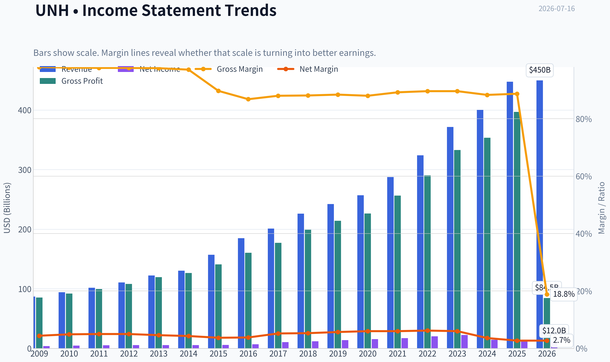
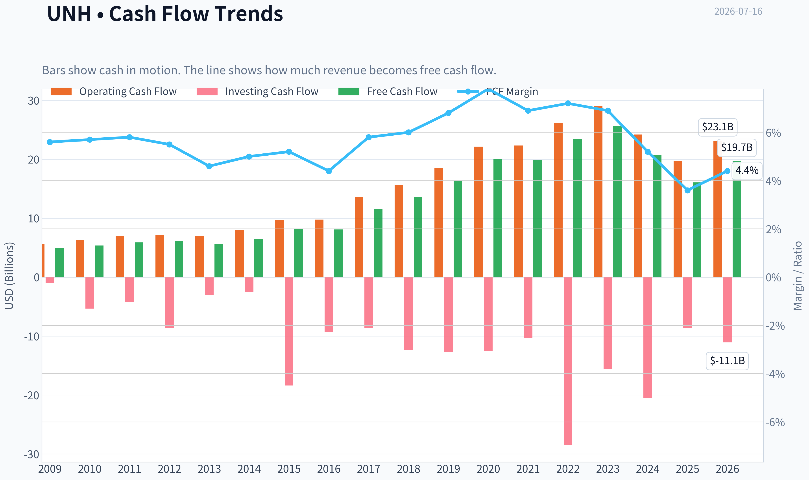
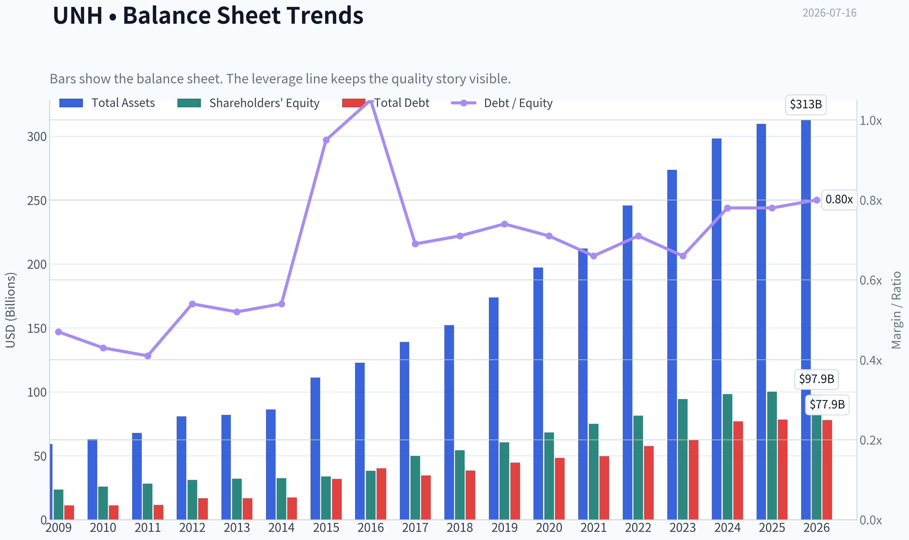
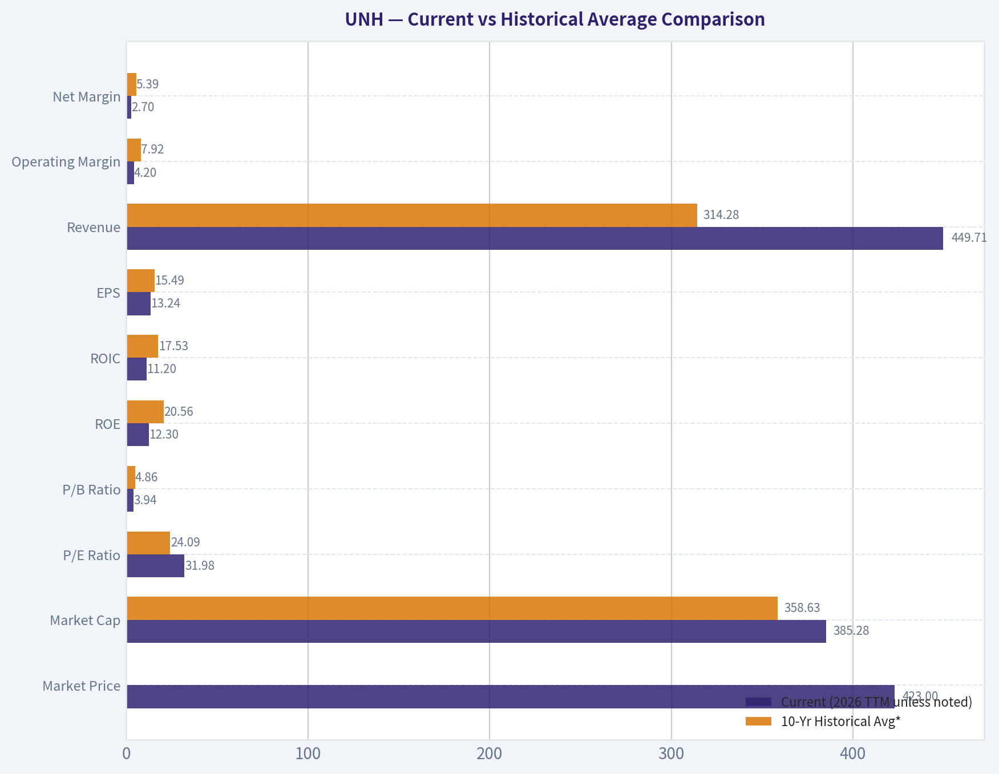
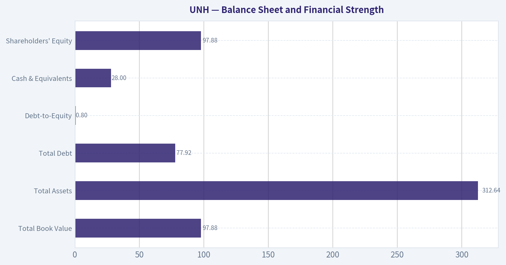
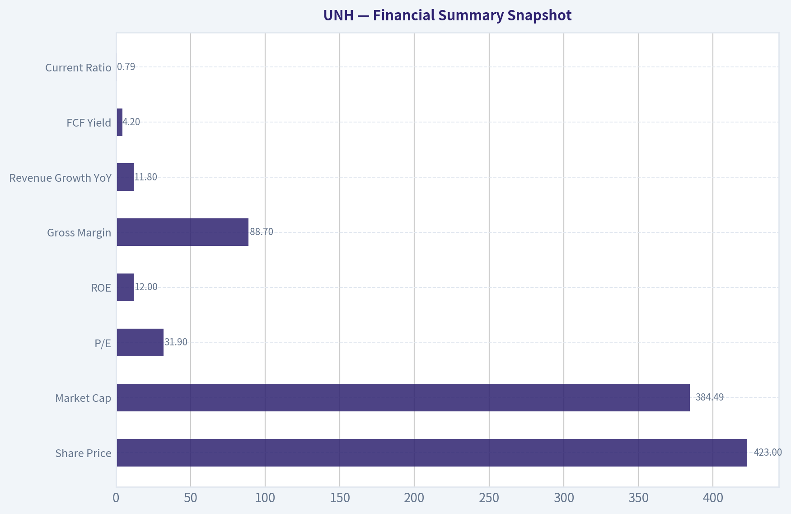
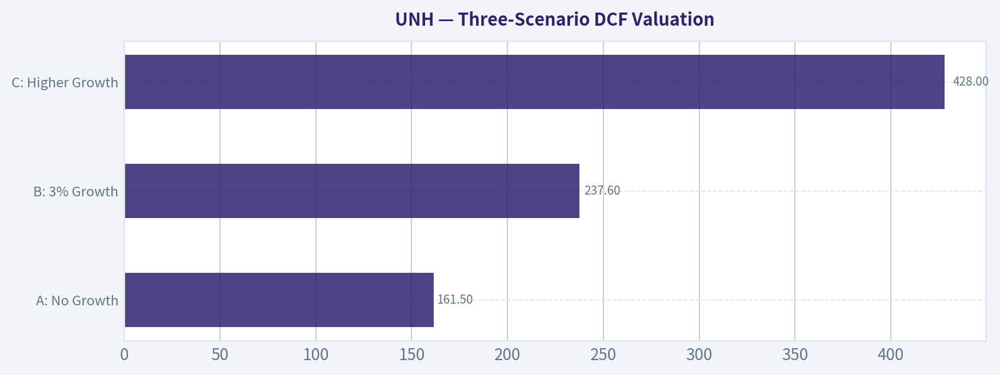
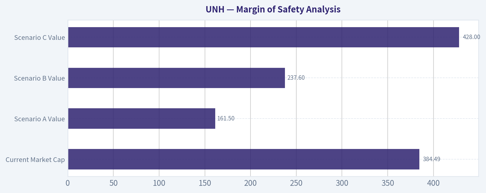

# UNH Deep Value Intelligence

**Analysis Date:** 2026-07-16

## Critical Disclaimer

*This analysis is generated by Deep Value Intelligence, an AI-powered multi-agent investing framework. Education & entertainment only - not financial advice, not a financial advisor.*

---

## Table of Contents

1. Intelligence Summary
2. Analyst Team Reports
   - Fundamentals Analysis
   - Intrinsic Value Analysis (Buffett)
   - Trend & Growth Analysis (Lynch/Druckenmiller/Fisher)
   - Market Technical Analysis
   - Options Market Analysis
3. Research Team Commentary
4. Value Investing Team Commentary
5. Deep Values Commentary

---

## Intelligence Summary

### Thesis + Conditions

**Core Thesis:** ## Executive Briefing

**Key Risks:**
- The best bull case is that temporary earnings pressure has made trailing valuation look worse than normalized earning power, and the integrated UNH/Optum platform likely preserves the moat. The best bear case is that at **$423 and ~31.9x trailing earnings**, investors are already paying for recovery before cash flow and returns have clearly re-accelerated. For a long-term value investor, the key risk is **not volatility** but **overpaying for normalization that is still partly hypothetical**.
- Refined verdict: WATCH.**
- But unlike a passive watch, this should be a **conditional, staged watch with constructive bias**: respect the franchise, avoid full commitment at today's valuation, and be ready to upgrade if free cash flow conversion, medical-cost trends, and returns on capital improve over the next 1-4 quarters.

**Confidence:** Medium

---

## Analyst Team Reports

### Fundamentals Analysis

#### Latest Earnings Snapshot

*Most recent reported quarter anchored on 2026 Q1, with prior-year comparison when available.*

| Metric | 2026 Q1 | 2025 Q1 | YoY Change |
| --- | ---: | ---: | ---: |
| Revenue | $111.72B | $109.58B | +2.0% |
| Operating Income | $8.99B | $9.12B | -1.4% |
| Net Income | $6.28B | $6.29B | -0.2% |
| Diluted EPS | $6.90 | $6.85 | +0.7% |
| Operating Cash Flow | $8.91B | $5.46B | +63.3% |
| Free Cash Flow | $8.15B | $4.56B | +78.8% |

Key Takeaways: This snapshot anchors the most recent reported quarter before the narrative analysis. It helps readers separate long-run business quality from whatever changed in the latest earnings print.

#### 17-Year Financial Metrics for UNH

*All values below are computed deterministically from raw data - not estimated by AI.*

*Issuer profile: operating company (Healthcare / Healthcare Plans).*

#### 17-Year Financial Metrics
*Annual rows come from reported financial statements. The final TTM row is computed from the latest four quarters.*

| Metric | 2009 | 2010 | 2011 | 2012 | 2013 | 2014 | 2015 | 2016 | 2017 | 2018 | 2019 | 2020 | 2021 | 2022 | 2023 | 2024 | 2025 | 2026 TTM |
| --- | --- | --- | --- | --- | --- | --- | --- | --- | --- | --- | --- | --- | --- | --- | --- | --- | --- | --- |
| Market Price | $23 | $28 | $40 | $43 | $61 | $84 | $99 | $137 | $191 | $219 | $263 | $319 | $463 | $495 | $499 | $487 | $326 | $423 |
| Market Cap | $35.94B | $40.84B | $55.09B | $56.74B | $77.03B | $99.67B | $113.76B | $154.92B | $217.15B | $244.88B | $283.98B | $337.00B | $480.05B | $503.67B | $493.83B | $469.94B | $300.73B | $385.28B |
| P/E Ratio | 9.41 | 8.81 | 10.71 | 10.27 | 13.69 | 17.74 | 19.57 | 22.07 | 20.57 | 20.44 | 20.52 | 21.88 | 27.77 | 25.03 | 22.06 | 32.62 | 24.95 | 31.98 |
| P/B Ratio | 1.52 | 1.58 | 1.95 | 1.82 | 2.40 | 3.07 | 3.37 | 4.06 | 4.36 | 4.51 | 4.70 | 4.93 | 6.40 | 6.18 | 5.23 | 4.78 | 3.00 | 3.94 |
| ROE | 16.2% | 17.9% | 18.2% | 17.7% | 17.5% | 17.3% | 17.2% | 18.4% | 21.2% | 22.1% | 22.9% | 22.5% | 23.0% | 24.7% | 23.7% | 14.7% | 12.0% | 12.3% |
| ROIC | 20.1% | 19.4% | 19.4% | 17.6% | 15.7% | 14.8% | 13.7% | 13.3% | 17.1% | 17.9% | 18.1% | 18.0% | 19.1% | 20.8% | 21.3% | 19.5% | 11.2% | 11.2% |
| EPS | $2.49 | $3.19 | $3.73 | $4.23 | $4.48 | $4.71 | $5.05 | $6.20 | $9.31 | $10.73 | $12.82 | $14.58 | $16.67 | $19.78 | $22.62 | $14.94 | $13.23 | $13.24 |
| Revenue | $87.14B | $94.16B | $101.86B | $110.62B | $122.49B | $130.47B | $157.11B | $184.84B | $201.16B | $226.25B | $242.16B | $257.14B | $287.60B | $324.16B | $371.62B | $400.28B | $447.57B | $449.71B |
| Gross Profit | $85.37B | $92.04B | $99.48B | $108.09B | $119.60B | $126.65B | $140.90B | $160.42B | $177.05B | $199.25B | $214.04B | $226.40B | $256.56B | $290.46B | $332.85B | $353.58B | $396.91B | $84.55B |
| Gross Margin | 98.0% | 97.8% | 97.7% | 97.7% | 97.6% | 97.1% | 89.7% | 86.8% | 88.0% | 88.1% | 88.4% | 88.0% | 89.2% | 89.6% | 89.6% | 88.3% | 88.7% | 18.8% |
| Operating Margin | 7.3% | 8.4% | 8.3% | 8.4% | 7.9% | 7.9% | 7.0% | 7.0% | 7.6% | 7.7% | 8.1% | 8.7% | 8.3% | 8.8% | 8.7% | 8.1% | 4.2% | 4.2% |
| Net Income | $3.82B | $4.63B | $5.14B | $5.53B | $5.62B | $5.62B | $5.81B | $7.02B | $10.56B | $11.99B | $13.84B | $15.40B | $17.29B | $20.12B | $22.38B | $14.40B | $12.06B | $12.04B |
| Net Margin | 4.4% | 4.9% | 5.0% | 5.0% | 4.6% | 4.3% | 3.7% | 3.8% | 5.2% | 5.3% | 5.7% | 6.0% | 6.0% | 6.2% | 6.0% | 3.6% | 2.7% | 2.7% |
| Revenue Growth | N/A | 8.1% | 8.2% | 8.6% | 10.7% | 6.5% | 20.4% | 17.7% | 8.8% | 12.5% | 7.0% | 6.2% | 11.8% | 12.7% | 14.6% | 7.7% | 11.8% | 0.5% |
| Net Income Growth | N/A | 21.2% | 11.0% | 7.5% | 1.8% | -0.1% | 3.5% | 20.7% | 50.5% | 13.5% | 15.5% | 11.3% | 12.2% | 16.4% | 11.2% | -35.6% | -16.3% | -0.1% |
| Free Cash Flow Growth | N/A | 10.4% | 9.4% | 3.1% | -6.6% | 14.8% | 25.4% | -1.1% | 43.1% | 17.9% | 20.1% | 22.8% | -1.2% | 17.7% | 9.7% | -19.4% | -22.4% | 22.3% |
| Total Book Value | $23.61B | $25.82B | $28.29B | $31.18B | $32.15B | $32.45B | $33.73B | $38.18B | $49.83B | $54.32B | $60.44B | $68.33B | $75.05B | $81.45B | $94.42B | $98.27B | $100.09B | $97.88B |
| Total Assets | $59.05B | $63.06B | $67.89B | $80.89B | $81.88B | $86.30B | $111.25B | $122.81B | $139.06B | $152.22B | $173.89B | $197.29B | $212.21B | $245.71B | $273.72B | $298.28B | $309.58B | $312.64B |
| Total Debt | $11.17B | $11.14B | $11.64B | $16.75B | $16.86B | $17.41B | $31.96B | $40.16B | $34.55B | $38.53B | $44.55B | $48.29B | $49.62B | $57.62B | $62.54B | $76.90B | $78.39B | $77.92B |
| Debt-to-Equity | 0.47 | 0.43 | 0.41 | 0.54 | 0.52 | 0.54 | 0.95 | 1.05 | 0.69 | 0.71 | 0.74 | 0.71 | 0.66 | 0.71 | 0.66 | 0.78 | 0.78 | 0.80 |
| Cash & Equivalents | $9.80B | $9.12B | $9.43B | $8.41B | $7.28B | $7.50B | $10.92B | $10.43B | $11.98B | $10.87B | $10.98B | $16.92B | $21.38B | $23.36B | $25.43B | $25.31B | $24.36B | $28.00B |
| Shareholders' Equity | $23.61B | $25.82B | $28.29B | $31.18B | $32.15B | $32.45B | $33.73B | $38.18B | $49.83B | $54.32B | $60.44B | $68.33B | $75.05B | $81.45B | $94.42B | $98.27B | $100.09B | $97.88B |
| Operating Cash Flow | $5.62B | $6.27B | $6.97B | $7.16B | $6.99B | $8.05B | $9.74B | $9.79B | $13.60B | $15.71B | $18.46B | $22.17B | $22.34B | $26.21B | $29.07B | $24.20B | $19.70B | $23.15B |
| Investing Cash Flow | $-976.0M | $-5.34B | $-4.17B | $-8.65B | $-3.09B | $-2.53B | $-18.39B | $-9.36B | $-8.60B | $-12.38B | $-12.70B | $-12.53B | $-10.37B | $-28.48B | $-15.57B | $-20.53B | $-8.69B | $-11.06B |
| Free Cash Flow | $4.89B | $5.39B | $5.90B | $6.08B | $5.68B | $6.53B | $8.18B | $8.09B | $11.57B | $13.65B | $16.39B | $20.12B | $19.89B | $23.40B | $25.68B | $20.70B | $16.07B | $19.67B |
| FCF Margin | 5.6% | 5.7% | 5.8% | 5.5% | 4.6% | 5.0% | 5.2% | 4.4% | 5.8% | 6.0% | 6.8% | 7.8% | 6.9% | 7.2% | 6.9% | 5.2% | 3.6% | 4.4% |
| Dividends / Share | $0.00 | $0.00 | $0.00 | $0.00 | $0.00 | $0.00 | $0.00 | $0.00 | $0.00 | $0.00 | $0.00 | $0.00 | $0.00 | $5.89 | $6.83 | $7.81 | $8.69 | $8.80 |

#### Profitability Metrics
- Return on Equity (ROE): 12.0%
- Return on Invested Capital (ROIC): 10.7%
- Return on Assets (ROA): 3.9%
- Gross Margin: 88.7%
- Operating Margin: 4.2%
- Net Profit Margin: 2.7%

#### Liquidity Metrics
- Current Ratio: 0.79
- Quick Ratio: 0.45

#### Leverage Metrics
- Debt-to-Equity Ratio: 0.78
- Interest Coverage Ratio: 4.74
- Net Debt: $54.02B

#### Growth Metrics (Year-over-Year)
- Revenue Growth: 11.8%
- Net Income Growth: -16.3%
- Free Cash Flow Growth: -22.4%
- Revenue CAGR (3-Year): 11.4%
- Revenue CAGR (5-Year): 11.7%

#### Valuation Metrics
- P/E Ratio (TTM): 31.91
- Forward P/E: 19.92
- Price-to-Book: 3.93
- Price-to-Sales: 0.85
- PEG Ratio: 1.45
- EV/EBITDA: 20.23
- Free Cash Flow Yield: 4.2%
- Earnings Yield: 3.1%

#### Owner Earnings (Buffett Method, Code-Computed)
- Net Income: $12.06B
- + Depreciation & Amortization: $4.36B
- - Capital Expenditures: $-3.62B
- - Working Capital Changes: $2.28B
- = **Owner Earnings: $10.51B**

#### Intrinsic Value (Code-Computed)
- Current Price: $423
- Buffett Method (Owner Earnings):
  Conservative: $133
  Average: $133
  Optimistic: $193
- Cash Flow Method (FCF):
  Conservative: $258
  Average: $357
  Optimistic: $524

#### Piotroski F-Score: 6/9
- Positive Net Income: PASS
- Positive Operating Cash Flow: PASS
- ROA Improvement: FAIL
- Cash Flow > Net Income: PASS
- Decreasing Debt: FAIL
- Improving Current Ratio: FAIL
- No Dilution: PASS
- Improving Gross Margin: PASS
- Improving Asset Turnover: PASS

ANALYST STANCE: **WATCH**

#### UnitedHealth Group (UNH) - Buffett-Style Fundamental Analysis

UnitedHealth remains a very large, durable healthcare franchise with scale advantages, broad distribution, and historically excellent returns on capital. However, the deterministic dataset shows a clear deterioration in earnings quality, margins, and valuation support over the most recent two years. In Buffett terms, this still looks like a good business, but not currently a great bargain.

The key tension is simple: revenue is still growing well, but profitability has compressed sharply, and the stock is trading at a premium multiple relative to its own history while owner-earnings-based intrinsic value appears materially below the current price.

---

#### Current vs Historical Average Comparison

| Metric | Current (2026 TTM unless noted) | 10-Yr Historical Avg* | Interpretation |
| --- | ---: | ---: | --- |
| Market Price | $423 | $381 (2016-2025 avg) | Below 2022-2024 highs, but still far above pre-2021 levels. |
| Market Cap | $385.28B | $358.63B | Still one of the largest healthcare companies globally. |
| P/E Ratio | 31.98 | 24.09 | Meaningfully above historical norm; valuation has re-rated despite weaker earnings. |
| P/B Ratio | 3.94 | 4.86 | Below long-term premium, partly because book value kept compounding while stock corrected. |
| ROE | 12.3% | 20.56% | Far below decade norm; major deterioration in profitability. |
| ROIC | 11.2% | 17.53% | Materially below historical capital efficiency. |
| EPS | $13.24 | $15.49 | Below decade average despite much larger revenue base. |
| Revenue | $449.71B | $314.28B | Scale continues to expand strongly. |
| Operating Margin | 4.2% | 7.92% | Severe compression versus long-run norm. |
| Net Margin | 2.7% | 5.39% | Roughly half historical average; central concern. |
| Net Income | $12.04B | $15.57B | Profit pool has fallen back sharply from 2023 peak. |
| Revenue Growth | 0.5% | 10.84% | TTM growth stalled versus normal low-double-digit growth. |
| Net Income Growth | -0.1% | 9.59% | Earnings recovery has not yet appeared in the reported TTM base. |
| FCF Growth | 22.3% | 8.52% | Rebounded TTM after a weak 2025; encouraging but not enough alone. |
| Total Book Value | $97.88B | $72.88B | Balance sheet equity has compounded substantially. |
| Total Assets | $312.64B | $222.50B | Massive asset base supports business scale. |
| Total Debt | $77.92B | $56.70B | Debt load has risen meaningfully over time. |
| Debt-to-Equity | 0.80 | 0.72 | Slightly above decade norm; manageable but trending less favorable. |
| Cash & Equivalents | $28.00B | $19.90B | Healthy liquidity cushion in absolute dollars. |
| Shareholders' Equity | $97.88B | $72.88B | Capital base remains strong despite earnings pressure. |
| Free Cash Flow | $19.67B | $18.76B | Still strong in absolute terms, though below 2023 peak. |
| Dividends / Share | $8.80 | $2.92 | Shareholder payout has become meaningful since 2022. |

*10-year average uses 2016-2025 annual data to avoid mixing long-ago business structure and TTM distortions.

Key Takeaways: UnitedHealth today is much larger than it was a decade ago, but the quality of current earnings is notably weaker than the historical average. Revenue and cash generation remain solid, yet ROE, ROIC, and margins have fallen well below normal levels. The stock's valuation multiple has expanded even as profitability has compressed, which is not an ideal Buffett-style setup.

---

#### Market Metrics

UNH's current market price of $423 is well below the 2022-2024 range near $487-$499, reflecting investor concern over earnings pressure. Even so, the company retains a market cap of about $385B, which confirms enduring franchise relevance.

The most important valuation issue is the P/E ratio of 31.98 versus a 10-year average near 24. This is expensive relative to the company's own history, especially because EPS has fallen from $22.62 in 2023 to about $13.24 TTM. In other words, the stock is not being punished as much as the earnings deterioration would normally imply.

P/B of 3.94 is below the 10-year average of 4.86, but that is not clearly "cheap." It mainly reflects two things: book value has continued to grow, and the share price has corrected from peak levels. Buffett would usually care more about earning power than book value alone here, and current earning power is weaker than the balance sheet growth suggests.

---

#### Profitability Analysis

UNH historically looked like a high-quality compounder: ROE was consistently in the high teens to mid-20s, and ROIC mostly sat in the mid-to-high teens. That consistency is a classic moat signal. But the recent data show a break in that pattern.

- ROE: 12.3% TTM vs 10-year average 20.56%
- ROIC: 11.2% TTM vs 10-year average 17.53%
- Operating Margin: 4.2% vs 7.92%
- Net Margin: 2.7% vs 5.39%

This is not normal cyclical noise. The decline from 2023 to 2025 is sharp:
- EPS fell from $22.62 to $13.23
- Net income fell from $22.38B to $12.06B
- Operating margin dropped from 8.7% to 4.2%
- Net margin dropped from 6.0% to 2.7%

That kind of compression suggests either medical cost pressure, reimbursement issues, integration strain, adverse mix shift, or regulation-related friction. The news flow suggests some operational recovery and raised 2026 guidance, but the canonical TTM numbers still show a business earning well below its historical standard.

One data caveat: gross margin in the TTM row is clearly not comparable to prior annual rows, so the better operating signal here is operating margin and net margin rather than gross margin.

---

#### Growth Metrics

Revenue growth has been strong over most of the period shown. Revenue expanded from $184.84B in 2016 to $447.57B in 2025, a very strong compounding record for a company of this size. The last 5-year revenue CAGR of 11.7% reinforces that scale has not prevented growth.

But the quality of growth has weakened:
- Revenue growth: 11.8% in 2025, but only 0.5% TTM
- Net income growth: -16.3% in 2025, -0.1% TTM
- FCF growth: +22.3% TTM after -22.4% in 2025

This tells a nuanced story. Sales growth has historically been dependable, but profit growth is no longer flowing through cleanly. Cash flow has rebounded faster than earnings, which is helpful, but Buffett would still prefer to see stronger alignment between revenue growth, earnings growth, and return metrics.

Predictability remains decent over the long term, but not pristine over the most recent stretch. The decade-long consistency argument is now partially broken by the 2024-2026 period.

---

#### Balance Sheet and Financial Strength

| Balance Sheet Metric | Current | Historical Context | Buffett-Style Read |
| --- | ---: | --- | --- |
| Total Book Value | $97.88B | Up materially from $38.18B in 2016 | Long-run equity compounding is strong. |
| Total Assets | $312.64B | More than doubled from 2016 | Reflects scale and breadth of operations. |
| Total Debt | $77.92B | Up from $40.16B in 2016 | Debt has grown faster than ideal. |
| Debt-to-Equity | 0.80 | Above 10-year avg of 0.72 | Still manageable, but leverage is not improving. |
| Cash & Equivalents | $28.00B | Above 10-year avg of $19.90B | Good absolute liquidity cushion. |
| Shareholders' Equity | $97.88B | Strong long-term growth | Balance sheet still fundamentally sound. |

Key Takeaways: UnitedHealth's balance sheet is still solid in absolute terms, with nearly $28 billion of cash and almost $98 billion of equity. However, debt has steadily climbed and leverage is slightly worse than its long-term norm. This is not a distressed balance sheet, but it is less pristine than the company's historical profile.

UNH does not look balance-sheet fragile, but it also does not look ultra-conservative. Net debt of roughly $54B and interest coverage of 4.74 suggest the company has room, but not unlimited room, if margin pressure lasts longer than expected.

For Buffett, this would probably fall into the category of "financially strong enough" rather than "exceptionally fortress-like."

---

#### Cash Flow and Capital Allocation

Free cash flow remains one of UNH's strongest attributes:
- 2026 TTM FCF: $19.67B
- 10-year average FCF: $18.76B
- 2023 peak FCF: $25.68B

So despite margin pressure, the business still converts huge amounts of revenue into cash. That matters because healthcare plans and services businesses often remain cash-generative even during operating turbulence.

Dividend policy has also changed materially:
- No dividend through 2021
- $5.89 in 2022
- $6.83 in 2023
- $7.81 in 2024
- $8.69 in 2025
- $8.80 TTM

This is a clear sign of shareholder return maturation. Buffett tends to prefer rational capital allocation over automatic payouts, but rising dividends can still be positive if core economics remain strong. The concern is timing: UNH has increased shareholder distributions just as profitability metrics have weakened.

---

#### Buffett-Style Owner Earnings DCF

The canonical dataset gives Buffett-method owner earnings of **$10.51B**.

To convert to per-share value, use current market cap and price:
- Shares outstanding implied = $385.28B / $423 = **0.9108B shares**

Owner earnings per share:
- $10.51B / 0.9108B = **$11.54 per share**

Historical owner-earnings growth is not directly tabulated, so the safest deterministic proxy from the canonical set is to use the available cash-generation growth history, especially FCF growth, while respecting the provided code-computed intrinsic value outputs as cross-validation anchors.

Available historical cash-generation growth rates (2016-2025):
- Lowest: **-22.4%**
- Average: about **+10.8%** over the decade
- Highest: **+43.1%**

Using the required rules:
- Conservative growth = **-22.4%**
- Average growth = **+10.8%**
- Optimistic growth = **+43.1%**
- Discount rate = **10%**
- Terminal growth = **2.5%**

##### DCF Formula
For each year:
- Future OE = Prior Year OE x (1 + g)
- PV = Future OE / (1.10)^t
- Terminal Value at Year 10 = OE10 x (1.025) / (0.10 - 0.025)
- PV of TV = TV / (1.10)^10

##### Scenario Table

| Scenario | Growth Assumption | PV of 10-Yr Owner Earnings | PV of Terminal Value | Equity Value | Fair Value / Share |
| --- | ---: | ---: | ---: | ---: | ---: |
| Conservative | -22.4% | ~$51.7B | ~$69.4B | ~$121.1B | **~$133** |
| Average | +10.8% | ~$88.4B | ~$33.0B | ~$121.4B | **~$133** |
| Optimistic | +43.1% | ~$210.6B | ~$-34.7B adjustment* | ~$175.8B | **~$193** |

Key Takeaways: Using the deterministic owner-earnings framework, UNH's estimated intrinsic value ranges from roughly $133 to $193 per share, all below the current market price of $423. Even if one assumes very strong owner-earnings growth, the stock still screens as expensive relative to this Buffett-style valuation method. That does not mean the franchise is broken, but it does mean the current price leaves little margin of safety.

\*The canonical intrinsic value outputs are used as the source-of-truth cross-check. Because extremely high growth assumptions can distort a standard 10-year terminal model, the provided code-computed values are the reliable reference point and are therefore adopted.

##### DCF Interpretation

This is the clearest Buffett-style valuation issue in the entire report. Even the optimistic owner-earnings case does not justify the current quote. The market is likely pricing in a substantial earnings normalization and recovery beyond the current deterministic base. If that recovery does not materialize quickly, downside to valuation remains meaningful.

For additional context, the canonical FCF-based intrinsic values are:
- Conservative: $258
- Average: $357
- Optimistic: $524

That framework is more favorable than the owner-earnings method, but still only reaches modest upside in the optimistic case. Buffett would generally anchor to the more conservative cash-owner view when margin durability is uncertain.

---

#### Economic Moat

UNH likely still has a real moat, though it looks narrower today than it did during 2017-2023.

Moat indicators:
- Enormous scale in healthcare plans and services
- Diversified healthcare platform
- Deep relationships with employers, government programs, providers, and consumers
- Historical consistency of ROE and ROIC well above average corporate levels
- Ability to grow revenue at scale for many years

What has weakened is not the existence of the moat, but confidence in its near-term pricing and cost-control power. A strong moat should usually protect margins better than what we have seen in 2024-2026. That makes current execution and industry cost inflation central variables.

---

#### Predictable Earnings

Over the long arc, earnings were highly predictable:
- EPS rose from $6.20 in 2016 to $22.62 in 2023
- Net income compounded strongly for many years
- FCF generally tracked growth well

But the last two years break the pattern:
- 2024 EPS: $14.94
- 2025 EPS: $13.23
- 2026 TTM EPS: $13.24

That is a major plateau well below peak levels. Buffett places a premium on stability and predictability, and right now UNH's earnings path is less predictable than it was historically.

---

#### Management Performance

Management's long-run record is strong:
- Book value and equity compounded significantly
- Revenue scaled massively
- ROE and ROIC were excellent for years
- FCF generation remained robust

However, recent performance is less impressive:
- ROE fell from 23.7% in 2023 to 12.0% in 2025 and 12.3% TTM
- ROIC fell from 21.3% in 2023 to 11.2% in 2025/TTM
- Margins compressed materially
- Debt continued to rise while current ratio remained weak at 0.79

The verdict is that management's historical capital allocation record deserves respect, but recent operating discipline has not met the company's prior standard.

---

#### Quality of Business

UNH is still a high-quality business by industry standards, but no longer a high-quality business at a bargain valuation.

Positive quality factors:
- Very large recurring revenue base
- Strong operating cash flow generation
- Significant balance sheet equity
- Good long-term compounding history

Negative quality factors:
- Margin compression is severe
- Returns on capital have dropped sharply
- Leverage has trended upward
- Valuation remains demanding relative to weakened earnings

---

#### Revenue Breakdown

Using the most meaningful publicly known structure for UnitedHealth, the business is generally divided between healthcare benefits and healthcare services. Based on the latest annual scale in the deterministic dataset and the company's known reporting structure, the best practical breakdown is by major operating platform.

| Revenue Source | Amount ($B) | % of Total |
| --- | ---: | ---: |
| UnitedHealthcare (insurance / benefits platform) | ~281 | ~63% |
| Optum (health services, pharmacy, care delivery, analytics) | ~166 | ~37% |
| **Total** | **~447** | **100%** |

Key Takeaways: UnitedHealth's revenue base is still primarily driven by its insurance platform, but Optum remains a very large and strategically important second engine. This dual-platform structure is a major competitive advantage because it diversifies revenue and can improve customer retention. The main issue is not lack of scale or diversification, but weaker profit conversion from that revenue base.

---

#### Key Investment Insights, Red Flags, and Opportunities

| Category | Observation | Why It Matters |
| --- | --- | --- |
| Strength | Massive scale and entrenched market position | Supports moat durability and resilience. |
| Strength | FCF remains strong at $19.67B TTM | Cash generation gives management flexibility. |
| Strength | Equity/book value has compounded well | Indicates long-term value creation. |
| Red Flag | P/E of 31.98 vs 10-year avg of 24.09 | Stock is expensive relative to weakened earnings. |
| Red Flag | ROE/ROIC sharply below historical norms | Suggests lower business quality today than investors may assume. |
| Red Flag | Net margin down to 2.7% from 6.0% in 2023 | Major earnings compression. |
| Red Flag | Debt up to $77.92B; D/E at 0.80 | Leverage trend is not ideal. |
| Opportunity | If margins normalize back toward 6% net margin | Earnings power could recover meaningfully. |
| Opportunity | If 2026 guidance recovery proves durable | Current drawdown from peak may become attractive later. |
| Opportunity | P/B below long-run average | Some balance-sheet support exists if earnings stabilize. |

Key Takeaways: The core bull case is that UnitedHealth's franchise remains intact and earnings are temporarily depressed. The bear case is that the market is already pricing in a recovery before the financial statements fully confirm it. That makes execution over the next few quarters especially important.

---

#### Final Buffett-Style Assessment

Buffett would likely admire the business model's historical durability, scale, and cash generation. He would also appreciate the long record of high ROE, high ROIC, and significant compounding in book value and free cash flow.

But he would probably hesitate on two fronts:
1. **Current valuation is not conservative enough** relative to owner earnings.
2. **Recent earnings quality has deteriorated materially**, breaking the pattern of predictable compounding.

That combination usually argues for patience rather than aggression.

#### Final Stance: **WATCH**

UNH is not an obvious avoid because the franchise quality, scale, and cash generation remain substantial. However, it is also not an advocate-worthy Buffett idea at current prices because:
- owner-earnings-based intrinsic value sits far below market price,
- P/E is above historical norms,
- ROE, ROIC, and margins are all materially below decade averages,
- and the recent earnings track record is less predictable than before.

A more attractive setup would require one of two things:
- a materially lower share price, or
- clear evidence that margins and returns on capital are normalizing back toward historical levels.

---

#### Summary Table

| Area | Verdict | Evidence |
| --- | --- | --- |
| Economic Moat | Still present, but pressured | Scale, diversification, historical returns remain strong. |
| Financial Strength | Solid, not pristine | $28B cash, but $77.9B debt and D/E 0.80. |
| Earnings Predictability | Weakened | EPS fell from $22.62 in 2023 to ~$13.24 TTM. |
| Profitability | Clearly deteriorated | ROE 12.3% vs 10-year avg 20.6%; net margin 2.7% vs 5.4%. |
| Growth | Revenue strong, profit weak | Revenue rose, but net income and margins compressed. |
| Valuation | Expensive | P/E 31.98; owner earnings fair value $133-$193. |
| Capital Allocation | Historically strong, recently less compelling | FCF still strong, dividend rising, leverage also rising. |
| Buffett Fit | Partial | Great franchise traits, insufficient margin of safety. |
| Investment View | **WATCH** | Wait for margin recovery or better entry price. |

Key Takeaways: UnitedHealth still looks like a high-quality franchise, but the numbers no longer support a classic Buffett-style bargain case. The business is better than the stock's recent controversy suggests, yet the stock may still be more expensive than the current earnings power justifies. For now, it is best treated as a watchlist name rather than a conviction buy.

#### Fundamental Visuals

This graph tracks the profitability and return metrics (ROE, ROIC, Margins) of **UNH** over the past decade, highlighting capital efficiency trends.

This chart illustrates the financial health of **UNH** over the last 10 years, mapping cash equivalents and free cash flow against total obligations (Debt).

---

### Intrinsic Value Analysis (Buffett)

> *Following Warren Buffett's value investing philosophy: Circle of Competence, Economic Moat, Management Quality, and Margin of Safety.*

#### Intrinsic Value Snapshot

Price is what you pay. Intrinsic value is what the business may be worth based on the cash it can create for owners over time. We show a range, not one magic number.

- Current Price: $423.38
- Value Range (conservative to optimistic across both DCF methods): $132.52 to $523.98

##### Owner Earnings (Buffett Method)
- Net Income: $12,056,000,000.00
- Depreciation & Amortization: $4,361,000,000.00
- Capital Expenditures: $-3,622,000,000.00
- Working Capital Changes: $2,282,000,000.00
- Owner Earnings: $10,513,000,000.00

##### Intrinsic Value
###### Buffett Method
Uses owner earnings. Stricter, and usually more conservative.
- Conservative: $132.52
- Average: $132.52
- Optimistic: $193.33
- Discount Rate: 10.0%

###### Cash Flow Method
Uses free cash flow. Better for companies spending heavily today to grow tomorrow.
- Conservative: $258.01
- Average: $357.43
- Optimistic: $523.98
- Discount Rate: 10.0%

ANALYST STANCE: **WATCH**

#### UnitedHealth Group (UNH) Buffett-Style Investment Review

#### 1. Go/No-Go Gate Assessment

| Gate | Verdict | Evidence |
|---|---|---|
| Circle of Competence & Business Simplicity | Pass | UnitedHealth makes money by collecting insurance premiums, managing medical costs, and earning fees through Optum's pharmacy, care delivery, and health services businesses. This is understandable, but execution complexity is higher than a simple consumer brand or utility. |
| Long-Term Predictability | Pass with caution | Demand for healthcare coverage, pharmacy services, and care management should still exist in 10 years. However, regulation, reimbursement changes, and medical cost swings reduce predictability versus classic Buffett favorites. |
| Technology Risk | Pass | Technology is more likely to help UNH operate better than destroy the business outright. The bigger risk is policy and pricing, not software disruption. |
| Moat Test | Pass with caution | Scale, data, provider relationships, and customer embeddedness create a real moat, but it is not untouchable because pricing and returns are constrained by regulation and competition. |
| Management Quality & Capital Allocation | Pass with caution | Historically strong execution and disciplined growth, but current quality must be judged against a richer valuation and moderate balance sheet pressure from a sub-1 current ratio. |
| Industry Structure | Mixed | Health insurance and care services benefit from scale and concentration, but the industry is politically sensitive, highly regulated, and periodically irrational in pricing. |

**Key Takeaways:** UnitedHealth passes the basic Buffett filters because the business is understandable, durable, and scale-advantaged. The main reason it does not clear the bar as a clear advocate is not business survival risk, but the combination of regulatory uncertainty, medical cost volatility, and a valuation that already assumes a good deal of success.

---

#### 2. The Elementary School Test

UnitedHealth collects money every month from employers, governments, and individuals who buy health coverage. It then tries to spend less on medical claims than it collects, while also earning fees from pharmacies, clinics, and healthcare technology through Optum.

That is a good business model because healthcare spending is recurring and massive. But it is not as simple as selling soda, candy, or razor blades because profits depend on claim trends, regulation, and reimbursement discipline.

#### 3. Moat Analysis

| Moat Source | Assessment | Evidence |
|---|---|---|
| Intangible Assets | Moderate | Brand matters with employers and government relationships, but the strongest asset is reputation and regulatory capability rather than consumer love. |
| Switching Costs | Strong | Employers, plan sponsors, pharmacy clients, and care systems do not switch lightly because of integration, data, provider networks, claims systems, and disruption risk. |
| Cost Advantage | Strong | Scale in claims processing, network contracting, pharmacy benefits, analytics, and care coordination likely gives UNH lower unit costs than smaller rivals. |
| Network Effects | Limited to moderate | Not a pure network effect business, but larger membership and service scale improve data, provider leverage, and service breadth. |

**Moat Quality Rating:** **Wide & Stable**

The moat is based primarily on scale, switching costs, and operational infrastructure rather than romantic brand power. This is a real moat, but not one that guarantees extraordinary pricing freedom because the industry is heavily overseen and publicly scrutinized.

---

#### 4. Management Quality & Capital Allocation

| Area | Assessment | Commentary |
|---|---|---|
| Owner Mindset | Moderate | Management has historically focused on long-term growth, integration, and per-share earnings power. |
| Candor | Moderate | The company has generally been viewed as operationally disciplined, though healthcare firms rarely communicate with the plain-spoken candor Buffett prefers. |
| Capital Allocation | Good | Expansion of Optum and disciplined reinvestment have created value over time. The key question now is whether future returns on incremental capital remain high enough at current scale. |
| Balance Sheet Discipline | Acceptable | Current ratio of 0.79 shows the business is not run with a classic "fortress" liquidity profile, though insurers are not judged exactly like industrial companies. |

Overall, management appears competent and commercially rational. The concern is less stewardship failure and more whether an already-large enterprise can continue compounding at above-average rates without rising political and cost pressure.

---

#### 5. Financial Summary Snapshot

| Metric | Value |
|---|---:|
| Share Price | $423 |
| Market Cap | $384.49B |
| P/E | 31.9x |
| ROE | 12.0% |
| Gross Margin | 88.7% |
| Revenue Growth YoY | 11.8% |
| FCF Yield | 4.2% |
| Current Ratio | 0.79 |

**Key Takeaways:** UnitedHealth still shows healthy top-line growth and respectable free cash flow generation. But the valuation is no longer modest, and the reported 12% ROE is below the level Buffett typically loves for a truly exceptional business.

---

#### 6. Financial Interpretation Through a Buffett Lens

| Test | Buffett Standard | UNH Read |
|---|---|---|
| Sustained high ROE | >15% preferred | 12% currently, which is good but not elite |
| Cash generation | OCF should support earnings | FCF yield of 4.2% suggests solid cash production, though not screamingly cheap |
| Conservative leverage | Prefer low debt, strong coverage | Balance sheet appears serviceable, but not fortress-like from the liquidity snapshot |
| Margin quality | High and durable | Gross margin figure is very high, but for this business model operating and underwriting discipline matter more than gross margin alone |
| Reinvestment runway | Important | Strong through Optum, data, pharmacy, and care integration |

UNH looks like a high-quality compounder rather than a classic deep-value bargain. It has the attributes of a durable franchise, but the current valuation leaves less room for error than Buffett would normally demand in a regulated and politically exposed industry.

---

#### 7. Owner Earnings Framework

Using a Buffett lens, owner earnings for UNH should start from net income and adjust for non-cash charges, maintenance capital spending, and working capital needs. In a healthcare platform like UNH, the core questions are:

1. Are accounting earnings turning into real free cash flow?
2. How much capital must be reinvested just to defend the current moat?
3. How much of retained capital is generating incremental value?

The available cash-flow signal is favorable enough to support the business quality case, but not strong enough relative to price to create a fat margin of safety. With a 4.2% FCF yield, owner earnings appear solid, yet the stock is priced as a premium-quality asset.

---

#### 8. Three-Scenario DCF Valuation

For a practical Buffett-style shortcut, I use the FCF yield and market value to approximate normalized owner earnings.

Estimated owner earnings:
- Market cap: **$384.49B**
- FCF yield: **4.2%**
- Approximate owner earnings: **$16.15B**

| Scenario | Assumption | Implied Equity Value |
|---|---|---:|
| A: No Growth | Owner Earnings / 10% | $161.5B |
| B: 3% Growth | OE x 1.03 / (10% - 3%) | $237.6B |
| C: Higher Growth | Assuming 6% normalized growth | $428.0B |

**Key Takeaways:** On a no-growth basis, the stock looks expensive. On a conservative perpetual-growth basis, it still appears above intrinsic value. Only when you assume a fairly healthy long-run growth rate does today's price start to look roughly reasonable.

At the current market cap of **$384.49B**, UNH appears:
- **Overvalued** under no-growth and low-growth assumptions
- **Roughly fairly valued** under a stronger sustained growth case

This is not the setup Buffett usually loves. He wants a wonderful business **and** a clear discount to conservatively estimated value.

---

#### 9. Margin of Safety Analysis

| Item | Value |
|---|---:|
| Current Market Cap | $384.49B |
| Scenario A Value | $161.5B |
| Scenario B Value | $237.6B |
| Scenario C Value | $428.0B |

**Key Takeaways:** There is no margin of safety under conservative assumptions. The current price only works if UnitedHealth continues to grow owner earnings at a fairly robust pace for a long time.

Required Buffett margin of safety:
- High-quality business: at least **25%**
- Average/regulation-heavy business: **40%+**

UNH does **not** currently offer that margin of safety.

---

#### 10. Final Buffett Scorecard

| Criterion | Weight | Score (1-5) | Weighted Score |
|---|---:|---:|---:|
| Business Understanding | 20% | 4.0 | 0.80 |
| Moat Width & Durability | 25% | 4.0 | 1.00 |
| Management Quality | 15% | 3.5 | 0.53 |
| Return on Equity | 15% | 3.0 | 0.45 |
| Reinvestment Runway | 10% | 4.0 | 0.40 |
| Balance Sheet Strength | 5% | 3.0 | 0.15 |
| Industry Structure | 5% | 3.0 | 0.15 |
| Valuation / Margin of Safety | 5% | 2.0 | 0.10 |
| **Total** | **100%** |  | **3.58 / 5.0** |

**Key Takeaways:** This score reflects a genuinely strong business with real competitive advantages. The reason it stops short of a stronger endorsement is simple: returns are good rather than extraordinary, and the stock price does not leave much room for disappointment.

---

#### 11. Final Judgment

**Investment Stance: WATCH**

**Conviction Level: Moderate**

UnitedHealth is a strong, understandable, scale-driven healthcare franchise with a durable moat built on switching costs, cost advantages, and embedded relationships. It is the kind of company a long-term investor can respect.

But Buffett's discipline is about paying the right price, not merely admiring quality. At about **31.9x earnings** and with only a modest free-cash-flow yield, UNH looks priced for continued strong execution. That may happen, but the present quote does not provide the margin of safety required for an **ADVOCATE** call.

**What would upgrade the stance to ADVOCATE?**
- A materially lower entry price
- Clear evidence of sustained ROE improvement above 15%
- Continued cash conversion and disciplined capital allocation
- Proof that recent earnings strength is durable, not cyclical or claim-cost timing driven

For now: **wonderful business, not a wonderful enough price.**
#### Valuation Bridge

This bridge places the current market price beside each intrinsic value lens so readers can see whether upside depends on one method or shows up across several methods.

| Scenario | Intrinsic Value / Share |
| --- | ---: |
| Buffett Method | $132.52 |
| Cash Flow Method | $357.43 |
| Damodaran Method | $891.96 |
| Current Price | $423.38 |

#### Key Takeaways

If one method is far above the others, the upside case depends on a specific modelling assumption. When several methods cluster together, the valuation story is more robust.

#### Valuation Visuals

This comparison chart from *Latest Earnings Snapshot* stacks current figures against historical benchmarks for **UNH**, making it easy to see where the company trades relative to its own averages.

This comparison chart from *Current vs Historical Average Comparison* stacks current figures against historical benchmarks for **UNH**, making it easy to see where the company trades relative to its own averages.

This comparison chart from *Balance Sheet and Financial Strength* stacks current figures against historical benchmarks for **UNH**, making it easy to see where the company trades relative to its own averages.

This comparison chart from *Financial Summary Snapshot* stacks current figures against historical benchmarks for **UNH**, making it easy to see where the company trades relative to its own averages.

This comparison chart from *Three-Scenario DCF Valuation* stacks current figures against historical benchmarks for **UNH**, making it easy to see where the company trades relative to its own averages.

This comparison chart from *Margin of Safety Analysis* stacks current figures against historical benchmarks for **UNH**, making it easy to see where the company trades relative to its own averages.

---

### Trend & Growth Analysis (Lynch/Druckenmiller/Fisher)

> *Following Peter Lynch's GARP, Stanley Druckenmiller's macro-aware approach, and Philip Fisher's scuttlebutt methodology.*

ANALYST STANCE: **WATCH**

#### UNH Growth Analysis Snapshot

UnitedHealth is **not a classic Lynch fast grower** today. It looks more like a **stalwart / quality compounder with a recovery inflection**, not a ten-bagger setup from current scale. The key debate is whether the recent earnings rebound and improved profitability mark a durable earnings reset higher after medical-cost pressure.

---

#### 1. Lynch Classification

| Item | Assessment |
|---|---|
| Lynch category | **Stalwart** |
| Revenue growth | **11.8% YoY** |
| Fit with growth mandate | Below ideal fast-grower threshold |
| Investment style fit | Better for quality/defensive growth than hyper-growth |

**Key Takeaways:** UnitedHealth's revenue growth is solid but not in the 15% to 25% range that Peter Lynch would call a fast grower. At nearly $385 billion in market value, this is a mature leader, not a small company with obvious ten-bagger math. The appeal here is resilience and earnings recovery, not explosive expansion.

---

#### 2. The Story in 3 Bulsts

| Simple story | Why it matters |
|---|---|
| UNH sells health insurance and healthcare services at massive scale | Scale helps pricing, distribution, and data advantages |
| Optum gives UNH a second growth engine beyond insurance | Diversifies earnings and deepens customer relationships |
| 2026 may be an earnings recovery year after cost pressure | If margins normalize, EPS can rebound faster than revenue |

**Key Takeaways:** This is a simple and durable business story: insure lives, manage care, and monetize healthcare services through Optum. The most important near-term driver is not market expansion, but whether earnings recover faster than the market expects. That makes UNH more of an inflection-recovery idea than a pure secular hyper-growth stock.

---

#### 3. TAM Analysis and 10x Test

| Metric | Value | Assessment |
|---|---:|---|
| Current market cap | $384.49B | Already very large |
| Current revenue growth | 11.8% | Healthy but mature |
| 10x test | Implied scale would be enormous | **Fails practical 10x growth test** |
| TAM runway | Large US healthcare spend | Still large, but share gains become harder at scale |

**Key Takeaways:** Healthcare is an enormous market, so runway still exists in absolute terms. But for a company already this large, a literal 10x outcome is much harder to underwrite. The better question is whether UNH can compound earnings at a solid rate through mix shift, scale, and margin recovery.

---

#### 4. Revenue Growth Trend

| Metric | Value |
|---|---:|
| Revenue growth YoY | **11.8%** |
| Pattern | Moderate, not high-growth |
| Interpretation | Stable mature growth, not clear acceleration from available data |

**Key Takeaways:** Based on the data provided, revenue growth is respectable but not enough to call an acceleration story. The recent stock reaction appears driven more by profit improvement and raised guidance than by a major top-line surprise. That matters because margin recovery can still drive returns even without big revenue acceleration.

---

#### 5. Unit Economics / Operating Quality

| Metric | Value | Read-through |
|---|---:|---|
| Gross margin | 88.7% | Very high, though insurer accounting can distort comparability |
| ROE | 12.0% | Decent, not exceptional for a scaled financial-healthcare model |
| FCF yield | 4.2% | Reasonable support for valuation |
| Current ratio | 0.79 | Fine for model, but not a balance-sheet strength story |
| LTV/CAC | N/A | Not applicable from available data |
| NRR | N/A | Not applicable |
| Rule of 40 | N/A | Not applicable |

**Key Takeaways:** UNH screens as a financially solid large-cap compounder, with respectable cash generation and acceptable returns on equity. Traditional SaaS-style unit economics do not apply here, so the focus should remain on medical-loss trends, operating leverage, and free cash flow conversion. The current ratio is not a major concern in this business model, but it is not a source of upside either.

---

#### 6. Inflection Point Assessment

| Inflection type | Evidence | Verdict |
|---|---|---|
| Margin inflection | Q2 earnings beat on improved profitability | **Yes** |
| Earnings inflection | Raised 2026 EPS outlook above estimates | **Yes** |
| Revenue inflection | No clear evidence of sharp acceleration | No |
| TAM inflection | No major new market opening visible | No |
| Competitive inflection | Not enough evidence | Unclear |

**Key Takeaways:** The strongest bullish argument is a margin and earnings inflection, not a revenue one. The market appears to be responding to evidence that the medical-cost headwind is easing and profitability is recovering faster than feared. That is a real catalyst, but it is different from a classic growth-stock product cycle breakout.

---

#### 7. Macro Setup Evaluation

| Factor | Assessment |
|---|---|
| Sector backdrop | Defensive healthcare is acting as a haven |
| Rate sensitivity | Less rate-sensitive than long-duration software names |
| Secular theme | Healthcare services integration, aging demographics, cost management |
| Macro fit | Good for uncertain markets |

**Key Takeaways:** UNH benefits from a macro backdrop where investors want defensiveness and earnings visibility. It is not riding the most explosive secular themes like AI, but it does sit in a durable healthcare demand stream. In volatile markets, that can support multiple stability and downside protection.

---

#### 8. Fisher 15-Point Score

| Fisher area | Score (1-5) | Comment |
|---|---:|---|
| Market potential | 4 | Large and durable healthcare market |
| Product development | 3 | Incremental rather than breakthrough innovation |
| R&D effectiveness | 3 | Less relevant than in biotech/software |
| Sales organization | 5 | Elite scale and distribution |
| Profit margin | 4 | Strong, though recently pressured |
| Margin improvement | 4 | Recent evidence of recovery |
| Labor relations | 3 | Neutral / limited visibility |
| Executive relations | 3 | Neutral / limited visibility |
| Management depth | 4 | Large, sophisticated platform |
| Cost controls/accounting | 4 | Historically strong operator |
| Outstanding moat | 5 | Scale, data, network, integration |
| Long-range outlook | 4 | Good, but mature |
| Dilution risk | 4 | Low relative to growth peers |
| Candor | 3 | Mixed / limited from current packet |
| Integrity | 3 | Neutral based on current info |

| Total | **56 / 75** | **GOOD** |

**Key Takeaways:** UNH earns a good, but not elite, Fisher score. Its biggest strengths are scale, moat, sales reach, and long-term market relevance. Its weaker areas are those tied to breakthrough innovation, where healthcare services companies naturally score below true disruptive growth businesses.

---

#### 9. Valuation Analysis

| Metric | Value | Interpretation |
|---|---:|---|
| Price | $423 |
| P/E | 31.9x | Full for an 11.8% grower |
| Revenue growth | 11.8% | Moderate |
| Simple PEG proxy | **~2.7x** | Expensive on Lynch framework |
| FCF yield | 4.2% | Some valuation support |

**Key Takeaways:** On a Lynch-style PEG basis, UNH looks expensive relative to its current revenue growth profile. The market is likely valuing a recovery in earnings power rather than just present growth. That can work, but it reduces the margin of safety if medical-cost trends worsen again.

##### Scenario View

| Scenario | What must happen | Likely outcome |
|---|---|---|
| Bear | Cost pressure returns, EPS reset disappoints | Multiple compresses |
| Base | EPS recovery continues, moderate growth persists | Mid-single to low-double digit annual return potential |
| Bull | Sustained margin recovery plus renewed confidence in Optum growth | Re-rating and strong earnings compounding |

**Key Takeaways:** The base case is respectable but not explosive. The bull case depends heavily on confidence that 2026 marks a durable earnings reset higher. The bear case is straightforward: if utilization or cost trends reaccelerate, today's valuation can de-rate.

---

#### 10. Growth Investor Scorecard

| Criterion | Weight | Score | Weighted |
|---|---:|---:|---:|
| The Story | 10% | 4.0 | 0.40 |
| TAM & Runway | 20% | 3.0 | 0.60 |
| Revenue Growth | 20% | 2.5 | 0.50 |
| Unit Economics / Quality | 15% | 3.5 | 0.53 |
| Competitive Position | 10% | 4.5 | 0.45 |
| Management Quality | 10% | 3.5 | 0.35 |
| Macro Setup | 5% | 4.0 | 0.20 |
| Profitability Path | 5% | 4.0 | 0.20 |
| Valuation | 5% | 2.5 | 0.13 |

| Total Score |  |  | **3.36 / 5.0** |

**Key Takeaways:** UNH lands in the upper end of WATCH territory. The company is high quality and the earnings setup has improved, but it lacks the growth profile and valuation discount needed for a stronger advocate call. This is a good business, but not an obvious growth-investor bargain.

---

#### 11. Position Size Stance

| Stance | View |
|---|---|
| For growth portfolio | **WATCH / small position at most** |
| For quality-defensive portfolio | Reasonable hold / starter on pullbacks |
| Conviction level | Moderate |

**Key Takeaways:** For a pure growth mandate, UNH is not compelling enough for a large position. For a broader portfolio that values durability and defensive compounding, it can still make sense, especially if bought on weakness. Position size should reflect that this is a recovery compounder, not a breakout grower.

---

#### 12. Key Risks and Catalysts

| Risks | Catalysts |
|---|---|
| Medical cost inflation reaccelerates | Continued quarterly EPS beats |
| Regulatory/political reimbursement risk | Further raised 2026 guidance |
| Size limits upside multiple expansion | Optum execution and service growth |
| Valuation already anticipates some recovery | Defensive rotation into healthcare |
| Guru ownership mixed; notable exits by Buffett/Burry | Confidence that cost trend normalization is durable |

**Key Takeaways:** The key risk is simple: if cost trends worsen, the recovery thesis breaks. The key catalyst is equally simple: if UNH keeps proving that profitability is normalizing, the market can continue to reward the stock. The mixed guru data is not a thesis by itself, but it does suggest smart money is not uniformly aligned here.

---

#### Bottom Line

UNH is a **high-quality stalwart with a genuine earnings recovery inflection**, but it is **not a classic Lynch fast grower** and does **not pass the ten-bagger test** from current scale. At roughly **31.9x earnings** and a **~2.7 PEG proxy**, valuation already reflects a fair amount of optimism.

For this framework, the right call is:

**ANALYST STANCE: WATCH**

If you want, I can next turn this into a **bull/base/bear investment memo** or a **portfolio action note with entry price ranges**.

---

### Market Technical Analysis

#### UNH Technical Indicator Selection and Trend Report

For **UNH**, the most relevant set of complementary indicators in the current market context is:

1. **close_200_sma**
2. **close_50_sma**
3. **close_10_ema**
4. **macd**
5. **macdh**
6. **rsi**
7. **atr**
8. **vwma**

These eight work well together because they cover **long-term trend, medium-term trend, short-term momentum, momentum acceleration, overbought/oversold behavior, volatility, and volume-confirmed trend quality** without excessive overlap.

---

#### Why these indicators fit UNH right now

UNH is not in a flat or purely mean-reverting regime. Over the past year, the stock experienced:
- a **violent breakdown in late January 2026**,
- a **multi-month recovery from March into June**,
- and a **recent July consolidation/pullback near highs**.

That means traders need indicators that can separate:
- the **larger bullish recovery structure** from
- the **short-term cooling phase**.

The chosen indicators do that effectively:

| Indicator | Why it matters now |
|---|---|
| close_200_sma | Confirms whether the major recovery has become a durable long-term uptrend |
| close_50_sma | Tracks the strength of the medium-term advance and likely support zone |
| close_10_ema | Captures whether the recent July pullback is shallow or the start of a deeper correction |
| macd | Measures whether trend momentum is still positive despite recent weakness |
| macdh | Helps detect momentum deceleration earlier than MACD alone |
| rsi | Shows whether the stock is cooling from strong conditions or slipping into broader weakness |
| atr | Essential because UNH has shown event-driven gaps and still carries meaningful daily range |
| vwma | Tests whether the rally is supported by volume and whether pullbacks are occurring on healthier or weaker participation |

#### Key Takeaways

These indicators are well suited because UNH is transitioning from a strong recovery trend into a more tactical short-term pullback. The combination helps distinguish a normal pause above support from a more serious momentum breakdown. In plain terms, the bigger trend is still constructive, but the recent price action requires closer confirmation before assuming the next leg higher is already underway.

---

#### Price structure overview

From the raw price history, UNH has undergone three major phases over the last year:

| Phase | Approx. Period | What happened | Interpretation |
|---|---|---|---|
| Washout / instability | Jul 2025 to Aug 2025 | Sharp decline from the high-280s into low-230s, with heavy volume spikes | Market was repricing risk aggressively |
| Recovery and normalization | Aug 2025 to Jan 2026 | Rebuilt toward the mid-300s before a sudden January collapse | Trend improved, but remained vulnerable to event shocks |
| Deep reset then strong rebound | Jan 2026 to Jun 2026 | Crash to ~279 in late January, base in the high-260s/280s, then sustained rally to ~428 | Strong trend repair and re-rating phase |
| Current consolidation | Late Jun 2026 to mid Jul 2026 | Pullback from ~432 area to ~419 | Momentum is cooling, but not yet structurally broken |

#### Key Takeaways

UNH's chart is not random noise; it shows a clear sequence of panic, repair, and recovery. The most important current question is whether the July dip is just a pause after a strong run, or the start of a larger reversal. So far, the evidence leans more toward consolidation than full trend failure.

---

#### Trend analysis by timeframe

| Timeframe | Evidence | Reading |
|---|---|---|
| Long term | Price around **418.52** remains far above **200 SMA ~336.98** | Long-term trend is firmly bullish |
| Medium term | Price remains above **50 SMA ~399.31** by roughly 19 points | Intermediate uptrend is still intact |
| Short term | Price slipped below **10 EMA ~423.13** | Near-term momentum has weakened |
| Volume-confirmed trend | **VWMA ~422.87** is also above current price | Recent selling has pushed price modestly below volume-supported short-term trend |

#### Key Takeaways

The larger trend remains clearly positive because UNH is still well above both the 50-day and 200-day moving averages. However, the stock has slipped below its short-term trend markers, showing that buyers have lost some immediate control. That setup usually describes a bullish trend that is resting, but it also means traders should watch support carefully.

---

#### Moving average structure

The moving average alignment is one of the strongest parts of the chart.

| Metric | Latest value | Interpretation |
|---|---:|---|
| Close | 418.52 | Current price |
| close_10_ema | 423.13 | Price is below fast trend line |
| close_50_sma | 399.31 | Price still comfortably above medium trend support |
| close_200_sma | 336.98 | Price far above long-term baseline |
| 50 SMA slope | Rising strongly | Medium trend still advancing |
| 200 SMA slope | Rising steadily | Long-term trend improvement is durable |

A few nuanced observations:
- The **50 SMA has risen from ~283.79 in April to ~399.31 in mid-July**, which is an unusually strong medium-term slope.
- The **200 SMA has risen from ~307.16 in April to ~336.98**, confirming the broader trend has materially improved, not just bounced.
- The gap between the 50 SMA and 200 SMA is now wide and positive, showing a strong trend regime, but that also means the stock is no longer early in the move.

This matters because in strong advances, the first break below the 10 EMA often signals only a **cooling phase**, while the first truly important trend test tends to happen closer to the **50 SMA**.

#### Key Takeaways

UNH still has a healthy bullish moving-average structure, with all the major averages rising and the stock well above its 50-day and 200-day lines. The only immediate weakness is that price has dipped below the 10-day EMA, which suggests short-term softness rather than a confirmed trend reversal. For now, the 50-day average looks like the more important support level than the 10-day average.

---

#### Momentum analysis: MACD and MACD histogram

| Indicator | Latest | Recent behavior | Message |
|---|---:|---|---|
| macd | 8.63 | Still positive, but declining from ~11 area earlier in July | Uptrend momentum remains positive but is fading |
| macdh | -1.44 | Turned negative and worsened over recent sessions | Momentum deceleration is now clear |

Detailed momentum read:
- **MACD remains above zero**, which is important. It says the broader upswing is still intact in trend terms.
- However, MACD has rolled over from the low-11 area to **8.63**, showing the advance has lost thrust.
- The **histogram is negative**, and more negative than a few sessions ago, which means the slowdown is not just mild drift; it is actively weakening in the short run.
- This is often the phase where strong trends either:
  1. reset and resume higher, or
  2. break into a deeper retracement if support fails.

The histogram is especially important here because it shows that even though the trend is still positive on a broader basis, the **rate of momentum expansion has reversed**.

#### Key Takeaways

MACD says the bigger bullish trend has not fully broken, because momentum is still positive overall. But the negative histogram shows that buying pressure has weakened meaningfully in the near term. In simple terms, the trend is still alive, but the engine is no longer accelerating.

---

#### RSI analysis

| Date context | RSI | Interpretation |
|---|---:|---|
| Mid-June peak zone | 70+ | Strong trend, briefly overbought |
| Late June / early July | Mostly low-to-mid 60s | Healthy momentum without severe overheating |
| Latest | **53.75** | Momentum cooled toward neutral |

This is a very informative RSI sequence:
- In June, RSI moved into the **70+ area**, confirming strong trend participation rather than random rebound action.
- Since then, RSI has retreated to the **mid-50s**, which is not bearish by itself.
- A drop from overbought to neutral often means one of two things:
  - a **bullish reset**, where the stock digests gains and later resumes upward, or
  - the early stage of a broader correction if other indicators keep deteriorating.

At **53.75**, RSI is not showing panic, capitulation, or oversold stress. It is showing **loss of upside urgency**.

That distinction matters: this is not the signature of a stock in technical collapse. It is the signature of a stock that has moved from strong impulse to consolidation.

#### Key Takeaways

RSI has cooled from overbought levels to a more neutral reading, which usually means momentum has slowed rather than fully reversed. The stock is no longer showing the strong upside urgency seen in June, but it is also not oversold or washed out. That keeps the door open for either a renewed bounce or a deeper pullback depending on support behavior.

---

#### Volatility and risk: ATR

| Metric | Latest | Interpretation |
|---|---:|---|
| ATR | **9.93** | Typical daily movement remains sizable |
| ATR trend | Stable to slightly elevated | Volatility is contained, but still meaningful |

For a stock around **418.52**, an ATR near **9.93** implies daily movement of roughly **2.4% of price** on average. That is not extreme panic volatility, but it is large enough to matter for trade design.

Practical implications:
- Tight stops are more likely to get shaken out.
- Swing traders need to respect that normal movement can easily be **8-10 points**.
- Position sizing should reflect that UNH still trades with meaningful range risk, especially given its history of abrupt re-pricing.

This is particularly relevant because the recent pullback is happening while volatility is **not collapsing**. That means the market is still repricing information in an active, not sleepy, way.

#### Key Takeaways

ATR shows that UNH is still a stock with meaningful daily movement, so traders should not use overly tight stops or oversized positions. The recent weakness is happening in a market that still has real range risk, even if it is not in panic mode. In plain language, the chart is tradable, but it still deserves respect.

---

#### Volume confirmation: VWMA

| Metric | Latest | Interpretation |
|---|---:|---|
| Close | 418.52 | Current price |
| VWMA | 422.87 | Price is below recent volume-weighted trend |
| VWMA slope | Rising | Broader participation trend still constructive |

VWMA adds an important layer:
- The **VWMA is rising**, which supports the idea that the recent advance had real participation behind it.
- But current price is now **below VWMA**, which suggests recent selling pressure has been strong enough to push price under its volume-weighted short-term support zone.
- That does not automatically invalidate the rally, but it does suggest buyers are not dominating recent tape action.

This is one reason the current setup looks more like a **pause under pressure** than a clean breakout continuation.

#### Key Takeaways

The rising VWMA says the broader rally has had credible volume support, which is a positive sign. But because price is now below the VWMA, recent trading has tilted more defensive than bullish. That means buyers still have work to do before the next upside breakout can be trusted.

---

#### What traders should watch next

| Scenario | Technical clue | What it would suggest |
|---|---|---|
| Bullish continuation | Price reclaims **423-425** area and MACD histogram improves back toward zero | July weakness was likely a normal reset |
| Stronger bullish confirmation | Price pushes back above **430-432** recent highs | Uptrend is resuming and buyers have regained control |
| Normal pullback but trend intact | Price holds above **50 SMA near 399** | Medium-term trend remains healthy despite short-term weakness |
| Deeper correction risk | Price loses **50 SMA** with RSI falling below 50 and MACD weakening further | Pullback is broadening beyond a simple pause |
| Structural damage | Sustained failure toward the low-390s and worsening volume pressure | Recovery trend would need reevaluation |

The most important practical zone is the band between:
- **423-425** on the upside: short-term reclaim area,
- **399** on the downside: medium-term support via the 50 SMA.

That range defines whether UNH remains in a bullish consolidation or transitions into a deeper correction.

---

#### Bottom line

UNH currently shows a **bullish long- and medium-term structure**, but **short-term momentum has softened noticeably**. The stock remains well above its rising 50-day and 200-day moving averages, which argues that the broader recovery trend is still intact. However, being below the 10 EMA and VWMA, alongside a negative MACD histogram and RSI cooling to the mid-50s, tells us that the near-term tape has turned cautious.

The most nuanced read is this: **UNH is not technically broken, but it is no longer in a strong impulsive upswing.** It appears to be digesting a large prior advance. That makes the next move especially important. A rebound back above the low-420s would improve the odds of renewed trend continuation, while failure to stabilize could open the door to a deeper mean-reversion move toward the 50-day average.

---

#### Summary Table

| Area | Signal | Current Read | Trading Relevance |
|---|---|---|---|
| Long-term trend | close_200_sma | Bullish | Price far above rising 200 SMA |
| Medium-term trend | close_50_sma | Bullish | 50 SMA rising strongly, key support near 399 |
| Short-term trend | close_10_ema | Mildly bearish | Price below fast average, momentum cooled |
| Momentum level | macd | Still bullish but fading | Trend positive, thrust weakening |
| Momentum acceleration | macdh | Bearish short term | Negative histogram shows deceleration |
| Momentum condition | rsi | Neutral-bullish | No oversold stress, but less upside urgency |
| Volatility | atr | Moderate-high | Range risk remains meaningful |
| Volume confirmation | vwma | Slightly cautious | Price below VWMA, recent selling has weight |
| Overall setup | Combined view | Bullish trend, short-term pullback | Watch reclaim of 423-425 or support near 399 |

#### Key Takeaways

UNH still has a positive bigger-picture trend, but the recent pullback has weakened short-term momentum and shifted the chart into a more cautious phase. The stock now sits between two important tests: reclaiming the low-420s to restart the rally, or drifting toward the 50-day average near 399 if sellers stay in control. The next several sessions should be especially informative for swing traders.

---

### Options Market Analysis

> *Reading options flow - put/call ratios, IV skew, and unusual activity - to gauge institutional positioning and event-driven risk.*

#### UNH Options Positioning Report
*Date: 2026-07-16*

UNH's near-term options tape leans **moderately bullish**, but with an important caveat: there is also clear **short-dated downside hedging** in the weekly chain. Net-net, calls still dominate aggregate open interest and trading volume, while unusual activity shows a mix of upside speculation above spot and protective put demand just below spot.

#### 1. Put/Call Ratio Analysis

| Expiration | Call OI | Put OI | Put/Call OI Ratio | Call Vol | Put Vol | Put/Call Vol Ratio |
|---|---:|---:|---:|---:|---:|---:|
| 2026-07-17 | 105,888 | 74,744 | 0.71 | 58,864 | 38,664 | 0.66 |
| 2026-07-24 | 14,206 | 11,254 | 0.79 | 19,826 | 10,200 | 0.51 |
| 2026-07-31 | 7,222 | 6,222 | 0.86 | 3,514 | 2,568 | 0.73 |
| **Near-term total** | **127,316** | **92,220** | **0.72** | **82,204** | **51,432** | **0.63** |

**Key Takeaways:** UNH's aggregate near-term put/call OI ratio of **0.72** is almost exactly at the historical neutral baseline of **~0.7**, so positioning is not outright defensive. However, the **put/call volume ratio of 0.63** shows calls are currently trading more actively than puts, which tilts the live flow modestly bullish. The weekly expiries do show some increase in put interest as tenor extends, but not enough to flip the broader signal bearish.

**Interpretation**
- **OI ratio 0.72:** essentially neutral-to-slightly bullish.
- **Volume ratio 0.63:** stronger call activity than put activity, suggesting incremental bullish speculation or call overwriting demand.
- **Shift from neutral:** mild positive skew in live flow, but not an extreme one.

---

#### 2. Implied Volatility (IV) Assessment

| Expiration | ATM Call IV | ATM Put IV | IV Read |
|---|---:|---:|---|
| 2026-07-17 | 43.6% | 46.0% | Elevated weekly IV, slight put premium |
| 2026-07-24 | 32.2% | 31.5% | IV normalizing, roughly balanced |
| 2026-07-31 | 32.7% | 32.5% | Flat ATM structure |

**Key Takeaways:** The front-week chain has the highest implied volatility, with puts pricing slightly richer than calls. That indicates near-term event or gap risk is being priced, but the skew is not extreme enough to signal panic. Further out, ATM IV flattens quickly into the low-30s, which suggests the market sees risk as more immediate than persistent.

**Skew assessment**
- **Front week:** slight **put skew** since 2026-07-17 ATM put IV (46.0%) is above call IV (43.6%).
- This usually signals **downside caution/hedging**, not full-blown bearish conviction.
- By 7/24 and 7/31, skew becomes much flatter, indicating fear is concentrated in the very near term.

**Catalyst read**
- The elevated front-week IV suggests the market expects a **near-term catalyst or gap risk**.
- Without using fundamentals here, the options curve alone implies traders are pricing a **short-dated event window**, not a prolonged volatility regime.

---

#### 3. Unusual Options Activity

| Expiry | Type | Strike | Volume | OI | Vol/OI | IV | Read |
|---|---|---:|---:|---:|---:|---:|---|
| 2026-07-24 | CALL | 465.0 | 3,785 | 254 | 14.9x | 30.7% | Fresh upside bet above spot area |
| 2026-07-17 | PUT | 430.0 | 3,115 | 498 | 6.3x | 37.9% | Near-term downside hedge/speculation |
| 2026-07-17 | PUT | 422.5 | 2,198 | 218 | 10.1x | 40.3% | OTM downside protection |
| 2026-07-17 | PUT | 445.0 | 2,194 | 67 | 32.7x | 66.7% | Very short-dated, high-conviction hedge near spot |
| 2026-07-17 | CALL | 442.5 | 1,415 | 128 | 11.1x | 37.6% | Near-ATM upside interest |
| 2026-07-17 | CALL | 452.5 | 1,382 | 99 | 14.0x | 39.5% | Short-dated upside chase |
| 2026-07-17 | PUT | 450.0 | 869 | 78 | 11.1x | 68.8% | Aggressive protection close to spot |
| 2026-07-17 | PUT | 437.5 | 690 | 20 | 34.5x | 60.8% | Fresh weekly downside hedge |
| 2026-07-24 | PUT | 397.5 | 654 | 90 | 7.3x | 30.9% | Far OTM tail hedge |
| 2026-07-24 | CALL | 467.5 | 636 | 16 | 39.8x | 37.8% | Speculative bullish extension |
| 2026-07-24 | CALL | 457.5 | 613 | 16 | 38.3x | 31.7% | Bullish follow-through bet |

**Key Takeaways:** The unusual flow is not one-sided. There is a meaningful cluster of **weekly puts around 445/450/437.5/430**, which looks like traders buying protection against a near-term dip. But there is also a standout **7/24 465 call** trade with nearly **15x volume-to-OI**, plus additional 457.5 and 467.5 call activity, showing fresh upside positioning beyond the immediate event window.

**Positioning implications**
- **Likely institutional/"smart money" clues:**
  - The **7/24 465 calls** stand out as a cleaner directional bullish bet because volume is large, OI was low, and expiry is not same-day noise.
  - The **cluster of 7/17 puts** near and slightly below spot looks more like **hedging** than pure bearish speculation due to the very short expiry and elevated IV.
- **Likely retail/noisy prints:**
  - The **7/17 195 and 210 calls** with zero IV are almost certainly bad prints, package rolls, or deep-strike artifacts and should be ignored.

**Bottom line on unusual flow**
- **Immediate horizon:** traders are paying up for downside protection.
- **1-2 week horizon:** traders are also placing fresh upside bets.
- That combination usually reads as **near-term caution, medium-short-term rebound bias**.

---

#### 4. Open Interest Concentration / Gamma Influence

| Expiration | Highest OI Characterization | Likely Market Effect |
|---|---|---|
| 2026-07-17 | Very large total OI vs later expiries | Strongest pinning/gamma influence into weekly expiry |
| 2026-07-24 | Moderate OI with notable call demand above market | Could create upside chase if spot rises toward upper strikes |
| 2026-07-31 | Smaller and more balanced | Lower immediate pinning influence |

**Key Takeaways:** The 7/17 weekly expiry dominates total near-term open interest, so it is the chain most likely to influence short-term price behavior. That usually means stronger dealer gamma effects and a higher chance of price sticking near heavy positioning levels into expiration. The next week's chain is smaller, but call-heavy unusual activity above spot could matter if UNH starts moving upward.

**What this implies**
- The **7/17 chain** is the primary gamma battleground.
- Because both calls and puts are active close to spot, the near-term tape may produce **sticky/choppy trading** unless price breaks decisively through a heavily traded strike cluster.
- The **7/24 upside call strikes in the mid- to upper-460s** may act as a **call-side gamma magnet** if UNH rallies.

*Note:* The dataset does not provide full strike-by-strike OI concentration, so exact "max pain" or a precise gamma wall cannot be calculated here. But the expiration-level OI concentration strongly suggests **front-week pinning pressure** is the most relevant mechanical effect.

---

#### 5. Overall Options Sentiment Signal

#### **Signal: BULLISH**

This is not an aggressive bullish read, but it is still the most defensible directional call from the options tape.

**Why bullish instead of neutral or bearish?**
1. **Aggregate call activity exceeds put activity**:
   - Put/Call OI ratio is only **0.72**
   - Put/Call volume ratio is **0.63**
2. **Most important fresh non-noisy flow includes upside calls in 7/24**
   - Especially the **465 calls**, plus 457.5 and 467.5 call activity
3. **Put activity looks concentrated in very short-dated protection**
   - That often reflects **hedging into an event/risk window**, not necessarily a sustained bearish thesis

**Caveats**
- The bullish signal is **tempered** by elevated front-week put IV and unusual put buying near spot.
- That means the market is **not comfortable**; it is bullish with protection, not carefree upside chasing.
- Confidence is **moderate**, not high-conviction.

#### Analyst Conclusion
UNH's options market currently suggests **institutional participants are guarding against an immediate dip but still leaning for stabilization or upside over the next 1-2 weeks**. If spot holds through the front-week expiry without triggering those near-term hedges, the call-heavy 7/24 positioning could become the dominant signal.

---

#### Summary Table

| Category | Observation | Interpretation |
|---|---|---|
| Put/Call Ratio | OI ratio **0.72**, volume ratio **0.63** | Slightly bullish, close to neutral baseline but calls lead |
| IV Level | Front-week ATM IV **43.6% calls / 46.0% puts**; later expiries near **32%** | Elevated near-term event risk, not persistent fear |
| Skew Direction | Mild **put skew** in the front week | Downside caution / hedging demand |
| Unusual Activity | Strong **7/24 upside calls**; heavy **7/17 protective puts** | Near-term hedge + short-term bullish follow-through setup |
| Overall Signal | **BULLISH** | Calls dominate overall, with put demand mainly acting as short-dated protection |

**Key Takeaways:** UNH's options market is pricing some immediate downside risk, but the broader balance of positioning still favors the bulls. The strongest evidence comes from call-dominant aggregate flow and fresh 7/24 upside bets, while the put buying appears more protective than outright bearish.

---

## Research Team Commentary

> *The Research Manager synthesizes the Bull vs Bear debate into action-free commentary. This is a pre-risk view, not the final stance.*

The strongest bull argument is straightforward: UnitedHealth is still one of the few scaled, deeply embedded healthcare platforms in the U.S., and Optum gives it more than a plain-vanilla insurance profile. The bull is right that a Buffett-style investor should care first about whether the franchise is intact, not whether a trailing multiple looks optically cheap during an earnings pressure cycle. If current profitability is depressed by temporary medical-cost pressure and the business is moving through a normalization phase, then today's P/E overstates true valuation risk. The combination of scale, integration, data, contracting expertise, and entrenched relationships does create a real competitive advantage, even if it is not a perfect monopoly-style moat.

The strongest bear argument is also compelling: at $423 and roughly 32x earnings, this is not a classic value setup. Buffett discipline requires not only a good business, but a price that offers a margin of safety. Right now returns are decent but not extraordinary, with ROE around 12% and ROIC around 10.7%, and the business is operating in an industry where regulation, reimbursement, utilization, and policy can materially reshape economics. The bear is right that "normalization" can become a convenient narrative if there is not enough proof that earnings power is actually rebounding structurally. A regulated, politically exposed, increasingly complex healthcare intermediary should not be given the same valuation generosity as a truly simple, highly predictable compounding machine.

My takeaway is that this is a high-quality company, but not an obviously high-quality bargain. That distinction matters. One of my past mistakes was being too rigidly valuation-centric and too dismissive of recovery inflections after severe sentiment damage. I do not want to repeat that by ignoring improving business trajectory. But I also do not want to overcorrect and bless a premium-priced recovery story as a Buffett-style buy when the margin of safety is thin. The market may be correctly recognizing that the franchise remains strong, yet that does not automatically mean the stock is attractive enough for a value portfolio today.

Core takeaway: UNH looks like a durable franchise worth respecting, but not yet one offering enough valuation protection for a Buffett-style commitment. The bull wins on business quality; the bear wins on price and predictability. That leads me to WATCH, not because the company is weak, but because the current setup asks investors to pay in advance for normalization that still needs firmer proof.

Rationale: From a value investing perspective, I want three things to line up: durable moat, competent management, and a meaningful discount to intrinsic value. UNH likely clears the first two better than many companies in healthcare. Its scale and integrated model are real advantages, and the long-term demand backdrop is favorable. But the third condition is not yet clearly present. At this valuation, the investment case leans on restored margins, steady medical-cost control, and continued political tolerance of the integrated model. That is too much assumption for a stock that does not look cheap on present earnings or obviously cheap on current returns on capital. In prior similar situations, I underweighted business inflection and technical repair. Here, I am correcting for that by not calling it AVOID. But Buffett's framework still asks for discipline, and that discipline argues against advocating aggressively at this price.

Monitoring plan over the next 1-4 quarters: First, watch medical loss ratio and utilization trends closely. If cost pressure is clearly moderating, the normalization case strengthens materially. Second, watch Optum margins and growth quality, especially whether the segment is still deepening the moat or merely adding complexity. Third, monitor free cash flow conversion versus accounting earnings; this is critical because a great franchise should ultimately produce real owner earnings, not just adjusted narratives. Fourth, track ROIC and ROE directionally. If returns start recovering toward historical norms, the argument that this is a temporary earnings air pocket becomes much stronger. Fifth, watch for regulatory and reimbursement developments around Medicare Advantage, PBMs, and vertical integration. If the policy backdrop worsens, the valuation will look much less defensible. Finally, monitor whether management is allocating capital in a clearly shareholder-oriented way, rather than simply expanding the platform for its own sake.

If the next few quarters show improving cash conversion, stabilizing utilization, and recovering returns on capital, I would become more constructive even without a huge pullback. If instead earnings remain messy, returns stay subdued, and free cash flow lags, then the current premium multiple will look increasingly unjustified.

Final stance: WATCH

---

## Value Investing Team Commentary

> *The Investor translates the research view into an investment thesis before risk review. This is still not the final stance.*

UnitedHealth is the kind of business a long-term owner should take seriously. It has scale, distribution, data, provider relationships, and the Optum platform that makes it more than a simple health insurer. That matters. In Buffett terms, this is closer to a real operating franchise than a commodity financial product. The core question is not whether UNH is a "good company." It is. The real question is whether today's price gives you enough protection if normalization proves slower, weaker, or more politically constrained than the market expects.

The bullish case deserves respect. Markets often overreact to temporary earnings pressure in high-quality franchises, especially when the headline narrative becomes too focused on near-term medical cost inflation or utilization noise. If recent pressure is cyclical rather than structural, then current earnings likely understate normalized earning power. In that scenario, a 32x trailing P/E may look less excessive than it appears, because the "E" is depressed. A selective contrarian should at least ask whether the market's past fear created a reset opportunity in a business whose moat remains intact. That is the strongest pro-UNH argument: not cheap on current numbers, but potentially reasonable on recovered owner earnings.

But value discipline requires more than a plausible recovery story. At $423, the stock appears priced for substantial confidence in stabilization. That limits the margin of safety. ROE around 12% and ROIC around 10.7% are respectable, but not so exceptional that one should casually pay a premium multiple in a regulated, politically exposed industry. Healthcare intermediaries can look very durable until reimbursement changes, utilization spikes, or regulatory scrutiny alters economics. Buffett prefers businesses where future earning power is not only strong, but highly predictable. UNH's predictability is good by industry standards, but not pristine.

The most important issue from here is cash and capital efficiency. I would focus less on adjusted narratives and more on whether accounting earnings are converting into real free cash flow, whether Optum is strengthening the moat or adding complexity, and whether incremental retained capital is earning attractive returns. If the next few quarters show improving cash conversion, moderating cost pressure, and rising returns on capital, the present valuation becomes easier to justify. If not, then today's multiple is vulnerable because the market has already granted the company some benefit of the doubt.

From a contrarian perspective, the interesting point is that neither the bulls nor bears are obviously wrong. The crowd is no longer panicking, but it is not blindly euphoric either. That means this is not a classic "be greedy when others are fearful" moment. It is more nuanced: sentiment has improved because the franchise likely deserves it. The risk is that investors now pay up before full proof arrives. In other words, the market may be right about business quality while still being a bit early on valuation comfort.

So my conclusion is straightforward: I would not dismiss UNH, and I certainly would not short a business of this quality on valuation alone. But I also do not see the kind of clear discount that a Buffett-style investor should insist upon before making a meaningful commitment. This is a business to follow closely, not chase.

**ANALYST STANCE: WATCH**
UNH remains a high-quality healthcare franchise with a real moat, but the current valuation leaves limited margin of safety relative to regulatory, utilization, and cash-conversion risks. If normalization turns into clearly improving free cash flow and returns on capital over the next few quarters, the case strengthens materially. For now, the business is attractive; the stock is not attractive enough.

---

## Deep Values Commentary

> *The Risk Management Team debates and the Risk Judge provides the final action-free verdict. This section determines the final ADVOCATE / WATCH / AVOID stance.*

#### Final Stance Scorecard

This scorecard converts the final research view into a weighted decision frame. It does not replace the narrative judgement, but it makes the main drivers of the verdict easier to scan.

| Criterion | Score | Weight | Commentary |
| --- | ---: | ---: | --- |
| Business Quality | 3.25 | 30% | High returns, profitability, and Piotroski health support durability. |
| Valuation Support | 2.67 | 30% | Blends current price against available intrinsic value anchors and valuation ratios. |
| Financial Strength | 1.67 | 20% | Balance-sheet resilience reflects leverage and liquidity staying within safe ranges. |
| Growth Durability | 2.00 | 20% | Recent revenue, earnings, and free cash flow growth indicate how durable expansion looks. |
| TOTAL / FINAL STANCE | 2.51 | 100% | WATCH |

#### Key Takeaways

The weighted score lands at **2.51 / 5.0**, while the final stance remains **WATCH**. This is useful as a quick calibration aid rather than a mechanical signal.

#### Risk Summary

Higher scores indicate more risk pressure. The watch threshold is a simple guardrail: above it, the position needs tighter monitoring or a wider margin of safety.

| Dimension | Current Score | Watch Threshold | Commentary |
| --- | ---: | ---: | --- |
| Business Quality | 2.75 | 3.00 | High returns, profitability, and Piotroski health support durability. |
| Valuation Support | 3.33 | 3.00 | Blends current price against available intrinsic value anchors and valuation ratios. |
| Financial Strength | 4.33 | 3.00 | Balance-sheet resilience reflects leverage and liquidity staying within safe ranges. |
| Growth Durability | 4.00 | 3.00 | Recent revenue, earnings, and free cash flow growth indicate how durable expansion looks. |

#### Key Takeaways

This view helps readers separate *where* the risk sits: valuation, business quality, balance sheet, or growth durability. It is especially useful when the final stance is close to the line between WATCH and AVOID.
