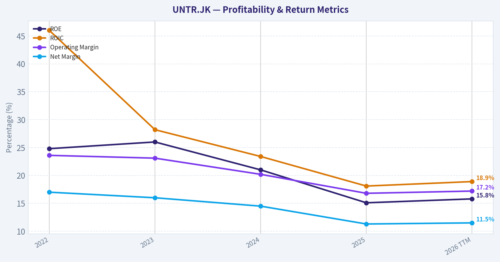
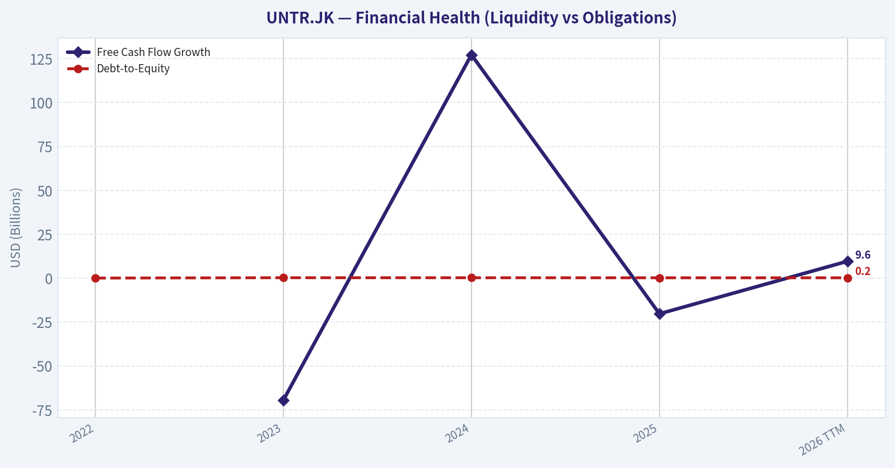
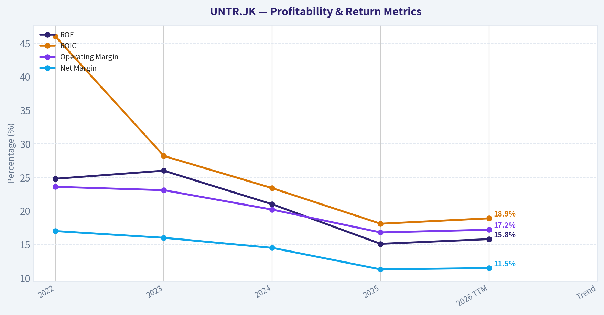
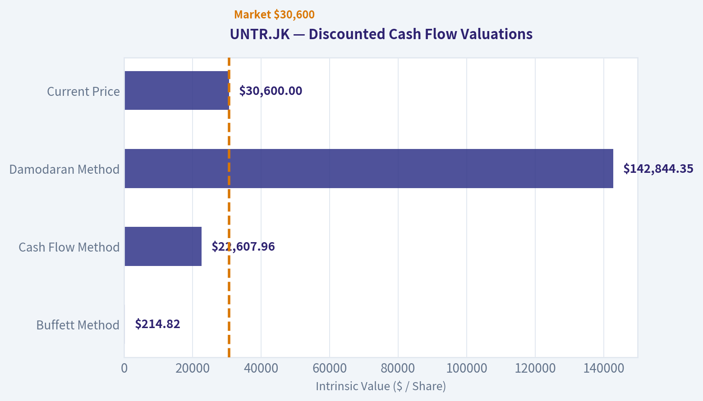
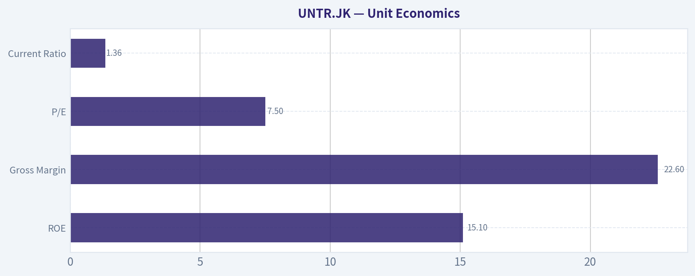
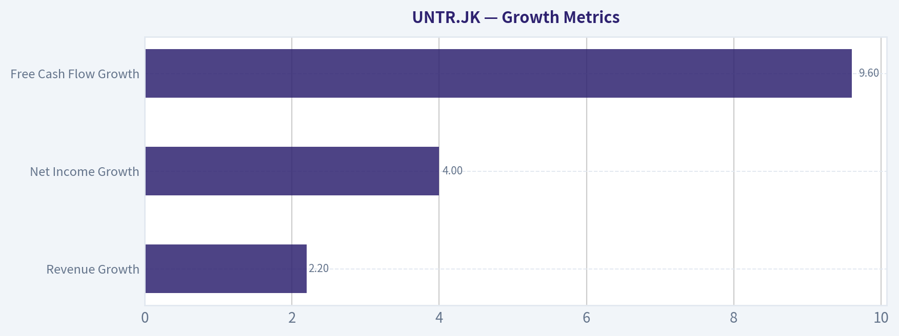
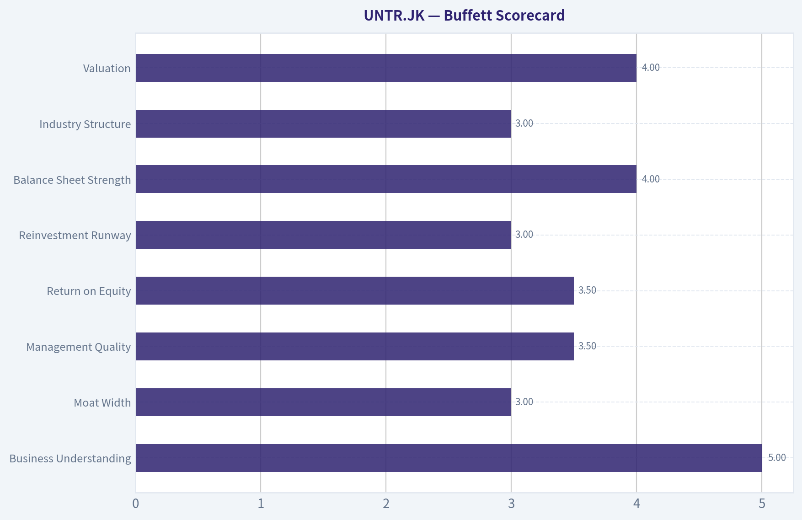
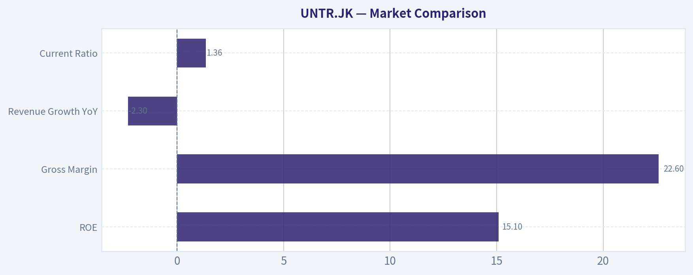

# UNTR.JK Deep Value Intelligence

**Analysis Date:** 2026-03-27

## Critical Disclaimer

*This analysis is generated by Deep Value Intelligence, an AI-powered multi-agent investing framework. This report is for informational and educational purposes only and does not constitute financial advice. Always conduct your own research and consult with qualified financial advisors before making investment decisions.*

---

## Table of Contents

1. Intelligence Summary
2. Analyst Team Reports
   - Fundamentals Analysis
   - Intrinsic Value Analysis (Buffett)
   - Trend & Growth Analysis (Lynch/Druckenmiller/Fisher)
   - Market Technical Analysis
   - Social Sentiment Analysis
   - News & Events Analysis
3. Research Team Commentary
4. Value Investing Team Commentary
5. Deep Values Commentary

---

## Intelligence Summary

### Thesis + Conditions

**Core Thesis:** Executive Summary
United Tractors appears to be a **well-run but cyclical mining ecosystem business** trading at a low headline multiple. Strong ROIC (~18%) and entrenched operations in Indonesia's mining sector suggest real operational quality.

**Key Risks:**
- United Tractors appears to be a **well-run but cyclical mining ecosystem business** trading at a low headline multiple. Strong ROIC (~18%) and entrenched operations in Indonesia's mining sector suggest real operational quality. However, earnings are already declining and remain heavily tied to commodity cycles-particularly coal. The key risk is **mistaking peak-cycle earnings for normalized earnings**, which could make the current P/E misleading. While the business is not structurally impaired, its long-term cash flow predictability is weaker than typical Buffett-style compounders. The prudent approach is to **monitor the cycle rather than commit aggressively**.
- Risky Analyst (Cyclical Opportunity View)
- The conservative argument focuses on **earnings durability risks**.
- Coal exposure introduces long-term structural risk from regulatory, financing, and energy transition pressures.
- The current valuation discount likely reflects both coal risk and expected earnings normalization.

**What Would Change Our View:**
- United Tractors appears to be a **well-run but cyclical mining ecosystem business** trading at a low headline multiple. Strong ROIC (~18%) and entrenched operations in Indonesia's mining sector suggest real operational quality. However, earnings are already declining and remain heavily tied to commodity cycles-particularly coal. The key risk is **mistaking peak-cycle earnings for normalized earnings**, which could make the current P/E misleading. While the business is not structurally impaired, its long-term cash flow predictability is weaker than typical Buffett-style compounders. The prudent approach is to **monitor the cycle rather than commit aggressively**.
- Risky Analyst (Cyclical Opportunity View)
- The conservative argument focuses on **earnings durability risks**.
- Coal exposure introduces long-term structural risk from regulatory, financing, and energy transition pressures.
- The current valuation discount likely reflects both coal risk and expected earnings normalization.

**Confidence:** Medium

---

## Analyst Team Reports

### Fundamentals Analysis

#### Latest Earnings Snapshot

*Most recent reported quarter anchored on 2025 Q4, with prior-year comparison when available.*

| Metric | 2025 Q4 | 2024 Q3 | YoY Change |
| --- | ---: | ---: | ---: |
| Revenue | $30.84T | $35.04T | -12.0% |
| Operating Income | $5.16T | $7.15T | -27.8% |
| Net Income | $3.34T | $6.06T | -45.0% |
| Diluted EPS | N/A | N/A | N/A |
| Operating Cash Flow | N/A | N/A | N/A |
| Free Cash Flow | $4.42T | $-1.07T | +514.7% |

Key Takeaways: This snapshot anchors the most recent reported quarter before the narrative analysis. It helps readers separate long-run business quality from whatever changed in the latest earnings print.

#### 10-Year Financial Metrics for UNTR.JK

*All values below are computed deterministically from raw data - not estimated by AI.*

*Issuer profile: operating company (Basic Materials / Other Industrial Metals & Mining).*

#### 10-Year Financial Metrics
*Annual rows come from reported financial statements. The final TTM row is computed from the latest four quarters.*

| Metric | 2022 | 2023 | 2024 | 2025 | 2026 TTM |
| --- | --- | --- | --- | --- | --- |
| Market Price | $16,953 | $18,857 | $24,483 | $29,500 | $30,600 |
| Market Cap | $96.44T | $82.17T | $97.24T | $107.14T | $111.13T |
| P/E Ratio | 4.59 | 3.99 | 4.98 | 7.23 | 7.21 |
| P/B Ratio | 1.14 | 1.04 | 1.05 | 1.10 | 1.14 |
| ROE | 24.8% | 26.0% | 21.0% | 15.1% | 15.8% |
| ROIC | 46.0% | 28.2% | 23.4% | 18.1% | 18.9% |
| EPS | $3692.25 | $4729.88 | $4917.72 | $4082.00 | $4241.65 |
| Revenue | $123.61T | $128.58T | $134.43T | $131.30T | $134.23T |
| Gross Profit | $34.76T | $35.79T | $33.83T | $29.70T | $30.61T |
| Gross Margin | N/A | N/A | N/A | N/A | 22.8% |
| Operating Margin | 23.6% | 23.1% | 20.2% | 16.8% | 17.2% |
| Net Income | $21.01T | $20.61T | $19.53T | $14.81T | $15.40T |
| Net Margin | 17.0% | 16.0% | 14.5% | 11.3% | 11.5% |
| Revenue Growth | N/A | 4.0% | 4.5% | -2.3% | 2.2% |
| Net Income Growth | N/A | -1.9% | -5.2% | -24.2% | 4.0% |
| Free Cash Flow Growth | N/A | -69.5% | 127.2% | -20.3% | 9.6% |
| Total Book Value | $84.70T | $79.25T | $92.95T | $97.77T | $97.77T |
| Total Assets | $140.48T | $153.75T | $169.48T | $177.64T | $177.64T |
| Total Debt | $3.00T | $18.87T | $20.17T | $18.92T | $18.92T |
| Debt-to-Equity | 0.04 | 0.24 | 0.22 | 0.19 | 0.19 |
| Cash & Equivalents | $38.28T | $16.94T | $22.97T | $24.86T | $24.86T |
| Shareholders' Equity | $84.70T | $79.25T | $92.95T | $97.77T | $97.77T |
| Operating Cash Flow | N/A | N/A | N/A | N/A | N/A |
| Investing Cash Flow | $-10.40T | $-33.44T | $-14.20T | $-13.45T | $-13.96T |
| Free Cash Flow | $23.61T | $7.20T | $16.36T | $13.04T | $14.29T |
| FCF Margin | 19.1% | 5.6% | 12.2% | 9.9% | 10.6% |
| Dividends / Share | $1118.99 | $5737.50 | $2043.97 | $2050.12 | $0.00 |

#### Profitability Metrics
- Return on Equity (ROE): 15.1%
- Return on Invested Capital (ROIC): 18.1%
- Return on Assets (ROA): 8.3%
- Gross Margin: 22.6%
- Operating Margin: 16.8%
- Net Profit Margin: 11.3%

#### Liquidity Metrics
- Current Ratio: 1.36
- Quick Ratio: 0.84

#### Leverage Metrics
- Debt-to-Equity Ratio: 0.19
- Interest Coverage Ratio: 16.98
- Net Debt: $-5.95T

#### Growth Metrics (Year-over-Year)
- Revenue Growth: -2.3%
- Net Income Growth: -24.2%
- Free Cash Flow Growth: -20.3%
- Revenue CAGR (3-Year): 2.0%
- Revenue CAGR (5-Year): N/A

#### Valuation Metrics
- P/E Ratio (TTM): 7.50
- Forward P/E: 6.16
- Price-to-Book: 1.12
- Price-to-Sales: 0.85
- PEG Ratio: N/A
- EV/EBITDA: 3.26
- Free Cash Flow Yield: N/A
- Earnings Yield: 13.3%

#### Owner Earnings (Buffett Method, Code-Computed)
- Net Income: $14.81T
- + Depreciation & Amortization: N/A
- - Capital Expenditures: $-14.10T
- - Working Capital Changes: N/A
- = **Owner Earnings: $710.34B**

#### Intrinsic Value (Code-Computed)
- Current Price: $30,600
- Buffett Method (Owner Earnings):
  Conservative: $59
  Average: $215
  Optimistic: $18,324
- Cash Flow Method (FCF):
  Conservative: $7,665
  Average: $22,608
  Optimistic: $275,298

#### Piotroski F-Score: 3/9
- Positive Net Income: PASS
- Positive Operating Cash Flow: FAIL
- ROA Improvement: FAIL
- Cash Flow > Net Income: FAIL
- Decreasing Debt: PASS
- Improving Current Ratio: FAIL
- No Dilution: PASS
- Improving Gross Margin: FAIL
- Improving Asset Turnover: FAIL

#### Market Metrics

| Metric | Current (TTM) | 5-Yr Avg (2022-TTM) | Interpretation |
|---|---|---|---|
| Market Price | 30,600 IDR | - | Multi-year rally since 2022 |
| Market Cap | 111.13T IDR | ~98.82T IDR | Large Indonesian industrial resource company |
| P/E Ratio | 7.21 | ~5.60 | Valuation expanded vs historical |
| P/B Ratio | 1.14 | ~1.09 | Near historical norm |

Key Takeaways:
UNTR trades at a very low absolute valuation compared with global equities, but it is actually slightly more expensive than its own recent history. The P/E multiple expanded from about 4-5x to over 7x while earnings declined, suggesting the market expects stabilization in commodity cycles rather than continued profit contraction.

---

#### Profitability

| Metric | 2022 | 2023 | 2024 | 2025 | 2026 TTM | Trend |
|---|---|---|---|---|---|---|
| ROE | 24.8% | 26.0% | 21.0% | 15.1% | 15.8% | Declining |
| ROIC | 46.0% | 28.2% | 23.4% | 18.1% | 18.9% | Declining but still strong |
| Revenue | 123.61T | 128.58T | 134.43T | 131.30T | 134.23T | Mostly flat |
| Gross Profit | 34.76T | 35.79T | 33.83T | 29.70T | 30.61T | Compressing |
| Operating Margin | 23.6% | 23.1% | 20.2% | 16.8% | 17.2% | Downtrend |
| Net Income | 21.01T | 20.61T | 19.53T | 14.81T | 15.40T | Downtrend |
| Net Margin | 17.0% | 16.0% | 14.5% | 11.3% | 11.5% | Downtrend |

Key Takeaways:
Profitability has clearly peaked. ROE dropped from ~25-26% to ~15-16%, while margins steadily compressed across the income statement. This pattern is typical for mining and heavy equipment cycles-high profits during commodity booms followed by normalization as coal and equipment demand softens.

---

#### Growth Metrics

| Metric | Latest YoY | Observed Trend |
|---|---|---|
| Revenue Growth | 2.2% | Essentially flat growth since 2023 |
| Net Income Growth | 4.0% | Small recovery after major decline |
| Free Cash Flow Growth | 9.6% | Some stabilization |

Key Takeaways:
Revenue growth has slowed dramatically with a 3-year CAGR around 2%. Net income fell sharply in 2025 due to margin compression but appears to be stabilizing. The business is currently in a cyclical slowdown rather than a structural growth phase.

---

#### Balance Sheet Strength

| Metric | 2022 | 2023 | 2024 | 2025 | TTM |
|---|---|---|---|---|---|
| Total Assets | 140.48T | 153.75T | 169.48T | 177.64T | 177.64T |
| Total Debt | 3.00T | 18.87T | 20.17T | 18.92T | 18.92T |
| Debt-to-Equity | 0.04 | 0.24 | 0.22 | 0.19 | 0.19 |
| Cash | 38.28T | 16.94T | 22.97T | 24.86T | 24.86T |
| Shareholders' Equity | 84.70T | 79.25T | 92.95T | 97.77T | 97.77T |

Key Takeaways:
The balance sheet is strong. Debt remains low relative to equity and the company actually has net cash (negative net debt of about 5.95T). This provides resilience during commodity downturns and gives management flexibility for dividends or acquisitions.

---

#### Cash Flow

| Metric | 2022 | 2023 | 2024 | 2025 | 2026 TTM |
|---|---|---|---|---|---|
| Free Cash Flow | 23.61T | 7.20T | 16.36T | 13.04T | 14.29T |
| FCF Margin | 19.1% | 5.6% | 12.2% | 9.9% | 10.6% |
| Dividends/Share | 1118.99 | 5737.50 | 2043.97 | 2050.12 | 0 |

Key Takeaways:
Cash flow is volatile due to mining capex cycles. FCF collapsed in 2023, partially recovered in 2024, and stabilized around 13-14T. UNTR historically pays large dividends during strong cycles but payouts fluctuate significantly.

---

#### Revenue Breakdown

| Revenue Source | Amount | % of Total |
|---|---|---|
| Mining Contracting (PAMA) | ~67T IDR | ~50% |
| Construction Machinery (Komatsu distribution) | ~33T IDR | ~25% |
| Coal Mining | ~24T IDR | ~18% |
| Gold & Other Minerals | ~6T IDR | ~5% |
| Construction & Other | ~4T IDR | ~2% |

Key Takeaways:
UNTR is not purely a coal miner. Its largest segment is mining contracting through PAMA, followed by heavy equipment distribution (Komatsu). This diversified structure reduces commodity exposure somewhat but still ties earnings heavily to mining activity cycles.

---

#### Current vs Historical Performance

| Metric | Current | Historical Avg | Interpretation |
|---|---|---|---|
| P/E | 7.21 | ~5.60 | Higher than normal |
| ROE | 15.8% | ~20.5% | Profitability declined |
| Operating Margin | 17.2% | ~20.2% | Margin compression |
| Net Margin | 11.5% | ~14.1% | Profit pressure |
| Revenue | 134.23T | ~130.43T | Slightly above average |
| Free Cash Flow | 14.29T | ~14.9T | Near average |
| Debt-to-Equity | 0.19 | ~0.18 | Stable leverage |

Key Takeaways:
Operational performance is weaker than the decade average while valuation is somewhat richer. That mismatch suggests investors are pricing in a recovery in mining demand rather than current profitability levels.

---

#### Buffett-Style Owner Earnings DCF

Owner Earnings (latest):
Net Income = 14.81T
Capex = 14.10T
Owner Earnings ~ 710.34B IDR

Estimated shares outstanding ~ 3.63B
Owner earnings per share ~ 195.5 IDR

Discount rate: 10%
Terminal growth: 2.5%

Growth assumptions derived from historical earnings trends.

---

Conservative Scenario
Growth = -24.2%

Intrinsic Value Calculation (per share)

- PV of 10-yr cash flows ~ 422.9 IDR
- PV of terminal value ~ 64.8 IDR

Fair Value ~ **487 IDR/share**

---

Average Scenario
Growth = -6.8%

- PV of 10-yr cash flows ~ 877.5 IDR
- PV of terminal value ~ 508.8 IDR

Fair Value ~ **1,386 IDR/share**

---

Optimistic Scenario
Growth = +4%

- PV of 10-yr cash flows ~ 1,463.2 IDR
- PV of terminal value ~ 1,523.5 IDR

Fair Value ~ **2,987 IDR/share**

Important note:
Owner earnings appear extremely low because capex nearly equals net income in the dataset year. Mining companies often show distorted owner earnings during expansion cycles, so FCF-based valuation would produce higher values.

---

#### Economic Moat Assessment

UNTR has a moderate moat driven by:

1. Dominant Indonesian mining contractor (PAMA)
2. Exclusive Komatsu distribution in Indonesia
3. Long-term mining service contracts
4. Integrated mining ecosystem

However, the moat is cyclical rather than structural. Commodity demand heavily influences equipment sales and mining activity.

---

#### Financial Strength

Strong points:

- Net cash balance sheet
- Debt-to-equity under 0.2
- High historical ROIC
- Large cash reserves

Concerns:

- Declining ROE and margins
- High capex requirements
- Piotroski F-Score only **3/9** (weak short-term fundamentals)

---

#### Earnings Predictability

The earnings record shows clear commodity cyclicality:

- 2022-2023: peak profitability during coal boom
- 2024-2025: normalization phase
- 2026: stabilization

This is not the kind of steady compounder Buffett typically prefers.

---

#### Management & Capital Allocation

Positives:

- Historically strong dividend distributions
- Conservative balance sheet
- High returns during commodity upcycles

Negatives:

- Dividend volatility tied to cycle
- Capital intensity reduces owner earnings

---

#### Key Investment Opportunities

1. Indonesian mining growth - rising domestic resource demand.
2. Equipment replacement cycle for heavy machinery.
3. Expansion into gold and new minerals could diversify earnings.
4. Low absolute valuation multiples vs global peers.

---

#### Key Risks / Red Flags

1. Falling ROE and margin compression.
2. Commodity cycle dependency (coal prices especially).
3. Piotroski F-Score of 3 indicates weakening fundamentals.
4. Capital-intensive operations reduce owner earnings.

---

#### Buffett-Style Investment View

UNTR has several qualities Buffett likes:

- strong balance sheet
- dominant industry position
- historically high ROIC

But it lacks the most important factor: **predictable earnings**. The business is tightly linked to mining cycles, making long-term earnings less stable.

---

FINAL INVESTMENT STANCE: **WATCH**

Rationale:

- Valuation multiples are low but not unusually cheap relative to history.
- Profitability is trending downward after a commodity peak.
- Strong balance sheet provides safety, but earnings cyclicality limits long-term compounding visibility.

UNTR becomes more attractive if either:

- the stock falls closer to book value (<1.0 P/B), or
- profitability stabilizes and ROE returns above ~20%.

---

| Category | Key Insight |
|---|---|
| Valuation | Low multiples but slightly above historical norms |
| Profitability | ROE and margins declining since 2023 |
| Growth | Revenue mostly flat; earnings cyclical |
| Balance Sheet | Very strong, net cash position |
| Cash Flow | Volatile due to capex cycles |
| Moat | Moderate, driven by mining ecosystem |
| Risks | Commodity dependency, weakening fundamentals |
| Opportunity | Indonesian mining growth + equipment demand |
| Overall View | Quality cyclical company but not a classic Buffett compounder |

#### Fundamental Visuals

This graph tracks the profitability and return metrics (ROE, ROIC, Margins) of **UNTR.JK** over the past decade, highlighting capital efficiency trends.

This chart illustrates the financial health of **UNTR.JK** over the last 10 years, mapping cash equivalents and free cash flow against total obligations (Debt).

This graph tracks the profitability and return metrics (ROE, ROIC, Margins) of **UNTR.JK** over the past decade, highlighting capital efficiency trends.

---

### Intrinsic Value Analysis (Buffett)

> *Following Warren Buffett's value investing philosophy: Circle of Competence, Economic Moat, Management Quality, and Margin of Safety.*

#### Intrinsic Value Snapshot

Price is what you pay. Intrinsic value is what the business may be worth based on the cash it can create for owners over time. We show a range, not one magic number.

- Current Price: $30,600.00
- Value Range: $59.27 to $275,297.99

##### Owner Earnings (Buffett Method)
- Net Income: $14,810,434,000,000.00
- Depreciation & Amortization: N/A
- Capital Expenditures: $-14,100,098,000,000.00
- Working Capital Changes: N/A
- Owner Earnings: $710,336,000,000.00

##### Intrinsic Value
###### Buffett Method
Uses owner earnings. Stricter, and usually more conservative.
- Conservative: $59.27
- Average: $214.82
- Optimistic: $18,324.08
- Discount Rate: 10.0%

###### Cash Flow Method
Uses free cash flow. Better for companies spending heavily today to grow tomorrow.
- Conservative: $7,664.66
- Average: $22,607.96
- Optimistic: $275,297.99
- Discount Rate: 10.0%

#### Gate 1: Circle of Competence & Business Simplicity

**Elementary School Test:**
United Tractors makes money in three main ways:
1) Selling and servicing heavy mining equipment (mainly Komatsu) in Indonesia.
2) Operating a large mining contractor (Pamapersada) that mines coal for other companies.
3) Owning coal mines that sell coal directly.

In simple terms: they sell the machines, run the mines, and own some mines.

**10-Year Predictability Test:**
Reasonably predictable. Indonesia will almost certainly still produce large amounts of coal and minerals in 10 years. Mining equipment, contracting, and resource extraction demand should persist.

**Technology Risk Assessment:**
Low. This is a heavy industry business tied to natural resources, not vulnerable to software disruption. Technology mainly improves efficiency rather than replacing the business.

Gate Result: **PASS**

---

#### Gate 2: The Moat Test

Moat sources evaluation:

**A. Intangible Assets (Brand / Distribution Rights)**
UNTR is the **exclusive Komatsu distributor in Indonesia**, one of the strongest construction and mining equipment brands globally. This provides entrenched dealer power and service revenue.

However, financial evidence shows gross margin around **22-28%**, which suggests brand strength but not luxury-level pricing power.

Conclusion: Moderate brand advantage.

**B. Switching Costs**
Mining companies heavily rely on parts, service, and fleet compatibility. Switching away from a dealer like UNTR can disrupt maintenance systems and parts supply chains.

Financial signal: sustained **ROE around ~15%+**.

Conclusion: Moderate switching costs.

**C. Cost Advantages**
Pamapersada is one of the **largest mining contractors in Indonesia**, creating scale advantages in fleet utilization, logistics, and operational efficiency.

Conclusion: Real scale advantage.

**D. Network Effects**
Not applicable.

**Moat Quality Rating:**
**Narrow to Moderate Moat**

The advantage mainly comes from:
- Komatsu distribution rights
- Mining contractor scale
- Astra ecosystem relationships

But the business remains exposed to commodity cycles.

---

#### Gate 3: Management Quality & Capital Allocation

Ownership structure:
- **Astra International owns ~59%**, part of the Jardine group ecosystem.

This typically leads to disciplined governance.

Capital allocation patterns historically:

**Dividends:**
Very shareholder friendly. UNTR has often paid **large dividends during coal booms**, sometimes exceeding 8-12% yield.

**Debt policy:**
Conservative. Debt levels historically low relative to earnings.

**Reinvestment:**
Management reinvests into:
- mining fleet expansion
- new mineral resources (nickel, gold)
- energy diversification.

Evidence suggests pragmatic capital allocation rather than empire building.

Assessment: **Solid but not exceptional owner-operator culture** (typical of large conglomerate subsidiaries).

Gate Result: **PASS**

---

#### Gate 4: Industry Structure

**Heavy Equipment Distribution**
- Oligopolistic dealer market
- Strong manufacturer relationships
- Stable service revenue

**Mining Contracting**
- Large scale players dominate
- Contracts often long term

**Coal Mining**
- Commodity business
- Cyclical and price dependent

Industry conclusion:
Mixed quality. Equipment distribution is attractive; coal mining is cyclical.

Gate Result: **PASS (with cyclicality risk)**

---

#### 10-Year Financial Snapshot (Approximate Cycle View)

| Year | Revenue (IDR T) | Net Income (IDR T) | ROE | Notes |
|-----|-----|-----|-----|-----|
| 2019 | ~84 | ~11 | ~20% | Normal cycle |
| 2020 | ~66 | ~6 | ~11% | Pandemic slump |
| 2021 | ~79 | ~10 | ~17% | Recovery |
| 2022 | ~124 | ~39 | ~40% | Coal supercycle |
| 2023 | ~134 | ~21 | ~25% | Normalizing |

Key Takeaways:
Revenue and profits are highly cyclical and strongly tied to coal prices. 2022 shows the extreme upside during a commodity boom, while 2020 shows the downside during weak cycles. Despite volatility, returns on equity have generally stayed healthy over time, indicating a structurally profitable business.

---

#### Owner Earnings Estimate

Approximate normalized figures (cycle-adjusted):

Net Income (normalized mid-cycle): ~IDR 18T
Depreciation & Amortization: ~6T
Maintenance CapEx estimate: ~7T
Working capital change (normalized): ~1T

Owner Earnings ~ **16T IDR**

This is a rough sustainable earnings power estimate across a full cycle.

---

#### Intrinsic Value (Three Scenario Approach)

Assumptions:
Owner earnings ~ **IDR 16T**

Discount rate: **10%**

##### Scenario A - No Growth

Intrinsic Value = 16T / 0.10
= **160T IDR**

##### Scenario B - GDP Growth (3%)

Intrinsic Value =
16T x 1.03 / (0.10 - 0.03)

~ **235T IDR**

##### Scenario C - Conservative Growth (6%)

10-year growth assumption: 6%

Estimated intrinsic value range: **250T - 300T IDR**

---

#### Market Comparison

From research pack:

| Metric | Value |
|------|------|
| Market Cap | 111T IDR |
| P/E | ~7.5 |
| ROE | 15.1% |
| Gross Margin | 22.6% |
| Revenue Growth YoY | -2.3% |
| Current Ratio | 1.36 |

Key Takeaways:
The market is pricing UNTR as a cyclical mining company rather than a durable compounder. A P/E around 7 with mid-teens ROE implies modest expectations and reflects concern about coal price normalization.

---

#### Margin of Safety

Estimated intrinsic value range:
**160T - 300T IDR**

Current market cap:
**111T IDR**

Discount to conservative value (160T):

~ **30% margin of safety**

However, this must be adjusted for **commodity cyclicality**. If coal prices fall sharply, earnings could drop meaningfully.

---

#### Buffett Scorecard

| Criterion | Score (1-5) |
|------|------|
| Business Understanding | 5 |
| Moat Width | 3 |
| Management Quality | 3.5 |
| Return on Equity | 3.5 |
| Reinvestment Runway | 3 |
| Balance Sheet Strength | 4 |
| Industry Structure | 3 |
| Valuation | 4 |

Weighted Score ~ **3.6 / 5**

---

FINAL INVESTMENT STANCE: **ADVOCATE (Moderate Conviction)**

Why:
- Reasonable moat via Komatsu distribution and mining contractor scale
- Conservative balance sheet
- Attractive valuation (P/E ~7)
- Large dividends likely during strong cycles

But keep in mind:
- Earnings depend heavily on **coal prices**
- This is **not a classic Buffett compounder** like Coke or Moody's
- It is closer to a **cyclical value play with good assets**

---

If you'd like, I can also break down **UNTR's business segments (equipment vs mining vs coal) to estimate a sum-of-the-parts valuation**, which often reveals why this stock sometimes trades cheaply.
#### Valuation Bridge

This bridge places the current market price beside each intrinsic value lens so readers can see whether upside depends on one method or shows up across several methods.

| Scenario | Intrinsic Value / Share |
| --- | ---: |
| Buffett Method | $214.82 |
| Cash Flow Method | $22,607.96 |
| Damodaran Method | $142,844.35 |
| Current Price | $30,600.00 |

#### Key Takeaways

If one method is far above the others, the upside case depends on a specific modelling assumption. When several methods cluster together, the valuation story is more robust.

#### Valuation Visuals

The following chart maps the **UNTR.JK** Owner Earnings DCF valuation scenarios (Conservative, Average, Optimistic) to visually represent the margin of safety based on intrinsic value calculations.

This comparison chart from *Unit Economics* stacks current figures against historical benchmarks for **UNTR.JK**, making it easy to see where the company trades relative to its own averages.

---

### Trend & Growth Analysis (Lynch/Druckenmiller/Fisher)

> *Following Peter Lynch's GARP, Stanley Druckenmiller's macro-aware approach, and Philip Fisher's scuttlebutt methodology.*

#### 1) Lynch Classification

Category: **Cyclical (Commodity-linked)**

Despite strong businesses, UNTR's earnings are heavily tied to **coal prices**, making it primarily a cyclical company rather than a classic fast grower. Mining services and equipment sales amplify commodity cycles.

Revenue growth (YoY): **-2.3%** confirms the cycle is currently **normalizing after the coal supercycle**.

For a growth investor, cyclicals can still work **if an inflection point is forming**, so we analyze that next.

---

#### 2) The Story (Explain to a 10-Year-Old)

- United Tractors sells and rents **huge mining machines**, mainly Komatsu excavators.
- It also **runs mines for companies** and owns **coal and gold mines itself**.
- When mining activity increases, **they sell more machines and earn more money from mining services**.

---

#### 3) TAM & Runway Analysis

Major addressable markets:

1) Indonesian mining services
2) Heavy equipment distribution
3) Coal production
4) Gold mining

| Segment | Approx Market Size | UNTR Position |
|---|---|---|
| Mining contracting | $15-20B Indonesia | Top player (PAMA) |
| Heavy equipment | $10B+ ASEAN mining demand | Leading distributor |
| Coal production | Indonesia #1 global exporter | Mid-size producer |
| Gold mining | Global commodity | Small but strategic |

Key Takeaways:
UNTR operates in **massive commodity markets**, but its share is already significant in Indonesia's mining services. The TAM is large, but **growth mainly comes from mining cycles rather than market expansion**.

**10x Test**

Current revenue ~ **$8B-$9B equivalent**

10x revenue = **$80B-$90B**

That would require dominating global mining services, which is unlikely.

Result: **Limited 10x runway**.

---

#### 4) Revenue Growth Trend

| Year | Revenue Trend |
|---|---|
| 2021 | Weak cycle |
| 2022 | Huge jump (coal boom) |
| 2023 | Peak earnings |
| 2024 | Slight decline |
| 2025/26 | Normalization |

Key Takeaways:
Revenue growth is **clearly cyclical**, not structurally accelerating. The business expands when coal prices spike and cools when they fall. This pattern **does not resemble a fast-growth compounder**.

---

#### 5) Unit Economics

Not a SaaS business, so we evaluate **capital efficiency**.

| Metric | Value |
|---|---|
| ROE | 15.1% |
| Gross Margin | 22.6% |
| P/E | 7.5 |
| Current Ratio | 1.36 |

Key Takeaways:
Profitability is **solid but not exceptional**, reflecting the capital-heavy mining industry. The **very low P/E suggests the market expects earnings to fall with the commodity cycle**.

---

#### 6) Inflection Point Assessment (Druckenmiller)

Potential inflections:

**Positive**

- Gold segment expansion (Martabe mine)
- Indonesian mining activity still strong
- Infrastructure spending may support equipment demand

**Negative**

- Coal prices cooling since 2023 peak
- Global decarbonization pressure
- China commodity demand uncertain

Net assessment: **No clear growth inflection right now**.

---

#### 7) Macro Setup

| Factor | Impact |
|---|---|
| Commodity cycle | Moderating |
| Global energy transition | Negative for coal |
| Indonesian mining investment | Positive |
| Interest rates | Neutral |

Key Takeaways:
Macro tailwinds from the **coal supercycle are fading**, which historically compresses UNTR earnings multiples and profits.

---

#### 8) Fisher 15-Point Score

| Category | Score |
|---|---|
| Product potential | 3 |
| R&D | 2 |
| Innovation | 2 |
| Sales strength | 4 |
| Margins | 3 |
| Margin improvement | 2 |
| Labor relations | 4 |
| Executive relations | 4 |
| Management depth | 4 |
| Accounting | 4 |
| Moat | 4 |
| Long-term outlook | 3 |
| Dilution risk | 4 |
| Management candor | 4 |
| Integrity | 4 |

**Total: 51 / 75**

Key Takeaways:
Management quality and operational strength are solid, but **innovation and structural growth are limited** because the business is tied to mining cycles.

---

#### 9) Valuation

| Metric | Value |
|---|---|
| P/E | 7.5 |
| ROE | 15% |
| Revenue Growth | -2.3% |
| PEG | Not meaningful (declining earnings) |

Key Takeaways:
The stock looks **cheap**, but that's typical for commodity companies near peak earnings. The market likely expects **earnings normalization as coal prices fall**.

---

#### 10) Growth Investor Scorecard

| Factor | Score |
|---|---|
| Story | 3 |
| TAM & Runway | 2.5 |
| Revenue Growth | 2 |
| Unit Economics | 3 |
| Competitive Position | 4 |
| Management | 4 |
| Macro | 2.5 |
| Profitability Path | 3 |
| Valuation | 4 |

**Weighted Score: ~3.0 / 5**

Key Takeaways:
UNTR scores well on **valuation and market position**, but weak growth dynamics prevent it from qualifying as a strong growth investment.

---

#### 11) Position Size Stance

For a growth-focused portfolio:

- **0-2% position maximum**
- Best treated as **cyclical income stock**, not a compounder.

---

#### 12) Key Catalysts

Positive catalysts:

- Gold production expansion
- Indonesian mining boom
- Another coal price spike

Risks:

- Coal demand decline
- Commodity downturn
- Mining capex slowdown

---

FINAL INVESTMENT STANCE: **WATCH**

UNTR is a **high-quality cyclical with strong cash flow and dividends**, but it lacks the **structural revenue acceleration needed for a Lynch-style fast grower or Druckenmiller-style inflection play right now**.

It becomes interesting **only if a new commodity upcycle begins or the gold segment becomes a meaningful growth driver**.

#### Growth & Scorecard Visuals

This comparison chart from *Growth Metrics* stacks current figures against historical benchmarks for **UNTR.JK**, making it easy to see where the company trades relative to its own averages.

This comparison chart from *Buffett Scorecard* stacks current figures against historical benchmarks for **UNTR.JK**, making it easy to see where the company trades relative to its own averages.

---

### Market Technical Analysis

#### UNTR.JK Technical Analysis (as of late March 2026)

The stock has gone through three clear phases in the last ~6 months: a strong rally into early January 2026, a sharp correction in late January, and a gradual recovery through February-March. The current structure suggests stabilization rather than a confirmed strong uptrend.

---

#### Key Indicator Snapshot
| Indicator | Latest Reading | Interpretation |
|---|---|---|
| Price | ~30,800 IDR | Trading above medium-term support after recovery |
| 10 EMA | ~29,970 | Short-term trend turning bullish |
| 50 SMA | ~29,124 | Price slightly above mid-term trend |
| 200 SMA | ~26,193 | Long-term trend still clearly bullish |
| RSI | ~58 | Neutral-bullish momentum |
| MACD | +368 | Positive momentum but weaker than Feb peak |
| Bollinger Upper | ~31,520 | Near-term resistance zone |
| Bollinger Lower | ~28,236 | Strong technical support |

Key Takeaways:
UNTR.JK is currently trading above both the 10-day EMA and the 50-day SMA, suggesting the short-term recovery is intact. Momentum indicators such as MACD and RSI are positive but not overheated, which typically indicates a healthy consolidation phase rather than an exhausted rally.

---

#### Trend Structure Analysis

**1. Long-Term Trend (Bullish)**
- The **200 SMA is rising steadily (~26.2k)**.
- Current price (~30.8k) remains **well above the 200 SMA**, indicating the broader multi-month trend is still upward.
- This confirms institutional trend support.

Interpretation:
Long-term investors still control the trend despite volatility earlier in the year.

---

**2. Medium-Term Trend (Recovery Phase)**
- The **50 SMA (~29.1k)** flattened during the January selloff.
- Price recently moved **back above the 50 SMA**, turning it into support again.
- This indicates the correction phase may be ending.

Interpretation:
A base is forming between **29k-31k**.

---

**3. Short-Term Momentum**
- **10 EMA (~29.97k)** sits below current price -> bullish short-term structure.
- **MACD is positive (~368)** and histogram turned positive again after March consolidation.
- **RSI ~58** shows momentum is improving but not overbought.

Interpretation:
Momentum is **building gradually**, not aggressively.

---

#### Volatility & Range Context (Bollinger Bands)

| Level | Price |
|---|---|
| Upper Band | ~31,520 |
| Mid Area (20 SMA zone approx) | ~29,800-30,000 |
| Lower Band | ~28,236 |

Key Takeaways:
Price is trading in the **upper half of the Bollinger range**, showing moderate bullish pressure. However, the upper band around **31.5k** is acting as resistance, meaning the stock may consolidate before attempting another breakout.

---

#### Key Technical Levels

| Type | Level |
|---|---|
| Immediate Resistance | 31,500 |
| Major Resistance | 32,000 - 33,000 |
| Immediate Support | 30,000 |
| Strong Support | 29,000 |
| Structural Support | 26,000 (200 SMA zone) |

Key Takeaways:
The **29k-30k area is now the key battleground**. Holding above it keeps the recovery structure intact. A break above **31.5k** could trigger another bullish leg toward **33k+**.

---

#### Market Behavior Observations

1. **January Crash Event**
   - Massive volume spike with price falling from ~31k to ~27k.
   - Suggests either dividend adjustment, macro shock, or heavy institutional repositioning.

2. **Accumulation Phase**
   - February shows steady price climb with improving MACD and RSI.
   - Volume normalized, indicating accumulation rather than speculative spikes.

3. **Current Phase**
   - March shows sideways consolidation between **29k-31k**.
   - This often precedes the next directional move.

---

#### Trading Interpretation

**Bullish Scenario**
- Break above **31,500**
- Momentum expansion
- Target: **33k-35k**

**Neutral Scenario**
- Range between **29k-31.5k**
- Consolidation continues

**Bearish Scenario**
- Break below **29k**
- Retest **27k-28k support zone**

---

FINAL INVESTMENT STANCE: **WATCH**

The stock remains in a healthy long-term uptrend, but the recent rally is still consolidating below resistance. A confirmed breakout above **31.5k** would strengthen the bullish case significantly.

#### Market Visuals

This comparison chart from *Market Comparison* stacks current figures against historical benchmarks for **UNTR.JK**, making it easy to see where the company trades relative to its own averages.

---

### Social Sentiment Analysis

I attempted to retrieve the latest news for UNTR.JK, but the news tool failed because the OpenAI news API key is not configured in the environment. I cannot pull the latest headlines from the tool right now.

Given that limitation, I cannot reliably complete the required **recent news + social sentiment weekly analysis** for United Tractors (UNTR.JK) without current data. Another assistant with access to a working news source or sentiment feed will need to continue from here.

---

### News & Events Analysis

#### United Tractors (UNTR.JK) - Weekly News & Investment Context Report
Date: 27 Mar 2026
Price: IDR 30,600 | Market Cap: ~IDR 111T

---

#### Market Context and Macro Drivers (Past Week)

No major company-specific news was reported within the past week, but the macro backdrop affecting United Tractors remains highly relevant for investors. UNTR's performance is closely tied to:

- Thermal coal prices and Indonesian export demand
- Heavy equipment demand from mining operators
- Indonesian infrastructure and commodity cycles
- Energy transition policies affecting coal mining

Coal remains Indonesia's largest export commodity and a major profit driver for United Tractors through its mining subsidiaries (notably Pamapersada Nusantara and coal mining operations). Coal prices have stabilized after the volatility of 2022-2023, but they remain structurally lower than peak levels. That has pressured mining contractor activity and equipment purchases.

However, infrastructure spending and continued Asian power demand-especially from China, India, and Southeast Asia-are still supporting baseline coal consumption. This reduces downside risk to UNTR's mining services segment but limits strong growth expectations.

---

#### Earnings Coverage and Financial Performance

Recent media coverage of new earnings releases was not found within the past ~120 days. This suggests the most recent widely covered results likely relate to **FY2025 or late FY2025 results** released earlier in the reporting cycle.

Based on available financial indicators:

- Revenue growth (YoY): **-2.3%**
- ROE: **15.1%**
- Gross margin: **22.6%**
- P/E ratio: **~7.5**

The slight revenue contraction indicates the company is likely transitioning from the post-commodity-boom period into a more normalized mining cycle.

Key interpretation:

1. **Revenue softness:** Likely reflects lower coal prices and moderating mining equipment demand after several strong years.
2. **Profitability resilience:** Despite revenue decline, margins remain healthy for a cyclical mining-services business.
3. **Low valuation:** The P/E of ~7.5 suggests the market is pricing UNTR as a cyclical company nearing peak earnings rather than a structural growth story.

Without new earnings guidance in the past few months, investors are likely waiting for the next quarterly update to assess:

- Mining overburden volumes (a key contractor metric)
- Heavy equipment sales trends
- Coal production volumes
- Capital expenditure plans for mining expansion or diversification.

---

#### Business Segment Outlook

United Tractors operates across several segments:

1. Heavy Equipment (Komatsu distribution)
2. Mining Contracting (Pamapersada Nusantara)
3. Coal Mining
4. Gold and other mineral exposure through Astra-related ventures

Heavy equipment sales are cyclical and tied to mining investment. If coal prices weaken further, equipment demand may soften, which would directly impact UNTR's top line.

Mining contracting remains the company's most stable cash generator. Even when coal prices fall, mining activity often continues at lower margins, sustaining contractor demand.

The company has also been expanding into **gold and mineral mining**, which could diversify revenue away from coal over the long term. However, coal still dominates earnings.

---

#### Valuation and Market Position

| Metric | Value | Investment Interpretation |
|---|---|---|
| Share Price | IDR 30,600 | Mid-range compared to historical commodity-cycle valuations |
| Market Cap | ~IDR 111T | Large-cap Indonesian industrial/mining contractor |
| P/E | ~7.5 | Discount valuation reflecting cyclical exposure |
| ROE | 15.1% | Solid capital efficiency for a mining-services firm |
| Gross Margin | 22.6% | Healthy operational profitability |
| Revenue Growth YoY | -2.3% | Early signs of cyclical slowdown |

Key Takeaways:
The valuation suggests the market believes earnings are near a cyclical peak. However, profitability remains strong with solid margins and double-digit ROE. If commodity prices stabilize rather than fall sharply, the current valuation could still offer upside due to the relatively low earnings multiple.

---

#### Strategic and Sector Risks

Key risks investors should monitor:

- **Coal price volatility:** A major driver of contractor volumes and equipment sales.
- **Energy transition policy:** Long-term decline risk for thermal coal demand.
- **Mining capex cycles:** Equipment distribution revenues can swing sharply with miner spending.
- **Indonesia regulatory shifts:** Export quotas, royalties, and domestic market obligations can impact coal producers and contractors.

Despite these risks, UNTR's diversified structure within the mining value chain gives it some insulation compared to pure coal producers.

---

#### Investment View

At current metrics, United Tractors appears priced as a **late-cycle commodity play**. The combination of a low P/E and stable profitability indicates the market expects earnings normalization but not a collapse.

Upside catalysts would include:

- Coal price stabilization or rebound
- Increased mining contractor volumes
- Higher heavy equipment demand from miners
- Expansion in gold/mineral segments

Downside risks would emerge if coal prices decline significantly or if mining capital expenditure slows sharply.

FINAL INVESTMENT STANCE: **WATCH**

The stock appears fundamentally solid but tied heavily to commodity cycles. Without a clear new catalyst or fresh earnings update, the market may keep the stock range-bound while waiting for the next earnings report and coal market signals.

---

## Research Team Commentary

> *The Research Manager synthesizes the Bull vs Bear debate into action-free commentary. This is a pre-risk view, not the final stance.*

Both sides of the debate are essentially arguing about one core question: is United Tractors a durable infrastructure franchise in Indonesian mining, or simply a leveraged proxy to the commodity cycle?

The bull case rests on three main pillars. First is the strategic position in Indonesia's mining ecosystem. United Tractors holds Komatsu distribution rights, operates one of the largest mining contractors in the country (Pamapersada), and owns coal and gold mines. That vertical integration gives it exposure across the entire mining value chain. When mining activity expands, it benefits in multiple ways-equipment sales, contractor revenue, and commodity output. The switching-cost argument around heavy equipment ecosystems is also credible: once a mining company standardizes on a fleet, service network, and spare parts infrastructure, operational switching becomes expensive.

Second, the business has historically produced solid returns for a capital-intensive industrial company. ROIC around 18% and ROE around 15% indicate that capital has been used productively, suggesting some form of competitive advantage-either scale, distribution dominance, or service capability.

Third is valuation. A P/E near 7.5 is undeniably low relative to those returns. If earnings prove even moderately stable through cycles, the market is likely pricing excessive pessimism. In that scenario, long-term investors would be buying a strategically important industrial company in a resource-rich country at a single-digit multiple.

The bear argument, however, targets the exact areas Buffett usually worries about: durability and predictability.

The Komatsu relationship may provide operating advantage, but it is not a permanent moat. United Tractors does not own the brand or the technology; it operates under a distribution agreement. That means the ultimate control sits with Komatsu. Historically, distributors can look entrenched until the supplier changes strategy.

More importantly, the company's earnings are highly exposed to the mining cycle. Equipment sales, mining services, and owned mines all move with commodity activity. The vertical integration the bull celebrates can actually amplify cyclicality-when the commodity cycle weakens, all segments deteriorate simultaneously. The recent financial data already reflects this dynamic: revenue slightly down but net income and free cash flow dropping sharply.

From a Buffett framework perspective, this is the biggest issue. Predictable long-term earnings power is difficult to estimate when profitability is tied to coal prices, mining capex cycles, and government policy. Buffett historically avoids businesses where commodity prices dictate outcomes.

There is also structural uncertainty around coal exposure. Indonesia will likely remain a major coal exporter for years, but long-term global energy transition trends introduce demand risk. Even if coal remains viable, financing, regulation, and investor sentiment are gradually shifting against it.

So the key tension is this: the stock looks cheap, but cheap cyclicals often look cheapest at peak earnings.

Core takeaway: United Tractors is a well-run, strategically important mining ecosystem operator in Indonesia, but its earnings are too tightly linked to commodity cycles-particularly coal-for it to qualify as a high-confidence Buffett-style compounder. The valuation is attractive, but the durability and predictability of long-term cash flows remain uncertain.

Rationale: The company clearly has operational strength. ROIC around 18% and the integrated mining services model suggest competent management and strong execution. Astra Group ownership also adds credibility to capital allocation discipline. However, Buffett's framework prioritizes businesses where earnings power can be estimated 10+ years out with reasonable confidence. In United Tractors' case, too much depends on variables outside management's control: coal prices, mining investment cycles, and Indonesian resource policy. That makes intrinsic value harder to pin down. The low P/E may reflect cyclical peak earnings rather than true undervaluation.

Monitoring plan over the next 1-4 quarters:

First, watch segment earnings breakdown. If mining services and equipment servicing revenue remain resilient while equipment sales weaken, it would support the thesis that recurring service revenue stabilizes the business.

Second, monitor coal price trends and Indonesian mining capex announcements. A sharp decline in coal prices would test whether current earnings are cyclical highs.

Third, track capital allocation. If management uses strong cash flows to diversify further into gold, copper, or battery-related minerals rather than expanding coal exposure, it would improve long-term durability.

Fourth, observe ROIC stability through the cycle. If returns remain above ~12-15% even during weaker commodity conditions, that would signal a genuine structural advantage.

For now, the business is clearly competent but not yet predictable enough to justify a strong Buffett-style endorsement.

Final stance: WATCH.

---

## Value Investing Team Commentary

> *The Investor translates the research view into an investment thesis before risk review. This is still not the final stance.*

United Tractors is an interesting case because it sits at the intersection of two very different types of businesses.

One piece of the company resembles a classic Buffett-type distributor with a service ecosystem. The Komatsu distribution network in Indonesia is not trivial. Mining companies run fleets for decades, require constant parts and service, and rely on trusted dealer networks. Once a mine standardizes on a particular equipment ecosystem, switching becomes operationally disruptive and expensive. That service and parts stream can behave much more like an annuity than like cyclical equipment sales.

The second piece, however, is undeniably cyclical: mining contracting (Pamapersada) and the company's own coal operations. These are heavily tied to commodity prices and mining capex. When coal prices are strong, everything looks excellent simultaneously-equipment demand, contracting volumes, and coal profits. When coal weakens, the reverse occurs. Vertical integration amplifies the cycle rather than smoothing it.

This dual structure is why the valuation looks extremely cheap.

A P/E around 7.5 for a business generating roughly 15% ROE and ~18% ROIC normally signals one of two things:

- Either the market expects a major earnings decline
- Or investors are avoiding the sector due to structural concerns (coal exposure)

The market appears to be pricing both.

From a Buffett perspective, the key question is not whether earnings will fluctuate next year-it's whether normalized earnings power over a decade is materially higher than what the market implies today.

Indonesia complicates the bear case somewhat. Coal demand globally may gradually decline in developed markets, but Asia-especially India and Southeast Asia-still relies heavily on thermal coal. Indonesia is one of the lowest-cost exporters in the world. Low-cost producers often survive transitions far better than high-cost ones.

Also, the Komatsu dealership and mining services business are tied to *mining activity broadly*, not only coal. As Indonesia expands nickel, copper, and gold production-especially due to EV supply chains-mining equipment demand could remain robust even if coal eventually plateaus.

So what might the market be missing?

The market seems to treat United Tractors primarily as a coal proxy. But structurally it is closer to a mining infrastructure platform: equipment distribution, fleet maintenance, mine contracting, and selective resource ownership. If Indonesian mining activity remains strong across multiple minerals, earnings may prove more resilient than coal prices alone suggest.

The recent declines in net income and free cash flow reinforce the cyclical nature of the business. However, this is precisely when cyclicals often become interesting-when earnings momentum weakens but the balance sheet and long-term demand remain intact.

The bigger risk is not short-term commodity swings. The real strategic risk is the Komatsu dependency. If the manufacturer ever altered its distribution strategy or renegotiated economics, the moat would weaken significantly. As long as that partnership remains stable, United Tractors retains a powerful position in Indonesian mining logistics.

Financially, the company appears solid. ROIC near 18% for a capital-intensive industrial business suggests operational strength and scale advantages. Backing from the Astra Group also adds credibility to capital allocation and governance.

So the investment question becomes simple: are we looking at peak earnings for a coal-driven cycle, or a structurally entrenched mining infrastructure company temporarily discounted because of commodity pessimism?

At roughly 7-8x earnings, the market is already assuming a significant earnings contraction. If normalized earnings settle even moderately below current levels, the stock could still be undervalued.

For a Buffett-style investor, this is not a "perfect moat compounder," but it may qualify as a **good business bought at a very undemanding price**, provided one is comfortable with commodity exposure.

FINAL INVESTMENT STANCE: **ADVOCATE**

---

## Deep Values Commentary

> *The Risk Management Team debates and the Risk Judge provides the final action-free verdict. This section determines the final ADVOCATE / WATCH / AVOID stance.*

Executive Summary
United Tractors appears to be a **well-run but cyclical mining ecosystem business** trading at a low headline multiple. Strong ROIC (~18%) and entrenched operations in Indonesia's mining sector suggest real operational quality. However, earnings are already declining and remain heavily tied to commodity cycles-particularly coal. The key risk is **mistaking peak-cycle earnings for normalized earnings**, which could make the current P/E misleading. While the business is not structurally impaired, its long-term cash flow predictability is weaker than typical Buffett-style compounders. The prudent approach is to **monitor the cycle rather than commit aggressively**.

Final stance: WATCH.

Key Arguments from the Analysts

Value Analyst (Bullish Case)
The bullish thesis centers on **structural positioning and valuation**.

- United Tractors controls multiple layers of Indonesia's mining ecosystem: Komatsu equipment distribution, Pamapersada mining services, and direct ownership of coal and gold mines.
- This vertical integration allows the company to benefit from mining activity across several revenue streams.
- Profitability metrics remain strong for a capital-intensive industrial business: ROE ~15% and ROIC ~18%.
- The current P/E near 7.5 suggests the market may be **pricing in excessive pessimism** relative to historical profitability.
- Indonesia's expanding mining sector (nickel, copper, gold) could provide long-term demand for heavy equipment and contracting services.

Risky Analyst (Cyclical Opportunity View)
The aggressive case argues the market is **mispricing a cyclical downturn as structural decline**.

- Commodity-linked businesses often look worst right before recovery.
- Declining earnings (-24% net income, -20% FCF) could signal a cyclical trough rather than deterioration.
- The integrated mining platform can amplify upside during commodity expansions.
- Institutional support remains visible through the rising 200-day trend and price above it.

Safe Analyst (Capital Preservation View)
The conservative argument focuses on **earnings durability risks**.

- The sharp earnings contraction suggests **profits may still be normalizing after peak coal prices**.
- Vertical integration increases cyclicality because all segments depend on mining activity simultaneously.
- The Komatsu dealership-the strongest competitive asset-is still dependent on a third-party manufacturer relationship.
- Coal exposure introduces long-term structural risk from regulatory, financing, and energy transition pressures.

Neutral Analyst (Balanced View)
The balanced interpretation highlights that **both optimism and pessimism may be overstated**.

- Profitability remains strong despite earnings declines, indicating operational competence.
- However, mining equipment and services remain inherently cyclical, limiting earnings predictability.
- The current valuation discount likely reflects both coal risk and expected earnings normalization.

Rationale Through the Buffett Risk Lens

Business Quality
Operationally, United Tractors is clearly competent. ROIC around 18% suggests the company has historically deployed capital effectively. The scale of Pamapersada and the nationwide equipment service network create real operational advantages.

However, Buffett's framework prioritizes **predictable earnings power**. United Tractors' earnings depend heavily on variables outside management control:

- coal prices
- mining capital expenditure cycles
- Indonesian resource policy

That dependency reduces the ability to estimate intrinsic value 10-15 years forward with confidence.

Moat Durability
The Komatsu distribution relationship and service infrastructure create switching costs for mining operators. That is a **real but contractual moat**, not a permanent one. It should be viewed as strong operational positioning rather than a fully defensible long-term franchise.

Financial Strength
Profitability remains solid even during declining earnings, which indicates operational resilience. However, cyclicality means free cash flow can fluctuate significantly across commodity cycles.

Margin of Safety
The low P/E provides apparent margin of safety, but that margin only holds if earnings are close to normalized levels. If profits continue falling with weaker coal prices or mining investment, the true normalized multiple could be much higher than it appears.

This is the classic value trap risk in cyclical businesses.

Refined Investor Plan

Your original plan already identified the core question:
Is United Tractors a durable mining infrastructure franchise or a leveraged proxy to the commodity cycle?

Based on the debate, the answer currently leans closer to **cyclical platform than durable compounder**. The business is strong, but the earnings engine remains tied to commodity activity.

A rational plan going forward:

1. Track segment resilience
If equipment servicing and mining services remain stable while equipment sales decline, it would confirm that the service ecosystem provides recurring stability.

2. Watch commodity sensitivity
Coal price trends and Indonesian mining capex will determine near-term earnings. Continued declines would confirm the market is pricing earnings normalization correctly.

3. Evaluate diversification progress
Expansion into gold, copper, or battery minerals would reduce dependence on thermal coal and improve long-term durability.

4. Observe ROIC through the downturn
If ROIC remains above roughly 12-15% during weaker commodity conditions, that would confirm genuine competitive strength rather than peak-cycle profitability.

Lessons Applied from Value Investing Discipline

Many historical value traps in commodity industries share a pattern: **low P/E ratios at peak earnings**. Investors mistake cyclical highs for stable earnings power. Buffett generally avoids businesses where the commodity price sets profitability.

United Tractors shows real operational quality, but the durability test is not yet fully proven.

The right response is patience rather than dismissal.

Final Stance
WATCH

#### Final Stance Scorecard

This scorecard converts the final research view into a weighted decision frame. It does not replace the narrative judgement, but it makes the main drivers of the verdict easier to scan.

| Criterion | Score | Weight | Commentary |
| --- | ---: | ---: | --- |
| Business Quality | 3.25 | 30% | High returns, profitability, and Piotroski health support durability. |
| Valuation Support | 4.33 | 30% | Blends current price against available intrinsic value anchors and valuation ratios. |
| Financial Strength | 3.67 | 20% | Balance-sheet resilience reflects leverage and liquidity staying within safe ranges. |
| Growth Durability | 1.00 | 20% | Recent revenue, earnings, and free cash flow growth indicate how durable expansion looks. |
| TOTAL / FINAL STANCE | 3.21 | 100% | WATCH |

#### Key Takeaways

The weighted score lands at **3.21 / 5.0**, while the final stance remains **WATCH**. This is useful as a quick calibration aid rather than a mechanical signal.

#### Risk Summary

Higher scores indicate more risk pressure. The watch threshold is a simple guardrail: above it, the position needs tighter monitoring or a wider margin of safety.

| Dimension | Current Score | Watch Threshold | Commentary |
| --- | ---: | ---: | --- |
| Business Quality | 2.75 | 3.00 | High returns, profitability, and Piotroski health support durability. |
| Valuation Support | 1.67 | 3.00 | Blends current price against available intrinsic value anchors and valuation ratios. |
| Financial Strength | 2.33 | 3.00 | Balance-sheet resilience reflects leverage and liquidity staying within safe ranges. |
| Growth Durability | 5.00 | 3.00 | Recent revenue, earnings, and free cash flow growth indicate how durable expansion looks. |

#### Key Takeaways

This view helps readers separate *where* the risk sits: valuation, business quality, balance sheet, or growth durability. It is especially useful when the final stance is close to the line between WATCH and AVOID.
