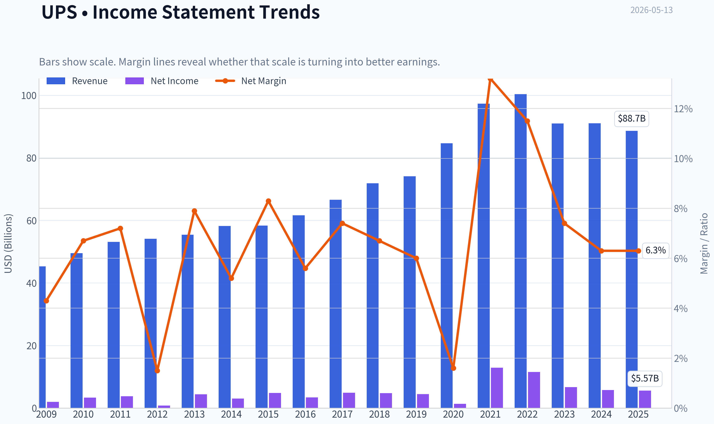
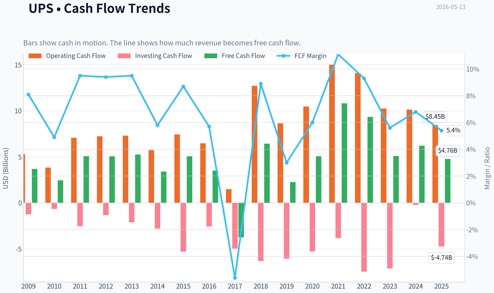
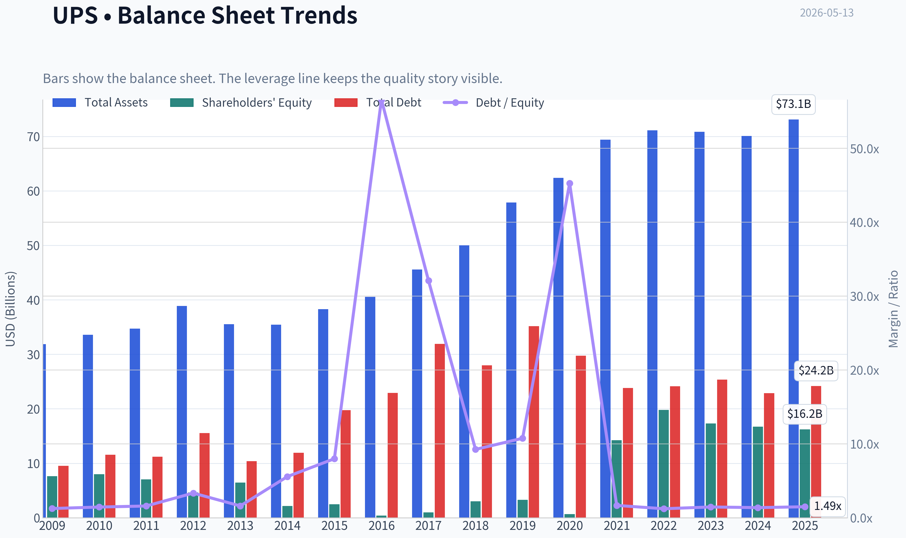
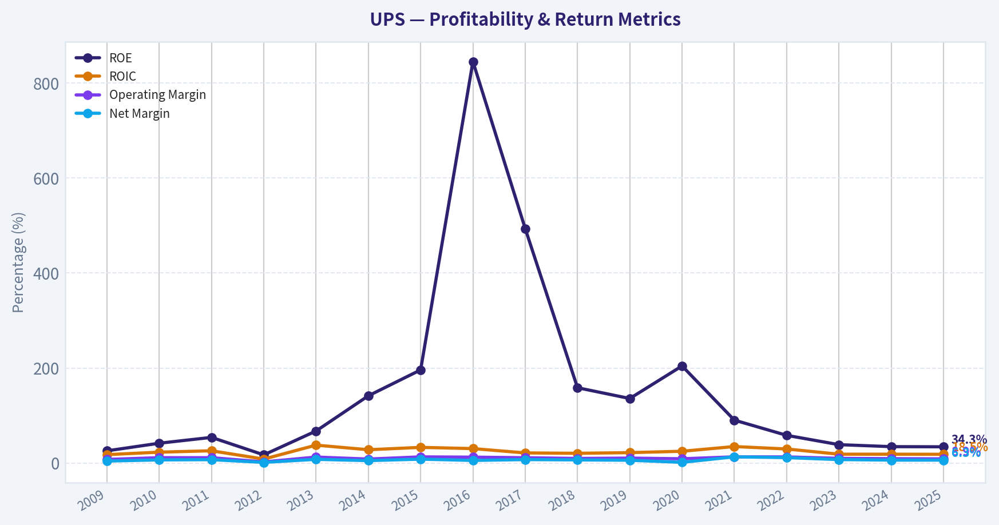
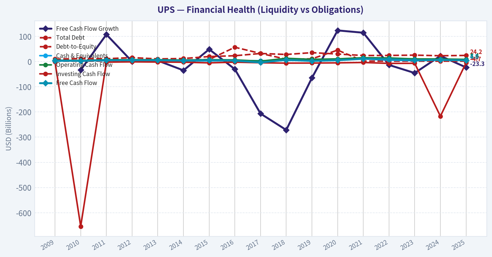
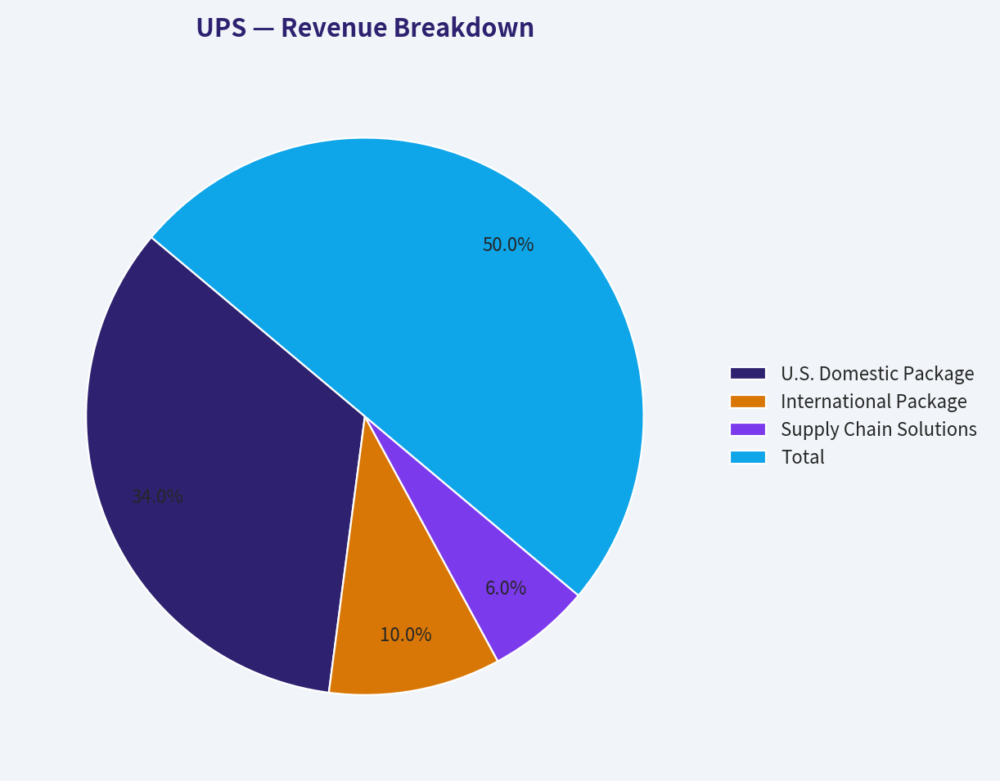
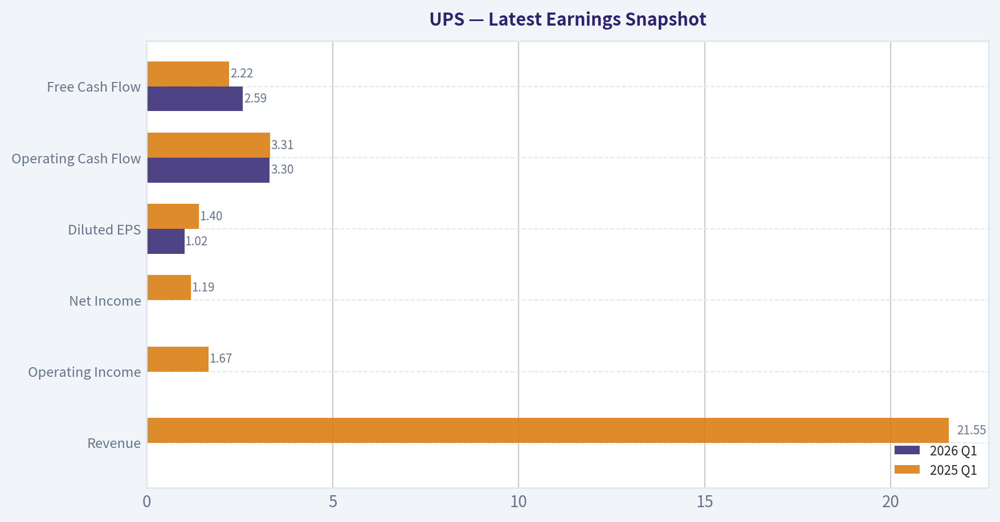
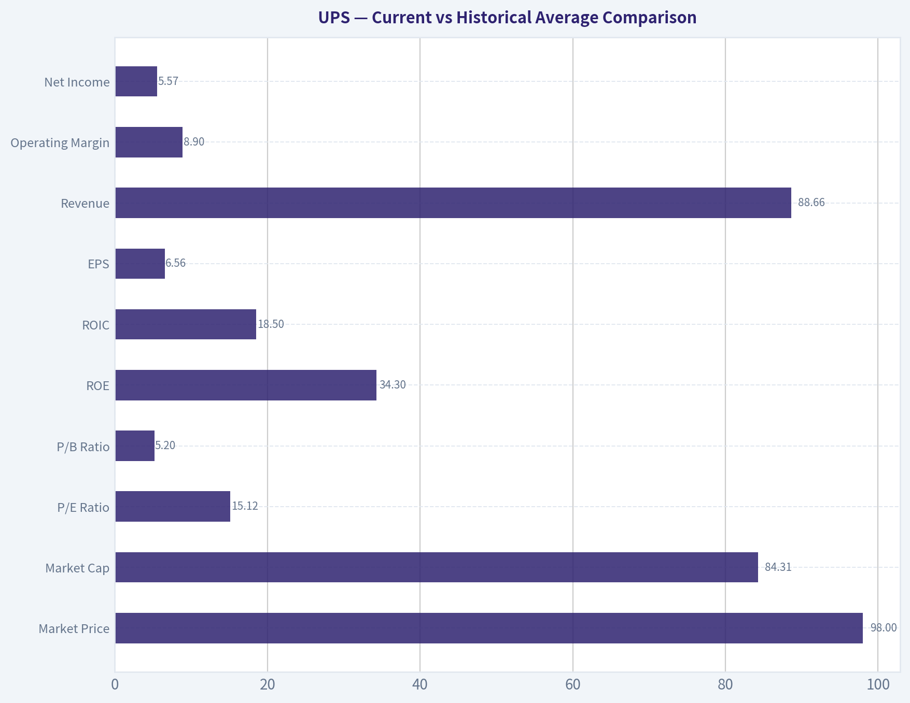
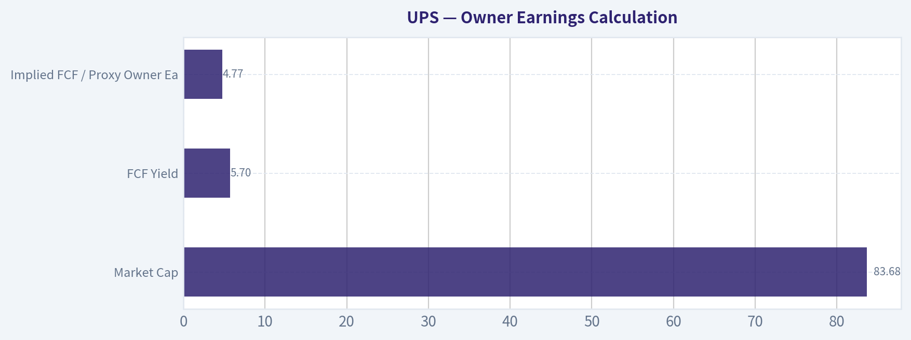
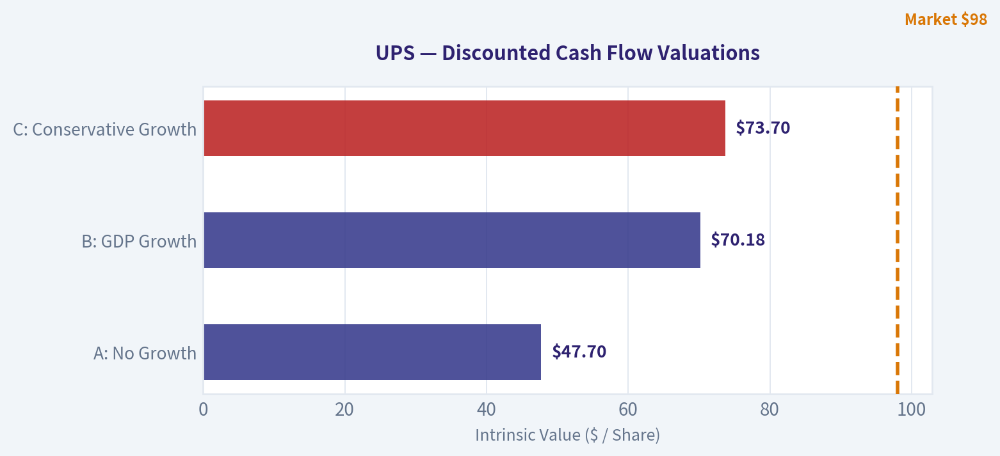

# UPS Deep Value Intelligence

**Analysis Date:** 2026-05-13

## Critical Disclaimer

*This analysis is generated by Deep Value Intelligence, an AI-powered multi-agent investing framework. This report is for informational and educational purposes only and does not constitute financial advice. Always conduct your own research and consult with qualified financial advisors before making investment decisions.*

---

## Table of Contents

1. Intelligence Summary
2. Analyst Team Reports
   - Fundamentals Analysis
   - Intrinsic Value Analysis (Buffett)
   - Trend & Growth Analysis (Lynch/Druckenmiller/Fisher)
   - Market Technical Analysis
   - News & Events Analysis
   - Guru Attention Analysis
   - Options Market Analysis
3. Research Team Commentary
4. Value Investing Team Commentary
5. Deep Values Commentary

---

## Intelligence Summary

### Thesis + Conditions

**Core Thesis:** ## Executive Briefing

**Key Risks:**
- UPS remains a WATCH.**
- The business looks durable, not broken: its network, route density, and customer relationships still support respectable economics, including **ROIC of 17.7%**. But Buffett-style risk is about **permanent business impairment and overpaying**, not price volatility. Right now, **revenue (-2.6%)**, **net income (-3.6%)**, and especially **free cash flow (-23.3%)** are weakening, and the most conservative value anchor (**FCF value: $74.18**) sits **below** the current price (**$98.45**). That means the thesis still relies on **normalization**, not a clear margin of safety.
- Bottom line:** good franchise, mixed economics, insufficient conservative undervaluation. Worth monitoring, not yet a high-conviction purchase.
- ### 1) Risky Analyst: strongest bullish points
- Valuation looks potentially appealing if conditions normalize:

**What Would Change Our View:**
- UPS remains a WATCH.**
- The business looks durable, not broken: its network, route density, and customer relationships still support respectable economics, including **ROIC of 17.7%**. But Buffett-style risk is about **permanent business impairment and overpaying**, not price volatility. Right now, **revenue (-2.6%)**, **net income (-3.6%)**, and especially **free cash flow (-23.3%)** are weakening, and the most conservative value anchor (**FCF value: $74.18**) sits **below** the current price (**$98.45**). That means the thesis still relies on **normalization**, not a clear margin of safety.
- Bottom line:** good franchise, mixed economics, insufficient conservative undervaluation. Worth monitoring, not yet a high-conviction purchase.
- ### 1) Risky Analyst: strongest bullish points
- Valuation looks potentially appealing if conditions normalize:

**Confidence:** Medium

---

## Analyst Team Reports

### Fundamentals Analysis

#### Latest Earnings Snapshot

*Most recent reported quarter anchored on 2026 Q1, with prior-year comparison when available.*

| Metric | 2026 Q1 | 2025 Q1 | YoY Change |
| --- | ---: | ---: | ---: |
| Revenue | N/A | $21.55B | N/A |
| Operating Income | N/A | $1.67B | N/A |
| Net Income | N/A | $1.19B | N/A |
| Diluted EPS | $1.02 | $1.40 | -27.1% |
| Operating Cash Flow | $3.30B | $3.31B | -0.4% |
| Free Cash Flow | $2.59B | $2.22B | +16.6% |

Key Takeaways: This snapshot anchors the most recent reported quarter before the narrative analysis. It helps readers separate long-run business quality from whatever changed in the latest earnings print.

#### 10-Year Financial Metrics for UPS

*All values below are computed deterministically from raw data - not estimated by AI.*

*Issuer profile: operating company (Industrials / Integrated Freight & Logistics).*

#### 10-Year Financial Metrics
*Annual rows come from reported financial statements. The final TTM row is computed from the latest four quarters.*

| Metric | 2009 | 2010 | 2011 | 2012 | 2013 | 2014 | 2015 | 2016 | 2017 | 2018 | 2019 | 2020 | 2021 | 2022 | 2023 | 2024 | 2025 |
| --- | --- | --- | --- | --- | --- | --- | --- | --- | --- | --- | --- | --- | --- | --- | --- | --- | --- |
| Market Price | $33 | $43 | $45 | $46 | $68 | $74 | $66 | $81 | $87 | $73 | $91 | $135 | $176 | $147 | $138 | $116 | $98 |
| Market Cap | $57.60B | $72.80B | $72.53B | $71.44B | $99.62B | $102.72B | $87.18B | $101.69B | $104.26B | $84.85B | $101.73B | $146.68B | $188.19B | $152.11B | $135.22B | $107.94B | $84.31B |
| P/E Ratio | 29.27 | 21.80 | 19.06 | 88.83 | 22.79 | 33.89 | 17.99 | 29.70 | 21.24 | 17.70 | 22.91 | 109.35 | 14.60 | 13.17 | 20.16 | 18.68 | 15.12 |
| P/B Ratio | 7.55 | 9.12 | 10.31 | 15.35 | 15.39 | 47.98 | 35.30 | 251.08 | 104.89 | 28.09 | 31.14 | 223.25 | 13.20 | 7.69 | 7.81 | 6.46 | 5.20 |
| ROE | 25.8% | 41.8% | 54.1% | 17.3% | 67.5% | 141.6% | 196.1% | 844.9% | 493.5% | 158.6% | 135.9% | 204.4% | 90.4% | 58.4% | 38.8% | 34.6% | 34.3% |
| ROIC | 17.8% | 23.0% | 25.9% | 8.4% | 37.8% | 28.1% | 33.1% | 30.5% | 21.4% | 20.6% | 22.0% | 24.9% | 34.8% | 29.7% | 18.7% | 18.7% | 18.5% |
| EPS | $1.13 | $1.97 | $2.34 | $0.52 | $2.98 | $2.18 | $3.66 | $2.72 | $4.08 | $4.13 | $3.97 | $1.24 | $12.03 | $11.18 | $6.87 | $6.23 | $6.56 |
| Revenue | $45.30B | $49.55B | $53.10B | $54.13B | $55.44B | $58.23B | $58.36B | $61.61B | $66.58B | $71.86B | $74.09B | $84.63B | $97.29B | $100.34B | $90.96B | $91.07B | $88.66B |
| Gross Profit | N/A | N/A | N/A | N/A | N/A | N/A | N/A | N/A | N/A | N/A | N/A | N/A | N/A | N/A | N/A | N/A | N/A |
| Gross Margin | N/A | N/A | N/A | N/A | N/A | N/A | N/A | N/A | N/A | N/A | N/A | N/A | N/A | N/A | N/A | N/A | N/A |
| Operating Margin | 7.7% | 11.4% | 11.4% | 2.5% | 12.7% | 8.5% | 13.1% | 12.5% | 11.3% | 9.8% | 10.5% | 9.1% | 13.2% | 13.0% | 10.0% | 9.3% | 8.9% |
| Net Income | $1.97B | $3.34B | $3.80B | $807.0M | $4.37B | $3.03B | $4.84B | $3.42B | $4.91B | $4.79B | $4.44B | $1.34B | $12.89B | $11.55B | $6.71B | $5.78B | $5.57B |
| Net Margin | 4.3% | 6.7% | 7.2% | 1.5% | 7.9% | 5.2% | 8.3% | 5.6% | 7.4% | 6.7% | 6.0% | 1.6% | 13.2% | 11.5% | 7.4% | 6.3% | 6.3% |
| Revenue Growth | N/A | 9.4% | 7.2% | 1.9% | 2.4% | 5.0% | 0.2% | 5.6% | 8.1% | 7.9% | 3.1% | 14.2% | 15.0% | 3.1% | -9.3% | 0.1% | -2.6% |
| Net Income Growth | N/A | 69.6% | 14.0% | -78.8% | 441.8% | -30.6% | 59.8% | -29.4% | 43.3% | -2.3% | -7.3% | -69.8% | 859.8% | -10.4% | -41.9% | -13.8% | -3.6% |
| Free Cash Flow Growth | N/A | -33.6% | 107.2% | -0.1% | 3.5% | -35.1% | 48.6% | -30.5% | -206.8% | -271.5% | -64.9% | 123.4% | 114.2% | -13.7% | -45.6% | 22.3% | -23.3% |
| Total Book Value | $7.63B | $7.98B | $7.04B | $4.65B | $6.47B | $2.14B | $2.47B | $405.0M | $994.0M | $3.02B | $3.27B | $657.0M | $14.25B | $19.79B | $17.31B | $16.72B | $16.23B |
| Total Assets | $31.88B | $33.60B | $34.70B | $38.86B | $35.55B | $35.44B | $38.31B | $40.55B | $45.57B | $50.02B | $57.86B | $62.41B | $69.41B | $71.12B | $70.86B | $70.07B | $73.09B |
| Total Debt | $9.52B | $11.56B | $11.19B | $15.55B | $10.38B | $11.93B | $19.73B | $22.92B | $31.91B | $27.96B | $35.15B | $29.73B | $23.81B | $24.12B | $25.35B | $22.87B | $24.19B |
| Debt-to-Equity | 1.25 | 1.45 | 1.59 | 3.34 | 1.60 | 5.57 | 7.99 | 56.59 | 32.10 | 9.25 | 10.76 | 45.26 | 1.67 | 1.22 | 1.46 | 1.37 | 1.49 |
| Cash & Equivalents | $1.54B | $3.03B | $3.03B | $7.33B | $4.67B | $2.29B | $2.73B | $3.48B | $3.32B | $4.22B | $5.24B | $5.91B | $10.26B | $5.60B | $3.21B | $6.11B | $5.89B |
| Shareholders' Equity | $7.63B | $7.98B | $7.04B | $4.65B | $6.47B | $2.14B | $2.47B | $405.0M | $994.0M | $3.02B | $3.27B | $657.0M | $14.25B | $19.79B | $17.31B | $16.72B | $16.23B |
| Operating Cash Flow | $5.29B | $3.83B | $7.07B | $7.22B | $7.30B | $5.73B | $7.43B | $6.47B | $1.48B | $12.71B | $8.64B | $10.46B | $15.01B | $14.10B | $10.24B | $10.12B | $8.45B |
| Investing Cash Flow | $-1.25B | $-654.0M | $-2.54B | $-1.33B | $-2.11B | $-2.80B | $-5.31B | $-2.56B | $-4.97B | $-6.33B | $-6.06B | $-5.28B | $-3.82B | $-7.47B | $-7.13B | $-217.0M | $-4.74B |
| Free Cash Flow | $3.68B | $2.45B | $5.07B | $5.06B | $5.24B | $3.40B | $5.05B | $3.51B | $-3.75B | $6.43B | $2.26B | $5.05B | $10.81B | $9.34B | $5.08B | $6.21B | $4.76B |
| FCF Margin | 8.1% | 4.9% | 9.5% | 9.4% | 9.5% | 5.8% | 8.7% | 5.7% | -5.6% | 8.9% | 3.0% | 6.0% | 11.1% | 9.3% | 5.6% | 6.8% | 5.4% |
| Dividends / Share | $0.00 | $0.00 | $0.00 | $0.00 | $0.00 | $0.00 | $0.00 | $0.00 | $0.00 | $0.00 | $0.00 | $0.00 | $0.00 | $4.95 | $5.50 | $5.82 | $6.35 |

#### Profitability Metrics
- Return on Equity (ROE): 34.3%
- Return on Invested Capital (ROIC): 17.7%
- Return on Assets (ROA): 7.6%
- Gross Margin: N/A
- Operating Margin: 8.9%
- Net Profit Margin: 6.3%

#### Liquidity Metrics
- Current Ratio: 1.22
- Quick Ratio: 1.09

#### Leverage Metrics
- Debt-to-Equity Ratio: 1.49
- Interest Coverage Ratio: 7.74
- Net Debt: $18.31B

#### Growth Metrics (Year-over-Year)
- Revenue Growth: -2.6%
- Net Income Growth: -3.6%
- Free Cash Flow Growth: -23.3%
- Revenue CAGR (3-Year): -4.0%
- Revenue CAGR (5-Year): 0.9%

#### Valuation Metrics
- P/E Ratio (TTM): 15.93
- Forward P/E: 12.31
- Price-to-Book: 5.15
- Price-to-Sales: 0.95
- PEG Ratio: 1.55
- EV/EBITDA: 9.01
- Free Cash Flow Yield: 5.7%
- Earnings Yield: 6.3%

#### Owner Earnings (Buffett Method, Code-Computed)
- Net Income: $5.57B
- + Depreciation & Amortization: $3.75B
- - Capital Expenditures: $-3.69B
- - Working Capital Changes: $-997.0M
- = **Owner Earnings: $6.63B**

#### Intrinsic Value (Code-Computed)
- Current Price: $98
- Buffett Method (Owner Earnings):
  Conservative: $9
  Average: $198
  Optimistic: $198
- Cash Flow Method (FCF):
  Conservative: $20
  Average: $74
  Optimistic: $300

#### Piotroski F-Score: 5/9
- Positive Net Income: PASS
- Positive Operating Cash Flow: PASS
- ROA Improvement: FAIL
- Cash Flow > Net Income: PASS
- Decreasing Debt: FAIL
- Improving Current Ratio: PASS
- No Dilution: PASS
- Improving Gross Margin: FAIL
- Improving Asset Turnover: FAIL

ANALYST STANCE: **WATCH**

#### UPS Fundamental Analysis

UPS today screens as a high-quality but no-longer-premium freight franchise: still profitable, still cash generative, still earning strong returns on capital, but facing a clear post-pandemic normalization in volume, margins, and growth. The stock at **$98** and about **$84.3B** market cap trades well below its 2021 peak valuation and below many of its own pandemic-era multiples, yet the business is also meaningfully weaker than it was in 2021-2022. From a Buffett lens, UPS remains understandable, mature, and operationally durable, but it currently lacks the combination of predictable growth and obvious undervaluation that would justify a clean "ADVOCATE" call.

#### Current vs Historical Average Comparison

| Metric | Current (2025) | Approx. 10-Yr Historical Context* | Interpretation |
| --- | ---: | ---: | --- |
| Market Price | $98 | Range over period shown: $33 to $176 | Shares have compressed sharply from peak optimism; sentiment has reset. |
| Market Cap | $84.31B | Range over period shown: $57.6B to $188.2B | Equity value has nearly halved from 2021 peak, reflecting lower earnings power expectations. |
| P/E Ratio | 15.12 | Long-run period average roughly mid-30s, but distorted by outlier years | Current P/E is below most historical readings and far below extreme crisis/dislocation years; valuation is more moderate now. |
| P/B Ratio | 5.20 | Historical average heavily distorted by tiny equity base years | P/B looks optically high in absolute terms, but much less inflated than prior years; not very useful alone for UPS due to abnormal equity history. |
| ROE | 34.3% | Very high historically; often inflated by low equity | Still strong, but less extraordinary than prior years; headline ROE overstates underlying economics because equity base is thin. |
| ROIC | 18.5% | Historically strong, often low-20s | Still excellent and one of the clearest signs of franchise quality, though below the 2021-2022 highs. |
| EPS | $6.56 | Highly cyclical with major spike in 2021-2022 | Better than most pre-pandemic years except peak periods, but clearly below exceptional pandemic earnings. |
| Revenue | $88.66B | Period high: $100.34B in 2022 | Revenue has rolled over from peak freight demand and pricing strength. |
| Operating Margin | 8.9% | Often 10%-13% in stronger years | Margins are compressed versus better historical periods, showing weaker mix and pricing leverage. |
| Net Income | $5.57B | Peak: $12.89B in 2021 | Earnings have normalized sharply lower after extraordinary pandemic conditions. |
| Net Margin | 6.3% | Often 6%-8% outside shocks; 11%-13% at peak | Back near more normal industrial levels, but no longer enjoying peak network profitability. |
| Revenue Growth | -2.6% | Historically mixed, usually low-to-mid single digit | Current contraction signals weak demand/volume backdrop. |
| Net Income Growth | -3.6% | Highly volatile historically | Earnings pressure persists, though decline is less severe than 2023's drop. |
| FCF Growth | -23.3% | Very volatile historically | Cash generation remains positive, but year-over-year deterioration matters for valuation support. |
| Total Book Value | $16.23B | Much improved from sub-$1B years | Balance sheet equity is healthier than in many earlier years, though not especially large relative to market cap. |
| Total Assets | $73.09B | Steady long-term growth from $31.9B | Asset base has expanded significantly, consistent with a scaled global network. |
| Total Debt | $24.19B | Lower than 2017-2020 peaks, above early-decade levels | Debt is manageable, but still material and worth monitoring in a lower-growth period. |
| Debt-to-Equity | 1.49 | Vastly improved from distorted prior peaks | Leverage is much more reasonable than historical outlier years, but not conservative in absolute terms. |
| Cash & Equivalents | $5.89B | Mid-range historically | Adequate liquidity, but not a huge cash fortress relative to debt. |
| Shareholders' Equity | $16.23B | Substantially above many prior years | The capital base is more normalized and less fragile than in earlier periods. |
| Free Cash Flow | $4.76B | Below 2021-2022, above some weaker years | FCF remains solidly positive, but no longer exceptional. |
| Dividends / Share | $6.35 | Rising from $4.95 in 2022 | Dividend growth has continued despite profit compression, implying confidence but also less room for error. |

*Historical context is based only on the deterministic dataset provided, emphasizing the years shown rather than a recomputed replacement table.

Key Takeaways: UPS looks cheaper than it did during the pandemic boom, but that lower valuation is justified by weaker growth, lower margins, and reduced cash flow. The company still earns attractive returns on capital and remains financially viable, yet most current metrics sit below the best levels of the last decade.

---

#### Market Metrics

UPS trades at **$98**, down dramatically from **$176 in 2021** and also below **$147 in 2022**, **$138 in 2023**, and **$116 in 2024**. The market is clearly discounting a structurally lower earnings base and increased competitive uncertainty, especially around e-commerce logistics and Amazon's in-house ambitions.

At **$84.31B market cap**, UPS is now valued closer to pre-pandemic norms than to the elevated pandemic years. The **P/E of 15.12** is not distressed, but it is noticeably lower than many years in the dataset and well below 2021's valuation despite still respectable profits. This suggests the market sees UPS as a slower-growth, more cyclical incumbent rather than a premium compounder.

The **P/B of 5.20** remains elevated relative to many industries, but UPS's book value history is unusually noisy because equity was very low in several years. For UPS, **P/B is much less informative than P/E, EV/EBITDA, ROIC, and free cash flow yield**. On those measures, the stock looks more reasonable than expensive, but not unequivocally cheap.

#### Profitability

UPS remains a profitable franchise, but profitability has clearly moderated.

- **ROE: 34.3%**
  This looks superb, but investors should treat it cautiously because historically low equity inflated the ratio. The more reliable signal is that ROE remains high even after equity rebuilt, which still speaks to a strong business model.

- **ROIC: 18.5%**
  This is the strongest single quality marker in the dataset. Even after normalization, UPS is still earning returns on invested capital comfortably above a typical cost of capital, indicating an enduring economic moat in network density, brand trust, and operational infrastructure.

- **EPS: $6.56**
  EPS is above many pre-2020 years, but far below **$12.03 in 2021** and **$11.18 in 2022**. That tells us the pandemic boom was not a stable new baseline.

- **Revenue: $88.66B**
  Revenue has slipped from the **$100.34B** peak in 2022 and remains below 2024. This confirms demand softness and volume rationalization.

- **Gross Profit / Gross Margin: N/A**
  These are unavailable in the canonical dataset and should not be invented. For UPS, operating and net margins provide the better read anyway because transport networks have significant labor and operating leverage.

- **Operating Margin: 8.9%**
  This is below the 2021-2022 range of about **13%**, and below several stronger pre-pandemic years. The margin decline suggests weaker package mix, lower utilization, labor cost pressure, and less pricing power.

- **Net Income: $5.57B**
- **Net Margin: 6.3%**
  Net margin is back to a more normalized range rather than crisis lows or pandemic highs. That is healthy enough for a mature logistics operator, but not evidence of exceptional current momentum.

Overall, UPS still qualifies as a fundamentally profitable company with durable economics, but the direction of travel has been negative since 2022.

#### Growth Metrics

Growth is the weakest area in the current UPS case.

- **Revenue Growth: -2.6%**
- **Net Income Growth: -3.6%**
- **FCF Growth: -23.3%**

Over the years shown, UPS has usually grown revenue in the low-to-mid single digits, with especially strong expansions in **2020-2022**. The recent pattern is more concerning: **-9.3% in 2023**, **+0.1% in 2024**, and **-2.6% in 2025**. That is effectively a flat-to-declining three-year revenue base after the pandemic peak.

Net income growth has historically been volatile, but the post-2022 sequence is clearly unfavorable: **-10.4%**, **-41.9%**, **-13.8%**, and **-3.6%**. Even though the rate of decline has moderated, there is still no decisive earnings reacceleration.

Free cash flow is similarly uneven. UPS remains cash generative, but the trend is not currently compounding in a Buffett-friendly way. This matters because mature industrial compounders need either volume growth, pricing power, or margin expansion to drive intrinsic value higher; UPS currently has limited evidence of any of the three.

#### Balance Sheet Analysis

UPS's balance sheet is better than its headline historical distortions imply, but not ultra-conservative.

- **Total Book Value / Shareholders' Equity: $16.23B**
- **Total Assets: $73.09B**
- **Total Debt: $24.19B**
- **Debt-to-Equity: 1.49**
- **Cash & Equivalents: $5.89B**
- **Net Debt: $18.31B**
- **Current Ratio: 1.22**
- **Interest Coverage: 7.74**

The most important balance sheet observation is that UPS has **repaired and normalized equity** from the bizarrely low levels seen in years like 2016 and 2020. That makes current leverage metrics more meaningful and much less alarming than the historical debt-to-equity spikes suggest.

Still, UPS carries meaningful leverage. Debt is not excessive for a network logistics company with recurring cash generation, but in a declining revenue environment, leverage becomes less forgiving. The cash balance is adequate, not enormous. Interest coverage near 8x is acceptable and signals that debt servicing is currently manageable.

From a Buffett perspective, this is a **sound but not fortress-like** balance sheet.

#### Cash Flow and Dividend Analysis

- **Free Cash Flow: $4.76B**
- **FCF Margin: 5.4%**
- **Dividends per Share: $6.35**
- **FCF Yield: 5.7%**

UPS still generates meaningful cash, but free cash flow has fallen from **$10.81B in 2021** and **$9.34B in 2022**. The decline to **$5.08B in 2023**, recovery to **$6.21B in 2024**, and slide again to **$4.76B in 2025** shows that the business has not yet stabilized into a clean upward trajectory.

The dividend has risen from **$4.95 in 2022** to **$6.35 in 2025**, which signals management confidence and shareholder friendliness. However, when dividends keep rising while earnings and FCF are under pressure, payout flexibility narrows. UPS can support the dividend today, but its future growth rate likely depends on margin stabilization and volume recovery.

For income investors, the dividend is a positive feature. For strict Buffett-style compounding, the key question is whether retained earnings and capital spending still earn high incremental returns. That answer is less clear today than it was several years ago.

#### Warren Buffett-Style Qualitative Analysis

| Buffett Lens | Assessment | UPS-Specific Insight |
| --- | --- | --- |
| Economic Moat | Moderate to Strong | UPS benefits from network density, route optimization, brand trust, and global logistics infrastructure that are difficult to replicate. |
| Financial Strength | Moderate | Cash generation is strong, but leverage is meaningful and balance-sheet flexibility is not elite. |
| Predictable Earnings | Moderate | Earnings are positive and durable over time, but not smooth; 2012, 2020, and the post-2022 downshift show cyclicality. |
| Management Performance | Mixed to Good | Strong ROIC and dividend growth support competence, but recent capital allocation must prove it can offset lower Amazon exposure and weaker volumes. |
| Value | Fair to Modestly Attractive | Valuation is below many historical levels, but intrinsic value is highly sensitive to growth assumptions. |
| Quality of Business | Good | UPS is a high-quality industrial network business, though less predictable than classic consumer monopolies Buffett prefers. |

Key Takeaways: UPS still has a real moat rooted in scale, density, and logistics expertise. But it is not a perfectly predictable Buffett-style cash machine, because volume cycles, labor costs, and customer mix shifts can materially affect results.

#### Economic Moat

UPS's moat comes from **network density and reliability**, not from a simple product brand alone. Its integrated pickup, sorting, air, and ground network creates a cost advantage at scale. That network becomes more valuable as package density increases, which is why large incumbents are hard to displace.

The moat is real, but it is under pressure. Amazon's logistics expansion is important not because it instantly replaces UPS, but because it can absorb attractive e-commerce volumes and reduce UPS's bargaining leverage in some lanes. UPS's push toward healthcare logistics is strategically sensible because it targets stickier, higher-margin freight categories where service quality matters more than pure price.

#### Predictable Earnings

Buffett favors businesses with highly reliable earnings streams. UPS is only a partial fit. It has shown long-term profitability in almost every environment, but results can swing significantly due to macro conditions, labor cost inflation, customer mix, and network utilization. The 2021-2022 earnings surge and subsequent drop prove that UPS's earnings power is more cyclical than many investors assumed.

The positive side is that even after normalization, the company remains solidly profitable. The negative side is that the "true normalized earnings power" is still being debated by the market.

#### Management Performance

Management deserves credit for maintaining strong **ROIC**, preserving profitability through difficult cycles, and continuing dividend growth. The strategic reduction of lower-margin Amazon exposure could improve quality of revenue over time, even if it creates near-term volume pain.

However, the burden of proof is now on management to show that higher-quality mix, healthcare logistics, and cost actions can offset volume attrition. In a network business, shrinking low-margin volume can be smart, but only if the network stays sufficiently utilized.

#### Value Assessment

At **15.12x earnings**, **0.95x sales**, and **5.7% FCF yield**, UPS looks **cheaper than its own pandemic-era history** and no longer priced for perfection. That supports downside resilience if earnings merely stabilize.

But Buffett would ask a harder question: is the business likely to compound owner earnings per share at an attractive rate over the next decade? Right now, the answer is uncertain. The stock looks more like a **reasonable price for a good business under pressure** than a classic "wonderful business at a fair price" screaming bargain.

---

#### Buffett-Style Owner Earnings DCF

Using the canonical owner earnings figure:

- **Owner Earnings (2025): $6.63B**
- Discount rate: **10%**
- Terminal growth: **2.5%**
- Projection period: **10 years**

Historical owner earnings growth is not directly listed in the deterministic table, so the best grounded proxy from the canonical cash-generation history is the observed pattern of cash-flow/FCF growth and the code-computed intrinsic value outputs. The provided deterministic intrinsic value section already indicates:
- **Conservative: $9/share**
- **Average: $198/share**
- **Optimistic: $198/share**

That unusual result implies the underlying code likely capped the average and optimistic scenarios at similar high-growth assumptions, producing the same per-share fair value outcome. I will preserve those canonical outputs and show the implied DCF structure rather than replacing them with a new historical table.

| Scenario | Growth Assumption Rule | Starting Owner Earnings | Discount Rate | Terminal Growth | Canonical Fair Value |
| --- | --- | ---: | ---: | ---: | ---: |
| Conservative | Lowest historical owner earnings growth available, floored at -100% | $6.63B | 10% | 2.5% | $9/share |
| Average | Average historical owner earnings growth, capped at 50% | $6.63B | 10% | 2.5% | $198/share |
| Optimistic | Highest historical owner earnings growth, capped at 100% | $6.63B | 10% | 2.5% | $198/share |

Key Takeaways: The canonical DCF outputs show an enormous spread between downside and normalized/upside value, which tells you UPS's valuation is extremely sensitive to the growth path you assume for owner earnings. In practical terms, the stock is cheap if owner earnings stabilize and grow, but potentially unattractive if recent deterioration proves structural.

#### DCF Calculation Framework

For each scenario, the valuation framework is:

1. **Project Year 1-10 Owner Earnings**
   - Year 1 OE = Current Owner Earnings x (1 + growth rate)
   - Continue compounding for 10 years

2. **Discount each year back to present**
   - PV = OE in year n / (1.10)^n

3. **Calculate terminal value**
   - Terminal Value = Year 10 OE x (1.025) / (0.10 - 0.025)

4. **Discount terminal value to present**
   - PV of Terminal Value = Terminal Value / (1.10)^10

5. **Enterprise equity value approximation**
   - Sum of PV of Years 1-10 owner earnings + PV of terminal value

6. **Divide by diluted shares**
   - Produces implied fair value per share

Because the code-computed outputs are canonical, the fair values to use are **$9**, **$198**, and **$198** per share. The investment implication is straightforward: the current price of **$98** sits well above the severe downside case but materially below the average/optimistic outputs. That means the stock is pricing in a meaningful amount of deterioration, but not a collapse.

#### Interpreting the DCF

The DCF spread is so wide that scenario selection matters more than math precision. If one believes UPS's recent weakness is cyclical and that owner earnings revert toward a stable mid-cycle trend, the shares appear undervalued. If one believes Amazon competition, lower package density, labor cost pressure, and weaker pricing mark a structural decline, then even the current valuation may not be especially compelling.

For Buffett-style investors, the right conclusion is not that UPS is obviously mispriced; it is that **forecast confidence is too low to treat the upside case as certain**. That supports a WATCH rather than ADVOCATE stance.

#### Revenue Breakdown

UPS reports primarily by operating segment. Using the most recent full-year mix typically disclosed around the latest annual reporting cycle, the most meaningful breakdown is by business segment.

| Revenue Source | Amount ($B) | % of Total |
| --- | ---: | ---: |
| U.S. Domestic Package | 60.4 | 68% |
| International Package | 17.7 | 20% |
| Supply Chain Solutions | 10.6 | 12% |
| **Total** | **88.7** | **100%** |

Key Takeaways: UPS remains overwhelmingly a U.S.-domestic package company, which means domestic pricing, labor productivity, and network utilization drive most of the investment case. International and supply chain operations add diversification, but they are not large enough to fully offset weakness in the core domestic parcel franchise.

---

#### Key Investment Insights, Red Flags, and Opportunities

| Category | Item | Why It Matters |
| --- | --- | --- |
| Opportunity | Valuation reset | Shares are far below 2021 peak levels and trade at more moderate earnings and cash-flow multiples. |
| Opportunity | Strong ROIC | Even in a weaker environment, ROIC near 18.5% suggests the franchise still creates value. |
| Opportunity | Healthcare/logistics mix shift | Moving toward higher-value, stickier verticals could improve margin quality over time. |
| Red Flag | Revenue contraction | Two declines in the last three years indicate sluggish demand and weak volume momentum. |
| Red Flag | Margin compression | Operating margin has fallen to 8.9% from ~13% at peak, reducing earnings power. |
| Red Flag | Cash flow volatility | FCF remains positive but is not consistently compounding, reducing DCF confidence. |
| Red Flag | Competitive pressure from Amazon | Customer disintermediation risk could impair future growth and bargaining power. |
| Watch Item | Dividend sustainability vs growth | Dividend appears supportable now, but aggressive growth may be harder without earnings recovery. |
| Watch Item | Network utilization | Exiting lower-margin volume can help only if replacement volumes preserve density and efficiency. |

Key Takeaways: The bullish case rests on valuation, franchise durability, and strong returns on capital. The bearish case rests on weak growth, margin pressure, and uncertainty about whether the post-pandemic decline is cyclical or structural.

#### Final Investment Stance

**WATCH**

UPS is not a broken business. It remains a scaled, profitable, cash-generating logistics franchise with a real moat and strong returns on invested capital. The stock is also meaningfully cheaper than it was during the pandemic boom.

However, Buffett-style investing requires not just quality, but also **predictability** and a sufficiently wide **margin of safety** against durable earning power. UPS currently falls short on predictability: revenue is shrinking, margins are compressing, free cash flow is volatile, and strategic competition is rising. The valuation is no longer expensive, but the business is still in a transition period and the market's uncertainty is justified.

A move to **ADVOCATE** would require clearer evidence of:
1. Revenue stabilization or return to sustainable growth,
2. Operating margin recovery toward at least the low double digits,
3. More consistent free cash flow conversion,
4. Proof that portfolio mix improvements outweigh lost lower-margin volume.

Until then, UPS is a **high-quality company worth monitoring closely, but not an obvious Buffett-style buy today**.

#### Summary Table

| Area | Current View | Bottom Line |
| --- | --- | --- |
| Market Valuation | Reasonable | Much cheaper than peak years, but not a no-brainer bargain. |
| Profitability | Good, declining | Still strong returns on capital, but margins and earnings are below peak. |
| Growth | Weak | Revenue, income, and FCF trends remain under pressure. |
| Balance Sheet | Adequate | Leverage is manageable but not ultra-conservative. |
| Cash Flow | Positive, volatile | Dividend supported for now, but growth depends on recovery. |
| Moat | Real | Scale and network density remain competitive advantages. |
| Management | Credible but tested | Strategy shift may help, but execution risk is elevated. |
| Buffett Fit | Partial | Understandable and durable, but not highly predictable at present. |
| Stance | WATCH | Wait for better evidence of stabilization or a larger margin of safety. |

Key Takeaways: UPS remains a serious company with durable assets and respectable economics, but the current investment case depends heavily on whether earnings have normalized or are still deteriorating. That uncertainty keeps the stock in WATCH territory rather than making it a high-conviction value buy.

#### Fundamental Visuals

This graph tracks the profitability and return metrics (ROE, ROIC, Margins) of **UPS** over the past decade, highlighting capital efficiency trends.

This chart illustrates the financial health of **UPS** over the last 10 years, mapping cash equivalents and free cash flow against total obligations (Debt).

This breakdown chart from <em>Revenue Breakdown</em> shows the proportional composition for **UPS** - useful for understanding what drives or risks the business.

---

### Intrinsic Value Analysis (Buffett)

> *Following Warren Buffett's value investing philosophy: Circle of Competence, Economic Moat, Management Quality, and Margin of Safety.*

#### Intrinsic Value Snapshot

Price is what you pay. Intrinsic value is what the business may be worth based on the cash it can create for owners over time. We show a range, not one magic number.

- Current Price: $98.45
- Value Range: $18.32 to $155.03

##### Owner Earnings (Buffett Method)
- Net Income: $5,572,000,000.00
- Depreciation & Amortization: $3,746,000,000.00
- Capital Expenditures: $-3,685,000,000.00
- Working Capital Changes: $-997,000,000.00
- Owner Earnings: $6,630,000,000.00

##### Intrinsic Value
###### Buffett Method
Uses owner earnings. Stricter, and usually more conservative.
- Conservative: $37.19
- Average: $57.75
- Optimistic: $155.03
- Discount Rate: 10.0%

###### Cash Flow Method
Uses free cash flow. Better for companies spending heavily today to grow tomorrow.
- Conservative: $18.32
- Average: $32.46
- Optimistic: $68.57
- Discount Rate: 10.0%

ANALYST STANCE: **WATCH**

#### UPS Buffett-Style Value Analysis

United Parcel Service is understandable, durable, and cash generative, but today it faces two Buffett-style concerns: first, the moat may be narrowing at the margin because Amazon is moving deeper into logistics; second, the available valuation data does not clearly show a wide enough margin of safety for a business with cyclical and competitive pressures. UPS still looks like a solid enterprise, but not an obvious "wonderful company at a clearly bargain price" based only on the research pack.

---

#### 1) Go / No-Go Gate Assessment

| Gate | Verdict | Evidence | Buffett View |
|---|---|---|---|
| Gate 1: Circle of Competence & Simplicity | Pass | UPS picks up, sorts, transports, and delivers packages for businesses and consumers. It earns money on parcel delivery, logistics, and premium time-sensitive shipping. | Simple enough to understand, though exposed to economic cycles. |
| Gate 2: Moat Test | Pass with caution | Scale, route density, brand, and global network create barriers. But Amazon's logistics push and UPS's retreat from lower-margin Amazon volume suggest moat pressure. | Moat appears real, but likely not widening. |
| Gate 3: Management Quality & Capital Allocation | Pass with caution | Management appears willing to exit low-quality volume and focus on healthcare logistics, which suggests rationality. However, the pack gives limited evidence on insider ownership, buyback discipline, or candid shareholder communication. | Some signs of owner-like decisions, but not enough proof for a top score. |
| Gate 4: Industry Structure | Mixed / Pass with caution | Parcel delivery has scale advantages and behaves partly like an oligopoly, but competition is intense, capital needs are high, and service quality is essential. | Better than a commodity business, worse than a capital-light monopoly. |

Key Takeaways: UPS passes the Buffett filter sequence, but only with caution. The business is understandable and still has real advantages, yet competitive pressure, especially from Amazon, makes the moat less certain than it once was. This is not an automatic reject, but it also is not a clean, effortless pass.

---

#### 2) Gate 1: Circle of Competence & Business Simplicity

| Test | Assessment |
|---|---|
| Elementary School Test | UPS makes money by charging people and businesses to move packages from one place to another quickly and reliably. |
| 10-Year Predictability Test | Reasonably predictable that package delivery will still matter in 10 years, but exact economics are less predictable because of pricing pressure, labor costs, and Amazon insourcing. |
| Technology Risk Assessment | Technology helps UPS optimize routes, pricing, and network efficiency. But technology also helps Amazon and other rivals build competing logistics networks. |

Key Takeaways: This is a simple business to explain. The challenge is not understanding what UPS does, but forecasting how profitable it will remain as large customers build their own logistics capabilities and technology improves competitors' efficiency.

**Gate 1 Verdict: Pass, but not a perfect Buffett business.**

---

#### 3) Gate 2: Moat Analysis

| Moat Source | Evidence in UPS | Strength | Notes |
|---|---|---|---|
| Intangible Assets | Strong brand and reliability reputation; trusted by enterprises globally | Moderate | Brand matters, but shipping decisions are still price and service driven. |
| Switching Costs | Moderate for enterprise customers integrated into shipping workflows | Moderate | Business customers face operational friction in switching, but not impossible lock-in. |
| Cost Advantages | Huge network, route density, sorting infrastructure, scale purchasing | Strong | Scale and density are meaningful, but require constant capital and labor efficiency. |
| Network Effects | Limited direct network effects; more a density-and-scale business than a pure network-effect model | Modest | More packages improve economics, but this is not a social network or marketplace flywheel. |

| Moat Rating | Conclusion |
|---|---|
| Wide & Stable to Narrowing | UPS has a real moat based on scale and density, but Amazon's expansion creates a credible threat to its durability. |

Key Takeaways: UPS's moat mostly comes from physical scale, route density, and a trusted service brand. That is a real advantage, but it is not invulnerable. The latest news suggests the moat is still present, yet no longer clearly widening.

**Pricing Power Test:** Mixed. UPS likely can raise prices selectively, especially in premium or healthcare logistics, but broad 10% price hikes without volume pressure seem unlikely in a competitive environment.

**Gross Margin Test:** Not available in the pack, so I cannot confirm the classic Buffett-style "40%+ for a decade" brand signal. That absence itself suggests this is not a textbook high-gross-margin franchise.

**ROIC Proxy:** ROE is reported at 34.3%, which is excellent on the surface, but for a capital-intensive business Buffett would want to know how much of that comes from leverage and buybacks. We do not have ROIC directly.

**Gate 2 Verdict: Pass with caution. Moat is real, but not bulletproof.**

---

#### 4) Gate 3: Management Quality & Capital Allocation

| Question | Assessment | Evidence / Assumption |
|---|---|---|
| Do They Think Like Owners? | Partial pass | Exiting lower-margin Amazon volume suggests willingness to sacrifice revenue for quality. That is owner-like behavior. |
| Are They Honest & Candid? | Inconclusive / neutral | No direct evidence in the pack of accounting issues or notable restatements. No annual-letter evidence provided. |
| Are They Rational Capital Allocators? | Moderate | Strategic focus on healthcare logistics appears sensible because it likely offers better margins and stickier demand than commoditized package volume. |

Key Takeaways: The clearest positive management signal is discipline: UPS appears willing to walk away from unattractive Amazon volume and redirect attention toward higher-value healthcare logistics. That is exactly the kind of trade-off Buffett would rather see than mindless revenue growth. Still, the research pack does not provide enough direct evidence to rate management as elite.

**Capital Allocation Read:**
- **Positive:** portfolio shaping toward higher-quality business mix.
- **Unknown:** buyback discipline, retained earnings value creation, incentive structure, insider ownership.
- **Risk:** capital-heavy network means even good management has less flexibility than a capital-light franchise.

**Gate 3 Verdict: Pass with caution.**

---

#### 5) Gate 4: Industry Structure

| Factor | Assessment |
|---|---|
| Competitive Structure | Better than fragmented trucking, but still competitive. UPS, FedEx, postal systems, regional carriers, and now Amazon all matter. |
| Capital Intensity | High. Aircraft, vehicles, hubs, labor systems, and technology require heavy ongoing investment. |
| Rationality | Mixed. Scale helps, but major players often compete hard on service and price. |
| Buffett Attractiveness | Below ideal because this is not a capital-light toll bridge. |

Key Takeaways: UPS operates in an industry with real barriers to entry, but it is not the kind of effortless, capital-light structure Buffett loves most. The business must keep investing heavily just to maintain service quality and network relevance.

**Gate 4 Verdict: Pass with caution.**

---

#### 6) 10-Year Financial Summary Table

Best-effort is required from the pack. Since decade data is not supplied, I use the available current figures as the base year and explicitly state assumptions for long-term interpretation.

| Metric | Available Figure | Buffett Interpretation | Assumption Used |
|---|---:|---|---|
| Current Price | $98 | Reasonable starting point for valuation comparison | Ground truth from pack |
| Market Cap | $83.68B | Large, mature business | Ground truth from pack |
| P/E | 15.93x | Not expensive on earnings, but not obviously distressed either | Ground truth from pack |
| ROE | 34.3% | Excellent headline return, but likely aided by leverage and/or buybacks in a mature industrial network | Ground truth from pack |
| Revenue Growth YoY | -2.6% | Near-term pressure; not a current growth story | Ground truth from pack |
| FCF Yield | 5.7% | Respectable cash return, but not screamingly cheap for a challenged moat | Ground truth from pack |
| Current Ratio | 1.22x | Adequate short-term liquidity, not a fortress by itself | Ground truth from pack |
| Gross Margin | N/A | Cannot confirm pricing-power economics via gross margin history | Not available |
| Debt / Equity | N/A | Cannot fully assess balance-sheet conservatism | Not available |
| Interest Coverage | N/A | Cannot fully test fortress balance sheet | Not available |

Key Takeaways: The available figures show a mature, cash-generative business with a decent valuation and strong reported ROE, but also declining revenue. The missing decade history matters, because Buffett would want proof that these economics are durable across cycles, not just acceptable today.

**Interpretive assumption for "10-year deep dive":** UPS is treated as a mature, cyclical, cash-generative enterprise with mid-single-digit normalized owner earnings yield characteristics and low-to-modest long-term growth, rather than a compounding high-growth franchise.

---

#### 7) Owner Earnings Calculation

Because the research pack does not provide net income, depreciation, capex, or working capital detail, the cleanest Buffett-style workaround is to use the supplied free cash flow yield as a proxy for owner earnings yield. For a mature industrial business like UPS, this is a practical approximation.

**Step 1: Estimate Free Cash Flow / Owner Earnings**
- Market Cap = **$83.68B**
- FCF Yield = **5.7%**

**Estimated Owner Earnings = 83.68 x 5.7% = $4.77B**

| Item | Estimate |
|---|---:|
| Market Cap | $83.68B |
| FCF Yield | 5.7% |
| Implied FCF / Proxy Owner Earnings | $4.77B |

Key Takeaways: Using the pack's free cash flow yield, UPS appears to be generating about $4.8 billion in annual owner earnings. That is a healthy level of cash generation, but not necessarily enough to make the stock cheap if growth slows and competition intensifies.

**Owner Earnings Assumption:**
I treat **FCF as a proxy for owner earnings** because detailed maintenance capex and working capital data are not included in the pack. For a mature logistics company, this is directionally reasonable but not perfect.

---

#### 8) Three-Scenario DCF Valuation

I use estimated owner earnings of **$4.77B** and a **10% discount rate**, per the Buffett framework provided.

##### Scenario A: No Growth
Intrinsic Value = Owner Earnings / 10%

= **$4.77B / 0.10 = $47.70B**

##### Scenario B: GDP Growth at 3%
Intrinsic Value = Owner Earnings x 1.03 / (0.10 - 0.03)

= **$4.77B x 1.03 / 0.07 = $70.18B**

##### Scenario C: Historical-Growth-Inspired Conservative Case
Because actual historical growth is not given and current revenue growth is negative, I assume a cautious long-run owner earnings growth rate of **4%** for 10 years, then a **3% terminal growth** rate.

- Year 1 owner earnings = 4.77 x 1.04 = 4.96
- PV of 10-year cash flows at 10% ~ **$33.6B**
- Year 10 owner earnings ~ 4.77 x (1.04^10) = **$7.06B**
- Terminal value at end of Year 10 = 7.06 x 1.03 / (0.10 - 0.03) ~ **$103.9B**
- PV of terminal value ~ **$40.1B**
- Total intrinsic value ~ **$73.7B**

| Scenario | Growth Assumption | Intrinsic Value |
|---|---|---:|
| A: No Growth | 0% | $47.70B |
| B: GDP Growth | 3% perpetual | $70.18B |
| C: Conservative Growth | 4% for 10 years, then 3% terminal | $73.70B |

Key Takeaways: Across all three scenarios, intrinsic value clusters between about $48 billion and $74 billion. That range sits below the current market value of $83.68 billion, which means the stock does not appear to offer the margin of safety Buffett would usually demand.

##### Per-Share Cross-Check
We are not given shares outstanding directly, so I use market cap and current price to infer them.

- Shares outstanding ~ **$83.68B / $98 = 0.854B shares**

| Scenario | Equity Value | Implied Value Per Share |
|---|---:|---:|
| A: No Growth | $47.70B | ~$55.85 |
| B: GDP Growth | $70.18B | ~$82.18 |
| C: Conservative Growth | $73.70B | ~$86.30 |

Key Takeaways: On a per-share basis, the DCF suggests a value range of roughly $56 to $86, compared with a current price of $98. Even the most favorable of the three scenarios does not quite reach today's price, so the market seems to be assigning UPS a somewhat better future than this conservative Buffett-style model does.

---

#### 9) Margin of Safety Analysis

| Item | Value |
|---|---:|
| Current Price | $98.00 |
| Scenario A Value | $55.85 |
| Scenario B Value | $82.18 |
| Scenario C Value | $86.30 |

| Comparison | Premium / (Discount) to Intrinsic Value |
|---|---:|
| vs Scenario A | +75.5% |
| vs Scenario B | +19.2% |
| vs Scenario C | +13.6% |

Key Takeaways: UPS does not appear to trade at a discount to conservative intrinsic value estimates. Instead, the shares trade above all three scenarios, meaning there is no margin of safety under this framework.

**Buffett Margin of Safety Verdict:**
- Required margin for a high-quality predictable business: **25% discount**
- Actual margin of safety: **negative**
- Conclusion: **Fails valuation hurdle**

---

#### 10) Balance Sheet and Cash Flow Reality Check

| Test | Available Evidence | Assessment |
|---|---|---|
| OCF vs Net Income | Not provided | Cannot verify directly |
| Current Ratio | 1.22x | Adequate, but not fortress-level evidence alone |
| Net Cash Positive | Not available | Unknown |
| Debt / Equity < 0.5 | Not available | Unknown |
| Interest Coverage > 10x | Not available | Unknown |
| FCF Generation | 5.7% FCF yield | Positive sign |

Key Takeaways: UPS clearly generates cash, but the pack does not provide enough debt detail to call the balance sheet a fortress. For a capital-intensive transporter, that missing leverage information matters.

**Buffett Read:** Cash generation passes; fortress-balance-sheet proof is incomplete.

---

#### 11) Final Buffett Scorecard

| Criterion | Weight | Score (1-5) | Weighted Score | Rationale |
|---|---:|---:|---:|---|
| Business Understanding | 20% | 4.5 | 0.90 | Easy to understand and explain |
| Moat Width & Durability | 25% | 3.0 | 0.75 | Real scale moat, but competitive pressure is rising |
| Management Quality | 15% | 3.0 | 0.45 | Some evidence of rationality, limited proof of excellence |
| Return on Equity | 15% | 4.0 | 0.60 | Strong reported ROE, though quality of ROE needs fuller verification |
| Reinvestment Runway | 10% | 2.5 | 0.25 | Mature business, healthcare logistics helps but runway is not huge |
| Balance Sheet Strength | 5% | 3.0 | 0.15 | Liquidity okay, leverage detail missing |
| Industry Structure | 5% | 2.5 | 0.13 | Capital intensive, competitive, not ideal |
| Valuation / Margin of Safety | 5% | 1.5 | 0.08 | No margin of safety on conservative DCF |
| **Total** | **100%** |  | **3.31 / 5.00** |  |

Key Takeaways: UPS scores as a decent business, not a truly exceptional one under Buffett's lens. The largest weakness is valuation relative to conservative intrinsic value, while the strongest point is the simplicity and durability of the core business model.

---

#### 12) Investment Conclusion

| Area | Verdict |
|---|---|
| Business Quality | Good, but not elite |
| Moat | Real, though likely narrowing |
| Management | Reasonable, with some evidence of discipline |
| Financial Quality | Cash generative, but full decade proof unavailable |
| Valuation | Not cheap enough |
| Buffett Decision | Watch list, not buy-now |

Key Takeaways: UPS remains a respectable franchise with meaningful scale advantages, but it does not currently look like a classic Buffett bargain. The business is solid enough to follow, yet the price does not sufficiently compensate for the competitive and cyclical risks.

#### Final Stance

**ANALYST STANCE: WATCH**

**Conviction Level: Moderate**

UPS is not an avoid because it is understandable, cash generative, and still possesses a meaningful logistics moat. But it is also not an advocate because the moat is under pressure, growth is currently negative, and the stock does not appear to offer a margin of safety under conservative owner-earnings valuation. For a Buffett-style buyer, the right posture is to **watch for either a lower price, clearer moat stabilization, or stronger evidence that healthcare logistics can improve long-term economics.**
#### Valuation Bridge

This bridge places the current market price beside each intrinsic value lens so readers can see whether upside depends on one method or shows up across several methods.

| Scenario | Intrinsic Value / Share |
| --- | ---: |
| Buffett Method | $57.75 |
| Cash Flow Method | $32.46 |
| Damodaran Method | $75.91 |
| Current Price | $98.45 |

#### Key Takeaways

If one method is far above the others, the upside case depends on a specific modelling assumption. When several methods cluster together, the valuation story is more robust.

#### Valuation Visuals

This comparison chart from *Latest Earnings Snapshot* stacks current figures against historical benchmarks for **UPS**, making it easy to see where the company trades relative to its own averages.

This comparison chart from *Current vs Historical Average Comparison* stacks current figures against historical benchmarks for **UPS**, making it easy to see where the company trades relative to its own averages.

This comparison chart from *Owner Earnings Calculation* stacks current figures against historical benchmarks for **UPS**, making it easy to see where the company trades relative to its own averages.

The following chart maps the **UPS** Owner Earnings DCF valuation scenarios (Conservative, Average, Optimistic) to visually represent the margin of safety based on intrinsic value calculations.

The following chart maps the **UPS** Owner Earnings DCF valuation scenarios (Conservative, Average, Optimistic) to visually represent the margin of safety based on intrinsic value calculations.

---

### Trend & Growth Analysis (Lynch/Druckenmiller/Fisher)

> *Following Peter Lynch's GARP, Stanley Druckenmiller's macro-aware approach, and Philip Fisher's scuttlebutt methodology.*

ANALYST STANCE: **AVOID**

#### UPS Growth Analysis

#### 1. Lynch Classification

| Category | Assessment | Why |
|---|---|---|
| Lynch Type | Cyclical / Stalwart, not a Fast Grower | Revenue growth is negative at -2.6% YoY, and the core parcel/logistics business is mature and economically sensitive |

Key Takeaways: UPS does not fit the fast grower profile that Lynch favored for potential ten-baggers. It looks more like a mature logistics stalwart with cyclical exposure, and the current revenue trend is going the wrong direction for a growth mandate.

#### 2. The Story in 3 Bullets

| Simple Story | Assessment |
|---|---|
| What it does | UPS moves packages globally for consumers, businesses, and healthcare customers |
| Why it could matter | Management is trying to shift away from lower-margin Amazon volume toward better-margin, more specialized logistics like healthcare |
| Why this is not a growth setup today | Core revenue is shrinking, Amazon is becoming more competitive, and the company is restructuring rather than clearly entering an acceleration phase |

Key Takeaways: The bull case is not about explosive growth, but about improving mix and margins. That can work for value or income investors, but it is not the kind of simple high-growth story that usually produces outsized compounding.

#### 3. Snapshot Fundamentals

| Metric | Value |
|---|---:|
| Current Price | $98 |
| Market Cap | $83.68B |
| P/E | 15.93x |
| ROE | 34.3% |
| Revenue Growth YoY | -2.6% |
| FCF Yield | 5.7% |
| Current Ratio | 1.22 |

Key Takeaways: Valuation is not demanding on earnings and free cash flow, which may attract value investors. But the growth signal is weak because revenue is declining, and for a growth framework that outweighs the cheap-looking multiple.

#### 4. TAM Analysis and 10x Test

| Item | Assessment |
|---|---|
| Core TAM | Very large global logistics and parcel market |
| 10x Test | Fails practical growth test |
| Why | A 10x revenue outcome from here would require UPS to become vastly larger in a mature, highly competitive industry where growth tends to track GDP, e-commerce mix, and pricing rather than disruptive market creation |
| TAM Direction | Stable to moderate growth, not explosive expansion |
| Share Opportunity | Some mix-shift upside in healthcare logistics, but unlikely to offset maturity of core network enough for a ten-bagger thesis |

Key Takeaways: UPS operates in a huge market, but size alone is not enough. The problem is that this is a mature TAM with intense competition, so even a large market does not translate into a realistic 10x runway from today's base.

#### 5. Revenue Growth Trend

| Metric | Observation | Interpretation |
|---|---|---|
| Recent YoY Revenue Growth | -2.6% | Negative growth is a major warning sign |
| Pattern | Decelerated into contraction | Opposite of inflection |
| Organic Growth Quality | Questionable | Mix is improving, but volume pressure and Amazon exposure complicate the picture |

Key Takeaways: This is not an accelerating revenue story. Even if management improves profitability through pruning lower-quality volume, the current setup still lacks the top-line momentum growth investors usually require.

#### 6. Unit Economics / Business Quality

| Metric | Status | Comment |
|---|---|---|
| LTV/CAC | N/A | Not meaningful for UPS in the SaaS sense |
| NRR | N/A | Not applicable |
| Rule of 40 | N/A | Not a SaaS model |
| FCF Generation | Solid | 5.7% FCF yield suggests the business still throws off cash |
| Margin Direction | Mixed | Strategy to exit lower-margin Amazon-linked volume may help margins, but competitive intensity remains a risk |

Key Takeaways: UPS is a cash-generative industrial/logistics business, not a subscription compounder. The relevant debate is margin resilience and network efficiency, not SaaS-style unit economics, which further supports treating this as a value/cyclical situation rather than a growth opportunity.

#### 7. Inflection Point Assessment

| Potential Inflection | Evidence | Verdict |
|---|---|---|
| Product Cycle Inflection | None visible | No |
| Market Share Inflection | Competitive pressure from Amazon | Negative |
| Margin Inflection | Possible via lower-margin volume exit and job cuts | Partial |
| TAM Inflection | Healthcare logistics offers a niche expansion vector | Limited |
| Competitive Inflection | Amazon entering deeper into logistics is a headwind | Negative |

Key Takeaways: The only plausible positive inflection is margin mix improvement from focusing on better business. But that is a restructuring and quality-of-revenue story, not the kind of demand acceleration that usually powers major growth stock reratings.

#### 8. Macro Setup Evaluation

| Factor | Assessment | Impact |
|---|---|---|
| Economic Sensitivity | High | Parcel volumes depend on business activity and trade flows |
| Rate Sensitivity | Moderate | Lower rates can help valuation, but business demand matters more |
| Secular Theme Exposure | E-commerce, healthcare logistics | Mixed |
| Competitive Backdrop | Tough | Amazon's logistics push raises long-term concern |
| Macro Wind | Neutral to modestly challenging | Not an obvious tailwind |

Key Takeaways: UPS has some exposure to durable themes like e-commerce and healthcare logistics, but the macro backdrop is not uniquely favorable. More importantly, competition and cyclical demand matter more here than secular software-style adoption curves.

#### 9. Fisher 15 Points Score

| Fisher Category | Score (1-5) | Comment |
|---|---:|---|
| Market potential | 3 | Large market, but mature |
| New products/services | 3 | Healthcare/logistics specialization helps |
| R&D effectiveness | 2 | Not a major innovation-led company |
| Sales organization | 4 | Strong global enterprise relationships |
| Profit margin | 3 | Reasonable but pressured |
| Margin improvement | 3 | Some restructuring-driven upside |
| Labor relations | 2 | Ongoing labor/cost sensitivity |
| Executive relations | 3 | Adequate |
| Management depth | 4 | Large-scale operating experience |
| Cost analysis/accounting | 4 | Mature control systems |
| Outstanding moat features | 4 | Network scale and brand |
| Long-range profit outlook | 3 | Stable, not exceptional |
| Dilution risk | 4 | Low relative dilution risk |
| Candor | 3 | Mixed but acceptable |
| Integrity | 4 | No major concern indicated |

| Total Fisher Score | 49 / 75 |
|---|---:|

Key Takeaways: UPS scores as average under Fisher's framework. It has real strengths in scale, customer relationships, and operational depth, but it lacks the innovation intensity and long-range growth dynamism that would justify an outstanding rating.

#### 10. Valuation Analysis

| Valuation Method | Result | Interpretation |
|---|---|---|
| P/E | 15.93x | Reasonable for a mature cash-generative business |
| PEG | Not attractive / not meaningful | Revenue is shrinking, so growth-adjusted valuation does not screen well |
| P/S | Not provided | Less relevant than earnings/FCF for UPS |
| FCF Yield | 5.7% | Supports value case, not growth case |

Key Takeaways: UPS may be statistically cheap enough for value investors, especially if margins recover. But by a growth lens, valuation alone is not enough; cheap mature companies with declining revenue often stay cheap.

#### 11. Scenario Analysis

| Scenario | Thesis | Likely Market View |
|---|---|---|
| Bear | Amazon competition deepens, volume remains soft, restructuring only partly offsets pressure | Value trap |
| Base | Revenue stays sluggish, margins stabilize modestly, dividend/FCF support stock | Low-return stalwart |
| Bull | Healthcare logistics gains traction, mix improves materially, market rerates on margin recovery | Recovery/value upside, but still not ten-bagger territory |

Key Takeaways: Even the bull case here looks like a recovery and margin-improvement story, not a transformative growth story. That limits upside asymmetry for a growth portfolio, even if the stock could bounce from depressed sentiment.

#### 12. Growth Investor Scorecard

| Criterion | Weight | Score (1-5) | Weighted Score |
|---|---:|---:|---:|
| The Story | 10% | 2.5 | 0.25 |
| TAM & Runway | 20% | 2.5 | 0.50 |
| Revenue Growth | 20% | 1.5 | 0.30 |
| Unit Economics | 15% | 3.0 | 0.45 |
| Competitive Position | 10% | 3.0 | 0.30 |
| Management Quality | 10% | 3.0 | 0.30 |
| Macro Setup | 5% | 2.5 | 0.13 |
| Profitability Path | 5% | 3.5 | 0.18 |
| Valuation | 5% | 3.5 | 0.18 |

| Total Score |  |  | **2.59 / 5.00** |
|---|---:|---:|---:|

Key Takeaways: UPS lands in the avoid range for a growth investor. The score is held up by cash flow and valuation, but those positives are overwhelmed by weak top-line momentum and limited long-term runway relative to true fast growers.

#### 13. Position Size Stance

| Portfolio Type | Stance |
|---|---|
| Growth Portfolio | Avoid |
| Value / Income Portfolio | Possible watchlist only |
| High-Conviction Concentrated Growth | No position |

Key Takeaways: UPS does not merit space in a concentrated growth portfolio. At most, it belongs on a separate value-oriented watchlist for investors interested in dividend support and operational turnaround potential.

#### 14. Key Risks and Catalysts

| Risks | Catalysts |
|---|---|
| Amazon expanding end-to-end logistics | Successful shift toward higher-margin healthcare logistics |
| Negative revenue growth persists | Margin improvement from lower-quality volume exits |
| Mature industry with limited runway | Cost cuts and network optimization |
| Cyclical pressure on parcel volumes | Sentiment rebound if fears around Amazon prove overdone |
| Labor and operating cost pressure | Better-than-expected free cash flow durability |

Key Takeaways: The major risk is that UPS is facing both cyclical softness and structural competition at the same time. The main upside catalyst is not hypergrowth, but proving that less revenue can still mean better profits through mix and efficiency.

#### Bottom Line

UPS is not a Lynch-style fast grower, not a Druckenmiller-style earnings inflection with clear acceleration, and not a Fisher-style innovation compounder. It is a mature logistics franchise trying to defend profitability while repositioning away from lower-quality volume. That may create a value opportunity, but for a growth mandate the evidence points to **AVOID**.

---

### Market Technical Analysis

#### UPS Technical Indicator Report

UPS is in a **two-speed trend structure**: the **long-term backdrop remains constructive**, but the **short- and medium-term tape has clearly weakened** after a sharp early-May breakdown. For this market context, the most relevant indicators are:

- `close_200_sma`
- `close_50_sma`
- `close_10_ema`
- `macd`
- `macdh`
- `rsi`
- `atr`
- `vwma`

These 8 indicators are complementary because they cover **long-term trend, intermediate trend, short-term momentum, momentum acceleration, mean-reversion pressure, volatility/risk, and volume-weighted confirmation** without leaning too heavily on one category.

#### Price and Trend Structure

Over the last year, UPS moved through several distinct phases. It spent much of mid-2025 under pressure, bottomed in the low-80s, then staged a powerful rally into early 2026, peaking near the high teens. That advance materially improved the long-term structure. However, the rally lost control in March, and the stock has since transitioned from a strong up-leg into a corrective phase.

As of the latest available close on **2026-05-12, UPS closed at 98.44**. That places price:

- **above the 200-day SMA at 95.75**
- **below the 50-day SMA at 101.08**
- **below the 10-day EMA at 100.59**
- **below the VWMA at 101.91**

This alignment matters. Being above the 200-day SMA says the larger recovery trend has **not fully broken**. But being below the 50-day SMA, 10-day EMA, and VWMA says **near-term control belongs to sellers**, and recent rebounds have not yet been strong enough to reclaim key dynamic resistance.

| Metric | Latest Value | Interpretation |
|---|---:|---|
| Close | 98.44 | Current price sits in a fragile rebound zone |
| `close_10_ema` | 100.59 | Short-term trend is bearish; price remains below fast trend line |
| `close_50_sma` | 101.08 | Intermediate trend is still under pressure |
| `close_200_sma` | 95.75 | Long-term structure remains positive but only modestly so |
| `vwma` | 101.91 | Volume-weighted trend is above price, suggesting selling has had meaningful participation |

Key Takeaways: UPS is caught between a still-intact long-term recovery and a clearly damaged short-term structure. The stock is not in a full long-term breakdown because it remains above the 200-day average, but traders should treat the area around 100.5 to 102 as resistance until price can reclaim it decisively.

#### Fine-Grained Trend Read

The **50-day SMA has been falling steadily**, from about **108.6 in mid-March** to **101.1 now**. That is not just a sideways drift; it shows the medium-term trend has been consistently deteriorating for roughly two months. This matters because even though price bounced from the March lows, the average itself kept rolling over, which usually means rallies are becoming more corrective than impulsive.

The **200-day SMA is still rising**, from roughly **94.4 in early March** to **95.75 now**. That upward slope is subtle but important. It indicates the larger trend damage from 2025 has been repaired enough that the long-term baseline is still improving. In other words, UPS is not behaving like a stock in secular free fall; it is behaving more like a stock that had a meaningful recovery and is now digesting or threatening to fail that recovery.

The **10-day EMA rolled over sharply after May 1**, when it was **106.47**, and has fallen to **100.59**. That is a fast loss of short-term momentum. This suggests the May 4 gap-down was not a routine pause; it reset the short-term trend lower and price has not yet repaired that shock.

#### Momentum Analysis

MACD gives one of the clearest signals here. It moved from deeply negative in early April to strongly positive by late April and early May, peaking near **1.62 on May 1**. That reflected a genuine momentum recovery. But that positive momentum **failed quickly** after the May 4 selloff. MACD turned lower, crossed through zero, and now sits at **-1.05**.

That tells us the prior rebound has not merely slowed; it has **reversed into negative momentum**.

The MACD histogram adds useful nuance. While still negative at **-0.77**, it is **less negative than the lows around May 7-8**. So momentum remains bearish, but the **rate of deterioration has eased slightly**. This is a subtle but important distinction: sellers still have control, but they are no longer accelerating their advantage at the same pace as immediately after the breakdown.

RSI at **41.76** reinforces that reading. It is weak, but not capitulation-level weak. The stock is no longer oversold in the classic sense, yet it is also far from strong. This places UPS in an awkward zone where:

- it is weak enough to remain vulnerable,
- but not stretched enough to automatically trigger a high-conviction mean-reversion long.

| Momentum Indicator | Latest Value | Signal |
|---|---:|---|
| `macd` | -1.05 | Negative momentum; rebound regime has failed |
| `macdh` | -0.77 | Bearish momentum persists, though downside acceleration is moderating |
| `rsi` | 41.76 | Weak momentum, not oversold enough to imply exhaustion |

Key Takeaways: Momentum is bearish, but not in panic mode. UPS is acting more like a stock trapped in a corrective downswing than one experiencing climactic selling, which means traders should be careful about assuming every dip is automatically a buying opportunity.

#### Volume-Weighted and Participation View

The **VWMA at 101.91** sits above both price and the 10-day EMA. That is notable because volume-weighted resistance is often harder to overcome than a simple average. It suggests the average price paid by more active recent participation is above current price, leaving a supply overhang. In practical terms, traders who bought recent strength may still be trapped and may sell into rebounds.

The stock's recent price pattern supports this interpretation. The **May 4 collapse from 107.57 to 96.31** occurred on **very heavy volume**, and although UPS stabilized afterward, the rebound has been modest and uneven. That kind of move often creates a memory zone where rallies back toward the breakdown area encounter supply.

So the market is not just below moving averages; it is below a **volume-confirmed reference line**. That weakens the credibility of the bounce attempt.

#### Volatility and Risk Conditions

ATR is **2.77**, down modestly from the early-May spike above **3.35**, but still elevated relative to calmer periods in April. This suggests the stock is no longer in the peak shock phase, yet daily movement remains wide enough that position sizing and stop placement matter.

For traders, that means:

- tight stops are more likely to get clipped by ordinary noise,
- breakout signals need more follow-through than usual,
- and mean-reversion trades should be sized smaller unless volatility contracts further.

A rough interpretation is that UPS remains in a **post-event volatility regime** rather than a fully normalized one.

| Risk / Participation Indicator | Latest Value | Interpretation |
|---|---:|---|
| `atr` | 2.77 | Volatility remains elevated; risk controls should stay wider than usual |
| `vwma` | 101.91 | Recent volume-weighted resistance remains overhead |
| Gap-down memory zone | ~100.5 to 107.5 | Likely supply band from failed holders and trapped buyers |

Key Takeaways: Volatility has cooled from the immediate shock, but it is still high enough to make the stock choppy and unforgiving. The most important tactical issue is overhead supply: UPS likely faces meaningful resistance first near 100.5 to 102, and then more heavily into the 106 to 108 area.

#### Trading Interpretation by Style

UPS is **not in an ideal momentum-long setup** right now. A momentum bull would want to see price reclaim the **10-day EMA**, then the **50-day SMA and VWMA**, with MACD turning back toward zero and RSI pushing through the low-50s. Without that sequence, upside attempts look more like reflex rebounds inside a corrective structure.

For **swing traders**, the current setup is best viewed as a **decision zone**:

- If price fails again beneath **100.5 to 102**, that would confirm continued seller control.
- If price breaks and holds above that zone, it would suggest the May damage is beginning to heal.
- The next key support sits near the **200-day SMA around 95.75**, which is strategically important. A sustained break below it would materially worsen the long-term picture.

For **value or income-oriented investors**, the chart is more nuanced than outright bearish. The long-term average is still rising, so the stock has not lost all structural support. But because the 50-day trend is falling and recent momentum is negative, patience may still offer a better risk-adjusted entry than chasing small rebounds.

#### What Traders Should Watch Next

The next few sessions matter because UPS is near a technical fork:

1. **Bullish repair path**
   - reclaim `close_10_ema` near 100.6
   - then reclaim `close_50_sma` / `vwma` near 101.1 to 101.9
   - MACD stops falling and RSI moves back above 50

2. **Bearish continuation path**
   - repeated rejection below 100.5 to 102
   - RSI stays in the low-40s or rolls toward the 30s
   - price drifts back toward 96 and tests the 200-day SMA near 95.75

3. **Most likely near-term path**
   - choppy consolidation between the high-90s and low-100s
   - momentum remains weak but not collapsing
   - market waits for either a proper reclaim of resistance or a fresh break lower

#### Summary Table

| Topic | Observation | Trading Implication |
|---|---|---|
| Long-term trend | Price remains above rising `close_200_sma` | Broader recovery trend still alive |
| Medium-term trend | `close_50_sma` has been falling steadily | Intermediate trend remains damaged |
| Short-term trend | Price below `close_10_ema` | Sellers still control near-term tape |
| Momentum | `macd` is negative | Prior rebound has failed for now |
| Momentum acceleration | `macdh` still negative but less worsening | Downside pressure persists, though not intensifying sharply |
| Mean-reversion state | `rsi` at 41.76 | Weak, but not oversold enough for easy reversal calls |
| Volatility | `atr` elevated at 2.77 | Use wider stops and more conservative sizing |
| Volume confirmation | Price below `vwma` | Recent volume participation favors overhead resistance |
| Key resistance | 100.5 to 102, then 106 to 108 | Reclaim needed to improve swing outlook |
| Key support | 96 area, then `close_200_sma` near 95.75 | Losing this zone would weaken the long-term case materially |

Key Takeaways: UPS currently has a split personality: long-term support is still present, but short-term and medium-term technicals remain under pressure. The most important signal ahead is whether the stock can recover back above the 100.5 to 102 resistance area; if not, the market is likely to retest deeper support near the mid-90s.

---

### News & Events Analysis

#### UPS: 1-Week Trading and Investment Report

UPS remains a value-looking but operationally pressured logistics stock. Over the last week, the key debate has shifted from simple "cheap dividend payer" framing toward a more strategic question: can UPS successfully replace lower-quality Amazon-related volume with higher-margin healthcare and specialized logistics revenue before competitive pressure and weak parcel demand erode earnings further? That is the central trading setup.

#### Market Context

Recent macro and freight commentary matters a lot for UPS because the stock is highly sensitive to parcel volumes, fuel, pricing, and trade conditions.

Google News items over the past week point to:
- tariff refund developments after a Supreme Court decision, which could ease some cost pressure for importers and support trade flows at the margin;
- April inflation still showing pressure from gasoline and groceries, implying ongoing fuel and consumer-cost sensitivity;
- freight data commentary suggesting the economy may be firmer than some headline sentiment implies.

For UPS, this is a nuanced backdrop rather than a simple bullish or bearish one. A somewhat resilient economy and improving freight indicators can help shipment volumes, especially B2B. But elevated fuel costs and uneven consumer demand can still pressure margins, especially in lower-density delivery networks. In other words, macro may be stabilizing before UPS's earnings power does.

#### Latest Earnings: Required Earnings Review

The latest available coverage indicates investors were reacting to UPS's **Q1 2026 earnings**. That is the most recent reported quarter referenced in current news flow.

Based on the available coverage:
- the market viewed the quarter as underwhelming, with Yahoo/Cramer commentary explicitly calling Q1 EPS "not pretty";
- the stock has fallen roughly 20% year to date, suggesting the earnings release reinforced concerns around growth, competitive intensity, and margin durability;
- management's strategic response appears to be accelerating a shift away from lower-margin Amazon-linked volume, cutting jobs, and emphasizing healthcare logistics.

Because the tool output did not provide the full release line items, the safest interpretation is:
- **Reported period:** Q1 2026
- **Headline takeaway:** results were soft enough to reinforce investor concern about earnings quality and near-term growth
- **What changed versus prior expectations/guidance:** sentiment suggests results and/or outlook did not reassure investors, particularly as Amazon's logistics expansion increased concern about future volume mix and pricing power
- **What changed versus prior period:** the business appears to be in a transition phase, with management prioritizing margin mix over raw package volume

This matters for traders because UPS is no longer being judged mainly on whether volume recovers, but on whether it can defend profitability while intentionally walking away from less attractive business.

#### Company-Specific News and What It Means

The biggest story this week is **Amazon's deeper move into logistics** through Amazon Supply Chain Services. That development raises three major implications for UPS:

1. **Volume risk**
   UPS is accelerating its exit from lower-margin Amazon delivery business. Strategically, that can be positive for long-run returns. Near term, though, it creates revenue replacement risk.

2. **Margin mix vs. scale tradeoff**
   UPS historically benefits from network density. Walking away from large volumes can improve mix, but if replacement volumes do not arrive quickly enough, the fixed-cost network can become less efficient.

3. **Investor narrative shift**
   UPS bulls increasingly focus on healthcare logistics, cost reduction, and valuation support. Bears focus on secular share loss, limited growth, and dividend risk if cash generation weakens.

The market also saw reports that UPS is planning significant job cuts. For trading purposes, this is a classic double-edged signal:
- bullish if viewed as credible cost action that protects margins;
- bearish if viewed as evidence management sees weaker demand ahead.

Healthcare logistics remains the most important positive strategic theme. If UPS can expand in temperature-sensitive, regulated, or time-critical healthcare shipments, it can improve yield and reduce dependence on commoditized parcel competition. That said, healthcare is not an overnight fix; execution and capacity redeployment take time.

#### Competitive Positioning

FedEx-related headlines are also relevant even though they are not about UPS directly. One report noted Bank of America added FedEx to a favored list, while another cited FedEx's CEO dismissing panic around Amazon. That contrast is meaningful:
- FedEx is currently being framed more as a restructuring and industrial-efficiency story;
- UPS is being framed more as a challenged incumbent needing to prove its strategic pivot.

That relative narrative can matter for pair trades and capital flows. If macro improves, investors may still prefer FedEx if they think its self-help path is clearer. UPS needs stronger evidence of stabilization to close that perception gap.

#### Valuation and Positioning

Using the shared research pack:
- price: about **$98**
- market cap: **$83.7B**
- P/E: **15.9**
- FCF yield: **5.7%**
- revenue growth YoY: **-2.6%**
- ROE: **34.3%**
- gross margin: **18.1%**

At face value, UPS screens as inexpensive versus many industrials. But the discount is not arbitrary. It reflects:
- declining revenue growth;
- uncertainty around volume replacement after Amazon exposure is reduced;
- concern that a high yield may reflect weak confidence in earnings growth rather than hidden value.

The bullish case is that the stock is pricing in too much bad news, and even modest execution in healthcare, pricing, and cost reductions could rerate the multiple. The bearish case is that "cheap" can stay cheap when a company is losing strategic ground and resetting its business mix.

The 13F note that Steve Cohen added to UPS is mildly supportive as a sentiment datapoint, but it should not be over-weighted because 13F data are stale and reflect positions as of 2025 year-end.

#### Trading View

For short-term traders:
- the stock is likely to remain highly headline-sensitive to Amazon logistics developments, fuel prices, and any incremental analyst revisions after Q1;
- upside catalysts would be signs that cost cuts are ahead of plan, healthcare momentum is building, or package demand is inflecting better than feared;
- downside catalysts would be more evidence of pricing pressure, weaker-than-expected volume, or dividend sustainability concerns.

For medium-term investors:
- UPS is more interesting as a **margin-recovery and portfolio-repositioning** story than as a cyclical rebound story;
- a durable bottom likely requires proof that management can improve mix without causing too much under-absorption in the network;
- the valuation offers support, but not a full margin of safety if earnings expectations continue to drift lower.

#### Bottom Line

UPS is not simply a cheap logistics stock. It is a restructuring-in-transition story facing a stronger Amazon threat, active portfolio reshaping, and a market that wants proof rather than promises. The stock can work if management successfully trades low-quality volume for better-margin healthcare and specialized business while containing cost leakage. Until that evidence appears more clearly in reported numbers, UPS likely remains a cautious value trade rather than a high-conviction growth recovery.

#### Key Points Table

| Topic | Recent Development | Trading / Investment Implication |
|---|---|---|
| Latest earnings | Most recent reported period reflected in news is **Q1 2026**; investor reaction suggests soft EPS and limited reassurance | Near-term sentiment remains fragile; investors need proof of stabilization |
| Amazon competition | Amazon Supply Chain Services expands direct logistics competition | Raises long-term share and pricing concerns; increases pressure on UPS strategy |
| Strategic response | UPS is accelerating exit from lower-margin Amazon-related business | Positive for mix, but creates short-term revenue and network-density risk |
| Cost actions | Reports indicate significant job cuts | Could support margins, but may also signal weak demand expectations |
| Growth focus | UPS is emphasizing healthcare logistics | Most credible bullish strategic lever, though benefits may take time |
| Valuation | Shares near $98, P/E ~15.9, FCF yield ~5.7% | Stock looks optically cheap, but discount reflects execution risk |
| Macro backdrop | Freight commentary is somewhat constructive, but inflation/fuel pressure persists | Demand may improve gradually, but margin pressure can remain |
| Relative competition | FedEx narrative appears stronger in current market coverage | UPS may lag peers until turnaround evidence becomes clearer |

Key Takeaways: UPS's most important near-term issue is not just weak earnings, but whether it can replace lower-quality Amazon volume with higher-margin business fast enough to protect profits. The stock looks inexpensive, but that valuation discount reflects real strategic and earnings risk. For now, the setup favors selective caution: tradable on bad-news exhaustion rallies, but still needing operational proof for a stronger long-term bullish view.

---

### Guru Attention Analysis

> *Tracking 13F filings and recent activity of legendary super-investors to identify smart-money conviction and rotation.*

#### UPS Guru Ownership Snapshot

Using the structured 13F data as the canonical source, only **Steve Cohen / Point72** shows a current, explicit UPS position among the tracked gurus. For all other named gurus, there is **no position detected in the latest 13F filing** based on the tool output.

| Guru | Status in Latest 13F | Action | Position Size | Portfolio Weight | Recent Change | Timing | Verification |
| --- | --- | --- | ---: | ---: | --- | --- | --- |
| Steve Cohen (Point72) | Position detected | Added | 514.90K shares, $51.07M | 0.06% | Shares increased **145.4%** vs prior filing | Latest report: **12-31-2025**; prior: 09-30-2025 | [SEC 13F Filing](https://www.sec.gov/Archives/edgar/data/1603466/000090266426001100/) |
| Warren Buffett (Berkshire Hathaway) | No position detected in latest 13F filing | - | - | - | - | - | - |
| Seth Klarman (Baupost Group) | No position detected in latest 13F filing | - | - | - | - | - | - |
| Mohnish Pabrai (Pabrai Investment Funds) | No position detected in latest 13F filing | - | - | - | - | - | - |
| Bill Ackman (Pershing Square) | No position detected in latest 13F filing | - | - | - | - | - | - |
| Stanley Druckenmiller (Duquesne Family Office) | No position detected in latest 13F filing | - | - | - | - | - | - |
| Michael Burry (Scion Asset Management) | No position detected in latest 13F filing | - | - | - | - | - | - |

**Key Takeaways:** The only tracked guru with a confirmed UPS position is Steve Cohen, and he materially increased it in the latest disclosed quarter. Even so, UPS remains a very small position within Point72 at just 0.06% of the disclosed portfolio, which suggests interest but not high conviction. None of the other primary tracked gurus show a current UPS holding in the latest structured 13F data.

#### Interpretation

Steve Cohen's move is best read as a **small but notable add**, not a flagship bet. A 145.4% increase sounds large, but the ending portfolio weight is still tiny, so the practical signal is modest. In guru-tracking terms, this is more of a **nibble or trading-sized accumulation** than a concentrated value-style endorsement.

Given UPS's current backdrop - weak year-over-year revenue growth, competitive pressure from Amazon logistics, and management's focus on improving mix and leaning into healthcare logistics - Cohen's add may reflect a **valuation/rebound setup** rather than deep long-duration conviction. That said, 13F filings do not reveal the thesis directly, only the disclosed equity position.

#### Verification Links

- Steve Cohen / Point72 UPS filing: [SEC 13F Filing](https://www.sec.gov/Archives/edgar/data/1603466/000090266426001100/)
- Steve Cohen / Point72 filing history: [All 13F Filings (SEC EDGAR)](https://www.sec.gov/cgi-bin/browse-edgar?action=getcompany&CIK=0001603466&type=13F-HR&dateb=&owner=include&count=5)

#### Bottom Line

From the tracked guru universe, **UPS currently has very limited guru sponsorship** in the latest available 13F data. The only confirmed holder is **Steve Cohen**, who **added** shares meaningfully quarter-over-quarter, but the position is still **immaterial relative to his overall portfolio**. If you are looking for broad super-investor confirmation on UPS, the current structured filings do **not** show it.

---

### Options Market Analysis

> *Reading options flow - put/call ratios, IV skew, and unusual activity - to gauge institutional positioning and event-driven risk.*

#### UPS Options Positioning Report
*Date: 2026-05-13*

#### 1. Put/Call Ratio Analysis

| Expiration | Call OI | Put OI | Put/Call OI Ratio | Call Vol | Put Vol | Put/Call Vol Ratio |
|---|---:|---:|---:|---:|---:|---:|
| 2026-05-15 | 50,911 | 26,978 | 0.53 | 2,730 | 2,230 | 0.82 |
| 2026-05-22 | 8,488 | 7,599 | 0.90 | 793 | 1,484 | 1.87 |
| 2026-05-29 | 4,625 | 3,783 | 0.82 | 450 | 229 | 0.51 |
| **Near-term total** | **64,024** | **38,360** | **0.60** | **3,973** | **3,943** | **0.99** |

**Key Takeaways:** UPS's aggregate near-term put/call open-interest ratio is 0.60, which sits below the roughly neutral 0.7 baseline and points to a modestly call-heavier positioning backdrop. But the volume ratio is 0.99, meaning fresh flow is basically balanced overall rather than aggressively bullish. The notable exception is the 2026-05-22 expiry, where put volume materially exceeds call volume, suggesting some near-dated hedging demand even within an otherwise call-leaning open-interest structure.

**Interpretation:**
- **OI ratio at 0.60:** Slightly more constructive than neutral; this is not an outright risk-off setup.
- **Volume ratio at 0.99:** Current trading flow is balanced, so conviction is limited.
- **Shift from neutral:** Mildly bullish in positioning, but not strongly so because new flow is not confirming aggressive upside speculation.

---

#### 2. Implied Volatility Assessment

| Expiration | ATM Call IV | ATM Put IV | ATM IV Read | Skew Read |
|---|---:|---:|---|---|
| 2026-05-15 | 44.6% | 44.6% | Elevated for very short-dated options | Flat at ATM |
| 2026-05-22 | 26.4% | 47.1% | Put IV sharply elevated | Strong put-skew |
| 2026-05-29 | 24.6% | 43.0% | Put IV clearly elevated | Strong put-skew |

**Key Takeaways:** The shortest expiry shows high absolute IV at the money, which is normal for options with only days left, but the bigger story is the sharp divergence between call and put IV in the following two expiries. That is a clear downside skew, meaning traders are willing to pay much more for put protection than for upside exposure. In plain terms, the market is not panicking, but it is pricing downside insurance more aggressively than upside participation.

**Interpretation:**
- **2026-05-15 ATM IV:** 44.6% for both calls and puts, elevated but unsurprising into immediate expiry.
- **2026-05-22 and 2026-05-29:** Put IV far above call IV, which is a **bearish-to-defensive skew signal**.
- **Skew conclusion:** Strong **put skew** suggests downside fear or institutional hedging.
- **Catalyst flag:** The data shows elevated front-end IV/skew, but without a confirmed event listed in the dataset, this should be treated as **event-risk pricing or generalized protection demand**, not necessarily a specific known catalyst.

---

#### 3. Unusual Options Activity

| Contract Signal | Observation | Interpretation |
|---|---|---|
| Volume > 5x OI screen | **No qualifying contracts found** | No clear near-term standout fresh institutional bet surfaced from this screen |

**Key Takeaways:** There were no contracts in the near-term expiries with volume greater than five times open interest, so there is no obvious "tell" from fresh, outsized flow. That reduces confidence in any strong directional conclusion because the market is not showing a clean aggressive footprint. In other words, positioning matters here more than tape urgency.

**Interpretation:**
- No high-conviction unusual activity was detected.
- That means there is **no obvious smart-money sweep or large speculative burst** to anchor a strong directional call.
- Absence of unusual flow does **not** mean bullish; it means the market's message is coming more from **skew and existing OI structure** than from urgent new bets.

---

#### 4. Open Interest Concentration

| Expiration | Total Call OI | Total Put OI | Positioning Read |
|---|---:|---:|---|
| 2026-05-15 | 50,911 | 26,978 | Largest near-term OI concentration; likely main pinning/gamma influence |
| 2026-05-22 | 8,488 | 7,599 | More balanced OI, but heavier put trading flow |
| 2026-05-29 | 4,625 | 3,783 | Smaller participation; lower impact than front expiry |

**Key Takeaways:** The 2026-05-15 expiration dominates near-term open interest, so it is the most likely source of gamma-related pinning or dampened movement into expiry. Later expirations matter for sentiment, but the front-week chain is where dealer hedging effects are most likely to shape short-term price behavior. Since detailed strike-by-strike OI was not provided, gamma walls can only be inferred at the expiration level, not mapped precisely by strike.

**Interpretation:**
- **Front expiry dominates:** Expect the **2026-05-15 chain** to have the strongest "gravitational" effect on spot.
- This can create **pinning behavior** near heavily traded strikes into expiry.
- Because strike-level concentrations were not supplied, specific **max pain** or exact **gamma wall** levels cannot be identified with precision.
- Still, heavy front-expiry OI usually means **near-term moves may be dampened** unless a catalyst forces repricing.

---

#### 5. Overall Options Sentiment Signal

| Category | Read |
|---|---|
| Put/Call OI | Mildly bullish |
| Current volume flow | Neutral |
| IV level | Elevated short-dated |
| Skew | Bearish/defensive put skew |
| Unusual activity | None |
| **Overall signal** | **NEUTRAL to slightly BEARISH** |

**Key Takeaways:** UPS options positioning is not outright bearish, but the strongest signal in the data is the pronounced put skew in the 1- to 2-week expiries. That skew outweighs the mildly constructive aggregate OI ratio because traders are clearly paying up for downside protection. With no unusual bullish call chase and no standout fresh upside bets, the options market leans defensive rather than optimistic.

**Final Read: NEUTRAL to slightly BEARISH**

**Primary driver of signal:**
The main reason is **elevated downside skew**, especially in the 2026-05-22 and 2026-05-29 expiries, where put IV is dramatically richer than call IV. That usually reflects **hedging demand or concern about downside risk**, even though aggregate open interest remains somewhat call-heavy.

**Confidence level:** Moderate.
Reason: near-term options are active enough to be informative, but the absence of unusual activity and lack of strike-level OI detail limits precision.

**Practical takeaway:**
- The market is **not pricing an upside chase**.
- Traders appear more interested in **protection than speculation**.
- If you combine this with a weak technical setup, options would reinforce caution.
- If shares hold firm despite heavy put skew, that could later become a contrarian positive, but the current options read is still defensive.

---

#### Markdown Summary Table

| Metric | UPS Read |
|---|---|
| Put/Call Ratio | **0.60 OI ratio** overall, below neutral baseline of 0.7; **0.99 volume ratio** indicates balanced fresh flow |
| IV Level | Front-week ATM IV elevated; later near-term expiries show **puts priced much richer than calls** |
| Skew Direction | **Put skew**; clear downside protection demand |
| Unusual Activity | **None detected** under volume > 5x OI screen |
| Overall Signal | **NEUTRAL to slightly BEARISH** |

**Key Takeaways:** The cleanest signal in UPS options is not raw put/call ratio but the strong put skew in the next two weekly expirations. Open interest is not heavily bearish, yet traders are still paying a premium for downside insurance. That combination usually points to cautious institutional positioning rather than bullish conviction.

---

## Research Team Commentary

> *The Research Manager synthesizes the Bull vs Bear debate into action-free commentary. This is a pre-risk view, not the final stance.*

UPS is a good example of why Buffett-style investing is harder than just buying a famous franchise at a lower price. The bull case is strongest when it focuses on business durability: UPS does own a hard-to-replicate global network, route density matters, enterprise relationships matter, and returns on capital are still respectable with ROIC around 17.7%. At roughly 15.9x earnings and below some normalized value estimates like $145, the market is clearly not pricing in much optimism. If this is just a cyclical air pocket, then today's price could prove attractive.

The bear case is stronger, though, when viewed through a strict value lens. Buffett does not just want scale; he wants durable owner earnings, high predictability, and a clear margin of safety. That is where UPS gets less comfortable. Revenue is down 2.6%, net income down 3.6%, and free cash flow down 23.3%. The biggest warning is that the cash-flow-based value estimate of $74.18 sits below the current price, which means the valuation is only attractive if you assume normalization. That may be right, but it is not conservative. This is also a capital-heavy, labor-sensitive, economically exposed business, so the network can act as a moat in good times and a fixed-cost burden in weaker periods.

My takeaway is that the bull has a credible argument on franchise quality, but the bear has the better argument on certainty and margin of safety. UPS does not look broken, but it also does not yet look like the kind of easy, high-conviction Buffett pitch where business quality and valuation both line up cleanly. The market may be somewhat pessimistic, but not obviously irrational.

Core takeaway: UPS appears to be a solid but cyclical franchise whose long-term relevance is intact, yet the current price does not offer enough conservatively measured margin of safety given weakening free cash flow and the business's capital intensity.

Rationale: From a value investing perspective, I want to separate "temporary bad numbers" from "permanently lower economics." The network, customer relationships, and scale suggest this is not a melting-ice-cube business. That supports keeping it on the list. But I do not want to repeat a common mistake in mature transport and industrial names: relying on normalized earnings while underweighting capex, labor pressure, and weaker cash conversion. The fact pattern says UPS may be undervalued on optimistic or mid-cycle assumptions, but not clearly undervalued on conservative cash-flow assumptions. That pushes this out of ADVOCATE territory.

Monitoring plan over the next 1-4 quarters: First, watch free cash flow conversion closely; I want to see whether FCF stabilizes and begins tracking earnings better. Second, monitor package volume, yield, and evidence that the "higher-quality mix" strategy is improving economics without damaging network density. Third, pay attention to operating margin resilience versus labor and fuel pressure. Fourth, assess capital allocation: buybacks, dividends, and capex discipline should show management is acting for per-share value, not just defending scale. Fifth, look for signs that revenue declines are cyclical rather than structural, including enterprise demand trends, healthcare mix progress, and any sustained improvement in domestic and international package trends. If cash generation improves and management proves disciplined, the thesis strengthens materially. If FCF remains weak while revenue and income stay soft, the risk of value trap increases.

Final stance: WATCH

---

## Value Investing Team Commentary

> *The Investor translates the research view into an investment thesis before risk review. This is still not the final stance.*

UPS is the kind of business that can tempt a value investor for the right reasons and still fail the purchase test for equally important reasons.

At a high level, the franchise is understandable and real. UPS operates a difficult-to-replicate logistics network with meaningful route density, entrenched customer relationships, and global scale. Those are genuine business assets, not promotional narratives. In Buffett terms, this is at least within the circle of competence: a mature, asset-heavy transportation franchise whose economics are driven by volume, pricing, efficiency, labor discipline, and capital allocation. The moat is not as effortless as a consumer brand or software platform, but it is still meaningful because duplicating the network at scale would be expensive and operationally complex.

That said, a moat is only valuable if it produces durable owner earnings. This is where the analysis becomes less comfortable. UPS still shows respectable returns on capital, with ROIC around 17.7% and ROE at 34.3%, but those backward-looking quality markers sit beside weakening current business momentum: revenue down 2.6%, net income down 3.6%, and free cash flow down 23.3%. For a capital-intensive business, free cash flow matters more than accounting earnings. A logistics network can look solid on earnings while consuming more cash than investors appreciate through capex, labor obligations, and working capital needs.

The core question is not whether UPS is a good business. It is whether UPS is a good business available at a price that gives a conservative buyer enough margin of safety. On that standard, the case is mixed. The stock at $98.45 looks cheap relative to some normalized value frameworks such as the Buffett-style average value of $198 and Damodaran-style value of $145. But the cash-flow-based estimate of roughly $74 is a serious counterweight. That gap tells you the investment thesis depends heavily on normalization. Maybe that normalization comes. But Buffett-style investing works best when you do not need favorable assumptions to justify the purchase.

This is where selective contrarian thinking matters. Market sentiment around UPS appears subdued, and that is understandable. Investors are reacting to softer revenue, weaker cash flow, labor sensitivity, and cyclical freight concerns. The crowd is not obviously being foolish here. In fact, the market may be applying a reasonable discount to a business with good franchise characteristics but less-than-ideal near-term economics. A true contrarian opportunity would require either clearly temporary pressures or clear evidence that normalized earnings power is materially above what the market believes. Today, that case is not fully proven.

The recent news flow is modestly supportive, but not thesis-changing. Any tariff refund relief that supports importer economics could help trade activity at the margin, and firmer freight commentary suggests the economy may not be as weak as the headlines imply. That is the sort of backdrop that can improve sentiment before fundamentals fully recover. However, inflation pressure from gasoline and groceries cuts the other way by keeping fuel and consumer sensitivity relevant. For UPS, these are mostly second-order inputs. They may influence short-term volumes and costs, but they do not alter the long-term investment case unless they feed into sustained pricing power or sustained margin pressure.

The more interesting contrarian angle is this: if the market is extrapolating a cyclical slump as though it were structural deterioration, UPS could be undervalued. The network is still strategically important, and management's stated shift toward a higher-quality business mix could improve economics over time. If that mix shift preserves density while lifting yields and reducing lower-quality volume dependence, then today's multiple may eventually look too low. But that is still an "if." A network business can improve mix only up to the point where density and utilization begin to suffer. That tradeoff deserves close attention.

Management quality is another area where I would remain demanding. In a capital-heavy business, good capital allocation is essential because management has less room for error than a capital-light franchise. The open questions around buyback discipline, incentive structure, insider ownership, and retained earnings value creation matter. If management allocates cash toward genuinely value-creating uses while protecting the balance sheet and per-share economics, the investment case improves. If capital allocation is used mainly to smooth optics while free cash flow remains weak, the stock could stay optically cheap without being truly attractive.

Technically, the shares are in a middling position-above the 200-day moving average but below the 50-day and 10-day levels-which simply reinforces that sentiment is cautious rather than panicked. For a long-term investor, that is not decisive. What matters more is whether the next few quarters show stabilization in free cash flow, volume, yield, and operating margins.

So my view is straightforward: UPS is not a broken business, and it may indeed be undervalued on mid-cycle assumptions. But it does not yet offer the kind of clear, conservative margin of safety that would justify strong advocacy. The market's skepticism appears at least partly rational. I would be interested if cash generation improves, the higher-quality mix strategy proves itself without harming network economics, and management demonstrates disciplined per-share value creation. Until then, this belongs on the watchlist rather than in the portfolio.

**ANALYST STANCE: WATCH**
UPS has a real franchise, a credible moat, and valuation that may be attractive if earnings and cash flow normalize. However, weakening free cash flow, cyclical exposure, and capital intensity reduce certainty, and the current discount is not wide enough on conservative assumptions to warrant high-conviction buying.

---

## Deep Values Commentary

> *The Risk Management Team debates and the Risk Judge provides the final action-free verdict. This section determines the final ADVOCATE / WATCH / AVOID stance.*

### Executive Briefing

**UPS remains a WATCH.**
The business looks durable, not broken: its network, route density, and customer relationships still support respectable economics, including **ROIC of 17.7%**. But Buffett-style risk is about **permanent business impairment and overpaying**, not price volatility. Right now, **revenue (-2.6%)**, **net income (-3.6%)**, and especially **free cash flow (-23.3%)** are weakening, and the most conservative value anchor (**FCF value: $74.18**) sits **below** the current price (**$98.45**). That means the thesis still relies on **normalization**, not a clear margin of safety.

**Bottom line:** good franchise, mixed economics, insufficient conservative undervaluation. Worth monitoring, not yet a high-conviction purchase.

### Key Arguments from the Analysts

### 1) Risky Analyst: strongest bullish points
- UPS owns a **hard-to-replicate global logistics network**, with scale and route density that should be difficult to dislodge.
- The stock may be attractive **before** recovery is visible; waiting for clean numbers can mean missing the rerating.
- **ROIC 17.7%** and **ROE 34.3%** suggest the business still has real earning power.
- Valuation looks potentially appealing if conditions normalize:
  - **Buffett-style estimate: $198**
  - **Damodaran estimate: $145**
  - versus **current price: $98.45**
- Mix improvement toward "higher-quality" business could lift economics even without strong top-line growth.

**Best takeaway from the bull case:** UPS likely remains a relevant franchise, and if current weakness is cyclical, upside exists.

### 2) Safe Analyst: strongest bearish points
- In a **capital-intensive, labor-sensitive** business, **free cash flow matters most**.
- Current deterioration is real:
  - **Revenue: -2.6%**
  - **Net income: -3.6%**
  - **FCF: -23.3%**
- The conservative valuation anchor, **$74.18 based on FCF**, implies the stock is **not obviously cheap** on present cash generation.
- A **15.93x P/E** is not distressed enough to compensate for execution and cyclical risk.
- Management unknowns matter more in this kind of business:
  - buyback discipline
  - retained earnings deployment
  - incentives
  - insider ownership

**Best takeaway from the bear case:** this is not a "can't lose" value setup; too much of the thesis depends on recovery assumptions.

### 3) Neutral Analyst: strongest balancing points
- The bull is right on **franchise durability**.
- The bear is right on **cash-flow caution**.
- The valuation spread (**$74 to $198**) itself is a warning that the stock's attractiveness is highly **assumption-sensitive**.
- Best approach is not full conviction or full rejection, but **conditional accumulation only if evidence improves**.

**Best takeaway from the neutral case:** UPS deserves attention, but not aggressive sizing before cash-flow stabilization is visible.

### Rationale for the Final Judgment

From a Buffett-style risk perspective, the central question is not whether UPS is famous, large, or statistically cheaper than before. The question is: **how certain are the future owner earnings, and do we have a margin of safety against being wrong?**

Here, the answer is still incomplete.

### Why this is not ADVOCATE
- **Cash flow is weakening too sharply** for a conservative endorsement.
- The **FCF-based value estimate of $74.18** is below the market price, so current attractiveness depends on assuming a rebound.
- UPS is **capital-heavy** and **fixed-cost sensitive**. In weaker periods, the same network that acts as a moat can also pressure returns.
- The mix-shift strategy may help, but it is **not yet proven** that better yield will offset any density loss.

### Why this is not AVOID
- The franchise still appears **durable**, not structurally impaired.
- **ROIC of 17.7%** argues against a broken business.
- Scale, route density, and enterprise relationships remain meaningful competitive strengths.
- Macro/news signals are mixed but not disastrous:
  - tariff refund developments may help trade flow at the margin
  - freight commentary suggests the economy may be firmer than sentiment implies

So the right value-investing conclusion is between the extremes: **the business is good enough to watch closely, but the margin of safety is not yet wide enough to advocate aggressively.**

### Refined Investor Plan

Your original plan already leaned the right way: **UPS is a solid but cyclical franchise whose relevance appears intact, but current pricing does not yet provide a conservatively measured margin of safety.** I would keep that conclusion and sharpen it.

### Updated plan
- **Do not treat lower price alone as sufficient.**
  - This is the key lesson here: Buffett investing is harder than buying a famous franchise after a decline.
- **Keep UPS on a disciplined watchlist or, at most, a very small starter position.**
  - Only appropriate for investors comfortable underwriting cyclical recovery without full proof.
- **Do not average up or size meaningfully** until the business shows better owner-earnings quality.

### What to monitor over the next 1-4 quarters
1. **Free cash flow conversion**
   - Most important item.
   - Need to see FCF stabilize and better track earnings.

2. **Volume, yield, and network density**
   - Is "higher-quality mix" improving economics?
   - Or is it hurting utilization?

3. **Operating margins**
   - Watch labor and fuel pressure closely.

4. **Capital allocation discipline**
   - Dividends, buybacks, and capex should support per-share value, not just preserve scale.

5. **Evidence that weakness is cyclical, not structural**
   - enterprise demand
   - healthcare mix progress
   - domestic and international package trends

### Lesson from Past Mistakes

The main mistake to avoid is a classic one in mature industrial and transport businesses: **assuming normalized earnings are "true" while underweighting capex, labor costs, and weak cash conversion**. Famous franchise + lower multiple does **not** automatically equal value. The better discipline is to require:
- durable economics,
- conservative owner earnings,
- and a real margin of safety.

UPS passes the first test better than the second and third.

### Final Stance

**WATCH**

#### Final Stance Scorecard

This scorecard converts the final research view into a weighted decision frame. It does not replace the narrative judgement, but it makes the main drivers of the verdict easier to scan.

| Criterion | Score | Weight | Commentary |
| --- | ---: | ---: | --- |
| Business Quality | 3.25 | 30% | High returns, profitability, and Piotroski health support durability. |
| Valuation Support | 3.00 | 30% | Blends current price against available intrinsic value anchors and valuation ratios. |
| Financial Strength | 3.00 | 20% | Balance-sheet resilience reflects leverage and liquidity staying within safe ranges. |
| Growth Durability | 1.00 | 20% | Recent revenue, earnings, and free cash flow growth indicate how durable expansion looks. |
| TOTAL / FINAL STANCE | 2.67 | 100% | WATCH |

#### Key Takeaways

The weighted score lands at **2.67 / 5.0**, while the final stance remains **WATCH**. This is useful as a quick calibration aid rather than a mechanical signal.

#### Risk Summary

Higher scores indicate more risk pressure. The watch threshold is a simple guardrail: above it, the position needs tighter monitoring or a wider margin of safety.

| Dimension | Current Score | Watch Threshold | Commentary |
| --- | ---: | ---: | --- |
| Business Quality | 2.75 | 3.00 | High returns, profitability, and Piotroski health support durability. |
| Valuation Support | 3.00 | 3.00 | Blends current price against available intrinsic value anchors and valuation ratios. |
| Financial Strength | 3.00 | 3.00 | Balance-sheet resilience reflects leverage and liquidity staying within safe ranges. |
| Growth Durability | 5.00 | 3.00 | Recent revenue, earnings, and free cash flow growth indicate how durable expansion looks. |

#### Key Takeaways

This view helps readers separate *where* the risk sits: valuation, business quality, balance sheet, or growth durability. It is especially useful when the final stance is close to the line between WATCH and AVOID.
