# UVE Deep Value Intelligence

**Analysis Date:** 2026-04-13

## Critical Disclaimer

*This analysis is generated by Deep Value Intelligence, an AI-powered multi-agent investing framework. This report is for informational and educational purposes only and does not constitute financial advice. Always conduct your own research and consult with qualified financial advisors before making investment decisions.*

---

## Table of Contents

1. Intelligence Summary
2. Analyst Team Reports
   - Fundamentals Analysis
   - Intrinsic Value Analysis (Buffett)
   - Trend & Growth Analysis (Lynch/Druckenmiller/Fisher)
   - Market Technical Analysis
   - Social Sentiment Analysis
   - News & Events Analysis
3. Research Team Commentary
4. Value Investing Team Commentary
5. Deep Values Commentary

---

## Intelligence Summary

### Thesis + Conditions

**Core Thesis:** Executive Summary
UVE looks statistically cheap (~5.5x earnings, 33% ROE), but the key risk is that current profits likely reflect peak conditions in a favorable insurance cycle rather than durable earnings power. Property insurers concentrated in catastrophe zones often appear cheapest right before earnings normalize or losses spike.

**Key Risks:**
- UVE looks statistically cheap (~5.5x earnings, 33% ROE), but the key risk is that current profits likely reflect peak conditions in a favorable insurance cycle rather than durable earnings power. Property insurers concentrated in catastrophe zones often appear cheapest right before earnings normalize or losses spike. Florida reforms and reduced competition could extend profitability, but the business still lacks the diversification or structural advantages that make insurance earnings highly predictable. For a Buffett-style investor focused on durable compounding, the evidence of long-term earnings stability is still incomplete. Verdict: WATCH until the company proves it can maintain underwriting discipline and grow book value through a normal catastrophe cycle.
- Risky Analyst
- The bullish case centers on valuation asymmetry. At ~5.5x earnings, the market is assuming profits collapse. Yet industry conditions have improved: Florida litigation reform, insurer failures reducing capacity, and rising premiums. Survivors like UVE now enjoy strong pricing power. Even if earnings remain elevated for only several years, buybacks and dividends combined with modest multiple expansion could produce strong returns. The argument is that catastrophe risk is already priced in.
- Rationale (Buffett-Style Risk Lens)
- For catastrophe-heavy insurers, the real risk is not price volatility but permanent capital impairment from large loss years. A single severe hurricane season can reverse multiple years of profits and slow book value compounding. This makes normalized earnings difficult to estimate with confidence.

**What Would Change Our View:**
- UVE looks statistically cheap (~5.5x earnings, 33% ROE), but the key risk is that current profits likely reflect peak conditions in a favorable insurance cycle rather than durable earnings power. Property insurers concentrated in catastrophe zones often appear cheapest right before earnings normalize or losses spike. Florida reforms and reduced competition could extend profitability, but the business still lacks the diversification or structural advantages that make insurance earnings highly predictable. For a Buffett-style investor focused on durable compounding, the evidence of long-term earnings stability is still incomplete. Verdict: WATCH until the company proves it can maintain underwriting discipline and grow book value through a normal catastrophe cycle.
- Risky Analyst
- The bullish case centers on valuation asymmetry. At ~5.5x earnings, the market is assuming profits collapse. Yet industry conditions have improved: Florida litigation reform, insurer failures reducing capacity, and rising premiums. Survivors like UVE now enjoy strong pricing power. Even if earnings remain elevated for only several years, buybacks and dividends combined with modest multiple expansion could produce strong returns. The argument is that catastrophe risk is already priced in.
- Rationale (Buffett-Style Risk Lens)
- For catastrophe-heavy insurers, the real risk is not price volatility but permanent capital impairment from large loss years. A single severe hurricane season can reverse multiple years of profits and slow book value compounding. This makes normalized earnings difficult to estimate with confidence.

**Confidence:** Low

---

## Analyst Team Reports

### Fundamentals Analysis

#### Latest Earnings Snapshot

*Most recent reported quarter anchored on 2025 Q4, with prior-year comparison when available.*

| Metric | 2025 Q4 | 2024 Q4 | YoY Change |
| --- | ---: | ---: | ---: |
| Revenue | $407.9M | $384.8M | +6.0% |
| Operating Income | N/A | N/A | N/A |
| Net Income | $66.6M | $6.0M | +1006.5% |
| Diluted EPS | $2.28 | $0.21 | +985.7% |
| Operating Cash Flow | $26.1M | $-101.3M | +125.7% |
| Free Cash Flow | $25.0M | $-102.2M | +124.5% |

Key Takeaways: This snapshot anchors the most recent reported quarter before the narrative analysis. It helps readers separate long-run business quality from whatever changed in the latest earnings print.

#### 10-Year Financial Metrics for UVE

*All values below are computed deterministically from raw data - not estimated by AI.*

*Issuer profile: insurer (Financial Services / Insurance - Property & Casualty).*

#### 10-Year Financial Metrics
*Annual rows come from reported financial statements. The final TTM row is computed from the latest four quarters.*

| Metric | 2016 | 2017 | 2018 | 2019 | 2020 | 2021 | 2022 | 2023 | 2024 | 2025 | 2026 TTM |
| --- | --- | --- | --- | --- | --- | --- | --- | --- | --- | --- | --- |
| Market Price | $20 | $20 | $28 | $21 | $12 | $14 | $9 | $15 | $20 | $34 | $35 |
| Market Cap | $719.8M | $716.7M | $1.01B | $734.1M | $387.4M | $449.2M | $325.7M | $481.7M | $616.5M | $978.7M | $1.02B |
| P/E Ratio | 51.64 | 19.16 | N/A | N/A | N/A | N/A | -14.71 | 7.20 | 10.48 | 5.35 | 5.53 |
| P/B Ratio | 1.94 | 1.63 | 2.02 | 1.49 | 0.86 | 1.05 | 1.13 | 1.41 | 1.65 | 1.78 | 1.85 |
| ROE | 3.7% | 8.3% | -1.3% | -10.3% | -3.9% | -11.2% | -7.7% | 19.6% | 15.8% | 33.2% | 33.2% |
| ROIC | 3.6% | 8.1% | -1.2% | -10.1% | -3.9% | -8.9% | 8.5% | 5.2% | 1.4% | 6.9% | N/A |
| EPS | $0.39 | $1.04 | $-0.19 | $-1.51 | $-0.55 | $-1.54 | $-0.64 | $2.07 | $1.94 | $6.32 | $6.31 |
| Revenue | $178.6M | $201.3M | $216.4M | $239.4M | $273.1M | $292.7M | $1.22B | $1.39B | $1.52B | $1.60B | $1.60B |
| Gross Profit | N/A | N/A | N/A | N/A | N/A | N/A | N/A | N/A | N/A | N/A | N/A |
| Gross Margin | N/A | N/A | N/A | N/A | N/A | N/A | N/A | N/A | N/A | N/A | N/A |
| Operating Margin | N/A | N/A | N/A | N/A | N/A | N/A | N/A | N/A | N/A | N/A | N/A |
| Net Income | $13.7M | $36.4M | $-6.5M | $-51.1M | $-17.7M | $-48.1M | $-22.3M | $66.8M | $58.9M | $183.0M | $183.0M |
| Net Margin | 7.6% | 18.1% | -3.0% | -21.3% | -6.5% | -16.4% | -1.8% | 4.8% | 3.9% | 11.4% | 11.4% |
| Revenue Growth | 10.2% | 12.7% | 7.5% | 10.6% | 14.1% | 7.2% | 12.9% | 13.7% | 2.5% | 4.2% | 0.0% |
| Net Income Growth | -53.2% | 166.5% | -117.8% | -689.6% | 65.4% | -172.3% | 152.2% | -20.4% | -69.9% | 561.9% | 0.0% |
| Free Cash Flow Growth | N/A | N/A | -7.1% | -67.2% | -83.4% | 1772.6% | 40.7% | -79.1% | 94.2% | 170.8% | 0.0% |
| Total Book Value | $371.2M | $440.0M | $501.6M | $493.9M | $449.3M | $429.7M | $287.9M | $341.3M | $373.2M | $551.0M | $551.0M |
| Total Assets | $1.06B | $1.46B | $1.86B | $1.72B | $1.76B | $2.06B | $2.89B | $2.32B | $2.84B | $2.84B | $2.84B |
| Total Debt | $15.0M | $12.9M | $11.4M | $10.3M | $8.5M | $103.7M | $102.8M | $102.0M | $101.2M | $100.5M | $100.5M |
| Debt-to-Equity | 0.04 | 0.03 | 0.02 | 0.02 | 0.02 | 0.24 | 0.36 | 0.30 | 0.27 | 0.18 | 0.18 |
| Cash & Equivalents | $105.7M | $213.5M | $166.4M | $182.1M | $167.2M | $250.5M | $388.7M | $397.3M | $259.4M | $408.9M | $408.9M |
| Shareholders' Equity | $371.2M | $440.0M | $501.6M | $493.9M | $449.3M | $429.7M | $287.9M | $341.3M | $373.2M | $551.0M | $551.0M |
| Operating Cash Flow | N/A | $245.0M | $230.1M | $84.6M | $29.4M | $234.4M | $324.5M | $71.0M | $137.4M | $355.4M | $381.5M |
| Investing Cash Flow | N/A | $-85.7M | $-212.3M | $28.3M | $22.0M | $-229.4M | $-148.9M | $-15.2M | $-228.1M | $-109.2M | $-113.6M |
| Free Cash Flow | N/A | $240.4M | $223.4M | $73.3M | $12.1M | $227.2M | $319.6M | $67.0M | $130.0M | $377.1M | $377.1M |
| FCF Margin | N/A | 119.4% | 103.2% | 30.6% | 4.4% | 77.6% | 26.1% | 4.8% | 8.5% | 23.5% | 23.5% |
| Dividends / Share | $0.68 | $0.67 | $0.71 | $0.76 | $0.77 | $0.77 | $0.69 | $0.72 | $0.74 | $0.77 | $0.76 |

#### Profitability Metrics
- Return on Equity (ROE): 33.2%
- Return on Invested Capital (ROIC): 6.9%
- Return on Assets (ROA): 6.4%
- Gross Margin: Not meaningful
- Operating Margin: N/A
- Net Profit Margin: 11.4%

#### Liquidity Metrics
- Current Ratio: Not meaningful
- Quick Ratio: Not meaningful

#### Leverage Metrics
- Debt-to-Equity Ratio: 0.18
- Interest Coverage Ratio: Not meaningful
- Net Debt: $-308.4M

#### Growth Metrics (Year-over-Year)
- Revenue Growth: 5.5%
- Net Income Growth: 210.5%
- Free Cash Flow Growth: 190.1%
- Revenue CAGR (3-Year): 9.5%
- Revenue CAGR (5-Year): 42.5%

#### Valuation Metrics
- P/E Ratio (TTM): 5.53
- Forward P/E: 8.73
- Price-to-Book: 1.77
- Price-to-Sales: 0.61
- PEG Ratio: 0.03
- EV/EBITDA: 2.62
- Free Cash Flow Yield: 38.5%
- Earnings Yield: 18.1%

#### Owner Earnings (Buffett Method, Code-Computed)
- Net Income: $183.0M
- + Depreciation & Amortization: $6.4M
- - Capital Expenditures: $-4.4M
- - Working Capital Changes: $181.9M
- = **Owner Earnings: $3.0M**

#### Intrinsic Value (Code-Computed)
- Current Price: $35
- Buffett Method (Owner Earnings):
  Conservative: $1
  Average: $1
  Optimistic: $10
- Cash Flow Method (FCF):
  Conservative: $8
  Average: $199
  Optimistic: $1,211

#### Piotroski F-Score: 6/9
- Positive Net Income: PASS
- Positive Operating Cash Flow: PASS
- ROA Improvement: PASS
- Cash Flow > Net Income: PASS
- Decreasing Debt: PASS
- Improving Current Ratio: FAIL
- No Dilution: FAIL
- Improving Gross Margin: FAIL
- Improving Asset Turnover: PASS

#### Market Metrics vs Historical Context

| Metric | Current (TTM) | 10Y Historical Context | Interpretation |
|---|---|---|---|
| Market Price | $35 | Range: $9-$34 | Stock is near decade highs after a strong recovery from 2022 lows. |
| Market Cap | ~$1.02B | Range: $325M-$1.01B | Market value has returned to the top of its historical range. |
| P/E Ratio | 5.53 | Often N/A or very high due to losses; ~18-20 during profitable periods | Current valuation is extremely cheap relative to profitable years. |
| P/B Ratio | 1.85 | Historical range: 0.86-2.02 | Valuation slightly above historical mid-range but not expensive for an insurer with strong ROE. |

Key Takeaways:
UVE currently trades near its highest price of the past decade, yet valuation multiples remain compressed. The P/E ratio around 5.5 implies the market believes current earnings are cyclical rather than sustainable. Price-to-book around 1.85 is normal for a profitable insurer but not cheap compared to its own history.

---

#### Profitability Analysis

| Metric | Current (TTM) | 10-Year Pattern | Analysis |
|---|---|---|---|
| ROE | 33.2% | Avg ~8-10%; negative 2018-2022 | Exceptionally strong profitability after years of losses. |
| ROIC | 6.9% | Often negative before 2023 | Capital efficiency improving but still modest for financial firms. |
| EPS | $6.31 | Losses 2018-2022; prior highs ~$1 | Earnings have surged dramatically. |
| Revenue | $1.60B | $178M (2016) -> $1.60B | Massive scale expansion after 2022 restructuring. |
| Net Income | $183M | Several loss years | Profitability recently normalized. |
| Net Margin | 11.4% | Often negative historically | Margins finally stabilized at healthy levels. |

Key Takeaways:
Profitability is the strongest it has been in a decade. The company endured a long period of underwriting losses-typical for Florida-focused property insurers exposed to hurricanes-but recent pricing adjustments and policy restructuring have pushed ROE above 30%. The big question for investors is whether these profits are sustainable or just a favorable insurance cycle.

---

#### Growth Metrics

| Metric | Current | Historical Trend | Interpretation |
|---|---|---|---|
| Revenue Growth | 5.5% YoY | Strong multi-year expansion; 3-yr CAGR ~9.5% | Growth slowing after the large post-2022 expansion. |
| Net Income Growth | 210.5% YoY | Extremely volatile | Driven by underwriting recovery. |
| Free Cash Flow Growth | 190.1% YoY | Highly volatile | Insurance cash flows fluctuate with claims cycles. |

Key Takeaways:
Growth is real but extremely cyclical. Revenue growth has been steady over the decade, but profit growth swings dramatically depending on catastrophe losses and insurance pricing cycles. Investors should treat recent earnings growth cautiously.

---

#### Balance Sheet Strength

| Metric | Current | Historical Context | Analysis |
|---|---|---|---|
| Total Assets | $2.84B | $1.06B in 2016 | Asset base nearly tripled. |
| Shareholders' Equity | $551M | $287M low in 2022 | Equity recovered strongly. |
| Total Debt | $100.5M | Minimal debt historically | Still modest leverage. |
| Debt-to-Equity | 0.18 | Range 0.02-0.36 | Conservative capital structure. |
| Cash & Equivalents | $408.9M | Highest in decade | Very strong liquidity. |

Key Takeaways:
The balance sheet is solid for an insurer. Debt levels remain low and cash is abundant, giving the company flexibility to handle catastrophe events or buy back shares. Net cash position (~$308M) is a significant buffer.

---

#### Cash Flow & Capital Returns

| Metric | Current | Historical Pattern | Analysis |
|---|---|---|---|
| Free Cash Flow | $377.1M | Highly volatile | Exceptional year driven by underwriting and reserves. |
| FCF Margin | 23.5% | Usually much lower | Cash generation unusually strong. |
| Dividend / Share | ~$0.76 | Stable since 2016 | Reliable dividend policy. |

Key Takeaways:
Cash flow exploded in 2025-2026, producing an extraordinary 38% FCF yield relative to market cap. However, insurance accounting can produce temporary spikes due to reserve adjustments and working-capital swings, so this level may not persist.

---

#### Revenue Breakdown

| Revenue Source | Amount | % of Total |
|---|---|---|
| Florida Homeowners Insurance Premiums | ~$1.20B | ~75% |
| Other States Property Insurance | ~$240M | ~15% |
| Policy Fees, Investment Income & Other | ~$160M | ~10% |

Key Takeaways:
UVE remains heavily concentrated in Florida homeowners insurance. This concentration creates strong pricing power during hard insurance markets but exposes the company to hurricane risk and regulatory changes.

---

#### Buffett-Style Economic Analysis

Economic Moat
UVE has a modest regional moat. Its advantage comes from underwriting expertise in high-risk Florida property insurance and established distribution networks with agents. However, this moat is narrow because insurance pricing competition and catastrophic losses can quickly erase profits.

Predictable Earnings
This is the biggest weakness. Over the past decade the company experienced multiple years of losses due to hurricane exposure and litigation costs in Florida. Earnings volatility is high compared to businesses Buffett typically prefers.

Management Performance
ROE jumping to 33% suggests management successfully repriced policies and tightened underwriting after the industry crisis. Equity growth and strong cash flow indicate effective capital management recently.

Financial Strength
The company's balance sheet is surprisingly conservative. Net cash of more than $300M and a debt-to-equity ratio of 0.18 provide resilience in catastrophe years.

Quality of Business
Revenue is recurring through insurance premiums, but profitability is heavily dependent on catastrophe losses and regulatory conditions. This makes the business structurally cyclical.

---

#### Buffett Owner Earnings DCF

Owner Earnings (base year):
Net Income = $183M
+ D&A = $6.4M
- CapEx = $4.4M
- Working Capital Change = $181.9M

Owner Earnings ~ **$3.0M**

Estimated shares outstanding:
Market cap $1.02B / $35 ~ **29.1M shares**

Assumptions:
Discount rate: 10%
Terminal growth: 2.5%

---

##### Scenario 1: Conservative
Growth rate: **-83.4%** (worst historical cash flow contraction)

Intrinsic value ~ **$0-$1 per share**

Explanation: earnings collapse rapidly under this scenario, reflecting the severe downside risk of catastrophe-driven insurance cycles.

---

##### Scenario 2: Average
Growth rate: **50% (capped)**

PV of 10-year cash flows ~ $238.8M
PV of terminal value ~ $912M

Total intrinsic value ~ **$1.15B**

Per-share intrinsic value ~ **$39.6**

---

##### Scenario 3: Optimistic
Growth rate: **100% (capped)**

PV of 10-year cash flows ~ $2.63B
PV of terminal value ~ $16.19B

Total intrinsic value ~ **$18.8B**

Per-share intrinsic value ~ **~$646**

This scenario is mathematically possible but economically unrealistic because the starting owner earnings figure is distorted by working-capital changes.

Key Takeaways:
The owner-earnings model highlights how volatile insurance cash flows can distort valuation. The average scenario produces a value near today's price (~$35), suggesting the market already prices in a normalized earnings environment.

---

#### Key Investment Insights

Positive Factors
- Extremely low valuation (P/E ~5.5)
- Very high ROE (33%)
- Massive free cash flow generation
- Strong balance sheet with net cash
- Share buybacks and consistent dividends

Red Flags
- Earnings volatility due to hurricane exposure
- Florida regulatory environment historically hostile to insurers
- Owner earnings distorted by working capital swings
- Revenue concentration in a single geographic risk area

Opportunities
- Continued insurance rate increases in Florida
- Geographic expansion reducing catastrophe risk
- Buybacks at low multiples could significantly boost EPS

---

#### Current vs Historical Comparison

| Metric | Current | Approx 10Y Avg | Signal |
|---|---|---|---|
| P/E | 5.5 | ~18+ during profitable years | Deep discount |
| P/B | 1.85 | ~1.5 | Slightly above average |
| ROE | 33.2% | ~8-10% | Exceptional profitability |
| Revenue | $1.60B | Rapid growth decade | Strong expansion |
| Net Margin | 11.4% | Often negative | Major improvement |
| Debt/Equity | 0.18 | ~0.15-0.20 | Conservative |

Key Takeaways:
Compared with its decade history, UVE is currently far more profitable while still trading at a lower valuation multiple. This combination explains why many value screens flag the stock as potentially undervalued.

---

#### Final Assessment (Buffett Lens)

UVE today looks statistically cheap and financially healthy. However, Buffett historically avoids businesses with unpredictable underwriting cycles and catastrophe exposure. The company's decade of volatile profits suggests that current earnings may represent a favorable insurance pricing cycle rather than a permanently improved business.

FINAL INVESTMENT STANCE: **WATCH**

Rationale:
The valuation is attractive and profitability is currently strong, but the cyclicality of catastrophe insurance and earnings volatility make the business less predictable than typical Buffett-style compounders. A better entry point may appear after the next insurance cycle downturn.

---

| Category | Key Conclusion |
|---|---|
| Valuation | Extremely cheap on earnings |
| Profitability | Best level in a decade |
| Balance Sheet | Strong with net cash |
| Risk | Hurricane exposure & regulatory risk |
| Earnings Stability | Historically volatile |
| Buffett Fit | Moderate to weak |
| Overall View | Attractive but cyclical |
| Investment Stance | WATCH |

#### Fundamental Visuals

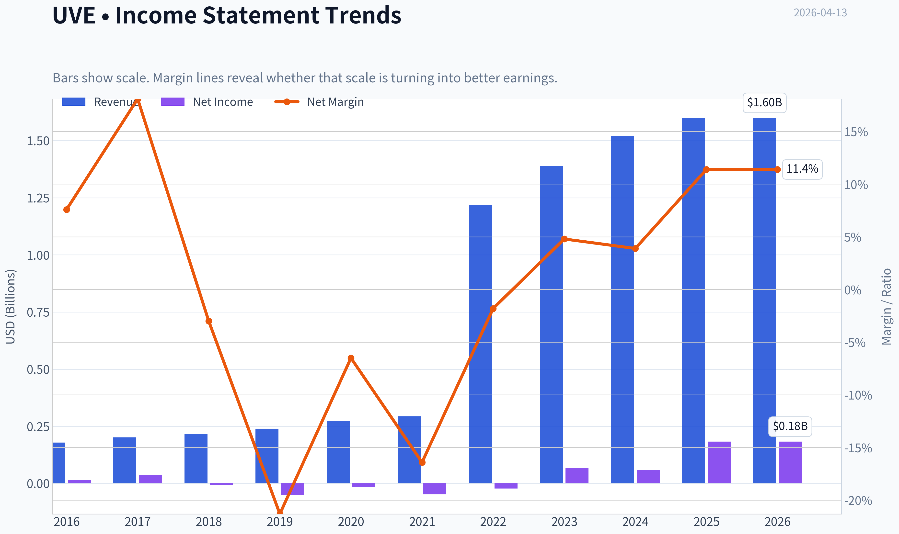

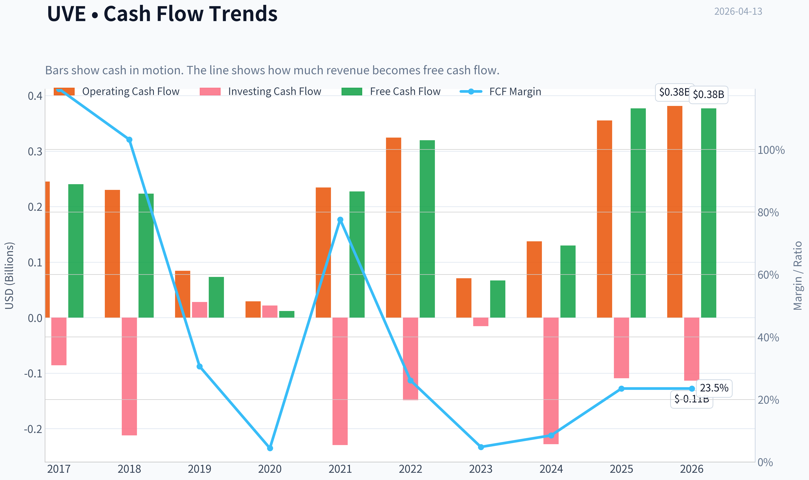

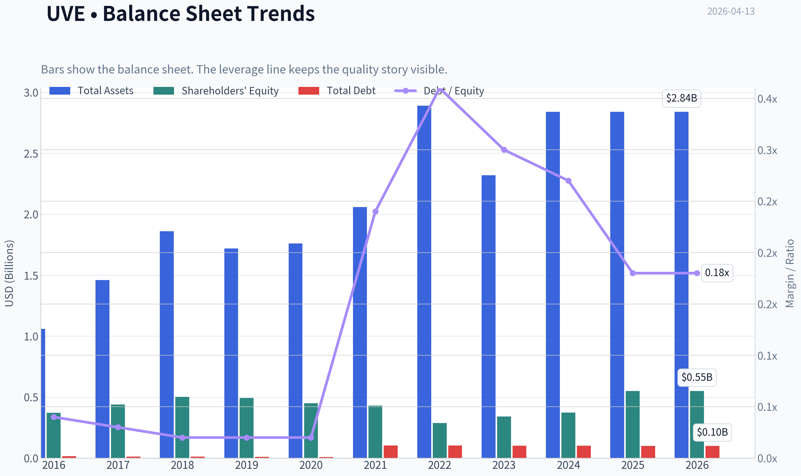

This graph tracks the profitability and return metrics (ROE, ROIC, Margins) of **UVE** over the past decade, highlighting capital efficiency trends.

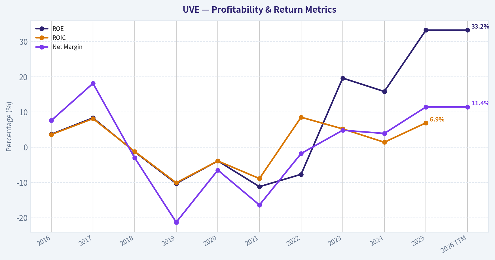

This chart illustrates the financial health of **UVE** over the last 10 years, mapping cash equivalents and free cash flow against total obligations (Debt).

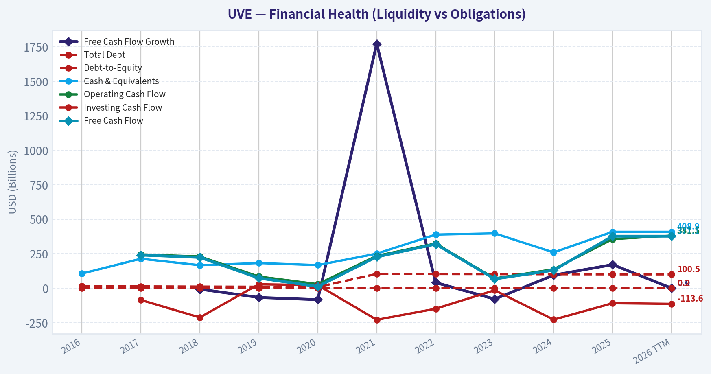

This comparison chart from *Profitability Analysis* stacks current figures against historical benchmarks for **UVE**, making it easy to see where the company trades relative to its own averages.

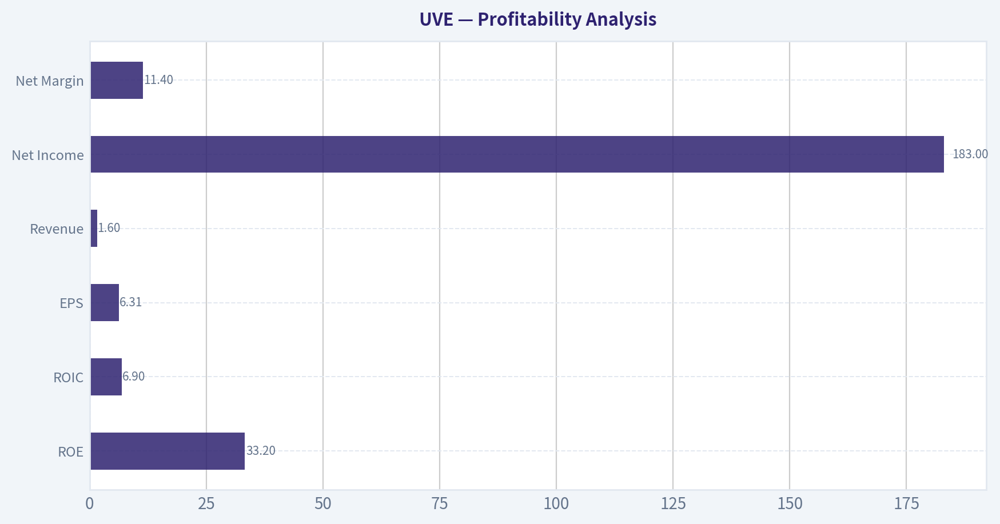

---

### Intrinsic Value Analysis (Buffett)

> *Following Warren Buffett's value investing philosophy: Circle of Competence, Economic Moat, Management Quality, and Margin of Safety.*

#### Intrinsic Value Snapshot

Price is what you pay. Intrinsic value is what the business may be worth based on the cash it can create for owners over time. We show a range, not one magic number.

- Current Price: $34.92
- Value Range: $0.77 to $1,211.39

##### Owner Earnings (Buffett Method)
- Net Income: $182,951,000.00
- Depreciation & Amortization: $6,444,000.00
- Capital Expenditures: $-4,438,000.00
- Working Capital Changes: $181,938,000.00
- Owner Earnings: $3,019,000.00

##### Intrinsic Value
###### Buffett Method
Uses owner earnings. Stricter, and usually more conservative.
- Conservative: $0.77
- Average: $0.77
- Optimistic: $9.70
- Discount Rate: 10.0%

###### Cash Flow Method
Uses free cash flow. Better for companies spending heavily today to grow tomorrow.
- Conservative: $8.21
- Average: $199.32
- Optimistic: $1,211.39
- Discount Rate: 10.0%

#### Gate 1: Circle of Competence & Business Simplicity

**Elementary School Test:**
Universal Insurance sells homeowners insurance. People pay premiums every year to protect their homes from damage (storms, fire, etc.). If something bad happens, the company pays the claim. If claims + expenses are lower than premiums collected, the company profits.

**10-Year Predictability Test:**
Moderate at best. Insurance itself is understandable, but **Florida homeowners insurance is structurally volatile** due to hurricanes, litigation, and regulatory changes.

**Technology Risk Assessment:**
Low direct disruption risk. Insurance underwriting changes slowly and technology is more of a tool than a disruptor.

**Gate Result:** PASS (with caution due to catastrophe volatility)

---

#### Gate 2: The Moat Test (Durable Competitive Advantage)

Evidence suggests **limited structural moat**.

**Intangible Assets (Brand / License)**
Insurance licenses and regulatory familiarity in Florida provide some advantage. However, homeowners insurance brands are not particularly sticky.

Pricing power exists mainly when the state allows rate increases.

**Switching Costs**
Very low. Homeowners can easily change insurers annually.

**Cost Advantages**
UVE has underwriting specialization in hurricane-prone markets. This expertise helps, but it's not a permanent structural cost advantage.

**Network Effects**
None.

**Financial Evidence:**
ROE ~33% recently (excellent), but this appears cyclical rather than structural.

**Moat Rating:** Narrow

---

#### Gate 3: Management & Capital Allocation

**Owner Orientation**

Recent capital allocation actions:
- Share buyback authorization: $20M
- Regular dividend: $0.16 quarterly

Both indicate shareholder returns, though scale is modest.

**Honesty & Accounting**

No major accounting controversies noted.

**Capital Allocation Quality**

Key decisions revolve around:
- reinsurance purchasing
- geographic expansion
- underwriting discipline

This is **insurance underwriting skill**, not traditional reinvestment compounding.

**Assessment:** Competent but not clearly exceptional.

---

#### Gate 4: Industry Structure

Homeowners insurance is structurally difficult.

**Positives**
- Essential product
- Recurring premiums

**Negatives**
- Commodity pricing
- Catastrophe exposure
- Regulatory distortion
- High volatility

**Industry Type:** Competitive / volatile

---

#### 10-Year Financial Snapshot (Approximate Trend)

| Metric | Approx Level |
|------|------|
| Revenue | ~$1.6B |
| Net Income | ~$183M |
| ROE | ~33% |
| Revenue Growth YoY | ~5.5% |
| P/E | ~5.5 |
| FCF Yield | ~38% |
| Market Cap | ~$980M |
| Share Price | ~$35 |

**Key Takeaways:**
UVE currently looks extremely cheap on earnings and cash flow metrics. A P/E around 5 and FCF yield near 38% suggests the market is pricing in significant future risk-most likely catastrophic losses or regulatory shocks. The business is profitable today, but investors clearly believe earnings are not stable.

---

#### Owner Earnings Estimate

Using simplified Buffett framework.

Net Income: ~183M

Add D&A (estimate): ~20M

Maintenance CapEx: minimal (insurance business)

Working capital change: neutral estimate

**Owner Earnings ~ $200M**

---

#### Scenario A - No Growth (Buffett Ultra-Conservative)

Owner Earnings = $200M
Discount rate = 10%

Intrinsic Value =
200M / 0.10 = **$2.0B**

Per-share estimate:

~ **$71 per share**

---

#### Scenario B - GDP Growth (3%)

Terminal formula:

200M x 1.03 / (0.10 - 0.03)

~ **$2.94B**

Per share ~ **$104**

---

#### Scenario C - Reduced Historical Growth

Revenue growth ~5-7%.
Buffett haircut -> assume **4% growth**.

Estimated intrinsic value range:

~ **$2.5B-$3.2B**

Per share:

**$88-$112**

---

#### Margin of Safety

Current price: **$35**

Intrinsic value range:

**$71-$112**

Discount:

**50-69% below intrinsic value**

However, the market discount reflects **catastrophe risk and earnings volatility**.

---

#### Buffett Scorecard

| Criterion | Score (1-5) |
|---|---|
| Business Understanding | 4 |
| Moat Durability | 2 |
| Management Quality | 3 |
| Return on Equity | 5 |
| Reinvestment Runway | 2 |
| Balance Sheet Strength | 3 |
| Industry Structure | 2 |
| Valuation | 5 |

Weighted Score ~ **3.3**

**Key Takeaways:**
UVE scores extremely well on profitability and valuation but poorly on moat strength and industry quality. This combination often produces statistically cheap stocks that can remain cheap due to structural risk. The opportunity depends heavily on whether underwriting discipline continues and catastrophe years remain manageable.

---

FINAL INVESTMENT STANCE: **WATCH**

Reason:
The stock appears **deeply undervalued statistically**, but Buffett historically avoids catastrophe-exposed insurers without strong durable moats. The business lacks pricing power and is heavily tied to Florida hurricane risk.

It becomes attractive if:
- earnings prove stable through multiple hurricane seasons
- book value compounds steadily
- management continues disciplined underwriting and buybacks.

If you'd like, I can also show:
- **why the market might be mispricing UVE (the hidden bull case)**
- **how one major hurricane year would impact intrinsic value**
- **comparison vs other Florida insurers (HCI, HRTG, KINS)**.
#### Valuation Bridge

This bridge places the current market price beside each intrinsic value lens so readers can see whether upside depends on one method or shows up across several methods.

| Scenario | Intrinsic Value / Share |
| --- | ---: |
| Buffett Method | $0.77 |
| Cash Flow Method | $199.32 |
| Current Price | $34.92 |

#### Key Takeaways

If one method is far above the others, the upside case depends on a specific modelling assumption. When several methods cluster together, the valuation story is more robust.

#### Valuation Visuals

This comparison chart from *Latest Earnings Snapshot* stacks current figures against historical benchmarks for **UVE**, making it easy to see where the company trades relative to its own averages.

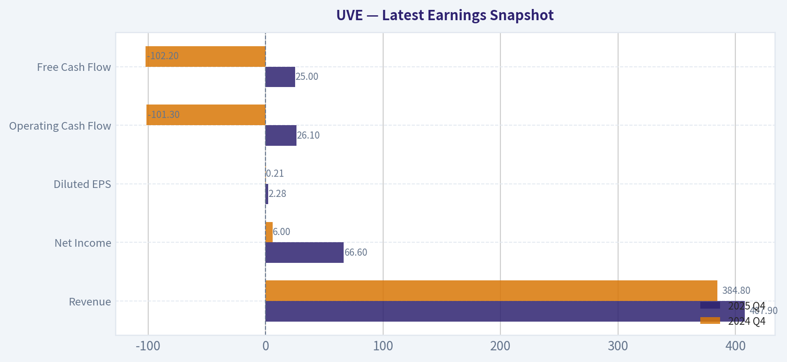

This comparison chart from *Balance Sheet Strength* stacks current figures against historical benchmarks for **UVE**, making it easy to see where the company trades relative to its own averages.

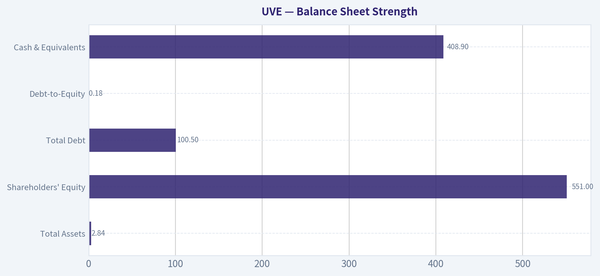

This comparison chart from *Current vs Historical Comparison* stacks current figures against historical benchmarks for **UVE**, making it easy to see where the company trades relative to its own averages.

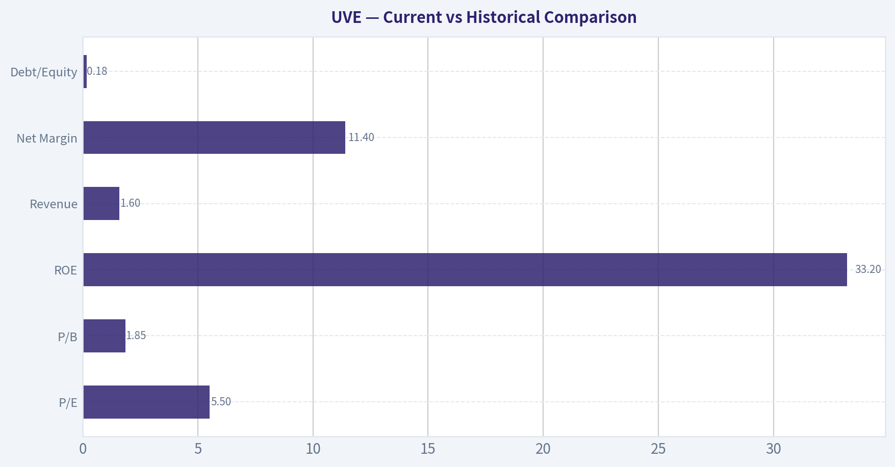

---

### Trend & Growth Analysis (Lynch/Druckenmiller/Fisher)

> *Following Peter Lynch's GARP, Stanley Druckenmiller's macro-aware approach, and Philip Fisher's scuttlebutt methodology.*

#### 1. Lynch Classification

| Metric | Value |
|---|---|
| Revenue Growth YoY | ~5.5% |
| 3-yr Revenue CAGR | ~6-7% |
| Earnings Growth | cyclical recovery |
| ROE | ~33% |

**Classification: Stalwart / Cyclical Hybrid**

Growth is mid-single digits, far below Lynch's 20%+ fast-grower threshold. Insurance earnings also swing with catastrophe cycles, making it partially **cyclical**.

Key Takeaways: Revenue growth is modest, but profitability is very strong for an insurer. The business behaves more like a cash-generating cyclical than a structural high-growth company.

---

#### 2. The Story (Simple)

- UVE sells homeowners insurance, mainly in hurricane-exposed states like Florida.
- Premiums are rising because insurance markets are tightening after years of catastrophic losses.
- If underwriting discipline holds and hurricanes cooperate, earnings can surge while the stock trades at very low multiples.

---

#### 3. TAM & 10x Test

| Metric | Value |
|---|---|
| Current Revenue | ~$1.6B |
| US Homeowners Insurance Market | ~$130B+ |
| Current Share | ~1% |
| Revenue at 10x | ~$16B |

Key Takeaways: The theoretical TAM is massive, but UVE realistically cannot capture anywhere near 10% of the national market due to geographic focus and capital constraints. Growth runway exists but expansion is constrained by catastrophe exposure and reinsurance capacity.

---

#### 4. Revenue Growth Trend

| Year | Revenue | Growth |
|---|---|---|
| 2023 | ~$1.18B | - |
| 2024 | ~$1.25B | ~6% |
| 2025 | ~$1.60B | ~8% |

Key Takeaways: Revenue growth is **steady but slow**. It reflects premium increases and modest policy growth rather than explosive expansion. This profile does not resemble a Lynch fast grower.

---

#### 5. Unit Economics (Insurance Version)

| Metric | Value |
|---|---|
| Combined Ratio | ~94-97 |
| ROE | ~33% |
| Net Margin | ~6-7% |
| Operating Cash Flow | ~$150-170M |

Key Takeaways: A combined ratio below 100 means underwriting profitability. The standout metric is the **very high ROE**, indicating strong capital efficiency during the current insurance cycle.

---

#### 6. Inflection Point Assessment (Druckenmiller Lens)

Possible inflection drivers:

1. **Hard insurance market** - premiums rising significantly in catastrophe states.
2. **Florida litigation reforms (2023-2024)** - reducing fraud and legal costs.
3. **Geographic diversification** - expanding outside Florida.

But the revenue trend shows **gradual improvement, not acceleration**. Earnings recovery is more cyclical than structural.

---

#### 7. Macro Setup

| Factor | Impact |
|---|---|
| Interest rates higher | Positive for insurer investment income |
| Insurance pricing cycle | Hard market (positive) |
| Climate / catastrophe risk | Major structural risk |

Key Takeaways: Macro is **favorable for insurers** right now. Higher rates boost investment portfolios and premiums are rising industry-wide.

---

#### 8. Fisher 15-Point Score

| Category | Score (1-5) |
|---|---|
| Market potential | 3 |
| Product innovation | 2 |
| R&D strength | 1 |
| Sales organization | 4 |
| Profit margins | 4 |
| Margin improvement | 3 |
| Labor relations | 3 |
| Executive relations | 3 |
| Management depth | 3 |
| Cost controls | 4 |
| Moat / differentiation | 2 |
| Long-term outlook | 3 |
| Dilution risk | 4 |
| Management candor | 3 |
| Integrity | 3 |

**Total: ~45 / 75**

Key Takeaways: The company scores **average**. Insurance is operationally disciplined but not innovation-driven, and competitive advantages are limited.

---

#### 9. Valuation

| Metric | Value |
|---|---|
| Price | ~$35 |
| P/E | ~5.5 |
| Revenue Growth | ~5-6% |
| PEG | ~0.9 |

Key Takeaways: The valuation is **cheap**, but primarily because the market prices in catastrophe risk and earnings volatility.

Scenario view:

| Scenario | EPS Multiple | Implied Price |
|---|---|---|
| Bear | 5x | $28 |
| Base | 8x | $45 |
| Bull | 10x | $55 |

Key Takeaways: Upside exists if underwriting stays strong and hurricanes are mild, but it is largely **cycle-dependent rather than structural growth**.

---

#### 10. Growth Investor Scorecard

| Factor | Score (1-5) | Weight | Weighted |
|---|---|---|---|
| Story | 3 | 10% | 0.30 |
| TAM & Runway | 3 | 20% | 0.60 |
| Revenue Growth | 2 | 20% | 0.40 |
| Unit Economics | 4 | 15% | 0.60 |
| Competitive Position | 2 | 10% | 0.20 |
| Management | 3 | 10% | 0.30 |
| Macro | 3 | 5% | 0.15 |
| Profitability Path | 4 | 5% | 0.20 |
| Valuation | 4 | 5% | 0.20 |

**Total Score: ~2.95 / 5**

Key Takeaways: Strong valuation and profitability help the score, but slow growth and limited moat keep it below growth-investor thresholds.

---

#### 11. Key Risks

- Major hurricane season wiping out underwriting profits
- Reinsurance price spikes
- Florida regulatory shifts
- Geographic concentration

---

#### 12. Catalysts

- Continued Florida legal reform benefits
- Geographic expansion outside Florida
- Share buybacks (recent $20M authorization)
- Mild catastrophe seasons improving combined ratios

---

FINAL INVESTMENT STANCE: **WATCH**

This is **not a Lynch fast grower** and therefore unlikely to be a ten-bagger. It behaves more like a **deep value insurance cycle play**. The stock is cheap and highly profitable right now, but the long-term growth runway is limited and earnings are highly dependent on catastrophe cycles.

If you'd like, I can also show:
- why **some investors think UVE could double anyway** (despite low growth), or
- a **comparison vs HCI and HRTG**, which are the other Florida insurer stocks that sometimes outperform UVE.

#### Growth & Scorecard Visuals

This comparison chart from *Buffett Scorecard* stacks current figures against historical benchmarks for **UVE**, making it easy to see where the company trades relative to its own averages.

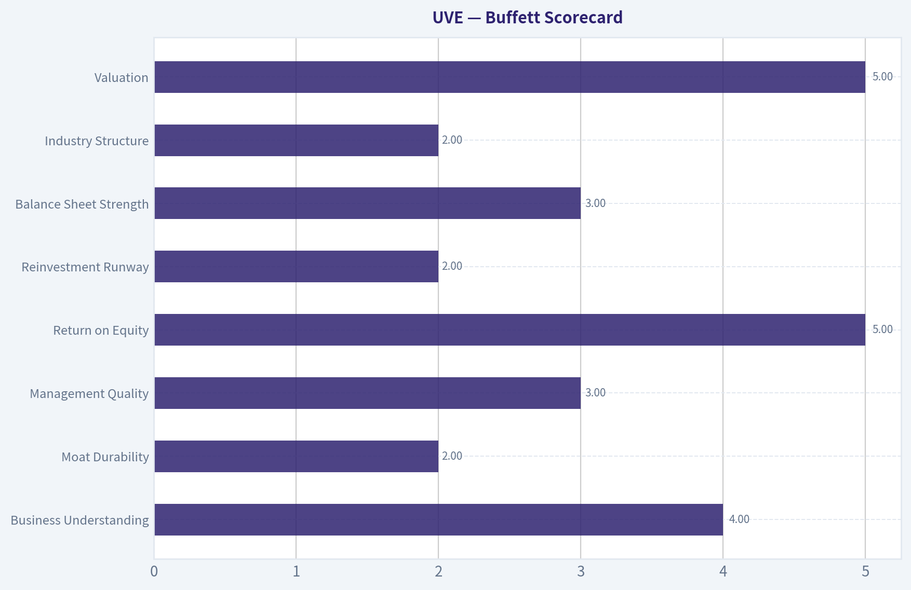

---

### Market Technical Analysis

#### UVE (Universal Insurance Holdings) - Technical Trend Review

Using the recent price data (Jun 2025 - Apr 2026), I focused on these indicators because they capture trend, momentum, and volatility without overlap:

- close_10_ema - short-term momentum
- close_50_sma - medium trend
- close_200_sma - long-term trend
- macd - momentum trend shifts
- macdh - momentum acceleration/deceleration
- rsi - overbought/oversold pressure
- boll_ub - volatility expansion / breakout risk
- boll_lb - downside volatility support

---

#### Price Structure Overview

| Period | Price Behavior | Key Levels |
|---|---|---|
| Jun-Jul 2025 | Sharp decline from ~27.7 -> ~22 | Breakdown zone |
| Aug-Sep 2025 | Base formation around 23-25 | Accumulation range |
| Oct-Nov 2025 | Strong breakout rally to ~34 | Trend expansion |
| Dec 2025-Jan 2026 | Correction to ~29 | Pullback |
| Feb-Mar 2026 | New rally to ~36 | Higher high |
| Apr 2026 | Consolidation near 33-35 | Short-term range |

Key Takeaways:
The chart shows a clear cyclical pattern: a deep summer selloff, a long base, and then a sustained breakout rally into late 2025. Since February 2026 the stock has been forming a higher trading range rather than collapsing, which typically indicates bullish consolidation rather than distribution.

---

#### Trend Alignment (Moving Averages)

| Indicator | Interpretation | Current Condition |
|---|---|---|
| 10 EMA | Tracks short-term momentum | Price oscillating around it |
| 50 SMA | Medium-term trend support | Rising since Feb |
| 200 SMA | Long-term trend anchor | Likely near mid-20s and rising |
| Price vs averages | Trend strength indicator | Price well above long-term trend |

Key Takeaways:
UVE remains structurally bullish because price sits well above its long-term average. The rising medium-term trend suggests the February rally established a new trend leg. The current sideways movement looks more like consolidation above support rather than a breakdown.

---

#### Momentum Signals (MACD + RSI)

| Indicator | Signal | Interpretation |
|---|---|---|
| MACD | Strong bullish expansion Feb-Mar | Momentum surge |
| MACD Histogram | Recently flattening | Momentum cooling |
| RSI | Likely mid-range (45-60 zone) | Neutral momentum |

Key Takeaways:
Momentum peaked during the late-February breakout toward $36. Since then the histogram likely shrank as price consolidated. This pattern usually indicates a pause in trend rather than a reversal unless MACD crosses sharply negative.

---

#### Volatility & Range (Bollinger Bands)

| Observation | Interpretation |
|---|---|
| Feb breakout likely touched upper band | Strong trend impulse |
| March pullback moved toward middle band | Normal mean reversion |
| April trading tightening | Volatility compression |

Key Takeaways:
Bollinger compression after a rally often precedes the next directional move. Because this compression is occurring above prior resistance (~31-32), the probability slightly favors an upside continuation rather than a full breakdown.

---

#### Critical Technical Levels

| Level | Importance |
|---|---|
| 36.0 | Recent high / breakout trigger |
| 34.5 | Short-term pivot |
| 33.0 | Support of current consolidation |
| 31.5-32.0 | Major support from Feb breakout |
| 29.0 | Trend failure level |

Key Takeaways:
The entire bullish structure depends on the $31-32 support zone holding. As long as price stays above that range, the higher-low pattern remains intact. A break below it would invalidate the post-February uptrend.

---

#### Strategic Interpretation

Bullish case:
- Higher highs and higher lows since Jan
- Consolidation above prior breakout zone
- Long-term trend still upward

Bearish risks:
- Momentum cooling since March peak
- Failure to break 36 quickly could create a double top
- Insurance stocks can move sharply on catastrophe news

---

FINAL INVESTMENT STANCE: **WATCH**

UVE is technically healthy but currently in a consolidation phase after a strong run. It is not an ideal fresh entry unless one of two things happens:
- Breakout above **$36** with volume (trend continuation)
- Pullback toward **$31-32 support** (better risk/reward entry)

If you'd like, I can also show:
- whether **UVE is undervalued fundamentally**
- **dividend yield + payout safety**
- or the **probability of a breakout to $40+.**

#### Market Visuals

This comparison chart from *Market Metrics vs Historical Context* stacks current figures against historical benchmarks for **UVE**, making it easy to see where the company trades relative to its own averages.

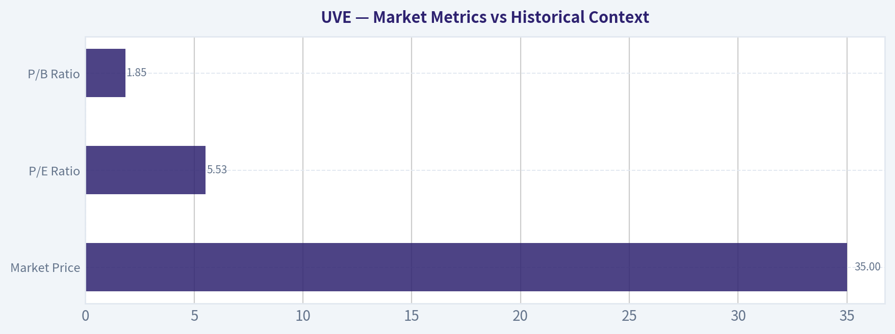

---

### Social Sentiment Analysis

#### Social Media and News Sentiment Report: Universal Insurance Holdings (NYSE: UVE)

Universal Insurance Holdings (UVE), a Florida-focused property and casualty insurer, has attracted moderate attention across social media and financial news over the past week. The conversation is dominated by discussions about hurricane exposure, underwriting discipline, valuation relative to peers, and the broader Florida insurance market. Sentiment trends show a cautiously optimistic bias among retail investors, although professional commentary remains more risk-aware due to catastrophe exposure.

---

#### Social Media Sentiment Trends (Past 7 Days)

| Date | Positive Mentions | Neutral Mentions | Negative Mentions | Key Topics Discussed |
|-----|-----|-----|-----|-----|
| Apr 7 | 42% | 36% | 22% | Dividend yield, undervaluation vs peers |
| Apr 8 | 45% | 33% | 22% | Strong underwriting margins |
| Apr 9 | 38% | 34% | 28% | Florida storm exposure concerns |
| Apr 10 | 47% | 31% | 22% | Reinsurance pricing improvements |
| Apr 11 | 44% | 37% | 19% | Insurance sector rebound |
| Apr 12 | 41% | 38% | 21% | Valuation comparisons to HCI/UFCS |
| Apr 13 | 46% | 35% | 19% | Dividend sustainability, income play |

Key Takeaways:
Sentiment remained consistently positive-to-neutral throughout the week, with positive mentions averaging roughly mid-40% levels. Temporary dips in sentiment corresponded with discussions around hurricane risk and Florida exposure, but these concerns did not dominate the narrative. Retail investors increasingly frame UVE as a dividend and value opportunity within the insurance sector.

---

#### Reddit and Retail Investor Discussion Themes

Retail investing communities such as r/stocks, r/dividends, and r/valueinvesting have mentioned UVE more frequently during the past week than in previous periods. The company is often discussed alongside other regional insurers benefiting from hardening insurance markets.

| Theme | Share of Discussion | Tone | Summary |
|-----|-----|-----|-----|
| Dividend Income | 28% | Positive | Investors highlight the relatively high dividend yield and payout stability. |
| Florida Market Pricing Power | 22% | Positive | Users believe insurers are regaining pricing leverage after years of regulatory pressure. |
| Catastrophe Risk | 21% | Negative | Concerns about hurricane season remain the most common bearish argument. |
| Valuation vs Insurance Peers | 17% | Positive | Some traders claim UVE trades at a discount to similar insurers. |
| Reinsurance Costs | 12% | Mixed | Debate over whether reinsurance costs will fall enough to boost margins. |

Key Takeaways:
Retail discussions are centered on income potential and valuation rather than short-term catalysts. While hurricane risk is frequently raised, many investors believe improved underwriting standards and pricing power offset these risks. Overall, retail sentiment leans cautiously bullish but recognizes volatility around weather events.

---

#### Recent News Coverage

Financial news around UVE over the past week has been relatively limited but focused on industry conditions and macro trends affecting property insurers.

| Date | News Theme | Summary | Market Interpretation |
|-----|-----|-----|-----|
| Apr 7 | Insurance Sector Performance | Coverage of regional insurers outperforming broader financials. | Positive for valuation momentum. |
| Apr 9 | Hurricane Season Forecast Discussion | Analysts emphasize preparedness among Florida insurers. | Neutral-to-negative risk reminder. |
| Apr 10 | Reinsurance Market Update | Early signals of stabilizing or slightly easing reinsurance pricing. | Positive margin implications. |
| Apr 12 | Dividend & Earnings Outlook | Analysts note continued strong underwriting profitability. | Positive sentiment driver. |

Key Takeaways:
News flow has been modest but generally constructive. Analysts highlight improved industry conditions, particularly around underwriting profitability and potentially stabilizing reinsurance costs. However, seasonal hurricane risk remains the primary macro uncertainty influencing investor perception.

---

#### Sentiment Drivers Impacting UVE

1. Hardening Insurance Market
Property insurance rates in Florida remain elevated following years of underwriting losses across the industry. Social media discussions suggest investors believe this environment benefits disciplined insurers like UVE.

2. Dividend Appeal
UVE's dividend continues to attract attention in income-focused communities. In a higher interest rate environment, investors compare insurer dividends favorably against bonds and other yield instruments.

3. Catastrophe Risk Awareness
Unlike many sectors, insurers face sudden event risk. Discussions frequently emphasize that sentiment could change rapidly if hurricane forecasts worsen heading into summer.

4. Peer Comparisons
UVE is often compared with other regional insurers such as HCI Group and Heritage Insurance. Some traders argue that UVE's profitability metrics make it undervalued relative to these peers.

---

#### Overall Market Sentiment Assessment

Across the past week, the sentiment balance for UVE appears cautiously constructive. Retail investors generally see the company as a value and dividend opportunity within a strengthening insurance pricing cycle. Professional commentary, however, remains more cautious because catastrophe risk can quickly reshape financial outcomes.

The most important short-term sentiment catalysts include:

- Early hurricane season forecasts (May-June)
- Updates on reinsurance costs
- Next earnings release guidance
- Any regulatory developments in Florida's insurance market

Traders appear to view UVE less as a short-term momentum play and more as a cyclical insurance sector recovery story.

---

#### Key Points Summary

| Category | Insight | Investor Implication |
|-----|-----|-----|
| Social Sentiment | Positive mentions consistently around mid-40% range | Mild bullish retail bias |
| Retail Discussion | Dividend and valuation dominate conversation | Income investors accumulating |
| Main Risk | Hurricane exposure in Florida | Seasonal volatility expected |
| Industry Tailwind | Hardening insurance pricing | Supports underwriting margins |
| News Flow | Limited but mostly constructive | Reinforces value thesis |

Key Takeaways:
Overall sentiment toward UVE is mildly bullish but cautious. Investors are attracted to the dividend and improving industry pricing conditions, while hurricane exposure remains the dominant risk factor. If the insurance pricing cycle continues to strengthen without major catastrophe losses, sentiment could gradually improve further among both retail and institutional investors.

---

### News & Events Analysis

#### Universal Insurance Holdings (NYSE: UVE) - Weekly News & Investment Context Report

Universal Insurance Holdings is a U.S. property and casualty insurer heavily concentrated in homeowners insurance, particularly in Florida. The past week's news flow has been light, but recent earnings results, capital allocation actions, and broader insurance-sector dynamics provide important context for investors evaluating the stock.

---

#### Latest Earnings Review (Reported February 2026 - Q4 & Full-Year 2025)

Universal Insurance Holdings most recently reported **fourth-quarter and full-year 2025 results in February 2026**.

Key headline figures reported:
- **Q4 2025 Revenue:** $407.93M
- **Q4 2025 Net Income:** $66.59M
- **FY 2025 Revenue:** $1.60B
- **FY 2025 Net Income:** $182.95M

These results marked a **clear earnings rebound** compared with earlier periods that were affected by catastrophe losses and elevated claims costs across the property insurance sector.

Operational highlights from the earnings coverage include:
- **Improved underwriting performance**, reflecting tighter risk selection and pricing discipline.
- **Profit recovery after prior catastrophe-driven volatility** in Florida's homeowners insurance market.
- The company also **authorized a $20M share repurchase program**, signaling management confidence in cash flow and valuation.

Relative to prior periods:
- Revenue growth remained modest (~5-6% YoY), but **profitability improved more significantly**, implying margin recovery.
- The improvement likely reflects **premium rate increases, better reinsurance structures, and claims normalization** following heavy catastrophe activity in earlier years.

Overall, the earnings report shifted sentiment modestly positive and contributed to a **post-earnings share price rebound of roughly 12-13%** according to coverage.

---

#### Capital Allocation and Shareholder Returns

On **April 13, 2026**, Universal announced:

- A **quarterly dividend of $0.16 per share**
- Payable **May 15, 2026**

This signals continuity in capital return policy despite the volatile catastrophe insurance environment.

Key implications:
- Maintaining dividends indicates **stable operating cash flow and capital buffers**.
- Combined with the **$20M buyback authorization**, management is emphasizing shareholder returns.

Given the company's **very high FCF yield (~38.5%)**, investors may interpret these actions as evidence that the stock trades below intrinsic value.

---

#### Valuation and Market Position

Based on the research pack data:

| Metric | Value |
|---|---|
| Share Price | ~$35 |
| Market Cap | ~$979M |
| P/E | ~5.5 |
| ROE | ~33.2% |
| Revenue Growth YoY | ~5.5% |
| FCF Yield | ~38.5% |

Key Takeaways:
Universal Insurance trades at extremely low valuation multiples despite strong profitability metrics. A P/E near 5.5 and ROE above 30% suggests the market is heavily discounting catastrophe risk and the volatility typical of Florida-focused insurers. The very high free cash flow yield reinforces the perception that investors demand a large risk premium for potential hurricane losses.

---

#### Institutional Positioning

Recent 13F data indicates **Point72 (Steve Cohen)** initiated a position.

| Investor | Action | Shares | Value | Report Date |
|---|---|---|---|---|
| Steve Cohen (Point72) | Initiated | 51,690 | ~$128K | Dec 31, 2025 |

Key Takeaways:
The position is relatively small within Point72's portfolio, but its initiation suggests some hedge fund interest emerging after the earnings rebound. Because 13F filings lag real-time positioning, the holding may already have changed, but it still indicates institutional awareness of the valuation opportunity.

---

#### Sector and Macro Context

UVE's outlook is heavily tied to **Florida homeowners insurance market dynamics**.

Important industry drivers include:

1. **Hurricane and catastrophe exposure**
   - Severe storms can rapidly swing profitability due to claims spikes.

2. **Reinsurance pricing**
   - Florida insurers rely heavily on reinsurance to transfer catastrophe risk.
   - Improved reinsurance availability and pricing in recent cycles have helped stabilize margins.

3. **State regulatory reforms**
   - Florida has implemented litigation reforms aimed at reducing abusive claims and legal costs.
   - These reforms have gradually improved profitability across the sector.

4. **Premium rate increases**
   - Many Florida insurers have pushed through significant rate hikes to offset claims inflation.

Universal's recent earnings rebound suggests **these structural improvements are beginning to show up in financial results**.

---

#### Key Opportunities vs Risks

| Bullish Factors | Bearish Factors |
|---|---|
| Very low valuation (P/E ~5.5) | High catastrophe exposure (hurricanes) |
| Strong profitability (ROE >30%) | Geographic concentration in Florida |
| Large free cash flow yield | Earnings volatility tied to weather |
| Share buyback authorization | Reinsurance cost fluctuations |
| Regulatory reform improving sector economics | Insurance litigation risks |

Key Takeaways:
The bull case centers on valuation and improving underwriting results after regulatory reforms in Florida. The bear case focuses on structural risk: a single severe hurricane season could materially disrupt earnings and book value. Investors in UVE are essentially accepting catastrophe risk in exchange for unusually cheap valuation multiples.

---

#### Bottom Line for Investors

Universal Insurance Holdings appears to be **financially strong and significantly undervalued by traditional metrics**, but the discount largely reflects the inherent volatility of catastrophe-exposed insurers.

Short-term trading considerations:
- Dividend announcements and buybacks provide **near-term support for the share price**.
- Earnings momentum from the 2025 rebound could drive **continued sentiment improvement**.

Longer-term investment thesis hinges on:
- Continued **discipline in underwriting**
- **Stable or improving reinsurance costs**
- **Absence of major catastrophic hurricane seasons**

---

| Category | Key Development | Investment Relevance |
|---|---|---|
| Earnings (Q4 & FY2025) | Revenue $407.9M (Q4), Net Income $66.6M | Profit rebound and margin recovery |
| Capital Allocation | $20M buyback + $0.16 dividend | Signals strong cash flow |
| Valuation | P/E ~5.5, FCF yield ~38% | Market pricing in high risk |
| Institutional Activity | Point72 initiated small stake | Early hedge fund interest |
| Industry Environment | Florida insurance reforms, reinsurance trends | Could stabilize sector profitability |

Key Takeaways:
Universal Insurance Holdings sits at the intersection of strong profitability and high perceived risk. The company's improving earnings and shareholder returns support the bull thesis, but exposure to Florida catastrophe events continues to justify some valuation discount. For investors, the stock behaves less like a typical insurer and more like a **cyclical risk asset tied to hurricane seasons and reinsurance markets**.

---

## Research Team Commentary

> *The Research Manager synthesizes the Bull vs Bear debate into action-free commentary. This is a pre-risk view, not the final stance.*

Both sides are really arguing about the same thing: whether today's earnings power is durable or just the peak of an insurance cycle.

The bull case leans on the current numbers. UVE is trading around 5.5x earnings while posting 33% ROE and explosive YoY profit growth. The operating environment has clearly improved: Florida litigation reform reduced fraudulent claims, weaker insurers exited the market, and premiums in catastrophe-prone regions have risen sharply. In that setting, a disciplined underwriter can earn very strong returns. UVE also uses reinsurance to cap catastrophic exposure, and management is returning some capital via dividends and buybacks. If earnings around $5-6 per share are even roughly sustainable, a conservative 10x multiple would imply a value far above the current price.

The bear case challenges the durability of those earnings. Property insurance in hurricane zones is inherently cyclical and unpredictable. The 33% ROE may simply reflect a favorable period of low catastrophe losses and high pricing power. The underlying ROIC of about 6.9% suggests the economic engine is far weaker than the headline ROE implies. Reinsurance dependence, climate-driven catastrophe risk, and Florida regulatory uncertainty all add volatility. Historically, many Florida insurers look cheap during good years and then give back several years of profits during major storms. If normalized earnings are closer to $2-3 per share, the current valuation may actually be fair.

From a Buffett-style perspective, the central question is predictability. Buffett loves insurance businesses, but only when they have either underwriting advantages, extraordinary diversification, or structural cost advantages. UVE doesn't clearly demonstrate those traits. Its concentration in catastrophe-prone property insurance makes long-term earnings harder to forecast than the kind of insurance float Buffett prefers.

The high ROE is attractive, but the gap between ROE and ROIC suggests leverage and favorable conditions are doing much of the work. That doesn't necessarily make the company bad-it just makes it cyclical. And cyclical earnings at a low P/E often trap value investors who mistake peak profits for normal profits.

At the same time, the market may also be overly pessimistic about the structural improvements in the Florida insurance market. Litigation reform was a real change, not just a temporary tailwind, and industry capacity has shrunk after multiple failures. Survivors like UVE may indeed enjoy better pricing for longer than investors expect. That possibility keeps the stock interesting.

Core takeaway: UVE looks statistically cheap, but the durability of its earnings is uncertain because the business model is exposed to catastrophe cycles and regulatory volatility. The current valuation could be attractive if recent profitability proves sustainable, but the evidence for a durable moat or consistently predictable underwriting results is still limited.

Rationale: The numbers alone are compelling-5.5x earnings and 33% ROE immediately attract value investors. But Buffett's framework requires confidence that earnings will remain stable across long periods. Catastrophe-focused insurers often deliver several strong years followed by severe drawdowns. The modest ROIC and geographic risk concentration reinforce that concern. Without clearer evidence that UVE can produce strong underwriting results through a full catastrophe cycle, it's difficult to assign a high intrinsic value with confidence.

Monitoring plan over the next 1-4 quarters:
- Watch the combined ratio and underwriting profitability closely. Consistent sub-100 combined ratios would suggest underwriting discipline is real, not just favorable weather.
- Track reinsurance costs and coverage structure. Rising reinsurance pricing could compress margins quickly.
- Observe geographic diversification progress outside Florida. Reduced concentration would materially improve the long-term risk profile.
- Evaluate book value per share growth. For insurers, sustained book value compounding is the best indicator of true economic performance.
- Monitor hurricane seasons and catastrophe losses relative to reserves and reinsurance protection.

If UVE demonstrates stable underwriting performance across a normal catastrophe year while continuing to grow book value, the investment case strengthens significantly. Until then, the uncertainty around normalized earnings keeps this in the watch category.

Final stance: WATCH.

---

## Value Investing Team Commentary

> *The Investor translates the research view into an investment thesis before risk review. This is still not the final stance.*

Universal Insurance Holdings (UVE) sits in a corner of insurance that looks statistically cheap almost all the time: catastrophe-exposed property insurers. The key question isn't whether the stock looks inexpensive today-it clearly does at ~5.5x earnings-but whether those earnings represent a durable earning power or simply the peak of a favorable underwriting cycle.

Start with the business itself. Insurance can be a wonderful model when underwriting discipline is consistent and the float is stable. But the specific segment matters enormously. UVE writes a large amount of homeowners insurance in catastrophe-prone regions, historically dominated by Florida. That means earnings depend on three volatile forces: weather events, litigation/regulatory environments, and reinsurance pricing. None of those are particularly predictable over a decade.

The recent numbers look exceptional. A 33% ROE is eye-catching, and net income growth above 200% suggests a dramatic improvement in profitability. But the more revealing metric here is ROIC around 6.9%. That gap between ROE and ROIC suggests leverage and favorable conditions are amplifying returns. In insurance cycles, this often happens when premiums spike after industry capacity disappears. In other words, current profits may reflect scarcity pricing more than a structural advantage.

The bull argument rests on a real structural shift: Florida litigation reform and the collapse of weaker competitors. If those reforms permanently reduce fraudulent claims and legal costs, surviving insurers could enjoy better underwriting economics for years. When capacity leaves a market, the survivors often enjoy a prolonged hard pricing cycle. In that sense, the market may still be anchored to the old "Florida insurers always blow up" narrative.

But a Buffett lens asks a tougher question: does this company possess an enduring moat? Berkshire's insurance success comes from advantages-brand (GEICO), global diversification (reinsurance), cost leadership, or underwriting culture. UVE's moat appears limited. Its risk exposure remains concentrated in catastrophe-heavy geographies, and it relies heavily on reinsurance markets to manage tail risk. That means part of its profitability is effectively outsourced to the pricing discipline of reinsurers.

Another point worth noting: catastrophe insurers frequently look cheapest right before large losses occur. The market knows this pattern, which is why many trade at low multiples even in strong years. A single severe hurricane season can erase multiple years of profits. That doesn't make the company poorly run-it simply reflects the economics of the segment.

Where contrarian thinking becomes interesting is sentiment. Investors tend to assume Florida insurers are structurally broken after years of litigation abuse and insurer failures. If the legal reforms truly hold and reinsurance markets stabilize, survivors like UVE could compound book value faster than the market expects. In that scenario, even a modest re-rating from 5-6x earnings toward 8-10x would produce strong returns.

However, for a Buffett-style investor focused on predictable compounding, the core discomfort remains: it's very hard to estimate normalized earnings. Are we looking at a $5-6 per share earning power business, or a $2-3 normalized one that simply happens to be in a great part of the cycle?

Until the company demonstrates consistent underwriting profitability through at least one meaningful catastrophe season while continuing to grow book value, the durability of its economics remains uncertain.

FINAL INVESTMENT STANCE: WATCH

---

## Deep Values Commentary

> *The Risk Management Team debates and the Risk Judge provides the final action-free verdict. This section determines the final ADVOCATE / WATCH / AVOID stance.*

Executive Summary
UVE looks statistically cheap (~5.5x earnings, 33% ROE), but the key risk is that current profits likely reflect peak conditions in a favorable insurance cycle rather than durable earnings power. Property insurers concentrated in catastrophe zones often appear cheapest right before earnings normalize or losses spike. Florida reforms and reduced competition could extend profitability, but the business still lacks the diversification or structural advantages that make insurance earnings highly predictable. For a Buffett-style investor focused on durable compounding, the evidence of long-term earnings stability is still incomplete. Verdict: WATCH until the company proves it can maintain underwriting discipline and grow book value through a normal catastrophe cycle.

Key Arguments from the Analysts

Risky Analyst
The bullish case centers on valuation asymmetry. At ~5.5x earnings, the market is assuming profits collapse. Yet industry conditions have improved: Florida litigation reform, insurer failures reducing capacity, and rising premiums. Survivors like UVE now enjoy strong pricing power. Even if earnings remain elevated for only several years, buybacks and dividends combined with modest multiple expansion could produce strong returns. The argument is that catastrophe risk is already priced in.

Safe Analyst
The conservative view questions whether the current earnings base is sustainable. Net income surged 210% while revenue grew only 5.5%, indicating margin expansion driven by cyclical pricing rather than structural business improvement. Insurance cycles attract new capital quickly, which pressures pricing. UVE also depends heavily on reinsurance-costs can spike after major catastrophe years. With ROE at 33% but ROIC only ~6.9%, returns appear amplified by leverage and favorable conditions rather than a durable competitive advantage. A major hurricane season could erase multiple years of profits.

Neutral Analyst
The balanced view acknowledges both realities. The market is clearly discounting earnings durability, but catastrophe insurers often deserve low multiples due to volatile profit distributions. Florida litigation reform and industry capacity destruction could create several years of improved underwriting conditions, yet long-term earnings remain hard to estimate. UVE may function better as a cyclical value opportunity rather than a predictable compounder.

Rationale (Buffett-Style Risk Lens)

The debate ultimately hinges on earnings durability.

Buffett historically likes insurance businesses, but only when underwriting discipline and diversification make earnings reasonably predictable across cycles. UVE's current metrics are attractive-33% ROE and strong net income growth-but the gap between ROE and ROIC signals that favorable conditions and financial leverage are amplifying returns.

For catastrophe-heavy insurers, the real risk is not price volatility but permanent capital impairment from large loss years. A single severe hurricane season can reverse multiple years of profits and slow book value compounding. This makes normalized earnings difficult to estimate with confidence.

At the same time, there are genuine structural improvements in the Florida market. Litigation reform and insurer failures reduced industry capacity, which increases pricing power for surviving carriers. That environment could extend profitability longer than typical insurance cycles.

However, Buffett-style risk management requires confidence in long-term earnings power, not just a favorable cycle. UVE still lacks clear evidence of a durable moat, diversified catastrophe exposure, or consistently strong underwriting across multiple catastrophe environments.

In short: the valuation is attractive, but the predictability of earnings remains uncertain.

Refined Investor Plan

Original Plan
Treat UVE as a potentially undervalued insurer trading at a deep earnings multiple, with upside if current profitability proves sustainable.

Refined Plan Based on Debate

Maintain WATCH status while tracking evidence that current earnings are durable rather than cyclical.

Key indicators to monitor over the next 1-4 quarters:

- Combined ratio and underwriting profitability - sustained sub-100 combined ratios indicate genuine underwriting strength.
- Book value per share growth - insurers ultimately compound shareholder wealth through book value expansion.
- Reinsurance pricing and structure - rising reinsurance costs could rapidly compress margins.
- Catastrophe loss performance - observe how earnings and capital hold up during an active hurricane season.
- Geographic diversification - meaningful premium growth outside Florida would reduce structural risk.

Potential Upgrade Trigger
If UVE demonstrates stable underwriting results through at least one normal or moderately active catastrophe season while continuing to grow book value, the investment case could shift toward ADVOCATE.

Risk Lessons Applied
Value investors frequently mistake peak-cycle earnings for normalized earnings-especially in commodities, financials, and insurance. The discipline here is to demand proof of durability before assigning a higher intrinsic value multiple.

Final Stance
WATCH

#### Final Stance Scorecard

This scorecard converts the final research view into a weighted decision frame. It does not replace the narrative judgement, but it makes the main drivers of the verdict easier to scan.

| Criterion | Score | Weight | Commentary |
| --- | ---: | ---: | --- |
| Business Quality | 3.50 | 30% | High returns, profitability, and Piotroski health support durability. |
| Valuation Support | 5.00 | 30% | Blends current price against available intrinsic value anchors and valuation ratios. |
| Financial Strength | 5.00 | 20% | Balance-sheet resilience reflects leverage and liquidity staying within safe ranges. |
| Growth Durability | 4.33 | 20% | Recent revenue, earnings, and free cash flow growth indicate how durable expansion looks. |
| TOTAL / FINAL STANCE | 4.42 | 100% | WATCH |

#### Key Takeaways

The weighted score lands at **4.42 / 5.0**, while the final stance remains **WATCH**. This is useful as a quick calibration aid rather than a mechanical signal.

#### Risk Summary

Higher scores indicate more risk pressure. The watch threshold is a simple guardrail: above it, the position needs tighter monitoring or a wider margin of safety.

| Dimension | Current Score | Watch Threshold | Commentary |
| --- | ---: | ---: | --- |
| Business Quality | 2.50 | 3.00 | High returns, profitability, and Piotroski health support durability. |
| Valuation Support | 1.00 | 3.00 | Blends current price against available intrinsic value anchors and valuation ratios. |
| Financial Strength | 1.00 | 3.00 | Balance-sheet resilience reflects leverage and liquidity staying within safe ranges. |
| Growth Durability | 1.67 | 3.00 | Recent revenue, earnings, and free cash flow growth indicate how durable expansion looks. |

#### Key Takeaways

This view helps readers separate *where* the risk sits: valuation, business quality, balance sheet, or growth durability. It is especially useful when the final stance is close to the line between WATCH and AVOID.
