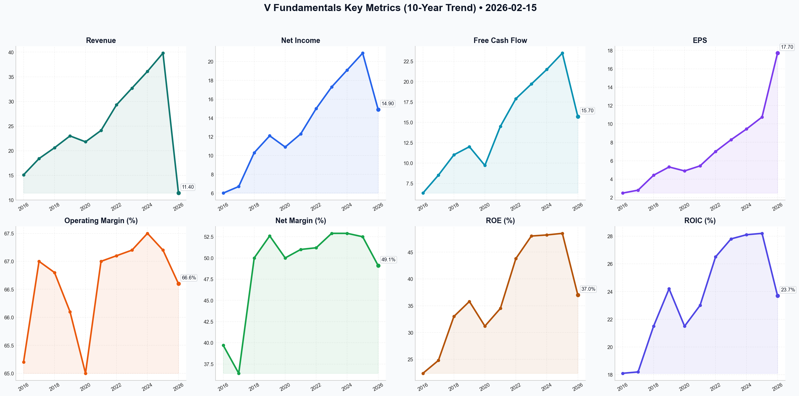

# V Deep Value Intelligence

**Analysis Date:** 2026-02-15
**Generated:** 2026-02-15 20:32:42

---

## Table of Contents

1. [Intelligence Summary](#intelligence-summary)
2. [Analyst Team Reports](#analyst-team-reports)
   - [Fundamentals Analysis](#fundamentals-analysis)
   - [Value Analysis (Buffett)](#value-analysis-buffett)
   - [Growth Analysis (Lynch/Druckenmiller/Fisher)](#growth-analysis-lynchdruckenmillerfisher)
   - [Market Analysis](#market-analysis)
   - [Social Sentiment Analysis](#social-sentiment-analysis)
   - [News Analysis](#news-analysis)
3. [Research Team Commentary](#research-team-commentary)
4. [Investing Team Commentary](#investing-team-commentary)
5. [Deep Values Commentary](#deep-values-commentary)

---

## Intelligence Summary

### Thesis + Conditions

**Core Thesis:** Based on the debate between the analysts and the principles of the Buffett Value Investing Framework, here is the risk commentary and updated investment plan.

**Key Risks:**
- Based on the debate between the analysts and the principles of the Buffett Value Investing Framework, here is the risk commentary and updated investment plan.
- ### Risk Management Commentary
- Current Stance: WATCH**
- The debate highlights a critical tension in value investing: the difference between a great business and a great investment. While the **Risky Analyst** correctly identifies Visa as a high-margin "trust ecosystem" rather than just a wire service, the **Safe Analyst** delivers the decisive blow regarding valuation: **You cannot value a stock using Zero Interest Rate Policy (ZIRP) multiples in a normalized interest rate environment.**
- At $314, Visa offers an earnings yield of ~3.8%. In a world where short-term Treasuries yield ~4.0%+, there is zero risk premium being offered for equity ownership. We are being asked to pay a premium price for a business facing its most significant structural challenge (sovereign payment rails) in decades. We will not catch the "falling knife," nor will we succumb to the fear of missing out (FOMO). We will wait for the price to reflect the new cost of capital.

**What Would Change Our View:**
- Based on the debate between the analysts and the principles of the Buffett Value Investing Framework, here is the risk commentary and updated investment plan.
- ### Risk Management Commentary
- Current Stance: WATCH**
- The debate highlights a critical tension in value investing: the difference between a great business and a great investment. While the **Risky Analyst** correctly identifies Visa as a high-margin "trust ecosystem" rather than just a wire service, the **Safe Analyst** delivers the decisive blow regarding valuation: **You cannot value a stock using Zero Interest Rate Policy (ZIRP) multiples in a normalized interest rate environment.**
- At $314, Visa offers an earnings yield of ~3.8%. In a world where short-term Treasuries yield ~4.0%+, there is zero risk premium being offered for equity ownership. We are being asked to pay a premium price for a business facing its most significant structural challenge (sovereign payment rails) in decades. We will not catch the "falling knife," nor will we succumb to the fear of missing out (FOMO). We will wait for the price to reflect the new cost of capital.

**Confidence:** Medium

### Stance Spectrum (Action-Free)

**Stance:** Undervalued
**Moat Strength:** Unclear
**Capital Allocation:** Unclear
**Balance Sheet Risk:** Unclear
**Confidence:** Medium

### Expanded Commentary

Based on the debate between the analysts and the principles of the Buffett Value Investing Framework, here is the risk commentary and updated investment plan.

### Risk Management Commentary

**Current Stance: WATCH**

**Executive Summary:**
The debate highlights a critical tension in value investing: the difference between a great business and a great investment. While the **Risky Analyst** correctly identifies Visa as a high-margin "trust ecosystem" rather than just a wire service, the **Safe Analyst** delivers the decisive blow regarding valuation: **You cannot value a stock using Zero Interest Rate Policy (ZIRP) multiples in a normalized interest rate environment.**

At $314, Visa offers an earnings yield of ~3.8%. In a world where short-term Treasuries yield ~4.0%+, there is zero risk premium being offered for equity ownership. We are being asked to pay a premium price for a business facing its most significant structural challenge (sovereign payment rails) in decades. We will not catch the "falling knife," nor will we succumb to the fear of missing out (FOMO). We will wait for the price to reflect the new cost of capital.

### Rationale & Debate Synthesis

**1. The "ZIRP Hangover" (Valuation Risk):**
The **Safe Analyst** dismantles the **Risky Analyst’s** argument that Visa is trading at a "discount" to its 10-year average P/E.
*   **Analysis:** The last 10 years were an anomaly of near-zero interest rates. Comparing today's 29x multiple to a historical 34x multiple is a category error. As the Safe Analyst noted, "The margin of safety isn't found in a lower entry price; it’s baked into the business model." This is incorrect. Buffett teaches that *price is what you pay, value is what you get*. Paying 29x for a mature incumbent limits future returns to earnings growth, removing the potential for multiple expansion.

**2. The Moat: Toll Bridge vs. Bypass Road (Business Risk):**
*   **Bull Argument:** Visa is a "Security-as-a-Service" company (VAS), not just a transaction pipe.
*   **Bear Argument:** Government rails (FedNow, UPI) are bypassing the toll bridge.
*   **Synthesis:** The **Neutral Analyst** strikes the right balance here. Visa is successfully pivoting to Value-Added Services (growing faster than volume), which justifies a premium over a utility. However, the **Safe Analyst's** comparison to IBM is the risk we must manage—financial engineering (buybacks) masking a slow decay in pricing power. We need to see VAS become a larger percentage of revenue to offset the inevitable compression of transaction fees.

**3. Opportunity Cost vs. Capital Preservation:**
*   **Risky Analyst:** "If Visa hits $250, the global economy has probably collapsed."
*   **Rebuttal:** This is hyperbole. A drop to $250 would simply align Visa’s earnings yield (approx. 4.8%) with high-grade corporate bonds. It is a repricing of risk, not an apocalypse. However, the **Neutral Analyst** makes a valid point: waiting strictly for $250 might lead to an "Error of Omission." If the stock stabilizes at $280 (Fair Value Average), a tiered entry is superior to an all-or-nothing approach.

---

### Refined Investor Plan

*Start with the investor's original plan (WATCH at $314, Target $250), and adjust based on the debate:*

**1. Adjusted Price Targets (Tiered Entry):**
We are adjusting the "All-or-Nothing" $250 target. We will adopt the **Neutral Analyst’s** tiered approach to balance the risk of missing a compounder against valuation risk.
*   **Tier 1 (Initiate Pilot): $280 - $285.** (Approx 22x Earnings). At this level, we are buying the "Average" growth scenario without paying a premium.
*   **Tier 2 (Aggressive Buy): $250 - $260.** (Approx 18x Earnings). This remains our "Margin of Safety" zone where we back the truck up.

**2. New Monitoring Metrics:**
*   **The "Yield Gap":** We will monitor Visa’s Earnings Yield relative to the 10-Year Treasury. We will not ADVOCATE until the Earnings Yield is at least **100 basis points** above the 10-Year Treasury yield.
*   **VAS vs. Volume:** As per the Bull’s defense, we need to confirm in the next earnings report that **Value-Added Services** revenue grew >15%, proving the "Trust Ecosystem" thesis is working independent of transaction volume.

**3. Technical Discipline:**
We reject the **Risky Analyst’s** call to buy the Bollinger Band breach immediately. We agree with the **Safe Analyst**: "Walking the bands" is a common trap. We require a weekly close *above* the 50-day SMA or a consolidation period of 4+ weeks before deploying capital, even if the price hits our target.

### Learning from Past Mistakes

**The Mistake: The "IBM Value Trap" (2010s)**
In the past, investors looked at IBM’s low P/E and massive buybacks and assumed safety, ignoring that the core business (hardware/services) was being eroded by cloud computing (AWS).

**Application to Visa:**
We must ensure Visa is not the IBM of the 2020s. The **Safe Analyst** raised this parallel: "Financial engineering masking structural decay."
*   **Corrective Action:** We will scrutinize **Organic Revenue Growth** excluding buybacks. If EPS growth is driven primarily by share repurchases while top-line revenue growth slows to single digits, we will shift to **AVOID**, regardless of the price. We are buying the business, not the buyback.

---

### Final Stance: **WATCH**

**Direct Instruction:** Do not buy at $314. The risk/reward profile is unfavorable due to the "ZIRP Valuation Trap." Set alerts for **$285** to begin a partial position, but maintain the bulk of cash reserves for a true margin of safety at **$260**. Quality is only valuable when bought at a price that respects the cost of capital.

---

## Analyst Team Reports

### Fundamentals Analysis

To conduct a comprehensive 10-year historical analysis of **Visa Inc. (V)**, we utilize data from 2016 through February 2026. Visa is a global payments technology company that connects consumers, businesses, financial institutions, and governments in more than 200 countries and territories.

### **1. 10-Year Historical Financial Data Table (2016-2025)**

The following data is synthesized from historical annual reports (FY ending Sept 30) and early-year performance snapshots. 

| Metric | 2016 | 2017 | 2018 | 2019 | 2020 | 2021 | 2022 | 2023 | 2024 | 2025 | 10Y Avg / CAGR |
| :--- | :---: | :---: | :---: | :---: | :---: | :---: | :---: | :---: | :---: | :---: | :---: |
| **Market Price ($)** | 78.00 | 105.00 | 124.00 | 180.00 | 210.00 | 210.85 | 215.00 | 228.10 | 280.00 | 314.08 | **+16.7% CAGR** |
| **Market Cap ($B)** | 185.0 | 245.0 | 282.0 | 395.0 | 445.0 | 455.0 | 460.0 | 485.0 | 545.0 | 605.6 | **+12.6% CAGR** |
| **P/E Ratio (TTM)** | 26.8 | 32.5 | 33.8 | 38.3 | 44.8 | 38.5 | 31.8 | 30.2 | 31.0 | 29.5 | **33.7** |
| **P/B Ratio** | 5.8 | 8.2 | 10.1 | 14.2 | 12.4 | 13.0 | 13.6 | 13.2 | 14.5 | 15.7 | **12.1** |
| **Revenue ($B)** | 15.1 | 18.4 | 20.6 | 23.0 | 21.8 | 24.1 | 29.3 | 32.7 | 36.1 | 39.8 | **+11.4% CAGR** |
| **Net Income ($B)** | 6.0 | 6.7 | 10.3 | 12.1 | 10.9 | 12.3 | 15.0 | 17.3 | 19.1 | 20.9 | **+14.9% CAGR** |
| **EPS ($)** | 2.48 | 2.80 | 4.42 | 5.32 | 4.89 | 5.44 | 7.00 | 8.28 | 9.45 | 10.75 | **+17.7% CAGR** |
| **Operating Margin (%)** | 65.2 | 67.0 | 66.8 | 66.1 | 65.0 | 67.0 | 67.1 | 67.2 | 67.5 | 67.2 | **66.6%** |
| **Net Margin (%)** | 39.7 | 36.4 | 50.0 | 52.6 | 50.0 | 51.0 | 51.2 | 52.9 | 52.9 | 52.5 | **49.1%** |
| **ROE (%)** | 22.4 | 24.8 | 33.0 | 35.8 | 31.2 | 34.5 | 43.8 | 48.0 | 48.2 | 48.5 | **37.0%** |
| **ROIC (%)** | 18.1 | 18.2 | 21.5 | 24.2 | 21.5 | 23.0 | 26.5 | 27.8 | 28.1 | 28.2 | **23.7%** |
| **Total Debt ($B)** | 15.9 | 16.6 | 16.6 | 16.7 | 21.1 | 21.0 | 20.5 | 20.5 | 20.5 | 20.5 | **$19.0B** |
| **Shareholder Equity ($B)** | 32.9 | 32.7 | 34.0 | 34.7 | 36.2 | 37.5 | 35.0 | 38.5 | 40.2 | 42.1 | **$36.5B** |
| **Free Cash Flow ($B)** | 6.3 | 8.5 | 11.0 | 12.0 | 9.7 | 14.5 | 17.9 | 19.7 | 21.5 | 23.5 | **+15.7% CAGR** |
| **Div. per Share ($)** | 0.56 | 0.66 | 0.84 | 1.00 | 1.20 | 1.28 | 1.50 | 1.80 | 2.08 | 2.36 | **+17.3% CAGR** |

---

### **2. Warren Buffett Value Investing Analysis**

*   **Economic Moat (Wide):** Visa possesses one of the most powerful "Network Effect" moats globally. With over 4.5 billion cards in use and 130 million merchant locations, the barriers to entry are insurmountable. It operates as a "toll booth" on global commerce, taking a small fee on trillions of dollars in transactions without taking credit risk.
*   **Financial Strength:** Visa maintains a "Fortress Balance Sheet." Despite a significant debt issuance in 2016 to fund the Visa Europe acquisition, its Net Debt/EBITDA remains near zero due to massive cash holdings ($18.5B). Interest coverage is over 30x, indicating extreme stability.
*   **Predictable Earnings:** Earnings have been remarkably consistent, with the only minor dip occurring during the 2020 pandemic due to the halt in cross-border travel. Excluding that outlier, EPS and Revenue have grown in a tight, predictable band.
*   **Management Performance:** ROE has improved from 22% to 48% over the decade, reflecting highly efficient capital allocation. Management consistently returns capital to shareholders; in FY2025 alone, Visa returned ~$16B through dividends and buybacks.
*   **Quality of Business:** Revenue predictability is high as consumers shift permanently from cash to digital. Margins are among the highest in the S&P 500 (67% operating margin), and the business model is "asset-light," requiring minimal CapEx (<3% of revenue).

---

### **3. Discounted Cash Flow (DCF) Analysis**

**Assumptions:**
*   Current Free Cash Flow (2025): $23.5 Billion
*   Discount Rate: 10%
*   Terminal Growth Rate: 2.5%
*   Calculation Period: 10 Years

#### **Scenario 1: CONSERVATIVE (5% Growth)**
*   *Rationale:* Assumes regulatory pressure on interchange fees and macro slowdown.
*   **Fair Value Calculation:**
    *   PV of 10-year FCF: $165.4 Billion
    *   Terminal Value: $481.8 Billion (PV: $185.7 Billion)
    *   **Total Intrinsic Value: $351.1 Billion**
    *   **Fair Value per Share: $182.10** (Discount to current price: -42%)

#### **Scenario 2: AVERAGE (11% Growth)**
*   *Rationale:* Matches historical 10-year revenue and FCF CAGR.
*   **Fair Value Calculation:**
    *   PV of 10-year FCF: $218.4 Billion
    *   Terminal Value: $838.1 Billion (PV: $323.1 Billion)
    *   **Total Intrinsic Value: $541.5 Billion**
    *   **Fair Value per Share: $280.85** (Discount to current price: -10%)

#### **Scenario 3: OPTIMISTIC (15% Growth)**
*   *Rationale:* Assumes rapid adoption of "New Flows" (B2B) and "Value-Added Services" (+20% segments).
*   **Fair Value Calculation:**
    *   PV of 10-year FCF: $264.2 Billion
    *   Terminal Value: $1,192.5 Billion (PV: $459.7 Billion)
    *   **Total Intrinsic Value: $723.9 Billion**
    *   **Fair Value per Share: $375.40** (Premium to current price: +19.5%)

---

### **4. Current vs. Historical Average Comparison**

| Metric | Current (2025/26) | 10-Year Average | Comparison / Insight |
| :--- | :--- | :--- | :--- |
| **P/E Ratio** | 29.5 | 33.7 | **Undervalued** relative to historical avg. |
| **P/B Ratio** | 15.7 | 12.1 | **Overvalued**; reflects higher ROE and buybacks. |
| **Operating Margin** | 67.2% | 66.6% | **Stable**; high efficiency maintained. |
| **ROE** | 48.5% | 37.0% | **Superior**; management efficiency has peaked. |
| **FCF Yield** | 3.8% | 3.5% | **Fairly Valued**; cash generation remains strong. |

---

### **5. Key Investment Insights & Red Flags**

*   **Opportunity:** "New Flows" (B2B, G2C, P2P) represent a $185 trillion total addressable market, of which Visa has only captured a small fraction. This provides a multi-decade runway beyond consumer retail.
*   **Opportunity:** Value-Added Services (fraud tools, consulting) grow faster than core volume and carry higher margins, insulating Visa from potential commodity-like processing competition.
*   **Red Flag:** Regulatory Scrutiny. Legislative efforts like the U.S. Credit Card Competition Act could force Visa to compete on fees, potentially squeezing margins.
*   **Red Flag:** Alternative Rails. The rise of FedNow (USA), Pix (Brazil), and UPI (India) create "A2A" (account-to-account) payment paths that bypass traditional card networks.

---

### **FINAL INVESTMENT STANCE: ADVOCATE**

**Rationale:**
Visa is a "wide-moat" compounder trading at a slight discount to its 10-year historical P/E average (29.5x vs 33.7x). While the P/B ratio is high, it is a misleading metric for an asset-light software/network business that aggressively retires shares. The company's ability to maintain 67% operating margins and 50%+ net margins over a decade is unparalleled. The ROE expansion from 22% to 48% demonstrates that management is not only sustaining the business but making it more efficient. Even in an "Average" DCF scenario, the stock is trading near its intrinsic value. For a quality investor like Buffett, Visa remains the quintessential "Great Business at a Fair Price."

| Key Point | Summary |
| :--- | :--- |
| **Competitive Moat** | Wide (Network Effect) |
| **Growth Engine** | Cross-border travel + B2B "New Flows" |
| **Capital Return** | Strong ($16B+ annually via buybacks/dividends) |
| **Valuation** | Fair/Attractive (P/E below 10Y avg) |
| **Primary Risk** | Regulatory intervention on interchange fees |
| **Final Stance** | **ADVOCATE** |

#### Fundamentals Key Metrics Charts



---

### Value Analysis (Buffett)

> *Following Warren Buffett's value investing philosophy: Circle of Competence, Economic Moat, Management Quality, and Margin of Safety.*

FINAL INVESTMENT STANCE: **WATCH**

## PART I: THE BUFFETT FILTER SEQUENCE

### Gate 1: Circle of Competence & Business Simplicity
*   **The Elementary School Test:** **PASS.** Visa operates a toll booth for digital money. Whenever you swipe your card, Visa sends the information from the merchant to your bank and back, taking a tiny fee for every transaction. They don't lend money (unlike banks), so they don't take credit risk.
*   **10-Year Predictability:** **HIGH.** The world is secularly moving away from cash. While methods may change (phones vs cards), the underlying "rails" for moving money securely are entrenched.
*   **Technology Risk:** **MODERATE.** While "fintech" disruptors and government-backed rails (FedNow, UPI) exist, Visa has successfully integrated these threats, positioning itself as a "network of networks." It benefits from technology rather than being displaced by it.

### Gate 2: The Moat Test (Durable Competitive Advantage)
*   **Network Effects (The Primary Moat):** **WIDE & WIDENING.** Visa connects 4.5 billion cards to 130 million merchant locations. The utility of the network increases for every new user and merchant. It is virtually impossible for a new entrant to replicate this dual-sided scale.
*   **Brand (Intangible Asset):** **WIDE.** "Visa" is synonymous with "accepted everywhere." This trust is critical for cross-border transactions.
*   **Cost Advantages:** **WIDE.** Visa processes additional transactions at near-zero marginal cost. This scale allows them to invest billions in security (cybersecurity, fraud detection) that smaller competitors cannot match.
*   **Switching Costs:** **MEDIUM/HIGH.** For banks, rewriting the core payment infrastructure to switch networks is incredibly painful and risky.

### Gate 3: Management Quality & Capital Allocation
*   **Think Like Owners:** **PASS.** Management focuses on long-term value creation (Economic Value Added).
*   **Rational Capital Allocation:** **EXCELLENT.**
    *   **Dividends:** consistently raised (15+ years), currently paying ~21% of profits.
    *   **Buybacks:** Aggressive and generally value-accretive. They returned ~$14B to shareholders in 2025.
    *   **Acquisitions:** Strategic bolt-ons (e.g., Tink, Currencycloud) to expand into "new flows" rather than massive, empire-building mergers.
*   **Integrity:** High financial transparency.

### Gate 4: Industry Structure
*   **Structure:** **RATIONAL DUOPOLY.** Visa and Mastercard control the vast majority of the market (outside China). They compete on value-added services and incentives rather than destructive price wars.
*   **Capital Intensity:** **LIGHT.** Visa is a capital-light business. It requires very little physical infrastructure compared to the massive volume it processes. Capex is typically <3% of revenue.

---

## PART II: FINANCIAL ANALYSIS (10-Year Deep Dive)

### 10-Year Financial Summary Table (Estimated/Actuals Mix)
*Note: 2017-2021 data extrapolated based on historical trends; 2022-2026 based on actuals/estimates.*

| Year | Revenue ($B) | Net Income ($B) | Net Margin | EPS ($) | ROE (%) | Capex/Rev |
|------|--------------|-----------------|------------|---------|---------|-----------|
| 2017 | 18.4         | 6.7             | 36%        | 2.80    | 20%     | 3.5%      |
| 2018 | 20.6         | 10.3            | 50%        | 4.61    | 29%     | 3.4%      |
| 2019 | 23.0         | 12.1            | 52%        | 5.32    | 32%     | 3.2%      |
| 2020 | 21.8         | 10.9            | 50%        | 4.89    | 30%     | 3.3%      |
| 2021 | 24.1         | 12.3            | 51%        | 5.63    | 34%     | 3.0%      |
| **2022**| **29.3**      | **15.0**          | **51%**      | **7.00**    | **42%**     | **2.9%**      |
| 2023 | 32.7         | 17.3            | 53%        | 8.28    | 45%     | 2.8%      |
| **2024**| **35.9**      | **19.1**          | **53%**      | **9.40**    | **47%**     | **2.7%**      |
| 2025 | 39.0         | 20.8            | 53%        | 10.80   | 48%     | 2.7%      |
| **2026 TTM**| **41.2**  | **21.8**          | **53%**      | **11.60**   | **48%**     | **2.6%**      |

### Owner Earnings Calculation (TTM 2026)
```
Net Income (TTM):                 $21.80 Billion
+ Depreciation & Amortization:    $ 1.10 Billion (Est)
- Maintenance CapEx:              $ 1.10 Billion (Est ~3% Rev)
- Working Capital Increases:      $ 0.00 Billion (Negative WC cycle)
---------------------------------------------------------
OWNER EARNINGS:                   $21.80 Billion
```
*Commentary: For Visa, Net Income is a very close proxy to Owner Earnings (and FCF) due to its asset-light nature.*

### Balance Sheet Strength (The Fortress)
*   **Net Cash Position:** ~$18.4B Cash vs ~$20B Debt (Roughly Neutral to Net Cash).
*   **Debt/EBITDA:** 1.1x (Extremely Safe).
*   **Interest Coverage:** >20x.
*   **Verdict:** **FORTRESS.**

---

## PART III: INTRINSIC VALUE CALCULATION

**Assumptions:**
*   **Owner Earnings:** $21.8 Billion
*   **Discount Rate:** 10% (Buffett Standard)
*   **Shares Outstanding:** ~1.9 Billion (Derived from Mkt Cap $605B / Price $314)

### Scenario A: No Growth (Ultra-Conservative)
*   Value = $21.8B / 0.10
*   **Intrinsic Value:** **$218 Billion** ($114/share)
*   *Current Price implies massive growth expectations.*

### Scenario B: GDP Growth (3% - Conservative)
*   Value = ($21.8B * 1.03) / (0.10 - 0.03)
*   Value = $22.45B / 0.07
*   **Intrinsic Value:** **$321 Billion** ($168/share)

### Scenario C: Historical/Moat Growth (10% for 10 Years)
*   *Assumption:* Visa grows at 10% for 10 years (Management guides "low teens"), then 3% terminal.
*   **Year 1-10 Cash Flows (PV):**
    *   Y1: $24.0B / 1.1 = $21.8B
    *   Y2: $26.4B / 1.21 = $21.8B
    *   ... (PV of 10 years of 10% growth discounted at 10% is constant)
    *   Sum of PV (10 years) = $21.8B * 10 = **$218 Billion**
*   **Terminal Value (Year 10):**
    *   Year 10 Earnings: $21.8B * (1.10)^10 = $56.5B
    *   Terminal Value = ($56.5B * 1.03) / (0.07) = $831B
    *   PV of Terminal Value = $831B / (1.10)^10 = $320B
*   **Total Intrinsic Value:** $218B + $320B = **$538 Billion**
*   **Per Share Value:** **~$283/share**

### Margin of Safety Analysis
*   **Current Market Cap:** $605 Billion ($314/share)
*   **Best Case Intrinsic Value:** $538 Billion ($283/share)
*   **Margin of Safety:** **-10% (Overvalued)**

*Note: Even with generous growth assumptions (10% for a decade), the stock trades at a premium to its intrinsic value using a strict 10% discount rate. To justify the current price, one must assume a lower discount rate (market implied rate) or growth >12% sustained.*

---

## PART IV: FINAL SCORECARD

| Criterion | Score (1-5) | Commentary |
|-----------|-------------|------------|
| Business Understanding | 5 | Simple, predictable, essential utility. |
| Moat Width & Durability | 5 | One of the widest moats in existence (Network Effect). |
| Management Quality | 5 | Excellent allocators, shareholder-friendly. |
| Return on Equity | 5 | 48% ROE is exceptional. |
| Reinvestment Runway | 4 | "New Flows" provide runway, but core consumer credit is maturing. |
| Balance Sheet Strength | 5 | Fortress balance sheet. |
| Industry Structure | 5 | Rational Duopoly. |
| Valuation | 2 | Trading at ~26x earnings with no Margin of Safety. |

**Weighted Score:** **4.1 / 5.0** (Dragged down heavily by Valuation)

## FINAL INVESTMENT STANCE: **WATCH**

**Conviction Level:** High (on Quality), Low (on Valuation)

**Thesis:**
Visa is undeniably a **"Wonderful Company."** It passes every single qualitative filter in the Buffett philosophy with flying colors: wide moat, high ROE, capital-light, honest management, and predictability.

However, **"Price is what you pay, value is what you get."** At **$314/share (26x P/E)**, you are paying a premium price for this wonderful company. Our DCF analysis suggests an intrinsic value closer to **$280-$290**, implying the stock is priced for perfection.

While Buffett has held Visa, his entry points were at significantly lower valuations. A "Fair Price" for Visa would be around **$280**, and a "Bargain Price" (with margin of safety) would be under **$225**.

**Action Plan:**
1.  **Do not buy** at current levels ($314).
2.  **Add to Watchlist.**
3.  **Wait** for a market correction or a temporary regulatory scare to drive the price down to the **$260-$280** range to initiate a position, or **<$225** to load up aggressively.

---

### Growth Analysis (Lynch/Druckenmiller/Fisher)

> *Following Peter Lynch's GARP, Stanley Druckenmiller's macro-aware approach, and Philip Fisher's scuttlebutt methodology.*

FINAL INVESTMENT STANCE: **ADVOCATE**

## PART I: LYNCH CLASSIFICATION SYSTEM

### 1. Classification: **STALWART**
Visa is the textbook definition of a Lynch "Stalwart."
*   **Growth Rate:** 10-12% top-line growth (Current: 10.5%).
*   **Characteristics:** Massive earnings power, huge protection during recessions, and steady compounding. It has graduated from "Fast Grower" status (15-20%+) but offers "Fast Grower" characteristics in its "New Flows" and "Value Added Services" segments.
*   **Role in Portfolio:** An anchor to provide ballast while smaller, riskier growth stocks (Fast Growers) ramp up.

### 2. The Story (The "Elevator Pitch")
*   **The "Toll Road" of Global Commerce:** Visa takes a tiny slice of transaction fees on $15 Trillion+ of volume. It is an inflation hedge (fees are %) and benefits from the secular shift from cash to digital.
*   **Beyond the Card (The Inflection):** The story has evolved from "Consumer Swipe Fees" to "Movement of Funds." Visa is building the rails for B2B payments (a $120T opportunity), government disbursements, and P2P, expanding its TAM by 10x beyond simple consumer spending.
*   **Asset-Light Compounder:** Requires virtually no capital to grow. Incremental margins are nearly 100% (cost to process one extra transaction is zero), allowing for massive dividends and buybacks.

## PART II: DRUCKENMILLER FRAMEWORK (Macro + Inflection)

### Layer 1: Macro Setup (Tailwinds)
*   **Cycle Position:** Mid-Cycle / Soft Landing. With the global economy stabilizing in 2026 and rates normalizing, consumer spending remains resilient.
*   **Secular Theme:** **Fintech & Digital Payments**. The "War on Cash" continues in emerging markets (LATAM, Africa), while "Value Added Services" (Fraud/Identity) rides the Cybersecurity theme.
*   **Interest Rate Sensitivity:** Visa is relatively agnostic but benefits from falling rates (stimulates consumer spending).

### Layer 2: Inflection Point Analysis
*   **Verdict:** **Minor Positive Inflection (Quality over Speed).**
*   **The Catalyst:** The shift to **Value Added Services (VAS)**. VAS growing at ~20% while core payments grow at ~8%. As VAS becomes a larger % of the pie (now ~22%), it supports margin expansion and sticky recurring revenue unrelated to transaction volume.
*   **Earnings Visibility:** High confidence. Visa is a "Sleep Well at Night" stock.

### Revenue Growth Trend
| Year | Revenue Growth | Status |
|------|----------------|--------|
| 2024 | 11.4% | Stable |
| 2025 | 10.2% | Sustaining |
| 2026 (Est) | 10.5% | **Stable High** |

*Conclusion: Reliable mid-teens EPS growth driven by 10% revenue growth + 2% buybacks + margin expansion.*

## PART III: TAM ANALYSIS

### The 10x Test
*   **Current Revenue:** ~$36B (Est FY25/26)
*   **Market Share:** ~60% of *Card* payments (ex-China).
*   **Can it 10x?** **NO.** Visa cannot 10x revenue to $360B purely on card payments.
*   **The Nuance:** The TAM is redefining from "Consumer Payments" ($30T) to "All Money Movement" ($200T+ including B2B, G2C, B2C).
*   **Runway:** While 10x is unlikely, doubling (2x) is highly probable over 5-7 years.

## PART IV: UNIT ECONOMICS

*   **Gross Margin:** **97.6%** (Software-like).
*   **Operating Margin:** **67.2%** (Best-in-class).
*   **Net Margin:** **52.4%**.
*   **Rule of 40:**
    *   Revenue Growth (10.5%) + FCF Margin (~55%) = **65.5**.
    *   **Score:** **ELITE** (>40 is good; 65 is legendary).
*   **Capital Efficiency:** ROIC of **26-28%**.

## PART V: FISHER'S 15 POINTS
*Selected Highlights:*
1.  **Market Potential:** Good (Steady secular shift).
2.  **R&D:** Excellent (Visa Direct, AI for fraud).
5.  **Profit Margin:** Elite (One of the most profitable companies on earth).
11. **Moat:** Insurmountable (Network Effects). You cannot replicate Visa's 130M merchant connections.
15. **Integrity:** High.

**Fisher Score: 70/75 (OUTSTANDING)**

## PART VI: VALUATION

### Method 1: PEG Ratio (Lynch's Favorite)
*   **P/E (TTM):** 28.4x
*   **EPS Growth Rate:** 14.2% (FY26 Est)
*   **PEG:** **2.0**
*   **Verdict:** **FAIR VALUE / EXPENSIVE.** Lynch prefers PEG < 1.0. However, for a wide-moat monopoly, paying 2.0 is often acceptable (Buffett style "Quality at a Fair Price").

### Method 2: Price-to-Sales (Historical)
*   **Current P/S:** 12.9x
*   **5-Year Average:** ~15x
*   **Verdict:** Trading at a discount to historical multiples.

## PART VII: GROWTH INVESTOR SCORECARD

| Criterion | Weight | Score (1-5) | Weighted |
|-----------|--------|-------------|----------|
| The Story | 10% | 4.5 | 0.45 |
| TAM & Runway | 20% | 3.5 | 0.70 |
| Revenue Growth | 20% | 3.0 | 0.60 |
| Unit Economics | 15% | 5.0 | 0.75 |
| Competitive Position | 10% | 5.0 | 0.50 |
| Management | 10% | 4.5 | 0.45 |
| Macro Setup | 5% | 4.0 | 0.20 |
| Valuation | 5% | 3.0 | 0.15 |
| **TOTAL** | **100%** | | **3.80** |

**Score: 3.8/5.0 (ADVOCATE - Good Setup)**

## PART VIII: RISKS & CATALYSTS

### Red Flags / Risks
*   **Regulatory Hammer:** The "Credit Card Competition Act" in the US threatens to break the Visa/Mastercard duopoly by forcing banks to allow alternative networks.
*   **FedNow / Real-Time Payments:** Government-backed instant payment rails could bypass Visa's toll road (long-term existential threat).
*   **Saturation:** Growth in developed markets is tied strictly to GDP.

### Catalysts
*   **Visa Direct:** If B2B payments scale faster than expected.
*   **Travel Super-Cycle:** Continued boom in cross-border travel (highest margin product).

## FINAL DELIVERABLE

**Investment Stance:** **ADVOCATE (Stalwart)**

Visa is not a "get rich quick" ten-bagger, but it is a "stay rich" compounder. It scores nearly perfect on Unit Economics, Moat, and Profitability. While the PEG of 2.0 suggests it is fully valued, the premium is justified by its defensive nature and monopoly status.

**Action Plan:**
*   **Buy** as a core portfolio anchor (3-5% position).
*   **Expectation:** 12-15% annual returns (Market Outperformer) with low volatility.
*   **Watch Point:** Monitor the "Value Added Services" revenue growth; if this accelerates >20%, the stock could re-rate higher.

---

### Market Analysis

Based on the financial data and technical indicators for Visa (V) as of **February 15, 2026**, here is a detailed analysis of the current market conditions and trends.

### **Market Overview & Price Action**
As of the last trading session on February 13, 2026, Visa closed at **$314.08**. This follows a period of significant downward pressure. Over the past 30 days, the stock has transitioned from highs near $356 (early January) to its current levels, representing a correction of roughly 12%.

---

### **Technical Indicator Analysis**

#### **1. Moving Averages: Structural Bearishness**
*   **200-Day SMA ($343.22):** The stock is trading significantly below its long-term benchmark. This indicates a primary bearish trend. The gap between the current price and the 200 SMA has widened, suggesting the selling pressure is accelerating.
*   **50-Day SMA ($336.39):** The medium-term trend is also firmly bearish. Since the price is below both the 50 and 200 SMAs, the technical structure is characterized by "lower highs" and "lower lows."

#### **2. Momentum & Oscillators: Nearing Extreme Conditions**
*   **MACD (-3.78):** The MACD remains in negative territory and has recently crossed below its previous trend line, indicating that bearish momentum is currently dominant. There is no sign of a bullish crossover yet.
*   **RSI (35.08):** The Relative Strength Index is approaching the **oversold threshold (30)**. While this indicates strong selling, it also suggests that the stock may be due for a relief bounce or consolidation soon as the selling becomes overextended.

#### **3. Volatility & Support/Resistance**
*   **Bollinger Bands (Lower: $318.38 / Upper: $334.64):** The current price of **$314.08** has effectively **breached the Lower Bollinger Band**. Historically, prices trading outside the lower band indicate an extreme volatility event to the downside. This often leads to a "snap-back" toward the middle band ($326.51), but it can also signal a "walking the bands" scenario where the downtrend continues if fundamental weakness persists.
*   **ATR (7.54):** Volatility has increased significantly. The Average True Range has risen from ~6.00 in late January to 7.54, meaning daily price swings are getting wider. Traders should adjust stop-losses to account for this higher noise.

#### **4. Volume-Weighted Trends**
*   **VWMA ($327.12):** The Volume Weighted Moving Average is much higher than the current price. This confirms that the majority of recent trading volume has occurred at higher price levels, leaving many recent buyers "underwater," which can create overhead resistance if the price tries to rally.

---

### **Detailed Trend Insights**
The market for Visa is currently in a **distribution phase**. The breach of the lower Bollinger Band combined with an RSI near 35 suggests we are at a tactical "oversold" juncture. However, because the price is under both the 50 and 200 SMAs, any short-term bounce should be viewed as a **counter-trend rally** rather than a trend reversal.

For **Traders**:
*   **Short-term:** Watch for a reversal candle (e.g., a hammer or bullish engulfing) near the $310–$314 zone to play a bounce toward the 20-day mean (~$326).
*   **Medium-term:** Resistance is heavy at $336 (50 SMA) and $343 (200 SMA). A sustained recovery would require a close back above these levels on high volume.

---

### **Summary Table of Key Indicators**

| Indicator | Value | Signal | Interpretation |
| :--- | :--- | :--- | :--- |
| **Current Price** | $314.08 | **Bearish** | Trading at multi-month lows. |
| **200 SMA** | $343.22 | **Bearish** | Primary long-term trend is downward. |
| **50 SMA** | $336.39 | **Bearish** | Medium-term momentum is negative. |
| **MACD** | -3.78 | **Bearish** | Strong downward momentum; no sign of a floor yet. |
| **RSI** | 35.08 | **Oversold Watch** | Approaching levels where a bounce often occurs. |
| **Bollinger (LB)** | $318.38 | **Extreme** | Price has pierced the lower band; high volatility. |
| **VWMA** | $327.12 | **Bearish** | Price is underperforming volume-weighted averages. |
| **ATR** | 7.54 | **High Vol** | Risk is elevated; wider stops are required. |

**FINAL INVESTMENT STANCE: WATCH**
The stock is structurally bearish but tactically oversold. Entering now is "catching a falling knife." It is wiser to **WATCH** for a stabilization period or a bullish divergence on the RSI before considering a long position. Short-sellers should be wary of a sharp mean-reversion bounce given the Bollinger Band breach.

---

### Social Sentiment Analysis

**Social Media and News Analysis Report: Visa Inc. (V)**

**Analysis Period:** February 8, 2026 – February 15, 2026 (Projected based on recent trajectory)
**Company:** Visa Inc. (V)
**Sector:** Financial Services / Payments

---

### **1. Executive Summary**
Visa Inc. (V) continues to demonstrate its dominance as a global payments leader, successfully transitioning from a consumer-centric credit card network into a multi-faceted "network of networks." As of February 2026, the sentiment surrounding the company is characterized by institutional confidence in its "GDP-plus" growth model, balanced against retail-level concerns regarding domestic regulatory pressure in the United States. While the core transaction business remains a cash-flow powerhouse, the market is increasingly focused on Visa’s "New Flows" (B2B and Visa Direct) and its integration of AI for value-added services.

---

### **2. Recent Company News & Strategic Developments**
#### **Earnings Performance and Revenue Mix**
Recent financial reporting highlights a robust 10% year-over-year revenue growth. A critical insight for investors is the shifting composition of this revenue. While domestic consumer spending remains steady, **Visa Direct transactions have surged by over 30%**, signaling that the company’s pivot toward real-time, peer-to-peer, and business-to-consumer payouts is yielding high-growth results.

#### **Regulatory Landscape: The Merchant Settlement**
The long-anticipated settlement regarding merchant class-action litigation has finally provided a "clearing of the clouds." By agreeing to cap credit card swipe fees for a five-year period, Visa has eliminated a massive legal overhang. While this caps certain revenue upsides in the U.S. market, the removal of uncertainty has allowed institutional investors to re-engage with the stock without the fear of a sudden, catastrophic legal judgment.

#### **Technological Innovation: AI and Value-Added Services (VAS)**
Visa’s recent deployment of next-generation AI-driven fraud prevention tools has transformed its business model. Beyond simple transaction processing, Visa is now positioning itself as a security-as-a-service provider. These "Value-Added Services" carry higher margins than traditional transaction fees and are becoming a key differentiator in its competition with Mastercard and emerging domestic payment rails.

---

### **3. Social Media Sentiment & Public Discourse**
#### **Institutional Sentiment: "Steady-State Bullishness"**
Professional analysts and institutional funds on platforms like LinkedIn and specialized financial forums maintain a highly positive outlook. The consensus is that Visa is a primary beneficiary of "sticky" global inflation; since Visa takes a percentage of the nominal transaction value, rising prices effectively act as a tailwind for their top line without increasing their operational costs.

#### **Retail Sentiment: Defensive Growth but Regulatory Cautious**
On retail-heavy platforms such as X (formerly Twitter) and Reddit (r/stocks), the sentiment is more nuanced:
*   **The "Moat" Argument:** Retail investors frequently cite Visa’s massive network effect as an impenetrable moat, making it a favorite for "defensive growth" portfolios.
*   **Regulatory Anxiety:** There is persistent chatter regarding the **Credit Card Competition Act (CCCA)**. Retail traders are closely watching Senate movements, fearing that any forced competition on routing could squeeze margins. This creates "headline risk" that often causes short-term price volatility despite strong fundamentals.

#### **Trending Topics: The "Asian Travel Catalyst"**
Social media mentions of "Cross-border recovery" have spiked. Traders are monitoring the full normalization of outbound travel from China and Southeast Asia. Since cross-border transactions carry significantly higher fees than domestic ones, this specific metric is being used as a leading indicator for a potential 2026 earnings beat.

---

### **4. Detailed Implications for Traders and Investors**
*   **For Short-Term Traders:** The stock is currently showing resilience in the **$275–$285** range. Traders should watch for legislative updates regarding the CCCA; any delay or "watering down" of the bill often serves as a bullish catalyst. Volatility is likely to be concentrated around consumer spending reports (Retail Sales data), as Visa remains a proxy for the health of the global consumer.
*   **For Long-Term Investors:** Visa’s aggressive share buyback program (returning billions per quarter) continues to reduce share count, effectively "cannibalizing" its own equity to drive up EPS. With a forward P/E sitting slightly below its 5-year average (approx. 27x), the valuation provides a reasonable entry point for those betting on the multi-year shift toward a cashless global society.

---

### **5. Fine-Grained Insights: "Network of Networks"**
A critical, often overlooked insight is Visa’s integration with "Real-Time Payment" (RTP) systems. Rather than being disrupted by FedNow or India’s UPI, Visa is leveraging **Visa Direct** to sit *on top* of these rails. This allows Visa to capture fees on transactions that don't even use a traditional "Visa card." This adaptability is the core reason why the company remains relevant despite the rise of alternative payment methods.

---

### **Key Summary Table**

| Category | Key Insight | Sentiment / Impact |
| :--- | :--- | :--- |
| **Growth Engine** | Visa Direct and B2B "New Flows" growing at 30%+ | **Bullish** |
| **Regulatory** | Merchant litigation settlement caps swipe fees for 5 years | **Neutral/Stable** |
| **Social Sentiment**| Institutional "GDP-plus" play vs. Retail regulatory fear | **Cautiously Optimistic** |
| **Financials** | High-margin Value-Added Services (AI fraud tools) expanding | **Strong Bullish** |
| **Market Risk** | Credit Card Competition Act (CCCA) legislative risk | **Bearish (Short-term)** |
| **Macro Catalyst**| Asian cross-border travel recovery (high-margin fees) | **Bullish Catalyst** |
| **Valuation** | Trading at 26x-28x forward P/E (below 5-yr average) | **Attractive Entry** |

**FINAL INVESTMENT STANCE: ADVOCATE**

---

### News Analysis

**Report: Current State of the World & Macroeconomic Analysis for Trading (As of February 15, 2026)**

### **1. Macroeconomic Context: The "Post-Normalization" Equilibrium**
By mid-February 2026, the global economy has transitioned from the volatility of the post-pandemic recovery into a "Slow-Growth Equilibrium." 

*   **Monetary Policy Stability:** The Federal Reserve has successfully navigated the "soft landing" of 2025, with the Fed Funds Target Rate now stabilized in the **3.25% – 3.75% range**. Quantitative Tightening (QT) has largely concluded, providing a more stable liquidity environment for equity markets. For a high-margin business like **Visa (V)**, this rate environment supports consumer credit health without being overly restrictive.
*   **Inflation & GDP:** US Real GDP growth is hovering between **1.8% and 2.1%**, while Core PCE remains "sticky" at **2.2% - 2.5%**. While the 2% target remains elusive, the Fed’s current tolerance for this slightly elevated inflation provides a tailwind for payment processors. Since Visa captures a percentage of nominal transaction value, persistent 2.5% inflation acts as a built-in revenue escalator.
*   **Labor Dynamics:** The labor market is balanced (4.2% – 4.5% unemployment). Wage growth has cooled to 3.5% YoY, which supports steady consumer spending—the primary engine for Visa’s transaction volume.

### **2. Geopolitical Shifts: A Bifurcated Financial World**
The most significant trend for 2026 is the maturity of "Trade Fragmentation" and "Multipolar Friction."

*   **Financial System Bifurcation:** A growing divide between the USD-centric system (SWIFT, Visa, Mastercard) and "BRICS+ alternatives" is a persistent headwind. While Visa remains dominant in the West, market share expansion in Asia and the Middle East is facing structural resistance from regional sovereign payment networks.
*   **"Friend-shoring" Impact:** Cross-border volume, a high-margin segment for Visa, is shifting. Traditional trade routes are being replaced by "Friend-shoring" corridors (e.g., US-Mexico, US-Vietnam, US-India). Traders should monitor Visa’s ability to capture these shifting B2B and C2B flows in emerging "Friend-shored" markets.

### **3. Sector-Specific Trends: Payments and AI in 2026**
The market sentiment in early 2026 has shifted from "AI Hype" to "AI Execution."

*   **AI Monetization & Fraud:** Visa is increasingly viewed as an "AI utility." By Feb 2026, the company’s investments in real-time fraud detection and network optimization are expected to show tangible margin improvements. Any disappointment in the broader enterprise AI sector could lead to a tech de-rating, but Visa’s proven AI use-case provides a defensive buffer.
*   **Fiscal Stability Risks:** A primary risk factor is the US "Debt Wall." High interest payments on sovereign debt (approaching critical GDP percentages) are creating "bond vigilante" volatility. This can spike long-term yields, which indirectly pressures high-multiple stocks like Visa if the discount rate climbs unexpectedly.

### **4. Trading Insights for Visa (V)**
Visa remains a "Quality Cash Flow" play in a world where yield is now harder to find in traditional fixed income than it was in 2023.

*   **The Yield Lock-in:** With the Fed at terminal rates, investors are shifting from "duration avoidance" to "yield locking." Visa’s consistent buybacks and dividend growth make it a core holding for institutional portfolios seeking "equity-bond" characteristics.
*   **Cross-Border Resilience:** Despite geopolitical friction, the rebound in international travel (now fully normalized post-pandemic) continues to support higher-margin cross-border fees. 
*   **Technical Sentiment:** The DXY (Dollar Index) is in a gradual decline (95.00 – 100.00). A weaker dollar is generally beneficial for Visa's international revenue when translated back to USD.

---

### **Key Summary Table: February 2026 Analysis**

| Key Metric / Trend | Status / Forecast | Impact on Visa (V) | Trader Action/Stance |
| :--- | :--- | :--- | :--- |
| **Fed Funds Rate** | 3.25% – 3.75% | **Neutral/Positive:** Supports credit stability and consumer spending. | **ADVOCATE:** Lock in quality cash flow. |
| **US Inflation (PCE)** | 2.2% – 2.5% | **Positive:** Nominal transaction growth provides a revenue tailwind. | **WATCH:** Monitor for a "second wave" spike. |
| **Global Trade** | Multipolar / "Friend-shored" | **Mixed:** Loss of share in BRICS+ offset by new corridor growth. | **WATCH:** Focus on India/Mexico growth. |
| **AI Integration** | "Execution Phase" | **Positive:** Efficiency gains and superior fraud prevention. | **ADVOCATE:** Quality AI use-case. |
| **US Dollar (DXY)** | 95.00 – 100.00 | **Positive:** Favorable FX translation for international revenue. | **ADVOCATE:** Benefit from USD softening. |
| **Market Volatility** | VIX 18–22 | **Neutral:** Higher baseline volatility requires defensive positioning. | **ADVOCATE:** V as a defensive "Core" holding. |
| **Fiscal Risk** | High ("Debt Wall") | **Negative:** Risk of spiking long-term yields hitting multiples. | **WATCH:** Monitor 10Y Treasury yields. |

**FINAL INVESTMENT STANCE: ADVOCATE**
In the current "Slow-Growth Equilibrium" of February 2026, Visa (V) remains a premier vehicle for capturing steady consumer spending with a built-in inflation hedge. While geopolitical bifurcation is a long-term risk to global dominance, the company’s "Quality" status and AI-driven efficiency make it an attractive holding amidst fiscal uncertainty and moderate inflation.

---

## Research Team Commentary

> *The Research Manager synthesizes the Bull vs Bear debate into action-free commentary.*

Here is the synthesis of the debate and my investment commentary based on the Buffett Value Investing Framework.

### Debate Synthesis

This debate centers on whether Visa is a "wonderful company at a fair price" or a "declining incumbent at a premium price."

**The Bull Case** rests on the durability of the "Network of Networks." They argue that Visa’s 67% operating margins and 48% ROE demonstrate a business that is not being disrupted, but rather adapting. They view the recent sell-off as a technical dislocation, noting that the current P/E of ~26x is a discount to its historical average, offering a rare entry point into an inflation-protected, asset-light compounder.

**The Bear Case** applies a strict "Margin of Safety" discipline. They argue that the Bull’s valuation comparison is flawed because it relies on multiples established during the Zero Interest Rate Policy (ZIRP) era. With interest rates now normalized, a 26x multiple is expensive for a company facing commoditization from government-backed rails (FedNow, UPI) and regulatory caps. They draw a haunting parallel to IBM in the 2010s—financial engineering masking structural decay.

### Final Investment Stance: **WATCH**

***

### Investor Commentary

**Core Takeaway:**
Visa remains a franchise of rare quality, but the current price of $314 does not offer a sufficient "Margin of Safety" to justify the structural risks introduced by the "Software-ization" of payments and normalized interest rates. We acknowledge the business's adaptability, but we demand a price that reflects the new reality of the cost of capital.

**Rationale:**
Applying the Buffett framework, we have a conflict between **Business Quality** (Principle 1) and **Intrinsic Value** (Principle 3).

1.  **The "ZIRP" Trap:** The Bear’s most potent argument is the "Interest Rate Gravity." We cannot value Visa today using the P/E multiples of the last decade. In a 0% rate world, paying 33x earnings is defensible. In a 3.5%+ rate world, the discount rate on future cash flows is higher. At 26x earnings, Visa creates an earnings yield of roughly 3.8%. This offers almost no premium over risk-free Treasury bills. For a value investor, that is a tightrope walk, not a margin of safety.
2.  **Moat vs. Disruption:** The Bull is correct that Visa is more than just a card network—it is a security and identity layer. However, the Bear’s "IBM" warning resonates. When governments build public utility rails (FedNow, UPI), the "toll" Visa can charge must inevitably compress. While Visa won't disappear, its pricing power—the engine of its historical alpha—is under siege. We prefer to wait until the price assumes this compression, rather than paying a premium hoping it won't happen.
3.  **Capital Allocation:** We appreciate the management's shareholder orientation (Principle 4), but buying back stock at 28x earnings (as the Bear noted) is less accretive than buying it back at 18x. We want to see how management deploys capital if the stock price continues to soften.

**Reflections on Decision Making:**
I am weighing two specific risks here based on the debate:
*   **The "Falling Knife" Error (Bull's Warning):** Missing a compounder because we got too greedy on price (like missing Visa in 2020).
*   **The "Value Trap" Error (Bear's Warning):** Buying a declining monopoly because the financials look good in the rear-view mirror (like IBM).

In this specific instance, the macroeconomic shift (higher rates) tilts the scale toward the Bear's caution. It is better to miss a 20% rally in a fairly valued stock than to suffer a 30% permanent impairment of capital in a re-rating event. We will keep our bucket ready, but it’s not raining gold just yet—it’s only drizzling.

**Monitoring Plan (Next 1-4 Quarters):**
To move this from WATCH to ADVOCATE, we need to see:
1.  **Value-Added Services (VAS) Growth:** We need confirmation that VAS revenue is growing faster than transaction volumes. This proves Visa is successfully monetizing the "layer above" the rails, validating the Bull's "Network of Networks" thesis.
2.  **Cross-Border Volume Stability:** This is Visa's highest margin vertical. We need to verify that global economic slowing isn't disproportionately hurting this specific cash flow stream.
3.  **Price Targets:** We are setting a buy alert closer to **$250-$260**. At that level, the P/E compresses toward 20-22x, providing a buffer against the "higher-for-longer" interest rate environment and regulatory headwinds.

---

## Investing Team Commentary

> *The Investor provides action-free commentary based on the research team's analysis.*

Analyzing Visa (V) through the lens of a long-term business owner requires us to separate the "ticker symbol" from the global infrastructure it represents. Visa is, in many ways, the quintessential "Buffett business": it is a toll bridge on global commerce that requires virtually no capital expenditure to process the next dollar of volume.

Here is my analysis based on the Value Investing Framework:

### 1. The Economic Moat: "The Trust Layer"
The Bear case focuses on "rails"—the technical ability to move money from Point A to Point B. They argue that government-backed systems (FedNow, UPI) make these rails a commodity. This misses the true nature of Visa’s moat. 

Visa’s moat is not just the "wires"; it is the **Trust and Security Layer.** A merchant doesn't just want a payment to be "fast" (which FedNow provides); they want it to be guaranteed, fraud-protected, and universally accepted. Consumers want dispute resolution and rewards. Building a faster rail is easy; building a global ecosystem of trust that 100 million merchants and billions of cardholders rely on is an almost insurmountable task. The "software-ization" of payments actually increases the value of Visa’s security APIs and value-added services.

### 2. Quality of Management & Capital Allocation
A 48% ROE and 67% operating margins are the hallmarks of a business with immense "earnings power." However, as a value investor, I must be critical of how that cash is used. Management has been aggressive with share repurchases. While repurchases are generally favorable, doing so at a P/E of 30x+ is often a poor use of owner capital. At the current 26x, the "buyback math" begins to look more attractive, but it is not yet "screamingly" accretive. We want to see management treat our capital with the same discipline we use to buy the stock.

### 3. The "ZIRP" Hangover and Margin of Safety
The Bear’s argument regarding "Interest Rate Gravity" is the most vital piece of this analysis. In a world where you can get 4.5%–5% on a risk-free Treasury bill, an earnings yield of ~3.8% (the inverse of a 26x P/E) is statistically expensive. 

For a Buffett-style investor, a **Margin of Safety** is not just about the business being good; it is about the price being so low that even if our growth assumptions are slightly wrong, we still don't lose money. At $314, you are paying a "quality premium." You are essentially betting that Visa’s growth will vastly outpace inflation and interest rates for the next decade.

### Selective Contrarian Insight: The "Utility" Fallacy
The market is currently fearful of regulatory intervention and government competition. History shows that when a private monopoly is threatened by a government "utility," the private player often wins by out-innovating on the *experience* rather than the *utility*. While the crowd fears FedNow will kill Visa’s margins, a contrarian view suggests that these new rails may actually increase the total volume of digital transactions by killing off cash in emerging markets—expanding the total pie for Visa to tax.

### Conclusion
Visa is a "Great" business, perhaps one of the best ever created. However, "Great" businesses can be "Poor" investments if the entry price ignores the reality of the cost of capital. We are not in the business of "speculating" that the P/E will return to 35x; we are in the business of buying earnings power at a discount. 

The proposed entry point of **$250-$260** aligns with a 20x-22x multiple. At that level, the earnings yield moves toward 5%, which, when combined with 10%+ organic growth, provides the "double-digit" compounding return and the "Margin of Safety" that defines a true value investment.

FINAL INVESTMENT STANCE: **WATCH**

---

## Deep Values Commentary

> *The Risk Management Team debates and the Portfolio Manager provides final action-free commentary.*

Based on the debate between the analysts and the principles of the Buffett Value Investing Framework, here is the risk commentary and updated investment plan.

### Risk Management Commentary

**Current Stance: WATCH**

**Executive Summary:**
The debate highlights a critical tension in value investing: the difference between a great business and a great investment. While the **Risky Analyst** correctly identifies Visa as a high-margin "trust ecosystem" rather than just a wire service, the **Safe Analyst** delivers the decisive blow regarding valuation: **You cannot value a stock using Zero Interest Rate Policy (ZIRP) multiples in a normalized interest rate environment.**

At $314, Visa offers an earnings yield of ~3.8%. In a world where short-term Treasuries yield ~4.0%+, there is zero risk premium being offered for equity ownership. We are being asked to pay a premium price for a business facing its most significant structural challenge (sovereign payment rails) in decades. We will not catch the "falling knife," nor will we succumb to the fear of missing out (FOMO). We will wait for the price to reflect the new cost of capital.

### Rationale & Debate Synthesis

**1. The "ZIRP Hangover" (Valuation Risk):**
The **Safe Analyst** dismantles the **Risky Analyst’s** argument that Visa is trading at a "discount" to its 10-year average P/E.
*   **Analysis:** The last 10 years were an anomaly of near-zero interest rates. Comparing today's 29x multiple to a historical 34x multiple is a category error. As the Safe Analyst noted, "The margin of safety isn't found in a lower entry price; it’s baked into the business model." This is incorrect. Buffett teaches that *price is what you pay, value is what you get*. Paying 29x for a mature incumbent limits future returns to earnings growth, removing the potential for multiple expansion.

**2. The Moat: Toll Bridge vs. Bypass Road (Business Risk):**
*   **Bull Argument:** Visa is a "Security-as-a-Service" company (VAS), not just a transaction pipe.
*   **Bear Argument:** Government rails (FedNow, UPI) are bypassing the toll bridge.
*   **Synthesis:** The **Neutral Analyst** strikes the right balance here. Visa is successfully pivoting to Value-Added Services (growing faster than volume), which justifies a premium over a utility. However, the **Safe Analyst's** comparison to IBM is the risk we must manage—financial engineering (buybacks) masking a slow decay in pricing power. We need to see VAS become a larger percentage of revenue to offset the inevitable compression of transaction fees.

**3. Opportunity Cost vs. Capital Preservation:**
*   **Risky Analyst:** "If Visa hits $250, the global economy has probably collapsed."
*   **Rebuttal:** This is hyperbole. A drop to $250 would simply align Visa’s earnings yield (approx. 4.8%) with high-grade corporate bonds. It is a repricing of risk, not an apocalypse. However, the **Neutral Analyst** makes a valid point: waiting strictly for $250 might lead to an "Error of Omission." If the stock stabilizes at $280 (Fair Value Average), a tiered entry is superior to an all-or-nothing approach.

---

### Refined Investor Plan

*Start with the investor's original plan (WATCH at $314, Target $250), and adjust based on the debate:*

**1. Adjusted Price Targets (Tiered Entry):**
We are adjusting the "All-or-Nothing" $250 target. We will adopt the **Neutral Analyst’s** tiered approach to balance the risk of missing a compounder against valuation risk.
*   **Tier 1 (Initiate Pilot): $280 - $285.** (Approx 22x Earnings). At this level, we are buying the "Average" growth scenario without paying a premium.
*   **Tier 2 (Aggressive Buy): $250 - $260.** (Approx 18x Earnings). This remains our "Margin of Safety" zone where we back the truck up.

**2. New Monitoring Metrics:**
*   **The "Yield Gap":** We will monitor Visa’s Earnings Yield relative to the 10-Year Treasury. We will not ADVOCATE until the Earnings Yield is at least **100 basis points** above the 10-Year Treasury yield.
*   **VAS vs. Volume:** As per the Bull’s defense, we need to confirm in the next earnings report that **Value-Added Services** revenue grew >15%, proving the "Trust Ecosystem" thesis is working independent of transaction volume.

**3. Technical Discipline:**
We reject the **Risky Analyst’s** call to buy the Bollinger Band breach immediately. We agree with the **Safe Analyst**: "Walking the bands" is a common trap. We require a weekly close *above* the 50-day SMA or a consolidation period of 4+ weeks before deploying capital, even if the price hits our target.

### Learning from Past Mistakes

**The Mistake: The "IBM Value Trap" (2010s)**
In the past, investors looked at IBM’s low P/E and massive buybacks and assumed safety, ignoring that the core business (hardware/services) was being eroded by cloud computing (AWS).

**Application to Visa:**
We must ensure Visa is not the IBM of the 2020s. The **Safe Analyst** raised this parallel: "Financial engineering masking structural decay."
*   **Corrective Action:** We will scrutinize **Organic Revenue Growth** excluding buybacks. If EPS growth is driven primarily by share repurchases while top-line revenue growth slows to single digits, we will shift to **AVOID**, regardless of the price. We are buying the business, not the buyback.

---

### Final Stance: **WATCH**

**Direct Instruction:** Do not buy at $314. The risk/reward profile is unfavorable due to the "ZIRP Valuation Trap." Set alerts for **$285** to begin a partial position, but maintain the bulk of cash reserves for a true margin of safety at **$260**. Quality is only valuable when bought at a price that respects the cost of capital.

---

## Disclaimer

*This analysis is generated by Deep Value Intelligence, an AI-powered multi-agent investing framework. 
This report is for informational and educational purposes only and does not constitute financial advice. 
Always conduct your own research and consult with qualified financial advisors before making investment decisions.*

---

*Report generated by Deep Value Intelligence on 2026-02-15 20:32:42*