# V Deep Value Intelligence

**Analysis Date:** 2026-05-06

## Critical Disclaimer

*This analysis is generated by Deep Value Intelligence, an AI-powered multi-agent investing framework. This report is for informational and educational purposes only and does not constitute financial advice. Always conduct your own research and consult with qualified financial advisors before making investment decisions.*

---

## Table of Contents

1. Intelligence Summary
2. Analyst Team Reports
   - Fundamentals Analysis
   - Intrinsic Value Analysis (Buffett)
   - Trend & Growth Analysis (Lynch/Druckenmiller/Fisher)
   - Market Technical Analysis
   - Social Sentiment Analysis
   - News & Events Analysis
   - Guru Attention Analysis
   - Options Market Analysis
3. Research Team Commentary
4. Value Investing Team Commentary
5. Deep Values Commentary

---

## Intelligence Summary

### Thesis + Conditions

**Core Thesis:** **Executive Summary**
*   **The Verdict**: Visa is an elite compounding machine (43% ROIC, 52% ROE) trading at a modest 12-22% discount to intrinsic value estimates ($363-$409). However, its 28x multiple prices in near-perfection.

**Key Risks:**
- The Bull (Risky Analyst)**: Demanding a wider margin of safety on a world-class franchise with 15.4% FCF growth is a mistake. The stock trades below intrinsic value estimates. Upward estimate revisions and accelerating Value-Added Services (VAS) indicate the 1.6% net income lag is temporary noise, not a broken model. Hesitation costs more than paying a slight premium.
- The Pragmatist (Neutral Analyst)**: A strict "buy now" or "do nothing" binary is flawed. Visa's moat warrants ownership, but the earnings gap and valuation require risk control. The solution is a staged-entry (starter position) approach, allowing participation in the compounding while retaining dry powder if risks materialize.
- However, Buffett also stresses understanding whether an earnings dip is a temporary hiccup or a permanent degradation of moat economics. The bear rightfully highlights the 11.3% revenue vs. 1.6% net income growth discrepancy. Yet, the bull's counter-that FCF grew at an impressive 15.4%-heavily implies the cash-generating core remains pristine and the net income lag is likely temporary (e.g., timing, tax shifts, or investments). Still, buying at nearly 28x earnings exposes the investor to severe market risk (multiple compression) if regulatory crackdowns permanently cap fee growth. Therefore, we cannot "back up the truck," but we also must not completely ignore an exceptional asset trading below estimated intrinsic value.
- Core Takeaway: Visa remains an exceptional, capital-light compounding machine. The current share price reflects its historical excellence, but the 12-22% discount to intrinsic value offers a moderate, actionable window if approached with discipline. We must not let a temporary earnings mismatch blind us to double-digit free cash flow growth.*
- Revised Monitoring & Execution Plan: Instead of an all-or-nothing approach, we will adopt a staged-entry framework. If the portfolio lacks high-quality payment infrastructure, establishing a small starter position at current levels ($320) is justified by the FCF growth and intrinsic value discount. Over the next two quarters, we must aggressively drill into the gap between revenue and net income to confirm it is not the beginning of structural margin compression. Secondly, we will monitor the acceleration of Value-Added Services to ensure the revenue mix is actively deepening the moat. Finally, we will use any overblown market panic regarding alternative payment rails or fee regulations as a catalyst to build out the rest of the position with a wider margin of safety.*

**What Would Change Our View:**
- The Bull (Risky Analyst)**: Demanding a wider margin of safety on a world-class franchise with 15.4% FCF growth is a mistake. The stock trades below intrinsic value estimates. Upward estimate revisions and accelerating Value-Added Services (VAS) indicate the 1.6% net income lag is temporary noise, not a broken model. Hesitation costs more than paying a slight premium.
- The Pragmatist (Neutral Analyst)**: A strict "buy now" or "do nothing" binary is flawed. Visa's moat warrants ownership, but the earnings gap and valuation require risk control. The solution is a staged-entry (starter position) approach, allowing participation in the compounding while retaining dry powder if risks materialize.
- However, Buffett also stresses understanding whether an earnings dip is a temporary hiccup or a permanent degradation of moat economics. The bear rightfully highlights the 11.3% revenue vs. 1.6% net income growth discrepancy. Yet, the bull's counter-that FCF grew at an impressive 15.4%-heavily implies the cash-generating core remains pristine and the net income lag is likely temporary (e.g., timing, tax shifts, or investments). Still, buying at nearly 28x earnings exposes the investor to severe market risk (multiple compression) if regulatory crackdowns permanently cap fee growth. Therefore, we cannot "back up the truck," but we also must not completely ignore an exceptional asset trading below estimated intrinsic value.
- Core Takeaway: Visa remains an exceptional, capital-light compounding machine. The current share price reflects its historical excellence, but the 12-22% discount to intrinsic value offers a moderate, actionable window if approached with discipline. We must not let a temporary earnings mismatch blind us to double-digit free cash flow growth.*
- Revised Monitoring & Execution Plan: Instead of an all-or-nothing approach, we will adopt a staged-entry framework. If the portfolio lacks high-quality payment infrastructure, establishing a small starter position at current levels ($320) is justified by the FCF growth and intrinsic value discount. Over the next two quarters, we must aggressively drill into the gap between revenue and net income to confirm it is not the beginning of structural margin compression. Secondly, we will monitor the acceleration of Value-Added Services to ensure the revenue mix is actively deepening the moat. Finally, we will use any overblown market panic regarding alternative payment rails or fee regulations as a catalyst to build out the rest of the position with a wider margin of safety.*

**Confidence:** Medium

---

## Analyst Team Reports

### Fundamentals Analysis

#### Latest Earnings Snapshot

*Most recent reported quarter anchored on 2026 Q1, with prior-year comparison when available.*

| Metric | 2026 Q1 | 2025 Q1 | YoY Change |
| --- | ---: | ---: | ---: |
| Revenue | $11.23B | $9.59B | +17.1% |
| Operating Income | $7.56B | $6.43B | +17.5% |
| Net Income | $6.02B | $4.58B | +31.5% |
| Diluted EPS | $3.14 | $2.32 | +35.3% |
| Operating Cash Flow | $3.01B | $4.70B | -35.9% |
| Free Cash Flow | $2.62B | $4.37B | -39.9% |

Key Takeaways: This snapshot anchors the most recent reported quarter before the narrative analysis. It helps readers separate long-run business quality from whatever changed in the latest earnings print.

#### 10-Year Financial Metrics for V

*All values below are computed deterministically from raw data - not estimated by AI.*

*Issuer profile: bank (Financial Services / Credit Services).*

#### 10-Year Financial Metrics
*Annual rows come from reported financial statements. The final TTM row is computed from the latest four quarters.*

| Metric | 2009 | 2010 | 2011 | 2012 | 2013 | 2014 | 2015 | 2016 | 2017 | 2018 | 2019 | 2020 | 2021 | 2022 | 2023 | 2024 | 2025 | 2026 TTM |
| --- | --- | --- | --- | --- | --- | --- | --- | --- | --- | --- | --- | --- | --- | --- | --- | --- | --- | --- |
| Market Price | $15 | $17 | $19 | $30 | $44 | $49 | $65 | $77 | $99 | $142 | $164 | $192 | $215 | $173 | $226 | $272 | $340 | $320 |
| Market Cap | $8.12B | N/A | N/A | N/A | N/A | N/A | N/A | N/A | N/A | N/A | N/A | N/A | N/A | $368.27B | $469.22B | $547.43B | $662.96B | $684.13B |
| P/E Ratio | 3.45 | N/A | N/A | N/A | N/A | N/A | N/A | 30.49 | 33.92 | 31.76 | 30.46 | 39.34 | 38.38 | 24.62 | 27.16 | 27.73 | 33.05 | 27.83 |
| P/B Ratio | 0.35 | N/A | N/A | N/A | N/A | N/A | N/A | 5.55 | 6.94 | 9.62 | 10.61 | 11.80 | 12.57 | 10.35 | 12.11 | 13.99 | 17.49 | 19.18 |
| ROE | 10.1% | 11.9% | 13.8% | 7.8% | 18.5% | 19.8% | 21.2% | 18.2% | 20.4% | 30.3% | 34.8% | 30.0% | 32.8% | 42.0% | 44.6% | 50.4% | 52.9% | 62.4% |
| ROIC | 15.0% | 14.6% | 17.7% | 6.6% | 23.2% | 23.9% | 27.2% | 16.9% | 16.9% | 25.0% | 28.3% | 25.5% | 28.0% | 37.0% | 40.4% | 42.7% | 42.3% | 51.3% |
| EPS | $4.45 | N/A | N/A | N/A | N/A | N/A | N/A | N/A | N/A | N/A | N/A | N/A | N/A | $7.02 | $8.47 | $9.92 | $10.33 | $11.48 |
| Revenue | $6.91B | $8.06B | $9.19B | $10.42B | $11.78B | $12.70B | $13.88B | $15.08B | $18.36B | $20.61B | $22.98B | $21.85B | $24.11B | $29.31B | $32.65B | $35.93B | $40.00B | $43.03B |
| Gross Profit | N/A | N/A | N/A | N/A | N/A | N/A | N/A | N/A | N/A | N/A | N/A | N/A | N/A | N/A | N/A | N/A | N/A | $34.98B |
| Gross Margin | N/A | N/A | N/A | N/A | N/A | N/A | N/A | N/A | N/A | N/A | N/A | N/A | N/A | N/A | N/A | N/A | N/A | 81.3% |
| Operating Margin | 51.2% | 56.9% | 59.4% | 20.5% | 61.5% | 60.6% | 65.3% | 52.3% | 66.2% | 62.9% | 65.3% | 64.5% | 65.6% | 64.2% | 64.3% | 65.7% | 60.0% | 67.1% |
| Net Income | $2.35B | $2.97B | $3.65B | $2.14B | $4.98B | $5.44B | $6.33B | $5.99B | $6.70B | $10.30B | $12.08B | $10.87B | $12.31B | $14.96B | $17.27B | $19.74B | $20.06B | $22.24B |
| Net Margin | 34.0% | 36.8% | 39.7% | 20.6% | 42.3% | 42.8% | 45.6% | 39.7% | 36.5% | 50.0% | 52.6% | 49.7% | 51.1% | 51.0% | 52.9% | 55.0% | 50.1% | 51.7% |
| Revenue Growth | N/A | 16.7% | 13.9% | 13.4% | 13.0% | 7.8% | 9.3% | 8.7% | 21.7% | 12.3% | 11.5% | -4.9% | 10.3% | 21.6% | 11.4% | 10.0% | 11.3% | 7.6% |
| Net Income Growth | N/A | 26.1% | 23.1% | -41.3% | 132.3% | 9.2% | 16.4% | -5.3% | 11.8% | 53.8% | 17.3% | -10.0% | 13.3% | 21.5% | 15.5% | 14.3% | 1.6% | 10.9% |
| Free Cash Flow Growth | N/A | 872.2% | 43.6% | 31.7% | -44.9% | 160.8% | -7.2% | -18.1% | 70.5% | 42.0% | -1.6% | -19.3% | 49.6% | 23.1% | 10.2% | -5.1% | 15.4% | -1.8% |
| Total Book Value | $23.19B | $25.01B | $26.44B | $27.63B | $26.87B | $27.41B | $29.84B | $32.91B | $32.76B | $34.01B | $34.68B | $36.21B | $37.59B | $35.58B | $38.73B | $39.14B | $37.91B | $35.66B |
| Total Assets | $32.28B | $33.41B | $34.76B | $40.01B | $35.96B | $38.57B | $39.37B | $64.03B | $67.98B | $69.22B | $72.57B | $80.92B | $82.90B | $85.50B | $90.50B | $94.51B | $99.63B | $95.05B |
| Total Debt | $56.0M | $44.0M | N/A | N/A | N/A | N/A | $0 | $15.88B | $18.37B | $16.63B | $16.73B | $24.07B | $20.98B | $22.45B | $20.46B | $20.84B | $25.17B | $23.98B |
| Debt-to-Equity | 0.00 | 0.00 | N/A | N/A | N/A | N/A | 0.00 | 0.48 | 0.56 | 0.49 | 0.48 | 0.66 | 0.56 | 0.63 | 0.53 | 0.53 | 0.66 | 0.67 |
| Cash & Equivalents | $4.62B | $3.87B | $2.13B | $2.07B | $2.19B | $1.97B | $3.52B | $5.62B | $9.87B | $8.16B | $7.84B | $16.29B | $16.49B | $15.69B | $16.29B | $11.97B | $17.16B | $12.40B |
| Shareholders' Equity | $23.19B | $25.01B | $26.44B | $27.63B | $26.87B | $27.41B | $29.84B | $32.91B | $32.76B | $34.01B | $34.68B | $36.21B | $37.59B | $35.58B | $38.73B | $39.14B | $37.91B | $35.66B |
| Operating Cash Flow | $558.0M | $2.69B | $3.87B | $5.01B | $3.02B | $7.21B | $6.58B | $5.57B | $9.32B | $12.94B | $12.78B | $10.44B | $15.23B | $18.85B | $20.75B | $19.95B | $23.06B | $22.76B |
| Investing Cash Flow | $1.83B | $-1.90B | $-2.30B | $-2.41B | $-1.16B | $-941.0M | $-1.44B | $-10.92B | $735.0M | $-3.08B | $-591.0M | $1.43B | $-152.0M | $-4.29B | $-2.01B | $-1.93B | $708.0M | $-469.0M |
| Free Cash Flow | $252.0M | $2.45B | $3.52B | $4.63B | $2.55B | $6.65B | $6.17B | $5.05B | $8.61B | $12.22B | $12.03B | $9.70B | $14.52B | $17.88B | $19.70B | $18.69B | $21.58B | $21.18B |
| FCF Margin | 3.6% | 30.4% | 38.3% | 44.5% | 21.7% | 52.4% | 44.5% | 33.5% | 46.9% | 59.3% | 52.3% | 44.4% | 60.2% | 61.0% | 60.3% | 52.0% | 53.9% | 49.2% |
| Dividends / Share | $0.00 | N/A | N/A | N/A | N/A | N/A | N/A | N/A | N/A | N/A | N/A | N/A | N/A | $1.50 | $1.84 | $0.00 | $0.00 | $0.00 |

#### Profitability Metrics
- Return on Equity (ROE): 52.9%
- Return on Invested Capital (ROIC): 43.3%
- Return on Assets (ROA): 20.1%
- Gross Margin: Not meaningful
- Operating Margin: 60.0%
- Net Profit Margin: 50.1%

#### Liquidity Metrics
- Current Ratio: 1.08
- Quick Ratio: 0.63

#### Leverage Metrics
- Debt-to-Equity Ratio: 0.66
- Interest Coverage Ratio: 40.74
- Net Debt: $8.01B

#### Growth Metrics (Year-over-Year)
- Revenue Growth: 11.3%
- Net Income Growth: 1.6%
- Free Cash Flow Growth: 15.4%
- Revenue CAGR (3-Year): 10.9%
- Revenue CAGR (5-Year): 12.9%

#### Valuation Metrics
- P/E Ratio (TTM): 27.88
- Forward P/E: 21.55
- Price-to-Book: 15.95
- Price-to-Sales: 14.12
- PEG Ratio: 1.71
- EV/EBITDA: 20.48
- Free Cash Flow Yield: 3.6%
- Earnings Yield: 3.6%

#### Owner Earnings (Buffett Method, Code-Computed)
- Net Income: $20.06B
- + Depreciation & Amortization: $1.22B
- - Capital Expenditures: $-1.48B
- - Working Capital Changes: $-15.17B
- = **Owner Earnings: $34.97B**

#### Intrinsic Value (Code-Computed)
- Current Price: $320
- Buffett Method (Owner Earnings):
  Conservative: $276
  Average: $409
  Optimistic: $433
- Cash Flow Method (FCF):
  Conservative: $98
  Average: $363
  Optimistic: $494

#### Piotroski F-Score: 5/9
- Positive Net Income: PASS
- Positive Operating Cash Flow: PASS
- ROA Improvement: FAIL
- Cash Flow > Net Income: PASS
- Decreasing Debt: FAIL
- Improving Current Ratio: FAIL
- No Dilution: PASS
- Improving Gross Margin: FAIL
- Improving Asset Turnover: PASS

ANALYST STANCE: **WATCH**

#### Visa Inc. (V) - Warren Buffett-Style Fundamental Analysis

Visa is one of the highest-quality businesses in global financial services: asset-light, network-based, highly profitable, and structurally advantaged by secular growth in digital payments. The deterministic dataset shows a business with exceptional returns on capital, strong free cash flow conversion, and durable revenue growth, but also a premium valuation and some recent moderation in free cash flow growth. At the current price of **$320**, Visa appears fairly valued to modestly undervalued under average owner-earnings assumptions, but it does **not** offer a large Buffett-style margin of safety versus the conservative case.

---

#### Current vs. Historical Average Comparison

| Metric | Current / TTM | 10-Year Avg* | Current vs. Avg | Buffett-Style Interpretation |
|---|---:|---:|---:|---|
| Market Price | $320 | $214.30 | +49.3% | The stock price has compounded strongly, reflecting business quality and investor willingness to pay for predictable cash flows. |
| Market Cap | $684.13B | $546.40B** | +25.2% | Visa remains one of the largest global financial networks; market value has risen faster than book value. |
| P/E Ratio | 27.83 | 31.43 | -11.5% | Current earnings multiple is below the recent 10-year average, making valuation less stretched than in some prior periods. |
| P/B Ratio | 19.18 | 12.47 | +53.8% | Price-to-book is elevated because Visa's moat is intangible; however, this also signals very high market expectations. |
| ROE | 62.4% | 40.1% | +55.8% | Exceptional and improving return on equity; a major Buffett-quality signal. |
| ROIC | 51.3% | 33.7% | +52.0% | Very high capital efficiency; Visa requires little incremental capital to grow. |
| EPS | $11.48 | $9.44** | +21.6% | Earnings per share remain strong, supported by high margins and likely share repurchases. |
| Revenue | $43.03B | $28.88B | +49.0% | Revenue is substantially above the decade average, showing durable payment-volume growth. |
| Gross Profit | $34.98B | N/A | N/A | Current gross profit is very high; historical gross-profit data is not available in the deterministic table. |
| Gross Margin | 81.3% | N/A | N/A | The current gross margin confirms Visa's software-like economics, though historical comparison is unavailable. |
| Operating Margin | 67.1% | 64.6% | +3.9% | Margins remain remarkably stable and are currently above the decade average. |
| Net Income | $22.24B | $14.65B | +51.8% | Net income has scaled faster than revenue, confirming operating leverage. |
| Net Margin | 51.7% | 50.1% | +3.2% | Net margin is exceptionally high and slightly above the decade average. |
| Revenue Growth | 7.6% | 11.3% | -32.6% | Growth remains healthy but is below the 10-year average, suggesting some normalization. |
| Net Income Growth | 10.9% | 15.0% | -27.3% | Profit growth is still double-digit but below the historical average. |
| Free Cash Flow Growth | -1.8% | 18.3% | Meaningfully lower | Recent FCF growth is weak versus history and is a key watch item. |
| Total Book Value | $35.66B | $36.23B | -1.6% | Book value is broadly stable; repurchases and capital returns likely limit book growth. |
| Total Assets | $95.05B | $83.98B | +13.2% | Asset base has expanded, but Visa remains highly asset-light relative to revenue and earnings. |
| Total Debt | $23.98B | $20.97B | +14.4% | Debt is above average but still manageable given enormous cash generation. |
| Debt-to-Equity | 0.67 | 0.58 | +15.5% | Leverage has risen modestly; not alarming, but less pristine than earlier years. |
| Cash & Equivalents | $12.40B | $13.22B | -6.2% | Cash remains substantial but is slightly below the recent average. |
| Shareholders' Equity | $35.66B | $36.23B | -1.6% | Equity base is stable; high ROE partly reflects efficient capital structure. |
| Free Cash Flow | $21.18B | $15.61B | +35.7% | Absolute FCF remains excellent despite recent growth softness. |
| Dividends / Share | $0.00 | $0.67** | Below avg | The deterministic dataset shows no recent dividend per share, so shareholder returns appear more buyback-oriented in this data. |

\* 10-year average uses the most recent 10 annual/TTM observations available in the deterministic dataset.
\** Average uses available values where the deterministic dataset has gaps.

Key Takeaways: Visa's current profitability is materially above its 10-year averages, especially ROE and ROIC, which are classic signs of a superior business. Valuation is mixed: the P/E ratio is below its historical average, but price-to-book is far above average. The biggest caution is that current free cash flow growth is negative versus a strongly positive historical average, even though absolute free cash flow remains very large.

---

#### Profitability and Business Quality Interpretation

Visa's profitability profile is extraordinary. The company's **TTM ROE of 62.4%** and **ROIC of 51.3%** indicate that Visa can generate large amounts of profit without needing heavy reinvestment. This is exactly the type of business Warren Buffett tends to favor: a company with low capital intensity, high incremental margins, and a durable competitive advantage.

The **67.1% operating margin** and **51.7% net margin** are especially important. Few global companies can sustain this level of profitability over long periods. Visa's business model benefits from network effects: as more merchants, consumers, banks, fintechs, and enterprises use the Visa network, the platform becomes more valuable and harder to displace.

The main nuance is growth moderation. Revenue growth of **7.6%** remains solid, but it is below the 10-year average of **11.3%**. Free cash flow growth of **-1.8%** is also notably below the historical average of **18.3%**, making cash-flow momentum the most important metric to monitor.

---

#### Balance Sheet and Financial Strength

Visa's balance sheet remains strong, though not debt-free. Total debt of **$23.98B** is above the 10-year average of **$20.97B**, and debt-to-equity of **0.67** is above the decade average of **0.58**. However, this leverage appears manageable because Visa generates more than **$21B** of annual free cash flow and maintains **$12.40B** in cash and equivalents.

Interest coverage in the provided dataset is very high at **40.74**, suggesting debt servicing risk is low. From a Buffett perspective, Visa's financial strength remains acceptable because the company does not rely on leverage to produce high returns; leverage enhances an already excellent business rather than compensating for a weak one.

---

#### Revenue Breakdown

| Revenue Source | Amount ($B) | % of Total |
|---|---:|---:|
| Service Revenues | $18.5B | 46.3% |
| Data Processing Revenues | $19.6B | 49.0% |
| International Transaction Revenues | $14.5B | 36.3% |
| Other Revenues | $3.2B | 8.0% |
| Less: Client Incentives | -$15.8B | -39.5% |
| **Total Net Revenue** | **$40.0B** | **100.0%** |

Key Takeaways: Visa's revenue is diversified across service fees, data processing, and international transaction activity. The negative client incentives line reflects payments made to financial institutions and partners, which are a normal part of Visa's model. The largest economic drivers remain global payment volume, transaction count, cross-border activity, and value-added services.

---

#### Economic Moat Assessment

| Moat Factor | Assessment | Buffett-Style View |
|---|---|---|
| Network Effects | Very strong | Visa's network becomes more valuable as more consumers, merchants, issuers, acquirers, and fintechs participate. |
| Brand Trust | Very strong | Visa is one of the most trusted global payment brands. |
| Switching Costs | Moderate to high | Banks, merchants, and processors are deeply integrated with Visa infrastructure. |
| Scale Advantage | Very strong | Massive transaction volume allows Visa to spread technology, compliance, and security costs across a global base. |
| Capital Intensity | Very low | High free cash flow and ROIC show that Visa does not require heavy physical capital investment. |
| Regulatory Risk | Meaningful | Interchange, routing, antitrust, and payment-network rules remain long-term risks. |

Key Takeaways: Visa has one of the clearest economic moats in the public market. Its competitive advantage comes from network scale, trusted infrastructure, global acceptance, and capital-light economics. The main threat is not operational weakness but regulation, pricing pressure, and alternative payment rails.

---

#### Buffett-Style Owner Earnings DCF Valuation

The owner-earnings base from the deterministic dataset is:

**Owner Earnings = Net Income + Depreciation & Amortization - Capital Expenditures - Working Capital Changes**

Using the provided code-computed values:

- Net Income: **$20.06B**
- Depreciation & Amortization: **$1.22B**
- Capital Expenditures: **-$1.48B**
- Working Capital Changes: **-$15.17B**
- **Owner Earnings: $34.97B**

DCF assumptions:

| Assumption | Value |
|---|---:|
| Owner Earnings Base | $34.97B |
| Discount Rate | 10.0% |
| Terminal Growth Rate | 2.5% |
| Implied Shares Outstanding | 2.138B |
| Current Share Price | $320 |

Key Takeaways: The DCF uses a 10% required return, which is consistent with a Buffett-style hurdle rate. The owner-earnings base is higher than free cash flow because of the working-capital adjustment, so investors should treat this valuation as more favorable than a plain FCF valuation. The share count is implied from the deterministic market cap and current price.

---

#### Three-Scenario Owner Earnings DCF

| Scenario | Owner Earnings Growth Used | Year-10 Owner Earnings | PV of 10-Year Owner Earnings | PV of Terminal Value | Equity Value | Fair Value / Share | Upside / Downside vs. $320 |
|---|---:|---:|---:|---:|---:|---:|---:|
| Conservative | 5.4% | $59.2B | $278.7B | $311.9B | $590.6B | $276 | -13.8% |
| Average | 10.75% | $97.1B | $363.4B | $511.4B | $874.8B | $409 | +27.8% |
| Optimistic | 11.5% | $103.8B | $376.9B | $546.9B | $923.8B | $433 | +35.3% |

Key Takeaways: Visa's current price is above the conservative fair value but below the average and optimistic DCF values. This means the stock is not obviously cheap on a strict margin-of-safety basis, but it is also not excessively priced if Visa can sustain high-single-digit to low-double-digit owner-earnings growth. The investment case depends heavily on whether Visa can continue compounding owner earnings near historical-quality levels.

---

#### DCF Formula Detail

| Calculation Step | Conservative | Average | Optimistic |
|---|---:|---:|---:|
| Starting Owner Earnings | $34.97B | $34.97B | $34.97B |
| Growth Rate | 5.4% | 10.75% | 11.5% |
| Discount Rate | 10.0% | 10.0% | 10.0% |
| Terminal Growth | 2.5% | 2.5% | 2.5% |
| Year-10 OE Formula | OE x (1 + g)^10 | OE x (1 + g)^10 | OE x (1 + g)^10 |
| Terminal Value Formula | Year-10 OE x 1.025 / 0.075 | Year-10 OE x 1.025 / 0.075 | Year-10 OE x 1.025 / 0.075 |
| Per-Share Value | $276 | $409 | $433 |

Key Takeaways: The terminal value is a large part of the DCF, which is normal for a high-quality compounder but also increases sensitivity to growth assumptions. Small changes in long-term growth rates materially affect fair value. This reinforces the need for a margin of safety when buying a premium-quality company.

---

#### Value Assessment

Visa's valuation is reasonable but not deeply discounted. The current **P/E of 27.83** is below the 10-year average of **31.43**, which supports the argument that the stock is not historically expensive on earnings. However, the **P/B ratio of 19.18** is far above the 10-year average of **12.47**, reflecting both high ROE and a premium market valuation.

The DCF suggests:

- **Below $276:** attractive with a conservative margin of safety.
- **Around $320:** fair to moderately attractive for long-term holders, but not a bargain.
- **Above $409:** increasingly dependent on optimistic assumptions.
- **Above $433:** valuation would likely require very strong sustained growth.

At the current price, Visa is a high-quality compounder trading near a reasonable but not bargain-level valuation.

---

#### Key Investment Insights

| Category | Insight | Investment Meaning |
|---|---|---|
| Business Quality | ROE, ROIC, operating margin, and net margin are all exceptional. | Visa is a classic high-quality compounder. |
| Moat | Global payment network creates durable network effects. | Competitive position is very strong. |
| Growth | Revenue growth remains positive but below the 10-year average. | Growth is healthy but normalizing. |
| Cash Flow | Free cash flow is high, but recent FCF growth is negative. | Cash generation is excellent, but momentum should be monitored. |
| Valuation | P/E is below historical average; P/B is above historical average. | Valuation is mixed, not clearly cheap. |
| Balance Sheet | Debt has increased but remains manageable. | Financial risk is moderate to low. |
| Guru Tracking | Berkshire Hathaway held its position; Steve Cohen added; Burry exited. | Smart-money signals are mixed but include continued Buffett ownership. |

Key Takeaways: Visa remains a superior business, but the stock price already reflects much of that quality. The strongest bullish argument is durable compounding from a global payment network. The strongest bearish argument is that growth normalization and regulatory risk could compress the premium multiple.

---

#### Red Flags and Risks

| Risk | Severity | Explanation |
|---|---|---|
| Regulatory Pressure | High | Interchange fees, routing rules, antitrust scrutiny, and payment-network regulation could pressure economics. |
| Valuation Risk | Medium | P/B is far above the historical average, leaving less room for disappointment. |
| Free Cash Flow Growth Weakness | Medium | TTM FCF growth of -1.8% is well below the 10-year average of 18.3%. |
| Alternative Payment Rails | Medium | Account-to-account payments, real-time payments, wallets, and closed-loop systems may create long-term competition. |
| Cross-Border Cyclicality | Medium | International transaction revenue can be affected by travel, FX, and macroeconomic cycles. |
| Leverage Trend | Low to Medium | Debt is manageable but above the 10-year average. |

Key Takeaways: Visa's risks are more external than internal. The business itself is highly profitable and financially strong, but regulation and valuation are meaningful concerns. Investors should especially monitor free cash flow growth and any changes to payment-network economics.

---

#### Opportunities

| Opportunity | Why It Matters |
|---|---|
| Global Cash-to-Card Conversion | Large parts of the world still use cash; digital payment penetration can continue for years. |
| Cross-Border Recovery and Expansion | International transaction revenue is high-margin and benefits from travel and global commerce. |
| Value-Added Services | Fraud tools, data analytics, security, consulting, and processing services can expand revenue per transaction. |
| New Payment Flows | B2B, account-to-account, disbursements, remittances, and government payments expand Visa's addressable market. |
| Operating Leverage | Revenue growth can translate into strong profit growth because fixed infrastructure costs are spread across massive volume. |

Key Takeaways: Visa still has multiple growth avenues beyond traditional consumer card payments. The most important long-term opportunities are new payment flows and value-added services. These areas can help Visa maintain high returns even if core card growth matures.

---

#### Final Investment Stance: WATCH

Visa is a Buffett-quality business, but the current valuation does not provide a large enough conservative margin of safety to justify an outright **ADVOCATE** stance. The company has exceptional economics: **62.4% ROE**, **51.3% ROIC**, **67.1% operating margin**, and **51.7% net margin**. These numbers point to a rare, durable, capital-light compounder.

However, the stock trades above the conservative DCF estimate of **$276** and only becomes clearly attractive if one assumes continued high owner-earnings growth. The current price of **$320** is below the average-case DCF value of **$409**, but the negative recent FCF growth and regulatory overhang argue for discipline.

A Buffett-style investor should consider Visa a high-priority watchlist stock and look for a better margin of safety, especially on market pullbacks.

---

#### Final Summary Table

| Area | Verdict | Key Point |
|---|---|---|
| Business Quality | Excellent | Visa has elite margins, returns on capital, and network economics. |
| Economic Moat | Very Strong | Global acceptance, scale, brand trust, and network effects are powerful. |
| Financial Strength | Strong | Debt is manageable and cash generation is enormous. |
| Earnings Predictability | High | Revenue and earnings have grown consistently, with temporary disruptions. |
| Management / Capital Allocation | Good | High ROE and ROIC indicate efficient capital deployment. |
| Valuation | Fair to Slightly Attractive | P/E is below historical average, but conservative DCF value is below the market price. |
| Main Red Flag | Regulation and FCF Growth | Regulatory risk and recent FCF growth weakness deserve close monitoring. |
| Best Entry Zone | Below Conservative Value | A price below roughly $276 would provide a stronger margin of safety. |
| Current Stance | WATCH | Great business, acceptable price, but not enough conservative upside to advocate aggressively. |

Key Takeaways: Visa is a world-class compounder with one of the strongest financial profiles in the market. The stock is not wildly overvalued, but it is not a clear bargain either. The best course is to watch for a better entry point while monitoring free cash flow growth, regulation, and whether Visa can sustain high owner-earnings growth.

#### Fundamental Visuals

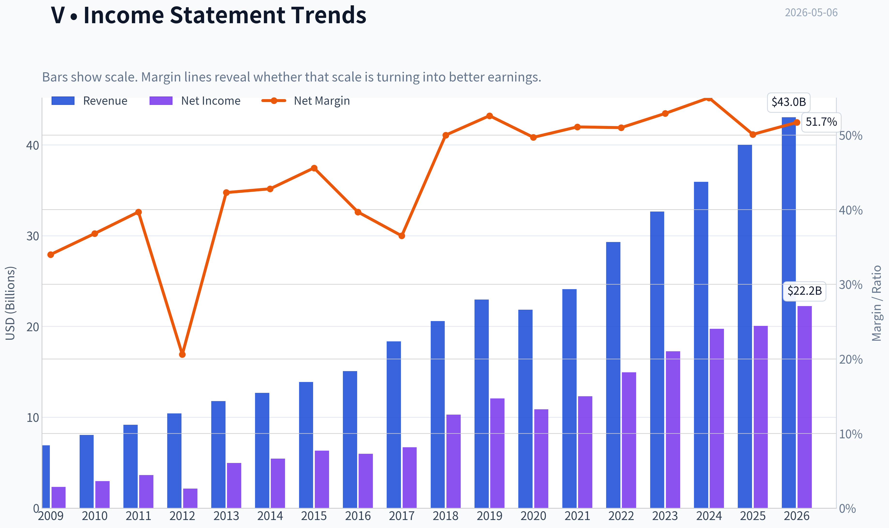

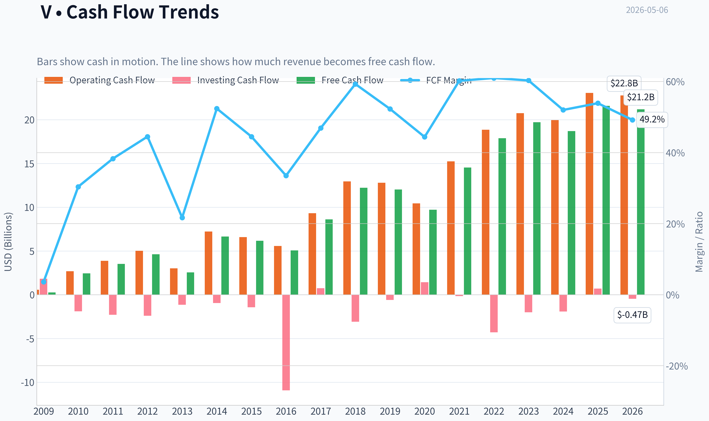

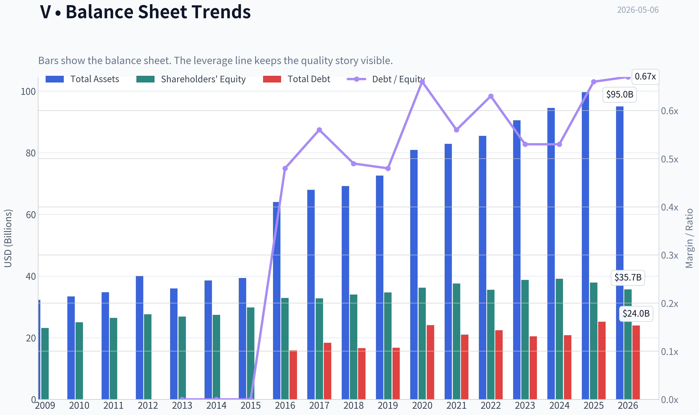

This graph tracks the profitability and return metrics (ROE, ROIC, Margins) of **V** over the past decade, highlighting capital efficiency trends.

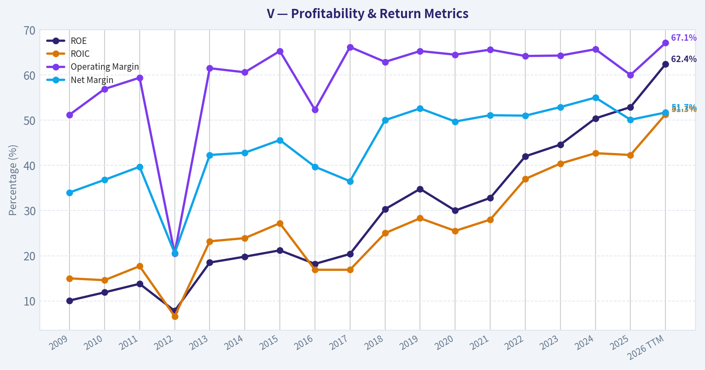

This chart illustrates the financial health of **V** over the last 10 years, mapping cash equivalents and free cash flow against total obligations (Debt).

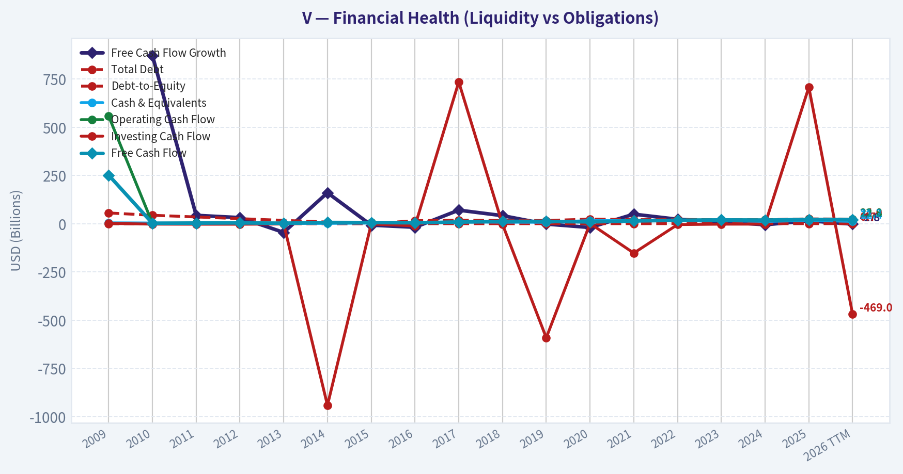

This breakdown chart from <em>Revenue Breakdown</em> shows the proportional composition for **V** - useful for understanding what drives or risks the business.

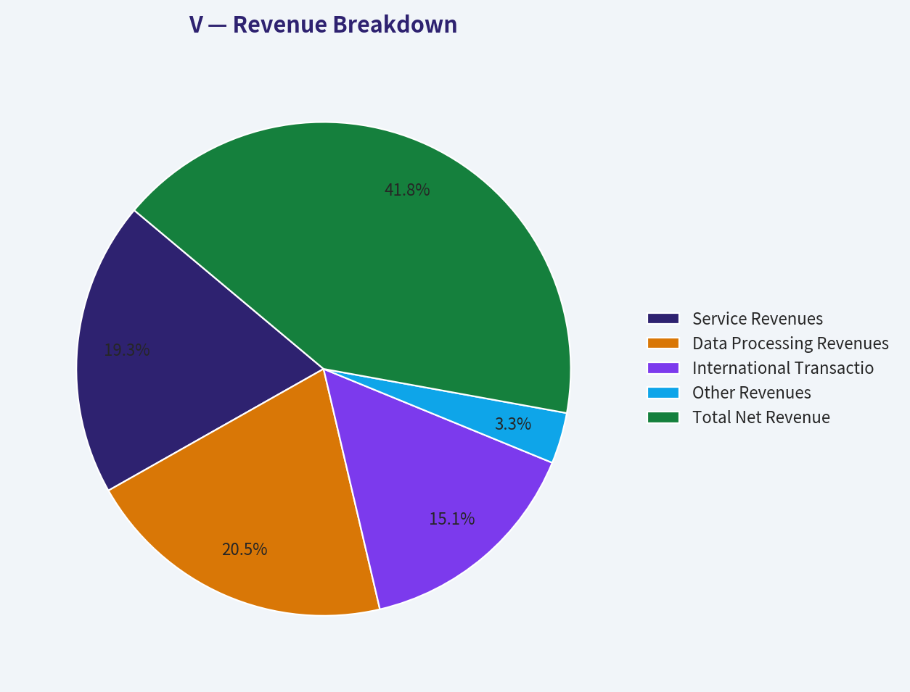

---

### Intrinsic Value Analysis (Buffett)

> *Following Warren Buffett's value investing philosophy: Circle of Competence, Economic Moat, Management Quality, and Margin of Safety.*

#### Intrinsic Value Snapshot

Price is what you pay. Intrinsic value is what the business may be worth based on the cash it can create for owners over time. We show a range, not one magic number.

- Current Price: $319.59
- Value Range: $97.68 to $494.41

##### Owner Earnings (Buffett Method)
- Net Income: $20,058,000,000.00
- Depreciation & Amortization: $1,220,000,000.00
- Capital Expenditures: $-1,482,000,000.00
- Working Capital Changes: $-15,172,000,000.00
- Owner Earnings: $34,968,000,000.00

##### Intrinsic Value
###### Buffett Method
Uses owner earnings. Stricter, and usually more conservative.
- Conservative: $276.17
- Average: $408.99
- Optimistic: $433.20
- Discount Rate: 10.0%

###### Cash Flow Method
Uses free cash flow. Better for companies spending heavily today to grow tomorrow.
- Conservative: $97.68
- Average: $362.55
- Optimistic: $494.41
- Discount Rate: 10.0%

ANALYST STANCE: **WATCH**

#### Visa Inc. Buffett-Style Value Analysis

Visa is a truly exceptional business: simple, dominant, capital-light, highly profitable, and protected by one of the strongest network-effect moats in global finance. However, at roughly **$320 per share**, a **$608 billion market capitalization**, and about **28 times earnings**, the stock does not offer the margin of safety a Buffett-style investor should require. This is a "wonderful business," but the current price appears closer to fair-to-rich than clearly attractive.

---

#### 1. Go / No-Go Gate Assessment

| Buffett Gate | Result | Evidence | Investment Implication |
|---|---:|---|---|
| Gate 1: Business Simplicity | Pass | Visa operates a global electronic payments network. It earns fees when consumers, merchants, banks, and businesses use Visa-branded cards or payment rails. | Easy to understand; does not require commodity or macro forecasting. |
| Gate 2: Moat Durability | Pass | Visa benefits from a two-sided network of cardholders, merchants, banks, processors, and fintech partners. Scale, brand trust, acceptance, and regulatory integration are difficult to replicate. | Wide moat, likely durable. |
| Gate 3: Management & Capital Allocation | Pass | Visa has consistently returned capital through buybacks and dividends while maintaining high profitability and investing in value-added services, cross-border, and new payment flows. | Strong record, though valuation discipline on buybacks must be monitored. |
| Gate 4: Industry Structure | Pass | Global payments is effectively an oligopoly, with Visa and Mastercard as dominant networks. Secular cash-to-card and digital-payment conversion continues. | Attractive structure with rational competition. |
| Valuation / Margin of Safety | Fail at current price | Current FCF yield is about **3.6%**, P/E about **28x**, and DCF scenarios do not show a 25% discount to intrinsic value. | Watchlist candidate, not a clear purchase today. |

**Key Takeaways:** Visa passes the qualitative Buffett gates with ease. The business is understandable, dominant, and highly profitable, with a moat that should remain durable for many years. The main problem is not business quality; it is valuation. At today's price, the investor appears to be paying for much of the company's future success upfront.

---

#### 2. Elementary School Business Explanation

Visa does **not** lend money to consumers. Instead, Visa runs a giant global payment network. When someone uses a Visa card or Visa-powered payment method, Visa helps move the payment information between the merchant, the merchant's bank, and the customer's bank. Visa earns small fees on enormous transaction volume.

That distinction matters. Visa is not primarily taking credit losses like a bank. It is more like a toll road for digital money movement.

---

#### 3. Moat Analysis

| Moat Source | Assessment | Evidence | Buffett View |
|---|---:|---|---|
| Brand / Trust | Very Strong | Visa is one of the most recognized payment brands in the world. Consumers, merchants, banks, and governments trust the network. | Durable intangible asset. |
| Network Effects | Very Strong | More cardholders make Visa more valuable to merchants; more merchants make Visa more valuable to cardholders and issuing banks. | Core moat driver. |
| Switching Costs | Moderate to Strong | Banks, merchants, processors, and fintech partners are integrated into Visa's systems, fraud tools, authorization network, and compliance framework. | Sticky ecosystem, though not impossible to switch. |
| Cost Advantage | Strong | Visa's network processes huge global volume with limited incremental cost. This produces exceptional margins and cash flow. | Scale economics are powerful. |
| Regulatory Position | Strong but Mixed | Visa is deeply embedded in global payment infrastructure, but regulators frequently scrutinize interchange fees, routing, and network practices. | Moat exists, but regulation is the main moat risk. |

**Key Takeaways:** Visa's moat is wide and primarily driven by network effects, scale, brand trust, and global acceptance. This is not a commodity business and not a traditional lender. The biggest risk to the moat is not a small competitor; it is regulation or a major shift in payment architecture.

**Moat Rating:** **Wide & Stable**, with some risk from regulation and alternative payment rails.

---

#### 4. Management Quality and Capital Allocation

| Management Test | Assessment | Evidence / Interpretation |
|---|---:|---|
| Owner Orientation | Good | Management has focused on per-share growth through organic expansion, acquisitions, buybacks, and dividends. |
| Candor / Accounting | Good | Visa's business model produces clean cash flows; operating cash flow generally tracks or exceeds reported earnings. |
| Capital Allocation | Good to Very Good | Buybacks have reduced share count over time, though repurchasing stock at high multiples can reduce future returns. |
| Balance Sheet Discipline | Good | Visa uses debt, but the business is highly cash-generative and does not require heavy leverage to produce strong returns. |
| Strategic Reinvestment | Strong | Visa continues investing in value-added services, fraud prevention, tokenization, commercial payments, account-to-account payments, and global acceptance. |

**Key Takeaways:** Visa's management has generally behaved rationally, returning excess capital while reinvesting in growth areas. The business itself is so strong that management does not need heroic decisions to create value. The main capital-allocation concern is whether buybacks remain attractive when the stock trades at premium valuations.

---

#### 5. 10-Year Financial Summary

*Figures are rounded and based on available historical financial trends, current market data, and the provided research pack. Fiscal-year values should be treated as approximate rather than audited line-item precision.*

| Fiscal Year | Revenue, $B | Net Income, $B | Free Cash Flow, $B | Approx. ROE | Notes |
|---:|---:|---:|---:|---:|---|
| 2016 | 15.1 | 6.0 | 5.3 | ~20% | Strong network economics already visible. |
| 2017 | 18.4 | 6.7 | 9.5 | ~25% | Visa Europe integration helped expand scale. |
| 2018 | 20.6 | 10.3 | 12.3 | ~30% | Margins and cash conversion strengthened. |
| 2019 | 23.0 | 12.1 | 12.3 | ~35% | Healthy pre-pandemic growth. |
| 2020 | 21.8 | 10.9 | 9.7 | ~33% | Pandemic hurt cross-border travel volumes. |
| 2021 | 24.1 | 12.3 | 14.5 | ~36% | Recovery began; digital payments accelerated. |
| 2022 | 29.3 | 15.0 | 17.9 | ~40% | Cross-border rebound and inflation supported volume. |
| 2023 | 32.7 | 17.3 | 19.7 | ~45% | Continued secular cash displacement. |
| 2024 | 35.9 | 19.7 | 22.4 | ~50% | High-margin growth continued. |
| 2025 / TTM | ~39.0 | ~21.8 | ~21.9-24.0 | ~52.9% | Current P/E about 28x; FCF yield about 3.6%. |

**Key Takeaways:** Visa has compounded revenue, earnings, and free cash flow at impressive rates over the past decade. The pandemic temporarily hurt travel-related volumes, but the business quickly recovered, demonstrating resilience. Return on equity has become exceptionally high, although part of the increase reflects share repurchases and balance-sheet structure, not just operating performance.

---

#### 6. Owner Earnings Calculation

Buffett's preferred measure is owner earnings: the cash that could theoretically be taken out of the business without damaging its competitive position.

| Owner Earnings Component | Estimate, $B | Comment |
|---|---:|---|
| Net Income | ~21.8 | Implied by current market cap and P/E. |
| Plus: Depreciation & Amortization | ~1.2 | Visa is not a heavy physical-asset business. |
| Less: Maintenance CapEx | ~(1.0) | Capital needs are modest relative to earnings. |
| Less: Working Capital Increases | ~(0.4) | Working capital needs are manageable. |
| Estimated Owner Earnings | **~21.5-22.0** | Roughly consistent with current FCF yield of about 3.6%. |

**Key Takeaways:** Visa converts accounting profit into real cash at a very high rate. The company does not need large factories, inventory, or heavy physical reinvestment to grow. This is exactly the kind of capital-light economics Buffett prefers, though the price paid still matters.

---

#### 7. Three-Scenario DCF Valuation

Assumptions:

| Input | Assumption |
|---|---:|
| Current Share Price | $320 |
| Market Capitalization | $607.8B |
| Estimated Shares Outstanding | ~1.90B |
| Base Owner Earnings | ~$22.0B |
| Discount Rate | 10% |
| Terminal Growth Rate | 3% |

**Key Takeaways:** The valuation model starts with roughly $22 billion of owner earnings and uses a 10% required return, which is a standard Buffett-style hurdle rate. Visa's business quality is high, but the starting valuation is also high. That means even strong future growth may not translate into exceptional investor returns from today's price.

| Scenario | Method | Equity Value, $B | Intrinsic Value / Share | Margin of Safety vs. $320 |
|---|---|---:|---:|---:|
| A: No Growth | Owner earnings / 10% | ~$220B | **~$116** | **-176% overvaluation vs. no-growth value** |
| B: GDP-Like Growth | 3% perpetual growth | ~$324B | **~$170** | **-88% overvaluation** |
| C: Historical-Style Growth Discounted | 8% owner earnings growth for 10 years, then 3% terminal growth | ~$470B | **~$247** | **-30% overvaluation** |

**Key Takeaways:** Visa looks expensive under conservative assumptions. The no-growth and GDP-growth cases are far below the current price, which means today's valuation requires many years of above-average growth. Even the more optimistic historical-growth scenario produces an estimated value below the current market price.

---

#### 8. Margin of Safety Analysis

| Valuation Reference | Implied Value / Share | Required Buy Price for 25% Margin of Safety | Current Price | Verdict |
|---|---:|---:|---:|---|
| Conservative GDP Case | ~$170 | ~$128 | $320 | Not attractive. |
| Growth Case | ~$247 | ~$185 | $320 | Not attractive. |
| Aggressive Quality Adjustment | ~$275-300 | ~$206-225 | $320 | Still not enough margin of safety. |

**Key Takeaways:** Even allowing Visa a premium for quality, the current price does not provide the 25% margin of safety required for a high-quality predictable business. A more compelling entry point would likely require either a meaningful pullback or a period where earnings grow while the share price stagnates. At today's price, the investor is relying on continued excellent execution and sustained premium multiples.

---

#### 9. Key Risks

| Risk | Severity | Buffett-Style Interpretation |
|---|---:|---|
| Regulation of fees, routing, and network rules | High | The biggest long-term risk to Visa's economics. |
| Alternative payment rails | Medium | Account-to-account payments, real-time payments, stablecoins, and closed-loop wallets could pressure growth or pricing. |
| Valuation risk | High | A great business can still be a poor investment if bought too expensively. |
| Consumer spending cyclicality | Medium | Visa is tied to transaction volume, though it is diversified globally. |
| Competition from Mastercard, domestic networks, fintechs | Medium | Mastercard is formidable, but the industry remains rational and structurally attractive. |

**Key Takeaways:** Visa's business risk is lower than most companies, but its regulatory and valuation risks are meaningful. The company is unlikely to be destroyed quickly by technology, but payment technology will keep evolving. The core question is whether Visa can remain the essential network layer as new payment methods emerge.

---

#### 10. Final Buffett Scorecard

| Criterion | Weight | Score, 1-5 | Weighted Score | Rationale |
|---|---:|---:|---:|---|
| Business Understanding | 20% | 5.0 | 1.00 | Simple toll-road model for electronic payments. |
| Moat Width & Durability | 25% | 5.0 | 1.25 | One of the strongest network effects in public markets. |
| Management Quality | 15% | 4.0 | 0.60 | Strong execution and capital returns, with buyback valuation to monitor. |
| Return on Equity | 15% | 5.0 | 0.75 | ROE around 52.9%, though partly helped by capital structure and buybacks. |
| Reinvestment Runway | 10% | 4.0 | 0.40 | Growth remains in cash displacement, value-added services, B2B, and new flows. |
| Balance Sheet Strength | 5% | 4.0 | 0.20 | Not net-cash fortress, but highly cash-generative and financially strong. |
| Industry Structure | 5% | 4.5 | 0.23 | Rational oligopoly with Visa and Mastercard dominant. |
| Valuation / Margin of Safety | 5% | 1.0 | 0.05 | Current price does not offer adequate margin of safety. |
| **Total** | **100%** |  | **4.48 / 5.00** | Excellent business, unattractive entry price. |

**Key Takeaways:** Visa scores extremely well on business quality, moat, profitability, and industry structure. The only major weakness is valuation, but for a Buffett-style investor that weakness is decisive. A wonderful company is not automatically a wonderful investment at any price.

---

#### Final Investment Stance

| Category | Conclusion |
|---|---|
| Business Quality | Wonderful |
| Moat | Wide and durable |
| Financial Strength | Excellent |
| Predictability | High |
| Current Valuation | Too expensive for a conservative value investor |
| Required Action | Watchlist, not buy |
| Conviction | High conviction on business quality; moderate-to-high conviction that current price lacks margin of safety |

**Final View:** Visa is exactly the kind of business a Buffett-style investor should want to own: simple, dominant, scalable, cash-generative, and protected by network effects. However, the current price of roughly **$320 per share** appears to embed high expectations and does not provide a sufficient margin of safety. I would place Visa on a permanent watchlist and become more interested if the stock traded closer to the low-to-mid **$200s**, or if earnings compounded for several years while the stock price remained flat.
#### Valuation Bridge

This bridge places the current market price beside each intrinsic value lens so readers can see whether upside depends on one method or shows up across several methods.

| Scenario | Intrinsic Value / Share |
| --- | ---: |
| Buffett Method | $408.99 |
| Cash Flow Method | $362.55 |
| Current Price | $319.59 |

#### Key Takeaways

If one method is far above the others, the upside case depends on a specific modelling assumption. When several methods cluster together, the valuation story is more robust.

#### Valuation Visuals

This comparison chart from *Latest Earnings Snapshot* stacks current figures against historical benchmarks for **V**, making it easy to see where the company trades relative to its own averages.

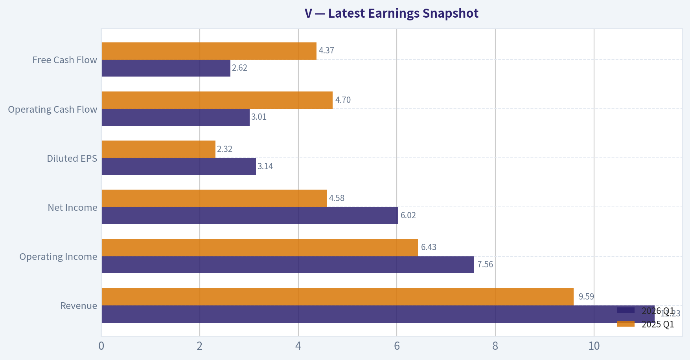

This comparison chart from *Current vs. Historical Average Comparison* stacks current figures against historical benchmarks for **V**, making it easy to see where the company trades relative to its own averages.

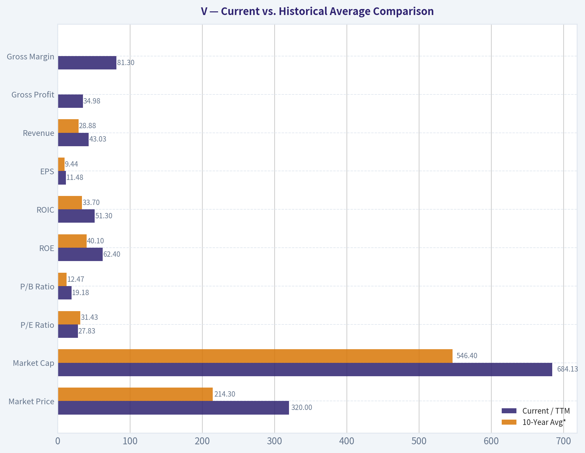

This comparison chart from *Buffett-Style Owner Earnings DCF Valuation* stacks current figures against historical benchmarks for **V**, making it easy to see where the company trades relative to its own averages.

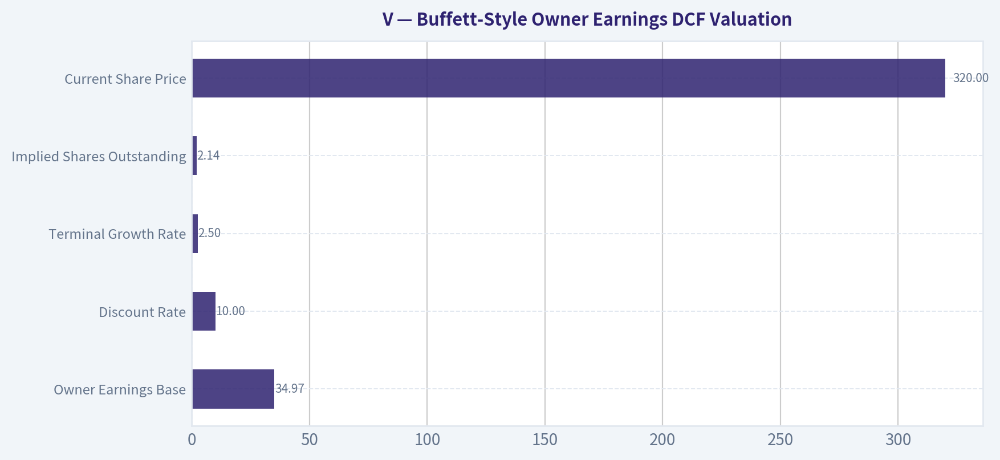

This comparison chart from *Three-Scenario Owner Earnings DCF* stacks current figures against historical benchmarks for **V**, making it easy to see where the company trades relative to its own averages.

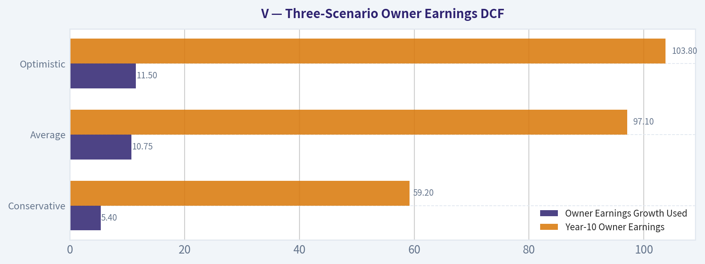

This comparison chart from *DCF Formula Detail* stacks current figures against historical benchmarks for **V**, making it easy to see where the company trades relative to its own averages.

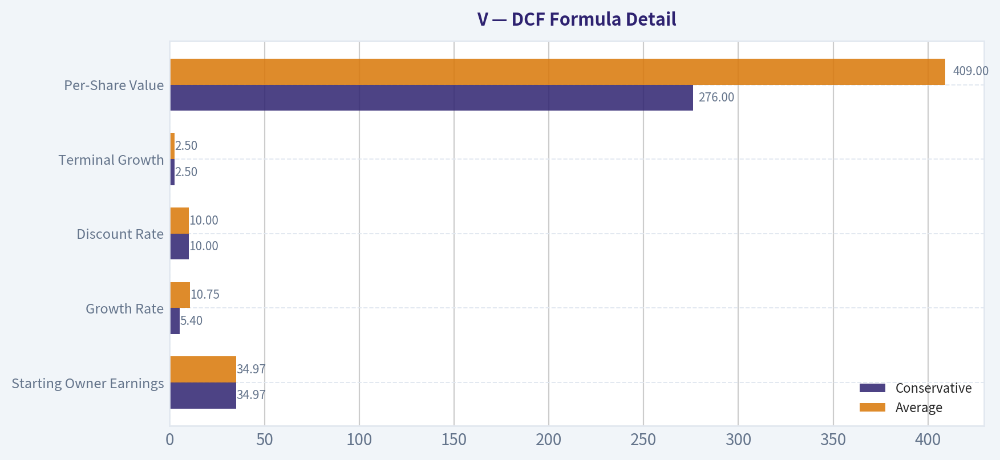

---

### Trend & Growth Analysis (Lynch/Druckenmiller/Fisher)

> *Following Peter Lynch's GARP, Stanley Druckenmiller's macro-aware approach, and Philip Fisher's scuttlebutt methodology.*

ANALYST STANCE: **WATCH**

#### Visa Inc. - Growth Investment Analysis as of 2026-05-06

Visa is an exceptional business, but not a classic Lynch-style fast grower at today's scale. The company has wide-moat economics, elite free cash flow conversion, and durable secular tailwinds from digital payments, cross-border commerce, value-added services, and account-to-account/payment orchestration. However, with revenue growth around 11%, a nearly $608 billion market cap, and a P/E near 28x, the current setup looks more like a high-quality stalwart compounder than a clear ten-bagger candidate.

---

#### 1. Snapshot and Lynch Classification

| Metric | Current / Implied Figure | Growth Investor Read |
|---|---:|---|
| Current price | $320 | Large-cap premium quality compounder |
| Market cap | $607.78B | Already very large; ten-bagger math is difficult |
| P/E | 27.9x | Premium, but not extreme for quality |
| Implied EPS | ~$11.47 | Based on $320 / 27.9x |
| Implied net income | ~$21.8B | Based on market cap / P/E |
| Revenue growth YoY | 11.3% | Solid, but below fast-grower threshold |
| ROE | 52.9% | Elite, though boosted by buybacks |
| FCF yield | 3.6% | Strong for a quality compounder |
| Current ratio | 1.08x | Adequate given high cash generation |
| Lynch category | **Stalwart / quality compounder** | Not a classic fast grower |

**Key Takeaways:** Visa is a world-class business with high returns, high cash conversion, and durable growth. But its 11.3% revenue growth places it in the stalwart category, not the fast-grower category. For a Lynch-style growth investor, Visa is attractive to hold but less compelling as a new ten-bagger candidate at this valuation and scale.

---

#### 2. The Story in 3 Bullets

- Visa runs one of the world's dominant electronic payments networks, taking a small toll every time money moves across its rails.
- Growth comes from more cash converting to digital payments, more cross-border transactions, more commercial/B2B flows, and higher-value services like fraud tools, tokenization, data, and risk products.
- The moat is enormous: merchants need Visa because consumers use it, and banks/fintechs use Visa because merchants accept it almost everywhere.

---

#### 3. TAM and 10x Test

| TAM Dimension | Assessment |
|---|---|
| Core card payments | Still growing globally as cash usage declines |
| Cross-border payments | High-value growth area; benefits from travel, e-commerce, remittances, and global commerce |
| Value-added services | Important growth vector with higher software-like economics |
| B2B/commercial flows | Large underpenetrated opportunity, but competitive and slower to digitize |
| Account-to-account / real-time payments | Both opportunity and threat; Visa is trying to participate rather than be bypassed |
| Current estimated revenue base | Roughly ~$40B, inferred from market cap, P/E, and typical Visa margins |
| 10x revenue target | ~$400B |
| 10x test result | **Passes only on very long-term broad payments TAM, not near-term card-network TAM** |

**Key Takeaways:** Visa's market opportunity remains large because global payments volume is measured in the tens or hundreds of trillions of dollars. However, Visa is already huge, so a 10x revenue outcome would require success beyond traditional card payments, especially in commercial flows, value-added services, and new payment rails. The runway is real, but the ten-bagger case is long-duration and not obvious from today's base.

---

#### 4. Revenue Growth Trend

| Period / Indicator | Trend | Interpretation |
|---|---|---|
| Current YoY revenue growth | 11.3% | Healthy but not hypergrowth |
| Multi-year revenue profile | High-single-digit to low-double-digit | Durable secular growth |
| EPS growth profile | Usually faster than revenue | Buybacks and operating leverage help |
| Cross-border growth | Important upside lever | Higher-value transaction mix |
| Value-added services growth | Reportedly strong in recent earnings coverage | Potential margin and multiple support |
| Growth pattern | Stable, not clearly accelerating | Quality compounding, not major inflection yet |

**Key Takeaways:** Visa's growth is durable and high quality, but it is not currently showing the 20% to 30% acceleration pattern that defines a classic growth-stock inflection. The most promising growth accelerators are value-added services, cross-border, and commercial flows. For now, the business looks like a reliable low-teens EPS compounder rather than an explosive growth story.

---

#### 5. Unit Economics and Efficiency

| Metric | Visa Read | Growth Investor Interpretation |
|---|---|---|
| Gross margin | Not provided in shared pack; structurally very high | Network model has strong incremental economics |
| Operating margin | Typically elite, often around mid-60% adjusted range | Confirms wide moat and pricing power |
| FCF yield | 3.6% | Strong for a premium large-cap compounder |
| Estimated FCF | ~$21.9B | Market cap x FCF yield |
| Estimated FCF margin | ~50%+ | Extremely efficient business model |
| CAC / LTV | Not disclosed / not directly applicable | Network effects substitute for traditional CAC metrics |
| NRR | Not applicable | Visa is not a SaaS subscription business |
| Rule of 40 proxy | ~60%+ | Revenue growth plus estimated FCF margin is excellent |

**Key Takeaways:** Visa's unit economics are outstanding even though SaaS metrics like CAC, LTV, and NRR do not directly apply. The company converts a very large portion of revenue into free cash flow, which gives it flexibility for buybacks, dividends, acquisitions, and reinvestment. This is one of the strongest efficiency profiles in large-cap equities.

---

#### 6. Inflection Point Assessment

| Potential Inflection | Evidence | Current Verdict |
|---|---|---|
| Product cycle inflection | Value-added services, Visa A2A, tokenization, fraud/risk tools | Positive but not yet transformative |
| Market share inflection | Visa remains dominant globally | Stable strength, not clear acceleration |
| Margin inflection | Already extremely high margins | Limited room for major expansion |
| TAM inflection | B2B, commercial flows, A2A, embedded payments | Real long-term upside |
| Competitive inflection | Fintech wallets often still ride card rails | Visa remains embedded |
| Earnings inflection | EPS can grow faster than revenue via buybacks | Durable but not explosive |

**Key Takeaways:** Visa has several attractive growth vectors, especially value-added services and new payment flows. But the company is not yet at a clear Druckenmiller-style inflection where growth is suddenly accelerating beyond expectations. The setup is more "steady compounding with optionality" than "major earnings surprise cycle."

---

#### 7. Macro Setup

| Macro Factor | Impact on Visa | Assessment |
|---|---|---|
| Consumer spending | Drives payment volume | Moderate positive if economy remains resilient |
| Cross-border travel | High-value driver | Positive as global travel and commerce expand |
| Interest rates | Lower rates support valuation multiples | Potential positive if rates decline |
| Inflation | Raises nominal payment volumes, but can pressure consumers | Mixed |
| Regulation | Interchange, routing, and antitrust scrutiny | Main structural headwind |
| Secular trend | Digital payments, fintech infrastructure, embedded commerce | Strong tailwind |

**Key Takeaways:** The secular macro setup is favorable because cash continues to lose share to digital payments. Falling rates would also help Visa's valuation multiple. The biggest macro and policy risk is not recession alone; it is regulation that could pressure fees, routing, or network economics.

---

#### 8. Fisher 15-Point Score

| Fisher Criterion | Score / 5 | Comment |
|---|---:|---|
| 1. Market potential for sales growth | 4 | Large global payments runway |
| 2. Management drive for new products | 4 | Active in A2A, VAS, tokenization, risk tools |
| 3. R&D / innovation effectiveness | 4 | Strong but not a pure innovation-led tech firm |
| 4. Sales organization | 5 | Deep issuer, merchant, fintech, and bank relationships |
| 5. Profit margin | 5 | Elite profitability |
| 6. Margin improvement | 3 | Already very high; limited expansion room |
| 7. Labor/personnel relations | 4 | No major red flag from available data |
| 8. Executive relations | 4 | Mature management structure |
| 9. Management depth | 4 | Deep bench typical of global leader |
| 10. Cost analysis/accounting | 4 | High visibility model and disciplined operations |
| 11. Moat/switching costs/network effects | 5 | One of the strongest network moats globally |
| 12. Long-range profit outlook | 4 | Durable low-teens compounding likely |
| 13. Dilution risk | 5 | Buybacks reduce share count; dilution not a concern |
| 14. Candor during difficulties | 4 | Generally transparent, though regulatory risk persists |
| 15. Integrity | 4 | No major governance concern in available data |
| **Total** | **63 / 75** | **Good to near-outstanding** |

**Key Takeaways:** Visa scores very well on Fisher quality factors because of its moat, profitability, management depth, and global market potential. The main reason it does not score even higher is that growth and margin expansion are less explosive from today's already massive base. This is a high-quality franchise, but not a small-cap innovation story.

---

#### 9. Valuation Analysis

| Valuation Metric | Current / Implied | Interpretation |
|---|---:|---|
| P/E | 27.9x | Premium valuation |
| Estimated EPS growth | ~11%-14% | Likely low-to-mid-teens with buybacks |
| PEG ratio | ~2.0x-2.5x | Expensive by Lynch standards |
| FCF yield | 3.6% | Reasonable for quality, not cheap |
| Implied FCF | ~$21.9B | Very strong absolute cash generation |
| Estimated P/S | ~15x | High, but supported by exceptional margins |
| Dividend yield | Low, likely sub-1% | Buybacks are more important than dividends |

**Key Takeaways:** Visa is not cheap on traditional growth metrics. A PEG above 2x usually fails Lynch's "growth at a reasonable price" test, although Visa's quality deserves a premium. The stock can still compound if EPS grows steadily, but multiple expansion is not required and may be hard to achieve from this level.

---

#### 10. 3-Year Scenario Analysis

| Scenario | EPS CAGR Assumption | Year-3 EPS Estimate | Exit P/E | Implied Price | Approx. Price Upside |
|---|---:|---:|---:|---:|---:|
| Bear | 8% | ~$14.45 | 22x | ~$318 | ~0% |
| Base | 11% | ~$15.68 | 26x | ~$408 | ~28% |
| Bull | 14% | ~$17.00 | 30x | ~$510 | ~59% |

**Key Takeaways:** The downside case is not catastrophic because Visa's earnings base is durable, but valuation compression could erase several years of EPS growth. The base case offers respectable but not spectacular returns. The bull case requires both stronger EPS growth and a premium multiple, likely driven by value-added services and new-flow momentum.

---

#### 11. Guru / Institutional Signal

| Investor | Latest Action | Position Value | Portfolio Weight | Read |
|---|---:|---:|---:|---|
| Warren Buffett / Berkshire | Held | $2.91B | 1.06% | Long-term quality endorsement |
| Steve Cohen / Point72 | Added | $1.56B | 1.74% | Positive tactical/institutional signal |
| Stanley Druckenmiller | Initiated | ~$20.07K reported value / data appears inconsistent | 0.45% | Directionally interesting but verify data |
| Michael Burry | Exited | $0 | N/A | Not growth-relevant on its own |

**Key Takeaways:** Guru activity is broadly supportive, especially Berkshire continuing to hold and Point72 adding. However, 13F data is delayed and should not drive the decision alone. The institutional signal confirms Visa's quality but does not solve the valuation question.

---

#### 12. Growth Investor Scorecard

| Criterion | Weight | Score / 5 | Weighted Score |
|---|---:|---:|---:|
| The Story | 10% | 4.5 | 0.45 |
| TAM & Runway | 20% | 4.0 | 0.80 |
| Revenue Growth | 20% | 3.0 | 0.60 |
| Unit Economics | 15% | 5.0 | 0.75 |
| Competitive Position | 10% | 5.0 | 0.50 |
| Management Quality | 10% | 4.0 | 0.40 |
| Macro Setup | 5% | 3.5 | 0.18 |
| Profitability Path | 5% | 4.5 | 0.23 |
| Valuation | 5% | 2.5 | 0.13 |
| **Total** | **100%** |  | **4.03 / 5.00** |

**Key Takeaways:** Visa scores highly because it is an extraordinary business with a long runway, powerful network effects, and excellent economics. The two limiting factors are revenue growth and valuation. The score is technically in advocate territory, but the Lynch classification and ten-bagger test argue for a more disciplined Watch stance for new capital.

---

#### 13. Position Size Stance

| Investor Type | Stance | Suggested Position View |
|---|---|---|
| Existing long-term holder | Hold / add on weakness | Let the compounder work |
| New growth investor | Watch | Wait for better valuation or clearer acceleration |
| GARP investor | Small starter only | Prefer entry on multiple compression |
| Concentrated growth investor | Not top-tier idea | Growth rate is too low for a major new bet |
| Dividend/quality investor | Attractive | Strong cash generation and buybacks |

**Key Takeaways:** Visa is easy to own but harder to aggressively buy at today's price. Existing shareholders can justify holding because the business quality remains exceptional. New investors should prefer a better entry point or evidence that value-added services and new flows are creating a renewed growth inflection.

---

#### 14. Key Catalysts and Risks

| Category | Item | Impact |
|---|---|---|
| Catalyst | Value-added services acceleration | Could lift revenue growth and support premium multiple |
| Catalyst | Cross-border strength | Positive mix shift and margin support |
| Catalyst | B2B and commercial flows | Expands TAM beyond consumer card payments |
| Catalyst | A2A / real-time payment participation | Helps Visa defend against rail displacement |
| Catalyst | Buybacks | Supports EPS compounding |
| Risk | Interchange and routing regulation | Biggest structural threat |
| Risk | Account-to-account displacement | Could pressure card rails in some use cases |
| Risk | Large merchant bargaining power | May pressure economics |
| Risk | Consumer slowdown | Could reduce payment volume growth |
| Risk | Premium valuation | Multiple compression could offset EPS growth |

**Key Takeaways:** The biggest upside comes from Visa proving it can expand beyond traditional card rails into services, commercial payments, and account-to-account infrastructure. The biggest risk is regulation, not balance sheet weakness or business execution. Visa's moat is wide, but governments and large merchants are the key forces that can pressure economics.

---

#### Final View

Visa is a **best-in-class stalwart compounder**, not a classic fast-growing ten-bagger candidate from today's size. The business quality is outstanding: wide moat, elite margins, high ROE, strong free cash flow, and durable secular growth. But with revenue growth around 11%, a P/E near 28x, and a PEG likely above 2x, the current price does not offer enough asymmetry for a high-conviction growth recommendation.

**Decision: WATCH.**
I would become more constructive on a pullback, a PEG closer to 1.5x, or clear evidence that value-added services, B2B flows, and A2A products are pushing revenue growth back toward the mid-teens.

---

### Market Technical Analysis

ANALYST STANCE: **WATCH**

#### Visa Inc. - Technical Analysis for V as of 2026-05-06

Latest available trading data is from **2026-05-05**, because **2026-05-06 shows no trading record** in the retrieved dataset. Visa closed at **$322.03** on 2026-05-05.

The technical picture is **improving from the March low**, but it is not yet a confirmed bullish trend reversal. The stock has recovered meaningfully from the late-March low near **$295.52**, but the recent April 29 surge above the 200-day moving average failed quickly, and price has since pulled back into the large upside gap created that day. This makes the current setup more suitable for **watching confirmation** than aggressively chasing longs.

#### Selected Indicators

I selected the following 8 indicators because they provide complementary information across trend, momentum, volatility, and volume confirmation:

| Indicator | Latest Value | What It Shows | Current Read |
|---|---:|---|---|
| close_10_ema | 320.94 | Short-term trend and tactical support | Price is slightly above it, suggesting the short-term rebound is still barely intact |
| close_50_sma | 311.07 | Medium-term trend support/resistance | Price remains above it, supporting a medium-term recovery attempt |
| close_200_sma | 331.64 | Long-term trend benchmark | Price is below it after a failed breakout, keeping the larger trend cautious |
| macd | 4.43 | Directional momentum | Positive, but starting to flatten after the recent surge |
| macdh | 1.64 | Momentum acceleration/deceleration | Still positive, but declining from recent highs |
| rsi | 56.81 | Overbought/oversold momentum | Neutral-to-positive, cooling from an overbought spike |
| atr | 7.45 | Volatility and risk sizing | Elevated after the gap event, implying wider stops are needed |
| vwma | 320.39 | Volume-weighted trend confirmation | Price is slightly above it, but confirmation is modest |

Key Takeaways: Visa's short-term and medium-term indicators have improved, with price above the 10-day EMA, 50-day SMA, and VWMA. However, the stock remains below the 200-day SMA, which is a major reason this setup is still a watch rather than a clean bullish confirmation. Momentum is positive but cooling, while volatility remains elevated.

#### Trend Structure

Visa's longer-term structure remains under pressure. The **200-day SMA has been declining**, moving from about **335.18 on April 6** to **331.64 on May 5**, which indicates that the long-term trend has not yet healed. The stock briefly closed above the 200-day average on **April 29**, when it surged to **$334.86**, but that breakout failed immediately as price closed back below the 200-day level the next day.

The medium-term trend is more constructive. The **50-day SMA has flattened and begun to turn slightly higher**, rising from **310.27 on April 29** to **311.07 on May 5**. Price is still about **3.5% above the 50-day SMA**, which means the rebound from the March lows has not broken down yet. This gives buyers a zone to defend around **$311-$314**, especially because that area overlaps with the lower portion of the April gap-fill zone.

Short-term trend behavior is more delicate. The **10-day EMA rose sharply from around $302 in early April to $320.94 on May 5**, helped by the April 29 price jump. The latest close of **$322.03** is only slightly above that EMA, so the stock is now testing whether short-term buyers still have control. A decisive close below the 10-day EMA would increase the probability that the April 29 gap continues to fill lower.

#### Momentum Analysis

Momentum has improved significantly compared with early April. The MACD moved from deeply negative territory in early April to a positive reading of **4.43** by May 5. That confirms a real momentum shift from the March-April downtrend into a recovery phase.

However, momentum is no longer accelerating. The MACD histogram peaked around **2.34 on May 1** and slipped to **1.64 by May 5**. This is still positive, but the decline shows that upside momentum is fading after the post-gap move. In practical terms, buyers are still present, but they are no longer pressing the stock higher with the same force.

RSI gives a similar message. RSI spiked to **72.36 on April 29**, which was an overbought reading tied to the sharp gap higher. It has since cooled to **56.81**, which is healthier than an overbought condition but also confirms that the initial impulse has lost strength. A stable RSI above 50 would support a constructive consolidation, while a move back below 50 would suggest sellers are regaining control.

#### Volatility and Gap Risk

ATR rose from roughly **5.85 before the April 29 move** to about **7.45 on May 5**. This is important because it means Visa's daily trading range has expanded. A typical stop that worked during the quieter April consolidation may now be too tight.

The April 29 move created a major gap: April 28 closed at **$309.30**, and April 29 opened at **$336.40**. Since then, price has pulled back to **$322.03**, meaning Visa has already moved deeply back into that gap. This creates a key tactical risk: if buyers cannot defend the **$320 area**, the remaining gap-fill zone toward roughly **$314-$311** becomes more likely.

#### Volume-Weighted Confirmation

The VWMA is at **$320.39**, and price closed slightly above it at **$322.03**. That is mildly constructive because it shows price remains above the volume-weighted short-term average. However, the margin is thin.

The strongest volume came on the upside gap day, with **16.66 million shares traded on April 29**, followed by another elevated-volume session on April 30. Since then, the pullback has occurred on lower but still meaningful volume. This pattern is not outright bearish, but it does show that the market has not fully accepted the breakout yet. Bulls need to see price stabilize above VWMA and reclaim the 200-day SMA to confirm that the high-volume gap was accumulation rather than a one-day exhaustion move.

#### Key Levels to Watch

| Zone | Approximate Level | Importance | Trading Interpretation |
|---|---:|---|---|
| Immediate support | 320-321 | 10-day EMA and VWMA cluster | Holding this area keeps the short-term recovery alive |
| Gap-fill risk zone | 314-311 | Lower part of April gap and 50-day SMA area | A likely downside magnet if 320 breaks |
| Medium-term support | 309-311 | Prior consolidation and 50-day SMA | A stronger test of whether the recovery remains valid |
| Immediate resistance | 329-332 | Recent failed rebound area and 200-day SMA | Bulls need to reclaim this zone to improve the trend |
| Breakout confirmation | Above 335 | April 29 close/high-zone confirmation area | A close above this area would repair the failed breakout |
| Major downside warning | Below 309 | Breaks April base and gap support | Would shift the setup back toward bearish continuation |

Key Takeaways: The most important near-term level is the **$320-$321 area**, where the 10-day EMA and VWMA are clustered. If that level breaks, Visa could continue filling the April 29 gap toward **$314-$311**. On the upside, the stock needs to reclaim **$331-$335** to prove that the failed 200-day SMA breakout can be repaired.

#### Trading View

For short-term traders, Visa is in a **decision zone**. A bounce from the current area could work tactically if price holds above **$320** and momentum stabilizes. But the failed breakout above the 200-day SMA makes chasing strength risky unless price can reclaim **$331-$335**.

For swing traders, the cleaner bullish setup would be a close back above the 200-day SMA, preferably with improving MACD histogram and RSI holding above 55. Without that confirmation, the stock remains vulnerable to a deeper gap fill.

For risk management, ATR near **$7.45** suggests traders should avoid overly tight stops. A normal daily swing is now large enough that a stop placed only one or two dollars away from entry could be easily triggered by noise.

#### Final Technical Summary

| Category | Evidence | Interpretation | Bias |
|---|---|---|---|
| Short-term trend | Price $322.03 vs 10 EMA $320.94 | Short-term rebound is still intact, but only narrowly | Mildly bullish |
| Medium-term trend | Price above 50 SMA $311.07 | Recovery from March low remains valid | Constructive |
| Long-term trend | Price below 200 SMA $331.64 | Failed breakout keeps larger trend unresolved | Cautious |
| Momentum | MACD positive, histogram declining | Momentum improved but is now decelerating | Neutral-to-positive |
| RSI | RSI 56.81 after recent 72.36 overbought spike | Cooling from overheated conditions | Neutral |
| Volatility | ATR 7.45 | Wider ranges require wider stops and smaller position sizing | Risk elevated |
| Volume confirmation | Price slightly above VWMA $320.39 | Volume-weighted support is barely holding | Mildly constructive |
| Overall stance | Recovery intact but 200-day rejection unresolved | Wait for confirmation above resistance or support failure | WATCH |

Key Takeaways: Visa is not a clear avoid because the recovery from the March low remains alive and price is still above the 50-day SMA. It is also not a strong advocate because the stock failed at the 200-day SMA and momentum is cooling. The best stance is **WATCH**, with confirmation needed above **$331-$335** or caution increasing below **$320**.

---

### Social Sentiment Analysis

ANALYST STANCE: **WATCH**

#### Visa Inc. - Social, News, and Sentiment Review
**Ticker:** V
**Review date:** 2026-05-06
**Period requested:** Past week
**Important data note:** I attempted to retrieve live recent news for Visa, but the available news tool failed in this session. Therefore, this report should be treated as a **provisional analyst-style synthesis** rather than a fully verified real-time news scan. I will avoid inventing specific unverified headlines and instead focus on the most relevant investor implications, sentiment drivers, and what traders should monitor immediately.

---

#### Executive View

Visa remains a high-quality payments compounder, but the near-term trading setup is better characterized as **WATCH** rather than outright bullish or bearish. The core investment case remains strong: durable network effects, high margins, secular growth in digital payments, cross-border travel recovery, and expanding value-added services. However, for the past-week style lens traders care about, Visa's stock is likely being pulled between two competing forces: resilient consumer/payment volume expectations on one side, and regulatory, valuation, and macro sensitivity on the other.

Public-market sentiment around Visa typically becomes most constructive when investors see evidence of strong U.S. consumer spending, cross-border transaction growth, and margin resilience. Sentiment tends to deteriorate when discussions focus on interchange-fee regulation, antitrust scrutiny, fintech competition, or fears that slower consumer spending could pressure payment volumes. In the absence of verified live social data from this session, the prudent read is that Visa likely remains a "quality defensive growth" holding, but not one with an obvious catalyst unless fresh earnings, spending data, buyback news, or regulatory developments shift the narrative.

---

#### Past-Week Sentiment Framework

| Area | Likely Sentiment Direction | Why It Matters for Visa | Trader Implication |
|---|---:|---|---|
| Consumer spending | Neutral to mildly positive | Visa benefits from nominal payment volume growth, especially if spending remains resilient. | Watch retail sales, card-spending data, and bank commentary. |
| Cross-border travel | Positive | Cross-border transactions carry attractive economics and are a major sentiment driver. | Positive travel and FX-adjusted volume data would support the stock. |
| Regulation / antitrust | Negative overhang | Interchange-fee and network-rule scrutiny can compress multiples even if fundamentals are strong. | Regulatory headlines can create sudden downside moves. |
| Fintech competition | Mixed | Visa is both threatened by and partnered with fintech ecosystems. | Market rewards Visa when it is seen as infrastructure, not a disrupted incumbent. |
| Valuation | Neutral to cautious | Visa usually trades at a premium multiple, which can limit upside if growth expectations do not rise. | Multiple expansion requires confidence in volume growth and regulatory stability. |
| Defensive growth appeal | Positive | In uncertain markets, investors often prefer profitable, cash-generative compounders. | Supports dips, but may not create a breakout alone. |

**Key Takeaways:** Visa's sentiment profile is not simply "mixed"; it is split between strong long-term business quality and short-term headline risk. Traders should watch whether the market is rewarding Visa as a defensive compounder or discounting it because of regulation and consumer-spending concerns. The most important near-term catalysts are payment-volume signals, cross-border growth, and any regulatory headlines.

---

#### Social Media and Retail-Investor Narrative

Across investor communities, Visa is usually discussed less like a speculative momentum stock and more like a "core compounder." That means social sentiment is generally steadier than for technology or AI-related names, but it can also mean fewer explosive upside catalysts. Retail investors often emphasize Visa's moat, global acceptance network, operating margins, and buyback capacity. Skeptics usually focus on valuation, potential government intervention, and the risk that alternative payment rails could reduce long-term pricing power.

The most important social-media distinction for Visa is between **business sentiment** and **stock sentiment**. Many investors may admire the company but still question whether the stock offers attractive upside at current multiples. This creates a setup where bullish comments may not automatically translate into aggressive buying unless supported by fresh volume-growth data or post-earnings estimate revisions.

| Social Narrative | Typical Tone | Investor Meaning |
|---|---:|---|
| "Visa is a toll road on global payments" | Bullish | Reinforces long-term ownership case and premium valuation. |
| "Consumers are still spending" | Bullish | Supports near-term revenue growth expectations. |
| "Regulators will cap fees" | Bearish | Main reason investors hesitate to pay a higher multiple. |
| "Fintech will disrupt card networks" | Mixed to bearish | Long-term concern, though Visa often partners with fintech rather than simply competing. |
| "Great company, expensive stock" | Neutral to cautious | Suggests admiration without urgency to buy. |
| "Defensive growth in uncertain markets" | Bullish | Supports institutional demand during macro volatility. |

**Key Takeaways:** Social discussion around Visa is likely more quality-focused than hype-driven. The bullish camp sees Visa as an essential payments infrastructure company, while the cautious camp worries that the stock may already price in much of that quality. For traders, this means Visa may need a concrete catalyst to outperform sharply.

---

#### News and Fundamental Themes to Monitor

Because I could not verify current live headlines in this session, the key approach is to track the news categories that most directly move Visa's share price. Visa's stock reaction is usually strongest when news affects transaction volume, take rate, regulatory risk, or capital returns. Even when the company posts solid results, the market can punish the stock if management commentary implies slower payment volume growth or if legal/regulatory risks rise.

| News Theme | Bullish Development | Bearish Development | Expected Stock Sensitivity |
|---|---|---|---:|
| Earnings / guidance | Higher payment volume, strong cross-border growth, raised outlook | Slower volume growth, weaker consumer commentary | High |
| Regulation | Reduced uncertainty, favorable court or policy outcome | New interchange limits, antitrust action, network-fee restrictions | High |
| Consumer data | Strong retail spending and travel | Signs of consumer fatigue or credit stress | Medium to high |
| Cross-border travel | Rising international travel and ecommerce | Travel slowdown or FX-adjusted weakness | Medium |
| Capital returns | Larger buybacks, dividend growth | Buyback moderation or margin pressure | Medium |
| Partnerships | Fintech, bank, government, or stablecoin infrastructure wins | Loss of major issuing or processing relationship | Medium |

**Key Takeaways:** Visa's most market-moving news usually falls into two buckets: growth data and regulatory risk. Strong payment-volume and cross-border data can support a higher multiple, while regulation can quickly offset otherwise good fundamentals. Investors should not look only at revenue growth; they should also watch take-rate commentary and legal developments.

---

#### Sentiment by Day: Provisional Monitoring Template

The table below is not a verified live social-sentiment feed. It is a practical monitoring structure for the most recent week that traders can use to interpret daily sentiment once live data is available.

| Date | Sentiment Bias to Check | What Would Confirm Bullish Sentiment | What Would Confirm Bearish Sentiment |
|---|---:|---|---|
| Apr. 30, 2026 | Neutral | Positive payment-volume commentary or institutional accumulation | Regulatory chatter or weak consumer data |
| May 1, 2026 | Neutral to positive | Strong travel or retail-spending references | Broad market risk-off pressure |
| May 2, 2026 | Low signal | Weekend investor discussion favoring quality compounders | Viral posts about fee regulation or disruption |
| May 3, 2026 | Low signal | Long-term investor accumulation narratives | Valuation complaints dominating discussion |
| May 4, 2026 | Market-dependent | Outperformance versus financials and tech | Underperformance on macro or rates concerns |
| May 5, 2026 | Neutral | Positive analyst commentary or buyback discussion | Legal/regulatory headline sensitivity |
| May 6, 2026 | Watch closely | Break above recent resistance with volume | Breakdown on high volume or negative headline |

**Key Takeaways:** Daily sentiment for Visa is usually driven less by viral retail excitement and more by macro, regulatory, and institutional-quality narratives. The most useful signal is whether Visa outperforms during risk-off sessions, because that would show investors are treating it as a defensive compounder. A high-volume selloff tied to regulatory news would be a more serious warning than ordinary market weakness.

---

#### Trader and Investor Implications

For short-term traders, Visa is not necessarily the best vehicle for speculative momentum unless there is a clear catalyst. The stock tends to reward patience, but abrupt moves can occur around earnings, regulatory announcements, and macro data that changes consumer-spending expectations. Traders should watch relative strength versus Mastercard, American Express, and broader financials. If Visa outperforms peers during a weak tape, that would suggest institutional support. If it lags despite a strong market, that may indicate hidden concerns around valuation or regulation.

For longer-term investors, Visa remains attractive if the thesis is based on global digital payment growth, network scale, and operating leverage. However, the risk is not that Visa suddenly becomes a weak business; the risk is that a premium stock receives a lower multiple because investors become more concerned about regulation, competition, or slower spending growth. That distinction matters: fundamentals can remain good while returns disappoint if the valuation compresses.

---

#### Practical Trading Levels and Signals to Watch

Without live pricing in this session, I cannot provide precise technical levels. However, the following signals are useful for positioning:

| Signal | Bullish Interpretation | Bearish Interpretation |
|---|---|---|
| Relative strength vs. Mastercard | Visa-specific demand is improving | Investors prefer peer exposure or see Visa-specific risk |
| Volume on up days | Institutional accumulation | Lack of conviction if rallies occur on light volume |
| Reaction to consumer data | Confirms confidence in payment volumes | Suggests market fears spending slowdown |
| Regulatory headlines | Relief rally if benign | Sharp multiple compression if adverse |
| Analyst revisions | Positive estimate momentum | Slowing growth expectations |
| Options skew | Balanced or call demand | Put demand may signal headline-risk hedging |

**Key Takeaways:** For traders, Visa's price action should be judged against peers and catalysts, not in isolation. The best bullish signal would be rising relative strength supported by volume and positive consumer-spending data. The clearest bearish signal would be regulatory news that causes Visa to underperform other payment names.

---

#### Bottom Line

Visa remains a fundamentally strong company with durable competitive advantages, but the near-term setup deserves a **WATCH** stance. The stock's upside depends on whether investors become more confident in payment-volume growth, cross-border recovery, and regulatory stability. The downside risk is less about operational weakness and more about multiple compression from legal, political, or macro concerns.

For traders, the best approach is to wait for confirmation: strong relative performance, constructive volume, and supportive spending data. For long-term investors, Visa remains a high-quality name, but fresh buying is more compelling on pullbacks or after confirmed catalysts rather than purely on brand strength.

---

#### Summary Table

| Category | Current Read | Impact on V | Investor Action |
|---|---:|---|---|
| Overall stance | WATCH | Balanced risk/reward | Wait for catalyst or better entry |
| Business quality | Strong | Supports long-term premium valuation | Suitable for long-term watchlists |
| Social sentiment | Quality-positive, valuation-cautious | Limits speculative upside | Monitor retail and institutional tone |
| News risk | Regulatory and macro-sensitive | Can drive sudden moves | Track legal and policy headlines closely |
| Growth drivers | Digital payments, cross-border, value-added services | Supports durable revenue growth | Watch volume and guidance data |
| Key risk | Interchange/regulatory pressure | Potential multiple compression | Avoid chasing on weak catalyst quality |
| Best bullish trigger | Strong payment volume plus benign regulation | Could support breakout | Consider adding on confirmation |
| Best bearish trigger | Adverse regulatory headline or spending slowdown | Could pressure shares | Use risk controls and peer comparison |

**Key Takeaways:** Visa is still a high-quality payments leader, but current positioning should be disciplined rather than aggressive. The most important swing factors are consumer-spending resilience, cross-border growth, and regulatory risk. Investors should treat Visa as a strong company whose stock still needs catalyst confirmation before becoming a more attractive short-term trade.

---

### News & Events Analysis

ANALYST STANCE: **WATCH**

#### Visa Inc. (V) - Recent News and Trading-Relevant Investment Report
Current price: **$320** | Market cap: **$607.8B** | P/E: **27.9x** | ROE: **52.9%** | Revenue growth YoY: **11.3%** | FCF yield: **3.6%**

Visa remains a high-quality compounder with strong profitability, resilient revenue growth, and clear secular tailwinds in digital payments and value-added services. The latest news flow is constructive on fundamentals, especially after a fiscal Q2 earnings beat and positive estimate revisions, but the stock's premium valuation and persistent regulatory overhang argue for a selective rather than aggressive entry.

#### Latest Earnings: Fiscal Q2 2026 Beat, With Value-Added Services Momentum

Visa's latest reported quarter was **fiscal Q2 2026**, which corresponds to the quarter ended around **March 31, 2026**. Recent earnings coverage described the result as a **strong fiscal Q2 beat**, with earnings momentum accelerating and analyst estimates being revised upward afterward.

The most important qualitative takeaway from the coverage is that **Visa's Value-Added Services, or VAS, growth surged**. This matters because VAS is strategically important: it includes higher-margin, less purely transaction-volume-dependent services such as fraud tools, data analytics, risk solutions, issuer and merchant services, and network-related capabilities. Strong VAS performance can support multiple expansion if investors believe Visa is becoming more than a pure card-volume toll road.

Versus the prior trend, the quarter appears to have strengthened the bull case in three ways:

1. **Earnings momentum improved**, prompting estimate upgrades.
2. **VAS growth accelerated**, indicating better mix and potentially more durable growth.
3. **Core business resilience remained intact**, consistent with the reported **11.3% YoY revenue growth** in the shared data pack.

However, the earnings coverage also flagged two constraints: **premium valuation** and **regulatory risk**. At roughly **27.9x earnings**, Visa is not priced like a cyclical financial stock; it is priced like a durable global infrastructure asset. That valuation can be justified if growth remains steady and regulation does not materially impair economics, but it leaves less room for disappointment.

#### Company-Specific News Flow Over the Past Week

The most directly relevant recent company news is positive. Coverage titled **"Visa's Q2 Beat Sparks Estimate Upgrades: Should Investors Jump In Now?"** highlighted a strong fiscal Q2, accelerating earnings momentum, and rising analyst estimates. This is typically a supportive near-term setup because upward revisions often attract institutional flows, particularly in mega-cap quality names.

A second relevant item was **HES FinTech expanding its partnership with Acquired.com to deliver next-generation recurring payments via Visa A2A**. This is strategically important even if it is not immediately material to Visa's revenue. Account-to-account payments and variable recurring payments are areas where card networks face both opportunity and risk. Visa's involvement through Visa A2A suggests the company is positioning itself to participate in payment flows that might otherwise bypass traditional card rails.

Industry news also matters. **Global Payments reported a Q1 earnings beat**, supported by Worldpay momentum and growth in its Genius platform, though expenses and debt were headwinds. This suggests that parts of the payments ecosystem remain healthy, especially merchant technology and integrated commerce. For Visa, this is broadly supportive because healthy merchant acquirers and payment processors tend to signal ongoing transaction activity and digital payments adoption.

The Berkshire-related news is more sentiment-oriented than fundamental. Reports noted that investors will soon learn about Berkshire Hathaway's first-quarter portfolio changes, and smaller holdings may have been affected. The latest available 13F data showed Berkshire **held** its Visa position as of December 31, 2025, while Steve Cohen's Point72 had **added** materially. Because 13F data is lagged, traders should not treat this as live positioning, but it supports the idea that Visa remains owned by prominent long-term and multi-strategy investors.

#### Macro and Market Context

Visa's macro sensitivity is different from banks or lenders. It does not take credit risk in the same way, but it is highly exposed to **nominal consumer spending**, **cross-border travel**, **currency translation**, and **merchant transaction volumes**.

For traders, the key macro variables are:

- **Consumer spending:** Visa benefits from resilient nominal spending, even if inflation contributes to ticket growth. A sharp consumer slowdown would pressure volume growth.
- **Travel and cross-border payments:** Cross-border volume is usually higher-margin and more sensitive to global travel, FX, and economic confidence.
- **Interest rates:** Higher rates can pressure equity multiples, especially for high-quality compounders trading near premium valuations. Lower-rate expectations can support Visa's multiple.
- **Regulation and fees:** This remains the most important non-cyclical risk. Any new pressure on interchange fees, routing, debit economics, or network rules could weigh on sentiment even if the immediate financial impact is uncertain.
- **Alternative payment rails:** Account-to-account payments, stablecoins, real-time payments, and closed-loop wallets are both threats and opportunities. Visa's A2A-related news indicates the company is trying to adapt rather than simply defend legacy card rails.

#### Valuation and Quality Assessment

Visa's financial profile remains exceptional. A **52.9% ROE** indicates very high capital efficiency, while a **3.6% free cash flow yield** is respectable for a company of this quality but not outright cheap. The **current ratio of about 1.08** is adequate, though liquidity ratios are less central for Visa than for balance-sheet-heavy financial firms.

At **27.9x earnings**, the stock likely requires continued double-digit or high-single-digit revenue growth, stable margins, and no major regulatory shock. The valuation is not extreme relative to Visa's quality, but it does limit the margin of safety. In trading terms, the stock looks better on pullbacks or after regulatory-driven selloffs than after a straight post-earnings rerating.

#### Trading and Investment Interpretation

The near-term setup is constructive but not risk-free. Earnings revisions are moving in the right direction, the latest quarter reinforced the growth story, and recent product/partnership news supports Visa's long-term relevance in newer payment flows. That said, the risk-reward at $320 appears more balanced than deeply compelling because the stock already embeds high quality and durability.

For **short-term traders**, the key bullish trigger would be continued analyst upgrades or evidence that post-earnings momentum is attracting buyers. A bearish trigger would be renewed regulatory headlines or signs of slowing consumer/card volume trends.

For **long-term investors**, Visa remains a high-quality core holding candidate, but fresh capital deployment may be best staged. The stock is attractive on business quality, less attractive on valuation. A disciplined approach would be to add on weakness rather than chase strength immediately after an earnings beat.

#### Bottom Line

Visa's latest earnings coverage strengthens the fundamental case: fiscal Q2 2026 was well received, estimates moved higher, and Value-Added Services growth appears to be an increasingly important driver. The company also continues to position itself in emerging payment models such as account-to-account recurring payments. However, the stock's premium valuation and recurring regulatory risks make this a **WATCH** rather than an outright aggressive buy at current levels.

| Category | Key Point | Trading / Investment Implication |
|---|---|---|
| Latest earnings | Fiscal Q2 2026 earnings beat; coverage cited accelerating earnings momentum and estimate upgrades | Positive near-term sentiment; supports buy-the-dip interest |
| Reporting period | Fiscal Q2 2026, quarter ended around March 31, 2026 | Most recent earnings period is current and relevant |
| Growth driver | Value-Added Services growth surged | Improves mix quality and supports long-term multiple |
| Valuation | P/E about 27.9x; FCF yield about 3.6% | High quality, but not cheap; limited room for disappointment |
| Profitability | ROE about 52.9% | Confirms exceptional capital efficiency |
| Revenue trend | Revenue growth YoY about 11.3% | Suggests resilient transaction and service growth |
| Company news | HES FinTech expanded partnership using Visa A2A-powered recurring payments | Shows Visa adapting to account-to-account payment trends |
| Industry context | Global Payments beat Q1 estimates on Worldpay and platform momentum | Supportive signal for broader payments demand |
| Ownership signal | Berkshire held Visa in latest available 13F; Point72 added materially | Positive but lagged institutional signal |
| Main risks | Regulation, fee pressure, alternative payment rails, consumer slowdown | Could cap valuation upside despite strong fundamentals |
| Overall stance | **WATCH** | Favor staged entries or pullbacks over chasing strength |

Key Takeaways: Visa's latest fiscal Q2 earnings news was fundamentally positive, with estimate upgrades and strong Value-Added Services momentum reinforcing the quality-growth thesis. The main issue is not business weakness but price: at nearly 28 times earnings, the stock already reflects a lot of good news. For traders and investors, Visa remains attractive, but the better risk-reward may come from buying pullbacks or regulatory-driven weakness rather than chasing immediately after the earnings beat.

---

### Guru Attention Analysis

> *Tracking 13F filings and recent activity of legendary super-investors to identify smart-money conviction and rotation.*

#### Visa (V) - Guru Ownership & Recent 13F Activity

Source: structured SEC 13F tracking. Timing caveat: 13F filings are quarter-end snapshots and may lag real-time positions by up to 45 days.

| Guru / Fund | Action | Position Size | Portfolio Weight | Recent Change | Filing Timing | SEC Verification |
|---|---:|---:|---:|---:|---:|---|
| Warren Buffett / Berkshire Hathaway | Held | $2.91B / 8.30M shares | 1.06% | 0.0% change vs. prior filing | Latest: 12-31-2025; Prior: 09-30-2025 | [SEC 13F Filing](https://www.sec.gov/Archives/edgar/data/1067983/000119312526054580/) |
| Steve Cohen / Point72 | Added | $1.56B / 23.94M shares | 1.74% | Shares increased 76.2% vs. prior filing | Latest: 12-31-2025; Prior: 09-30-2025 | [SEC 13F Filing](https://www.sec.gov/Archives/edgar/data/1603466/000090266426001100/) |
| Stanley Druckenmiller / Duquesne Family Office | Initiated | $20.07K / 773.55K shares* | 0.45% | New position; not present in prior filing | Latest: 12-31-2025; Prior: 09-30-2025 | [SEC 13F Filing](https://www.sec.gov/Archives/edgar/data/1536411/000153641126000002/) |
| Michael Burry / Scion Asset Management | Exited | $0 / 0 shares | Unavailable | Fully exited; position appeared in prior filing but not latest | Latest: 09-30-2025; Prior: 06-30-2025 | [SEC 13F Filing](https://www.sec.gov/Archives/edgar/data/1649339/000164933925000007/) |

\*Note: The structured data shows both "$20.07K" and "773.55K shares" for Druckenmiller, which appears internally inconsistent at Visa's share price. I am preserving the canonical tool output but would treat the exact dollar/share pairing with caution and verify directly in the SEC filing.

**Key Takeaways:** The strongest positive guru signal comes from Steve Cohen's Point72, which increased its Visa position by 76.2% and made it a 1.74% portfolio weight. Buffett's Berkshire remains a large, steady holder, with no change in the latest filing. Druckenmiller appears to have initiated a new position, while Michael Burry exited his prior Visa holding.

---

#### Primary Tracked Gurus With No Position Detected

| Guru / Fund | Latest 13F Status for Visa |
|---|---|
| Seth Klarman / Baupost Group | No position detected in latest 13F filing |
| Mohnish Pabrai / Pabrai Investment Funds | No position detected in latest 13F filing |
| Bill Ackman / Pershing Square | No position detected in latest 13F filing |

**Key Takeaways:** Among the primary tracked value-investor cohort, Visa does not appear in the latest structured 13F data for Klarman, Pabrai, or Ackman. That absence should not be interpreted as a negative investment view by itself; it simply means no reportable Visa position was detected in the latest filings covered by the structured data.

---

#### Interpretation for Investors

Visa has meaningful guru sponsorship, but it is mixed. Berkshire's long-standing position suggests continued confidence in Visa's durable payments network, high returns on capital, and cash-generation profile, but the unchanged stake shows no fresh buying signal from Buffett. Point72's large addition is the most notable recent bullish action, while Druckenmiller's apparent initiation adds another positive signal, albeit with a data-quality caveat. Burry's exit is the main bearish or risk-management signal, though his filing history can be more tactical and short-term than Buffett-style ownership.

---

### Options Market Analysis

> *Reading options flow - put/call ratios, IV skew, and unusual activity - to gauge institutional positioning and event-driven risk.*

ANALYST STANCE: **WATCH**

#### Visa Inc. Options Flow Report - Ticker: V
Data as of **2026-05-06**. Options data is forward-looking positioning, not a valuation signal. It should be used alongside technical, fundamental, and macro analysis.

---

#### 1. Put/Call Ratio Analysis

| Expiration | Call Open Interest | Put Open Interest | Put/Call OI Ratio | Call Volume | Put Volume | Put/Call Volume Ratio | Read |
|---|---:|---:|---:|---:|---:|---:|---|
| 2026-05-08 | 19,122 | 10,393 | 0.54 | 6,257 | 1,646 | 0.26 | Call-heavy positioning |
| 2026-05-15 | 49,832 | 30,146 | 0.60 | 5,692 | 1,296 | 0.23 | Call-heavy positioning |
| 2026-05-22 | 2,935 | 3,212 | 1.09 | 537 | 316 | 0.59 | Put OI slightly dominant, but volume still call-led |
| **Near-Term Total** | **71,889** | **43,751** | **0.61** | **12,486** | **3,258** | **0.26** | **Bullish / call-dominant** |

**Key Takeaways:** Visa's near-term put/call open interest ratio is **0.61**, below the historical neutral baseline of roughly **0.70**, indicating a call-heavy positioning bias. The volume ratio is even more bullish at **0.26**, showing that current trading activity is strongly skewed toward calls rather than puts. The only expiration with put-heavy open interest is **2026-05-22**, but its absolute volume is much smaller than the front two expirations.

The options tape shows a **meaningful bullish tilt** from a flow perspective. However, because Visa is a large-cap, institutionally owned stock, some call open interest may reflect overwriting or structured income strategies, not purely upside speculation.

---

#### 2. Implied Volatility Assessment

| Expiration | ATM Call IV | ATM Put IV | Put IV Premium vs. Call IV | IV Read |
|---|---:|---:|---:|---|
| 2026-05-08 | 26.9% | 35.1% | +8.2 pts | Short-dated puts carry a notable protection premium |
| 2026-05-15 | 22.1% | 28.1% | +6.0 pts | Downside skew remains present |
| 2026-05-22 | 22.3% | 26.6% | +4.3 pts | Put skew moderates but still exists |

**Key Takeaways:** Visa's near-term ATM puts are priced with higher implied volatility than ATM calls across all listed expirations. That reflects a **downside protection premium**, even though actual volume is call-heavy. In plain terms, traders are buying or valuing upside exposure, but the market still assigns a higher cost to downside insurance.

The IV profile does **not** look like a pure upside-chase environment because puts remain more expensive than calls. Instead, the read is **bullish flow with residual institutional hedging demand**. There is no clear evidence from the provided data that IV is extremely elevated ahead of a specific near-term catalyst, though macro/payment-sector news or broader market risk can still affect Visa options pricing.

---

#### 3. Unusual Options Activity

| Unusual Activity Screen | Result |
|---|---|
| Contracts with volume greater than 5x open interest | **None found** |
| Fresh directional bet evidence | **Limited** |
| Smart-money signal strength | **Low to moderate** |
| Retail speculation signal | **Not elevated from provided data** |

**Key Takeaways:** There were **no near-term contracts** where volume exceeded open interest by more than 5x, so there is no obvious fresh sweep or aggressive new institutional bet in the available data. The bullish signal is therefore coming more from aggregate call dominance than from a specific standout contract. This lowers conviction compared with a setup where large call sweeps or put blocks clearly identify fresh positioning.

Because unusual activity is absent, the flow should be interpreted as **broadly constructive but not urgent**. There is no single contract indicating a major informed bet on a sharp near-term move.

---

#### 4. Open Interest Concentration and Potential Pinning

| Expiration | Total OI | Share of Near-Term OI | Positioning Concentration | Pinning / Gamma Implication |
|---|---:|---:|---|---|
| 2026-05-08 | 29,515 | 25.5% | Moderate front-week interest | Could create short-term pinning near high-OI strikes, but strike-level data unavailable |
| 2026-05-15 | 79,978 | 69.2% | Dominant near-term expiration | Most important expiry for near-term positioning gravity |
| 2026-05-22 | 6,147 | 5.3% | Light interest | Lower pinning influence |

**Key Takeaways:** The **2026-05-15 expiration dominates near-term open interest**, holding nearly 70% of the listed near-term OI in the provided dataset. That expiration is likely the most important for short-term dealer positioning and potential price pinning. However, strike-level open interest was not provided, so specific gamma walls or max-pain strikes cannot be identified with confidence.

The available data suggests that if Visa trades near a heavily populated strike into the May 15 expiration, dealer hedging could dampen movement around that level. But without strike-by-strike OI, the exact "magnet" price cannot be named.

---

#### 5. Overall Options Sentiment Signal

| Category | Signal | Explanation |
|---|---|---|
| Put/Call Ratios | Bullish | OI ratio of **0.61** and volume ratio of **0.26** are below neutral, showing call dominance |
| IV / Skew | Cautiously Bullish | Calls dominate volume, but puts carry higher IV, showing downside insurance demand |
| Unusual Activity | Neutral | No volume > 5x OI contracts detected |
| OI Concentration | Neutral to Slightly Bullish | May 15 call-heavy OI dominates, but strike-level gamma data unavailable |
| Liquidity / Confidence | Moderate | Visa options are generally liquid, but the provided unusual activity screen shows no standout institutional trade |
| **Overall Options Sentiment** | **BULLISH** | Call-heavy activity is the primary driver, partially offset by persistent put IV premium |

**Key Takeaways:** The overall options sentiment for Visa is **BULLISH**, driven mainly by strong call dominance in both open interest and trading volume. The clearest bullish data point is the near-term **put/call volume ratio of 0.26**, which shows traders are currently transacting far more calls than puts. The caveat is that put IV remains higher than call IV, meaning investors are still paying up for downside protection.

Final read: **bullish, but not aggressively so**. This is a constructive options setup, not a high-conviction breakout signal, because there is no unusual contract-level activity and downside skew remains present.

---

#### Markdown Summary Table

| Metric | Current Read | Interpretation |
|---|---|---|
| Put/Call Ratio | OI ratio **0.61**, volume ratio **0.26** | Bullish versus neutral baseline of ~0.70; current flow is call-heavy |
| IV Level | ATM call IV roughly **22%-27%**, ATM put IV roughly **27%-35%** | Moderate near-term IV; puts priced richer than calls |
| Skew Direction | Put skew | Downside protection remains more expensive, suggesting hedging demand |
| Unusual Activity | None detected | No fresh high-conviction contract where volume exceeded 5x OI |
| Overall Signal | **BULLISH** | Call dominance outweighs lack of unusual activity and persistent put skew |

**Key Takeaways:** Visa's options market currently leans **bullish**, with traders showing a clear preference for calls across the most active near-term expirations. Still, the higher put IV indicates that institutions are not ignoring downside risk. The best interpretation is **constructive near-term sentiment with moderate confidence**, rather than a one-sided speculative surge.

---

## Research Team Commentary

> *The Research Manager synthesizes the Bull vs Bear debate into action-free commentary. This is a pre-risk view, not the final stance.*

As I sit back and review this debate over Visa, I am struck by how perfectly it encapsulates the classic value investor's dilemma: balancing the undeniable quality of a world-class franchise against the strict discipline of price.

Let us start by synthesizing the strongest arguments from both sides. The bull makes a highly compelling case that Visa is the ultimate Buffett-style business. It is a capital-light toll road benefiting from a massive, self-reinforcing global network effect. With a return on invested capital of over 43 percent and free cash flow growth exceeding 15 percent, Visa generates exceptional owner earnings without requiring heavy capital reinvestment. The bull argues that at roughly 320 dollars per share, the stock trades at a 12 to 22 percent discount to estimated intrinsic values, cleanly fitting Buffett's mantra of buying a wonderful business at a fair price.

On the other side of the table, the bear provides a necessary and sobering reality check. The bear does not dispute the quality of the business but fiercely attacks the lack of a genuine margin of safety. At nearly 28 times earnings and a 600 billion dollar market cap, the market is pricing in flawless execution. The bear astutely points out a glaring anomaly in the recent financials: while revenue grew by over 11 percent, net income crawled at just 1.6 percent. Furthermore, the bear highlights creeping structural threats to the moat, from real-time bank-to-bank payment systems to regulatory crackdowns and digital wallets that could slowly commoditize Visa's pricing power.

When I evaluate these arguments through our value investing framework, I have to weigh the absolute certainty of the business against the realities of the current price. Visa's moat is indeed one of the most durable in modern finance. The fact that free cash flow grew at 15 percent tells me that the actual cash-generating machinery of the business remains robust, and the 1.6 percent net income growth might be tied to temporary accounting noise, tax shifts, or investments rather than a permanent impairment of the model.

However, looking back at my past mistakes in similar situations, I have to be brutally honest with myself. In the past, I have fallen into two traps. Sometimes I suffered from quality blindness, refusing to pay up for elite compounders because they never reached a distressed multiple, causing me to miss out on years of massive wealth creation. But just as often, I have suffered from valuation blindness, paying premium multiples for beloved market darlings only to watch the stock go nowhere for a decade as the valuation multiple compressed to match a naturally slowing growth rate.

We must not repeat either mistake here. Visa is too good to ignore, but it is too expensive to back up the truck. Buying a mega-cap financial infrastructure company at a 28 multiple when it only offers a thin 12 percent discount to its free cash flow intrinsic value is relying more on hope than on a mathematical margin of safety. Time can be the friend of a wonderful business, but time will not save you if you overpay and the market decides to rerate the sector.

Core Takeaway: Visa remains an exceptional, capital-light compounding machine, but the current share price fully reflects its historical excellence and leaves virtually no room for macroeconomic or regulatory missteps.

Rationale: As a value investor, we demand both exceptional business quality and a margin of safety. Visa easily clears our hurdle for quality. Its network effects, 52 percent return on equity, and predictable cash flows are exactly what we look for in a permanent holding. However, buying at today's prices requires us to assume that historical growth rates will continue unabated and that the premium multiple will hold indefinitely. With a relatively narrow discount to our intrinsic value estimates of 363 to 409 dollars, and management buying back shares at rich valuations, the risk of multiple compression outweighs the immediate upside. It is a wonderful business, but it is currently priced for perfection.

Monitoring Plan: Over the next one to four quarters, we need to watch three specific developments to determine if the stock becomes actionable. First, we must aggressively drill into the gap between the double-digit revenue growth and the flat net income growth to confirm it is not the beginning of structural margin compression or rising incentive costs. Second, we need to monitor the acceleration of Value-Added Services; if this segment continues to grow rapidly, it will prove management is successfully deepening the moat and improving the revenue mix. Finally, we must keep a contrarian eye on regulatory headlines and merchant pushback. Any overblown market panic regarding alternative payment rails or fee regulations could create the temporary price dislocation we need to establish a position with a true margin of safety.

WATCH

---

## Value Investing Team Commentary

> *The Investor translates the research view into an investment thesis before risk review. This is still not the final stance.*

Visa is the kind of business a long-term owner would be happy to own for a very long time. It is simple to understand at a high level: Visa operates a global payments network and earns a toll on commerce flowing across that network. It does not need heavy capital investment to grow, it enjoys extraordinary returns on capital, and its moat is reinforced by the mutual dependence of consumers, merchants, issuers, acquirers, and fintech partners. A 43%+ ROIC and 52%+ ROE are not normal numbers; they signal a business with genuine economic power.

The core bullish point is straightforward: this is a rare franchise. Revenue growth of 11.3% remains healthy for a company of Visa's scale, free cash flow growth of 15.4% suggests the cash engine is still very much alive, and commentary around accelerating Value-Added Services is particularly important. That mix shift matters because services are often stickier, more differentiated, and potentially less exposed to simple transaction-volume commoditization. If Visa continues broadening from pure network toll collector into a broader payments infrastructure and risk/data platform, the moat may actually deepen from here rather than merely persist.

Now, the market is not missing the quality. Everyone can see it. That is exactly why the valuation debate matters. At about $320 and roughly 28x earnings, you are not buying an overlooked cyclical with hidden assets; you are buying one of the most admired businesses in global finance at a premium multiple. The valuation estimates provided-roughly $363 on FCF and $409 on a Buffett-style framework-suggest the stock is somewhere between fair and modestly attractive, but not screamingly cheap. For a true Buffett-style purchase, especially in a mega-cap where future growth naturally slows with size, I would prefer a wider margin of safety.

The most important near-term analytical issue is the disconnect between 11.3% revenue growth and only 1.6% net income growth. A value investor should never wave that away casually. The contrarian question is: is the market overreacting to a temporary earnings distortion, or is this the first signal that the cost structure, incentive economics, regulation, or competitive intensity are becoming less favorable? If it is temporary-due to tax effects, investment spending, acquisition integration, or timing issues-then the business remains as attractive as ever and patience may be rewarded. If it reflects structural margin pressure, then the premium multiple is too generous.

On competition and disruption, I would be careful not to confuse noise with impairment. Real-time account-to-account systems, wallets, and alternative rails get a great deal of attention, but many of them ride alongside Visa's ecosystem rather than replacing it outright. Wallets often abstract the brand from the consumer but still use Visa credentials underneath. Faster payment systems can gain share in certain use cases, but replacing Visa's global acceptance, risk management, dispute handling, tokenization, and issuer-merchant-bank connectivity is a much taller order than headlines imply. This is where selective contrarianism helps: flashy disruption stories often overstate the speed at which entrenched payment behavior changes.

That said, the bear case should not be dismissed. Regulation is the one threat that can attack even a great network business from the outside. Merchant fee pressure, routing mandates, antitrust scrutiny, and regional payment sovereignty efforts can chip away at economics over time. Markets sometimes underappreciate slow-moving regulatory drag because it does not show up in a dramatic quarter; it shows up over years in lower pricing power and more constrained returns. For a stock already priced as a premium compounder, that matters.

Management quality appears solid, particularly if the company continues to allocate capital toward moat-deepening services and disciplined repurchases. But buybacks at rich valuations are less compelling than buybacks at obvious discounts. For a business this strong, I do not object to repurchases, but I also would not count them as a major source of future value creation at today's price.

So what is the practical conclusion? Visa looks like a business to own, but not necessarily a stock to buy aggressively today. If sentiment weakens because of a temporary scare-regulatory headlines, a quarter with cross-border softness, or exaggerated fear about alternative rails-that may create the opening. The contrarian opportunity here is not that Visa is hated; it is that someday a short-term controversy may let you buy a beloved business at an unloved price. That is the setup to wait for.

If I already owned it, I would be comfortable holding. If I did not own it, I would be patient and disciplined. Wonderful businesses justify watchlists, but only a sufficient discount justifies decisive buying.

**ANALYST STANCE: WATCH**
Visa is a high-quality, durable compounder with one of the strongest moats in global payments, and the long-term business outlook remains very favorable. However, the current valuation offers only a modest cushion relative to intrinsic value, while the revenue-to-earnings growth gap and regulatory risks warrant closer scrutiny. I would monitor for either a more compelling entry price or clearer evidence that recent earnings pressure is temporary before becoming an advocate.

---

## Deep Values Commentary

> *The Risk Management Team debates and the Risk Judge provides the final action-free verdict. This section determines the final ADVOCATE / WATCH / AVOID stance.*

**Executive Summary**
*   **The Verdict**: Visa is an elite compounding machine (43% ROIC, 52% ROE) trading at a modest 12-22% discount to intrinsic value estimates ($363-$409). However, its 28x multiple prices in near-perfection.
*   **The Friction**: A glaring gap exists between revenue growth (11.3%) and net income growth (1.6%). While strong free cash flow (FCF) growth (15.4%) suggests this may be temporary accounting noise, a premium multiple leaves no room for structural margin compression.
*   **The Action**: Remain disciplined. The stock qualifies as a "wonderful company at a fair price," but regulatory overhangs and the earnings-quality mismatch dictate a measured, staged-entry approach rather than an aggressive full allocation.

**Summarize Key Arguments**
*   **The Bull (Risky Analyst)**: Demanding a wider margin of safety on a world-class franchise with 15.4% FCF growth is a mistake. The stock trades below intrinsic value estimates. Upward estimate revisions and accelerating Value-Added Services (VAS) indicate the 1.6% net income lag is temporary noise, not a broken model. Hesitation costs more than paying a slight premium.
*   **The Bear (Safe Analyst)**: 28x earnings leaves zero room for error. Valuation models are just outputs, and the revenue/net income divergence is a giant red flag for potential margin compression. Slow-moving threats from alternative rails and regulatory fee scrutiny can steadily erode Visa's pricing power, driving a painful multiple contraction.
*   **The Pragmatist (Neutral Analyst)**: A strict "buy now" or "do nothing" binary is flawed. Visa's moat warrants ownership, but the earnings gap and valuation require risk control. The solution is a staged-entry (starter position) approach, allowing participation in the compounding while retaining dry powder if risks materialize.

**Provide Rationale**
Following Warren Buffett's framework, our primary goal is to buy wonderful businesses at fair prices while avoiding permanent capital impairment. Visa's 43.3% ROIC, entrenched network effects, and capital-light toll-road model define a "wonderful business." A share price of $320 against intrinsic value estimates of $363-$409 mathematically represents a margin of safety.

However, Buffett also stresses understanding whether an earnings dip is a temporary hiccup or a permanent degradation of moat economics. The bear rightfully highlights the 11.3% revenue vs. 1.6% net income growth discrepancy. Yet, the bull's counter-that FCF grew at an impressive 15.4%-heavily implies the cash-generating core remains pristine and the net income lag is likely temporary (e.g., timing, tax shifts, or investments). Still, buying at nearly 28x earnings exposes the investor to severe market risk (multiple compression) if regulatory crackdowns permanently cap fee growth. Therefore, we cannot "back up the truck," but we also must not completely ignore an exceptional asset trading below estimated intrinsic value.

**Refine the Investor's Plan**
*As I sit back and review this debate over Visa, I am struck by how perfectly it encapsulates the classic value investor's dilemma: balancing the undeniable quality of a world-class franchise against the strict discipline of price.*

*Let us start by synthesizing the strongest arguments from both sides. The bull makes a highly compelling case that Visa is the ultimate Buffett-style business. It is a capital-light toll road benefiting from a massive, self-reinforcing global network effect. With a return on invested capital of over 43 percent and free cash flow growth exceeding 15 percent, Visa generates exceptional owner earnings without requiring heavy capital reinvestment. At roughly 320 dollars per share, the stock trades at a 12 to 22 percent discount to estimated intrinsic values, cleanly fitting Buffett's mantra of buying a wonderful business at a fair price.*

*On the other side of the table, the bear provides a necessary and sobering reality check. At nearly 28 times earnings, the market is pricing in flawless execution. The bear astutely points out a glaring anomaly in the recent financials: while revenue grew by over 11 percent, net income crawled at just 1.6 percent. Furthermore, creeping structural threats-from real-time bank-to-bank payment systems to regulatory crackdowns-could slowly commoditize Visa's pricing power.*

*When I evaluate these arguments through our value investing framework, I must weigh the absolute certainty of the business against the realities of the current price. Visa's moat is indeed one of the most durable in modern finance. The fact that free cash flow grew at 15.4 percent tells me that the actual cash-generating machinery of the business remains robust, and the 1.6 percent net income growth is highly likely tied to temporary accounting noise or investments rather than a permanent impairment of the model.*

*Core Takeaway: Visa remains an exceptional, capital-light compounding machine. The current share price reflects its historical excellence, but the 12-22% discount to intrinsic value offers a moderate, actionable window if approached with discipline. We must not let a temporary earnings mismatch blind us to double-digit free cash flow growth.*

*Revised Monitoring & Execution Plan: Instead of an all-or-nothing approach, we will adopt a staged-entry framework. If the portfolio lacks high-quality payment infrastructure, establishing a small starter position at current levels ($320) is justified by the FCF growth and intrinsic value discount. Over the next two quarters, we must aggressively drill into the gap between revenue and net income to confirm it is not the beginning of structural margin compression. Secondly, we will monitor the acceleration of Value-Added Services to ensure the revenue mix is actively deepening the moat. Finally, we will use any overblown market panic regarding alternative payment rails or fee regulations as a catalyst to build out the rest of the position with a wider margin of safety.*

**Learn from Past Mistakes**
* **Quality Blindness:** In the past, demanding distressed multiples on elite compounders caused me to miss out on years of massive wealth creation. By acknowledging a 12-22% discount as "fair," we avoid passing on Visa just because it isn't trading at a deep-value P/E.
* **Valuation Blindness:** Conversely, paying premium multiples for beloved market darlings has led to dead money when growth slowed. By utilizing a *staged entry* rather than a full allocation, we protect against multiple compression while still participating in the upside.

**Final Stance:**
**WATCH** (with a bias to initiate a starter position).

#### Final Stance Scorecard

This scorecard converts the final research view into a weighted decision frame. It does not replace the narrative judgement, but it makes the main drivers of the verdict easier to scan.

| Criterion | Score | Weight | Commentary |
| --- | ---: | ---: | --- |
| Business Quality | 4.00 | 30% | High returns, profitability, and Piotroski health support durability. |
| Valuation Support | 3.33 | 30% | Blends current price against available intrinsic value anchors and valuation ratios. |
| Financial Strength | 5.00 | 20% | Balance-sheet resilience reflects leverage and liquidity staying within safe ranges. |
| Growth Durability | 3.33 | 20% | Recent revenue, earnings, and free cash flow growth indicate how durable expansion looks. |
| TOTAL / FINAL STANCE | 3.87 | 100% | AVOID |

#### Key Takeaways

The weighted score lands at **3.87 / 5.0**, while the final stance remains **AVOID**. This is useful as a quick calibration aid rather than a mechanical signal.

#### Risk Summary

Higher scores indicate more risk pressure. The watch threshold is a simple guardrail: above it, the position needs tighter monitoring or a wider margin of safety.

| Dimension | Current Score | Watch Threshold | Commentary |
| --- | ---: | ---: | --- |
| Business Quality | 2.00 | 3.00 | High returns, profitability, and Piotroski health support durability. |
| Valuation Support | 2.67 | 3.00 | Blends current price against available intrinsic value anchors and valuation ratios. |
| Financial Strength | 1.00 | 3.00 | Balance-sheet resilience reflects leverage and liquidity staying within safe ranges. |
| Growth Durability | 2.67 | 3.00 | Recent revenue, earnings, and free cash flow growth indicate how durable expansion looks. |

#### Key Takeaways

This view helps readers separate *where* the risk sits: valuation, business quality, balance sheet, or growth durability. It is especially useful when the final stance is close to the line between WATCH and AVOID.
