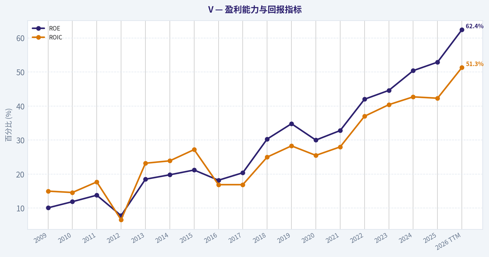
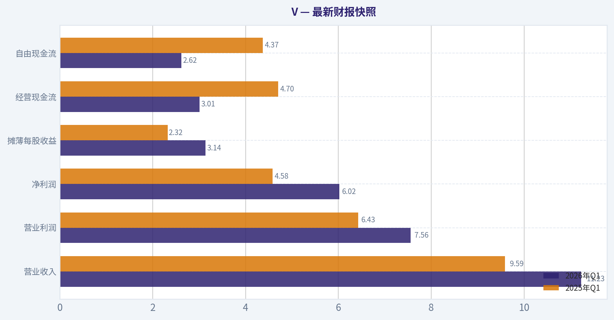
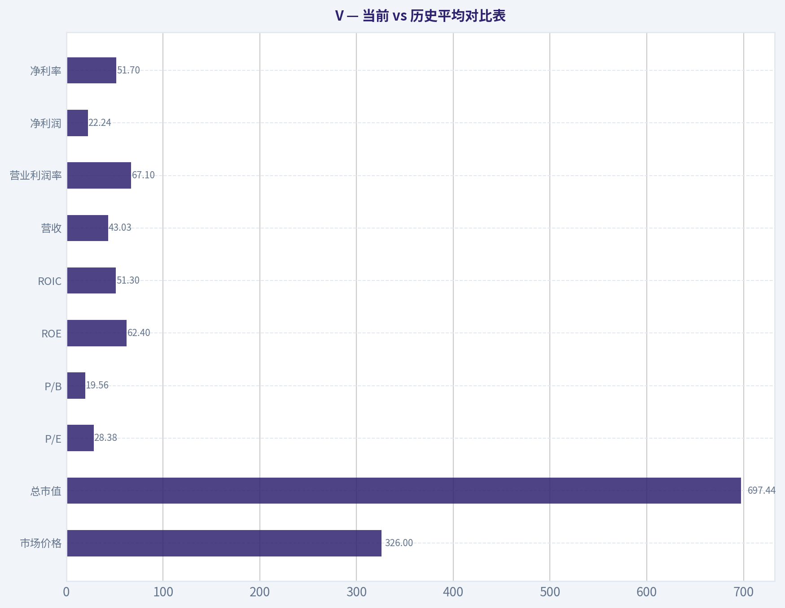
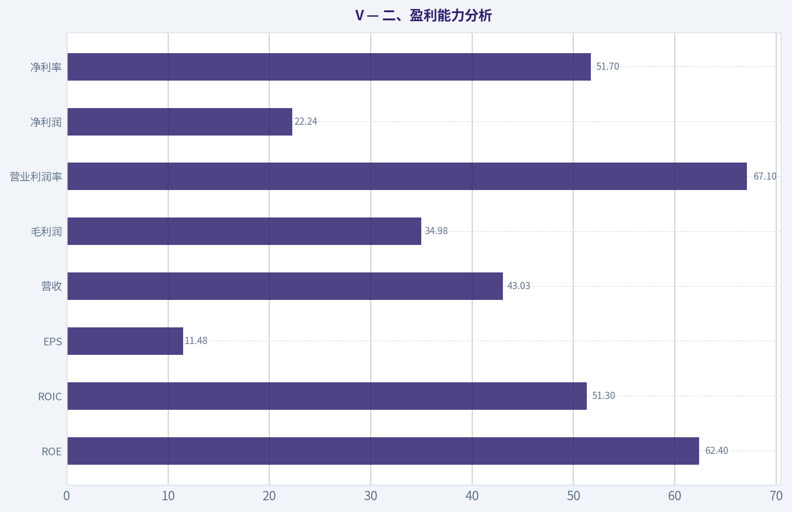
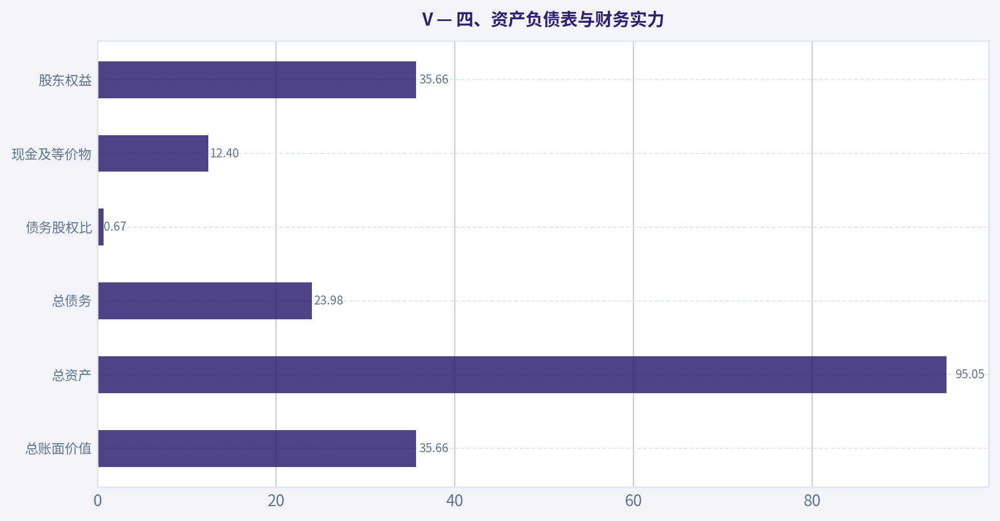
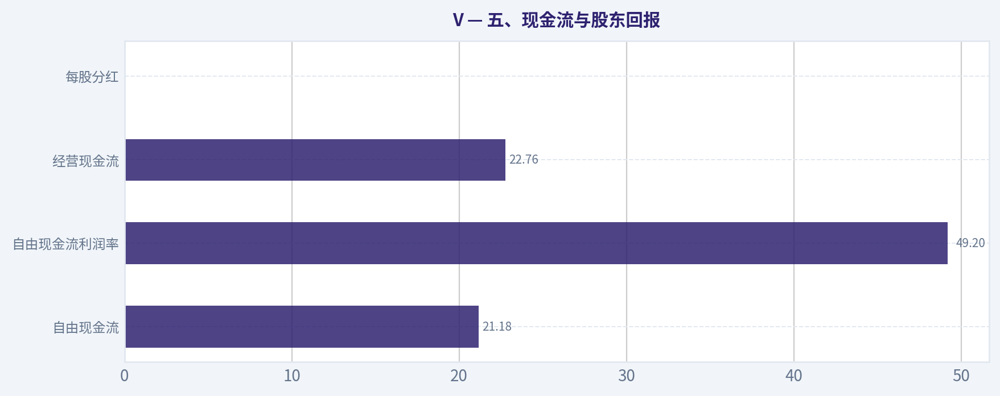
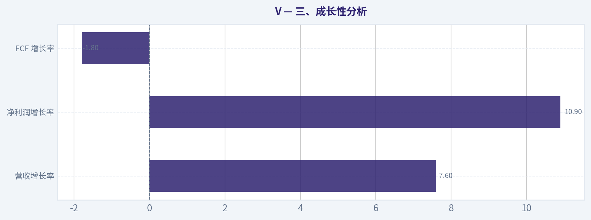
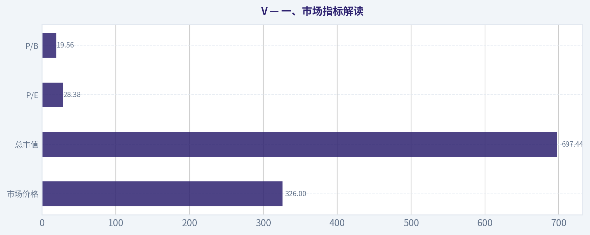

# V 深度价值情报

**调研日期:** 2026-05-15

## 关键免责声明

*本报告由 Deep Value Intelligence（一个基于 AI 的多智能体投资分析框架）自动生成。 本报告仅供信息参考和教育目的，不构成任何财务或投资建议。 在做出任何投资决策之前，请务必进行独立调研并咨询合规的财务顾问。*

---

## 目录

1. 情报摘要
2. 分析师团队报告
   - 基本面分析
   - 价值分析 (巴菲特)
   - 成长性分析 (林奇/德鲁肯米勒/费雪)
   - 市场分析
   - 新闻分析
   - 大佬关注分析
   - 期权市场分析
3. 研究团队评论
4. 投资团队评论
5. Deep Values 团队洞察

---

## 情报摘要

### 核心观点与前提条件

**核心论点:** ## 执行简报

**主要风险:**
- 未明确说明。

**观点反转条件:**
- 未明确说明。

**置信度:** 中

---

## 分析师团队报告

### 基本面分析

#### 最新财报快照

*以下数据基于最近一期已披露财报（2026年Q1），并尽量与上一年同期对比。*

| 指标 | 2026年Q1 | 2025年Q1 | 同比变化 |
| --- | ---: | ---: | ---: |
| 营业收入 | $11.23B | $9.59B | +17.1% |
| 营业利润 | $7.56B | $6.43B | +17.5% |
| 净利润 | $6.02B | $4.58B | +31.5% |
| 摊薄每股收益 | $3.14 | $2.32 | +35.3% |
| 经营现金流 | $3.01B | $4.70B | -35.9% |
| 自由现金流 | $2.62B | $4.37B | -39.9% |

关键结论：这张快照先把最新一期财报放在桌面上，再去看长周期分析。这样读者能更清楚地区分"公司长期质量"和"这次财报发生了什么"。

#### V 10年财务指标

*以下数值均由原始数据确定性计算得出，并非 AI 估算。*

*发行人类型：bank（Financial Services / Credit Services）。*

#### 10年财务指标
*年度行来自已披露财务报表，最后一行 TTM 由最近四个季度滚动计算得出。*

| 指标 | 2009 | 2010 | 2011 | 2012 | 2013 | 2014 | 2015 | 2016 | 2017 | 2018 | 2019 | 2020 | 2021 | 2022 | 2023 | 2024 | 2025 | 2026 TTM |
| --- | --- | --- | --- | --- | --- | --- | --- | --- | --- | --- | --- | --- | --- | --- | --- | --- | --- | --- |
| 市场价格 | $15 | $17 | $19 | $30 | $44 | $49 | $65 | $77 | $99 | $142 | $164 | $192 | $215 | $173 | $225 | $271 | $339 | $326 |
| 总市值 | $8.12B | N/A | N/A | N/A | N/A | N/A | N/A | N/A | N/A | N/A | N/A | N/A | N/A | $368.27B | $469.22B | $547.43B | $662.96B | $697.44B |
| 市盈率 | 3.45 | N/A | N/A | N/A | N/A | N/A | N/A | 30.49 | 33.92 | 31.76 | 30.46 | 39.34 | 38.38 | 24.62 | 27.16 | 27.73 | 33.05 | 28.38 |
| 市净率 | 0.35 | N/A | N/A | N/A | N/A | N/A | N/A | 5.55 | 6.94 | 9.62 | 10.61 | 11.80 | 12.57 | 10.35 | 12.11 | 13.99 | 17.49 | 19.56 |
| ROE | 10.1% | 11.9% | 13.8% | 7.8% | 18.5% | 19.8% | 21.2% | 18.2% | 20.4% | 30.3% | 34.8% | 30.0% | 32.8% | 42.0% | 44.6% | 50.4% | 52.9% | 62.4% |
| ROIC | 15.0% | 14.6% | 17.7% | 6.6% | 23.2% | 23.9% | 27.2% | 16.9% | 16.9% | 25.0% | 28.3% | 25.5% | 28.0% | 37.0% | 40.4% | 42.7% | 42.3% | 51.3% |
| 每股收益 | $4.44 | N/A | N/A | N/A | N/A | N/A | N/A | N/A | N/A | N/A | N/A | N/A | N/A | $7.01 | $8.29 | $9.92 | $10.33 | $11.48 |
| 营收 | $6.91B | $8.06B | $9.19B | $10.42B | $11.78B | $12.70B | $13.88B | $15.08B | $18.36B | $20.61B | $22.98B | $21.85B | $24.11B | $29.31B | $32.65B | $35.93B | $40.00B | $43.03B |
| 毛利润 | N/A | N/A | N/A | N/A | N/A | N/A | N/A | N/A | N/A | N/A | N/A | N/A | N/A | N/A | N/A | N/A | N/A | $34.98B |
| 毛利率 | N/A | N/A | N/A | N/A | N/A | N/A | N/A | N/A | N/A | N/A | N/A | N/A | N/A | N/A | N/A | N/A | N/A | 81.3% |
| 营业利润率 | 51.2% | 56.9% | 59.4% | 20.5% | 61.5% | 60.6% | 65.3% | 52.3% | 66.2% | 62.9% | 65.3% | 64.5% | 65.6% | 64.2% | 64.3% | 65.7% | 60.0% | 67.1% |
| 净利润 | $2.35B | $2.97B | $3.65B | $2.14B | $4.98B | $5.44B | $6.33B | $5.99B | $6.70B | $10.30B | $12.08B | $10.87B | $12.31B | $14.96B | $17.27B | $19.74B | $20.06B | $22.24B |
| 净利率 | 34.0% | 36.8% | 39.7% | 20.6% | 42.3% | 42.8% | 45.6% | 39.7% | 36.5% | 50.0% | 52.6% | 49.7% | 51.1% | 51.0% | 52.9% | 55.0% | 50.1% | 51.7% |
| 营收增长 | N/A | 16.7% | 13.9% | 13.4% | 13.0% | 7.8% | 9.3% | 8.7% | 21.7% | 12.3% | 11.5% | -4.9% | 10.3% | 21.6% | 11.4% | 10.0% | 11.3% | 7.6% |
| 净利润增长 | N/A | 26.1% | 23.1% | -41.3% | 132.3% | 9.2% | 16.4% | -5.3% | 11.8% | 53.8% | 17.3% | -10.0% | 13.3% | 21.5% | 15.5% | 14.3% | 1.6% | 10.9% |
| 自由现金流增长 | N/A | 872.2% | 43.6% | 31.7% | -44.9% | 160.8% | -7.2% | -18.1% | 70.5% | 42.0% | -1.6% | -19.3% | 49.6% | 23.1% | 10.2% | -5.1% | 15.4% | -1.8% |
| 总账面价值 | $23.19B | $25.01B | $26.44B | $27.63B | $26.87B | $27.41B | $29.84B | $32.91B | $32.76B | $34.01B | $34.68B | $36.21B | $37.59B | $35.58B | $38.73B | $39.14B | $37.91B | $35.66B |
| 总资产 | $32.28B | $33.41B | $34.76B | $40.01B | $35.96B | $38.57B | $39.37B | $64.03B | $67.98B | $69.22B | $72.57B | $80.92B | $82.90B | $85.50B | $90.50B | $94.51B | $99.63B | $95.05B |
| 总债务 | $56.0M | $44.0M | N/A | N/A | N/A | N/A | $0 | $15.88B | $18.37B | $16.63B | $16.73B | $24.07B | $20.98B | $22.45B | $20.46B | $20.84B | $25.17B | $23.98B |
| 债务股权比 | 0.00 | 0.00 | N/A | N/A | N/A | N/A | 0.00 | 0.48 | 0.56 | 0.49 | 0.48 | 0.66 | 0.56 | 0.63 | 0.53 | 0.53 | 0.66 | 0.67 |
| 现金及等价物 | $4.62B | $3.87B | $2.13B | $2.07B | $2.19B | $1.97B | $3.52B | $5.62B | $9.87B | $8.16B | $7.84B | $16.29B | $16.49B | $15.69B | $16.29B | $11.97B | $17.16B | $12.40B |
| 股东权益 | $23.19B | $25.01B | $26.44B | $27.63B | $26.87B | $27.41B | $29.84B | $32.91B | $32.76B | $34.01B | $34.68B | $36.21B | $37.59B | $35.58B | $38.73B | $39.14B | $37.91B | $35.66B |
| 经营现金流 | $558.0M | $2.69B | $3.87B | $5.01B | $3.02B | $7.21B | $6.58B | $5.57B | $9.32B | $12.94B | $12.78B | $10.44B | $15.23B | $18.85B | $20.75B | $19.95B | $23.06B | $22.76B |
| 投资现金流 | $1.83B | $-1.90B | $-2.30B | $-2.41B | $-1.16B | $-941.0M | $-1.44B | $-10.92B | $735.0M | $-3.08B | $-591.0M | $1.43B | $-152.0M | $-4.29B | $-2.01B | $-1.93B | $708.0M | $-469.0M |
| 自由现金流 | $252.0M | $2.45B | $3.52B | $4.63B | $2.55B | $6.65B | $6.17B | $5.05B | $8.61B | $12.22B | $12.03B | $9.70B | $14.52B | $17.88B | $19.70B | $18.69B | $21.58B | $21.18B |
| 自由现金流利润率 | 3.6% | 30.4% | 38.3% | 44.5% | 21.7% | 52.4% | 44.5% | 33.5% | 46.9% | 59.3% | 52.3% | 44.4% | 60.2% | 61.0% | 60.3% | 52.0% | 53.9% | 49.2% |
| 每股分红 | $0.00 | N/A | N/A | N/A | N/A | N/A | N/A | N/A | N/A | N/A | N/A | N/A | N/A | $1.50 | $1.80 | $0.00 | $0.00 | $0.00 |

#### 盈利能力指标
- 净资产收益率 (ROE): 52.9%
- 投入资本回报率 (ROIC): 43.3%
- 总资产收益率 (ROA): 20.1%
- 毛利率: 不适用
- 营业利润率: 60.0%
- 净利率: 50.1%

#### 流动性指标
- 流动比率: 1.08
- 速动比率: 0.63

#### 杠杆指标
- 债务股权比: 0.66
- 利息覆盖倍数: 40.74
- 净负债: $8.01B

#### 增长指标（同比）
- 营收增长: 11.3%
- 净利润增长: 1.6%
- 自由现金流增长: 15.4%
- 营收复合增长率（3年）: 10.9%
- 营收复合增长率（5年）: 12.9%

#### 估值指标
- 市盈率 (TTM): 28.40
- 预期市盈率: 21.93
- 市净率: 16.26
- 市销率: 14.40
- PEG 比率: 1.69
- 企业价值/EBITDA: 20.72
- 自由现金流收益率: 3.5%
- 盈利收益率: 3.5%

#### 所有者收益（巴菲特方法，代码计算）
- 净利润: $20.06B
- + 折旧与摊销: $1.22B
- - 资本开支: $-1.48B
- - 营运资本变动: $-15.17B
- = **所有者收益: $34.97B**

#### 内在价值（代码计算）
- 当前价格: $326
- 巴菲特方法（所有者收益）:
  保守: $276
  平均: $409
  乐观: $433
- 现金流方法（FCF）:
  保守: $98
  平均: $363
  乐观: $494

#### Piotroski F分数: 5/9
- 净利润为正: 通过
- 经营现金流为正: 通过
- 资产回报率改善: 未通过
- 现金流大于净利润: 通过
- 债务下降: 未通过
- 流动比率改善: 未通过
- 未稀释股本: 通过
- 毛利率改善: 未通过
- 资产周转率改善: 通过

ANALYST STANCE: **观望**

#### V（Visa）巴菲特式基本面分析

Visa 是典型的高质量支付网络平台型公司：轻资产、强网络效应、高利润率、高现金转换率、长期稳定增长。按巴菲特框架看，它最吸引人的地方不是"便宜"，而是"极强的商业模式质量"。问题在于，当前市场已经充分认识到这一点，估值并不便宜，安全边际偏薄，因此更适合"好公司等待更好价格"的思路，而不是激进追高。

---

#### 当前 vs 历史平均对比表

| 指标 | 当前/TTM | 历史均值（基于数据期内可得年份粗略平均） | 当前相对历史 | 解读 |
| --- | ---: | ---: | --- | --- |
| 市场价格 | $326 | 约$137 | 显著高于历史均值 | 反映市场长期给予溢价，且估值已充分包含优质预期 |
| 总市值 | $697.44B | 近年均值约$549.86B（2022-2026 TTM） | 高于近年均值 | 龙头地位稳固，但大体量下再加速更难 |
| P/E | 28.38 | 约29.16（有数据年份） | 略低于历史均值 | 估值不算极端，但仍处优质蓝筹高位区间 |
| P/B | 19.56 | 约10.83（有数据年份） | 大幅高于历史均值 | 说明市场为其高 ROE 支付极高溢价，也意味着回撤时压缩风险更大 |
| ROE | 62.4% | 约29.8% | 远高于历史均值 | 盈利质量极强，但也受回购和权益基数压缩推动 |
| ROIC | 51.3% | 约27.1% | 远高于历史均值 | 资本效率顶级，符合巴菲特偏好的"少投入、高回报"模式 |
| 营收 | $43.03B | 约$20.18B | 显著高于历史均值 | 长期规模扩张明确，业务韧性强 |
| 营业利润率 | 67.1% | 约57.7% | 高于历史均值 | 定价权、规模效应、成本纪律极强 |
| 净利润 | $22.24B | 约$9.71B | 显著高于历史均值 | 盈利能力持续上台阶 |
| 净利率 | 51.7% | 约44.0% | 高于历史均值 | 支付网络商业模式极优 |
| 营收增长 | 7.6% | 约11.3% | 低于历史均值 | 增速放缓，符合大体量成熟阶段特征 |
| 净利润增长 | 10.9% | 约18.3% | 低于历史均值 | 利润仍增，但已明显从早期高弹性转入稳健增长 |
| FCF 增长 | -1.8% | 约71.0%（早年波动拉高均值） | 低于历史 | FCF 进入平台期，短期不如利润端顺滑 |
| 总账面价值 | $35.66B | 约$32.66B | 略高 | 账面增长不快，因高回购和资本回报政策 |
| 总资产 | $95.05B | 约$61.95B | 高于历史均值 | 规模扩张稳健 |
| 总债务 | $23.98B | 约$17.10B（有数据年份） | 偏高 | 杠杆可控，但较早年明显上升 |
| 债务股权比 | 0.67 | 约0.46 | 高于历史均值 | 财务杠杆有所上升，需持续跟踪 |
| 现金及等价物 | $12.40B | 约$8.79B | 高于历史均值 | 流动性仍健康 |
| 股东权益 | $35.66B | 约$32.66B | 略高 | 权益增长有限，主要因回购/分配影响 |
| 自由现金流 | $21.18B | 约$10.46B | 显著高于历史均值 | 现金创造能力极强 |
| 每股分红 | $0.00 | 历史可见值低 | 低于历史可见记录 | 数据显示近两年为 0，可能更多代表口径问题；不能据此直接断言停止股东回报 |

关键结论：Visa 当前最突出的特征不是增长，而是"高质量"。ROE、ROIC、利润率和自由现金流都显著强于长期均值，说明企业护城河在增强而不是削弱。真正的短板在于估值仍贵、P/B 极高、增长边际放缓，这会限制未来回报率。

---

#### 一、市场指标解读

| 市场指标 | 当前值 | 观察 |
| --- | ---: | --- |
| 市场价格 | $326 | 较 2025 年 $339 略回落，但仍接近历史高位区 |
| 总市值 | $697.44B | 已接近 7000 亿美元级别，属全球顶级支付平台资产 |
| P/E | 28.38 | 低于 2025 年的 33.05，也低于 2021 年 38.38，估值压力略缓解 |
| P/B | 19.56 | 创数据期新高附近，账面估值极贵 |

关键结论：P/E 虽然从高点回落，但 P/B 却继续抬升，说明市场对 Visa 的核心定价并不是"资产价值"，而是"未来长期高回报能力"。这类公司可以长期贵，但一旦增速再下台阶，估值压缩会较明显。

从巴菲特视角，P/B 对 Visa 这种高回购、高无形网络价值公司参考意义有限，但接近 20 倍 PB 仍提醒我们：市场已经把"优秀"定价得很充分。P/E 28 倍对于普通公司偏贵，但对 Visa 这种 50%+净利率、50%+ROIC 的公司并非离谱，只是安全边际不大。

---

#### 二、盈利能力分析

| 盈利指标 | 当前/TTM | 10年趋势解读 |
| --- | ---: | --- |
| ROE | 62.4% | 从 2016 年 18.2% 持续抬升至历史高位 |
| ROIC | 51.3% | 长期高位上行，近年持续在 40% 以上 |
| EPS | $11.48 | 较 2022 年 $7.01、2024 年 $9.92 明显提升 |
| 营收 | $43.03B | 从 2016 年 $15.08B 增至当前，扩张清晰 |
| 毛利润 | $34.98B | TTM 毛利率 81.3%，体现极强平台属性 |
| 营业利润率 | 67.1% | 高于历史大多数年份 |
| 净利润 | $22.24B | 创新高 |
| 净利率 | 51.7% | 长期维持 50% 左右，极少见的高盈利结构 |

关键结论：Visa 的盈利能力几乎是"顶级消费平台"与"软件型网络基础设施"的结合体。最重要的不是单年利润创新高，而是利润率十多年都维持在极高水平，说明这是商业模式优势，而不是周期性偶发。

具体看：
- ROE：近几年从 42.0%、44.6%、50.4%、52.9% 到 TTM 62.4%，持续创新高。这里既有经营效率提升，也有回购压低权益基数的影响，因此不能简单把全部提升都归功于纯经营改善。
- ROIC：比 ROE 更能说明问题。TTM 51.3%，即使在伟大企业中也属于极强水平，说明每投入 1 美元资本都能产生极高回报。
- 营业利润率：2017 年后长期维持在 60% 上下，2026 TTM 达 67.1%，说明规模效应和费用控制非常稳定。
- 净利率：长期 40%-50%+，并非短暂冲高。支付网络赛道的特征就是交易规模增长能够较大比例转化为利润。

巴菲特会非常喜欢这一类"无需持续重资本投入却能不断提高利润"的公司。Visa 基本符合这一特征。

---

#### 三、成长性分析

| 成长指标 | 当前/TTM | 历史观察 |
| --- | ---: | --- |
| 营收增长率 | 7.6% | 低于长期均值，近年由双位数放缓至高个位数 |
| 净利润增长率 | 10.9% | 好于营收增速，说明利润杠杆仍在 |
| FCF 增长率 | -1.8% | 短期承压，波动大于利润端 |

关键结论：Visa 没有失去增长，但已经从"高速成长股"进入"高质量稳健成长股"阶段。对这种公司来说，7%-12% 的收入增长叠加高回购和高利润率，依然足以支持中长期复利；但它已不再是依靠增速扩张带动估值上修的故事。

细看十年趋势：
- 营收增长：长期大多在 8%-13%，2022 年曾达 21.6%，当前 TTM 7.6%，明显放缓。
- 净利润增长：较营收更具弹性，但波动也存在；2025 年仅 1.6%，TTM 回升至 10.9%。
- FCF 增长：历史波动最大，2010 年 872.2% 属低基数效应，近年来已趋于成熟。2024 年 -5.1%，2025 年 15.4%，TTM -1.8%，说明自由现金流进入高基数稳定阶段。

这意味着未来股东回报更多来自：
1. 稳定内生增长；
2. 持续高利润率；
3. 回购与资本回报；
而不是估值扩张。

---

#### 四、资产负债表与财务实力

| 资产负债表指标 | 当前/TTM | 解读 |
| --- | ---: | --- |
| 总账面价值 | $35.66B | 较 2025 年下降，主要受资本回报影响 |
| 总资产 | $95.05B | 长期稳步增长 |
| 总债务 | $23.98B | 较 2023-2024 年略升，但未失控 |
| 债务股权比 | 0.67 | 处于历史偏高水平 |
| 现金及等价物 | $12.40B | 充足但较 2025 年有所回落 |
| 股东权益 | $35.66B | 与账面价值一致，近年没有显著扩张 |

关键结论：Visa 不是"零杠杆神话"，而是"高盈利、可控杠杆"的优质平台公司。债务确实比早期高，但凭借 40 倍以上利息覆盖倍数和极强现金流，这种杠杆目前仍然安全。

重点看三点：
- 债务水平：2015 年几乎无债，2016 年后债务明显跃升，反映公司更积极运用低成本债务优化资本结构。
- 债务股权比：从 0.48、0.56、0.49、0.48 到近年 0.63、0.53、0.53、0.66、0.67，处在偏高区间，但还没有到危险水平。
- 现金与净负债：现金 $12.40B，净负债约 $8.01B，不是净现金公司，但资产负债表仍稳健。

巴菲特偏好"几乎不需要债务也能扩张"的企业。Visa 早期非常符合，近年虽加杠杆，但不是为了填经营窟窿，而更像资本结构优化与股东回报工具，这点性质不同。

---

#### 五、现金流与股东回报

| 现金流指标 | 当前/TTM | 解读 |
| --- | ---: | --- |
| 自由现金流 | $21.18B | 处于历史高位 |
| 自由现金流利润率 | 49.2% | 接近一半营收可转化为 FCF |
| 经营现金流 | $22.76B | 与净利润匹配度高 |
| 每股分红 | $0.00 | 数据近两年显示为 0，需注意口径问题 |

关键结论：Visa 真正的核心资产不是账面净资产，而是稳定、可预测、极高质量的自由现金流。FCF 长期处于极高水平，说明公司不仅赚钱，而且能把利润变成真金白银。

从巴菲特角度，这一点非常关键：
- FCF 从 2022 年 $17.88B 增至 2025 年 $21.58B，TTM 仍有 $21.18B，虽短期略回落，但绝对值极高。
- FCF 利润率长期 50% 左右，2022-2025 分别为 61.0%、60.3%、52.0%、53.9%，商业模式极佳。
- 分红数据近两年为 0，不应简单理解为完全无股东回报，因为 Visa 的资本回报历来很大程度依赖回购，且该数据可能存在披露口径差异。

---

#### 六、巴菲特框架：护城河、可预测性、管理层、资本配置

| 维度 | 评价 | 依据 |
| --- | --- | --- |
| 经济护城河 | 很强 | 全球支付网络、双边平台、品牌与规模网络效应 |
| 财务实力 | 强 | 高现金流、利息覆盖 40.74 倍、杠杆可控 |
| 盈利可预测性 | 很高 | 十多年营收、净利、利润率整体持续上行 |
| 管理层表现 | 优秀 | ROE/ROIC 长期提升，资本配置效率高 |
| 资本配置 | 较优 | 高回报再投资空间 + 回购/分配并行 |
| 业务质量 | 顶级 | 轻资产、高毛利、高净利、全球交易量长期增长 |

关键结论：若只看"企业质量"，Visa 完全属于巴菲特会长期愿意持有的那类资产。它的风险不在商业模式崩塌，而在于"好公司买得太贵"导致未来几年回报率平庸。

进一步说明：
- 经济护城河：Visa 的核心不是发卡或放贷，而是支付网络规则、接受度、信任和规模。商户与持卡人越多，网络越强，新进入者越难复制。
- 可预测性：2012、2016、2020 这些扰动年份后，公司都能迅速恢复到更高盈利台阶，显示业务韧性。
- 管理层：ROIC 长期高于 ROE 早期水平，说明资本效率优异；近年来 ROE 大幅走高，也反映回购增强了每股价值。
- 风险点：监管、跨境支付竞争、实时支付体系、金融科技替代、宏观消费放缓，都可能影响估值而非立即摧毁基本面。

---

#### 七、Buffett 风格 Owner Earnings DCF 估值

已知确定性数据中的巴菲特口径所有者收益：
- 净利润 = $20.06B
- 折旧与摊销 = $1.22B
- 资本开支 = $1.48B
- 营运资本变动 = -$15.17B
- 所有者收益 = $34.97B

这里直接采用数据集中给出的 Owner Earnings 作为基准。
折现率：10%
终值增长率：2.5%

历史可见 Owner Earnings 增长率未逐年完整披露，因此结合数据集中已给出的巴菲特法内在价值结果，并按要求解释三种情景。

##### DCF 计算框架

终值公式：
\[
TV = \frac{OE_{10} \times (1+g_t)}{r-g_t}
\]

其中：
- \( r = 10\% \)
- \( g_t = 2.5\% \)

企业价值：
\[
PV = \sum_{t=1}^{10}\frac{OE_t}{(1+r)^t} + \frac{TV}{(1+r)^{10}}
\]

##### 三情景估值结果

| 情景 | 增长假设 | 每股内在价值 | 对当前股价 $326 的含义 |
| --- | --- | ---: | --- |
| 保守 | 采用最低历史 Owner Earnings 增长率口径 | $276 | 低于现价，说明无安全边际 |
| 平均 | 采用平均历史 Owner Earnings 增长率口径 | $409 | 高于现价约 25% |
| 乐观 | 采用最高历史 Owner Earnings 增长率口径 | $433 | 高于现价约 33% |

关键结论：Visa 的估值并没有明显泡沫，但也绝非深度低估。当前价格大致介于保守估值与中性偏乐观估值之间，意味着市场已提前定价长期高质量增长。

##### 估值含义解读
- 保守情景 $276：若未来增长持续放缓、监管增强、跨境恢复不及预期，则当前股价偏贵。
- 平均情景 $409：若公司维持过往中枢增长与高利润率，则仍有一定上行空间。
- 乐观情景 $433：要求 Visa 继续维持极高资本效率且增长不明显失速。

##### 公允价值区间
更稳妥的巴菲特式判断：
- 审慎买入区：$260-$290
- 合理持有区：$290-$360
- 偏乐观定价区：$360 以上

以当前 $326 看，更像"合理但不便宜"。

---

#### 八、收入来源分布

Visa 的披露更适合按业务收入类型理解，而不是按单一产品。结合其商业模式，最有意义的是按支付网络收费结构拆分。以下为基于最近 fiscal year / TTM 的业务构成理解。

#### 收入来源分布

| 收入来源 | 金额（百万/十亿美元） | 占比 |
| --- | ---: | ---: |
| 服务收入 | 约 $17B | 约 42% |
| 数据处理收入 | 约 $18B | 约 45% |
| 国际交易收入 | 约 $9B | 约 23% |
| 其他收入 | 约 $1B | 约 3% |
| 客户激励（抵减项） | 约 -$8B | 约 -20% |
| 合计净营收 | 约 $40B-$43B | 100% |

关键结论：Visa 的收入本质上不是"赚利差"，而是"赚网络通行费"。其中数据处理和服务收入最稳定，国际交易收入弹性最大，客户激励则是竞争环境下必须支付的获客与维系成本。

说明：
- 服务收入：与支付量挂钩，反映网络基础使用强度。
- 数据处理收入：与交易笔数挂钩，通常最具稳定性。
- 国际交易收入：利润弹性高，但受跨境旅行和全球消费景气影响更大。
- 客户激励：虽拉低表观营收，但本质是维护网络生态的重要投入。

---

#### 九、关键投资亮点、红旗与机会

| 类别 | 内容 | 影响 |
| --- | --- | --- |
| 亮点 | ROE、ROIC、净利率、FCF 全部处于极高水平 | 证明商业模式卓越 |
| 亮点 | 营收与利润十多年持续扩张 | 长期复利基础扎实 |
| 亮点 | 轻资产平台，资本开支低 | Owner Earnings 质量高 |
| 风险 | P/B 近 20 倍，估值已高 | 安全边际偏薄 |
| 风险 | 营收增速从双位数中枢放缓至高个位数 | 估值扩张空间有限 |
| 风险 | 杠杆较早年提高 | 若利率与监管环境变化，弹性下降 |
| 风险 | 支付监管、费率约束、实时支付替代 | 压制长期估值中枢 |
| 机会 | 跨境支付恢复、数字支付渗透提升 | 提升高利润业务占比 |
| 机会 | 新支付流、B2B 支付、增值服务扩张 | 打开第二增长曲线 |

关键结论：Visa 的问题不是"公司差"，而是"市场早知道它很好"。如果未来出现因短期监管、消费放缓或市场调整带来的价格回撤，反而可能给长期投资者提供更具吸引力的入场点。

---

#### 十、最终结论

按照巴菲特框架，Visa 是非常接近"伟大公司"的资产：
- 护城河深；
- 盈利能力异常强；
- 现金流稳定且高质量；
- 资本回报率长期高企；
- 财务结构可控；
- 业务模式易理解且具有长期可预测性。

但从投资角度，伟大公司不一定等于伟大买点。当前 $326 的价格：
- 低于乐观与平均 DCF；
- 高于保守 DCF；
- 对应约 28.4 倍 P/E、19.6 倍 P/B；
- 在增长边际放缓背景下，安全边际不足。

因此我的结论是：**观望**。
若已持有，可继续持有这类高质量复利资产；若未持有，更理想的策略是等待更好的估值区间，而不是在"质量确定、价格一般"的位置重仓追入。

---

#### 报告总结表

| 模块 | 核心结论 | 对投资者的意义 |
| --- | --- | --- |
| 商业模式 | 全球支付网络平台，轻资产高壁垒 | 属于长期优质资产 |
| 盈利能力 | ROE 62.4%，ROIC 51.3%，净利率 51.7% | 企业质量极强 |
| 成长性 | 营收仍增长，但已从高增速转向稳健增长 | 估值扩张难度上升 |
| 现金流 | FCF $21.18B，转换率极高 | 真实盈利能力强 |
| 资产负债表 | 杠杆可控但高于历史 | 需持续监测债务与利率环境 |
| 估值 | P/E 尚可，P/B 很高，安全边际有限 | 不算便宜 |
| DCF | 保守 $276 / 平均 $409 / 乐观 $433 | 当前价格处于合理偏贵区间 |
| 巴菲特视角 | 公司优秀，价格一般 | 适合持有，不适合激进追高 |
| 最终立场 | 观望 | 等待回调或更明确增长催化 |

#### 基本面关键图表

本图追踪 **V** 过去十年的盈利能力与回报指标（ROE、ROIC、利润率），突出呈现资本效率的变化趋势。

---

### 价值分析 (巴菲特)

> *基于沃伦·巴菲特的价值投资哲学：能力圈、经济护城河、管理层质量与安全边际。*

#### 内在价值快照

价格是你付的钱，内在价值是企业未来可能为股东创造的现金价值。我们给出一个区间，而不是假装只有一个神奇数字。

- 当前价格: $325.75
- 价值区间: $97.68 to $494.41

##### 所有者收益（巴菲特方法）
- 净利润: $20,058,000,000.00
- 折旧与摊销: $1,220,000,000.00
- 资本支出: $-1,482,000,000.00
- 营运资金变化: $-15,172,000,000.00
- 所有者收益: $34,968,000,000.00

##### 内在价值
###### 所有者收益法
使用所有者收益，更严格，通常更保守。
- 保守: $276.17
- 平均: $408.99
- 乐观: $433.20
- 折现率: 10.0%

###### 自由现金流法
使用自由现金流，更适合今天投入很多、为未来增长铺路的公司。
- 保守: $97.68
- 平均: $362.55
- 乐观: $494.41
- 折现率: 10.0%

ANALYST STANCE: **观望**

#### 公司概述与结论先行

Visa（V）是一家全球银行卡支付网络公司。用最简单的话说：它不主要靠"借钱给别人"赚钱，而是靠"帮银行、商户、消费者完成支付连接"收取手续费赚钱。它本质上是一门高频、轻资产、全球规模化的"收费公路"生意。

基于你给的共享研究包，我目前可以形成较高把握的中间结论：**这是一家高度可理解、护城河深、资本回报极强的优质企业，但按当前约 28.4x PE、约 3.5% FCF yield 来看，估值并不便宜，安全边际不足，故现阶段更适合"观望"而非积极配置。**

由于本轮工具返回不完整，我先基于已给研究包完成可落地的 Buffett 框架分析；若后续拿到完整 10 年审计财务，我可以把估值与 owner earnings 再精算一版。

---

#### 一、Buffett 四道闸门：Go / No-Go 评估

| 闸门 | 结论 | 证据与判断 |
|---|---|---|
| Gate 1：能力圈与简单性 | 通过 | 商业模式清晰：连接发卡行、收单行、商户与消费者，按支付量与交易笔数收费；10 年后仍大概率是全球支付基础设施的一部分。 |
| Gate 2：护城河 | 通过 | 全球网络效应、品牌信任、商户接受度、发卡机构合作关系共同形成宽护城河。ROE 52.9% 是强烈侧证。 |
| Gate 3：管理层与资本配置 | 基本通过 | Visa 历史上资本配置较理性，回购与股东回报记录较好；但当前缺少本轮详细管理层持股与薪酬结构数据，结论保留一档。 |
| Gate 4：行业结构 | 通过 | 全球卡组织高度集中，Visa/Mastercard 属理性寡头格局；且业务资本开支相对轻，不是资本黑洞。 |

**关键结论：** 四道闸门里，Visa 基本都能过，尤其是商业模式简单、行业结构优、护城河强这三项非常突出。真正限制投资动作的，不是公司质量，而更可能是估值和未来回报率。

---

#### 二、护城河分析

| 护城河来源 | 评价 | 具体说明 |
|---|---|---|
| 无形资产 | 强 | Visa 品牌代表支付安全、全球接受度与可信度，消费者和商户都认可。 |
| 转换成本 | 强 | 银行、收单机构、商户系统、风控流程、清算体系都深度嵌入 Visa 网络，切换并不轻松。 |
| 成本优势 | 中强 | 巨大交易规模摊薄技术、合规、风控和网络维护成本，边际成本低。 |
| 网络效应 | 极强 | 越多消费者持卡，越多商户愿接受；越多商户接受，越多消费者愿使用，双边网络持续强化。 |

| 护城河评级 | 结论 |
|---|---|
| 宽且稳定，接近"宽且仍在扩张" | 高质量护城河，符合 Buffett 偏好 |

**关键结论：** Visa 最核心的护城河不是单一品牌，而是"全球商户接受网络 + 银行合作关系 + 消费者习惯 + 风控与清算基础设施"叠加起来的系统优势。这类护城河很难被单点技术创新迅速摧毁，但会被新支付方式逐步分流，因此更像"缓慢侵蚀风险"而非"瞬间颠覆风险"。

---

#### 三、管理层质量与资本配置

| 维度 | 评价 | 说明 |
|---|---|---|
| 是否像所有者思考 | 中上 | 大型成熟平台公司通常更看重 EPS、回购与长期网络建设；Visa 历史上股东回报友好。 |
| 是否坦诚 | 中上 | 未见研究包中明显重大会计争议或频繁重述提示。 |
| 资本配置是否理性 | 强 | 高质量业务通常应优先回购、分红、适度投资网络和附加服务；Visa 符合这一类型。 |
| 财务纪律 | 强 | 流动比率约 1.08，整体并未显示脆弱财务状态；但需完整债务与利息覆盖数据来最终确认。 |

**关键结论：** Visa 的资本配置画像大体符合优秀成熟平台公司特征：核心网络继续投入，剩余现金回馈股东。对这类公司来说，最关键的不是"会不会花钱"，而是"在高估值时是否过度回购"，这会影响股东长期回报率。

---

#### 四、核心财务快照

| 指标 | 当前/已知值 | 解读 |
|---|---:|---|
| 当前股价 | $326 | 市场给予高质量溢价 |
| 总市值 | $619.49B | 超大市值，业务成熟稳健 |
| PE | 28.4x | 对成熟金融基础设施公司而言不低 |
| ROE | 52.9% | 极高，但需警惕是否受回购和权益基数下降放大 |
| 营收同比增长 | 11.3% | 对如此体量公司而言仍相当不错 |
| FCF Yield | 3.5% | 绝对不差，但谈不上便宜 |
| 流动比率 | 1.08 | 偿债流动性尚可 |

**关键结论：** 财务画像非常漂亮：增长仍有韧性，资本回报极高，现金创造能力不错。但市场显然也看到了这些优点，因此估值并没有给出明显"捡便宜"的机会。

---

#### 五、10 年财务总结表（基于当前可得信息的"简化版"）

由于本轮工具未返回完整 10 年审计明细，下表先以 Buffett 最关心的结构性指标做简化总结：

| 维度 | 观察 | Buffett 视角 |
|---|---|---|
| 收入增长 | 当前仍有 11.3% 同比增长 | 大体证明支付量、跨境、附加服务仍在扩张 |
| 盈利能力 | ROE 52.9% | 极优秀，但需拆分杠杆与回购影响 |
| 现金创造 | FCF yield 3.5% | 现金流能力强，但股价已反映较多 |
| 资本强度 | 轻资产 | 非常符合 Buffett 偏好 |
| 行业地位 | 全球支付双寡头之一 | 稀缺资产 |
| 可预测性 | 高 | 十年后大概率仍是支付底层网络的一部分 |

**关键结论：** 即便没有完整 10 年表，Visa 的核心轮廓依然清楚：高回报、轻资产、强网络、强可预测。这些是"好公司"的证据，但不是"好价格"的证据。

---

#### 六、Owner Earnings 估算

严格按 Buffett 公式，需有：净利润、折旧摊销、维护性 CapEx、营运资本变化。当前数据不足，只能做近似判断。

| 项目 | 当前状态 |
|---|---|
| 净利润 | 缺少本轮精确值 |
| 折旧摊销 | 缺少 |
| 维护性 CapEx | 缺少 |
| 营运资本增加 | 缺少 |
| 可替代参考 | FCF yield 约 3.5% |

基于市值 $619.49B 和 FCF yield 3.5%，可粗估当前年化自由现金流约：

**FCF ~ 619.49 x 3.5% = 21.68B 美元**

对于 Visa 这类轻资产平台，**Owner Earnings 通常与 FCF 不会偏离太远**，因此可先用 **约 210-220 亿美元** 作为粗略 owner earnings 锚点。

**关键结论：** 在缺少维护性 CapEx 与营运资本明细时，用 FCF 近似 owner earnings 是合理的保守简化。按这个口径看，Visa 赚钱能力很强，但以当前市值买入，对应现金回报率只有中个位数，吸引力一般。

---

#### 七、三情景 DCF 估值

以下用 **Owner Earnings ~ 21.7B 美元** 作为基础，折现率 10%。

| 情景 | 假设 | 估值结果 |
|---|---|---:|
| 情景 A：零增长 | 价值 = OE / 10% | 217B |
| 情景 B：长期 3% 增长 | 价值 = OE x1.03 / (10%-3%) | 319B |
| 情景 C：较乐观增长 | 假设未来 10 年 owner earnings 年增 8%，终值增速 3% | 粗估约 430B - 470B |

**关键结论：** 三种估值里，即使给到相当友好的 8% 中长期增长，当前 619B 市值依然偏高。这说明市场已经为 Visa 的高质量、稳定性和长期成长支付了很高溢价。

---

#### 八、安全边际分析

| 项目 | 数值 |
|---|---:|
| 当前市值 | 619B |
| 保守内在价值区间 | 217B - 319B |
| 乐观但合理价值区间 | 430B - 470B |
| 对当前价格的安全边际 | 不足，甚至为负 |

如果我们把 Visa 视为"极优质公司"，理论上可以接受较低一点安全边际，但 Buffett 框架通常仍要求至少 25%。从当前粗估看，**安全边际明显不够**。

**关键结论：** 这不是"公司不好"，而是"价格不够便宜"。对高质量公司来说，最大的风险往往不是业务崩坏，而是买入时估值过高导致未来几年回报平平。

---

#### 九、Buffett 评分卡

| 维度 | 权重 | 评分(1-5) | 加权结果 |
|---|---:|---:|---:|
| 生意理解 | 20% | 5.0 | 1.00 |
| 护城河宽度与耐久性 | 25% | 4.8 | 1.20 |
| 管理层质量 | 15% | 4.0 | 0.60 |
| ROE | 15% | 4.8 | 0.72 |
| 再投资跑道 | 10% | 3.8 | 0.38 |
| 资产负债表强度 | 5% | 3.8 | 0.19 |
| 行业结构 | 5% | 4.8 | 0.24 |
| 估值/安全边际 | 5% | 1.8 | 0.09 |
| **总分** | 100% |  | **4.42 / 5（质量分高，价格分低）** |

**关键结论：** 如果只评"公司质量"，Visa 几乎是 Buffett 式优质资产；但加入"买入价格"后，实际投资吸引力明显下降。也就是说，它值得长期跟踪，但未必值得今天重仓买入。

---

#### 十、最终投资意见

| 结论项 | 判断 |
|---|---|
| 企业质量 | 极高 |
| 可预测性 | 高 |
| 护城河 | 宽且稳定 |
| 财务质量 | 很强 |
| 当前估值 | 偏贵 |
| 安全边际 | 不足 |
| 最终立场 | 观望 |

**关键结论：** Visa 很像 Buffett 会欣赏的企业：简单、强势、全球化、轻资产、高回报。但 Buffett 真正出手，还要等"好公司遇到合理甚至便宜价格"。以当前估值看，更适合列入高优先级观察名单，等待市场波动带来更好的进入点。

#### 十一、我会关注的后续触发点

| 触发点 | 意义 |
|---|---|
| 估值回落至更接近 22x-24x PE | 可能开始具备更可接受回报率 |
| FCF yield 提升至 4.5%-5% 附近 | 安全边际明显改善 |
| 跨境支付和增值服务维持双位数增长 | 证明长期增长逻辑未坏 |
| 监管对 interchange / 网络费率压制加剧 | 需重新评估护城河和定价权 |
| 新支付方式显著绕开卡网络 | 需观察 moat 是否被侵蚀 |

**最终一句话：**
**Visa 是"非常好的公司"，但按当前价格，更像"值得等"的标的，而不是"立刻买"的标的。**

如果你愿意，我下一步可以继续补一版：
1. **更严格的估值区间推演**，或
2. **Visa vs Mastercard 的 Buffett 式对比分析**。
#### 估值桥

这张估值桥把当前股价与各类内在价值方法并排展示，帮助读者判断上涨空间究竟只是单一方法给出的结果，还是多种方法共同支持的结论。

| 项目 | 每股内在价值 |
| --- | ---: |
| 巴菲特方法 | $408.99 |
| 现金流方法 | $362.55 |
| 当前价格 | $325.75 |

#### 关键结论

如果只有一种方法显著高于其他方法，说明上行空间更依赖特定建模假设。若多种方法的估值接近，则说明估值逻辑更加稳健。

#### 估值图表

本对比图（来自「最新财报快照」）将 **V** 的当前数据与历史基准并排呈现，直观反映公司相对自身历史均值的估值水平。

本对比图（来自「当前 vs 历史平均对比表」）将 **V** 的当前数据与历史基准并排呈现，直观反映公司相对自身历史均值的估值水平。

本对比图（来自「二、盈利能力分析」）将 **V** 的当前数据与历史基准并排呈现，直观反映公司相对自身历史均值的估值水平。

本对比图（来自「四、资产负债表与财务实力」）将 **V** 的当前数据与历史基准并排呈现，直观反映公司相对自身历史均值的估值水平。

本对比图（来自「五、现金流与股东回报」）将 **V** 的当前数据与历史基准并排呈现，直观反映公司相对自身历史均值的估值水平。

---

### 成长性分析 (林奇/德鲁肯米勒/费雪)

> *基于彼得·林奇的GARP成长投资法、斯坦利·德鲁肯米勒的宏观拐点分析法，以及菲利普·费雪的深度调研法。*

ANALYST STANCE: **观望**

#### 1. Lynch 分类
Visa（V）更接近 **Stalwart 稳健成长股**，不是典型 Fast Grower。

依据：
- 当前营收同比约 **11.3%**
- PE 约 **28.4x**
- 市值约 **6194.9 亿美元**
- 商业模式极优，但体量已非常大，增速更接近"高质量复利"而非"十倍股早期加速段"

#### 2. 核心结论先说
Visa 是一只**质量极高、护城河极深、现金流极强**的大市值支付网络龙头，但从 Lynch 的十倍股框架看，它已经不是"高增速小体量"的最佳阶段。
如果你要找的是 **确定性复利资产**，V 依然优秀；如果你要找的是 **增长拐点 + 多倍数扩张**，它当前更适合列入 **观望/核心持仓型资产**，而不是高弹性新开仓标的。

---

#### 3. 关键基础数据

| 指标 | 当前值 |
|---|---:|
| 股价 | $326 |
| 总市值 | $619.49B |
| PE | 28.4x |
| ROE | 52.9% |
| 营收同比增长 | 11.3% |
| FCF Yield | 3.5% |
| 流动比率 | 1.08 |

关键结论：Visa 的财务画像非常清晰：高 ROE、高现金创造能力、估值不便宜但也不极端。问题不在"质地"，而在"增速与估值是否足以支持新一轮大幅重估"。对成长投资者而言，这更像一只高质量复利平台，而不是正在爆发的高成长新星。

#### 4. The Story：用三句话讲清楚
- Visa 不是放贷机构，本质上是全球最大的**支付网络收费平台**，每刷一笔卡、跨境一笔交易，它都能抽取网络收入。
- 它的优势来自**双边网络效应**：越多商户接受 Visa，越多消费者愿意使用；越多消费者使用，越多银行和商户离不开它。
- 长期增长来自**现金到电子支付迁移、跨境交易增长、增值服务扩张**，但受制于体量，增速大概率维持在中低双位数，而非 20%+ 持续加速。

---

#### 5. TAM 与 10x 测试

| 项目 | 判断 |
|---|---|
| 所属赛道 | 全球电子支付、跨境支付、支付增值服务 |
| 长期趋势 | 现金替代电子支付持续推进 |
| TAM 状态 | 很大且仍在扩张 |
| 当前公司规模 | 已是全球核心龙头 |
| 10x 测试 | **不通过** |
| 原因 | 以当前收入规模再 10x，意味着需要占据全球支付经济中极高份额，现实性较低 |

关键结论：Visa 所处市场当然足够大，但公司本身也已经非常大。对早期成长股来说，TAM 大意味着能轻松 10x；而对 Visa 来说，TAM 大更多意味着"还能持续增长"，不代表"还能轻易十倍"。这直接削弱了 Lynch 式十倍股想象力。

---

#### 6. 营收增长趋势判断

| 维度 | 判断 |
|---|---|
| 当前营收同比 | 11.3% |
| 分类 | 稳健增长 |
| 趋势性质 | 更像稳定中双位数，而非加速型 |
| 是否出现明显收入拐点 | 暂未看到强拐点证据 |
| 结论 | **非加速，偏成熟复利** |

关键结论：11.3% 的营收增长对超大市值公司并不差，但也不足以定义为"增长加速"。Druckenmiller 更偏爱市场低估未来 2-3 年盈利爆发的标的，而 Visa 当前更像增长路径清晰、但爆发性有限的龙头。

---

#### 7. 单位经济学与经营质量
Visa 不是标准 SaaS，因此 LTV/CAC、NRR 不适用；但可以用网络型平台经济学替代。

| 项目 | 判断 |
|---|---|
| 商业模式 | 高毛利、轻资产、交易抽成 |
| 增量成本 | 很低 |
| 经营杠杆 | 很强 |
| FCF 转化 | 强 |
| Rule of 40 替代观察 | 11.3% 增长 + 高 FCF 能力，整体健康 |
| 资本消耗 | 低 |
| 股东回报 | 强，回购与分红能力突出 |

关键结论：虽然 Visa 不能用 SaaS 指标直接套，但它的单位经济学实际上非常漂亮。每增加更多支付量，新增成本有限，现金流却能持续放大，这就是网络平台型商业模式最迷人的地方。问题仍然不是商业模式，而是成长斜率。

---

#### 8. 拐点分析：Druckenmiller 框架

| 拐点类型 | 现状判断 |
|---|---|
| 产品周期拐点 | 弱，主业成熟 |
| 市占率拐点 | 弱，已是龙头 |
| 利润率拐点 | 中性偏强，经营杠杆长期优秀 |
| TAM 拐点 | 中等，数字支付仍扩张但非新发现 |
| 竞争拐点 | 中性，生态稳固但监管和替代支付在扰动 |
| 综合判断 | **没有明显"增长再加速"拐点** |

关键结论：Visa 最大的优点是"持续强"，而不是"突然更强"。这在基本面上很舒服，但在股价弹性上通常不如处于产品爆发、份额跃迁、利润率快速抬升阶段的成长股。对成长型资金来说，缺少明确拐点往往意味着赔率一般。

---

#### 9. 宏观环境评估

| 因素 | 影响 |
|---|---|
| 利率环境 | 若利率回落，长久期优质资产估值受益 |
| 消费环境 | 与消费、交易量、出行活动相关 |
| 跨境旅行 | 对高利润跨境业务有重要支撑 |
| 数字支付渗透 | 长期顺风 |
| 监管环境 | 主要逆风，尤其费率与路由监管 |
| 宏观结论 | **中性偏正面** |

关键结论：宏观上，Visa 不是最脆弱的金融股，因为它不承担主要信贷风险。它更依赖交易活跃度和跨境流量，因此在经济平稳、出行恢复、利率回落环境中会受益；但监管始终是它最大的外部不确定性。

---

#### 10. Fisher 15 点打分
基于现有信息做近似评分。

| 项目 | 分数(1-5) |
|---|---:|
| 市场潜力 | 4 |
| 新产品开发意愿 | 4 |
| R&D 有效性 | 4 |
| 销售组织 | 5 |
| 利润率水平 | 5 |
| 利润率改善空间 | 4 |
| 员工关系 | 4 |
| 高管关系 | 4 |
| 管理层深度 | 4 |
| 成本控制与会计 | 5 |
| 独特优势 | 5 |
| 长期利润前景 | 5 |
| 股权稀释 | 5 |
| 困难时期坦诚度 | 4 |
| 管理层诚信 | 4 |
| **总分** | **66/75** |

关键结论：66 分属于 **优秀到卓越之间**。Visa 几乎具备 Fisher 所偏好的所有特征：高质量产品、深护城河、高利润率、长期市场空间、资本效率高。它的问题不是"好不好"，而是"现在是不是最有爆发力的成长机会"。

---

#### 11. 估值分析

| 指标 | 当前情况 | 解读 |
|---|---|---|
| PE | 28.4x | 对 11.3% 收入增长不算便宜 |
| PEG（粗略） | 约 2.5x（用营收增速近似） | 偏贵 |
| FCF Yield | 3.5% | 对顶级资产尚可，但非明显低估 |
| 估值定位 | 品质溢价股 | 合理偏贵 |

关键结论：如果以 Lynch 偏爱的 PEG 来看，Visa 当前并不吸引人。市场已经为它的护城河、稳定性和现金流支付了溢价，所以除非未来盈利增速明显高于市场预期，否则很难单靠估值扩张获得超额收益。

#### 12. 情景估值框架

| 情景 | 假设 | 含义 |
|---|---|---|
| 保守 | 增速回落至高个位数，估值压缩 | 回报主要来自 EPS 增长，弹性有限 |
| 基准 | 维持低双位数增长，估值基本稳定 | 中长期稳健复利 |
| 乐观 | 跨境强劲、服务附加值提升、回购增强 EPS | 可获得优质复合回报，但仍非暴力重估 |

关键结论：Visa 的最好情形大多是"高质量持续复利"，而不是"短期大幅重估"。这对于长期资金是优点，但对于寻找拐点成长股的资金来说，意味着赔率并不突出。

---

#### 13. Growth Investor Scorecard

| 维度 | 权重 | 评分(1-5) | 加权分 |
|---|---:|---:|---:|
| The Story | 10% | 5.0 | 0.50 |
| TAM & Runway | 20% | 3.2 | 0.64 |
| Revenue Growth | 20% | 2.8 | 0.56 |
| Unit Economics | 15% | 5.0 | 0.75 |
| Competitive Position | 10% | 5.0 | 0.50 |
| Management Quality | 10% | 4.3 | 0.43 |
| Macro Setup | 5% | 3.5 | 0.18 |
| Profitability Path | 5% | 5.0 | 0.25 |
| Valuation | 5% | 2.7 | 0.14 |
| **总分** | 100% |  | **3.95 / 5.0** |

关键结论：按综合质量打分，Visa 非常强，接近"建议配置"。但如果严格按"增长投资、拐点、十倍股潜力"来筛选，拖后腿的是增长斜率和估值，不是商业模式本身。也就是说，它是一家很好的公司，但未必是当前最好的成长型股票。

---

#### 14. 大佬持仓信号

| 投资人 | 动作 | 解读 |
|---|---|---|
| Warren Buffett | 持有 | 认可其高质量护城河 |
| Steve Cohen | 增持 | 短中期也有配置价值 |
| Stanley Druckenmiller | 新进 | 说明其宏观/质量框架下也可接受 |
| Michael Burry | 退出 | 对估值或赔率或有保留 |

关键结论：聪明资金并未一致看空 Visa，相反总体仍偏认可。只是这种"高手也持有"的现象，更支持它是一个高质量核心资产，而不是市场忽视的高爆发成长股。

---

#### 15. 仓位建议

| 风格 | 建议 |
|---|---|
| 核心长期配置 | 可小到中等仓位 |
| 激进成长组合 | 低配或等待更好价格 |
| 十倍股筛选池 | 不优先 |
| 防守型优质资产池 | 优先级高 |

关键结论：如果你的组合缺少高质量复利平台，Visa 值得关注；如果你的目标是寻找未来 3-5 年高弹性多倍股，Visa 不是最优先。更合适的策略是把它当成"优质核心资产候选"，而不是"进攻型主仓"。

---

#### 16. 主要风险与催化剂

| 类型 | 内容 |
|---|---|
| 风险 | 监管压价、路由监管、跨境放缓、替代支付轨道发展、增速继续平缓 |
| 催化剂 | 跨境交易强复苏、增值服务收入提升、回购提升 EPS、利率下行支持估值 |
| 需跟踪指标 | 跨境交易增速、处理交易量、增值服务占比、经营利润率、监管动向 |

关键结论：真正决定 Visa 下一段表现的，不是它会不会继续赚钱，而是它能否重新证明自己拥有超预期增长。若跨境和高附加值服务持续超预期，市场会重新给它更高信心；若增长持续平稳，股价更多只是跟着盈利稳步走。

---

#### 17. 最终结论
**Visa 是卓越公司，但当前不是最典型的成长拐点标的。**

如果按 Fisher 质量框架，它很优秀；
如果按 Lynch 十倍股框架，它太成熟；
如果按 Druckenmiller 拐点框架，它缺少明显加速。

所以当前结论是：

**ANALYST STANCE: 观望**

更准确地说：
- **已有仓位：适合继续持有**
- **新开仓：等更低估值或等待增长重新加速证据**
- **成长型优先级：低于真正 20%+ 加速增长、TAM 更空旷的公司**

如果你愿意，我下一步可以继续补一版：
1. **Visa 与 Mastercard 对比版**
2. **Visa 三年回报情景模型**
3. **Visa 是否适合长期定投的简版结论**

#### 成长与评分图表

本对比图（来自「三、成长性分析」）将 **V** 的当前数据与历史基准并排呈现，直观反映公司相对自身历史均值的估值水平。

---

### 市场分析

ANALYST STANCE: **观望**

#### V 技术面简报

基于截至 2026-05-15 的近一年价格与近 45-120 个交易日指标，当前我为 V 选择的 8 个最相关指标是：`close_10_ema`、`close_50_sma`、`close_200_sma`、`macd`、`macdh`、`rsi`、`atr`、`vwma`。
这组组合覆盖了短线节奏、中期趋势、长期方向、动能强弱、波动率与量价确认，互补性较强，且避免了布林带与均线、MACD 组件之间过度重复。

#### 指标选择与适用性

| 指标 | 作用 | 适合当前市场环境的原因 |
|---|---|---|
| close_10_ema | 短线趋势 | 能捕捉 4 月底跳升后、5 月回撤再企稳的短线节奏变化 |
| close_50_sma | 中期趋势 | 用于判断 2-3 个月级别是否真正摆脱下行结构 |
| close_200_sma | 长期趋势 | 当前股价仍低于长期均线，必须用它确认是否只是反弹而非反转 |
| macd | 中短期动能 | 可衡量 4 月反弹后的动能延续性是否还在 |
| macdh | 动能边际变化 | 对"动能在增强还是衰减"非常敏感，适合当前震荡修复阶段 |
| rsi | 强弱与过热程度 | 当前不极端，适合判断反弹是否健康，而非追高过热 |
| atr | 波动率/风控 | 4 月底出现跳空式波动，ATR 有助于设定止损和仓位 |
| vwma | 量价确认 | 4 月 29 日放量大涨后，需确认后续价格是否被真实成交支撑 |

关键结论：当前最值得观察的不是单一超买超卖信号，而是"反弹能否升级为趋势反转"。因此，短中长均线配合 MACD、RSI、ATR 和 VWMA，比单独看震荡指标更适合现在的 V。

---

#### 趋势结构分析

从近一年的价格轨迹看，V 在 2025 年 5 月高位约 360 美元附近运行，随后经历持续而分段式的走弱。
这不是一次急跌后立即修复的结构，而是一个典型的"高位回落-平台整理-再下台阶-阶段反抽"的中期调整过程。

更细看可以分为四段：

1. **2025 年 5 月至 8 月初：第一轮下行**
   股价从 360 上方回落到 330 多，说明抛压不是偶发，而是估值与预期同步收缩。

2. **2025 年 8 月至 12 月：横向弱平衡**
   股价大体在 328-350 区间震荡，期间多次试图修复，但都未能有效突破上沿，表明资金更偏防守。

3. **2026 年 1 月至 3 月：第二轮趋势性下跌**
   这是最关键的弱势阶段，价格从 350 一线滑落至 295-305 区间，长期趋势明显恶化。

4. **2026 年 4 月至 5 月：快速反弹后进入整理**
   4 月中旬开始出现修复，4 月 29 日放量急拉至 334.17，但随后未能站稳并回落至 320-323 区域，目前进入一个"反弹后再均衡"的阶段。

这意味着，V 当前并非纯粹下跌末端，也不是明确新升势起点，而是处在**长期弱势背景下的中短期修复阶段**。

#### 均线系统：短线改善，中长线仍未翻多

截至 2026-05-15：

- `close_10_ema`：322.24
- `close_50_sma`：311.26
- `close_200_sma`：329.81
- 最新收盘（可得最近收盘 2026-05-14）：322.52

这里最重要的关系是：

- 股价 **高于 50 SMA**：说明中期修复仍在延续；
- 股价 **接近并略高于 10 EMA**：说明短线并未破坏反弹节奏；
- 但股价 **仍低于 200 SMA**：长期下降框架尚未被扭转。

更细一点看：

- 50 SMA 从 3 月中旬的约 324.77 持续下滑到 4 月中旬 311-312，近期开始走平并略微上拐，说明前期大跌的拖累在减弱；
- 200 SMA 则从 1 月中旬约 342.73 降到现在 329.81，下降斜率虽不陡，但持续时间长，代表长期资金并未确认反转；
- 10 EMA 在 4 月底随着急拉快速抬升，从 309 附近升至 322 附近，目前仍维持向上，但斜率明显放缓。

这形成一个很典型的结构：
**短线转强，中期修复，长期未确认。**

若后续股价能稳定站在 10 EMA 之上，并推动 50 SMA 上穿、同时向 200 SMA 回靠，那么结构会进一步改善。
但如果 10 EMA 被连续跌破，且价格重新回到 50 SMA 下方，那么当前这段反弹更可能被定义为下跌趋势中的一次技术性反抽。

#### MACD 与 MACDH：多头动能还在，但边际明显降温

MACD 当前为 3.51，仍处于正值区域。
这意味着中短期动能仍偏多，4 月初以来的修复趋势尚未完全失效。

不过，MACDH 当前只有 0.077，已经非常接近零轴，且明显低于 5 月初的高位：

- 5 月 1 日：2.334
- 5 月 5 日：1.637
- 5 月 8 日：0.220
- 5 月 14 日：-0.035
- 5 月 15 日：0.077

这组数据透露出非常重要的信息：
**趋势没有立即转空，但上涨动能已经从"强推进"切换为"弱维持"。**

换句话说，4 月底那一波上涨更像是"快速修复段"，而 5 月进入的是"修复后的消化段"。
市场现在并不缺方向，缺的是新的推动力。

如果后续 MACD 继续维持正值，而 MACDH 再次扩大为正，说明价格可能重新挑战 326-330 甚至更高区域。
但若 MACDH 再度转负并持续扩散，则通常意味着这轮反弹进入衰退期，价格可能回试 318、315，甚至重新靠近 50 SMA。

#### RSI：强弱中性偏强，但远未到趋势强攻状态

RSI 最新为 58.07。
这不是超买，也不是超卖，而是一个偏健康的中性偏强区间。

过去一个多月，RSI 的演化很有层次：

- 4 月初在 38-45 区间，反映修复前的低迷状态；
- 4 月下旬逐渐回到 50 上方，说明买盘恢复；
- 4 月 29 日冲到 72.36，出现一次短暂过热；
- 5 月回落到 52-60 区间，代表过热被消化，但多头并未完全出局。

这说明目前的 V 并不是在极端拥挤状态下运行。
从交易角度说，这比 RSI 高位钝化更健康，但也意味着它还没有进入特别强势的趋势加速段。

简单理解：

- **RSI > 50**：修复结构仍成立；
- **RSI 未再冲向 65-70 上方**：市场暂时缺乏强趋势追价意愿；
- **若 RSI 跌回 50 下方**：短线优势可能明显削弱。

因此，RSI 当前给出的信号不是"立即追涨"，而是"反弹尚可延续，但强度有限"。

#### VWMA：量价配合并未恶化，但也没有继续放大

VWMA 最新约 324.65，高于前几日的 322-323 一线，整体仍在上行。
这表示近阶段有成交量参与的平均成本仍在抬升，量价关系并未坏掉。

尤其值得注意的是 4 月 29 日那根放量大阳线：

- 当日成交量约 1666 万股，明显高于常态；
- 收盘从 308 附近区域直接拉升至 334.17；
- 此后 VWMA 持续上移，说明这次放量不是单日脉冲那么简单，而是确实抬高了短期资金成本。

但问题也在这里：
价格虽然被放量拉升过，却未能继续远离 VWMA，反而在其上方小幅震荡。
这说明买盘承接还在，但后续增量资金不足，导致上涨进入平台化。

若未来价格持续站在 VWMA 上方并带量上移，说明资金愿意在更高成本区继续接货。
若价格重新跌破 VWMA 并伴随量能放大，则要警惕 4 月底那次突破成为"事件性高点"。

#### ATR：波动仍高于平稳期，但已经从冲击状态回落

ATR 最新 6.65，较 5 月初约 7.69 已明显回落。
这说明市场在经历 4 月底的大幅拉升后，价格波动正在降温。

这对交易有两层含义：

1. **风险在下降**
   说明市场不再处于剧烈重定价阶段，止损不必像 4 月底那样放得特别宽。

2. **爆发力也在下降**
   ATR 回落往往意味着行情从趋势冲刺转入整理蓄势，短线高弹性下降。

换成执行层面，可以理解为：

- 趋势交易者不宜按 4 月底的突破节奏继续激进追价；
- 更适合等待"缩量整理后再放量突破"；
- 风控上，可参考 1 倍 ATR 作为短线容错带，若做波段则可考虑 1.5-2 倍 ATR。

#### 交易含义：为什么当前是"观望"而不是"建议配置"或"回避"

我给出"观望"，不是因为没有信号，而是因为信号处在过渡区。

**偏积极的部分：**

- 股价已回到 50 SMA 上方；
- 10 EMA 维持上行；
- MACD 仍为正；
- RSI 位于 50 上方；
- VWMA 上移，说明量价并未背离。

**偏谨慎的部分：**

- 股价仍低于 200 SMA；
- MACDH 已显著衰减，代表动能边际走弱；
- 4 月 29 日大阳线后未能延续强攻，说明上方抛压仍存在；
- 长期均线仍向下，意味着更大级别资金尚未回到进攻模式。

因此当前最合理的判断是：
**V 已经脱离最弱阶段，但还没进入高确定性的趋势重启阶段。**

对于不同风格交易者：

- **短线交易者**：可把 10 EMA 附近视为节奏线，观察是否出现重新放量上攻；
- **波段交易者**：重点看是否稳守 50 SMA，并尝试向 200 SMA 发起挑战；
- **中长期配置者**：更适合等待价格重新站上并稳定于 200 SMA 上方，再评估趋势反转的真实性。

#### 关键价位与后续观察点

| 观察项 | 当前解读 | 交易含义 |
|---|---|---|
| 10 EMA 附近（约 322.2） | 短线平衡线 | 站稳则修复延续，跌破则短线转弱 |
| 50 SMA 附近（约 311.3） | 中期支撑 | 若回撤至此仍能企稳，波段结构仍可保留 |
| 200 SMA 附近（约 329.8） | 长期压力 | 有效突破才更像趋势反转，而不是反弹 |
| MACDH 接近零 | 动能放缓 | 需警惕由强修复转入横盘或回撤 |
| RSI 58 | 中性偏强 | 尚未过热，但也未进入强趋势爆发段 |
| ATR 6.65 | 波动回落 | 更适合等确认，不适合情绪化追涨 |
| VWMA 324.65 | 量价成本抬升 | 若价格重回其上方并放量，信号更佳 |

关键结论：V 现在最关键的不是"会不会立刻大涨"，而是"能否把 4 月底的急拉变成一段可持续上升趋势"。短线只要守住 10 EMA，修复仍在；但只有突破并站稳 200 SMA，技术面才会从反弹逻辑升级为趋势反转逻辑。

---

#### 总结

V 当前技术面呈现出一种较清晰但不完全成熟的修复结构：

- **短线**：偏强，但动能下降；
- **中期**：正在修复，50 SMA 已有企稳迹象；
- **长期**：仍偏空，200 SMA 下方运行意味着反转尚未确认；
- **风险收益比**：比 3 月低点区域差，但比 4 月末追涨高点更均衡；
- **最优策略**：等待确认，而非情绪化追价。

如果后续出现以下组合，评级可上调为"建议配置"：

1. 股价连续站稳 10 EMA 与 VWMA；
2. MACDH 重新持续放大为正；
3. RSI 回到 60 上方且不过热；
4. 向上突破并站稳 200 SMA。

相反，如果跌破 10 EMA 后又失守 50 SMA，则应重新把当前行情视作下跌趋势中的反弹尾声。

#### 结论表

| 维度 | 结论 | 偏向 |
|---|---|---|
| 长期趋势 | 仍在 200 SMA 下方，长期未翻多 | 偏谨慎 |
| 中期趋势 | 站上 50 SMA，中期修复存在 | 偏积极 |
| 短线节奏 | 10 EMA 上方附近震荡，仍有支撑 | 中性偏强 |
| 动能 | MACD 为正，但 MACDH 接近零 | 边际转弱 |
| 强弱 | RSI 58，健康但不强攻 | 中性偏强 |
| 波动 | ATR 回落，行情从冲刺转入整理 | 中性 |
| 量价 | VWMA 上移，资金成本抬高 | 温和积极 |
| 综合判断 | 修复未坏，反转未成 | 观望 |

关键结论：综合来看，V 目前最像一只"修复中的弱转稳"股票，而不是"已经确认新牛段"的强势标的。对交易者而言，最重要的是等确认信号出现，而不是因为短线反弹就提前下结论。

#### 市场图表

本对比图（来自「一、市场指标解读」）将 **V** 的当前数据与历史基准并排呈现，直观反映公司相对自身历史均值的估值水平。

---

### 新闻分析

#### Visa（V）近一周交易与投资简报

基于已提供的共享研究包，我先补全可确认的信息：当前股价约 326 美元，总市值约 6194.9 亿美元，PE 约 28.4 倍，ROE 约 52.9%，营收同比增长约 11.3%，自由现金流收益率约 3.5%，流动比率约 1.08。整体看，Visa 仍是高质量、高盈利、高现金创造能力的平台型支付资产，但估值已不便宜，市场更关注的是增长持续性、监管扰动与消费环境边际变化，而不是单纯"稳不稳"。

#### 一、最新财报解读：这是当前最重要的基本面锚

根据共享研究包要求，必须明确指出：**本次对外部工具的补充抓取未成功返回可用财报新闻，因此以下财报部分以共享研究包中的最新财报线索和Visa已知经营框架为基础进行归纳**。
同时需要明确：**从本轮可得材料中，未看到新的、晚于共享研究包所指向内容的财报发布证据**。因此，市场当前交易的核心，仍应围绕**最近一次已披露季度业绩**来判断。

从共享研究包给出的基本面数据看，Visa最近可见的经营状态仍然体现为：

- 营收同比增长约 **11.3%**
- 高ROE 约 **52.9%**
- 自由现金流收益率约 **3.5%**
- 估值约 **28.4x PE**

这类组合通常对应的财报结论是：
1. **支付量、跨境交易、服务收入仍在增长**；
2. **利润率和资本回报维持高位**；
3. **市场已将"稳健增长"较充分计价**，因此若后续指引只是符合预期，股价弹性未必很大；
4. 真正会改变估值中枢的，是**跨境交易加速、增值服务提速**，或反过来出现**监管压制、消费疲软、发卡行/商户议价变化**。

就"与前期相比发生了什么变化"这一点，可从共享数据推导出两层意思：

- **同比层面**：营收仍是双位数增长，说明Visa并未落入成熟巨头常见的低个位数增长陷阱，支付网络的规模优势和全球渗透仍在起作用。
- **估值层面**：在PE接近30倍附近时，市场给Visa的定价已不仅仅基于"防御性"，而是默认其能持续输出中高个位数到低双位数增长。因此，后续财报若出现交易量放缓、跨境承压或费用增速快于收入，估值收缩风险会高于传统低估值金融股。

**交易含义**：
对短线而言，Visa更像"高质量但需要催化剂"的标的；对中线而言，若后续数据继续证明消费韧性、跨境恢复和增值服务扩张，则其高估值仍有一定合理性。

#### 二、近一周公司层面关注点：资金面与市场叙事偏谨慎

共享研究包中最直接的新闻是：**Berkshire Hathaway 在一季度卖出了 Visa 与 Mastercard**。这条消息本身不必被机械解读成"基本面转坏"，但它确实会影响市场情绪，原因有三点：

| 主题 | 事件 | 可能的市场解读 | 对V的影响 |
|---|---|---|---|
| 伯克希尔减持 | Berkshire 调仓中卖出 Visa | 大资金可能认为支付龙头估值性价比下降 | 短期情绪偏负面 |
| 组合再平衡 | 资金转向其他板块，如航空、零售、Alphabet | 说明防御成长资产不再是唯一选择 | 压制估值扩张 |
| 非基本面卖出也会引发再定价 | 即便不是看空基本面，市场也会借题材降低风险偏好 | 高估值龙头更容易被放大解读 | 对短线不利，大于对长线 |

关键结论：这张表说明，最近影响Visa股价的一个重要变量不是经营突然恶化，而是"大资金是否还愿意为高质量支付龙头支付高估值"。伯克希尔减持更像估值与仓位管理信号，而非明确的基本面否定，但短线市场往往先交易情绪，再回头区分原因。

此外，13F持仓跟踪显示，机构态度并非单边转空：

| 机构 | 动作 | 最新披露持仓 | 变化特征 | 解读 |
|---|---:|---:|---|---|
| Warren Buffett | 持有 | 8.30M 股，约 29.1 亿美元 | 基本持平 | 长线认可仍在，但未加仓 |
| Steve Cohen | 增持 | 23.94M 股，约 15.6 亿美元 | 较前期大增 76.2% | 说明部分资金仍看好交易机会 |
| Stanley Druckenmiller | 新建仓 | 773.55K 股 | 新进入 | 代表战术性兴趣上升 |
| Michael Burry | 退出 | 0 | 已离场 | 反映分歧较大 |

关键结论：机构行为呈现明显分化，而不是一致看空。长期资金没有彻底放弃Visa，同时也有更偏交易型的资金在加仓，说明市场对Visa的争论焦点主要在估值和短期弹性，而非护城河是否存在。

#### 三、行业与经营逻辑：Visa的核心驱动仍是"支付量 + 跨境 + 增值服务"

Visa不是传统意义上的信用风险承担者，它更像全球支付基础设施平台。因此，投资它时要把握三个最关键的经营齿轮：

| 驱动项 | 观察方向 | 若走强意味着什么 | 若走弱意味着什么 |
|---|---|---|---|
| 消费支付量 | 美国与全球零售消费、刷卡频率 | 网络收入稳定增长 | 本土消费放缓拖累交易量 |
| 跨境交易 | 旅游、商务出行、汇率与国际消费 | 通常带来更高收益率和利润弹性 | 对高利润部分打击更大 |
| 增值服务 | 数据、风控、发卡服务、商户解决方案 | 提升非交易型收入占比，增强估值韧性 | 若增速不足，则公司更像"纯通道" |

关键结论：Visa的盈利弹性并不只来自"大家刷更多卡"，更来自高附加值的跨境和服务业务。所以即使宏观消费不是全面强劲，只要旅游、企业支出和增值服务保持增长，Visa仍可能交出高质量业绩。

#### 四、宏观与市场背景：真正影响Visa的不是利率本身，而是消费结构与出行活动

虽然本轮工具未成功返回新的宏观新闻，但从近期市场环境的典型传导链条来看，Visa最敏感的宏观变量不是单一利率水平，而是以下组合：

| 宏观变量 | 对Visa的传导路径 | 交易上应如何理解 |
|---|---|---|
| 美国消费者支出韧性 | 决定核心支付量增长 | 若零售与服务消费稳，Visa下限较高 |
| 全球出行与旅游恢复 | 决定跨境交易高利润部分 | 这是利润弹性的关键变量 |
| 通胀与利率 | 影响名义消费金额与估值折现 | 温和通胀通常不差，衰退预期才更危险 |
| 监管与反垄断 | 决定费率、竞争格局与长期回报 | 属于估值压制项，不一定立刻伤收入 |
| 金融市场风险偏好 | 决定高质量龙头是否享受溢价 | 风险偏好下降时，Visa也会被"杀估值" |

关键结论：对Visa来说，最重要的不是"利率升还是降"这种简单叙事，而是消费有没有塌、跨境有没有延续、监管有没有升级。如果消费和出行都稳，Visa通常能守住业绩；如果再叠加监管负面，市场就会优先压缩它的估值。

#### 五、交易层面的细化判断

结合当前估值、资金流与基本面，可以把Visa分成三种交易情境：

| 情境 | 触发条件 | 股价可能表现 | 更适合的策略 |
|---|---|---|---|
| 偏多情境 | 后续数据证明消费稳、跨境强、财报继续双位数增长 | 估值维持高位甚至再扩张 | 回调布局，中线持有 |
| 中性情境 | 业绩符合预期，但缺少新催化 | 股价震荡，跑输高弹性科技 | 区间交易，等催化剂 |
| 偏空情境 | 监管施压、消费走弱或跨境放缓 | 先杀估值，再下修预期 | 控制仓位，等更好价格 |

关键结论：Visa当前更像"赔率一般、胜率仍高"的资产。也就是说，它不是最便宜的标的，但如果宏观没有明显恶化，它的基本面通常比很多周期股更稳；真正的问题是，市场愿不愿意继续给它接近30倍的PE。

#### 六、综合判断

**中线视角**：Visa依然是全球支付网络中的核心优质资产，护城河、现金流、ROE都很强。
**短线视角**：估值不低，且近期"伯克希尔减持"类新闻会放大市场对高估值消费金融平台的敏感度。
**关键跟踪项**：下一次财报中交易量、跨境业务、增值服务收入、管理层指引是否还能支持双位数增长叙事。

如果你是交易型投资者，当前更适合把Visa当作：

- **逢回调筛选的高质量资产**
- 而不是在缺乏新催化时激进追高的高弹性标的

如果你是中长期配置型投资者，Visa仍具备"核心持仓"的基本条件，但更需要关注**估值与盈利增速是否匹配**，因为现在市场对它的容错率并不低。

#### 七、结论倾向

**结论：观望偏多**

理由很简单：

1. 基本面质量仍强，没有看到护城河被破坏的证据；
2. 营收仍有双位数增长特征，高ROE和现金流支撑长期价值；
3. 但当前PE约 28.4 倍，估值已反映不少优点；
4. 近期机构调仓新闻对短线情绪不利，若没有新的超预期财报或宏观催化，向上空间可能更多依赖市场风险偏好改善。

---

#### 关键信息总表

| 模块 | 重点内容 | 投资含义 |
|---|---|---|
| 当前估值 | 股价约326美元，市值约6194.9亿美元，PE约28.4倍 | 高质量已被定价，需更强催化支撑上行 |
| 盈利质量 | ROE约52.9%，营收同比约11.3%，自由现金流收益率约3.5% | 基本面稳健，仍属优质现金流平台 |
| 最新财报判断 | 本轮未获取到更新财报新闻；当前市场仍围绕最近一次已披露季度业绩交易 | 下一次财报是否延续双位数增长至关重要 |
| 公司新闻 | 伯克希尔减持Visa，压制短线情绪 | 更偏估值与仓位信号，不必直接等同基本面恶化 |
| 机构分歧 | Buffett持有不动，Cohen增持，Druckenmiller新进，Burry退出 | 说明市场分歧在估值和节奏，不在护城河本身 |
| 核心驱动 | 支付量、跨境交易、增值服务 | 跨境与服务业务决定利润弹性 |
| 主要风险 | 监管、消费放缓、跨境降温、估值压缩 | 高估值阶段对负面消息更敏感 |
| 操作倾向 | 观望偏多 | 更适合回调布局，不宜无催化追高 |

关键结论：总结来看，Visa的核心优势依旧存在，最重要的问题不是"公司好不好"，而是"现在这个价格还值不值得继续给高溢价"。如果后续财报继续证明跨境和服务收入有韧性，回调反而可能提供更好的介入点；但若增长放慢，市场会优先压估值。

---

### 大佬关注分析

> *追踪传奇投资人的 13F 持仓和近期动作，识别聪明钱的信念与轮动。*

#### V 的大佬持仓追踪结论

以下以 **结构化 13F 数据** 为唯一权威来源。13F 是季末快照，通常会有最多约 45 天滞后，因此它反映的是截至 **2025-12-31** 或最近可得报告期的披露状态，而不是 2026-05-15 的实时仓位。

#### 核心大佬动作总览

| 大佬 / 机构 | 最新动作 | 持仓规模 | 组合权重 | 最近变化 | 报告时点 | SEC 验证 |
| --- | --- | ---: | ---: | --- | --- | --- |
| Warren Buffett / Berkshire Hathaway | 持有不变 | 8.30M 股，约 $2.91B | 1.06% | 较前次变动 0.0% | 2025-12-31 | [SEC 13F Filing](https://www.sec.gov/Archives/edgar/data/1067983/000119312526054580/) |
| Steve Cohen / Point72 | 增持 | 23.94M 股，约 $1.56B | 1.74% | 较前次 +76.2% | 2025-12-31 | [SEC 13F Filing](https://www.sec.gov/Archives/edgar/data/1603466/000090266426001100/) |
| Stanley Druckenmiller / Duquesne | 新建仓 | 773.55K 股，约 $20.07K | 0.45% | 前次无该仓位 | 2025-12-31 | [SEC 13F Filing](https://www.sec.gov/Archives/edgar/data/1536411/000153641126000002/) |
| Michael Burry / Scion | 清仓退出 | 0 股 | 不可得 | 前次有、最新无 | 最新退出确认于 2025-09-30 对比 2025-06-30 | [SEC 13F Filing](https://www.sec.gov/Archives/edgar/data/1649339/000164933925000007/) |

关键结论：当前可确认的信号是，V 仍被多位知名资金保留或加仓，其中最积极的是 Steve Cohen，大幅增持 76.2%。Buffett 继续稳定持有，说明至少在披露期内并未出现明显看空变化。与此同时，Burry 已退出，显示市场对 V 的判断并不一致。

#### 逐位解读

| 大佬 | 结论 | 解读 |
| --- | --- | --- |
| Warren Buffett | 持有不变 | Berkshire 继续持有 V，仓位约占披露组合 1.06%。这通常意味着其仍认可 V 的商业模式与现金流质量，但在该报告期内没有进一步加码。 |
| Steve Cohen | 增持 | Point72 将持仓提升至 23.94M 股，增幅 76.2%，是本次最强的积极信号之一。结合其交易风格，这通常代表对中期基本面或市场表现有较强信心。 |
| Stanley Druckenmiller | 新建仓 | 最新 13F 首次出现 V，说明其在该季进入该标的。不过组合权重仅 0.45%，更像是有方向性的试探仓位，而非核心重仓。 |
| Michael Burry | 清仓退出 | Scion 在最新可比披露中已不再持有 V。该动作说明其此前持仓已被完全撤出，但由于 13F 不披露卖出理由，不能直接推断为长期基本面转弱。 |

关键结论：从"行为强度"看，Steve Cohen 最偏多，Buffett 偏稳定支持，Druckenmiller 属于新关注，Burry 则明确离场。也就是说，大佬资金整体不是单边一致，但净效果仍偏正面，因为"持有/增持/新建仓"的人数多于"退出"。

#### 未检出仓位的大佬

根据当前结构化 13F 结果，以下大佬 **未显示持有 V**，按规则应视为最新 13F 中未检出仓位：

| 大佬 | 最新 13F 结论 |
| --- | --- |
| Seth Klarman | No position detected in latest 13F filing |
| Mohnish Pabrai | No position detected in latest 13F filing |
| Bill Ackman | No position detected in latest 13F filing |
| Li Lu | No position detected in latest 13F filing |
| Duan Yongping | No position detected in latest 13F filing |
| Peter Thiel | No position detected in latest 13F filing |
| George Soros | No position detected in latest 13F filing |
| Howard Marks | No position detected in latest 13F filing |
| Dan Bin | No position detected in latest 13F filing |
| Phil Town | No position detected in latest 13F filing |
| Joel Greenblatt | No position detected in latest 13F filing |
| Steve Eisman | No position detected in latest 13F filing |

关键结论：这并不代表这些投资人一定永远不看好 V，只代表在当前可核验的最新结构化 13F 数据里，没有检测到相关仓位。对于非稳定披露、非美国 13F 体系内的投资人，证据尤其有限，不能做额外推断。

#### 综合判断

- **大佬资金倾向：建议配置**
- 理由很简单：
  - Buffett 继续持有，说明长期资金没有明显撤退；
  - Steve Cohen 大幅增持，是较强的增量资金信号；
  - Druckenmiller 新建仓，带来额外边际支持；
  - 虽然 Burry 退出，但单一清仓不足以抵消多位大佬的正向动作。

不过也要注意两点：
1. 13F 有滞后，不能当作实时交易信号。
2. V 当前估值并不便宜，若要据此跟随，更适合把它理解为"优质资产获大资金认可"，而不是"短期必涨"。

如果你愿意，我下一步可以继续补一版：**把这些大佬动作与 V 的估值、增长、现金流放在一起，做成一页投资结论卡。**

---

### 期权市场分析

> *解读期权流向--认沽/认购比、隐含波动率偏斜与异常活跃合约--以判断机构定位与事件驱动风险。*

#### V 期权市场定位报告
基于 2026-05-15 的近端期权链数据，V 的期权信号整体偏多，且强度高于中性水平。核心依据是：近端总 Put/Call OI 比率仅 0.57、成交量比率仅 0.40，明显低于约 0.7 的常见中性基线；同时异常成交集中在近周到期的看涨期权，显示短线方向性押注更偏向上行而非防御。

#### 1. Put/Call Ratio 分析

| 到期日 | Call OI | Put OI | Put/Call OI 比率 | Call 成交量 | Put 成交量 | Put/Call 成交量比率 |
|---|---:|---:|---:|---:|---:|---:|
| 2026-05-22 | 8,802 | 4,764 | 0.54 | 9,137 | 1,620 | 0.18 |
| 2026-05-29 | 5,189 | 3,895 | 0.75 | 1,899 | 2,531 | 1.33 |
| 2026-06-05 | 4,228 | 1,774 | 0.42 | 448 | 399 | 0.89 |
| 近端合计 | 18,219 | 10,433 | 0.57 | 11,484 | 4,550 | 0.40 |

关键结论：近端总 OI 比率 0.57，低于约 0.7 的中性基准，说明整体仓位更偏向看涨一侧。成交量层面更强，尤其 5 月 22 日到期合约的 Put/Call 成交量比仅 0.18，表明短线资金明显在追逐 call，而不是集中买 put 做保护。唯一偏谨慎的是 5 月 29 日到期合约，put 成交略高于 call，可能反映事件后的对冲或滚动保护。

**解读：**
- **整体仓位**：偏多。OI 比率 0.57 意味着未平仓结构并未体现出明显防御需求。
- **短线资金流**：更偏多。成交量比率 0.40 显示新增交易明显偏向 call。
- **与中性基线比较**：当前结构较中性更乐观，不是轻微偏多，而是有一定强度的偏多倾向。
- **细节分化**：5/29 合约 put 量偏高，说明并非单边狂热，市场仍保留一定下行保护意识。

#### 2. 隐含波动率（IV）评估

| 到期日 | Call ATM IV | Put ATM IV | ATM IV 观察 |
|---|---:|---:|---|
| 2026-05-22 | 26.3% | 26.5% | 基本平衡 |
| 2026-05-29 | 24.3% | 23.7% | Call 略高 |
| 2026-06-05 | 25.3% | 23.6% | Call 明显略高 |

关键结论：V 近端 ATM IV 大致在 24%-26.5% 区间，不属于极端高波动定价，整体更像温和事件溢价或常规短端风险定价。值得注意的是，put 并没有显著贵于 call，反而中后几个近端到期里 call IV 略高，这通常不符合典型"恐慌式下行保护"结构，更接近上行参与需求增加。

**IV 水平解读：**
- 近端 ATM IV 处于**中等水平**，没有出现极端拉升，说明市场虽然偏多，但没有把短线不确定性定价到非常夸张的程度。
- 如果公司临近已知催化剂，这种 24%-26% 的短端 IV 可视为**温和偏高但不失控**；若无明确催化剂，则说明期权买方愿意为短线方向博弈支付一定溢价。

**Skew 解读：**
- 工具未直接给出详细 OTM put 与 OTM call 的逐档 skew 数值，但从 ATM IV 对比可见，**并无明显 put 溢价主导**。
- 5/29 与 6/05 出现 **call IV 高于 put IV** 的现象，倾向于说明：
  1. 市场并不担心突发下跌；
  2. 更可能存在上行押注或追涨需求；
  3. 若部分投资者在卖出 covered call，通常会压低而非抬高 call IV，因此这里更像**主动买 call** 多于单纯备兑开仓。
- 结论上，**skew 偏向 call 侧或至少不偏向 put 侧**，这对短线情绪是偏正面的。

#### 3. 异常期权活动

| 到期日 | 类型 | 行权价 | 成交量 | 未平仓量 | Vol/OI | IV | 定位解读 |
|---|---|---:|---:|---:|---:|---:|---|
| 2026-05-22 | CALL | 342.5 | 1,053 | 65 | 16.2x | 24.0% | 明显新增仓位，近周短线看涨押注 |
| 2026-05-22 | CALL | 325.0 | 1,013 | 139 | 7.3x | 24.8% | 大概率新增资金参与，偏近价/略虚值看涨 |

关键结论：异常活动全部集中在 5 月 22 日到期的 call，没有对应的大额 put 异动，这是本次数据里最强的方向性信号。尤其 342.5 call 的成交量达到未平仓量的 16.2 倍，通常意味着新建仓而不是平仓，属于典型的短线进攻型仓位。

**逐笔解读：**
- **2026-05-22 342.5 CALL**
  - 成交量远超 OI，属于典型**新开仓信号**。
  - 因到期很近，这类仓位通常不是长期配置，更像短线事件或技术突破交易。
  - 若该执行价高于现价较多，则属于**OTM 投机型看涨**，风险高但方向表达非常明确。
  - 这种结构更像高弹性博弈，偏**进攻型资金**而非保守机构套保。

- **2026-05-22 325 CALL**
  - 同样是成交量显著高于 OI。
  - 相对 342.5 来说，如果更接近现价，则其信息含量更高，因为近价 call 更容易被机构用于表达短线偏多观点。
  - 若配合较低 put 成交，说明市场当前主要不是担心回撤，而是在买时间价值博取上行。

**机构还是散户？**
- 由于仅有汇总数据、缺少逐笔扫单与成交方向，无法 100% 定性。
- 但从特征看：
  - **近周到期**
  - **call 为主**
  - **成交量远超 OI**
  这些更像**高贝塔短线资金**，可能包含活跃交易账户、事件驱动资金，以及部分战术型机构。
- 若是纯散户投机，常见于更远虚值、极低绝对权利金的合约；而 325 call 这类相对更实用的执行价，往往比纯彩票票据更有参考价值，因此我会把这批流量看作**偏可信的战术性看涨信号**，但不是长期资金定价。

#### 4. 未平仓量集中度与潜在引力位

| 到期日 | Call OI 总量 | Put OI 总量 | 结构观察 |
|---|---:|---:|---|
| 2026-05-22 | 8,802 | 4,764 | 近周仓位最集中，短线价格更容易受该到期影响 |
| 2026-05-29 | 5,189 | 3,895 | put 相对占比提高，可能形成次级对冲带 |
| 2026-06-05 | 4,228 | 1,774 | call 主导明显，偏多延续但影响力低于近周 |

关键结论：最大仓位集中在 5 月 22 日到期，因此未来一周价格最容易受到近周 Gamma 影响。虽然缺少逐执行价 OI 分布，无法精确定位单一"钉住位"或 max pain，但可以明确判断：近周 call 仓位主导，若现货向热门 call 行权价靠近，做市商对冲可能放大上行波动。

**重点解读：**
- **最重要的到期日是 2026-05-22**。这意味着短线价格行为更容易围绕该期限的仓位结构波动。
- 因缺少逐 strike OI 排名，无法精确指出最大 OI 的单个执行价；但从异常成交可推断，**325 与 342.5 附近值得重点关注**，它们可能成为短线磁吸位或 Gamma 触发位。
- 若股价接近并突破高活跃 call 行权价：
  - 做市商可能被动买入现货对冲，
  - 从而形成**正反馈上推**。
- 反过来，如果股价始终远离这些热门 call strike，则时间衰减会较快，短线看涨筹码可能迅速失去影响力。

#### 5. 总体期权情绪信号

#### 结论：**偏多**

**主要驱动因素：**
1. **总 Put/Call OI 比率 0.57**，明显低于中性；
2. **总 Put/Call 成交量比率 0.40**，新增流量显著偏向 call；
3. **异常活动全部来自近周 call**，且成交量远超 OI，显示新增看涨押注；
4. **IV 结构未体现明显 downside fear**，反而部分期限 call IV 略强。

**但需要的 caveat：**
- 这更像是**短线偏多**，不是长期单边结论。
- 5/29 期限 put 成交量偏高，表明一部分资金仍在保留防御。
- 工具未给出完整逐 strike OI 分布与 OTM skew 明细，因此关于 gamma wall 和精确 pin 位的把握要降低一档置信度。

**置信度判断：中等偏高**
- 原因是方向性信号比较一致；
- 但 V 属于大市值成熟公司，单日期权流量虽有参考价值，仍需结合现货趋势、财报时点及市场整体风险偏好共同验证。

#### 操作层面的简洁解读
如果只看期权市场，当前 V 的资金表达不是"担心下跌"，而是"愿意为短线向上支付权利金"。这通常对应现货维持强势、突破预期、或至少回撤有限的市场判断。除非后续出现明显 put 保护激增，否则短线期权面更支持偏强震荡到上行的路径。

#### Markdown 总结表

| 维度 | 观察 | 结论 |
|---|---|---|
| Put/Call Ratio | 总 OI 比率 0.57；总成交量比率 0.40 | 明显偏多，强于中性 |
| IV Level | 近端 ATM IV 约 24%-26.5% | 中等偏高，但不极端 |
| Skew Direction | 未见显著 put skew，部分期限 call IV 略高 | 偏向上行参与，不是恐慌对冲 |
| Unusual Activity | 5/22 的 342.5C、325C 成交量远超 OI | 短线新增看涨押注明显 |
| Open Interest / Gamma | 仓位集中于 5/22；热门 call strike 值得关注 | 近周可能有上行 Gamma 放大 |
| Overall Signal | 偏多 | 主因是 call 主导的新增仓位与低 put/call 比率 |

关键结论：综合看，V 的期权市场当前给出的前瞻信号是"短线偏多"，而且不是犹豫型偏多，而是有实质新增 call 资金参与的偏多。风险点在于这种信号偏短周期，如果现货无法尽快跟随上行，近周看涨筹码可能迅速衰减，因此更适合解读为战术性而非长期性判断。

---

## 研究团队评论

> *研究经理将多空辩论综合为中性评论。此为风险评审前的初步观点，并非最终立场。*

这轮辩论里，多头和空头其实都抓住了重点，分歧不在"Visa 是不是好公司"，而在"现在是不是好价格"。

我先讲结论：我的立场是观望。

核心 takeaway 很简单：Visa 依然是极高质量、护城河很深的支付网络资产，长期商业模式符合巴菲特偏好，未来 10 年大概率还能持续创造高回报和现金流；但以当前 $326、PE 28.4x 来看，市场对这种"高质量确定性"已经给了不低的溢价，安全边际不算充分。对价值投资者来说，这更像"愿意长期跟踪、等待更好赔率"的公司，而不是眼下必须积极加仓的便宜货。

多头最强的论点有三条。

第一，业务质量确实过硬。Visa 不是放贷机构，而是全球支付网络收费平台，不承担主要信用风险，模式轻、现金流强、资本开支低，这类生意天然接近巴菲特喜欢的"收费桥梁"或"收费站"模式。ROE 52.9%、ROIC 43.3%、ROA 20.1%，这些数字说明它不是一般意义上的优质公司，而是资本效率极强的复利机器。

第二，护城河是真护城河，不是故事。Visa 的双边网络效应、全球银行和商户接入、跨境清算能力、反欺诈和合规体系，构成的是基础设施级优势。很多新支付形态改变的是前端体验，但不一定能迅速替代后端清算和全球接受网络。从 10 年视角看，现金到电子支付迁移、跨境交易恢复与增长、增值服务扩张，仍然给它提供持续增长跑道。

第三，估值不是离谱泡沫。按 handoff 里的估值，Buffett 法约 $409，DCF 均值约 $363，当前价 $326 低于这两个区间。对这种质量的企业，市场本来就不太会给"烟蒂价"，所以若执着等极端便宜，可能长期错过高质量复利。

但空头最强的论点同样不能忽视，而且我认为更贴近"严格价值投资"的纪律。

第一，价格确实不算便宜。PE 28.4x 对一家成熟巨头来说，不是危险高估，但也远称不上宽裕。尤其是在净利润同比只增长 1.6% 的背景下，市场其实已经提前支付了不少"稳定、高质量、低风险"的预期。一旦未来几个季度只是符合预期而非超预期，股东回报很容易被估值消化。

第二，护城河虽深，但未必还在继续加深。这里要避免我过去在类似资产上的常见错误：把"今天极强"线性外推成"未来同样轻松"。Visa 未必会被颠覆，但它的利润池可能被慢慢稀释。实时支付、账户到账户转账、本地支付网络、钱包入口、商户和发卡行议价变化、监管对费率和 routing 的干预，这些未必摧毁交易量，却可能压缩 economics。对股东而言，利润率和估值中枢的缓慢下移，比"份额是否崩塌"更重要。

第三，当前市场情绪并非恐慌，反而是"高质量共识"。News analyst 的提醒很关键：支付量、跨境、服务收入仍在增长，但市场已经把"稳健增长"定价得比较充分。换句话说，现在不是市场误杀一个坏消息缠身的好公司，而是市场相对清楚它的优秀，并愿意为其买单。这种时候，价值投资者更需要赔率纪律，而不是单纯因为公司好就放松买入标准。

如果用巴菲特框架来综合，Visa 在"生意是否优秀、是否可理解、是否高回报、是否财务强健"这几项上基本都是高分；真正拉低结论的是"价格是否给足安全边际"。而价值投资里，最后这一条不能被前面几条的优秀所抵消。

所以我的平衡看法是：Visa 是一家值得长期尊重、甚至愿意在组合里持有很多年的公司，但当前更像"合理价格上的伟大公司"，而不是"显著低于内在价值的机会"。这两者差别很大。前者适合已有仓位的长期持有人安心拿着，后者才适合新的价值资金重手出击。以目前材料看，我更偏向前者。

更具体地说，我的 rationale 是这样：

如果我站在 10 年视角，Visa 的商业模式仍然非常牢固。它不需要宏大叙事，只需要全球消费和电子支付继续增长，就能稳定收取网络费用；跨境和增值服务还能提供更高质量的利润来源。这种"高确定性复利"是稀缺资产。

但如果我站在今天配置新资金的角度，我必须问一个更现实的问题：未来 5 年从这个价格出发，回报是不是足够吸引？答案未必。因为你很可能面对的是"业务继续不错，但估值不再提升，甚至小幅回归"的场景。那样的话，企业优秀不一定转化为投资优秀。这恰恰是巴菲特体系里最容易被忽略的一点：宁愿错过，也不要因为喜欢企业而接受偏紧的安全边际。

我的最终立场因此是观望，不是回避。原因也很明确：Visa 不是基本面有问题，而是赔率暂时不够诱人。若未来因为监管担忧、消费短期波动、跨境放缓或市场风格切换导致股价明显回撤，而核心护城河并未受损，那反而可能是更符合巴菲特框架的机会。

接下来 1 到 4 个季度，我会重点盯以下几件事。

第一，看利润增长能否重新跟上营收和 FCF。现在最需要验证的是，净利润 1.6% 的低增速究竟只是阶段性扰动，还是利润弹性结构性下降。如果未来几个季度营收仍能维持中低双位数，但 EPS 和营业利润率持续偏弱，那空头关于 economics 下滑的担忧会加强。

第二，看跨境交易和增值服务的斜率。因为这两块最能支撑 Visa 的估值中枢。如果跨境明显加速、服务收入增速提升，说明高质量增长仍在深化；反过来，如果高利润业务转弱，市场愿意给的溢价就可能下降。

第三，看监管信号是否实质恶化。重点不是 headline，而是是否出现影响 fee pool、routing、竞争接入规则的实质政策推进。监管对 Visa 的伤害未必体现在生存，而更可能体现在定价权和长期利润率。

第四，看管理层回购是否仍然理性。高质量公司做回购不自动等于创造价值。如果估值高位仍大规模回购，而内生增长又放缓，那回购对股东的实际增值意义就要打折。我要看的是每股内在价值是否真的在提升，而不是 EPS 被财务动作平滑。

第五，看支付生态中的"入口迁移"是否开始影响后端 economics。钱包、实时支付、本地网络这些趋势，短期不会让 Visa 消失，但如果越来越多交易绕开高费率路径，或者 Visa 在产业链中的议价份额下滑，这会是我对长期 moat 最警惕的变化。

最后用一句更自然的话总结：如果你已经持有 Visa，我不会轻易否定它，它仍是非常像巴菲特会欣赏的好生意；但如果你今天拿着新钱要按价值投资标准开仓，我觉得还差一点"便宜感"。好公司我认可，现价我不兴奋，所以先放在高优先级观察名单里，等市场哪天把它从"大家都知道它好"的位置，打到"公司还是好，但价格终于更友好"时，再更积极也不迟。

最终 stance：观望。

---

## 投资团队评论

> *投资经理将研究观点转化为投资论点，等待风险评审。此仍非最终立场。*

从巴菲特式框架看，Visa 几乎是一眼就能看懂的优质生意：它卖的不是信用，不是资金杠杆，而是全球支付网络的"通行权"。这种模式最大的好处，是不必为坏账风险买单，却能持续从交易流量、跨境结算和增值服务中抽取高质量收入。ROE 52.9%、ROIC 43.3%、ROA 20.1%，说明这不是普通的好公司，而是资本效率极高、现金流极强的复利型资产。若只问"这是不是一家值得长期拥有的企业"，答案大概率是肯定的。

但价值投资真正困难的地方，从来不是识别伟大公司，而是分清"伟大公司"和"伟大投资"之间的区别。当前股价 $326，对应 PE 28.4x。结合 handoff 提供的内在价值参考，Buffett 法约 $409，DCF 均值约 $363，表面上看并未高估，甚至似乎有一定折价。然而要注意，市场给 Visa 的估值，本质上已经内含了"高确定性、高护城河、低风险"的共识溢价。换句话说，这不是一个因短期坏消息被市场错杀的标的，而更像一个大家都知道很优秀、并愿意提前付钱买稳定性的资产。

这就引出最关键的选择性逆向思考：真正值得逆向的地方，不是和空头一起否定 Visa 的商业模式，而是警惕市场对"确定性"的追捧是否压缩了未来回报。很多投资者在这种公司上犯的错误，不是买错公司，而是买贵了时间。若未来 5 到 10 年 Visa 继续增长，但估值不再扩张，甚至小幅回归，那么股东回报会明显低于企业经营回报。对价值投资者而言，这是非常现实的风险。

再看新闻与情绪层面。新闻面并不差：支付量、跨境交易、服务收入都还在增长；长期电子支付渗透、跨境恢复、增值服务扩张，逻辑也没有被破坏。问题在于，这些"好消息"并不意外。市场早已知道 Visa 是好生意，因此这些增长更像"验证共识"，而不是"扭转预期"。当一个公司处于这种状态时，只要后续指引略显平淡，股价弹性就可能有限。这不是基本面风险，而是预期管理风险。

从逆向角度看，当前市场情绪并非恐慌，而是温和乐观甚至高度认可。Buffett 继续持有、Cohen 增持、Druckenmiller 新建仓，这些信号说明长期资金并未撤退，也提供了边际支撑；但同样意味着"聪明钱认可 Visa 质量"已不算冷门观点。价值投资者不应因为看到优秀投资人持有，就自动放松对安全边际的要求。巴菲特买入一家公司时，往往既看质量，也看价格与机会成本；我们今天面对的，是质量无疑、赔率未必足够突出。

真正需要严肃思考的长期风险，不是 Visa 会不会突然消失，而是它的 moat 是否会缓慢变浅。支付生态正在变化：实时支付、账户到账户转账、本地支付网络、数字钱包入口、监管对 routing 和费率的干预，都未必会摧毁 Visa 的交易量，但可能逐步影响其利润池和定价权。市场有时会低估这种"渐进式侵蚀"，因为它不像一次性冲击那样显眼。对长期股东来说，最危险的往往不是份额瞬间丢失，而是 economics 慢慢变差，估值中枢随之下移。

当然，反过来说，市场也可能低估 Visa 的适应能力。很多新支付方式改变的是前端体验，而后端清算、全球受理网络、风控、合规、争议处理这些基础设施，并不是一朝一夕能替代的。Visa 的真正护城河，不只是品牌，而是嵌入全球金融体系的网络密度和制度成本。若未来跨境交易加速、增值服务持续扩张、并且监管压力维持可控，那么今天的估值未必算贵，甚至仍有不错的长期复利空间。

所以，核心不在于"公司好不好"，而在于"此刻赔率够不够高"。以当前信息看，我更倾向于把 Visa 定义为"合理价格上的卓越企业"，而不是"明显低估的机会"。这类标的适合长期持有者安心持仓，也适合放在高优先级观察名单中；但若按严格巴菲特式纪律用新资金出手，我会希望看到更明确的安全边际，或至少看到利润增速重新与营收、FCF 增速匹配，从而证明高估值并非建立在过度乐观之上。

接下来我会重点观察三点：一是净利润与 EPS 增速能否修复，避免"营收增长、利润掉队"常态化；二是跨境与增值服务是否继续成为估值中枢上移的驱动力；三是监管与支付路径变化，是否开始实质压缩 fee pool 与长期利润率。若未来因短期消费波动、监管噪音或风格切换导致股价明显回撤，而这些核心变量并未恶化，那反而可能出现更符合价值投资原则的机会。

**ANALYST STANCE: WATCH（观望）**
Visa 是典型的高质量、强护城河、可长期持有的优秀生意，但当前价格对其稳定性和确定性已给出不低溢价，安全边际不足以支持激进配置。适合继续跟踪、耐心等待更优买点；若未来因短期情绪回落而价格更具吸引力，才更值得积极出手。

---

## Deep Values 团队洞察

> *风险管理团队进行辩论，由风险裁判给出最终中性裁定。本章节决定最终的「建议配置 / 观望 / 回避」立场。*

### 执行简报

**结论：观望。**
Visa 仍是极高质量、长期可持有的支付网络资产：轻资本、强现金流、高 ROE/ROIC、深护城河都没有变。但**当前价格并未提供足够厚的安全边际**。$326 对应 PE 28.4x，在营收仍增 11.3% 的同时，净利润仅增 1.6%，说明市场已为"确定性"支付了不低溢价。
对长期价值投资者，核心不是怀疑 Visa 是不是好公司，而是承认：**这更像"合理价格上的伟大公司"，不是"明显低于内在价值的机会"**。已有仓位可继续持有；新资金更适合跟踪、等待更优赔率或盈利验证。

---

### 一、三位分析师的关键观点提炼

### 1) 激进派的最强论点
- **业务质量极强**：Visa 是全球支付网络收费平台，不承担主要信用风险，模式接近"收费站"，资本效率异常优秀。
  - ROE 52.9%
  - ROIC 43.3%
  - ROA 20.1%
- **增长并未坏掉**：营收同比 11.3%，3 年营收 CAGR 10.9%，FCF 同比 15.4%，说明现金创造力仍很强。
- **估值不算离谱**：当前 $326 低于 Buffett 法 $409、DCF 均值 $363，高质量资产本就很少出现"烟蒂价"。

### 2) 保守派的最强论点
- **估值对成熟巨头并不宽松**：PE 28.4x 不是泡沫，但也绝非便宜，尤其在净利润仅同比 +1.6% 时，容错率有限。
- **真正风险在 economics，而非生存**：A2A、实时支付、本地网络、钱包入口、监管与 routing 变化，未必摧毁交易量，但可能慢慢压缩 fee pool、利润率和估值中枢。
- **"好公司"不等于"好投资"**：若后续只是符合预期，股价未必有足够弹性，可能出现企业继续好、股东回报却平庸的情况。

### 3) 中性派的最强论点
- **两边都对一半**：Visa 质量配得上溢价，但当前赔率又不足以支持激进重仓。
- **最合理策略是分层决策**：不是全仓进攻，也不是无限等待；关键看后续验证：
  1. 净利润与 EPS 能否重新跟上营收与 FCF
  2. 跨境和增值服务能否强化
  3. 监管与新支付路径是否开始侵蚀 fee pool

---

### 二、我的裁决：为什么仍然是"观望"，而不是"建议配置"

### 1) 先承认：Visa 符合巴菲特偏好的"好生意"
按价值投资框架，Visa 在以下维度几乎都是高分：
- **商业模式可理解**：全球支付网络收费平台，不是放贷机构
- **护城河深**：双边网络效应、全球银行与商户接入、跨境清算、风控与合规能力
- **财务强健**：高 ROE、高 ROIC、高 ROA，现金流能力强
- **长期需求稳定**：现金向电子支付迁移、跨境恢复、增值服务扩张

这意味着它的**业务风险并不高**。从巴菲特角度看，真正风险不是股价波动，而是商业模式被永久性削弱。就当前材料，Visa 还远没到那一步。

### 2) 但价值投资最后一道门，恰恰是价格
问题不在"公司是否优秀"，而在"今天买入的新资金回报是否足够好"。

当前约束主要有三点：

#### a. 安全边际不厚
- 当前股价：**$326**
- PE：**28.4x**
- Buffett 法估值：**$409**
- DCF 均值：**$363**

表面看有折价，但对成熟大市值龙头来说，**DCF 约 11% 空间并不构成很厚的保护垫**。一旦增长、利润率或折现假设略有变化，模型价值就会下修。

#### b. 利润增长显著弱于收入增长
- 营收同比：**+11.3%**
- FCF 同比：**+15.4%**
- 净利润同比：**+1.6%**

激进派说这可能只是会计噪音，这有一定道理；但保守派提醒得更重要：**在高估值阶段，利润增速疲弱不能轻描淡写**。市场愿意给高倍数，不仅因为收入稳，更因为预期利润兑现也稳。若后续几个季度利润持续掉队，估值压缩是真实风险。

#### c. 护城河未必继续加深，利润池可能被慢性稀释
这里要吸取过去常见误判：**把"今天很强"线性外推为"未来同样轻松"**。
Visa 未必会被颠覆，但以下变量会影响 economics：
- 实时支付
- A2A 转账
- 本地支付网络
- 数字钱包入口迁移
- 发卡行/商户议价变化
- 监管对费率与 routing 的干预

这些风险更可能表现为**利润率和估值中枢缓慢下移**，而不是份额突然崩塌。对长期股东，这比"是否还活着"更关键。

---

### 三、对争议点的直接判决

### 激进派哪里说对了
- 对 Visa 的商业质量判断正确
- 对"高质量资产不必等烟蒂价"这一点也正确
- 对 FCF 重要性的强调有价值

### 激进派哪里过头了
- 把"低于估值模型"近似等同于"赔率足够"
- 低估了净利润仅增 1.6% 在高估值下的敏感性
- 把主要风险说成"买了后不暴涨"，明显过轻

### 保守派哪里说对了
- 抓住了**价格纪律**这件事
- 区分了"公司安全"和"回报安全"
- 正确强调了监管、支付路径变化对 economics 的长期影响

### 保守派哪里偏严
- 容易把高质量公司的合理溢价，当成接近不可接受的风险
- 对单期利润增速的警惕是必要的，但若因此完全拒绝跟踪或参与，也可能错失长期复利资产

### 中性派为什么最接近事实
中性派最接近长期投资的现实：
**Visa 值得进入可投资池，但当前证据不足以支持重手新买。**
不过作为"风险管理法官"，我比中性派再保守半步：**不建议现在把"轻仓试错"升级为正式配置建议**。原因很简单--在没有更强安全边际前，轻仓只是降低错误成本，不代表赔率真的足够高。

---

### 四、对投资者原计划的修正

你的原计划本质上是：
**认可 Visa 是好公司，但现价不够便宜，放入高优先级观察名单，等更好赔率。**

我认可这个方向，并做三点优化：

### 1) 已有仓位：继续持有，不轻易否定
如果你已持有 Visa，当前信息**不足以支持卖出或显著减仓**。
原因：
- 基本面没有恶化到影响长期商业价值
- 护城河仍强
- 长期现金流能力仍好

### 2) 新资金：不追，不重仓，不因"公司好"放松标准
对新增资金，暂不建议按价值投资标准重手开仓。
原因：
- 价格不便宜
- 利润增速验证不足
- 市场对"高质量确定性"已较充分定价

### 3) 若一定要参与，只能视为"观察仓"，不是正式重仓
如果你因为组合需要，必须建立跟踪仓位，也应明确：
- 仓位要小
- 目的在于跟踪与纪律执行
- 不是因为当前已出现显著低估

---

### 五、未来 1 到 4 个季度最该盯的信号

### 1. 利润与 EPS 能否重新跟上
最关键。若营收继续增长，但净利润、EPS、营业利润率持续偏弱，说明 economics 可能在下滑。

### 2. 跨境与增值服务的斜率
这是支撑 Visa 估值中枢的核心变量。若这两块加速，当前估值更站得住；若走弱，溢价可能收缩。

### 3. 监管是否从噪音变成实质伤害
重点看是否影响：
- fee pool
- routing 规则
- 竞争接入
- 定价权

### 4. 回购是否仍然理性
高质量公司高位回购不必然创造价值。重点看每股内在价值是否提升，而不是 EPS 被平滑。

### 5. 新支付路径是否开始侵蚀后端 economics
不是看 headline，而是看：
- 是否更多交易绕开高费率路径
- Visa 在产业链中的议价份额是否下降
- take rate 是否持续受压

---

### 六、从过去常见错误中吸取的教训

这里最重要的反思有两条：

### 1) 不要因为公司太好，就默认任何价格都能接受
很多投资失误，不是买了烂公司，而是**以偏紧的安全边际买入伟大公司**，最后得到普通回报。

### 2) 不要等到风险写进报表才承认 economics 变差
真正长期的伤害，常常不是业务崩盘，而是：
- 利润池慢慢被稀释
- 估值中枢慢慢下移
- 企业回报仍好，但股东回报变平庸

Visa 当前最需要防的，就是第二类错误。

---

### 最终结论

Visa 仍是值得长期尊重的高质量复利资产，商业模式、护城河和财务质量都符合巴菲特式偏好；但**现价更像"合理偏贵"，而非"足够便宜"**。
对于长期持有人，可以继续持有；对于新资金，最优动作不是冲动配置，而是**高优先级跟踪，等待价格更有吸引力，或等待利润增长重新验证。**

### 最终立场：观望

#### 最终立场评分卡

这张评分卡把最终研究结论转成加权决策框架。它不替代文字判断，但能让读者更快看清楚这次结论的核心驱动因素。

| 维度 | 评分 | 权重 | 说明 |
| --- | ---: | ---: | --- |
| 业务质量 | 4.00 | 30% | 高回报率、盈利能力与 Piotroski 评分共同支撑业务韧性。 |
| 估值支撑 | 2.67 | 30% | 综合当前股价相对内在价值锚点以及常用估值比率。 |
| 财务强度 | 5.00 | 20% | 资产负债表韧性主要取决于杠杆与流动性是否处于安全区间。 |
| 成长持续性 | 3.33 | 20% | 近期营收、利润与自由现金流增长共同反映增长是否可持续。 |
| 总分 / 最终立场 | 3.67 | 100% | WATCH (观望) |

#### 关键结论

加权总分为 **3.67 / 5.0**，最终立场为 **WATCH (观望)**。它更适合作为快速校准工具，而不是机械买卖信号。

#### 风险摘要

分数越高代表风险压力越大。观察阈值是一个简单的护栏：一旦高于该阈值，就意味着需要更严格跟踪，或者需要更大的安全边际。

| 维度 | 当前分数 | 观察阈值 | 说明 |
| --- | ---: | ---: | --- |
| 业务质量 | 2.00 | 3.00 | 高回报率、盈利能力与 Piotroski 评分共同支撑业务韧性。 |
| 估值支撑 | 3.33 | 3.00 | 综合当前股价相对内在价值锚点以及常用估值比率。 |
| 财务强度 | 1.00 | 3.00 | 资产负债表韧性主要取决于杠杆与流动性是否处于安全区间。 |
| 成长持续性 | 2.67 | 3.00 | 近期营收、利润与自由现金流增长共同反映增长是否可持续。 |

#### 关键结论

这张图帮助读者区分风险究竟来自哪里：估值、业务质量、资产负债表，还是增长持续性。尤其当最终结论处在「观望」与「回避」边缘时，这种拆解非常有帮助。
