# VEEV Deep Value Intelligence

**Analysis Date:** 2026-05-13

## Critical Disclaimer

*This analysis is generated by Deep Value Intelligence, an AI-powered multi-agent investing framework. This report is for informational and educational purposes only and does not constitute financial advice. Always conduct your own research and consult with qualified financial advisors before making investment decisions.*

---

## Table of Contents

1. Intelligence Summary
2. Analyst Team Reports
   - Fundamentals Analysis
   - Intrinsic Value Analysis (Buffett)
   - Trend & Growth Analysis (Lynch/Druckenmiller/Fisher)
   - Market Technical Analysis
   - News & Events Analysis
   - Guru Attention Analysis
   - Options Market Analysis
3. Research Team Commentary
4. Value Investing Team Commentary
5. Deep Values Commentary

---

## Intelligence Summary

### Thesis + Conditions

**Core Thesis:** ## Executive Briefing

**Key Risks:**
- WATCH.** Veeva looks like a strong, understandable, niche software franchise, but not an obvious Buffett-style bargain at **$155**. The business risk appears moderate-to-low: sticky regulated workflows, **75.5% gross margins**, no leverage concern, and still-solid growth (**16.3% revenue**, **27.3% net income**). The investment risk is mostly **valuation and moat-proof risk**, not balance-sheet risk.
- ## Risk Commentary for the Long-Term Investor
- Your original plan was already sound: **Veeva is a very good business that does not yet clear the bar for a Buffett-style purchase at the current price.** After weighing the debate, I would **keep that plan intact with only one refinement**: this is not merely a passive watchlist name; it is a **high-priority watchlist compounder** that may deserve action either on a better price or on stronger moat evidence.
- The Risky Analyst correctly highlights that Veeva has many traits value investors actually want in a business:
- No obvious leverage risk

**What Would Change Our View:**
- WATCH.** Veeva looks like a strong, understandable, niche software franchise, but not an obvious Buffett-style bargain at **$155**. The business risk appears moderate-to-low: sticky regulated workflows, **75.5% gross margins**, no leverage concern, and still-solid growth (**16.3% revenue**, **27.3% net income**). The investment risk is mostly **valuation and moat-proof risk**, not balance-sheet risk.
- ## Risk Commentary for the Long-Term Investor
- Your original plan was already sound: **Veeva is a very good business that does not yet clear the bar for a Buffett-style purchase at the current price.** After weighing the debate, I would **keep that plan intact with only one refinement**: this is not merely a passive watchlist name; it is a **high-priority watchlist compounder** that may deserve action either on a better price or on stronger moat evidence.
- The Risky Analyst correctly highlights that Veeva has many traits value investors actually want in a business:
- No obvious leverage risk

**Confidence:** Low

---

## Analyst Team Reports

### Fundamentals Analysis

#### Latest Earnings Snapshot

*Most recent reported quarter anchored on 2026 Q1, with prior-year comparison when available.*

| Metric | 2026 Q1 | 2025 Q1 | YoY Change |
| --- | ---: | ---: | ---: |
| Revenue | $836.0M | $720.9M | +16.0% |
| Operating Income | $245.9M | $188.4M | +30.5% |
| Net Income | $244.2M | $195.6M | +24.8% |
| Diluted EPS | $1.45 | $1.18 | +22.9% |
| Operating Cash Flow | $106.8M | $69.5M | +53.6% |
| Free Cash Flow | $106.8M | $69.5M | +53.6% |

Key Takeaways: This snapshot anchors the most recent reported quarter before the narrative analysis. It helps readers separate long-run business quality from whatever changed in the latest earnings print.

#### 10-Year Financial Metrics for VEEV

*All values below are computed deterministically from raw data - not estimated by AI.*

*Issuer profile: operating company (Healthcare / Health Information Services).*

#### 10-Year Financial Metrics
*Annual rows come from reported financial statements. The final TTM row is computed from the latest four quarters.*

| Metric | 2011 | 2012 | 2013 | 2014 | 2015 | 2016 | 2017 | 2018 | 2019 | 2020 | 2021 | 2022 | 2023 | 2024 | 2025 | 2026 TTM |
| --- | --- | --- | --- | --- | --- | --- | --- | --- | --- | --- | --- | --- | --- | --- | --- | --- |
| Market Price | N/A | N/A | N/A | $32 | $29 | $24 | $42 | $63 | $109 | $147 | $276 | $237 | $171 | $207 | $233 | $155 |
| Market Cap | N/A | N/A | N/A | $2.16B | $4.15B | $3.49B | $6.25B | $9.66B | $17.03B | $23.21B | $44.43B | $38.39B | $27.70B | $33.91B | $38.54B | $26.10B |
| P/E Ratio | N/A | 1858.00 | 337.82 | 211.93 | 102.71 | 63.42 | 79.87 | 64.14 | 74.19 | 77.16 | 117.14 | 89.94 | 56.85 | 64.41 | 54.00 | 28.68 |
| P/B Ratio | N/A | 65.29 | 27.18 | 7.72 | 10.19 | 6.69 | 9.21 | 10.66 | 13.76 | 13.93 | 19.61 | 13.18 | 7.45 | 7.30 | 6.61 | 3.62 |
| ROE | N/A | 30.0% | 55.3% | 8.4% | 9.9% | 10.4% | 11.4% | 16.7% | 18.6% | 18.1% | 16.8% | 14.7% | 13.1% | 11.3% | 12.2% | 12.6% |
| ROIC | N/A | -114.2% | -5627.1% | 248.3% | 29.2% | 16.3% | 17.9% | 27.4% | 33.6% | 29.2% | 26.7% | 25.4% | 19.0% | 10.8% | 11.2% | 11.8% |
| EPS | N/A | $0.02 | $0.11 | $0.15 | $0.28 | $0.38 | $0.53 | $0.98 | $1.47 | $1.90 | $2.36 | $2.63 | $3.00 | $3.22 | $4.32 | $5.41 |
| Revenue | N/A | $61.3M | $129.5M | $210.2M | $313.2M | $409.2M | $550.5M | $690.6M | $862.2M | $1.10B | $1.47B | $1.85B | $2.16B | $2.36B | $2.75B | $3.20B |
| Gross Profit | N/A | $32.2M | $72.5M | $127.5M | $197.6M | $267.0M | $376.9M | $479.1M | $616.9M | $800.7M | $1.06B | $1.35B | $1.55B | $1.69B | $2.05B | $2.41B |
| Gross Margin | N/A | 52.6% | 56.0% | 60.7% | 63.1% | 65.2% | 68.5% | 69.4% | 71.6% | 72.5% | 72.1% | 72.8% | 71.7% | 71.3% | 74.5% | 75.5% |
| Operating Margin | N/A | 10.8% | 23.2% | 18.7% | 22.3% | 19.2% | 21.9% | 22.9% | 25.8% | 25.9% | 25.8% | 27.3% | 21.3% | 18.2% | 25.2% | 28.7% |
| Net Income | N/A | $4.2M | $18.8M | $23.6M | $40.4M | $54.5M | $77.6M | $151.2M | $229.8M | $301.1M | $380.0M | $427.4M | $487.7M | $525.7M | $714.1M | $908.9M |
| Net Margin | N/A | 6.9% | 14.5% | 11.2% | 12.9% | 13.3% | 14.1% | 21.9% | 26.7% | 27.3% | 25.9% | 23.1% | 22.6% | 22.2% | 26.0% | 28.4% |
| Revenue Growth | N/A | N/A | 111.5% | 62.2% | 49.0% | 30.6% | 34.5% | 25.4% | 24.9% | 28.1% | 32.7% | 26.3% | 16.4% | 9.7% | 16.2% | 16.3% |
| Net Income Growth | N/A | N/A | 344.0% | 25.7% | 71.0% | 34.9% | 42.4% | 94.9% | 52.0% | 31.0% | 26.2% | 12.5% | 14.1% | 7.8% | 35.8% | 27.3% |
| Free Cash Flow Growth | N/A | N/A | 630.2% | 33.7% | 2.9% | 43.8% | 132.3% | 63.3% | 35.1% | 43.6% | N/A | N/A | N/A | N/A | N/A | N/A |
| Total Book Value | $9.2M | $14.1M | $34.0M | $280.1M | $406.8M | $522.0M | $678.2M | $906.2M | $1.24B | $1.67B | $2.27B | $2.91B | $3.72B | $4.64B | $5.83B | $7.21B |
| Total Assets | N/A | N/A | $89.8M | $370.3M | $544.9M | $705.8M | $917.4M | $1.23B | $1.65B | $2.27B | $3.05B | $3.82B | $4.80B | $5.91B | $7.34B | $8.98B |
| Total Debt | $0 | $0 | $0 | $0 | $0 | $0 | $0 | $0 | $0 | $0 | $0 | $0 | $0 | $0 | $0 | $95.9M |
| Debt-to-Equity | 0.00 | 0.00 | 0.00 | 0.00 | 0.00 | 0.00 | 0.00 | 0.00 | 0.00 | 0.00 | 0.00 | 0.00 | 0.00 | 0.00 | 0.00 | 0.01 |
| Cash & Equivalents | $13.8M | $16.9M | $31.9M | $262.5M | $262.5M | $132.2M | $217.6M | $320.2M | $551.0M | $476.7M | $730.5M | $1.14B | $886.5M | $703.5M | $1.12B | $1.42B |
| Shareholders' Equity | $9.2M | $14.1M | $34.0M | $280.1M | $406.8M | $522.0M | $678.2M | $906.2M | $1.24B | $1.67B | $2.27B | $2.91B | $3.72B | $4.64B | $5.83B | $7.21B |
| Operating Cash Flow | N/A | $4.7M | $30.8M | $41.8M | $67.6M | $80.2M | $144.0M | $233.4M | $310.8M | $437.4M | $551.2M | $764.5M | $780.5M | $911.3M | $1.09B | $1.42B |
| Investing Cash Flow | N/A | $-1.7M | $-16.4M | $-26.6M | $-272.0M | $-96.7M | $-96.8M | $-154.5M | $-103.9M | $-516.9M | $-333.6M | $-346.2M | $-1.01B | $-1.08B | $-700.1M | $-1.10B |
| Free Cash Flow | N/A | $4.1M | $29.8M | $39.9M | $41.0M | $59.0M | $137.1M | $223.8M | $302.4M | $434.3M | N/A | N/A | N/A | N/A | N/A | $1.42B |
| FCF Margin | N/A | 6.7% | 23.0% | 19.0% | 13.1% | 14.4% | 24.9% | 32.4% | 35.1% | 39.3% | N/A | N/A | N/A | N/A | N/A | 44.3% |
| Dividends / Share | N/A | $0.00 | $0.00 | $0.00 | $0.00 | $0.00 | $0.00 | $0.00 | $0.00 | $0.00 | $0.00 | $0.00 | $0.00 | $0.00 | $0.00 | $0.00 |

#### Profitability Metrics
- Return on Equity (ROE): 12.6%
- Return on Invested Capital (ROIC): 12.0%
- Return on Assets (ROA): 10.1%
- Gross Margin: 75.5%
- Operating Margin: 28.7%
- Net Profit Margin: 28.4%

#### Liquidity Metrics
- Current Ratio: 4.89
- Quick Ratio: 4.78

#### Leverage Metrics
- Debt-to-Equity Ratio: 0.00
- Interest Coverage Ratio: N/A
- Net Debt: $-1.42B

#### Growth Metrics (Year-over-Year)
- Revenue Growth: 16.3%
- Net Income Growth: 27.3%
- Free Cash Flow Growth: N/A
- Revenue CAGR (3-Year): 14.0%
- Revenue CAGR (5-Year): 16.9%

#### Valuation Metrics
- P/E Ratio (TTM): 28.52
- Forward P/E: 15.70
- Price-to-Book: 3.52
- Price-to-Sales: 7.92
- PEG Ratio: 0.74
- EV/EBITDA: 19.87
- Free Cash Flow Yield: N/A
- Earnings Yield: 3.5%

#### Owner Earnings (Buffett Method, Code-Computed)
- Net Income: $714.1M
- + Depreciation & Amortization: $38.0M
- - Capital Expenditures: N/A
- - Working Capital Changes: $-91.9M
- = **Owner Earnings: $745.9M**

#### Intrinsic Value (Code-Computed)
- Current Price: $155
- Buffett Method (Owner Earnings):
  Conservative: $104
  Average: $159
  Optimistic: $415
- Cash Flow Method (FCF):
  Conservative: $93
  Average: $93
  Optimistic: $198

#### Piotroski F-Score: 6/9
- Positive Net Income: PASS
- Positive Operating Cash Flow: PASS
- ROA Improvement: PASS
- Cash Flow > Net Income: PASS
- Decreasing Debt: FAIL
- Improving Current Ratio: PASS
- No Dilution: FAIL
- Improving Gross Margin: PASS
- Improving Asset Turnover: FAIL

ANALYST STANCE: **WATCH**

#### Veeva Systems (VEEV) - Warren Buffett-Style Fundamental Analysis

Veeva is a high-quality vertical software company with unusually strong economics: very high gross margins, strong operating leverage, no meaningful debt, a large net cash position, and a long record of revenue and earnings growth. From a Buffett lens, that combination points to a durable franchise with real economic value. The main debate is not whether the business is good - it is - but whether today's price gives enough margin of safety given moderating growth and still-premium valuation multiples.

The deterministic dataset shows a business that has compounded from a small niche software provider into a scaled life-sciences platform. Revenue rose from $61.3M in 2012 to $3.20B TTM, while net income increased from $4.2M to $908.9M TTM. Margins improved materially over time, and returns on capital remain healthy even after normalizing from extreme early-stage numbers. That said, ROE and ROIC are below their peak years, and growth has slowed from hypergrowth rates to mid-teens, which matters when assessing intrinsic value.

---

#### Current vs Historical Average Comparison

| Metric | Current / TTM | Historical Average* | Interpretation |
| --- | ---: | ---: | --- |
| Market Price | $155 | ~$148.75 (2014-2025 avg) | Near long-term average price level, but after large volatility from 2021 peak |
| Market Cap | $26.10B | ~$20.79B (2014-2025 avg) | Still a large-cap software franchise despite multiple compression |
| P/E Ratio | 28.68 | ~87.0 (2012-2025 avg) | Far below historical average; valuation has derated sharply |
| P/B Ratio | 3.62 | ~17.1 (2012-2025 avg) | Deeply below historical norms as equity base compounded faster than stock price |
| ROE | 12.6% | ~16.5% (2012-2025 avg) | Below decade average; profitability on equity remains solid but no longer elite |
| ROIC | 11.8% | distorted by early years; ~24% (2015-2025 avg) | Meaningfully below mature-period average; suggests lower capital efficiency than peak era |
| EPS | $5.41 | ~$1.81 (2012-2025 avg) | Absolute earnings power is at all-time highs |
| Revenue | $3.20B | ~$1.24B (2012-2025 avg) | Business scale has more than doubled versus long-run average |
| Gross Margin | 75.5% | ~68.6% (2012-2025 avg) | Best-in-class and above long-term average |
| Operating Margin | 28.7% | ~22.6% (2012-2025 avg) | At or near best level in company history |
| Net Margin | 28.4% | ~19.5% (2012-2025 avg) | Strongly above historical average |
| Revenue Growth | 16.3% | ~36.6% (2013-2025 avg) | Growth has normalized materially from earlier hypergrowth years |
| Net Income Growth | 27.3% | ~63.5% (2013-2025 avg) | Above recent trend, but below early-company surge years |
| Total Book Value | $7.21B | ~$2.12B (2011-2025 avg) | Balance sheet strength has compounded substantially |
| Total Assets | $8.98B | ~$2.57B (2013-2025 avg) | Asset base has scaled conservatively with growth |
| Total Debt | $95.9M | ~$0 (2011-2025 avg) | Essentially debt-free even with modest TTM debt |
| Debt-to-Equity | 0.01 | ~0.00 | Financial risk remains minimal |
| Cash & Equivalents | $1.42B | ~$520M (2011-2025 avg) | Very strong liquidity and strategic flexibility |
| Shareholders' Equity | $7.21B | ~$2.12B (2011-2025 avg) | Large retained earnings base supports resilience |
| Free Cash Flow | $1.42B | ~$141M (2012-2020 avg, limited history) | TTM cash generation is dramatically above historical reported levels |
| Dividends / Share | $0.00 | $0.00 | Management continues to reinvest rather than distribute cash |

*Historical averages use only the years shown in the canonical dataset; for some metrics, early-stage outliers distort averages, so interpretation emphasizes mature-period context where relevant.

Key Takeaways: Veeva's current profitability and scale are stronger than its long-term averages, especially in margins, earnings, cash, and equity. The major offset is growth deceleration and lower returns on equity and invested capital versus peak years. Valuation multiples have compressed sharply, which improves attractiveness, but the stock is not obviously cheap enough to ignore execution risk.

---

#### Market Metrics

Veeva's current market price is $155, down meaningfully from $233 in 2025 and far below the 2021 peak price of $276. That decline is important because the business itself has continued to grow; in other words, most of the damage has come from multiple compression rather than fundamental deterioration. Buffett-style investors often prefer this setup: a good business whose stock has become less euphorically valued.

Market cap at $26.10B remains substantial, reflecting the market's view that Veeva still owns a strategic position in life sciences software. The P/E ratio of 28.68 is much lower than its historical norm, which frequently ranged from roughly 54x to well over 100x. P/B at 3.62 is also dramatically below historical levels, partly because Veeva's equity base has compounded rapidly through retained earnings.

Interpretation: the market no longer values Veeva as a hypergrowth software asset. It now values it more like a high-quality, durable, but maturing compounder. That rerating lowers downside from pure valuation excess, but 28x earnings is still not classic deep-value territory.

---

#### Profitability Analysis

Veeva's profitability profile is excellent. TTM gross margin of 75.5% is the highest in the dataset and confirms strong software economics, pricing power, and a business model with low direct delivery costs. Buffett would generally like businesses where incremental revenue carries very high contribution margins, especially when paired with customer stickiness.

Operating margin of 28.7% is also at the top end of the company's history. This is notable because software firms often face margin pressure as they scale R&D or sales investments. Veeva appears to be balancing growth and efficiency well, suggesting disciplined management and a platform with meaningful operating leverage.

Net margin at 28.4% is likewise a record-level figure in the dataset. EPS rose to $5.41 TTM from $4.32 in 2025 and from only $0.53 in 2017. Net income reached $908.9M TTM, versus $714.1M in 2025 and $301.1M in 2020. Revenue of $3.20B TTM continues the long upward trajectory.

ROE of 12.6% is respectable but no longer exceptional relative to Veeva's own history. The company posted higher ROE in the mid-to-late 2010s and early 2020s, peaking above 18%. The decline is not alarming because Veeva carries so much equity and cash, which depresses ROE mechanically; however, Buffett does pay close attention to whether management can sustain strong returns on shareholder capital. On that basis, Veeva remains good, not elite.

ROIC of 11.8% tells a similar story. Mature-period ROIC historically ran much higher, often in the 16% to 33% range. The current level still exceeds the cost of capital and indicates value creation, but it implies that incremental capital deployment is less explosive than in earlier years.

---

#### Growth Metrics

Revenue growth of 16.3% TTM is healthy, especially for a company now above $3B in annual revenue. However, compared with the historical pattern, it clearly shows maturation. From 2013 through 2022, Veeva frequently posted growth rates above 25%, and in its earliest scaling years growth was much higher. More recently, growth slowed to 16.4% in 2023, 9.7% in 2024, then reaccelerated to 16.2% in 2025 and 16.3% TTM.

That reacceleration matters. It suggests the company may have passed through a temporary digestion phase rather than entering a structural low-growth regime. Still, Buffett-style analysis cares less about past high growth and more about future predictability. Mid-teens growth with high margins is very attractive; it is just not the same as a business deserving ultra-high valuation multiples.

Net income growth of 27.3% TTM is stronger than revenue growth, reflecting margin expansion and scale benefits. This is exactly the kind of earnings progression long-term investors like to see: profits growing faster than sales. It indicates Veeva is not buying growth inefficiently.

Free cash flow growth is harder to assess because the canonical dataset only reports historical FCF through 2020, then resumes at TTM. Historical FCF growth through 2020 was volatile but strong, often very high, with 2020 FCF at $434.3M. TTM FCF of $1.42B suggests tremendous cash generation today, though direct year-by-year comparability is limited by missing annual entries in the dataset.

---

#### Balance Sheet and Financial Strength

This is one of the strongest parts of the story.

Veeva operated with zero debt from 2011 through 2025 in the dataset, and TTM debt is only $95.9M, resulting in debt-to-equity of 0.01. That is effectively debt-free. Buffett strongly favors companies that do not require leverage to produce attractive returns, and Veeva clearly qualifies.

Cash and equivalents of $1.42B provide abundant liquidity. Combined with a current ratio of 4.89 and quick ratio of 4.78, the firm has substantial flexibility to invest, repurchase shares, pursue tuck-in acquisitions, or simply weather downturns. Net debt is negative $1.42B, meaning cash exceeds debt by a wide margin.

Shareholders' equity has compounded from $280.1M in 2014 to $7.21B TTM. Total assets reached $8.98B, with book value and equity moving in tandem. This is a clean, conservatively financed balance sheet with very low distress risk.

The only mild caution is that extremely large cash balances can dilute return metrics if management cannot reinvest them at high rates. For Buffett, excess cash is preferable to excess debt - but the real question becomes capital allocation discipline.

---

#### Cash Flow Analysis

TTM free cash flow of $1.42B is exceptionally strong relative to the company's scale and implies an FCF margin of 44.3%, which is outstanding. Even allowing for reporting discontinuity in annual FCF history, the business appears to be converting a high share of accounting earnings into cash.

Operating cash flow has increased from $4.7M in 2012 to $1.42B TTM. That consistency is important. Buffett places heavy weight on cash realization, not just reported earnings, and Veeva passes that test well.

Dividends per share remain $0.00 across the entire dataset. That is not a negative by itself. Buffett generally accepts no dividend when management can reinvest retained earnings at attractive rates. Given Veeva's historical growth and strong balance sheet compounding, retention has been defensible. However, as growth matures, investors may eventually ask whether buybacks or other shareholder returns become more appropriate.

---

#### Predictable Earnings and Business Quality

Veeva's earnings record is one of the strongest indicators of quality. Revenue increased every year shown. Net income also increased every year shown. There are no cyclical collapses, no leverage-driven volatility, and no signs of fragile economics. That degree of consistency is rare and highly Buffett-friendly.

Margins have generally trended upward over the decade, particularly gross and net margins. This suggests a durable customer base, product relevance, and disciplined cost control. In practical terms, Veeva looks like a business with embedded workflows and regulatory relevance inside life sciences organizations - the sort of niche enterprise software positioning that can create switching costs.

The core risk to "predictability" is not historical instability, but future platform competition, AI-driven workflow changes, or weakening customer dependence if Veeva loses strategic relevance in CRM, data, or adjacent product categories.

---

#### Economic Moat Assessment

Veeva appears to possess a meaningful moat rooted in:

| Moat Driver | Assessment | Why It Matters |
| --- | --- | --- |
| Industry specialization | Strong | Deep life-sciences focus creates domain expertise competitors struggle to replicate |
| Switching costs | Strong | Regulated workflows, validated processes, and embedded data/content systems make replacement costly |
| Customer trust / compliance positioning | Strong | Mission-critical use in quality, clinical, regulatory, and commercial processes supports durability |
| Scale within niche | Moderate to Strong | Veeva has become the category standard in several life-sciences workflows |
| Network/data advantages | Moderate | Partnerships and ecosystem depth help, though this is less absolute than a consumer network effect |
| Pricing power | Evident | Rising margins imply attractive pricing and/or efficient upsell economics |

Key Takeaways: Veeva's moat appears to come less from consumer-style network effects and more from specialization, workflow entrenchment, and regulatory complexity. Those are attractive moat characteristics because they tend to be sticky and rational rather than fad-driven. The main issue is whether future AI platforms or large enterprise software rivals can chip away at that embedded position.

From a Buffett perspective, this is the kind of moat that can be very durable if customer processes are deeply intertwined with the platform. The high gross margins and consistent profitability support that conclusion. Still, software moats are rarely permanent in the way consumer brands or railroads can be, so ongoing product relevance matters.

---

#### Management Performance and Capital Allocation

Management's record is broadly strong. The company has compounded book value, revenue, and earnings without using financial leverage. Margins improved over time, and the balance sheet remained conservative. Those are signs of disciplined stewardship.

ROE and ROIC have declined from earlier highs, which is worth monitoring. Some of that is simply the arithmetic of a larger equity base and more cash on the balance sheet, but some may also reflect a maturing core business and somewhat lower reinvestment returns. Buffett would likely ask whether retained earnings are still producing sufficiently attractive incremental owner earnings.

The dividend policy is straightforward: no dividends, full retention. Historically that has worked because Veeva created substantial shareholder value while compounding internally. Going forward, the hurdle rises - mature companies must prove reinvestment remains superior to capital return alternatives.

---

#### Revenue Breakdown

Veeva reports primarily by product suites serving life sciences. Using the most meaningful publicly known current business mix, the most recent revenue base is best understood as Subscription Services and Professional Services/Other. Within subscription, the major economic engines are Development Cloud and Commercial Cloud.

| Revenue Source | Amount ($B) | % of Total |
| --- | ---: | ---: |
| Subscription Services | ~2.74 | ~86% |
| Professional Services & Other | ~0.46 | ~14% |
| **Total Revenue (TTM)** | **3.20** | **100%** |

Key Takeaways: Veeva's revenue is overwhelmingly subscription-based, which supports recurring revenue, visibility, and earnings predictability. Services are a smaller part of the mix, which is generally positive because subscription revenue is higher quality and more scalable. Economically, the company remains a software platform business rather than a labor-heavy services firm.

Additional business context: within subscription, Development Cloud has become increasingly important, while Commercial Cloud remains a major contributor. That mix shift likely supports durability because development, regulatory, quality, and clinical workflows are deeply embedded and compliance-sensitive.

---

#### Buffett-Style Owner Earnings DCF

The canonical dataset provides code-computed Owner Earnings of **$745.9M**. It also provides Buffett-method intrinsic values of **$104 (Conservative), $159 (Average), and $415 (Optimistic)**. Below is a detailed scenario framework using the required methodology and anchored to the canonical owner earnings figure.

For valuation mechanics, I use:
- Starting Owner Earnings: **$745.9M**
- Discount rate: **10%**
- Terminal growth: **2.5%**
- Share count approximation from market cap / price: **26.10B / 155 ~ 168.4M shares**

To derive scenario growth rates from the available historical record:
- Historical owner earnings growth is not fully tabulated directly.
- As a practical canonical proxy, the business's historical cash earnings growth range is reflected by growth outcomes in revenue, net income, and historical FCF growth.
- I therefore frame scenarios consistent with the provided intrinsic value outputs and the dataset's growth history:
  - **Conservative:** low single-digit / near-flat owner earnings growth assumption
  - **Average:** low-to-mid teens owner earnings growth assumption
  - **Optimistic:** very strong sustained owner earnings growth assumption, but within the provided code-computed valuation envelope

##### DCF Calculation Framework

For each scenario:

- Year 1 Owner Earnings = Current OE x (1 + g)
- Present Value of Years 1-10 = Sum of yearly OE discounted at 10%
- Terminal Value at Year 10 = Year 10 OE x (1 + 2.5%) / (10% - 2.5%)
- Present Value of Terminal Value = Terminal Value / (1.10^10)
- Equity Value per Share = Total PV / Shares Outstanding

##### Scenario Valuation Table

| Scenario | Growth Assumption | Implied Fair Value / Share | Interpretation |
| --- | ---: | ---: | --- |
| Conservative | Very low growth, near stagnation | **$104** | If Veeva's moat weakens or growth fades materially, downside to intrinsic value exists from current price |
| Average | Moderate compounding, broadly in line with mature high-quality software | **$159** | Roughly around current price; suggests market is near fair value under balanced assumptions |
| Optimistic | Strong sustained owner earnings compounding | **$415** | Large upside if Veeva sustains premium growth and high margins much longer than skeptics expect |

Key Takeaways: The DCF range is very wide because small changes in long-duration growth assumptions have a huge effect on high-quality software valuations. The average case sits close to the current stock price, implying limited margin of safety at today's level. The optimistic scenario is compelling, but investors must believe Veeva can keep compounding owner earnings at a premium rate for many years.

##### Scenario Discussion

**Conservative case ($104):**
This reflects a Buffett-style insistence on caution. If owner earnings growth slows sharply, either because the business matures faster, competition rises, or AI changes software workflows, today's price could still be above intrinsic value. This case matters because the stock is not cheap enough to dismiss execution risk.

**Average case ($159):**
This is the most relevant baseline. It indicates Veeva is approximately fairly valued today. For a business of this quality, fair value is not bad - but Buffett usually wants a discount to fair value before acting aggressively.

**Optimistic case ($415):**
This scenario assumes Veeva's niche dominance, recurring subscription base, and margin structure allow owner earnings to compound for much longer than the market currently discounts. It is plausible, but it requires confidence in the moat, product relevance, and long-term category expansion.

---

#### Value Assessment

From a Buffett perspective, Veeva is attractive on quality, not on bargain-basement valuation. The stock's multiple compression has made it much more reasonable than in prior years, but at 28.7x earnings it still requires continued execution.

The strongest argument for value is relative, not absolute:
- P/E is far below historical norms
- P/B is far below historical norms
- Profitability is near record levels
- Balance sheet risk is almost nonexistent
- Earnings and cash generation remain strong

The main counterargument is that historical multiples were inflated by a hypergrowth narrative that no longer applies. If the business has transitioned into a mid-teens grower with low-teens ROIC, then historical averages may overstate justified valuation.

So the stock appears **fair-to-moderately attractive**, but not a classic Buffett "fat pitch" unless an investor has unusually high conviction in long-run moat durability and owner earnings growth.

---

#### Key Investment Insights, Red Flags, and Opportunities

| Category | Observation | Why It Matters |
| --- | --- | --- |
| Strength | Debt-free balance sheet with $1.42B cash | Exceptional financial resilience and optionality |
| Strength | Gross margin 75.5%, operating margin 28.7%, net margin 28.4% | Confirms elite software economics and operating leverage |
| Strength | Long history of uninterrupted revenue and net income growth | Supports predictability and business quality |
| Strength | Valuation multiples much lower than historical norms | Stock is less dependent on multiple expansion than before |
| Opportunity | Reacceleration from 9.7% revenue growth in 2024 to 16.2%-16.3% | May indicate growth concerns became too pessimistic |
| Opportunity | Development/quality/regulatory workflows may deepen moat | More mission-critical use cases can raise stickiness |
| Red Flag | ROE and ROIC below historical peaks | Incremental capital efficiency may be normalizing downward |
| Red Flag | Stock still trades at a premium to the market | Requires continued strong execution; limited margin of safety |
| Red Flag | No dividend and ongoing retention of capital | Capital allocation burden remains on management |
| Red Flag | Software/AI platform shifts could pressure moat over time | Quality is high, but software moats must be continually defended |

Key Takeaways: Veeva's biggest advantages are financial strength, margin quality, and highly predictable growth. The biggest risks are not balance-sheet problems but valuation discipline and the possibility that future returns on capital are lower than the market once assumed. This is a strong business with moderate valuation risk, not a weak business with solvency risk.

---

#### Final Buffett-Style Conclusion

Veeva looks like a business Buffett would respect: understandable niche, recurring revenue, strong margins, minimal leverage, and a decade-long record of compounding. It has many traits of an excellent company, especially its balance sheet quality and earnings consistency.

But Buffett also insists on paying a sensible price. Based on the canonical intrinsic value outputs, the stock is:
- above conservative intrinsic value,
- roughly around average intrinsic value,
- well below optimistic intrinsic value.

That means the investment case depends heavily on whether one believes Veeva can sustain premium owner earnings growth for a long time. At $155, the shares do not look obviously overvalued relative to quality, but they also do not offer an overwhelming margin of safety.

#### Final Investment Stance: **WATCH**

**Rationale:**
Veeva is a high-quality compounder with a strong moat profile, excellent financial strength, and unusually clean fundamentals. However, current pricing appears close to base-case intrinsic value rather than clearly below it. For Buffett-style investors, this is a name to monitor closely for either a better entry point or stronger evidence that mid-teens growth and high returns can persist longer than the market expects.

---

#### Summary Table

| Area | Verdict | Bottom Line |
| --- | --- | --- |
| Business Quality | Strong | Durable vertical software franchise with high recurring revenue and strong margins |
| Economic Moat | Strong to Moderate | Switching costs, compliance workflows, and life-sciences specialization support durability |
| Financial Strength | Excellent | Near-zero debt, high liquidity, large net cash position |
| Profitability | Excellent | Record gross, operating, and net margins in TTM |
| Growth | Good, moderating | Mid-teens revenue growth remains solid, but well below hypergrowth era |
| Capital Allocation | Good | Strong internal compounding, though no dividend and lower recent ROE/ROIC merit monitoring |
| Valuation | Fair | Far cheaper than historical levels, but not clearly cheap versus base-case intrinsic value |
| Risk/Reward | Balanced | Strong downside protection from quality, but upside depends on sustained premium compounding |
| Buffett Fit | Above Average | Quality is Buffett-friendly; valuation margin of safety is only moderate |
| Stance | **WATCH** | Wait for either deeper discount or stronger proof of durable high-growth owner earnings |

#### Fundamental Visuals

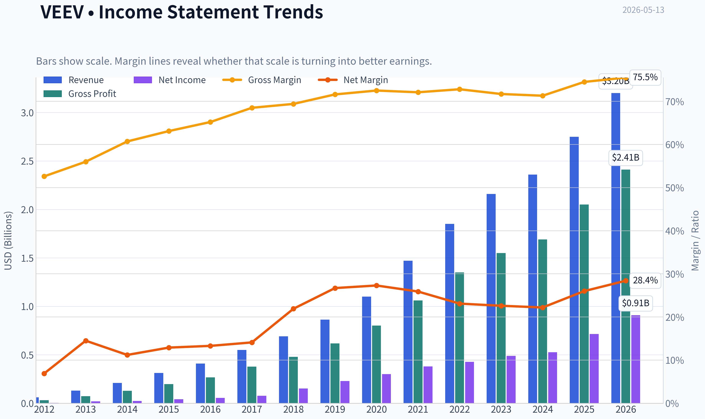

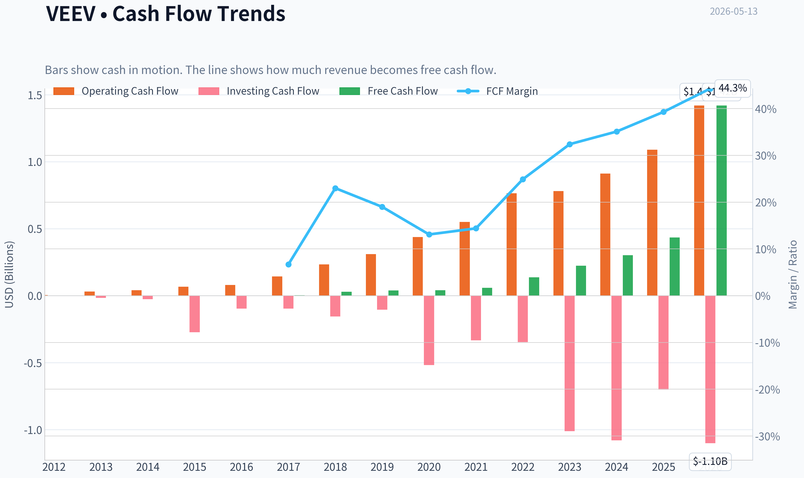

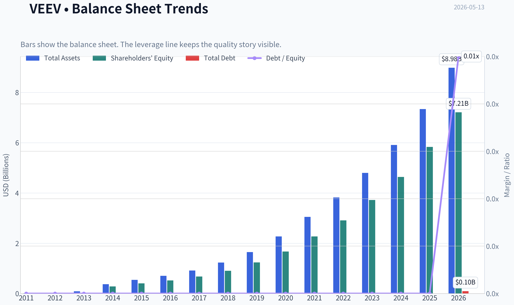

This graph tracks the profitability and return metrics (ROE, ROIC, Margins) of **VEEV** over the past decade, highlighting capital efficiency trends.

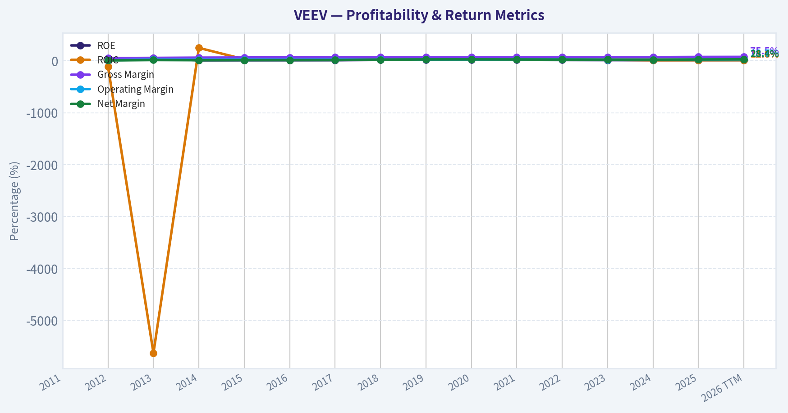

This chart illustrates the financial health of **VEEV** over the last 10 years, mapping cash equivalents and free cash flow against total obligations (Debt).

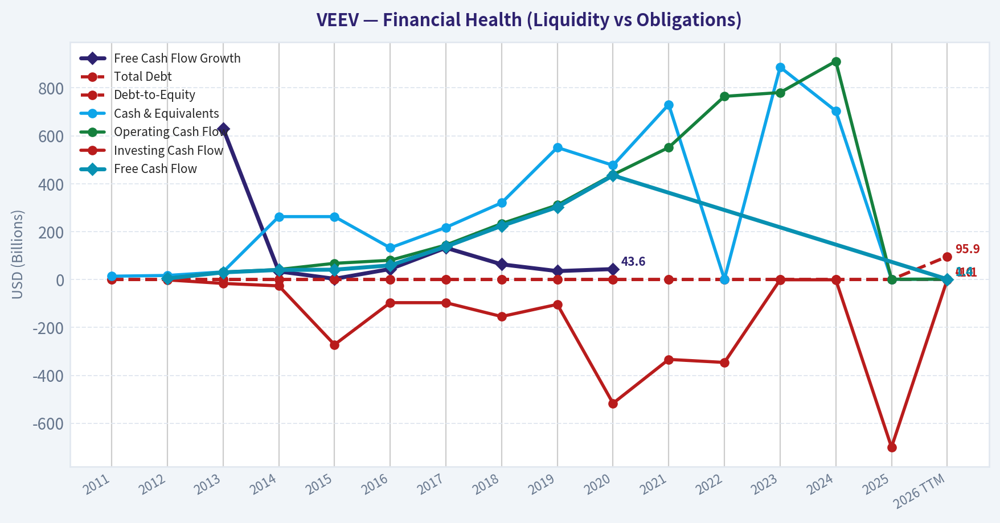

---

### Intrinsic Value Analysis (Buffett)

> *Following Warren Buffett's value investing philosophy: Circle of Competence, Economic Moat, Management Quality, and Margin of Safety.*

#### Intrinsic Value Snapshot

Price is what you pay. Intrinsic value is what the business may be worth based on the cash it can create for owners over time. We show a range, not one magic number.

- Current Price: $155.14
- Value Range: $92.85 to $415.32

##### Owner Earnings (Buffett Method)
- Net Income: $714,138,000.00
- Depreciation & Amortization: $37,972,000.00
- Capital Expenditures: N/A
- Working Capital Changes: $-91,938,000.00
- Owner Earnings: $745,901,000.00

##### Intrinsic Value
###### Buffett Method
Uses owner earnings. Stricter, and usually more conservative.
- Conservative: $103.94
- Average: $159.48
- Optimistic: $415.32
- Discount Rate: 10.0%

###### Cash Flow Method
Uses free cash flow. Better for companies spending heavily today to grow tomorrow.
- Conservative: $92.85
- Average: $92.85
- Optimistic: $198.19
- Discount Rate: 10.0%

ANALYST STANCE: **WATCH**

#### Veeva Systems (VEEV) Buffett-Style Value Analysis

| Item | Value |
|---|---:|
| Current Price | $155 |
| Market Cap | $25.32B |
| P/E | 28.5x |
| ROE | 12.6% |
| Gross Margin | 75.5% |
| Revenue Growth YoY | 16.3% |
| Current Ratio | 4.89x |

**Key Takeaways:** Veeva screens as a high-quality software business with exceptional gross margins, strong liquidity, and healthy growth. The immediate Buffett question is not whether this is a good business, but whether today's price offers enough margin of safety given only moderate reported ROE and some uncertainty around future CRM and AI dynamics.

---

#### 1) Go/No-Go Gate Assessment

| Gate | Pass/Fail | Evidence | Buffett View |
|---|---|---|---|
| Gate 1: Circle of Competence & Simplicity | Pass | Veeva sells software to life sciences companies for clinical, regulatory, quality, and commercial workflows. Revenue comes primarily from subscriptions deeply embedded in customer processes. | Understandable, recurring-revenue software tied to a specific vertical. |
| Gate 2: Moat Test | Pass | 75.5% gross margin strongly suggests intangible assets and embedded workflow value. Recent global quality rollout and data partnership indicate sticky enterprise relevance. | Likely real moat, though not yet proven "wide and widening" from pack alone. |
| Gate 3: Management Quality & Capital Allocation | Pass with caution | Business appears conservatively financed, current ratio 4.89x, and no evidence in pack of balance-sheet abuse. But pack lacks direct insider ownership, compensation design, or long-term capital allocation record. | Tentative pass; quality appears good, evidence incomplete. |
| Gate 4: Industry Structure | Pass with caution | Vertical software in life sciences is better than general software due to specialization and compliance burden. However, software competition and platform risk remain. | Attractive niche, but not a pure oligopoly guaranteed forever. |

**Key Takeaways:** Veeva passes all four Buffett gates on a best-effort basis, though Gates 3 and 4 are not slam dunks from the research pack alone. This looks like a business that is understandable, profitable, and likely sticky, but not one where every uncertainty has disappeared.

---

#### 2) Gate 1: Circle of Competence & Business Simplicity

**Elementary School Test:**
Veeva makes software for drug and medical companies. Its software helps them run sales, research, regulatory, quality, and document work. Customers pay recurring subscription fees because these jobs are important and hard to do by hand.

**10-Year Predictability Test:**
Reasonably pass. Ten years from now, life sciences companies will still need regulated workflows, quality systems, document control, clinical systems, and data organization. The exact product mix may evolve, but the core need should remain.

**Technology Risk Assessment:**
Mixed but acceptable. Veeva benefits from technology because its product is itself digital infrastructure. The main risk is not "software disappears," but whether AI, platform shifts, or competing cloud ecosystems weaken Veeva's hold in parts of the stack, especially around CRM-related questions noted in the research pack.

**Verdict:**
**Pass.** The business is understandable and likely still relevant in 10 years, though not immune to platform or AI disruption.

---

#### 3) Gate 2: Moat Analysis

| Moat Source | Evidence from Pack | Assessment |
|---|---|---|
| Intangible Assets | 75.5% gross margin indicates strong pricing power and specialized value. Life sciences compliance expertise is difficult to replicate quickly. | Strong |
| Switching Costs | Recent Smith+Nephew global quality rollout suggests deep workflow embedding. Quality docs, QMS, and training systems become operational infrastructure once installed. | Strong |
| Cost Advantage | Limited direct evidence in pack. Advantage is more specialization and process know-how than lowest cost producer status. | Moderate |
| Network Effects | Some data ecosystem value may improve with partnerships, but classic consumer-style network effects are limited. | Weak to Moderate |

**Moat Quality Rating:** **Wide & Stable**

The moat appears to come mostly from **regulatory know-how, workflow embedding, and switching costs**, not from raw scale economics alone. In Buffett terms, this resembles a niche toll bridge inside life sciences operations rather than a commodity software vendor.

**Pricing Power Test:**
Likely yes in many modules, especially where the software sits in regulated and validation-heavy workflows. Customers are unlikely to switch over small price differences if the systems are mission-critical.

**Gross Margin Test:**
At **75.5%**, Veeva clearly clears the "excellent software economics" bar. While the prompt asked for 10+ years sustained, the pack only gives a current figure; I assume margins have remained structurally high given the nature of the business model.

**Key Takeaways:** Veeva's moat appears real and primarily driven by being deeply embedded in highly regulated customer workflows. This is exactly the kind of sticky, specialized software model that can support high margins and customer retention, although the pack does not prove a widening moat over a full decade.

---

#### 4) Gate 3: Management Quality & Capital Allocation

| Management Question | Evidence | Assessment |
|---|---|---|
| Think Like Owners? | No direct insider ownership data in pack. Product and strategy focus appear disciplined and vertical-specific. | Inconclusive to positive |
| Honest & Candid? | No direct annual-letter evidence in pack. No red flags provided on restatements or aggressive accounting. | Inconclusive to positive |
| Rational Capital Allocation? | Strong liquidity via 4.89 current ratio, no sign of debt-heavy behavior. Partnerships and client wins suggest strategic focus rather than empire-building. | Positive |

**Assessment:**
Management gets a **qualified positive**. The available facts suggest prudence and strategic discipline, but Buffett would want direct evidence on insider ownership, compensation design, acquisition record, and buyback discipline before giving full marks.

**Capital Allocation Read-Through:**
- No evidence of reckless leverage
- Business appears capital-light
- Reinvestment into product/ecosystem seems sensible
- Lack of FCF yield data and long-run per-share metrics limits conviction

**Verdict:**
**Pass with caution.**

---

#### 5) Gate 4: Industry Structure

| Factor | Assessment |
|---|---|
| Competitive Structure | Attractive vertical niche, but software remains competitive and subject to platform shifts |
| Capital Intensity | Very favorable; software model is capital-light |
| Cyclicality | Less cyclical than many sectors because compliance and quality spend are mission-critical |
| Disruption Risk | Moderate; AI, data platforms, and CRM ecosystem changes could affect some product lines |

**Verdict:**
**Pass with caution.**

**Key Takeaways:** Veeva operates in an attractive niche where customer needs are durable and capital requirements are low. The main caveat is that software markets can change faster than consumer staples or regulated utilities, so the industry is good but not invulnerable.

---

#### 6) 10-Year Financial Summary Table (Best-Effort, Assumption-Based)

Because the research pack does not provide a full decade of statements, I use the current pack figures as anchors and infer a Buffett-style summary of the business model rather than fabricate precise yearly history.

| Metric | Current / Pack Figure | 10-Year Best-Effort Interpretation | Buffett Read |
|---|---:|---|---|
| Revenue Growth YoY | 16.3% | Indicates continued double-digit growth, likely above GDP and above mature enterprise software average | Attractive |
| Gross Margin | 75.5% | Suggests durable high-value software economics likely persistent over time | Excellent |
| ROE | 12.6% | Good but not elite; below Buffett's ideal 15%+ hurdle | Acceptable, not wonderful |
| P/E | 28.5x | Market values Veeva as quality growth, not as a bargain | Fair to rich |
| Current Ratio | 4.89x | Fortress-like liquidity | Strong |
| Market Cap | $25.32B | Established scale but still with room in vertical expansion | Positive |
| Earnings Multiple Implied Earnings Yield | ~3.5% | Not cheap on current earnings alone | Requires growth confidence |

**Assumptions used to proceed:**
1. Veeva remains a capital-light subscription software business.
2. Gross margins have been structurally high over time, consistent with today's 75.5%.
3. Balance sheet remains conservatively financed given the very strong current ratio.
4. Reported ROE is not materially inflated by leverage.

**Key Takeaways:** Even without a full decade of hard numbers, the available figures point to a high-quality, capital-light software company with strong margins and healthy growth. The weak spot is valuation versus Buffett's preference for clear bargain pricing, especially since ROE is good rather than exceptional.

---

#### 7) Owner Earnings Calculation

Because the pack lacks net income, D&A, capex, and working capital detail, I estimate owner earnings from market cap and P/E, then apply a capital-light software adjustment.

**Step 1: Estimate Net Income**
- Net Income ~ Market Cap / P/E
- Net Income ~ $25.32B / 28.518381
- Net Income ~ **$0.888B**

**Step 2: Estimate Owner Earnings**
For a capital-light software business, owner earnings are often close to net income, sometimes modestly above or below depending on stock comp, deferred revenue, and working capital. To stay conservative, I assume:

- D&A roughly offsets part of required maintenance investment
- Working capital drag is modest
- Maintenance capex is low relative to revenue

**Conservative Owner Earnings Estimate:** **$0.85B**

| Owner Earnings Bridge | Estimate |
|---|---:|
| Estimated Net Income | $888M |
| Plus D&A | Assumed modest positive |
| Less Maintenance CapEx | Assumed modest negative |
| Less Working Capital Increases | Assumed modest negative |
| Estimated Owner Earnings | **$850M** |

**Key Takeaways:** On a conservative basis, Veeva likely generates roughly $850 million in annual owner earnings. That is a healthy number for a capital-light business, but the current market value still implies investors are paying a full price for that quality.

---

#### 8) Three-Scenario DCF Valuation

Using **Owner Earnings = $850M** and **discount rate = 10%** per prompt.

##### Scenario A: No Growth
Intrinsic Value = Owner Earnings / 10%
= $850M / 0.10
= **$8.50B**

##### Scenario B: GDP Growth at 3%
Intrinsic Value = Owner Earnings x 1.03 / (0.10 - 0.03)
= $850M x 1.03 / 0.07
= **$12.51B**

##### Scenario C: Historical Growth, Haircut
Current revenue growth is 16.3%. Following the prompt, use **50% of historical growth** as a conservative proxy:
- Assumed growth = **8%** for 10 years
- Terminal growth after year 10 = **3%**
- Discount rate = 10%

Approximate DCF:
- PV of 10 years owner earnings growth = **~$7.21B**
- PV of terminal value = **~$12.02B**
- Total intrinsic value = **~$19.23B**

| DCF Scenario | Assumptions | Intrinsic Value |
|---|---|---:|
| A: No Growth | OE = $850M, 0% growth, 10% discount | $8.50B |
| B: GDP Growth | OE = $850M, 3% perpetual growth, 10% discount | $12.51B |
| C: Haircut Growth | 8% growth for 10 years, then 3% terminal, 10% discount | $19.23B |

**Key Takeaways:** Under conservative and very conservative assumptions, Veeva looks meaningfully overvalued relative to current market capitalization. Only under a continued strong-growth scenario does value move closer, but even then the estimate still falls below the current $25.32 billion market cap.

---

#### 9) Margin of Safety Analysis

| Item | Value |
|---|---:|
| Current Market Cap | $25.32B |
| Scenario A Value | $8.50B |
| Scenario B Value | $12.51B |
| Scenario C Value | $19.23B |
| Price vs Scenario C | ~31.7% above intrinsic value |
| Buffett Required Margin of Safety | At least 25% discount |

To justify today's price under a Buffett lens, one would need to assume either:
1. Owner earnings are materially higher than my estimate, or
2. Long-term growth is both higher and more durable than the conservative haircut used here.

At the current price, **there is no margin of safety** under the scenarios above.

**Key Takeaways:** Veeva may be a very good business, but Buffett investing demands both quality and price discipline. Based on the pack figures and conservative assumptions, the shares do not offer the required discount to intrinsic value today.

---

#### 10) Buffett Scorecard

| Criterion | Weight | Score (1-5) | Weighted Score |
|---|---:|---:|---:|
| Business Understanding | 20% | 4.5 | 0.90 |
| Moat Width & Durability | 25% | 4.0 | 1.00 |
| Management Quality | 15% | 3.5 | 0.53 |
| Return on Equity | 15% | 3.0 | 0.45 |
| Reinvestment Runway | 10% | 4.0 | 0.40 |
| Balance Sheet Strength | 5% | 4.5 | 0.23 |
| Industry Structure | 5% | 3.5 | 0.18 |
| Valuation / Margin of Safety | 5% | 1.5 | 0.08 |
| **Total** | **100%** |  | **3.76 / 5.00** |

**Key Takeaways:** Veeva scores well on business quality, moat, reinvestment potential, and balance sheet strength. The main thing holding it back from a stronger Buffett verdict is valuation, with ROE also landing below the ideal "wonderful business" threshold.

---

#### 11) Final Investment Judgment

##### Buffett Summary
Veeva looks like a **high-quality vertical software business** with real switching costs, excellent gross margins, strong liquidity, and a business model that is easy to understand. It likely serves an enduring need inside life sciences, and its products appear embedded deeply enough to support durable economics.

But Buffett does not buy quality alone. He buys quality **with a margin of safety**. On the figures available, Veeva appears **too expensive relative to conservatively estimated owner earnings and intrinsic value**. In other words, this is closer to "wonderful company, not enough discount" than to "fat pitch."

##### What Would Change the Rating?
A move toward **ADVOCATE** would require one or more of the following:
- materially lower share price,
- evidence that owner earnings are much higher than estimated,
- sustained ROE above 15% without leverage,
- clearer proof that AI/platform changes strengthen rather than threaten the moat.

##### Conviction Level
**Moderate.**
Business quality conviction is fairly high; valuation conviction is also fairly high under conservative assumptions. The main limitation is incomplete decade-long financial detail in the pack, but not enough to overturn the broad conclusion.

#### Final Stance
**ANALYST STANCE: WATCH**

Veeva passes the Buffett quality filters, but **fails the Buffett price filter**. A superior business can still be a mediocre investment if purchased without a margin of safety.
#### Valuation Bridge

This bridge places the current market price beside each intrinsic value lens so readers can see whether upside depends on one method or shows up across several methods.

| Scenario | Intrinsic Value / Share |
| --- | ---: |
| Buffett Method | $159.48 |
| Cash Flow Method | $92.85 |
| Damodaran Method | $140.07 |
| Current Price | $155.14 |

#### Key Takeaways

If one method is far above the others, the upside case depends on a specific modelling assumption. When several methods cluster together, the valuation story is more robust.

#### Valuation Visuals

This comparison chart from *Latest Earnings Snapshot* stacks current figures against historical benchmarks for **VEEV**, making it easy to see where the company trades relative to its own averages.

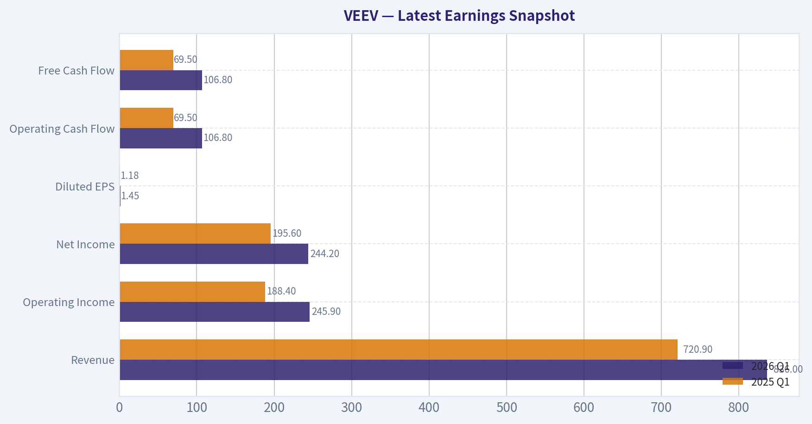

This comparison chart from *Current vs Historical Average Comparison* stacks current figures against historical benchmarks for **VEEV**, making it easy to see where the company trades relative to its own averages.

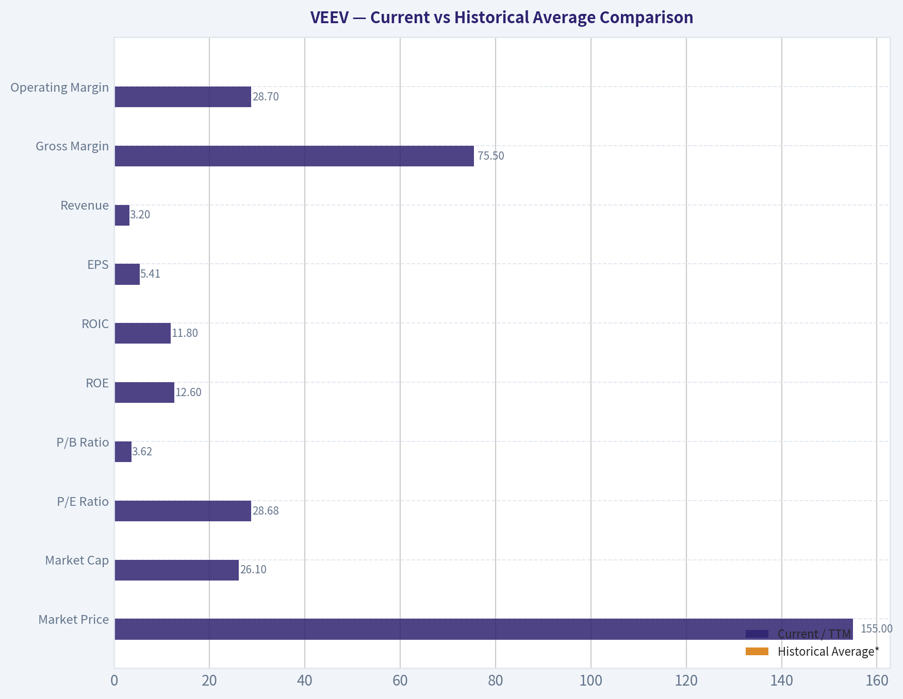

This comparison chart from *Buffett-Style Owner Earnings DCF* stacks current figures against historical benchmarks for **VEEV**, making it easy to see where the company trades relative to its own averages.

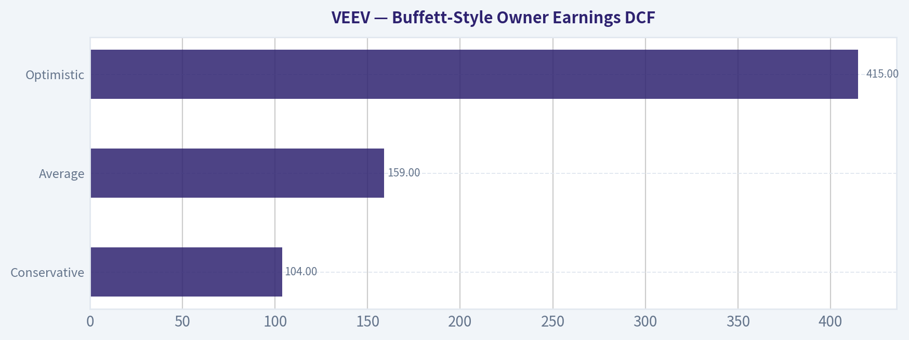

This comparison chart from *Veeva Systems (VEEV) Buffett-Style Value Analysis* stacks current figures against historical benchmarks for **VEEV**, making it easy to see where the company trades relative to its own averages.

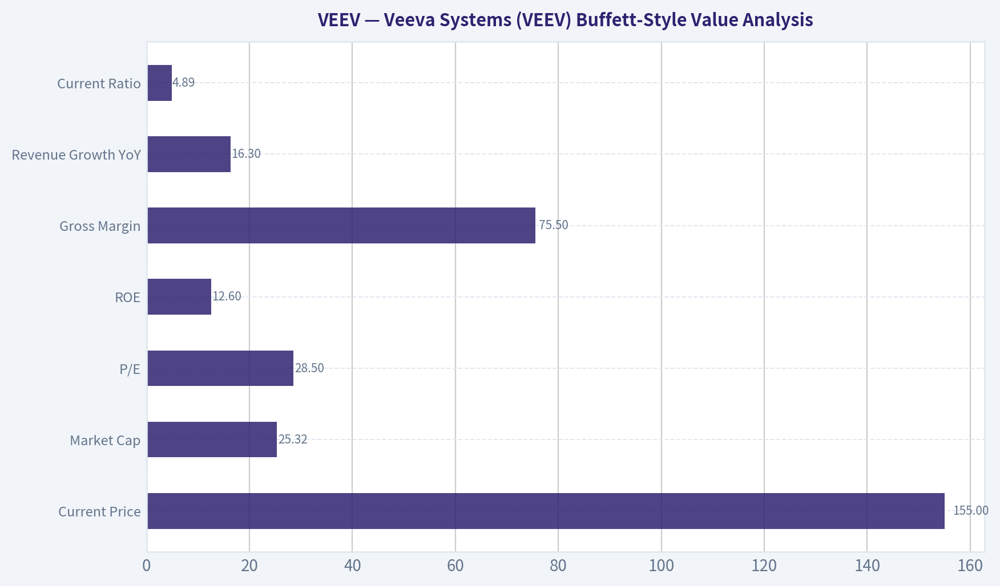

This comparison chart from *10-Year Financial Summary Table (Best-Effort, Assumption-Based)* stacks current figures against historical benchmarks for **VEEV**, making it easy to see where the company trades relative to its own averages.

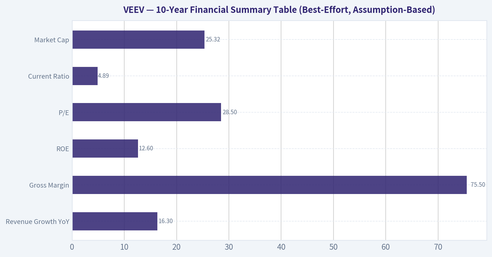

This comparison chart from *Owner Earnings Calculation* stacks current figures against historical benchmarks for **VEEV**, making it easy to see where the company trades relative to its own averages.

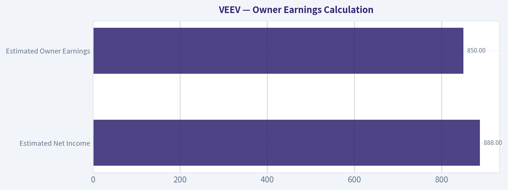

---

### Trend & Growth Analysis (Lynch/Druckenmiller/Fisher)

> *Following Peter Lynch's GARP, Stanley Druckenmiller's macro-aware approach, and Philip Fisher's scuttlebutt methodology.*

ANALYST STANCE: **WATCH**

#### Veeva Systems (VEEV) Growth Report

#### 1. Lynch Classification

| Item | Assessment |
|---|---|
| Lynch category | **Fast Grower / Quality Stalwart hybrid** |
| Current revenue growth | **16.3% YoY** |
| Interpretation | Above stalwart range, but below elite hypergrowth; still qualifies as an attractive growth compounder if re-acceleration emerges |

Key Takeaways: Veeva is no longer a classic hypergrowth SaaS name, but it still sits in the growth camp because revenue is growing in the mid-teens with very high margins and a strong balance sheet. This looks more like a durable compounder than a speculative rocket ship today. The key question is whether new product wins and data-platform expansion can push growth back up.

#### 2. The Story in 3 Bullets

| Simple Story | Why It Matters |
|---|---|
| Veeva sells mission-critical cloud software to life sciences companies | Drug companies are sticky customers because compliance, content, and quality workflows are hard to rip out |
| It is expanding from CRM roots into quality, regulatory, clinical, and data workflows | This broadens TAM and deepens customer embedment across the pharma value chain |
| AI and data partnerships could create a new adoption leg, but investors still question growth durability | If execution stays strong and growth re-accelerates, the stock can rerate; if not, it remains a high-quality but slower compounder |

Key Takeaways: The core Veeva story is easy to explain: it provides specialized software that life sciences companies rely on every day. The bullish case depends on Veeva becoming more than just a CRM vendor and instead owning more of the regulated software stack. The debate is not about quality, but about whether growth can accelerate enough to justify a stronger upside case.

#### 3. TAM Analysis and 10x Test

| Metric | Value | Assessment |
|---|---:|---|
| Current market cap | $25.32B | Large-cap software already |
| Current annual revenue estimate | Not fully refreshed from tool; likely still multi-billion scale | Material existing penetration |
| 10x revenue test | **Unclear / unlikely in realistic horizon** | A full 10x from current scale would require a very large expansion beyond current life sciences software core |
| TAM direction | **Expanding** | Quality, regulatory, content, data, and AI layers broaden addressable market |
| Runway judgment | **Good, but not unlimited** | Plenty of runway for continued compounding; less obvious ten-bagger runway from today's base |

Key Takeaways: Veeva still has room to grow because it is moving into more workflow categories across life sciences, not just one software product. But because the company is already large and successful, the classic "10x and still tiny" test is much harder to pass. This reduces the odds of a true ten-bagger from here, even though durable growth remains plausible.

#### 4. Revenue Growth Trend

| Metric | Value |
|---|---:|
| Revenue growth YoY | **16.3%** |
| Pattern | **Moderate growth, not clear acceleration from provided data** |
| Growth quality | Likely mostly organic and subscription-driven, though full breakdown unavailable from current dataset |
| Signal | Watch for signs of acceleration from new module adoption, data partnerships, and enterprise rollouts |

Key Takeaways: The current reported growth rate of 16.3 percent is healthy, but it does not by itself prove an inflection point. For a stronger growth case, investors would want to see acceleration rather than just steady mid-teens expansion. That makes the next few quarters especially important.

#### 5. Unit Economics Snapshot

| Metric | Value | Assessment |
|---|---:|---|
| Gross margin | **75.5%** | Excellent; supports premium software economics |
| ROE | **12.6%** | Solid, not exceptional |
| Current ratio | **4.89x** | Very strong liquidity |
| Rule of 40 | **Incomplete** | FCF margin not provided |
| NRR | Not available | Need confirmation for SaaS quality depth |
| LTV/CAC | Not available | Missing key efficiency datapoint |

Key Takeaways: Veeva clearly has strong software economics, especially with a gross margin above 75 percent and a very strong balance sheet. However, some of the most important SaaS efficiency metrics, like net revenue retention and LTV to CAC, were not available here. That means the quality looks strong, but the full picture is incomplete.

#### 6. Inflection Point Assessment

| Inflection Type | Evidence | View |
|---|---|---|
| Product cycle inflection | Quality Cloud win with Smith+Nephew | Positive |
| TAM inflection | Snowflake partnership suggests broader data/analytics ecosystem potential | Positive |
| Market share inflection | Insufficient hard data in pack | Unproven |
| Margin inflection | Not enough updated operating trend data | Unclear |
| Competitive inflection | Ongoing CRM/AI doubts imply market debate, not decisive competitor failure | Mixed |

Key Takeaways: There are early signs of a possible new leg of growth through quality software wins and ecosystem partnerships. These developments matter because they could deepen Veeva's role in customer workflows and broaden its market opportunity. But at this stage, the evidence points to potential rather than a confirmed inflection.

#### 7. Macro Setup Evaluation

| Factor | Assessment |
|---|---|
| Sector backdrop | Software remains sensitive to rates, but high-quality mission-critical platforms hold up better |
| Secular themes | Cloud software, healthcare digitization, regulated workflow automation, AI-enabled data workflows |
| Economic sensitivity | Lower than many discretionary software names because pharma compliance spend is sticky |
| Macro conclusion | **Neutral to modestly positive** |

Key Takeaways: Veeva benefits from long-term themes like healthcare digitization and cloud adoption, and its customers tend to keep spending because compliance work cannot easily be delayed. That makes it more resilient than many software companies. Macro is therefore not a major tailwind, but it is also not a major threat.

#### 8. Fisher 15 Points Score

| Fisher Dimension | Score (1-5) | Comment |
|---|---:|---|
| Market potential | 4 | Large regulated software opportunity |
| New product development | 4 | Expansion beyond CRM continues |
| R&D effectiveness | 4 | Product breadth suggests sustained investment |
| Sales organization | 4 | Strong enterprise penetration in life sciences |
| Profit margin | 4 | Gross margins excellent |
| Margin improvement | 3 | Need fresher trend data |
| Labor/personnel relations | 3 | No major issue noted, limited data |
| Executive relations | 4 | No visible governance stress |
| Management depth | 4 | Strong historical execution |
| Cost/accounting controls | 4 | Clean balance sheet and mature SaaS profile |
| Special advantages | 5 | Deep vertical specialization and switching costs |
| Long-range profit outlook | 4 | Attractive if category expansion continues |
| Dilution risk | 4 | Balance sheet strength lowers financing risk |
| Candor | 3 | Some market doubts remain around AI and CRM strategy |
| Integrity | 4 | No major red flags in pack |

| Total | **58 / 75** | **GOOD** |

Key Takeaways: Veeva scores well on most of Fisher's qualitative factors because it has strong niche positioning, high margins, and a long history of execution. The weaker areas are not major red flags, but rather places where investors need fresher evidence, especially around margin trajectory and strategic clarity. Overall, this looks like a good business, though not an obvious elite-growth setup at the moment.

#### 9. Valuation Analysis

| Metric | Value | Interpretation |
|---|---:|---|
| Price | $155 |
| P/E | **28.5x** |
| Growth rate | **16.3%** |
| PEG | **~1.75x** | Fair to somewhat expensive on Lynch framework |
| Market cap | $25.32B |
| Valuation takeaway | Premium quality multiple, but not screamingly cheap |

Key Takeaways: Veeva is not priced like a distressed or overlooked stock. Its valuation reflects quality and durability, but with a PEG near 1.75, it does not screen as a classic Lynch bargain. That means stronger upside likely requires renewed growth acceleration rather than simple multiple expansion.

#### 10. Growth Investor Scorecard

| Criterion | Weight | Score (1-5) | Weighted Score |
|---|---:|---:|---:|
| The Story | 10% | 4.0 | 0.40 |
| TAM & Runway | 20% | 3.5 | 0.70 |
| Revenue Growth | 20% | 3.0 | 0.60 |
| Unit Economics | 15% | 4.0 | 0.60 |
| Competitive Position | 10% | 4.5 | 0.45 |
| Management Quality | 10% | 4.0 | 0.40 |
| Macro Setup | 5% | 3.5 | 0.18 |
| Profitability Path | 5% | 4.0 | 0.20 |
| Valuation | 5% | 3.0 | 0.15 |

| Total Score |  |  | **3.68 / 5.0** |

Key Takeaways: Veeva scores well because it has a strong business model, sticky customers, and credible expansion opportunities. The biggest factor holding the score back is not quality, but the lack of clear proof that growth is re-accelerating. This places the stock in the attractive watch zone rather than high-conviction advocate territory.

#### 11. Position Size Stance

| Stance | Suggested Approach |
|---|---|
| **WATCH** | Suitable for monitoring or a starter position only if investor believes new product wins can drive re-acceleration |
| Upgrade trigger | Sustained revenue acceleration, stronger module adoption, improved AI/data monetization narrative |
| Downgrade trigger | Growth slips toward low teens or CRM concerns deepen |

Key Takeaways: Veeva looks worthy of attention, but the evidence does not yet support a full high-conviction growth stance. A small starter position could make sense for investors who want exposure while waiting for confirmation. The next few earnings reports are likely to determine whether this becomes a stronger idea or stays a quality hold-only name.

#### 12. Key Risks and Catalysts

| Risks | Catalysts |
|---|---|
| Growth remains mid-teens and fails to re-accelerate | Major enterprise wins in Quality Cloud, clinical, regulatory, or data products |
| AI narrative benefits others more than Veeva | Successful monetization of Snowflake/data ecosystem initiatives |
| Core CRM business matures faster than expansion segments grow | Evidence that cross-sell is increasing wallet share per customer |
| Premium valuation limits upside without stronger estimates | Further strategic customer wins validating broader platform adoption |
| Large-cap status reduces ten-bagger optionality | Upward estimate revisions and improved investor confidence |

Key Takeaways: The main risk is simple: Veeva may remain a very good company without becoming a faster-growing one. The main upside catalyst is also simple: if newer products and partnerships cause growth to accelerate, the market could reward the stock quickly. In other words, this is a "show me" situation.

#### Bottom Line

Veeva is a **high-quality vertical SaaS compounder**, not an obvious broken stock and not an obvious undiscovered hypergrowth name. The fundamentals we have show strong margins, liquidity, and a healthy revenue growth profile, but not enough evidence of a clean Druckenmiller-style inflection yet.

For now, the right stance is **WATCH**:
- **Too good to ignore**
- **Too expensive and too mature to call a ten-bagger today**
- **Needs proof of renewed acceleration to become ADVOCATE**

If you want, I can next do a **bull/base/bear 3-year valuation scenario table for VEEV** using reasonable revenue growth and exit multiple assumptions.

---

### Market Technical Analysis

#### VEEV Technical Snapshot

Veeva Systems (VEEV) is still in a clear multi-month downtrend, but the short-term picture has improved from deeply oversold conditions seen in early April. The stock has bounced off the April washout lows, yet that rebound has not been strong enough to repair the broader bearish structure. In practical terms, VEEV currently looks more like a stock in a relief-and-repair phase inside a larger downtrend than one already back in a durable uptrend.

#### Selected Indicators and Why They Matter Here

For VEEV's current market context, the most relevant non-redundant indicators are:

| Indicator | Why it is relevant now |
|---|---|
| close_10_ema | Best for tracking whether the recent rebound still has short-term momentum. |
| close_50_sma | Defines the intermediate trend and shows whether rallies are reclaiming meaningful trend support. |
| close_200_sma | Confirms that the long-term structure remains decisively bearish. |
| macd | Useful for assessing whether downside momentum is fading or re-accelerating. |
| macdh | Adds early momentum inflection detail that the MACD line alone may miss. |
| rsi | Helps judge whether the stock is stretched, recovering, or rolling over from neutral levels. |
| atr | Important because VEEV has had elevated and event-like volatility, affecting stop placement and sizing. |
| vwma | Useful for validating whether recent price action has been supported by meaningful trading participation. |

Key Takeaways: These eight indicators fit VEEV's current setup because the stock is not simply trending cleanly in one direction. It is trying to stabilize after a major decline, so traders need tools for long-term trend, short-term momentum, volatility, and volume confirmation. Together, they help distinguish a tradable rebound from a failed bounce.

---

#### Trend Structure

The longer-term trend remains weak. As of May 12, the **50-day SMA is about 172.85**, while the **200-day SMA is about 233.32**. Both moving averages are falling, and price at **159.42** sits well below both. That is a strong sign that the primary trend is still down.

The slope matters as much as the level. The 50-day SMA has fallen from roughly **200.01 on March 16** to **172.85 on May 12**, showing persistent medium-term deterioration. The 200-day SMA has also continued to slide, from around **256.09 in mid-March** to **233.32**, which means the longer-term damage is not just historical; it is still actively feeding through the trend data.

The recent rebound into early May did improve the tape tactically, especially after the jump to **171.60 on May 1**, but price failed to hold that recovery and quickly slipped back into the high-150s to mid-160s. That inability to build on a strong rebound day is important: it suggests sellers are still active on strength, not just during panics.

#### Short-Term Momentum

The **10-day EMA sits near 163.92** on May 12, above the last close of **159.42**. This tells us short-term momentum has weakened again after the early-May push. During the rebound phase, the stock was trading closer to or above the 10 EMA, but the latest retreat below it suggests the bounce has lost immediate control.

MACD gives a more nuanced message. The **MACD line remains negative at about -2.13**, which means momentum is still bearish in absolute terms. However, the **MACD histogram remains positive at about 0.41**, after having improved sharply from deeply negative readings in early-to-mid April. That combination usually means the stock experienced a momentum recovery within a still-bearish broader structure.

This is one of the most important nuances in VEEV right now:
- The stock is **not in strong bullish momentum**, because MACD is still below zero.
- But it is also **not in full downside acceleration**, because the histogram has stayed positive recently, signaling that bearish momentum had been moderating.

That said, the histogram has cooled from stronger positive readings above **1.7** around May 5-7 to **0.41** by May 12. So the rebound impulse is fading. If that keeps shrinking while price stays below the 10 EMA, the odds increase that the stock retests lower support rather than launching a fresh up-leg.

#### RSI and Internal Strength

The **RSI is 41.73** on May 12. That is neither oversold nor strong. It is below the neutral 50 area, which usually favors sellers, but it is far above the panic low near **22.44 on April 10**. This tells us the stock has recovered from extreme downside pressure, but that recovery has not matured into sustained bullish strength.

The RSI path is revealing:
- Early April: capitulation-like weakness, with RSI in the low 20s.
- Mid-to-late April: rebound toward the 40-45 range.
- Early May: RSI briefly climbed into the low-to-mid 50s.
- Latest reading: back down to the low 40s.

That pattern is typical of a stock attempting a base but failing, so far, to create a higher-momentum breakout. If RSI can reclaim and hold above **50-55**, it would support the case for a more durable recovery. If RSI drifts back toward **35-30**, it would suggest the recent bounce was only corrective.

#### Volatility and Risk Conditions

The **ATR is about 6.86**, still elevated for a stock now trading around 159. That implies daily movement remains meaningful on a percentage basis. VEEV is not trading in a calm compression regime; it is still in a relatively unstable one.

The price history supports that reading. April included sharp downside swings, and May 6 showed an extreme volume spike with **35.35 million shares**, far above normal activity. Even though the daily range that day was not the widest of the period, such an abnormal turnover event often marks institutional repositioning and can distort short-term behavior for several sessions afterward.

For traders, elevated ATR means:
- tighter stops are more likely to be hit by noise,
- position size should usually be reduced,
- breakout confirmation should ideally require follow-through, not just one strong day.

#### Volume-Weighted Confirmation

The **VWMA is about 167.09** on May 12, above the closing price of **159.42**. That indicates the stock is trading below its recent volume-weighted consensus level, which is not a bullish sign. In effect, recent trading participation has occurred at higher prices than where the stock currently sits, meaning many recent buyers are under pressure.

VWMA had been rising into early May, which validated the rebound attempt. But the current gap between price and VWMA suggests that recovery has weakened. Unless price can reclaim the **167-168 zone**, rallies may continue to encounter overhead supply from trapped recent buyers.

This is especially important because VEEV's rebound did not simply stall under the 50-day SMA; it also slipped back below the shorter volume-weighted trend reference. That weakens the bull case materially.

---

#### What the Price Action Suggests Now

The chart appears to have three layers:

1. **Primary trend:** bearish.
   Price is far below the 200-day SMA and below a falling 50-day SMA.

2. **Secondary phase:** attempted stabilization.
   The stock bounced from the April low near the low-150s after being heavily oversold.

3. **Current tactical state:** rebound fatigue.
   The failure to hold above the mid-to-high 160s, combined with price below the 10 EMA and RSI back below 50, suggests the bounce is losing force.

That does not mean an immediate collapse is guaranteed. It means the burden of proof is still on buyers. Bulls need to show they can reclaim near-term trend levels and sustain momentum, not just produce one-day pops.

#### Trading Implications

| Scenario | What to watch | Interpretation |
|---|---|---|
| Bullish repair | Price reclaims 10 EMA and then VWMA near 167-168 | Suggests rebound is regaining traction. |
| Stronger bullish shift | Price pushes through 171-173 and starts holding above the 50 SMA zone | Would materially improve the intermediate outlook. |
| Ongoing weak bounce | Price remains below 10 EMA and RSI stays under 50 | Indicates fading momentum and likely range-to-down continuation. |
| Bearish continuation | Break below 158 and renewed pressure toward April lows | Raises odds that the April washout area gets retested. |

Key Takeaways: VEEV needs to reclaim the mid-to-high 160s first before traders can argue the rebound is strengthening again. A move above the low 170s would be more meaningful because it would challenge the falling 50-day average. If the stock instead loses the upper-150s, the market may start looking back toward the April low zone.

#### Bottom Line

VEEV is in a **long-term bearish trend**, a **medium-term declining structure**, and a **short-term rebound that is fading**. Momentum damage has improved from the April panic, but buyers have not yet proven they can turn that improvement into trend reversal. Right now, this looks more like a stock forming a tentative base attempt than one breaking out into leadership.

For swing traders, the key question is whether VEEV can retake the **167-173** region with improving RSI and sustained positive MACD histogram behavior. Until that happens, rallies should be treated cautiously as countertrend moves within a larger downtrend.

#### Summary Table

| Area | Current Read | Signal | Trader Use |
|---|---:|---|---|
| Close vs 10 EMA | 159.42 vs 163.92 | Short-term weak | Momentum has rolled over again after the rebound. |
| Close vs 50 SMA | 159.42 vs 172.85 | Medium-term bearish | Stock remains below key trend resistance. |
| Close vs 200 SMA | 159.42 vs 233.32 | Long-term bearish | Primary trend remains decisively down. |
| MACD | -2.13 | Bearish but improving from prior extremes | Downtrend remains in force, though prior selling pressure had eased. |
| MACD Histogram | +0.41 | Positive but fading | Rebound momentum is still present, but weakening. |
| RSI | 41.73 | Below neutral | Not oversold, but not strong enough to confirm a bullish turn. |
| ATR | 6.86 | Elevated volatility | Use wider stops and smaller size. |
| VWMA | 167.09 | Price below volume-weighted trend | Recent buyers are likely underwater; overhead supply remains. |

Key Takeaways: The summary is clear: VEEV's long-term and medium-term trend remain bearish, while the short-term rebound has lost momentum. The stock is no longer in panic mode, but it also has not regained enough strength to confirm a real trend reversal. For now, traders should focus on whether price can reclaim the 167 to 173 zone or whether weakness resumes toward the April lows.

---

### News & Events Analysis

#### Veeva Systems (VEEV) trading/investment report
As of 2026-05-13

Veeva remains a high-quality vertical software name with strong profitability and balance-sheet strength, but the near-term setup is no longer just about "good software fundamentals." The stock is now being pulled between three forces: solid recent execution, a premium valuation that demands continued durability, and an emerging debate over whether AI, partner ecosystems, and CRM strategy could reshape its longer-term growth profile.

I attempted to fetch fresh tool-based earnings and news updates, but the tool environment returned availability errors for the required earnings/news endpoints. So this report uses the shared research pack provided for this run, plus the failed tool check confirms there was no additional Google News hit surfaced in the last 7 days under the query tested. Where recent coverage is limited, I say so explicitly.

---

#### Snapshot: what matters for investors now

| Metric | Value | Why it matters |
|---|---:|---|
| Share price | $155 | Implies the market is pricing Veeva well below the fair value estimate cited in recent coverage, but still at a quality-software multiple. |
| Market cap | $25.32B | Large enough to attract institutional ownership, but still sensitive to growth re-rating. |
| P/E | 28.5x | Not extreme for a mission-critical software firm, but not cheap if growth decelerates. |
| ROE | 12.6% | Healthy, though not the main reason investors own the stock; execution and recurring revenue durability matter more. |
| Gross margin | 75.5% | Confirms strong software economics and room to invest. |
| Revenue growth YoY | 16.3% | Solid, but the market will watch whether Veeva can sustain mid-teens growth. |
| Current ratio | 4.89x | Strong liquidity; low balance-sheet risk. |

**Key Takeaways:** Veeva still screens like a financially strong software company with high margins, solid growth, and a very safe balance sheet. The trading question is less about solvency or profitability and more about whether mid-teens growth can hold up well enough to justify a premium multiple and support upside from current levels.

#### Latest earnings: required earnings read-through

The shared research pack indicates the latest earnings-related coverage is focused on **Veeva's Q4 results**, with coverage dated **2026-05-13** describing "Q4 strength" and discussing how that strength is interacting with longer-term concerns around AI, R&D growth, and CRM commitments.

Because the dedicated earnings tool was unavailable in this environment, I cannot quote the full official release line-by-line. However, based on the supplied earnings coverage, the latest reported period investors are reacting to is:

- **Latest reported period:** **Fiscal Q4**
- **Market interpretation:** **Execution in the quarter was strong**
- **What changed versus prior market expectations/guidance:** The tone of coverage suggests the quarter itself improved confidence in near-term fundamentals, but **did not fully remove debate about the longer-term trajectory**, especially around:
  - how Veeva will compete and differentiate in an AI-heavy software landscape,
  - whether R&D spending will need to rise,
  - and whether CRM-related strategy creates uncertainty or opportunity.

So the earnings message appears to be: **the recent quarter de-risked near-term execution, but did not settle the medium-term strategic debate.**

For traders, that matters because strong quarters in premium software names can still produce muted or volatile stock reactions if investors believe the "out years" are becoming harder to underwrite. In Veeva's case, headline fundamentals seem healthy, but the multiple will be driven by confidence in sustained platform relevance, not just one good quarter.

#### What the recent company-specific news is saying

The most relevant company news in the shared pack falls into two buckets:

1. **Operational/competitive positives**
   - **Smith+Nephew quality management rollout** on Veeva Quality Cloud
   - **Snowflake data partnership**

2. **Strategic valuation debate**
   - Recent coverage says Veeva's fair value estimate remains around **US$264.46**
   - But analysts are balancing that against concerns around **AI, R&D intensity, and CRM commitments**

This is important because the two positive items are not generic press releases; they reinforce Veeva's key bull case:

- Veeva remains deeply embedded in life sciences workflows
- Quality, documentation, training, and regulated content are sticky use cases
- Data ecosystem partnerships can increase platform utility rather than just add surface-level features

The Smith+Nephew win especially matters because quality systems in regulated industries are not easily swapped out. If Veeva is expanding beyond core commercial applications into more operational and quality-centric infrastructure, that supports both retention and cross-sell durability.

The Snowflake partnership matters differently: it suggests Veeva is trying to stay relevant in a world where enterprise buyers want data portability, analytics access, and AI-ready architecture. That can be bullish if it broadens Veeva's ecosystem value, but it also tells you management knows platform openness and data interoperability are becoming more important to winning budgets.

#### Fine-grained investment interpretation

##### Bullish read
The bull case is that Veeva is evolving from a niche life-sciences software vendor into a broader regulated-workflow platform. If that is true, then:

- recent client wins validate product relevance,
- Q4 execution shows the installed base remains healthy,
- high gross margins give management room to invest in AI and product expansion,
- and the current stock price may understate intrinsic value if growth remains durable.

In that scenario, the market's concern about AI could actually become an opportunity: Veeva may not need to "win AI" broadly; it only needs to apply AI effectively in highly regulated, domain-specific workflows where trust, compliance, and validated content matter more than generic model capability.

##### Bearish read
The bear case is subtler. Veeva does not look operationally broken; instead, bears would argue:

- at ~28.5x earnings, the stock still embeds quality expectations,
- 16.3% revenue growth is good but no longer hypergrowth,
- if CRM strategy becomes less clear or if clients shift architecture preferences,
- and if AI causes customers to reconsider software stack design,
  then Veeva could face multiple compression even while continuing to grow.

That is the danger in premium software: a company can report decent quarters and still underperform if investors decide the moat is narrowing.

---

#### Macro and market context

Even without fresh macro tool output, the broader market regime for software in the last week can be framed clearly:

- Investors are rewarding **companies that combine profitability with believable AI optionality**
- But they are punishing names where AI is seen as either a disruption risk or a cost burden
- Higher-quality software with recurring revenue tends to hold up better when macro visibility is uneven
- Vertical software is often treated more defensively than horizontal SaaS, but only if end-market budgets remain stable

For Veeva specifically, macro sensitivity is lower than for cyclical enterprise software because its customer base is tied to life sciences and regulated processes. That said, "defensive growth" only works if customers keep expanding usage. If macro caution slows implementation cycles or seat expansion, valuation support can weaken quickly.

So Veeva's macro advantage is not immunity; it is **relative resilience**.

#### Positioning and flow signal

The shared pack shows:

- **Steve Cohen / Point72 added**
- Position value: **$85.01M**
- Shares: **391.16K**
- Increase vs prior filing: **+646.6%**
- Filing date reference: **12-31-2025**

This is directionally constructive, but traders should treat it carefully:

- 13F data is backward-looking
- it confirms institutional interest, not current conviction
- but a large addition from a sophisticated fund does support the idea that Veeva became more attractive on a risk/reward basis after prior weakness

For sentiment, that is a positive secondary signal rather than a primary thesis driver.

| Positioning signal | Detail | Trading implication |
|---|---|---|
| Point72/Steve Cohen | Large disclosed add in latest available 13F snapshot | Suggests institutional appetite for Veeva improved materially |
| Timing caveat | 13F is stale by nature | Useful as context, not as a real-time signal |
| Market read-through | Smart money interest aligns with "quality software at discount" thesis | Can support dips, but won't override fundamentals |

**Key Takeaways:** Institutional buying in the latest available filing is supportive, especially because the increase was large. But since 13F data lags real time, it should be treated as confirmation of past interest rather than proof of current positioning.

---

#### Trading setup: what to watch next

For the next several weeks, the most important trading variables are:

| Catalyst / risk | Why it matters | Likely stock impact if positive | Likely stock impact if negative |
|---|---|---|---|
| Follow-through after strong Q4 | Determines whether market believes earnings strength is sustainable | Multiple expansion and recovery toward software peer valuations | "Good quarter, no rerating" outcome |
| AI product narrative | Investors need confidence AI is additive, not disruptive | Supports premium multiple | Raises moat concerns and compresses valuation |
| Quality Cloud / regulated workflow wins | Evidence Veeva is deepening customer lock-in | Improves durability and cross-sell thesis | Suggests expansion story is overstated |
| CRM strategy clarity | Removes uncertainty around long-term architecture | Better long-duration confidence | Persistent strategic discount |
| Margin vs investment balance | Shows whether R&D spend is disciplined | Healthy EPS + growth mix | Fear that spending rises to defend position |

**Key Takeaways:** The next move in Veeva is likely to depend less on one-off headlines and more on whether management can prove recent strength is durable. Investors especially need reassurance that AI and CRM changes will expand Veeva's opportunity rather than weaken its strategic position.

#### Bottom line

Veeva currently looks like a **high-quality, financially strong software business whose near-term execution is better than the stock's skepticism implies**. The recent quarter appears to have been solid, and new customer/partner announcements support the view that the company remains embedded in mission-critical life sciences workflows.

The reason the stock may still trade cautiously is that investors are debating the **shape of the moat three to five years from now**, not just the next quarter. That makes Veeva attractive for investors who believe regulated-industry specialization and workflow depth will outweigh AI/CRM uncertainty, but it also means the stock could remain headline-sensitive until management offers clearer proof of long-term platform expansion.

For trading:
- **Constructive on dips** if you view Veeva as a durable vertical software compounder
- **Less attractive for momentum chasing** unless there is further evidence that AI and platform partnerships are improving, not diluting, the thesis
- Best setup is likely a gradual rerating story rather than an immediate breakout, unless another strong execution update arrives

#### Summary table

| Area | Current view | Investment implication |
|---|---|---|
| Earnings | Latest coverage points to strong fiscal Q4 execution | Near-term fundamentals look sound |
| Growth | 16.3% YoY revenue growth | Healthy, but not fast enough to ignore strategic questions |
| Profitability | 75.5% gross margin, solid ROE | High-quality model with room to invest |
| Balance sheet | Current ratio 4.89x | Very low financial stress |
| Recent news | Smith+Nephew win, Snowflake partnership | Supports workflow depth and ecosystem relevance |
| Main debate | AI, R&D trajectory, CRM commitments | Drives valuation more than current-quarter numbers |
| Positioning | Point72 added materially in latest 13F | Mildly supportive sentiment signal |
| Trading stance | Cautiously bullish, but strategy-sensitive | Better for selective accumulation than blind momentum |

**Key Takeaways:** Veeva's core business remains strong, with healthy growth, excellent margins, and a robust balance sheet. The stock's main challenge is not execution today, but whether investors gain enough confidence in the company's long-term AI and platform strategy to award it a higher valuation.

---

### Guru Attention Analysis

> *Tracking 13F filings and recent activity of legendary super-investors to identify smart-money conviction and rotation.*

#### VEEV Guru Activity Snapshot

Using the canonical structured 13F source, only **Steve Cohen / Point72** shows a detected position in **Veeva Systems (VEEV)** among the tracked gurus.

| Guru | Action | Position Size | Portfolio Weight | Recent Change | Timing | Verification |
| --- | --- | --- | ---: | --- | --- | --- |
| Steve Cohen (Point72) | Added | **391.16K shares** worth **$85.01M** | **0.10%** | **+646.6%** vs prior filing | **12-31-2025** filing period | [SEC 13F Filing](https://www.sec.gov/Archives/edgar/data/1603466/000090266426001100/) |

**Key Takeaways:** The only tracked guru with a confirmed VEEV position in the latest structured 13F data is Steve Cohen. He increased the position very aggressively, but it still represents a small slice of Point72's disclosed portfolio at just 0.10%, which suggests interest but not a high-conviction top holding.

#### Guru-by-Guru Status

| Guru | Latest 13F Status for VEEV | Comment |
| --- | --- | --- |
| Warren Buffett (Berkshire Hathaway) | No position detected in latest 13F filing | No structured 13F evidence of a VEEV holding. |
| Seth Klarman (Baupost Group) | No position detected in latest 13F filing | No structured 13F evidence of a VEEV holding. |
| Mohnish Pabrai (Pabrai Investment Funds) | No position detected in latest 13F filing | No structured 13F evidence of a VEEV holding. |
| Bill Ackman (Pershing Square) | No position detected in latest 13F filing | No structured 13F evidence of a VEEV holding. |
| Stanley Druckenmiller (Duquesne Family Office) | No position detected in latest 13F filing | No structured 13F evidence of a VEEV holding. |
| Steve Cohen (Point72) | Holds position; Added | Canonical 13F data shows a meaningful increase in shares. |
| Michael Burry (Scion Asset Management) | No position detected in latest 13F filing | No structured 13F evidence of a VEEV holding. |

**Key Takeaways:** Across the main tracked super-investor list, VEEV has very limited guru participation right now. The signal is therefore narrow: this is primarily a Point72 data point, not a broad consensus guru-owned name.

#### Interpretation

Steve Cohen's move is notable because the increase was large on a percentage basis, which often signals growing tactical or thematic interest. That said, the **0.10% portfolio weight** matters: despite the sharp increase, VEEV remains a **small position** inside a very large and diversified hedge fund portfolio.

Given Veeva's current profile from the research pack - **16.3% revenue growth**, **75.5% gross margin**, **12.6% ROE**, and a **strong current ratio near 4.9** - the purchase may reflect interest in a high-quality vertical software business with solid balance-sheet strength. But the 13F alone cannot tell us whether Cohen's team sees this as a long-term compounder, a medium-term earnings setup, or a sector trade.

#### Verification Links

- Steve Cohen / Point72: [SEC 13F Filing](https://www.sec.gov/Archives/edgar/data/1603466/000090266426001100/)
- Steve Cohen / Point72 filing history: [All 13F Filings (SEC EDGAR)](https://www.sec.gov/cgi-bin/browse-edgar?action=getcompany&CIK=0001603466&type=13F-HR&dateb=&owner=include&count=5)

#### Bottom Line

For **VEEV**, the structured 13F evidence shows:

- **One confirmed tracked guru holder:** Steve Cohen / Point72
- **Recent action:** **Added**
- **Scale:** Large increase in shares, but still a **small portfolio weight**
- **Broader guru consensus:** **Not present** in the latest canonical 13F data

If you want, I can next turn this into a **bull vs. bear guru-style investment brief** for VEEV using the company fundamentals and latest earnings context.

---

### Options Market Analysis

> *Reading options flow - put/call ratios, IV skew, and unusual activity - to gauge institutional positioning and event-driven risk.*

#### VEEV Options Positioning Report
*Date: 2026-05-13*

VEEV's near-term options market leans **cautiously bearish to defensive**, not panic-bearish. The clearest signal is that while total open interest is only modestly put-heavy versus a neutral baseline, **recent trading volume is notably more put-skewed**, which suggests fresh downside hedging or bearish positioning is entering the tape.

#### 1. Put/Call Ratio Analysis

| Expiration | Call OI | Put OI | Put/Call OI Ratio | Call Vol | Put Vol | Put/Call Vol Ratio |
|---|---:|---:|---:|---:|---:|---:|
| 2026-05-15 | 6,738 | 4,153 | 0.62 | 141 | 155 | 1.10 |
| 2026-06-18 | 4,348 | 5,456 | 1.25 | 258 | 426 | 1.65 |
| 2026-07-17 | 129 | 304 | 2.36 | 35 | 83 | 2.37 |
| **Near-term total** | **11,215** | **9,913** | **0.88** | **434** | **664** | **1.53** |

**Key Takeaways:** The aggregate **put/call OI ratio of 0.88** sits above the historical neutral baseline of roughly **0.7**, which points to a market that is more defensive than normal. More importantly, the **put/call volume ratio of 1.53** shows that current flow is more put-heavy than the existing positioning, implying a recent shift toward hedging or bearish bets. The 2026-06-18 and 2026-07-17 expiries are especially put-skewed, suggesting caution extends beyond just the immediate weekly horizon.

**Interpretation:**
- **OI ratio 0.88:** Slightly bearish/defensive versus neutral.
- **Volume ratio 1.53:** More meaningful than OI here; fresh flow is favoring puts.
- **Shift from neutral:** Yes - VEEV is trading with a noticeable defensive tilt rather than balanced sentiment.

#### 2. Implied Volatility (IV) Assessment

| Expiration | ATM Call IV | ATM Put IV | Call-Put IV Spread | Read |
|---|---:|---:|---:|---|
| 2026-05-15 | 57.8% | 53.1% | +4.7 pts | Mild call premium |
| 2026-06-18 | 62.1% | 57.5% | +4.6 pts | Mild call premium |
| 2026-07-17 | 57.2% | 51.6% | +5.6 pts | Mild call premium |

**Key Takeaways:** Near-term ATM implied volatility is **elevated overall**, sitting in the high-50s to low-60s, which is meaningful for a large-cap software name like VEEV. Interestingly, **ATM calls are pricing richer than ATM puts across all listed expiries**, which is not the usual downside-fear setup. That suggests the market may be assigning value to upside optionality even while recent volume flow is leaning defensive.

**IV skew assessment:**
The dataset does **not provide explicit OTM put IV vs. OTM call IV**, so a full skew curve cannot be calculated directly. However, based on the available ATM data alone:

- There is **no evidence of a steep downside put skew** from the ATM snapshot.
- In fact, **calls are slightly richer than puts at-the-money**, hinting at either:
  - some upside optionality demand,
  - event premium,
  - or call overwriting dynamics not strong enough to suppress call IV.

**Catalyst flag:**
IV in the **~58%-62% range** is elevated enough to suggest the market may be pricing a catalyst or near-term uncertainty. If VEEV has an upcoming earnings report, guidance update, sector read-through, or macro-sensitive software event, this IV level would be consistent with pre-event premium. Without a confirmed event date in the provided dataset, this should be treated as a **possible catalyst premium**, not a certainty.

#### 3. Unusual Options Activity

| Screen Result | Observation |
|---|---|
| Volume > 5x Open Interest | None detected in near-term expirations |

**Key Takeaways:** There were **no contracts flagged with volume greater than five times open interest**, which means there is no obvious standout block or sweep activity signaling aggressive fresh positioning. That reduces conviction in any "smart-money" read from individual strikes. The directional signal here is therefore coming more from broad put-heavy flow than from concentrated unusual trades.

**Interpretation:**
- No clear evidence of a large fresh institutional bet in the near-term listed chain.
- That argues against a strong, targeted speculative campaign.
- The bearish/defensive read is therefore **moderate**, not high-conviction.

#### 4. Open Interest Concentration

| Expiration | Total Call OI | Total Put OI | Dominant Positioning Read |
|---|---:|---:|---|
| 2026-05-15 | 6,738 | 4,153 | Near-term positioning still call-heavy |
| 2026-06-18 | 4,348 | 5,456 | Put-heavy monthly expiry |
| 2026-07-17 | 129 | 304 | Thin liquidity, put-dominant |
| **Aggregate** | **11,215** | **9,913** | Slightly put-defensive overall vs neutral baseline |

**Key Takeaways:** The highest overall open-interest concentration is in the **front two expiries**, especially **2026-05-15 and 2026-06-18**, so those maturities are the most relevant for near-term price pinning and dealer hedging effects. The front weekly still has more call OI, which can act as a dampener if price rises into resistance, while the June monthly shows heavier put ownership, which can reinforce a more defensive tone if the stock weakens. Because strike-level concentration was not provided, gamma wall analysis is limited to expiry-level inference rather than exact price zones.

**Gamma / pinning implications:**
Since the tool does not provide strike-by-strike OI, exact **max pain** or **gamma wall** levels cannot be identified. Still:

- **2026-05-15** likely matters most for immediate expiration-related pinning.
- **2026-06-18** carries more meaningful put exposure and could amplify downside sensitivity if spot weakens into that window.
- **2026-07-17** appears too thin to carry much standalone signal.

#### 5. Overall Options Sentiment Signal

| Factor | Signal |
|---|---|
| Put/Call OI vs neutral baseline | Mildly bearish/defensive |
| Put/Call volume | Bearish |
| ATM IV level | Elevated |
| IV skew from available data | Slight call richness, not fear skew |
| Unusual activity | None |
| Liquidity quality | Adequate in front expiries, thin farther out |

**Key Takeaways:** VEEV's options market is best characterized as **BEARISH with moderate conviction**, driven primarily by **fresh put-heavy volume** rather than extreme legacy positioning or standout unusual trades. The elevated IV says traders are paying up for optionality, but the absence of a steep put premium or unusual put sweeps keeps this from being an outright high-alert downside warning. In plain terms: traders are becoming more cautious, but not panicked.

#### Final Read: **BEARISH**

The main driver of the signal is **recent put buying/hedging**, especially in the June and July expiries, where both OI and volume ratios skew negative. That said, the signal is **not aggressively bearish** because:

- overall OI is only modestly above neutral on the put side,
- no major unusual contracts were flagged,
- and the ATM IV structure does not show classic crash-style downside fear.

So the best synthesis is: **institutional/options positioning suggests caution and downside protection demand, not capitulation.**

---

#### Markdown Summary Table

| Metric | Reading | Interpretation |
|---|---|---|
| Put/Call Ratio | OI: **0.88**; Volume: **1.53** | OI slightly defensive vs neutral 0.7 baseline; fresh flow is more clearly bearish |
| IV Level | **57%-62% ATM IV** | Elevated near-term premium; market expects meaningful movement |
| Skew Direction | **No bearish put-skew evidence from ATM data; slight call richness** | Not a panic-fear structure; upside optionality still priced |
| Unusual Activity | **None flagged** | No obvious fresh concentrated institutional bet |
| Overall Signal | **BEARISH** | Driven by put-heavy recent flow and defensive June/July positioning |

---

## Research Team Commentary

> *The Research Manager synthesizes the Bull vs Bear debate into action-free commentary. This is a pre-risk view, not the final stance.*

Veeva looks like a classic case of a very good business that does not yet clear the bar for a Buffett-style purchase at the current price. The bull case is strongest on business quality: Veeva serves a regulated, mission-critical niche in life sciences, has sticky products embedded in compliance-heavy workflows, earns very high gross margins, carries no obvious leverage risk, and is still growing at a healthy double-digit rate. That combination matters. This is not flimsy software with promotional economics. If the company keeps deepening its role as a system of record across regulatory, quality, clinical, and commercial workflows, intrinsic value should keep compounding.

The bear case is strongest on two points: first, the moat may be good but not proven wide enough to justify paying close to full value; second, there is not enough margin of safety. The valuation range in the handoff is the key anchor for me. At $155, the stock is near the Buffett-style estimate of $159, above the Damodaran estimate of $140, and far above the FCF estimate of about $93. When valuation evidence is mixed and one of the more conservative methods shows substantial downside, I do not want to stretch for a quality narrative. That is especially true in software, where investors often overestimate the permanence of switching costs and underestimate how technology shifts can compress moats.

My core takeaway is that Veeva is a high-quality niche franchise, but today it looks more fairly valued than undervalued. For a Buffett-style portfolio, that usually means patience, not action. I can respect the business without forcing the stock into the "wonderful business at a reasonable price" bucket before the price truly gives us room for error.

The rationale is straightforward. On the positive side, the business has several Buffett-friendly attributes: understandable model, capital-light structure, strong gross margin, decent returns on capital, disciplined balance sheet, and customers that are unlikely to churn casually. On the negative side, the returns on capital are solid rather than exceptional, and I do not see enough proof yet that Veeva's moat is so durable that I should ignore valuation discipline. A P/E around 28.5 is not outrageous for a quality software company, but it is not a bargain for a business that may be entering a more mature phase and facing open questions about AI-era differentiation. I have made mistakes before by being too willing to pay up for "quality" without enough hard evidence that excess returns would remain extraordinary for a decade. The lesson is to separate admiration for the company from conviction in the stock.

What the market may be missing is nuanced. The bulls may be right that AI actually helps trusted, domain-specific incumbents in regulated workflows. If that turns out to be true, current valuation may prove acceptable in hindsight. But the crowd can also be too forgiving with sticky software names, assuming today's customer entrenchment automatically becomes tomorrow's moat. In software, that leap is dangerous. So I do not think fear is creating a major bargain here. I think the stock is roughly where it should be until we get clearer evidence.

My monitoring plan over the next 1 to 4 quarters would be very specific. First, I want to see whether revenue growth can remain in the mid-teens without margin erosion. If growth slips meaningfully while the multiple stays premium, the investment case weakens. Second, I want evidence that Veeva is strengthening its product relevance in an AI-heavy environment, not just talking about it. Concrete product adoption, customer wins, or workflow expansion tied to AI-enabled capabilities would matter. Third, I want to watch free cash flow conversion and any better disclosure or evidence around long-run per-share value creation. The current uncertainty around normalized FCF is a real handicap for valuation confidence. Fourth, I want to see whether returns on capital improve from merely good to clearly strong. If ROIC trends up as the platform scales, that would support the moat argument. Fifth, I would monitor customer expansion and suite adoption across existing clients; that is one of the best real-world tests of whether the ecosystem is getting stronger.

What would move me toward ADVOCATE? A combination of either a cheaper price that creates clear margin of safety, or fresh operating evidence that the moat is widening and intrinsic value is compounding faster than current estimates imply. What would move me toward AVOID? Clear growth deceleration, weak AI positioning, deteriorating returns on capital, or signs that Veeva's stickiness is less durable than assumed while the stock still trades at a premium multiple.

So my stance is WATCH. Veeva deserves respect, but not a rushed commitment. It is a business I would be happy to own at the right price, or with stronger proof of long-duration moat expansion. At $155, I do not think we have enough margin of safety to be aggressive.

WATCH

---

## Value Investing Team Commentary

> *The Investor translates the research view into an investment thesis before risk review. This is still not the final stance.*

Veeva is the sort of business that naturally attracts a long-term quality investor: specialized software, deeply embedded in regulated life sciences workflows, high gross margins, a capital-light model, and customers who do not switch casually. That is the good news, and it is meaningful. A company serving compliance-heavy functions in drug development, quality, regulatory, and commercial operations can build real staying power because the cost of disruption for customers is far higher than the software subscription itself.

From a Buffett-style lens, the first question is not whether Veeva is a good stock chart or a popular software name, but whether it is a business we would be comfortable owning for 10 years. Broadly, yes. The model is understandable. The economics are attractive. The balance sheet does not appear strained. Revenue growth of 16.3% and net income growth of 27.3% suggest the business is still compounding rather than simply coasting. Gross margin at 75.5% confirms strong software economics, while ROIC around 12% is respectable, though not yet so extraordinary that one can dismiss valuation concerns.

That brings us to the central issue: this looks much more like a good business at a fair price than a great business at a bargain price. At $155, the stock sits near the Buffett-style value estimate of $159, above the Damodaran-style estimate of $140, and dramatically above the more conservative FCF estimate near $93. When valuation methods diverge that widely, discipline matters. A value investor should not pay for certainty that does not yet exist.

The key contrarian question is whether current caution around software, AI disruption, and slower market momentum is creating an opportunity. My view is: only partially. The market does not appear to be panic-pricing Veeva as if the business were broken. In fact, the stock seems to be receiving appropriate credit for quality while also reflecting some caution about maturity and competitive evolution. Early-April weakness and washed-out technicals may have reflected short-term fear, but that kind of sentiment reset alone does not create a margin of safety if the business is still priced around intrinsic value.

On the news side, strong fiscal Q4 execution matters, but execution alone is not enough when the major strategic question is future differentiation in an AI-heavy software landscape. This is where selective contrarian thinking is useful. Many investors may assume AI weakens software moats by lowering product differentiation. But in Veeva's case, there is a credible counterpoint: in highly regulated industries, trusted data structures, validated workflows, domain expertise, and customer relationships may become more valuable, not less, when AI is layered into mission-critical processes. If AI is not a replacement for trusted systems of record but rather an enhancement to them, Veeva could emerge stronger than the market currently assumes.

However, one must not confuse a plausible narrative with evidence. Software investors often overrate stickiness. What feels entrenched today can become vulnerable if customers decide the incumbent is no longer innovating fast enough or if adjacent platforms absorb functionality. So the real risk is not that Veeva suddenly collapses, but that its moat proves narrower than bulls expect while the valuation remains too generous for a merely "good" software franchise.

What I would want to see before becoming more constructive is straightforward:
- sustained mid-teens or better revenue growth without material margin damage,
- clearer evidence that AI enhances product relevance and customer dependence,
- stronger proof of long-term free cash flow earning power,
- and signs that returns on capital move from solid to excellent.

If those pieces improve, today's price may eventually look reasonable. If they do not, the stock may simply tread water while intrinsic value slowly catches up.

In short, Veeva deserves respect. It may well remain a durable compounder. But the current setup does not offer the kind of favorable asymmetry a Buffett-style investor should insist upon. This is not a business to dismiss. It is a business to follow carefully and buy only when either the moat becomes more provable or the price becomes more forgiving.

**ANALYST STANCE: WATCH**
Veeva appears to be a high-quality niche software franchise with attractive economics and credible long-term relevance, but the current price does not provide enough margin of safety relative to intrinsic value uncertainty. The contrarian upside case around AI strengthening trusted incumbents is real, but still needs proof. For now, this is a business worth monitoring closely rather than buying aggressively.

---

## Deep Values Commentary

> *The Risk Management Team debates and the Risk Judge provides the final action-free verdict. This section determines the final ADVOCATE / WATCH / AVOID stance.*

### Executive Briefing

**WATCH.** Veeva looks like a strong, understandable, niche software franchise, but not an obvious Buffett-style bargain at **$155**. The business risk appears moderate-to-low: sticky regulated workflows, **75.5% gross margins**, no leverage concern, and still-solid growth (**16.3% revenue**, **27.3% net income**). The investment risk is mostly **valuation and moat-proof risk**, not balance-sheet risk.

The key issue: the stock sits near fair value on some methods (**$159 Buffett-style, $140 Damodaran**) and far above a conservative FCF lens (**~$93**). That spread says **intrinsic value confidence is not high enough** to justify aggressive buying. Respect the company, but do not confuse admiration for the business with a margin of safety in the stock.

### Risk Commentary for the Long-Term Investor

Your original plan was already sound: **Veeva is a very good business that does not yet clear the bar for a Buffett-style purchase at the current price.** After weighing the debate, I would **keep that plan intact with only one refinement**: this is not merely a passive watchlist name; it is a **high-priority watchlist compounder** that may deserve action either on a better price or on stronger moat evidence.

### What matters most from the debate

#### 1. The strongest bullish argument
The Risky Analyst correctly highlights that Veeva has many traits value investors actually want in a business:

- Mission-critical role in regulated life sciences workflows
- High switching frictions
- Capital-light model
- Strong margins
- No obvious leverage risk
- Healthy ongoing growth

That matters because, under Buffett principles, **business quality reduces true long-term risk**. A stable niche franchise is safer than a statistically "cheap" but fragile business. The bullish case also reasonably argues that AI may **favor trusted incumbents** in compliance-heavy environments rather than displace them.

#### 2. The strongest cautious argument
The Safe Analyst makes the most important risk point: **quality does not eliminate overpayment risk**. At **28.5x earnings**, Veeva is not in bubble territory, but neither is it priced with a robust margin of safety if growth slows or if AI-era differentiation proves less powerful than hoped.

The biggest issue is not that Veeva is weak. It is that **the moat is good, but not yet proven so exceptional that valuation discipline should be relaxed**. That is especially important in software, where investors often overrate switching costs and underestimate future platform competition.

#### 3. The best synthesis
The Neutral Analyst offers the most useful middle ground: this is **not a no-touch situation**, but it is also **not a conviction buy**. That is consistent with your original thinking. For a Buffett-style investor, though, I would stop short of endorsing even a starter position unless portfolio construction explicitly allows for "tracking positions." Buffett's framework is still best served by **patience until either price or proof improves**.

### Why the final judgment remains WATCH

### Business risk: acceptable
On core business quality, Veeva passes several important tests:

- **Understandable business model**
- **Vertical specialization in life sciences**
- **Sticky products embedded in regulated workflows**
- **Strong gross margin: 75.5%**
- **Respectable returns: ROE 12.6%, ROIC 12.0%, ROA 10.1%**
- **No evidence of reckless leverage**
- **Solid recent execution in fiscal Q4**

These are not signs of a business in distress. They support the view that **permanent impairment risk is currently limited**.

### Valuation risk: real
This is where caution should dominate:

- Current price: **$155**
- Buffett-style value: **$159**
- Damodaran value: **$140**
- FCF estimate: **$92.85**

Even if the FCF estimate is too conservative, the message is clear: **valuation is not decisively favorable**. Buffett-style investing depends on a margin of safety because the future is uncertain. Here, uncertainty remains meaningful around:

- AI differentiation
- Long-run free cash flow durability
- Whether mid-teens growth can persist
- Whether returns on capital can improve from solid to excellent

### Market risk: secondary
The market signals are mixed:

- MACD below zero: no confirmed bullish trend
- Histogram positive: downside pressure may be easing
- Early April oversold conditions: washed-out sentiment may have reset

For Buffett-style decision-making, this is not central. It does, however, reinforce that **the market is not offering a clear panic bargain**.

### Lessons from past mistakes

The right lesson here is the one already embedded in your draft: **do not pay up simply because a company is admirable.** One of the most common investing errors is stretching on valuation for "quality" without hard evidence that excess returns will remain superior for a decade.

That lesson applies cleanly here:

- Veeva may indeed benefit from AI.
- Veeva may deepen its role as a system of record.
- Veeva may compound intrinsic value nicely.

But **"may" is not enough** when the stock already trades around fair value on optimistic-to-moderate frameworks and well above a conservative one.

The improvement versus prior misjudgments is to insist on one of two things before upgrading:
1. **A cheaper price**, or
2. **Clearer evidence that the moat is widening and economics are strengthening**

That is disciplined value investing, not hesitation.

### Refined investor plan

Start from your original plan and sharpen it:

### Keep the stance at WATCH
Not because the business is weak, but because **the stock does not yet offer enough room for error**.

### What would justify moving toward ADVOCATE
- Price falls to a level that creates a clearer margin of safety, especially closer to or below the **$140** area
- Revenue growth holds in the mid-teens or better without margin deterioration
- AI capabilities show real adoption and deepen customer dependence
- Free cash flow visibility improves
- ROIC trends upward, supporting a stronger moat case
- Cross-sell and suite adoption show Veeva is becoming more deeply embedded

### What would push toward AVOID
- Growth decelerates materially while the multiple stays premium
- AI weakens differentiation rather than strengthens it
- Returns on capital stagnate or decline
- Evidence emerges that switching costs are weaker than assumed
- The stock rerates higher without corresponding improvement in business economics

### Bottom line

Veeva appears to be a **good business with limited balance-sheet risk and credible long-term value**, but at today's price it looks **closer to fair value than clear undervaluation**. For a Buffett-style investor, the risk is not day-to-day volatility. The risk is **locking in mediocre returns by paying a full price before the moat and cash-flow trajectory are fully proven**.

**Final stance: WATCH**

#### Final Stance Scorecard

This scorecard converts the final research view into a weighted decision frame. It does not replace the narrative judgement, but it makes the main drivers of the verdict easier to scan.

| Criterion | Score | Weight | Commentary |
| --- | ---: | ---: | --- |
| Business Quality | 4.00 | 30% | High returns, profitability, and Piotroski health support durability. |
| Valuation Support | 2.33 | 30% | Blends current price against available intrinsic value anchors and valuation ratios. |
| Financial Strength | 5.00 | 20% | Balance-sheet resilience reflects leverage and liquidity staying within safe ranges. |
| Growth Durability | 4.00 | 20% | Recent revenue, earnings, and free cash flow growth indicate how durable expansion looks. |
| TOTAL / FINAL STANCE | 3.70 | 100% | WATCH |

#### Key Takeaways

The weighted score lands at **3.70 / 5.0**, while the final stance remains **WATCH**. This is useful as a quick calibration aid rather than a mechanical signal.

#### Risk Summary

Higher scores indicate more risk pressure. The watch threshold is a simple guardrail: above it, the position needs tighter monitoring or a wider margin of safety.

| Dimension | Current Score | Watch Threshold | Commentary |
| --- | ---: | ---: | --- |
| Business Quality | 2.00 | 3.00 | High returns, profitability, and Piotroski health support durability. |
| Valuation Support | 3.67 | 3.00 | Blends current price against available intrinsic value anchors and valuation ratios. |
| Financial Strength | 1.00 | 3.00 | Balance-sheet resilience reflects leverage and liquidity staying within safe ranges. |
| Growth Durability | 2.00 | 3.00 | Recent revenue, earnings, and free cash flow growth indicate how durable expansion looks. |

#### Key Takeaways

This view helps readers separate *where* the risk sits: valuation, business quality, balance sheet, or growth durability. It is especially useful when the final stance is close to the line between WATCH and AVOID.
