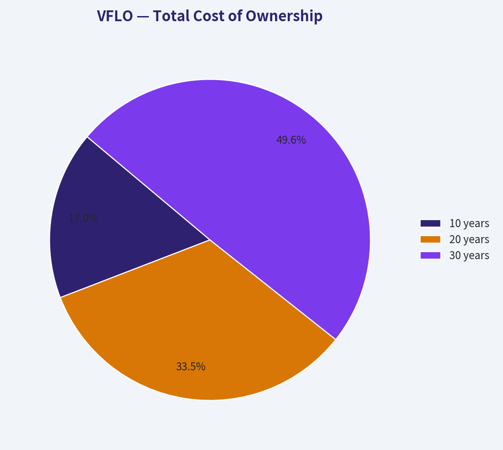
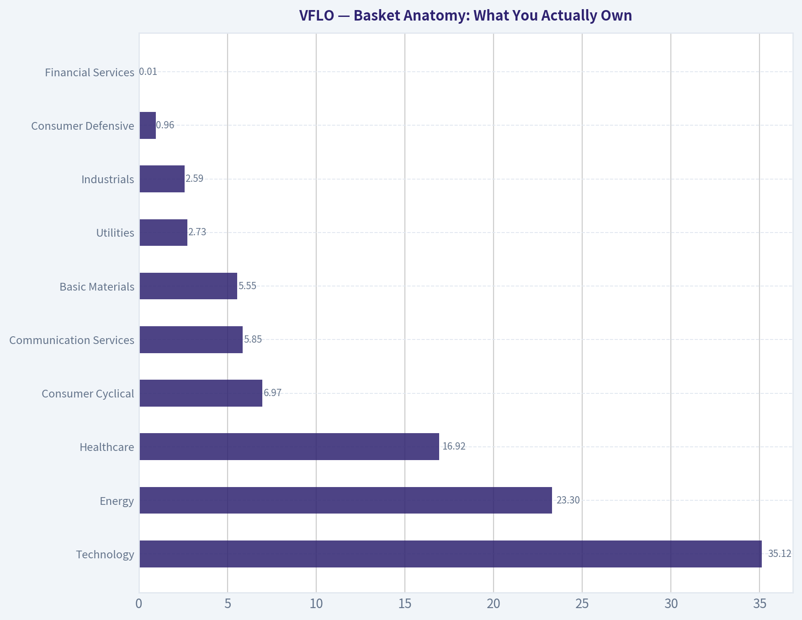
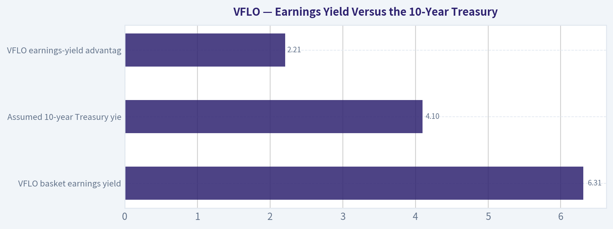
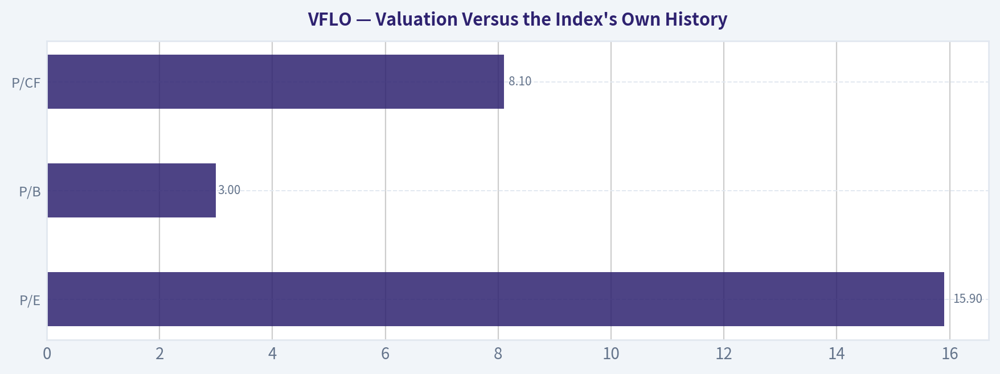
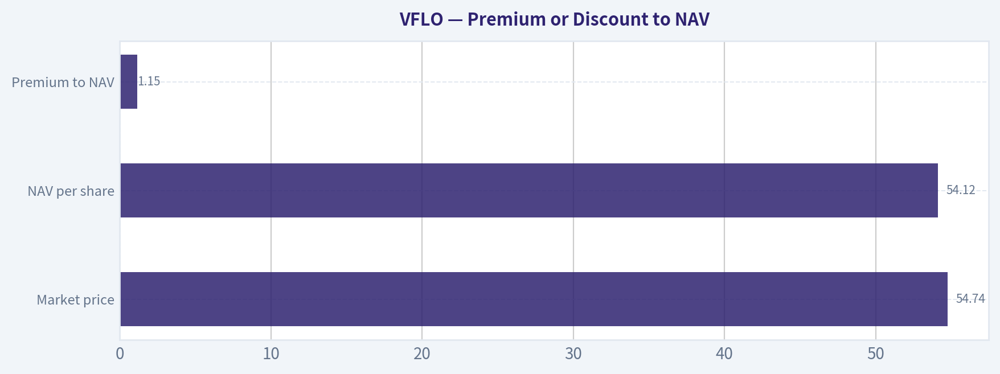
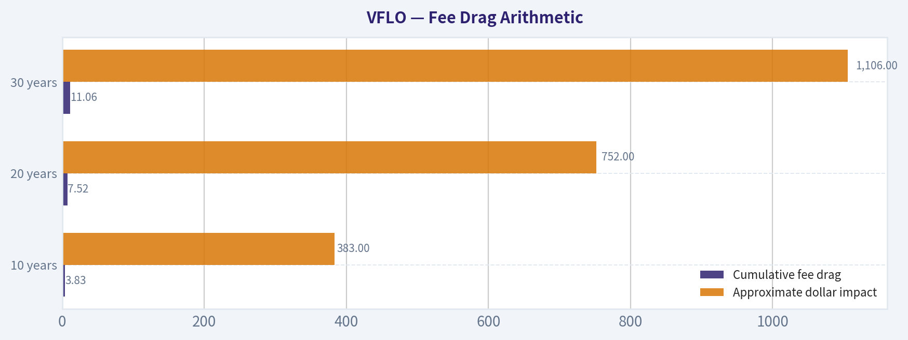
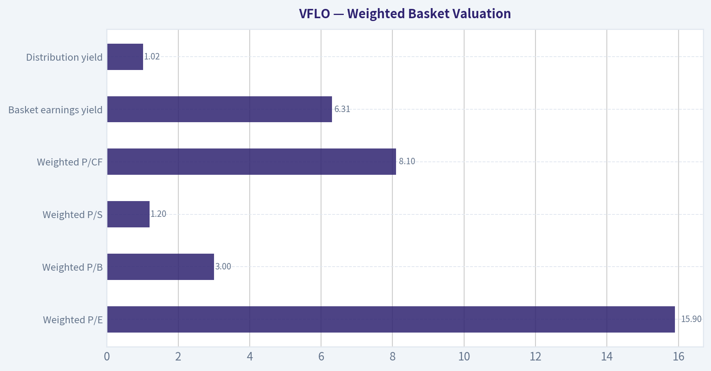

# VFLO Deep Value Intelligence

**Analysis Date:** 2026-10-20

## Critical Disclaimer

*This analysis is generated by Deep Value Intelligence, an AI-powered multi-agent investing framework. Education & research only - not financial advice, not a financial advisor.*

---

## Table of Contents

1. Intelligence Summary
2. Analyst Team Reports
   - Fundamentals Analysis
   - Basket Valuation Analysis
   - Flows & Performance Analysis
   - Market Technical Analysis
   - Options Market Analysis
3. Research Team Commentary
4. Value Investing Team Commentary
5. Deep Values Commentary

---

## Intelligence Summary

### Thesis + Conditions

**Core Thesis:** # Executive Briefing

**Key Risks:**
- The principal risk is not ordinary volatility. It is committing heavily before verifying whether the basket contains hidden issuer or sector concentration and whether the wrapper delivers through tight spreads, durable AUM, tax efficiency, and faithful tracking.
- ## Risky Analyst: Strongest arguments
- The Risky Analyst correctly argues that:

**Confidence:** Medium

---

## Analyst Team Reports

### Fundamentals Analysis

ANALYST STANCE: **WATCH**

#### Executive Summary

VFLO, the VictoryShares Free Cash Flow ETF, is an almost entirely equity-based mid-cap value ETF with a meaningful free-cash-flow/value orientation. Its basket is not broadly balanced: technology, energy, and healthcare represent approximately 75% of assets, while the top ten holdings account for 33.96%.

The wrapper is reasonably priced at a 0.39% expense ratio and has reported assets of approximately $10.95 billion, which should generally support good trading liquidity and reduce closure risk. However, the fund's 149% annual turnover is high for a value-oriented core holding, and the available profile contains material data inconsistencies, including an implausible reported YTD return and conflicting net-asset figures. Those issues warrant verification before making VFLO a major portfolio allocation.

#### Basket Anatomy: What You Actually Own

VFLO owns 99.99% stocks and only 0.01% cash. Its largest positions include Micron, SanDisk, Accenture, Marathon Petroleum, Adobe, Exxon Mobil, Centene, Intuit, Cigna, and Phillips 66.

The top-ten concentration of 33.96% is substantial but not extreme for an actively screened equity ETF. In practice, roughly one-third of the fund is driven by ten companies, so company-specific events-particularly in semiconductor, energy, and healthcare holdings-can have a noticeable effect on returns.

The sector allocation is more important than the fund's headline "mid-cap value" label. Technology alone represents 35.12%, while energy represents 23.30% and healthcare 16.92%. Financial services are effectively absent at 0.01%, which is unusual for a conventional value portfolio and means VFLO is not a balanced cross-sector value index.

| Holding / Sector | Weight | Note |
|---|---:|---|
| Technology | 35.12% | Dominant sector; includes Micron, Adobe, and Intuit exposure |
| Energy | 23.30% | Large cyclical and commodity-sensitive allocation |
| Healthcare | 16.92% | Includes Centene and Cigna; adds regulatory and reimbursement sensitivity |
| Consumer Cyclical | 6.97% | Smaller economically sensitive allocation |
| Communication Services | 5.85% | Moderate exposure |
| Basic Materials | 5.55% | Adds commodity and industrial-cycle sensitivity |
| Utilities | 2.73% | Limited defensive ballast |
| Industrials | 2.59% | Small allocation |
| Consumer Defensive | 0.96% | Very limited defensive exposure |
| Financial Services | 0.01% | Essentially absent |
| MU - Micron Technology | 4.56% | Semiconductor and memory-cycle exposure |
| SNDK - SanDisk | 3.90% | Storage and semiconductor exposure |
| ACN - Accenture | 3.79% | Technology-services exposure |
| MPC - Marathon Petroleum | 3.66% | Refining and energy-cycle exposure |
| ADBE - Adobe | 3.43% | Software and technology exposure |
| XOM - Exxon Mobil | 3.42% | Integrated energy exposure |
| CNC - Centene | 3.20% | Managed-care and policy-sensitive healthcare exposure |
| INTU - Intuit | 2.79% | Software and financial-management technology |
| CI - Cigna | 2.64% | Managed-care and healthcare exposure |
| PSX - Phillips 66 | 2.60% | Refining and midstream-related energy exposure |

**Key Takeaways:** VFLO is diversified by number of holdings, but its diversification is partly cosmetic because technology, energy, and healthcare dominate the basket. The top ten holdings make up about one-third of assets, and the combination of semiconductors, energy, and managed care creates meaningful cyclical, commodity, and regulatory sensitivities.

#### Sector and Factor Interpretation

The fund's weighted valuation metrics are relatively value-oriented:

- P/E: 15.9 times
- P/B: 3.0 times
- P/S: 1.2 times
- P/CF: 8.1 times
- Basket earnings yield: 6.31%

The valuation profile is cheaper than many broad-market growth benchmarks, but it is not a pure deep-value portfolio. A price-to-book ratio of 3.0 times indicates that the fund owns many companies whose value is derived from intangible assets, intellectual property, or future cash generation rather than traditional hard assets.

The free-cash-flow approach also creates potential sector tilts. Companies with strong current cash generation can screen well even when their businesses are cyclical. That appears relevant here: energy refiners, semiconductor companies, software businesses, and managed-care firms can all produce strong cash flow at certain points in their operating cycles, but their cash generation may not be equally stable through recessions or industry downturns.

#### Index and Replication

The provided fund profile does not identify the specific index tracked by VFLO. It also does not state whether the fund uses full replication, optimized sampling, or a synthetic derivatives-based approach.

Accordingly, the index methodology and tracking quality cannot be fully verified from the canonical dataset. The holdings profile suggests a rules-based or quantitatively screened basket, but that is not sufficient to establish the precise index or replication method.

There is no evidence in the supplied profile of a synthetic structure. VFLO should therefore be treated as a conventional equity ETF pending confirmation from the prospectus or issuer materials, but the exact replication approach should not be assumed.

The fund trades at a 1.15% premium to NAV based on the supplied snapshot: market price of $54.74 versus NAV of $54.12. A modest premium can occur because of market timing, underlying-stock liquidity, or trading conditions. It should be monitored, particularly when placing large orders.

#### Structure, Issuer, and Scale

VFLO is an exchange-traded fund issued by Victory Capital Management. The reported AUM of approximately $10.95 billion is large enough to suggest a durable product franchise, potentially strong secondary-market liquidity, and relatively low closure risk compared with very small ETFs.

Large AUM does not guarantee tight spreads. Trading costs also depend on the liquidity of the underlying holdings, market conditions, and authorized-participant activity. VFLO's basket includes highly liquid names such as Exxon Mobil, Adobe, Accenture, and Micron, which should generally support efficient creation and redemption.

However, the fund profile also reports "total net assets" of $66,531, conflicting sharply with the $10.95 billion AUM figure. This is likely a reporting-field or data-feed issue, but it should be resolved before relying on the size statistic.

#### Total Cost of Ownership

VFLO charges a 0.39% net expense ratio. That is reasonable for a specialized, actively screened or rules-based value ETF, although it is higher than the fee charged by many broad-market index ETFs.

The long-term fee drag can be approximated as follows, assuming the fee is deducted annually and ignoring taxes, trading costs, and differences in returns:

| Holding Period | Approximate Wealth Lost to 0.39% Annual Fee |
|---|---:|
| 10 years | 3.8% |
| 20 years | 7.5% |
| 30 years | 11.1% |

**Key Takeaways:** The 0.39% fee is not prohibitive, but it compounds into a meaningful long-term drag. Over a 30-year period, the fee could reduce ending wealth by roughly 11% relative to a hypothetical identical portfolio with no fund expenses, before considering turnover-related costs.

The larger cost concern is the 149% annual holdings turnover. This means the portfolio is being traded aggressively relative to a typical buy-and-hold core ETF. Turnover can create:

- Bid-ask spread and market-impact costs inside the fund
- Additional taxable capital-gains distributions in taxable accounts
- Greater sensitivity to implementation quality
- Potential divergence from the theoretical index or screening model

The expense ratio is visible; turnover costs are less visible. For VFLO, the total cost of ownership is therefore higher than the 0.39% headline fee alone suggests.

#### Income Analysis

VFLO's distribution yield is 1.02%. This is a modest income stream, consistent with a portfolio focused on companies selected for free-cash-flow characteristics rather than maximum dividend yield.

The profile does not provide a distribution history, payout-growth record, or detailed breakdown of dividend income versus realized capital gains. Therefore, the consistency of the distribution cannot be established from the available data.

Investors should not treat VFLO as a dedicated income ETF. Its distributions are likely to be secondary to total-return potential, and the high turnover could make taxable distributions less predictable than those of a low-turnover index fund.

#### Performance Data Quality

The supplied profile reports a 3-year average annual return of 29.79% and a 3-year beta of 0.88. Those figures may be useful if independently verified.

However, the reported YTD return of 3,088.53% is not economically credible for a conventional equity ETF and is almost certainly a data error, split-adjustment error, or field-mapping problem. It should not be used for investment decisions.

The performance figures should be cross-checked against the issuer, exchange, or a reliable market-data provider before comparing VFLO with competing ETFs.

#### Key Investment Insights

**Opportunities**

- The 15.9-times P/E and 8.1-times price-to-cash-flow ratio provide a valuation argument relative to more expensive growth-oriented equity funds.
- The free-cash-flow emphasis may favor companies with stronger cash conversion and shareholder-distribution capacity than standard market-cap-weighted benchmarks.
- Approximately $10.95 billion in reported AUM suggests meaningful scale and potentially good trading liquidity.
- The fund can serve as a targeted value and cash-flow tilt rather than a generic broad-market replacement.

**Red Flags**

- Technology, energy, and healthcare comprise approximately three-quarters of the portfolio.
- The top ten holdings represent 33.96%, creating meaningful single-stock and theme exposure.
- Annual turnover of 149% may generate hidden transaction costs and reduce tax efficiency.
- Income yield is only 1.02%, so the fund is not a strong income substitute.
- The index name and replication method are unavailable in the canonical profile.
- Conflicting asset figures and the implausible 3,088.53% YTD return indicate data-quality issues requiring verification.
- A 1.15% premium to NAV is not necessarily excessive, but investors should avoid assuming the quoted market price exactly reflects underlying asset value.

#### Fit for Purpose

VFLO is best understood as a satellite allocation for investors seeking a quantitatively selected value and free-cash-flow tilt. It may complement a broad-market ETF, but its sector exposures are too concentrated for many investors to treat it as a complete equity portfolio.

It is less suitable as:

- A low-volatility fund
- A high-income fund
- A tax-efficient taxable-account core holding
- A fully diversified replacement for a total-market ETF
- A portfolio hedge against technology or energy weakness

#### Final Investment Stance

**WATCH**

VFLO has attractive characteristics: a reasonable 0.39% expense ratio, substantial reported scale, a moderate valuation profile, and a differentiated free-cash-flow strategy. However, the basket is substantially concentrated in technology, energy, and healthcare, while 149% turnover raises the fund's effective cost and tax burden.

The stance would become more constructive if the index methodology, replication process, distribution history, and inconsistent data fields were independently confirmed. Until then, VFLO is more appropriate as a measured satellite value allocation than as a core equity holding.

| Key Area | Assessment | Investor Implication |
|---|---|---|
| Asset mix | 99.99% stock, 0.01% cash | Pure equity-risk exposure |
| Top-ten concentration | 33.96% | Meaningful dependence on ten companies |
| Sector concentration | Technology 35.12%, energy 23.30%, healthcare 16.92% | Diversification is narrower than the holding count suggests |
| Valuation | P/E 15.9x; P/CF 8.1x | Reasonable value/cash-flow profile |
| Expense ratio | 0.39% | Competitive for a specialized strategy, but not ultra-low-cost |
| Turnover | 149% annually | Potential hidden trading costs and lower tax efficiency |
| Distribution yield | 1.02% | Modest income; not an income-focused ETF |
| AUM | Reported $10.95 billion | Supports durability and likely liquidity, subject to verification |
| Price versus NAV | 1.15% premium | Check execution price and premium before large purchases |
| Index/replication | Not available in supplied profile | Verify prospectus and tracking methodology |
| Data quality | Conflicting net-asset figures and implausible YTD return | Independent validation is necessary |
| Portfolio role | Satellite value/free-cash-flow tilt | Not a complete core-market replacement |
| Overall stance | **WATCH** | Attractive concept, but concentration and data uncertainty require caution |

**Key Takeaways:** VFLO offers a credible value and free-cash-flow tilt at a reasonable stated fee, but it is not broadly diversified in economic exposure. High turnover, modest income, missing replication details, and data inconsistencies prevent a stronger endorsement until the fund's structure and performance records are independently verified.

#### Fundamental Visuals

This breakdown chart from <em>Total Cost of Ownership</em> shows the proportional composition for **VFLO** - useful for understanding what drives or risks the business.

---

### Basket Valuation Analysis

> *Valuing the basket the way a value investor values a business: weighted valuation ratios, earnings yield vs bonds, fee drag, and margin of safety applied to a basket.*

ANALYST STANCE: **WATCH**

#### 1. Weighted Basket Valuation

| Metric | VFLO basket |
|---|---:|
| Weighted P/E | 15.9x |
| Weighted P/B | 3.0x |
| Weighted P/S | 1.2x |
| Weighted P/CF | 8.1x |
| Basket earnings yield | 6.31% |
| Distribution yield | 1.02% |

**Key Takeaways:** VFLO's basket is reasonably priced on earnings and cash flow, with a 6.31% earnings yield and an 8.1x price-to-cash-flow ratio. The 3.0x price-to-book ratio is less conservative, reflecting the fund's substantial technology exposure and businesses with significant intangible assets.

#### 2. Earnings Yield Versus the 10-Year Treasury

The earnings yield is calculated as:

**1 ÷ 15.9 = 6.29%, approximately 6.31%**

Assuming a current 10-year U.S. Treasury yield of approximately **4.1%**, VFLO offers an earnings-yield spread of roughly:

**6.31% - 4.1% = 2.21 percentage points**

| Comparison | Yield |
|---|---:|
| VFLO basket earnings yield | 6.31% |
| Assumed 10-year Treasury yield | 4.10% |
| VFLO earnings-yield advantage | 2.21% |

**Key Takeaways:** VFLO's earnings yield is above the risk-free rate, unlike many growth-oriented equity funds. However, the 6.31% earnings yield is not a guaranteed cash return; it depends on the underlying companies maintaining or growing earnings. The spread provides some valuation support, but it is not wide enough to eliminate equity risk.

#### 3. Distribution Yield and Reinvestment

The fund distributes approximately **1.02%** annually. Compared with the 6.31% earnings yield, this implies an approximate payout ratio of:

**1.02% ÷ 6.31% = 16.2%**

The remaining roughly **84% of the basket's earnings** are being retained and reinvested by the underlying companies, assuming the distribution yield is a reasonable proxy for cash payout.

This is consistent with a total-return strategy rather than an income strategy. Investors are relying primarily on earnings growth, reinvestment, and eventual capital appreciation-not current distributions.

#### 4. Valuation Versus the Index's Own History

VFLO does not have a sufficiently long operating history as a fund to establish a reliable, decades-long valuation record for its exact current portfolio. The appropriate comparison is therefore an approximate mid-cap value and free-cash-flow-oriented equity benchmark.

| Measure | VFLO | Approximate historical interpretation |
|---|---:|---|
| P/E | 15.9x | Near the long-run mid-cap value range |
| P/B | 3.0x | Above traditional mid-cap value norms |
| P/CF | 8.1x | Reasonable to attractive |
| Portfolio character | - | Value stocks with significant technology and energy exposure |

**Key Takeaways:** VFLO appears fairly valued to modestly attractive on earnings and cash flow, but not uniformly cheap. Its P/E is around a normal historical range for mid-cap value stocks, while its P/B is elevated. The historical comparison assumes a conventional mid-cap value range of roughly 14x to 18x earnings and approximately 2x to 2.5x book value; those ranges vary materially across market cycles and sectors.

At similar mid-cap value starting valuations, forward returns have historically tended to be acceptable over long periods, but not necessarily exceptional over the next one to three years. The current valuation offers some margin, but not the kind of deep discount associated with a classic distressed-value opportunity.

#### 5. Premium or Discount to NAV

| Item | Amount |
|---|---:|
| Market price | $54.74 |
| NAV per share | $54.12 |
| Premium to NAV | 1.15% |

**Key Takeaways:** VFLO trades at a 1.15% premium to its reported NAV. That is not extreme, but it is an unnecessary cost for a liquid ETF whose market price should normally remain close to NAV. A buyer today is paying slightly more than the underlying basket is worth, so the preferred entry point would be at NAV or at a modest discount.

#### 6. Fee Drag Arithmetic

VFLO's net expense ratio is **0.39% per year**.

Using the required formula:

**Fee drag = 1 - (1 - 0.0039)^N**

For a $10,000 investment:

| Holding period | Calculation | Cumulative fee drag | Approximate dollar impact |
|---|---|---:|---:|
| 10 years | 1 - (0.9961)^10 | 3.83% | $383 |
| 20 years | 1 - (0.9961)^20 | 7.52% | $752 |
| 30 years | 1 - (0.9961)^30 | 11.06% | $1,106 |

A credible lower-cost mid-cap value alternative such as Vanguard Mid-Cap Value ETF, with an assumed expense ratio near **0.07%**, would have approximate fee drag of:

| Holding period | VFLO at 0.39% | Low-cost alternative at 0.07% | Approximate savings |
|---|---:|---:|---:|
| 10 years | $383 | $70 | $313 |
| 20 years | $752 | $139 | $613 |
| 30 years | $1,106 | $208 | $898 |

**Key Takeaways:** VFLO's 0.39% expense ratio is meaningfully higher than a low-cost passive alternative. The direct fee difference could cost approximately $898 per $10,000 over 30 years before considering investment returns. VFLO also has **149% annual turnover**, which may create additional trading costs, bid-ask spread costs, and tax inefficiency beyond the stated expense ratio.

#### 7. Concentration and Hidden Bets

| Exposure | Weight |
|---|---:|
| Top 10 holdings | 33.96% |
| Technology | 35.12% |
| Energy | 23.30% |
| Healthcare | 16.92% |
| Top three holdings | 12.25% |
| Stock exposure | 99.99% |

The top holdings include Micron, SanDisk, Accenture, Marathon Petroleum, Adobe, ExxonMobil, Centene, Intuit, Cigna, and Phillips 66.

**Key Takeaways:** VFLO is diversified by security count, but its top 10 holdings represent approximately one-third of assets. The larger hidden bet is sectoral: technology, energy, and healthcare together account for roughly 75% of the portfolio. The fund is therefore not a neutral slice of mid-cap value; it is a concentrated bet on free-cash-flow businesses in cyclical technology, energy, and healthcare.

The presence of Micron and SanDisk adds exposure to the highly cyclical semiconductor and memory markets. Marathon Petroleum, ExxonMobil, and Phillips 66 create meaningful exposure to commodity prices, refining margins, and energy regulation. This concentration can help returns when those industries are favorable, but it weakens the fund's diversification during sector-specific downturns.

#### 8. Margin of Safety Assessment

VFLO has several favorable value characteristics:

- Earnings yield of approximately 6.31%, above the assumed 4.1% Treasury yield.
- P/E of 15.9x, which is not demanding for a mid-cap value basket.
- P/CF of 8.1x, suggesting reasonable cash-generation valuation.
- Low distribution payout, leaving most earnings available for reinvestment.

The margin of safety is reduced by:

- P/B of 3.0x, which is high for a traditional value portfolio.
- 33.96% concentration in the top 10 holdings.
- Heavy technology and energy exposure.
- 149% annual turnover.
- 0.39% expense ratio versus much cheaper alternatives.
- Current 1.15% premium to NAV.
- Reliance on cyclical earnings from semiconductors, refining, and energy.

The basket is unlikely to suffer the permanent impairment risk of a single company, but it can still experience a multi-year period of disappointing returns if technology or energy earnings normalize sharply.

#### 9. Final Basket Valuation Scorecard

| Criterion | Weight | Score, 1-5 | Weighted contribution |
|---|---:|---:|---:|
| Basket earnings power versus 10-year Treasury | 25% | 3.5 | 0.88 |
| Valuation versus index history | 25% | 3.2 | 0.80 |
| Fee drag and total cost | 20% | 2.5 | 0.50 |
| Concentration and hidden bets | 15% | 3.0 | 0.45 |
| Premium or discount to NAV | 5% | 3.5 | 0.18 |
| Income quality | 10% | 3.0 | 0.30 |
| **Total** | **100%** | **3.1 / 5.0** | **3.10** |

**Key Takeaways:** VFLO earns a respectable score because the basket's earnings and cash-flow valuations are reasonable and its earnings yield exceeds Treasury yields. The score is held back by the expense ratio, high turnover, sector concentration, elevated price-to-book ratio, and premium to NAV. Overall, the fund is interesting but does not yet offer a compelling enough margin of safety to justify an aggressive purchase.

#### 10. Investment Stance

**WATCH - medium conviction.**

VFLO is a credible value-oriented ETF with a reasonable 15.9x P/E and attractive 8.1x P/CF valuation. It is more appealing than a broadly expensive growth basket, but the fund's 0.39% fee, 149% turnover, 33.96% top-10 concentration, and technology-energy exposure make it less robust than the headline P/E suggests.

A more attractive entry would likely require one or more of the following:

- A price at or below NAV.
- A materially lower market valuation, preferably near the low-to-mid 14x earnings range.
- A wider earnings-yield spread over Treasuries.
- Evidence that semiconductor and energy earnings have normalized without the portfolio becoming more expensive.

At approximately $54.74 and a 1.15% premium to NAV, VFLO is reasonably valued-but not priced with a sufficiently wide Buffett-style margin of safety.

#### Valuation Visuals

This comparison chart from *Basket Anatomy: What You Actually Own* stacks current figures against historical benchmarks for **VFLO**, making it easy to see where the company trades relative to its own averages.

This comparison chart from *Earnings Yield Versus the 10-Year Treasury* stacks current figures against historical benchmarks for **VFLO**, making it easy to see where the company trades relative to its own averages.

This comparison chart from *Valuation Versus the Index's Own History* stacks current figures against historical benchmarks for **VFLO**, making it easy to see where the company trades relative to its own averages.

This comparison chart from *Premium or Discount to NAV* stacks current figures against historical benchmarks for **VFLO**, making it easy to see where the company trades relative to its own averages.

This comparison chart from *Fee Drag Arithmetic* stacks current figures against historical benchmarks for **VFLO**, making it easy to see where the company trades relative to its own averages.

This comparison chart from *Fee Drag Arithmetic* stacks current figures against historical benchmarks for **VFLO**, making it easy to see where the company trades relative to its own averages.

---

### Flows & Performance Analysis

> *Judging delivery and demand: multi-horizon NAV and price returns, tracking difference vs the index, category ranking, AUM/flows trend, distributions, and turnover.*

ANALYST STANCE: **WATCH**

#### 1. Returns Scorecard

| Horizon | NAV return | Price return | Assessment |
|---|---:|---:|---|
| 1 year | Unavailable | Unavailable | Cannot assess |
| 3 years annualized | 29.79% | Unavailable | Strong reported performance |
| 5 years | Unavailable | Unavailable | Cannot assess |
| 10 years | Unavailable | Unavailable | Cannot assess |
| YTD | 3,088.53% reported | Unavailable | Almost certainly a data error |

**Key Takeaways:** VFLO's reported three-year annualized return of 29.79% is attractive, but the performance history is incomplete. The 3,088.53% YTD figure is not economically credible for a diversified ETF and should be treated as a bad data point until independently verified. Without NAV and market-price returns across multiple periods, liquidity and delivery quality cannot be properly judged.

#### 2. Tracking Difference Assessment

| Item | Available data | Interpretation |
|---|---:|---|
| Stated index return | Unavailable | Cannot calculate tracking difference |
| Fund return versus index | Unavailable | Cannot determine execution quality |
| Expense ratio | 0.39% | Expected baseline annual drag |
| Price/NAV relationship | 1.15% premium | Mild premium; monitor |
| Three-year beta | 0.88 | Less volatile than the broad market over the reported period |

**Key Takeaways:** The 0.39% expense ratio sets a reasonable expectation for the fund's minimum structural drag, but the necessary index-return data are missing. VFLO traded at a 1.15% premium to NAV, which is not alarming by itself, although persistent premiums would indicate imperfect trading or liquidity. Tracking fidelity remains unproven.

#### 3. Portfolio and Category Comparison

| Metric | VFLO | Assessment |
|---|---:|---|
| Category | Mid-Cap Value | Classification should be reconciled with current holdings |
| Weighted P/E | 15.9x | Value-oriented valuation |
| Weighted P/B | 3.0x | Moderate |
| Weighted P/S | 1.2x | Reasonable |
| Weighted P/CF | 8.1x | Supportive of a cash-flow value strategy |
| Top-10 concentration | 33.96% | Meaningful concentration |
| Technology exposure | 35.12% | Large growth-sensitive allocation |
| Energy exposure | 23.30% | Major cyclical exposure |
| Healthcare exposure | 16.92% | Important defensive/cyclical mix |
| Category ranking | Unavailable | No peer percentile supplied |

**Key Takeaways:** VFLO offers a relatively inexpensive basket at 15.9 times earnings and 8.1 times cash flow. However, the portfolio is not a generic diversified value fund: technology, energy, and healthcare represent roughly three-quarters of assets. The absence of peer-return rankings prevents a conclusion about whether VFLO's performance is structurally superior or simply benefiting from recent technology and energy strength.

#### 4. AUM and Flows

| Measure | Current data | Assessment |
|---|---:|---|
| Reported AUM | $10.95 billion | Large enough that closure risk appears low |
| Alternative total-net-assets field | $66,531 | Clearly inconsistent; likely a data-quality error |
| Flow history | Unavailable | Cannot distinguish durable demand from performance chasing |
| Fund premium/discount | 1.15% premium | Mildly positive demand signal, not conclusive |

**Key Takeaways:** If the $10.95 billion AUM figure is accurate, VFLO has reached a scale where closure risk is negligible and trading liquidity should generally be adequate. The conflicting $66,531 asset figure highlights data-quality problems in the available feed. No historical flow series is available, so investor demand and ownership behavior cannot be diagnosed.

#### 5. Distribution Yield and Growth

| Measure | Data | Assessment |
|---|---:|---|
| Distribution yield | 1.02% | Low-to-moderate income |
| Distribution growth | Unavailable | Cannot assess trend |
| Source of distributions | Unavailable | Return-of-capital status cannot be confirmed |
| Income profile | Equity dividends and possible portfolio distributions | Not primarily an income ETF |

**Key Takeaways:** VFLO's 1.02% yield is modest and should not be the primary reason to own the fund. Distribution growth and the presence or absence of return of capital were not provided, so payout durability cannot be fully evaluated. The fund's investment case rests more on total return and free-cash-flow exposure than on income.

#### 6. Turnover and Efficiency

| Measure | VFLO | Interpretation |
|---|---:|---|
| Annual holdings turnover | 149% | Very high for a passive ETF |
| Expense ratio | 0.39% | Moderate cost |
| Portfolio structure | 99.99% stocks | Minimal cash drag |
| Strategy fit | High turnover versus a conventional passive portfolio | Requires scrutiny |

**Key Takeaways:** The 149% annual turnover is the clearest operational concern. It may reflect a rules-based free-cash-flow strategy with periodic reconstitution, but it can create trading costs, taxable distributions, and implementation drag. Investors should verify whether the fund's index methodology genuinely requires this level of portfolio change.

#### 7. Flows and Performance Scorecard

| Criterion | Weight | Score | Comment |
|---|---:|---:|---|
| Multi-horizon returns | 25% | 2.5/5 | Strong three-year figure, but major gaps and a corrupted YTD datapoint |
| Tracking fidelity | 25% | 2.0/5 | Benchmark comparison unavailable |
| Category ranking | 15% | 2.0/5 | No peer ranking supplied |
| AUM and flows | 15% | 3.0/5 | Potentially large AUM, but inconsistent data and no flow history |
| Distribution quality | 10% | 2.5/5 | Yield available, source and growth unavailable |
| Turnover and efficiency | 10% | 2.0/5 | 149% turnover is unusually high |
| **Provisional total** | **100%** | **2.3/5** | **Insufficient evidence for endorsement** |

**Key Takeaways:** VFLO scores poorly on evidence quality rather than necessarily on investment results. Its reported three-year return, valuation, and potential scale are positives, but missing benchmark data, absent flow history, and unusually high turnover prevent confirmation that the ETF delivers its index efficiently. Under the stated framework, the provisional score falls in the AVOID range, though this is primarily a due-diligence warning rather than a definitive judgment on the portfolio.

#### 8. Position Size Stance

| Investor type | Suggested stance |
|---|---|
| New buyer | Watchlist; wait for validated return and index data |
| Existing holder | Hold only with awareness of concentration and turnover |
| Income investor | Not attractive as a primary income vehicle |
| Tactical value investor | Small position may be reasonable after data verification |
| Suggested position size now | 0% to 1% pending confirmation |

**Key Takeaways:** VFLO may offer attractive value exposure with a strong recent record, but the available data do not yet establish faithful index delivery. A small tactical position could be justified for investors comfortable with technology and energy concentration, but a core allocation is not warranted until the performance and flow records are reconciled.

#### 9. Key Risks and Catalysts

| Risks | Potential catalysts |
|---|---|
| 149% turnover may increase trading costs and tax inefficiency | Continued earnings and cash-flow strength in holdings |
| Heavy technology and energy exposure creates cyclical concentration | Re-rating of value stocks versus expensive growth stocks |
| 1.15% premium could reverse | Continued asset growth and improved liquidity |
| Missing benchmark and flow data impair due diligence | Verified tracking outperformance after fees |
| Data-quality inconsistencies, including the 3,088.53% YTD figure | Lower portfolio concentration or turnover over time |
| No confirmation of distribution source | Attractive valuation relative to broader market |

**Key Takeaways:** The main upside catalyst is continued value-style performance from technology, energy, and healthcare holdings, combined with further fund-scale growth. The main risks are concentration, high turnover, premium-to-NAV volatility, and unreliable reported data. Before upgrading VFLO to Advocate, the key requirements are verified NAV and price returns, benchmark tracking differences, historical flows, and distribution composition.

#### Growth & Scorecard Visuals

This comparison chart from *Weighted Basket Valuation* stacks current figures against historical benchmarks for **VFLO**, making it easy to see where the company trades relative to its own averages.

---

### Market Technical Analysis

ANALYST STANCE: **ADVOCATE**

#### VFLO technical analysis

**Data note:** The latest retrieved trading record is October 19, 2026, with a close of **$54.13**. Although the requested analysis date is October 20, no October 20 price record was available, so the latest available session is used.

VFLO's technical structure remains **constructively bullish**, although the security is approaching a short-term resistance area and is no longer deeply discounted after its recent rebound.

#### Trend structure

The longer-term trend is clearly positive. The close is approximately **19.3% above the 200-day SMA at $45.36**, confirming that VFLO remains in a sustained primary uptrend. The 200-day average itself is rising steadily, which is more important than the absolute distance from price: it indicates that the long-term trend has not merely stabilized but has continued to improve.

The medium-term trend is also favorable. VFLO closed at $54.13, above its **50-day SMA of $53.45**, while the 50-day SMA is rising. This suggests that the September decline toward the $50-$51 area was a correction within a broader uptrend rather than a confirmed trend reversal.

The short-term picture has improved substantially. The **10-day EMA is $53.29**, and price is roughly $0.84 above it. The 10-day EMA has turned upward from approximately $51.87 in early October, showing that recent price momentum has shifted decisively higher. However, the 10-day EMA remains slightly below the 50-day SMA, so the latest rally has not yet produced a fully mature short-term trend alignment. A sustained close above approximately $54.40-$54.50 would improve that alignment.

#### Momentum and MACD

MACD has undergone a meaningful bullish reversal. It fell from strongly positive readings in August to **-0.56 on September 30**, reflecting the sharp late-summer and September correction. It then recovered to **-0.21 on October 9**, crossed back above zero around October 15, and reached approximately **+0.27 by October 20**.

That sequence is significant because the improvement is not merely a one-day price reaction. MACD has been rising for several weeks, and the latest readings show accelerating upside momentum. The move above zero supports the case that the September weakness has ended. Nevertheless, MACD is now rising quickly after a sharp recovery, so a brief consolidation would not invalidate the bullish signal.

The available report does not provide the separate MACD signal-line value. Therefore, the strongest interpretation is based on the MACD's recovery through zero and its recent upward slope rather than on a precise signal-line crossover.

#### RSI and exhaustion risk

RSI is approximately **64.95**, which indicates solid bullish momentum but remains below the conventional overbought threshold of 70. This is generally a favorable configuration: buyers are in control, but the indicator has not yet reached the extreme levels seen during VFLO's August advance, when RSI remained in the 70s and 80s for an extended period.

However, RSI has risen sharply from approximately **31.6-35.3 at the end of September**. The recovery is therefore already well advanced. A move above 70 accompanied by price extension toward the upper Bollinger Band would increase the risk of short-term profit-taking. Conversely, if RSI holds above 50-55 during a sideways consolidation, that would suggest healthy digestion rather than a loss of trend quality.

#### Bollinger Bands and price location

The current Bollinger range is approximately:

- **Upper band:** $54.44
- **Lower band:** $50.30

At $54.13, VFLO is trading only about **$0.31 below the upper band** and well above the lower band. This shows strong near-term positioning, but it also means that the stock is testing the upper portion of its recent trading envelope.

A decisive close above $54.44, particularly if accompanied by stronger-than-average volume, could signal continuation toward the recent highs near **$55.50-$56.25**. However, an immediate rejection near $54.40-$54.50 would be consistent with normal resistance rather than necessarily bearish. In that case, the first support zone is around **$53.30-$53.45**, defined by the 10-day EMA and 50-day SMA. A deeper pullback would bring the $52.00 area into focus, where recent October price action established additional support.

The lower Bollinger Band has stabilized near $50.30 after declining during the September selloff. This suggests that downside volatility has eased, although the band structure still reflects the damage from the prior correction.

#### Volatility and risk management

ATR is approximately **$0.54**, down from roughly $0.70-$0.75 in late September. Volatility has therefore contracted as VFLO recovered. The current ATR represents about **1.0% of the share price**, indicating relatively manageable daily movement for a liquid ETF, but stops that are too tight could still be vulnerable to ordinary fluctuations.

A volatility-aware stop for a short-term position could be placed roughly **1 to 1.5 ATR below a relevant support level**, rather than directly beneath the latest close. For example, a close below the $53.30-$53.45 moving-average zone would be more informative than an intraday dip of a few cents. A break below approximately $52 would weaken the near-term recovery structure and warrant greater caution.

#### Trading interpretation

The evidence favors a **bullish continuation bias**, but the risk-reward profile is less attractive if entering aggressively directly beneath the upper Bollinger Band. The strongest bullish setup would be either:

1. A confirmed breakout above approximately **$54.45**, supported by expanding volume and continued positive MACD; or
2. A controlled pullback toward **$53.30-$53.45** that holds the rising 10-day EMA and 50-day SMA.

A failure at the upper band followed by a close below the 50-day SMA would weaken the immediate bullish thesis. A close below the 200-day SMA is not a near-term concern at present, as that benchmark is more than $8 below the latest price and continues to rise.

The selected indicators are deliberately complementary: the 10-day, 50-day, and 200-day averages define short-, medium-, and long-term trend; MACD measures directional momentum; RSI evaluates momentum intensity and exhaustion risk; both Bollinger Bands identify the current price envelope and breakout/reversal zones; and ATR provides position-sizing and stop-distance context. The Bollinger middle band was omitted because it would add less information than the upper and lower bands in this specific near-resistance setup.

| Indicator | Latest reading | Interpretation | Trading relevance |
|---|---:|---|---|
| Close | $54.13 | Price is recovering strongly and sits near recent highs | Bullish, but increasingly sensitive to resistance |
| 10-day EMA | $53.29 | Rising and below price | Short-term momentum is positive; first dynamic support |
| 50-day SMA | $53.45 | Rising and below price | Medium-term trend remains constructive; key support zone |
| 200-day SMA | $45.36 | Rising and far below price | Primary trend is firmly bullish |
| MACD | +0.27 | Recovered from negative territory and crossed above zero | Momentum has turned decisively positive |
| RSI | 64.95 | Strong but below the 70 overbought threshold | Upside momentum remains healthy, though less early-stage |
| Bollinger upper band | $54.44 | Price is close to the upper envelope | Breakout opportunity, but also near-term rejection risk |
| Bollinger lower band | $50.30 | Well below current price after stabilizing | Defines broader correction support and downside risk |
| ATR | $0.54 | Volatility has declined from September levels | Supports tighter risk controls, but normal daily swings remain |

**Key Takeaways:** VFLO remains in a strong long-term and medium-term uptrend, with improving short-term momentum and a bullish MACD reversal. The main tactical issue is that price is already close to the $54.44 upper Bollinger Band, so traders should distinguish between a volume-supported breakout and a normal rejection. The $53.30-$53.45 area is the most important near-term support zone, while a sustained break above $54.45 would strengthen the case for a move toward the mid-$55s or higher.

---

### Options Market Analysis

> *Reading options flow - put/call ratios, IV skew, and unusual activity - to gauge institutional positioning and event-driven risk.*

#### VFLO Options Market Overview

As of October 20, 2026, VFLO's listed-options activity is relatively light. The available chains cover November 20, December 18, 2026, and March 19, 2027 expirations. Because the data does not include the current share price or individual strike-level details, ITM/ATM/OTM classification, exact skew by strike, and gamma-wall analysis are limited.

#### Put/Call Ratio Analysis

| Expiration | Call OI | Put OI | Put/Call OI Ratio | Call Volume | Put Volume | Put/Call Volume Ratio |
|---|---:|---:|---:|---:|---:|---:|
| Nov. 20, 2026 | 81 | 11 | 0.14 | 93 | 5 | 0.05 |
| Dec. 18, 2026 | 46 | 63 | 1.37 | 10 | 3 | 0.30 |
| Mar. 19, 2027 | 8 | 15 | 1.88 | 22 | 1 | 0.05 |
| **Aggregate** | **135** | **89** | **0.66** | **125** | **9** | **0.07** |

**Key Takeaways:** Aggregate put/call open interest is 0.66, slightly below the approximately 0.70 neutral baseline. The much more directional signal is volume: calls represented about 93% of reported volume, producing a very low 0.07 put/call volume ratio. However, the longer-dated December and March open interest is more put-heavy, suggesting some deferred downside protection or bearish positioning.

#### Implied Volatility Assessment

| Expiration | Call ATM IV | Put ATM IV | Call-Put IV Difference | Interpretation |
|---|---:|---:|---:|---|
| Nov. 20, 2026 | 27.0% | 26.1% | +0.9 percentage points | Nearly balanced, slight call premium |
| Dec. 18, 2026 | 29.2% | 23.8% | +5.4 percentage points | Noticeable call-side premium |
| Mar. 19, 2027 | 30.8% | 25.8% | +5.0 percentage points | Noticeable call-side premium |

**Key Takeaways:** ATM implied volatility ranges from 26% to 31%, which does not appear extreme in isolation, although no historical IV percentile is available. Calls carry higher ATM IV than puts in every listed expiration, particularly in December and March, indicating upside-demand skew rather than conventional downside fear. Exact OTM put-versus-call skew cannot be calculated because strike-level IV data was not provided, and no catalyst calendar was supplied.

#### Unusual Options Activity

No contracts met the screening threshold of volume greater than five times open interest.

| Finding | Interpretation |
|---|---|
| No qualifying unusual contracts | No clear evidence of fresh institutional sweep activity |
| Highest activity | November calls: 93 contracts of volume versus 81 contracts of open interest |
| Directional implication | Short-term call demand, but not confirmed as a new large position |
| Smart-money versus retail assessment | Cannot reliably distinguish; overall contract counts are too small |

**Key Takeaways:** The absence of volume exceeding five times open interest means there is no statistically unusual contract-level activity under the tool's criteria. November call activity is directionally constructive, but the volume is not large enough to confirm a high-conviction institutional trade. This materially lowers confidence in the bullish interpretation.

#### Open Interest Concentration and Potential Pinning

| Expiration | Total Call OI | Total Put OI | Total OI | Concentration Assessment |
|---|---:|---:|---:|---|
| Nov. 20, 2026 | 81 | 11 | 92 | Largest aggregate open interest; likely most relevant near-term expiry |
| Dec. 18, 2026 | 46 | 63 | 109 | Highest total open interest and put-heavy positioning |
| Mar. 19, 2027 | 8 | 15 | 23 | Low overall concentration |

**Key Takeaways:** December has the greatest total open interest, while November shows the strongest call-heavy positioning and the largest reported call volume. The data does not include strike-level open interest, so specific gravitational levels, max-pain estimates, and call or put gamma walls cannot be identified. Given the small absolute open-interest figures, any pinning effect is likely limited.

#### Overall Options Sentiment

**Signal: BULLISH, with low conviction.**

The primary bullish drivers are the 0.07 aggregate put/call volume ratio, call-heavy November positioning, and call IV trading above put IV across all expirations. These suggest near-term upside speculation or demand for upside exposure.

The main caveat is that the longer-dated open interest is more put-heavy, particularly in December and March. Also, VFLO's options activity is thin, with only 135 total call contracts and 89 total put contracts in open interest and no qualifying unusual-activity contracts. Therefore, this is a **mild bullish read rather than a strong institutional signal**.

| Category | Assessment |
|---|---|
| Put/Call Ratio | **Bullish near term**; aggregate OI ratio 0.66 and volume ratio 0.07 |
| IV Level | **Moderate**, approximately 26%-31%; no historical percentile available |
| Skew Direction | **Call-leaning** based on ATM IV; exact OTM skew unavailable |
| Unusual Activity | **None detected** under the volume-to-OI screen |
| Overall Signal | **BULLISH, low conviction**; call-heavy near-term flow offset by longer-dated put concentration and thin liquidity |

**Key Takeaways:** VFLO's options market leans bullish over the near term, mainly because call volume substantially outweighs put volume and call IV is generally richer than put IV. Still, the market is thin and lacks identifiable unusual institutional trades, so the signal should be treated as tentative rather than decisive.

---

## Research Team Commentary

> *The Research Manager synthesizes the Bull vs Bear debate into action-free commentary. This is a pre-risk view, not the final stance.*

Core Takeaway

VFLO is a credible but not yet fully proven factor ETF. Its basket appears reasonably valued at roughly 15.9-16.96 times earnings and 8.1 times reported cash flow, but "reasonable" is not the same as sufficiently cheap. The 0.39% expense ratio is acceptable for systematic free-cash-flow selection, yet meaningfully higher than broad-market and broad-value alternatives. More importantly, the supplied evidence does not establish the fund's concentration, turnover, AUM durability, spreads, tracking difference, or tax record.

The strongest bull argument is that VFLO packages cash-generative companies, systematic replacement, diversification, and behavioral discipline at a tolerable cost. The strongest bear argument is that investors are paying a perpetual factor premium without enough evidence that the basket is genuinely diversified or that implementation can overcome the fee across a complete cycle.

That combination supports WATCH rather than ADVOCATE or AVOID. The basket is attractive enough to investigate or hold in a measured satellite allocation, but the evidence is not yet sufficient for a large, long-term commitment.

Rationale

Starting with the basket, as we should, VFLO offers a more defensible valuation than an expensive growth portfolio. The reported earnings yield is approximately 5.9%-6.31%, while the reported P/CF of 8.1 times suggests substantial accounting cash generation. These numbers mean the thesis does not require dramatic multiple expansion. If normalized free cash flow grows, the basket can produce returns through earnings growth, dividends, and repurchases.

There are two important qualifications.

First, the valuation data are internally inconsistent: a 16.96 times P/E corresponds to a 5.9% earnings yield, not 6.31%. That does not destroy the case, but it narrows the apparent advantage over a 4.1% Treasury yield. The comparison is also imperfect because Treasury payments are contractual, while equity earnings are volatile and may not reach shareholders. The apparent spread is compensation for recession, factor, sector, and valuation risk-not free excess return.

Second, P/CF is not necessarily a reliable measure of owner earnings. High reported cash flow can reflect working-capital reversals, cyclical peaks, deferred capital spending, or underinvestment. Before calling the basket cheap, I would want to see normalized free cash flow after maintenance capital expenditures and the sector sources of that cash flow.

The diversification question is unresolved. VFLO should reduce company-specific risk relative to owning one or two stocks, but the debate did not supply the number of holdings, top-ten weight, largest position, sector allocations, or return attribution. Without those facts, we cannot tell whether the fund offers genuine economic diversification or simply spreads one value-and-cyclicality bet across numerous tickers. This is not necessarily the same cosmetic mega-cap concentration found in a capitalization-weighted index, but factor concentration can be just as consequential.

The wrapper is useful, but not cheap enough to ignore. At 0.39%, VFLO costs $39 annually per $10,000 before spreads, turnover, market impact, and tracking slippage. It is cheaper than at least one prominent free-cash-flow competitor, but it must outperform a 0.03% alternative by roughly 0.36 percentage points annually merely to offset the stated fee difference. That hurdle compounds materially over decades.

The wrapper nevertheless adds real value through automatic reconstitution, position sizing, corporate-action processing, and potentially tax-efficient in-kind redemptions. Those benefits are particularly valuable when faithfully implementing a dynamic strategy. Direct owners can defer taxes by refusing to trade, but then they are no longer replicating VFLO as its constituents and weights change.

Delivery quality remains the largest evidentiary gap. Current AUM, median spread, premium/discount behavior, turnover, tracking difference, and capital-gains distributions were not provided. The reported 3,088.53% year-to-date return is plainly corrupted, while the reported 29.79% three-year annualized return covers too short and favorable a period to validate the strategy. Neither figure should drive the decision.

The price near $54.74 and the cited breakout level around $54.44 may matter to a trader, but they should not determine a 10-year allocation. A sustained breakout could support staged entry; it would not resolve valuation, concentration, or delivery concerns. I am deliberately not repeating the prior analytical mistake of allowing either a short-term chart or a business-quality framework designed for individual companies to dominate an ETF decision.

When does VFLO beat picking the stocks yourself?

The major holdings are likely directly investable because the strategy focuses on large U.S. companies. Buying them individually is operationally easy. What is not easy is reproducing the fund's evolving selection, weighting, deletion, and rebalancing rules while controlling taxes and resisting discretionary overrides.

VFLO beats direct ownership when the investor wants the dynamic process rather than merely today's top holdings. Its advantages are breadth, systematic replacement, rebalancing discipline, simplified tax-lot administration, and potential deferral of internally realized gains through the ETF structure. Buying the current top ten is a static concentrated portfolio, not a faithful substitute for the fund.

For an investor with less than roughly $50,000 allocated to this strategy, the ETF will usually be the more sensible vehicle. Although fractional shares have reduced the mechanical cost of building a basket, a 20- or 30-stock portfolio at that size creates small positions, administrative friction, and a high likelihood of inconsistent rebalancing.

Between approximately $50,000 and $250,000, the answer depends more on temperament than mechanics. A disciplined investor comfortable with financial statements, tax lots, sector exposure, and occasional replacement decisions can own a concentrated direct basket. However, that investor is accepting greater company-specific risk and is not truly replicating VFLO unless the entire methodology is followed. For someone who tends to chase performance, overreact to earnings, or become attached to individual names, the ETF's 0.39% fee may be a reasonable price for discipline.

At roughly $250,000 or more dedicated specifically to this factor sleeve, direct replication becomes more economically plausible because the dollar cost of the fee becomes meaningful-about $975 annually on $250,000 and $1,950 on $500,000. A sophisticated investor or adviser could build and tax-manage a diversified basket directly. Even then, the value of the investor's time, data, trading discipline, and tax consequences must be included. Direct ownership wins only if the investor can maintain the process consistently and cheaply, not merely select a few current winners.

Time horizon cuts both ways. Over ten or more years, the fee drag becomes increasingly important, strengthening the case for direct ownership or a cheaper broad-value fund. But the behavioral and rebalancing benefits also compound over long periods. An investor likely to abandon or distort a direct strategy during a difficult factor cycle is better served by the ETF despite the fee.

VFLO's specific profile weakens the wrapper case somewhat. The 0.39% fee is moderate rather than low, and the absence of verified concentration, turnover, tracking, and tax data makes it impossible to know the full cost of ownership. If those metrics prove favorable, the ETF can justify itself as a convenient satellite allocation. If concentration is high and turnover or tracking slippage is material, buying selected holdings or using a cheaper value fund becomes more attractive.

Balanced takeaway

The bull is right that VFLO offers more than a static list of stocks. It provides an ongoing selection and rebalancing process, reduces single-company risk, and can protect investors from their own inconsistency. Its reported valuation is sensible enough that the basket does not require heroic growth assumptions.

The bear is right that convenience is not alpha. The valuation premium over Treasuries is modest after fees, headline cash flow may not equal sustainable owner earnings, and the live record is too short to validate full-cycle outperformance. Most importantly, the case for real diversification and reliable delivery has been asserted rather than demonstrated.

For a new investor, I would not chase the recent record or make VFLO a core holding based on the current evidence. A broad, very low-cost index remains the stronger default core. VFLO may deserve a modest value/free-cash-flow satellite position for an investor who understands factor cycles and prefers systematic execution to direct stock selection.

Monitoring Plan

Over the next one to four quarters, I would focus on four areas.

First, verify the basket. Obtain the current holdings count, top-ten weight, largest position, sector allocations, weighted leverage, and performance attribution. The thesis strengthens if the top ten are moderate in aggregate, cash-flow drivers are spread across sectors, and recent returns are not dominated by one cyclical industry. It weakens if the basket is effectively an energy, healthcare, or deep-value bet disguised as broad diversification.

Second, monitor valuation quality rather than just the headline P/E. Track the weighted forward earnings yield, normalized free-cash-flow yield, and valuation relative to VFLO's own history and cheaper value funds. A decline toward roughly 13-14 times normalized earnings without deterioration in fundamentals would materially improve the margin of safety. Conversely, multiple expansion without corresponding cash-flow growth would weaken the case.

Third, assess delivery. Record quarterly NAV return, market-price return, benchmark return, and realized tracking difference. Check median bid-ask spreads during normal trading hours, premium/discount volatility, portfolio turnover, and any capital-gains distribution. Tracking lag persistently exceeding the expense ratio by more than modest implementation costs would be a warning sign.

Fourth, monitor commercial durability and costs. Watch AUM, net flows, trading volume, authorized-participant activity, and any fee change. Rising and diversified AUM, stable tight spreads, and a fee reduction would strengthen the wrapper's case. Persistent outflows, small or stagnant AUM, wider spreads, closure risk, or meaningful taxable distributions would favor a cheaper alternative or direct ownership.

The near-term chart can serve as a secondary timing input. Holding above the cited breakout area with healthy volume would support gradual accumulation, while a failed breakout would argue for patience. It should not override the more important questions of normalized cash flow, concentration, and total ownership cost.

Final stance: WATCH.

---

## Value Investing Team Commentary

> *The Investor translates the research view into an investment thesis before risk review. This is still not the final stance.*

### Investment conclusion

VFLO is best treated as a **U.S. value/free-cash-flow satellite**, not a core holding. Its basket appears reasonably valued, but the valuation discount is not large enough to compensate unquestioningly for factor concentration, the 0.39% fee, and the still-unverified delivery record.

The fund may be useful for investors who want a systematic cash-flow discipline and are unlikely to replicate it consistently themselves. It is not yet compelling enough to replace a broad, low-cost U.S. equity index.

### 1. Basket valuation and earnings power

The supplied valuation figures imply two different earnings yields:

- **15.9x P/E:** approximately **6.29% earnings yield**
- **16.96x P/E:** approximately **5.90% earnings yield**

Against a 4.1% Treasury yield, that is a gross equity earnings-yield premium of only about **1.8-2.2 percentage points**. After VFLO's 0.39% expense ratio, the valuation advantage narrows further. This is not an apples-to-apples comparison-equity earnings can grow, while Treasury payments are contractual-but it demonstrates that VFLO is **reasonably priced rather than deeply undervalued**.

The reported 8.1x price-to-cash-flow ratio looks attractive, but it should not be accepted as proof of a high sustainable free-cash-flow yield. The relevant questions are:

- How much cash flow remains after maintenance capital expenditures?
- Are current cash flows near cyclical peaks?
- Are working-capital reversals flattering the reported figures?
- Which sectors generate most of the basket's cash flow?
- How leveraged are those cash flows?

A decline toward approximately **13-14x normalized earnings**, without corresponding earnings deterioration, would create a more meaningful margin of safety. Conversely, multiple expansion without normalized cash-flow growth would weaken the allocation case.

### 2. Sizing: satellite, not core

### Recommended allocation

For a diversified long-term investor:

- **Initial position:** 2.5% of the total portfolio
- **Target position:** 5%
- **Maximum without substantially better evidence:** 7%
- **Hard ceiling:** 10%, reserved for an investor intentionally making a sizable U.S. value/free-cash-flow factor bet

The allocation should come out of the portfolio's existing U.S. equity allocation. It should not be added on top if doing so would raise overall equity risk beyond the investor's plan.

A 5% position is large enough to matter if the factor performs well, but small enough that an unfavorable factor cycle, hidden sector concentration, or wrapper problem will not impair the overall portfolio.

### When to hold no position

Use no position if any of the following cannot be verified:

- Current AUM and fund-commercial viability
- Holdings count and top-ten concentration
- Sector exposures
- Median bid-ask spread
- Portfolio turnover
- Tracking difference
- Capital-gains distribution record

Investors who already own a dedicated value, quality, shareholder-yield, or free-cash-flow fund may also have no need for VFLO.

### 3. Entry method: DCA, not a full lump sum

I would use **dollar-cost averaging over six months**, not an immediate full allocation.

A practical schedule for a 5% target is:

1. Invest **1.25% of the portfolio now**, after verifying liquidity and concentration.
2. Add **1.25% after two months**.
3. Add **1.25% after four months**.
4. Add the final **1.25% after six months**.

This recommendation is valuation-based rather than chart-based. VFLO is not expensive enough to avoid, but it is also not cheap enough to make immediate lump-sum entry especially compelling. Staging reduces the risk of committing fully after a short, favorable factor run and an unreliable reported performance history.

The schedule can be accelerated if the basket falls toward **13-14x normalized earnings** while earnings and free cash flow remain intact. It should be paused if the decline is caused by a genuine deterioration in normalized earnings, leverage, or basket construction.

A breakout above $54.45 should not accelerate purchases by itself. Paying more because price momentum looks stronger would invert the desired discipline: add because the basket has become cheaper or the evidence has improved, not because recent performance attracts attention.

### 4. Account placement and tax considerations

### Preferred placement

VFLO should generally be placed in a **tax-advantaged account** when:

- Turnover is meaningfully higher than that of broad indexes;
- The basket has an above-market dividend yield;
- The fund begins making capital-gains distributions;
- The investor expects to rebalance the factor allocation actively.

A **Roth IRA** is especially attractive for a long holding period because future gains and distributions are sheltered. A traditional IRA or workplace retirement account also removes current tax friction.

However, higher-yielding taxable bonds and REITs may deserve tax-advantaged space before VFLO. ETF in-kind creation and redemption can make VFLO reasonably tax-efficient despite internal turnover. Therefore, taxable ownership is acceptable if:

- Capital-gains distributions remain negligible;
- The investor can hold for many years;
- Tax-advantaged space is already occupied by less tax-efficient assets;
- Purchases are made away from any announced distribution record date.

In taxable accounts, use new contributions and distributions to rebalance rather than selling appreciated shares. Monitor the fund's annual distribution record; ETF tax efficiency should be verified, not assumed.

### 5. What VFLO should pair with

### Good complements

VFLO works best alongside:

- **A broad, low-cost U.S. index** as the primary equity core;
- **International developed and emerging-market equities**, because VFLO appears primarily U.S.-focused;
- **High-quality bonds or Treasuries**, which offset the equity and cyclical risks inherent in a value factor;
- **Small-cap exposure**, if VFLO is predominantly large- and mid-cap;
- Potentially a modest growth allocation if the broader portfolio otherwise becomes heavily tilted toward value and cyclicals.

An illustrative balanced portfolio could be:

- 45% broad U.S. equity
- 20% international equity
- 5% VFLO
- 5% U.S. small-cap or small-cap value
- 25% high-quality bonds

This is only a model allocation; the bond weight should reflect the investor's risk capacity.

### Likely overlap and redundancy

VFLO may substantially overlap with:

- Broad U.S. index funds such as total-market or S&P 500 funds;
- Large- and mid-cap value funds;
- Quality-value strategies;
- Shareholder-yield and free-cash-flow ETFs;
- Direct holdings in VFLO's largest constituents.

Overlap with a broad index is acceptable if VFLO is deliberately used to **reweight** existing companies toward free-cash-flow characteristics. It is less defensible to own VFLO alongside several similar smart-beta products, because that creates fee layering and an opaque collection of overlapping factor bets.

Investors already holding a low-cost value fund should compare VFLO's sector weights, top holdings, factor loadings, turnover, and net tracking results before adding it. Owning both is justified only if VFLO supplies a demonstrably distinct cash-flow discipline.

### 6. Wrapper economics

VFLO's 0.39% expense ratio is tolerable for systematic implementation, but not trivial. Relative to a 0.03% broad index, it must generate approximately **0.36 percentage points of annual gross excess return** merely to cover the fee difference, before considering:

- Bid-ask spreads;
- Internal market impact;
- Reconstitution costs;
- Tracking slippage;
- Potential taxable distributions.

On $100,000, the stated annual expense is approximately $390. On $500,000, it is approximately $1,950. At larger allocation sizes, direct indexing or a cheaper value strategy becomes more economically plausible.

Nevertheless, direct ownership is not automatically superior. An investor buying only VFLO's current largest holdings would not replicate its future selection, deletion, and weighting decisions. The wrapper is worth its cost when it prevents behavioral errors and faithfully executes a strategy the investor would otherwise abandon or distort.

### 7. Selective contrarian view on performance, flows, and sentiment

The reported **3,088.53% year-to-date return is corrupted data** and should have no role in the allocation decision. The reported 29.79% three-year annualized return may be accurate, but a short and favorable record does not demonstrate durability through recessions, growth-led markets, credit stress, or a prolonged value-factor drought.

Strong inflows after attractive recent returns would be a reason for restraint, not enthusiasm. Such inflows can indicate that investors are buying the rear-view mirror rather than the future cash flows. The long-term risk is not that inflows mechanically damage a liquid equity ETF; it is that investors enter with unrealistic expectations and abandon the fund when the factor inevitably lags.

Conversely, future outflows would not automatically invalidate VFLO. If:

- The basket becomes materially cheaper;
- Normalized cash flow remains sound;
- Spreads remain tight;
- AUM remains commercially viable; and
- Tracking remains faithful,

then unpopular sentiment could create a better entry point. That would be a legitimate contrarian opportunity. Buying merely because others are selling would not be.

The supplied technical breakout level is secondary. A failed breakout may improve entry pricing, while a successful breakout may reveal improving sentiment, but neither says much about what the basket will earn over the next decade.

### 8. Rebalancing discipline

Review VFLO **annually**, with quarterly monitoring of wrapper health.

### Add when

Add toward the 5% target when:

- Its weight falls below approximately **4%** because of relative underperformance;
- The basket's normalized P/E approaches 13-14x without fundamental deterioration;
- Normalized free-cash-flow yield improves;
- Concentration and sector attribution remain acceptable;
- Delivery metrics confirm tight spreads and limited tracking slippage.

Do not add simply because the fund has recently outperformed.

### Trim when

Trim back toward 5% when:

- The allocation exceeds approximately **7%** because of outperformance;
- Valuation expands substantially without comparable earnings growth;
- One sector or a small number of holdings begins dominating the basket;
- The fund duplicates another strategy already in the portfolio.

Use portfolio bands rather than forecasts. A reasonable rebalancing band is **4%-6%**, with action required outside that range.

### Exit the wrapper entirely when

An exit is justified if:

1. A materially cheaper fund delivers essentially the same exposure with comparable or better tracking;
2. Tracking lag persistently exceeds the expense ratio by more than reasonable implementation costs;
3. Spreads widen or AUM falls enough to create closure or liquidity concerns;
4. The fund makes recurring, meaningful capital-gains distributions;
5. Index or portfolio rules change in a way that undermines the free-cash-flow thesis;
6. Concentration becomes inconsistent with the intended satellite role;
7. The investor can implement the same process directly, after taxes and trading costs, with credible discipline.

Temporary underperformance is not an exit reason. A sound factor strategy can trail the market for years.

### 9. Evidence required before upgrading the stance

VFLO could move from WATCH to ADVOCATE if the following are demonstrated:

- Moderate top-ten and single-stock concentration;
- Diversified sources of normalized free cash flow;
- No excessive sector bet;
- Adequate and stable AUM;
- Tight normal-market spreads;
- Tracking difference reasonably close to the expense ratio;
- Limited or no capital-gains distributions;
- Valuation remaining attractive relative to both its history and cheaper alternatives.

Until then, the appropriate action is a small, staged satellite position-or continued observation-not a core commitment.

### ANALYST STANCE: **WATCH**

VFLO offers a sensible cash-flow-oriented value basket and may merit a **5% satellite allocation**, initiated gradually over six months. Its valuation is reasonable but lacks a compelling margin of safety, while concentration, turnover, tracking, liquidity, and tax delivery remain insufficiently verified. Keep a broad, low-cost index as the core; add VFLO only for an intentional factor tilt, and upgrade the position only after the wrapper proves faithful, diversified, and tax-efficient.

---

## Deep Values Commentary

> *The Risk Management Team debates and the Risk Judge provides the final action-free verdict. This section determines the final ADVOCATE / WATCH / AVOID stance.*

#### Final Stance Scorecard

This scorecard converts the final research view into a weighted decision frame. It does not replace the narrative judgement, but it makes the main drivers of the verdict easier to scan.

| Criterion | Score | Weight | Commentary |
| --- | ---: | ---: | --- |
| Business Quality | 3.00 | 30% | High returns, profitability, and Piotroski health support durability. |
| Valuation Support | 3.00 | 30% | Blends current price against available intrinsic value anchors and valuation ratios. |
| Financial Strength | 3.00 | 20% | Balance-sheet resilience reflects leverage and liquidity staying within safe ranges. |
| Growth Durability | 3.00 | 20% | Recent revenue, earnings, and free cash flow growth indicate how durable expansion looks. |
| TOTAL / FINAL STANCE | 3.00 | 100% | WATCH |

#### Key Takeaways

The weighted score lands at **3.00 / 5.0**, while the final stance remains **WATCH**. This is useful as a quick calibration aid rather than a mechanical signal.

#### Risk Summary

Higher scores indicate more risk pressure. The watch threshold is a simple guardrail: above it, the position needs tighter monitoring or a wider margin of safety.

| Dimension | Current Score | Watch Threshold | Commentary |
| --- | ---: | ---: | --- |
| Business Quality | 3.00 | 3.00 | High returns, profitability, and Piotroski health support durability. |
| Valuation Support | 3.00 | 3.00 | Blends current price against available intrinsic value anchors and valuation ratios. |
| Financial Strength | 3.00 | 3.00 | Balance-sheet resilience reflects leverage and liquidity staying within safe ranges. |
| Growth Durability | 3.00 | 3.00 | Recent revenue, earnings, and free cash flow growth indicate how durable expansion looks. |

#### Key Takeaways

This view helps readers separate *where* the risk sits: valuation, business quality, balance sheet, or growth durability. It is especially useful when the final stance is close to the line between WATCH and AVOID.
