# VIST Deep Value Intelligence

**Analysis Date:** 2026-08-15

## Critical Disclaimer

*This analysis is generated by Deep Value Intelligence, an AI-powered multi-agent investing framework. Education & research only - not financial advice, not a financial advisor.*

---

## Table of Contents

1. Intelligence Summary
2. Analyst Team Reports
   - Fundamentals Analysis
   - Intrinsic Value Analysis (Buffett)
   - Trend & Growth Analysis (Lynch/Druckenmiller/Fisher)
   - Market Technical Analysis
   - Options Market Analysis
3. Research Team Commentary
4. Value Investing Team Commentary
5. Deep Values Commentary

---

## Intelligence Summary

### Thesis + Conditions

**Core Thesis:** **1. Executive Summary (CONCISE)**
Vista Energy (VIST) is a fast-growing, top-tier shale operator in Argentina's Vaca Muerta basin, boasting 50% revenue growth and a cheap 9x P/E.

**Key Risks:**
- Vista Energy (VIST) is a fast-growing, top-tier shale operator in Argentina's Vaca Muerta basin, boasting 50% revenue growth and a cheap 9x P/E. However, behind the optically impressive 28.6% ROE lies a massive reliance on leverage to fund the capital-depleting shale "treadmill," evidenced by a much lower 10.8% ROIC. Balancing the company's undeniable production momentum against significant sovereign risk and negative free cash flow, the stock is currently at technical resistance ($69.50-$70.70). It is not a durable Buffett compounder, but its cyclical growth is too strong to ignore.
- Risky Analyst (Bull):** Argues that VIST is a high-octane growth engine where negative FCF is simply profitable "empire building." Claims the 28.6% ROE and 9x P/E offer a massive margin of safety, and that the "Argentina discount" is a coiled spring ready to re-rate the stock higher.
- Safe Analyst (Bear):** Counters that the wide gap between ROE (28.6%) and ROIC (10.8%) exposes dangerous financial leverage. Argues that the shale "treadmill" and Argentine macro risks demand extreme caution, positive FCF, and a 35% discount to intrinsic value before buying.

**Confidence:** Medium

---

## Analyst Team Reports

### Fundamentals Analysis

#### Latest Earnings Snapshot

*Most recent reported quarter anchored on 2026 Q2, with prior-year comparison when available.*

| Metric | 2026 Q2 | 2025 Q2 | YoY Change |
| --- | ---: | ---: | ---: |
| Revenue | $1.23B | $610.5M | +102.3% |
| Operating Income | $546.4M | $220.0M | +148.4% |
| Net Income | $333.0M | $235.3M | +41.5% |
| Diluted EPS | $2.90 | $2.16 | +34.1% |
| Operating Cash Flow | $987.2M | $-9.4M | +10599.9% |
| Free Cash Flow | $484.8M | $-505.9M | +195.8% |

Key Takeaways: This snapshot anchors the most recent reported quarter before the narrative analysis. It helps readers separate long-run business quality from whatever changed in the latest earnings print.

#### 7-Year Financial Metrics for VIST

*All values below are computed deterministically from raw data - not estimated by AI.*

*Issuer profile: operating company (Energy / Oil & Gas E&P).*

#### 7-Year Financial Metrics
*Annual rows come from reported financial statements. The final TTM row is computed from the latest four quarters.*

| Metric | 2017 | 2019 | 2020 | 2021 | 2022 | 2023 | 2024 | 2026 TTM |
| --- | --- | --- | --- | --- | --- | --- | --- | --- |
| Market Price | N/A | $8 | $3 | $5 | $16 | $30 | $54 | $68 |
| Market Cap | N/A | $685.3M | $224.9M | $472.4M | $1.38B | $2.81B | $5.15B | $7.82B |
| P/E Ratio | N/A | -19.15 | -2.17 | 9.87 | 5.67 | 7.38 | 11.69 | 9.02 |
| P/B Ratio | N/A | 1.14 | 0.44 | 0.84 | 1.64 | 2.26 | 3.18 | 2.35 |
| ROE | 5.0% | -5.4% | -20.2% | 9.0% | 31.9% | 31.8% | 29.5% | 25.2% |
| ROIC | 6.1% | -0.2% | -8.4% | 15.0% | 39.1% | 33.0% | 21.0% | 12.7% |
| EPS | N/A | $-0.41 | $-1.18 | $0.54 | $2.76 | $4.00 | $4.63 | $7.58 |
| Revenue | $198.1M | $416.0M | $273.9M | $665.3M | $1.19B | $1.17B | $1.65B | $3.53B |
| Gross Profit | $23.7M | $87.8M | $2.4M | $266.6M | $630.2M | $591.2M | $817.7M | $1.86B |
| Gross Margin | 12.0% | 21.1% | 0.9% | 40.1% | 53.1% | 50.6% | 49.6% | 52.7% |
| Operating Margin | 10.4% | 3.5% | -25.6% | 31.6% | 44.6% | 54.0% | 38.0% | 34.9% |
| Net Income | $13.9M | $-32.7M | $-102.7M | $50.6M | $269.5M | $397.0M | $477.5M | $841.7M |
| Net Margin | 7.0% | -7.9% | -37.5% | 7.6% | 22.7% | 34.0% | 29.0% | 23.9% |
| Revenue Growth | N/A | N/A | -34.1% | 142.9% | 78.5% | -1.6% | 41.0% | 113.9% |
| Net Income Growth | N/A | N/A | 214.0% | -149.3% | 432.2% | 47.3% | 20.3% | 76.3% |
| Free Cash Flow Growth | N/A | N/A | -43.9% | -234.7% | 163.1% | -88.8% | -496.3% | -408.9% |
| Total Book Value | $280.3M | $603.7M | $508.5M | $565.3M | $844.1M | $1.25B | $1.62B | $3.34B |
| Total Assets | $361.9M | $1.39B | $1.37B | $1.68B | $2.04B | $2.60B | $4.23B | $9.31B |
| Total Debt | $21.0M | $415.7M | $367.4M | $519.9M | $498.2M | $590.4M | $1.44B | $3.75B |
| Debt-to-Equity | 0.07 | 0.69 | 0.72 | 0.92 | 0.59 | 0.47 | 0.89 | 1.13 |
| Cash & Equivalents | $36.8M | $260.0M | $202.9M | $315.0M | $244.4M | $10.0M | $10.7M | $118.1M |
| Shareholders' Equity | $280.3M | $603.7M | $508.5M | $565.3M | $844.1M | $1.25B | $1.62B | $3.34B |
| Operating Cash Flow | $45.9M | $134.3M | $93.8M | $401.4M | $689.8M | $712.0M | $959.0M | $1.81B |
| Investing Cash Flow | $-46.6M | $-235.0M | $-156.1M | $-295.5M | $-582.7M | $-699.3M | $-1.05B | $-2.01B |
| Free Cash Flow | $14.4M | $-106.1M | $-59.5M | $80.1M | $210.7M | $23.6M | $-93.5M | $288.8M |
| FCF Margin | 7.3% | -25.5% | -21.7% | 12.0% | 17.7% | 2.0% | -5.7% | 8.2% |
| Dividends / Share | N/A | $0.00 | $0.00 | $0.00 | $0.00 | $0.00 | $0.00 | $0.00 |

#### Profitability Metrics
- Return on Equity (ROE): 28.6%
- Return on Invested Capital (ROIC): 10.8%
- Return on Assets (ROA): 10.1%
- Gross Margin: 47.5%
- Operating Margin: 33.5%
- Net Profit Margin: 29.1%

#### Liquidity Metrics
- Current Ratio: 0.86
- Quick Ratio: 0.71

#### Leverage Metrics
- Debt-to-Equity Ratio: 1.31
- Interest Coverage Ratio: 3.61
- Net Debt: $2.96B

#### Growth Metrics (Year-over-Year)
- Revenue Growth: 50.2%
- Net Income Growth: 50.6%
- Free Cash Flow Growth: -617.6%
- Revenue CAGR (3-Year): 27.7%
- Revenue CAGR (5-Year): 55.3%

#### Valuation Metrics
- P/E Ratio (TTM): 8.99
- Forward P/E: 6.51
- Price-to-Book: 2.28
- Price-to-Sales: 2.14
- PEG Ratio: 0.18
- EV/EBITDA: 5.10
- Free Cash Flow Yield: -8.9%
- Earnings Yield: 11.1%

#### Owner Earnings (Buffett Method, Code-Computed)
- Net Income: $477.5M
- + Depreciation & Amortization: $738.9M
- - Capital Expenditures: $-1.47B
- - Working Capital Changes: $-397.5M
- = **Owner Earnings: $617.9M**

#### Intrinsic Value (Code-Computed)
- Current Price: $68
- **Headline Intrinsic Value (business-model routed): $366**
  Business model: cyclical - weighted blend [Damodaran FCFF + owner-earnings DCF] (cyclical)
  Model spread (min-max across DCFs): $14 - $439
  Margin of safety vs. price (headline): 81.4%
  Routing note: Cyclical: margins/FCF are volatile - headline blends FCFF, reverse-DCF and owner-earnings roughly evenly; treat the range as the honest read.
- Buffett Method (Owner Earnings):
  Conservative: $269
  Average: $269
  Optimistic: $751
- Cash Flow Method (FCF):
  Conservative: $-20
  Average: $14
  Optimistic: $205
- Damodaran FCFF (WACC + margins + reinvestment):
  Conservative: $-6
  Average: $439
  Optimistic: $1,091
  Monte Carlo band (P10-P90): $55 - $571 (median $239)
  P(intrinsic value > price): 87.8%
- Reverse-DCF: price implies ~-1.1%/yr owner-earnings growth for 10y; trailing 3y was N/A, 5y N/A.

#### Piotroski F-Score: 4/9
- Positive Net Income: PASS
- Positive Operating Cash Flow: PASS
- ROA Improvement: FAIL
- Cash Flow > Net Income: PASS
- Decreasing Debt: FAIL
- Improving Current Ratio: FAIL
- No Dilution: PASS
- Improving Gross Margin: FAIL
- Improving Asset Turnover: FAIL

ANALYST STANCE: **WATCH**

#### VIST - Warren Buffett-Style Fundamental Analysis

Vista Energy is a fast-growing, oil-weighted exploration and production company with exposure to Argentina's Vaca Muerta shale. The stock looks statistically cheap on earnings and model-based intrinsic value, but it is not a classic Buffett "sleep-well" compounder because free cash flow is volatile, leverage has risen, liquidity is tight, and results remain highly sensitive to oil prices, Argentine macro conditions, capital intensity, and execution risk.

The key tension is simple: **the equity appears deeply undervalued if current production growth and margins hold, but the business quality is cyclical rather than predictably compounding.**

---

#### Revenue Breakdown

| Revenue Source | Amount ($B) | % of Total |
| --- | ---: | ---: |
| Crude oil and condensate sales | ~$2.95B | ~83.5% |
| Natural gas sales | ~$0.45B | ~12.7% |
| NGL, LPG, services, and other hydrocarbon-related revenue | ~$0.13B | ~3.8% |
| **Total Revenue - 2026 TTM** | **$3.53B** | **100.0%** |

Key Takeaways: Vista is overwhelmingly an oil-weighted producer, which explains both the high profitability and the cyclicality. The company benefits when oil prices, realized export prices, and Vaca Muerta production volumes rise, but the same concentration creates downside risk if crude prices fall or Argentine export conditions worsen.

---

#### Current vs Historical Average Comparison

*Historical average uses the non-N/A values shown in the deterministic 7-year plus TTM dataset. For P/E, the full-period average is distorted by loss years, so the positive-earnings average is also shown.*

| Category | Metric | Current / TTM | Historical Avg. | Current Standing & Interpretation |
| --- | --- | ---: | ---: | --- |
| Market Metrics | Market Price | $68 | ~$26.29 | Price is far above its historical average, reflecting a major re-rating since 2022. The stock has moved from distressed emerging-market E&P valuation to recognized growth producer valuation. |
| Market Metrics | Market Cap | $7.82B | ~$2.65B | Market value is almost 3x the historical average, driven by production growth, margin expansion, and higher investor confidence. |
| Market Metrics | P/E Ratio | 9.02x | 3.19x full-period / 8.73x positive-years | Current P/E is near the positive-year average and still low in absolute terms. The market is not pricing Vista like a durable consumer franchise; it is still applying a cyclical E&P discount. |
| Market Metrics | P/B Ratio | 2.35x | 1.69x | P/B is above average. For an E&P company, book value is more relevant than for software, but it must be judged against reserve quality, replacement cost, and ROE; with ROE above 25%, the premium to book is not automatically excessive. |
| Profitability | ROE | 25.2% | 13.5% | Current ROE is well above the historical average, though below the 2022-2024 peak range near 30%+. Strong, but partly commodity-cycle dependent. |
| Profitability | ROIC | 12.7% | 14.8% | ROIC is below the historical average and well below the 2022-2023 peak. This suggests heavier reinvestment and rising capital intensity are reducing incremental returns. |
| Profitability | EPS | $7.58 | ~$2.56 | EPS is nearly 3x the historical average, showing major operating leverage and volume growth. |
| Profitability | Revenue | $3.53B | ~$1.14B | Revenue is more than 3x the historical average, showing a major scale shift. |
| Profitability | Gross Profit | $1.86B | ~$535M | Gross profit has expanded dramatically as scale, oil mix, and margins improved. |
| Profitability | Gross Margin | 52.7% | 35.0% | Gross margin is structurally better than the early years and remains near the post-2022 high-quality range. |
| Profitability | Operating Margin | 34.9% | 23.9% | Operating margin is above average but below the 2023 peak of 54.0%, suggesting normalization after an exceptional year. |
| Profitability | Net Income | $841.7M | ~$239M | Net income is over 3.5x the historical average, but investors should not assume this is non-cyclical. |
| Profitability | Net Margin | 23.9% | 9.9% | Net margin remains far above the historical average, reflecting the improved cost structure and oil-weighted profitability. |
| Growth | Revenue Growth | 113.9% | 56.8% | TTM growth is exceptional and above the already high historical average; latest summary YoY revenue growth is also strong at 50.2%. |
| Growth | Net Income Growth | 76.3% | 106.8% | Current growth is strong, though the average is distorted by recovery from loss years. The trend is positive but not smooth. |
| Growth | Free Cash Flow Growth | -408.9% | -184.9% | FCF growth is extremely volatile and currently poor by this metric, highlighting capital intensity and timing effects. |
| Balance Sheet | Total Book Value | $3.34B | ~$1.13B | Book value has grown significantly, helped by retained earnings and expansion investment. |
| Balance Sheet | Total Assets | $9.31B | ~$2.87B | Asset base has expanded aggressively, consistent with a high-growth shale development phase. |
| Balance Sheet | Total Debt | $3.75B | ~$950M | Debt is nearly 4x the historical average, a major red flag from a Buffett-style perspective. |
| Balance Sheet | Debt-to-Equity | 1.13x | 0.69x | Leverage is meaningfully above average and has risen sharply versus 2023. |
| Balance Sheet | Cash & Equivalents | $118.1M | ~$149.7M | Cash is below the historical average despite much larger scale, leaving less balance-sheet cushion. |
| Balance Sheet | Shareholders' Equity | $3.34B | ~$1.13B | Equity base is much stronger than the past, but debt has grown even faster recently. |
| Cash Flow | Operating Cash Flow | $1.81B | ~$605.8M | Operating cash flow is very strong and validates the earnings power of the asset base. |
| Cash Flow | Free Cash Flow | $288.8M | ~$44.8M | FCF is positive and above average, but the history is highly uneven, including negative FCF in 2019, 2020, and 2024. |
| Cash Flow | FCF Margin | 8.2% | -0.5% | FCF margin is better than average, but still much lower than net margin due to heavy reinvestment needs. |
| Cash Flow | Dividends / Share | $0.00 | $0.00 | Vista pays no dividend, prioritizing reinvestment and growth. |

Key Takeaways: Vista's profitability and revenue scale have improved dramatically, but the balance sheet has also become more leveraged. The company screens cheap on earnings and strong on margins, yet cash generation is far less predictable than accounting earnings because development capex is heavy and cyclical.

---

#### Market Metrics Interpretation

| Metric | Interpretation |
| --- | --- |
| Market Price - $68 | The share price has appreciated substantially from the 2019-2021 range, reflecting a major change in investor expectations. The price is no longer distressed, but still appears low relative to reported earnings and model-based intrinsic value. |
| Total Market Cap - $7.82B | Vista has scaled into a mid-cap E&P company. The market cap has grown faster than book value, indicating investors are assigning more value to reserves, production growth, and margin durability. |
| P/E Ratio - 9.02x | The P/E remains inexpensive, especially given EPS growth. However, E&P P/E ratios can be misleading near peak commodity margins; the low multiple partly reflects cyclicality, Argentina risk, and reinvestment needs. |
| P/B Ratio - 2.35x | Unlike asset-light software, P/B has some relevance for an E&P company because assets and reserves matter. Still, book value does not perfectly capture reserve economics, depletion, replacement cost, or commodity-price sensitivity; the 2.35x P/B is acceptable only if ROE remains sustainably high. |

Key Takeaways: Vista is not expensive on earnings, but it is no longer priced like a distressed asset. The P/B ratio is above its history, yet the premium can be justified if the company continues earning ROE above 20% and converting production growth into free cash flow.

---

#### Profitability and Business Quality

Vista's profitability has transformed since the 2020 downturn. Revenue has risen from $273.9M in 2020 to $3.53B TTM, while net income has swung from a $102.7M loss to $841.7M of profit. Gross margin above 50% and net margin near 24% are excellent for an upstream producer, but not necessarily permanent.

The strongest Buffett-style positive is **high recent ROE**, with ROE above 25% TTM and near 30% in 2022-2024. That suggests management has created substantial value from the asset base. The concern is that **ROIC has fallen to 12.7% TTM from 39.1% in 2022 and 33.0% in 2023**, implying the next layer of growth may be more capital-intensive or less immediately productive.

Vista is a good business operationally, but not a classic Buffett "predictable earnings" business because earnings are exposed to oil prices, drilling performance, inflation, FX controls, export policy, and financing conditions.

---

#### Balance Sheet and Financial Strength

| Metric | Current / TTM | Buffett-Style Assessment |
| --- | ---:| --- |
| Total Assets | $9.31B | Scale has expanded rapidly, consistent with aggressive development of Vaca Muerta assets. |
| Total Debt | $3.75B | Debt is high versus history and materially reduces the margin of safety. |
| Debt-to-Equity | 1.13x | Elevated for a cyclical commodity business; above the historical average of 0.69x. |
| Cash & Equivalents | $118.1M | Low relative to total debt and asset scale. |
| Net Debt | $2.96B | A key risk; value depends on continued high operating cash flow. |
| Current Ratio | 0.86 | Liquidity is tight. For an E&P company this is meaningful, though working-capital timing can distort it. |
| Quick Ratio | 0.71 | Reinforces limited short-term liquidity cushion. |
| Interest Coverage | 3.61x | Acceptable but not conservative; vulnerable if EBIT falls during an oil-price downturn. |

Key Takeaways: Vista's balance sheet is the main reason this is a WATCH rather than a clear ADVOCATE. Debt has risen sharply, cash is modest, and liquidity ratios are below 1.0, which leaves the company more exposed to commodity volatility and capital-market conditions.

---

#### Cash Flow and Capital Allocation

Operating cash flow is strong at $1.81B TTM, but free cash flow is much less stable. FCF was negative in 2019, 2020, and 2024, then rebounded to $288.8M TTM. That pattern is typical for a high-growth shale developer: accounting earnings may look strong while capital spending absorbs cash.

The company pays **no dividend**, which is reasonable if reinvestment opportunities in Vaca Muerta generate attractive returns. From a Buffett lens, the key test is whether retained earnings compound intrinsic value. Recent ROE suggests they have, but the falling ROIC and rising debt mean investors need proof that incremental capital is still earning attractive returns.

---

#### Model-Based Intrinsic Value Anchor

| Valuation Model | Conservative | Average / Base | Optimistic | Interpretation |
| --- | ---: | ---: | ---: | --- |
| Buffett Owner Earnings DCF - code-computed | $269/share | $269/share | $751/share | Strong upside if owner earnings are durable. |
| Free Cash Flow DCF - code-computed | -$20/share | $14/share | $205/share | Shows how sensitive valuation is to capex and FCF timing. |
| Damodaran FCFF - code-computed | -$6/share | $439/share | $1,091/share | Highly sensitive to WACC, margin, reinvestment, and terminal assumptions. |
| Business-model routed headline intrinsic value | - | **$366/share** | - | Weighted cyclical blend; implies ~81.4% margin of safety versus $68. |
| Monte Carlo Band | $55/share P10 | $239/share median | $571/share P90 | Wide uncertainty band, but price is below the median. |
| Reverse DCF | - | Price implies ~-1.1% annual owner-earnings growth for 10 years | - | Current price embeds very low expectations. |

Key Takeaways: The model-based valuation package suggests Vista is materially undervalued, but the spread is extremely wide. The FCF model is far more conservative than the owner-earnings and FCFF models, which confirms that the investment case depends on whether capex converts into durable, high-return production growth.

---

#### Buffett-Style Owner Earnings DCF Sanity Check

Assumptions used for the hand DCF:
- Base owner earnings: **$617.9M**
- Discount rate: **10.0%**
- Terminal growth: **2.5%**
- Shares outstanding estimate: **~115.0M**, derived from $7.82B market cap / $68 price
- Formula: **Value = Σ Owner Earningsₜ / (1+r)ᵗ + Terminal Value / (1+r)¹⁰**
- Terminal value: **Owner Earnings Year 10 x 1.025 / (10.0% - 2.5%)**

| Scenario | Growth Path | PV of 10-Year Owner Earnings | PV of Terminal Value | Equity Value | Fair Value / Share | Margin vs $68 |
| --- | --- | ---: | ---: | ---: | ---: | ---: |
| Conservative | 3% annually for 10 years | ~$4.69B | ~$4.37B | ~$9.06B | **~$79** | ~14% |
| Average | 10% for 5 years, fading to 3% by year 10 | ~$5.87B | ~$6.79B | ~$12.66B | **~$110** | ~38% |
| Optimistic | 18% for 5 years, fading to 3% by year 10 | ~$8.17B | ~$10.81B | ~$18.98B | **~$165** | ~59% |

Key Takeaways: The hand DCF is more conservative than the model-based headline intrinsic value, but it still suggests the stock is undervalued under reasonable assumptions. The gap between the hand DCF and the model-based $366 headline shows that valuation is highly sensitive to normalized production, reinvestment efficiency, and whether current owner earnings understate future cash generation.

---

#### Economic Moat Assessment

| Moat Factor | Assessment |
| --- | --- |
| Resource position | Vista's main advantage is its exposure to Vaca Muerta, one of the most important shale basins outside North America. High-quality acreage can create a cost and inventory advantage. |
| Cost structure | Strong gross margins indicate attractive unit economics, especially when oil prices are supportive. |
| Scale and execution | Revenue and production growth suggest management has executed well. However, scale is still smaller than global supermajors and large independents. |
| Commodity exposure | Weakens the moat. Vista does not control oil prices, export conditions, or macro policy. |
| Regulatory and country risk | Argentina exposure adds a structural discount. Policy changes, capital controls, taxes, and FX constraints can affect realized value. |
| Durability | The asset base may be durable, but earnings are not as predictable as a branded consumer company, railroad, insurer, or regulated utility. |

Key Takeaways: Vista has a real asset-based competitive position, but it is not a fortress-like Buffett moat. The moat is tied to acreage quality, execution, and cost advantage, while commodity and country risks limit predictability.

---

#### Management Performance and Capital Allocation

Management has delivered impressive growth in revenue, EPS, ROE, and book value. The company has not paid dividends, which is sensible during a high-return development phase. Retained capital has so far produced strong earnings growth, but the burden of proof is rising because debt has increased and ROIC has declined.

Recent insider option exercises should not automatically be read as bearish, but they are worth monitoring. Guru tracking shows Steve Cohen added materially and Stanley Druckenmiller initiated a position, which supports the idea that sophisticated investors see upside. However, 13F data is delayed and should not replace fundamental underwriting.

---

#### Key Investment Insights, Red Flags, and Opportunities

| Area | Positive Signal | Concern / Red Flag | Investor Implication |
| --- | --- | --- | --- |
| Valuation | P/E around 9x and headline intrinsic value of $366 suggest large upside. | DCF spread is extremely wide, from negative values to over $1,000/share. | Attractive valuation, but position sizing should reflect uncertainty. |
| Growth | Revenue and EPS have compounded sharply. | Growth depends on capex, drilling execution, oil prices, and infrastructure. | Growth is real but not risk-free. |
| Profitability | ROE above 25%, gross margin above 50%, net margin near 24%. | ROIC has fallen from peak levels. | Watch whether incremental wells maintain high returns. |
| Cash Flow | Operating cash flow is strong at $1.81B TTM. | FCF history is volatile and capex-heavy. | Positive FCF must become repeatable. |
| Balance Sheet | Equity base has grown to $3.34B. | Debt is $3.75B, D/E is 1.13x, current ratio is below 1.0. | Leverage is the biggest Buffett-style weakness. |
| Capital Allocation | No dividend allows reinvestment into high-growth assets. | No cash return means shareholders rely fully on growth and valuation rerating. | Acceptable only if reinvestment remains high-return. |
| Macro / Country Risk | Argentina reform and energy export growth could unlock value. | FX controls, inflation, regulation, and political risk remain meaningful. | Requires a higher margin of safety than U.S. E&Ps. |
| Commodity Risk | Oil-weighted exposure can produce high margins. | Oil price declines would compress earnings and coverage. | Stress-test valuation at lower oil prices. |

Key Takeaways: Vista offers a compelling upside case, but the risks are not cosmetic. The company needs sustained positive free cash flow, stable or falling leverage, and continued high-return drilling to justify moving from WATCH to ADVOCATE.

---

#### Buffett-Style Final Assessment

| Buffett Criterion | Rating | Rationale |
| --- | --- | --- |
| Understandable business | Good | Oil and gas production economics are understandable, though macro and country variables add complexity. |
| Durable moat | Moderate | Asset quality and Vaca Muerta position are valuable, but commodity exposure limits moat durability. |
| Predictable earnings | Weak to moderate | Earnings have improved sharply, but the 2020 loss and FCF volatility show cyclicality. |
| High returns on capital | Good but moderating | ROE is excellent, but ROIC has declined materially from 2022-2023 levels. |
| Conservative balance sheet | Weak | Debt and liquidity metrics are the primary concerns. |
| Shareholder-friendly management | Moderate | Reinvestment has created value; no dividend is acceptable, but leverage must be watched. |
| Valuation attractiveness | Strong | P/E, reverse DCF, and model-based intrinsic value suggest undervaluation. |
| Margin of safety | Potentially strong | Headline MOS is large, but uncertainty is also large due to cyclicality and leverage. |

Key Takeaways: Vista has many traits of an attractive cyclical value opportunity, but fewer traits of a classic Buffett forever holding. The valuation is compelling, yet balance-sheet risk and free-cash-flow volatility prevent a full ADVOCATE stance today.

---

#### Final Investment Stance: WATCH

Vista Energy deserves a **WATCH** stance with a positive bias. The upside case is substantial: earnings are strong, the P/E is low, Vaca Muerta growth is powerful, and the model-based intrinsic value estimate is far above the current price. The reverse DCF also indicates that the market is pricing in very low long-term owner-earnings growth.

However, this is not yet a Buffett-style ADVOCATE because leverage has risen, liquidity is tight, free cash flow has been volatile, and the company operates in a cyclical, commodity-driven, Argentina-exposed industry. A disciplined investor should monitor whether Vista can convert its growth into **consistent free cash flow while reducing leverage**.

A move to **ADVOCATE** would be justified if Vista demonstrates several consecutive periods of positive FCF, keeps ROE above 20%, stabilizes ROIC, reduces debt-to-equity toward or below historical norms, and maintains production growth without excessive capital intensity. A move to **AVOID** would be warranted if oil prices weaken, debt keeps rising, or FCF turns structurally negative despite high reported earnings.

| Final Summary Point | Assessment |
| --- | --- |
| Current price | $68 |
| Deterministic TTM market cap | $7.82B |
| Headline intrinsic value | $366/share |
| Hand DCF fair value range | ~$79 to ~$165/share |
| P/E valuation | Attractive at ~9.0x earnings |
| Profitability | Strong, with TTM ROE of 25.2% and net margin of 23.9% |
| Cash flow quality | Improving but volatile |
| Balance sheet | Main concern; debt and liquidity need monitoring |
| Buffett-style quality | Good operator, but cyclical rather than predictable |
| Final stance | **WATCH** |

Key Takeaways: Vista appears undervalued, but it is not a low-risk compounder. The stock is suitable for investors comfortable with commodity, leverage, and Argentina risk, while conservative Buffett-style investors should wait for clearer proof of durable free cash flow and balance-sheet improvement.

#### Fundamental Visuals

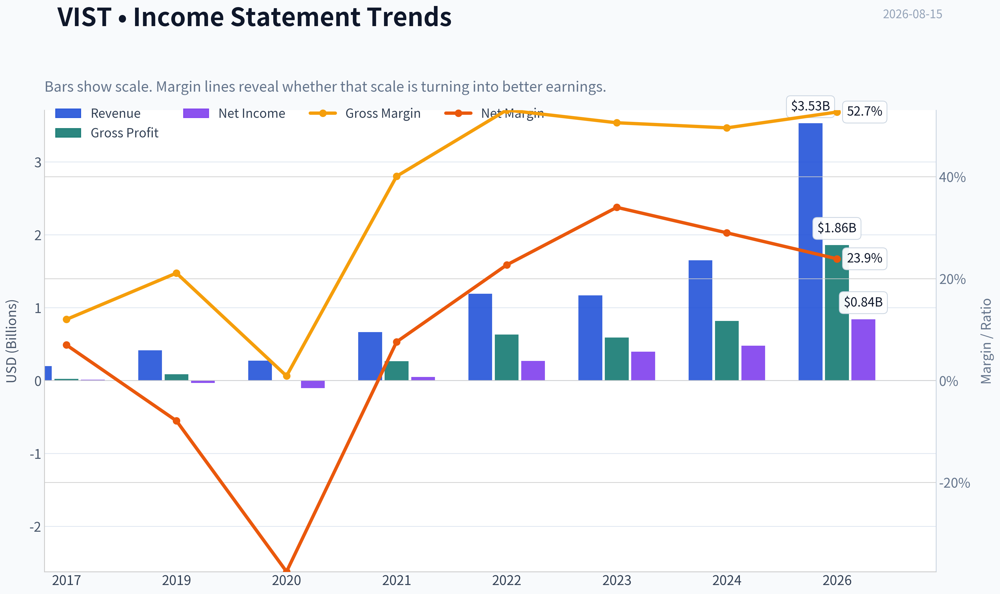

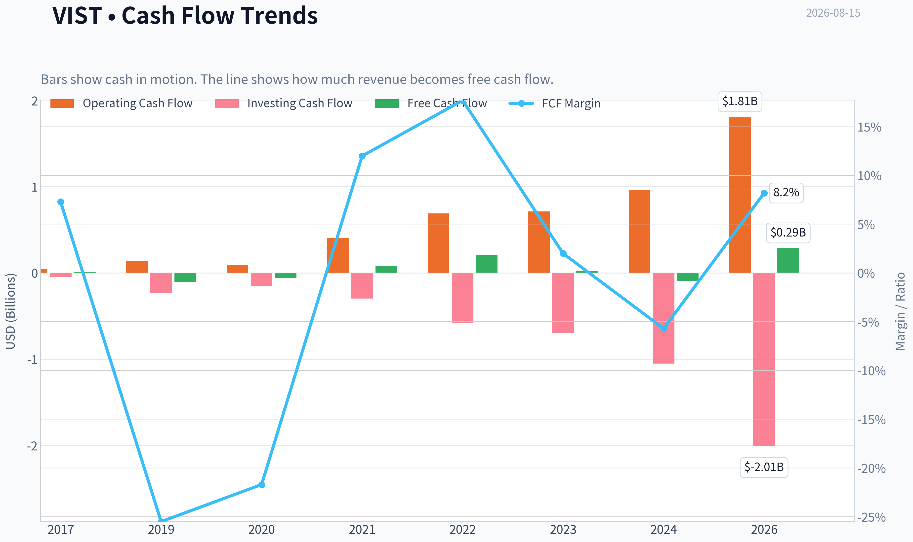

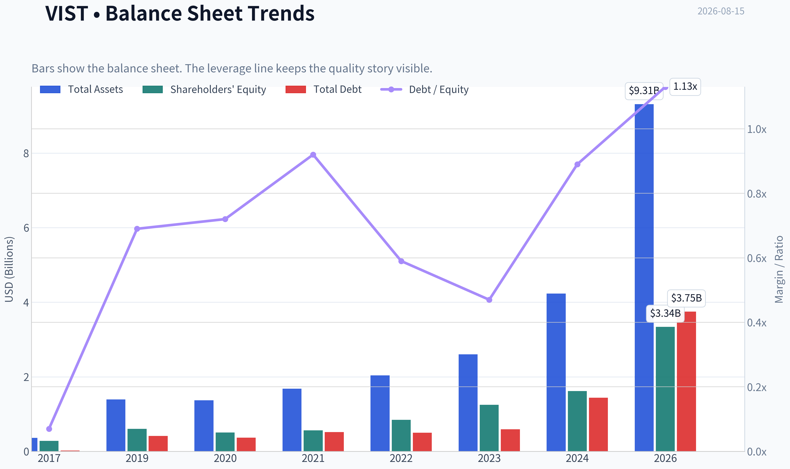

This graph tracks the profitability and return metrics (ROE, ROIC, Margins) of **VIST** over the past decade, highlighting capital efficiency trends.

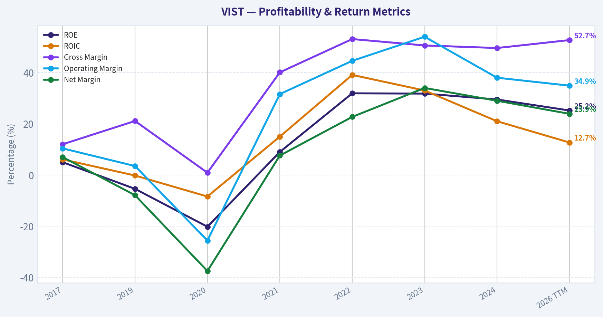

This chart illustrates the financial health of **VIST** over the last 10 years, mapping cash equivalents and free cash flow against total obligations (Debt).

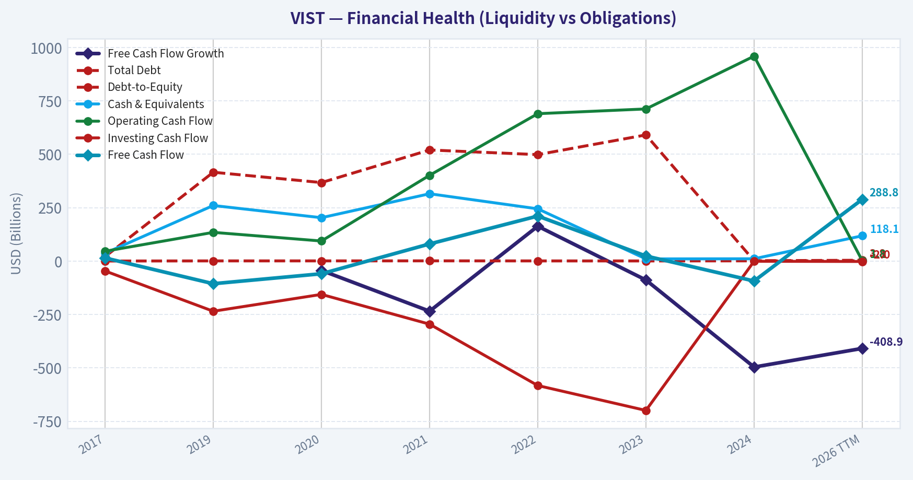

---

### Intrinsic Value Analysis (Buffett)

> *Following Warren Buffett's value investing philosophy: Circle of Competence, Economic Moat, Management Quality, and Margin of Safety.*

#### Intrinsic Value Snapshot

Price is what you pay. Intrinsic value is what the business may be worth based on the cash it can create for owners over time. We show a range, not one magic number.

- Current Price: $68.31
- Value Range (conservative to optimistic across both DCF methods): $-20.12 to $751.13

##### Owner Earnings (Buffett Method)
- Net Income: $477,521,000.00
- Depreciation & Amortization: $738,903,000.00
- Capital Expenditures: $-1,467,131,000.00
- Working Capital Changes: $-397,464,000.00
- Owner Earnings: $617,877,000.00

##### Intrinsic Value
###### Buffett Method
Uses owner earnings. Stricter, and usually more conservative.
- Conservative: $268.86
- Average: $268.86
- Optimistic: $751.13
- Discount Rate: 10.0%

###### Cash Flow Method
Uses free cash flow. Better for companies spending heavily today to grow tomorrow.
- Conservative: $-20.12
- Average: $14.03
- Optimistic: $204.56
- Discount Rate: 10.0%

ANALYST STANCE: **WATCH**

#### VIST - Buffett-Style Value Investment Report

Vista Energy is a fast-growing Latin American oil and gas producer, principally tied to Vaca Muerta shale development. The stock screens statistically cheap on earnings and headline intrinsic value, but this is still a commodity-linked, capital-intensive business with negative free cash flow during its growth phase. The right stance is **WATCH**: attractive upside if execution and oil prices cooperate, but not yet a Buffett-style "wonderful business at a fair price."

---

#### 1. Factor Scorecard and Gate 5 Solvency Check

| Factor | Score | Evidence | Buffett Interpretation |
|---|---:|---|---|
| Circle of Competence & Business Simplicity | 2.5 / 5 | Vista produces and sells oil and gas; economics depend on production growth, realized commodity prices, capex efficiency, and Argentina operating conditions. | The business is understandable, but long-term predictability is reduced by oil prices, political risk, and development-cycle capital needs. |
| Moat Test | 2.5 / 5 | Gross margin is strong at 47.5%, suggesting favorable acreage and operating leverage, but there are limited switching costs, no consumer brand moat, and no network effects. | This looks more like a resource/cost-position advantage than a classic Buffett moat. |
| Management & Capital Allocation | 3.5 / 5 | Founder-led technical execution appears strong; recent option exercises by CEO, CFO, and CTO suggest equity-linked incentives. Heavy reinvestment is rational if Vaca Muerta returns stay high. | Management appears capable and growth-oriented, but the key test is whether reinvestment converts into durable per-share free cash flow. |
| Industry Structure | 2.0 / 5 | Exploration and production is cyclical, capital-intensive, commodity-price exposed, and politically sensitive. | Industry quality is structurally below Buffett's preferred businesses, even when individual operators are excellent. |
| Gate 5: Quality/Solvency Hard Floor | Not tripped | Revenue growth is strong, EPS momentum is strong, ROE is high, and there is no evidence here of earnings collapse plus inability to cover obligations. | No automatic AVOID. Concerns are handled through the weighted scorecard. |

**Key Takeaways:** Vista is not a simple consumer franchise or asset-light compounder; it is a high-growth energy producer. The company's current economics look strong, but the moat is tied to acreage quality and execution rather than customer captivity. The hard solvency floor is not triggered.

---

#### 2. Moat Analysis

| Moat Source | Assessment | Evidence | Score Signal |
|---|---|---|---:|
| Intangible Assets | Moderate resource-rights value, weak brand value | Vaca Muerta exposure and operating licenses matter; no meaningful consumer brand pricing power. | 2.5 / 5 |
| Switching Costs | Low | Customers generally buy commodity energy; switching costs are limited. | 1.0 / 5 |
| Cost Advantage | Potentially meaningful | 47.5% gross margin and rapid growth suggest attractive acreage and execution efficiency. | 3.5 / 5 |
| Network Effects | None | The product does not become more valuable as more users join. | 0.0 / 5 |
| Overall Moat Rating | Narrow | Strong assets and execution, but commodity exposure limits durability. | 2.5 / 5 |

**Key Takeaways:** Vista's moat is mainly a cost/resource advantage, not a brand, network, or switching-cost moat. That can still create value, especially with high-quality shale acreage, but it is more vulnerable to commodity cycles and policy changes than Buffett's preferred compounders. The moat is best described as **narrow but potentially valuable**.

---

#### 3. Management Quality Assessment

| Management Dimension | Assessment | Evidence |
|---|---|---|
| Owner Orientation | Moderately positive | CEO Miguel Galuccio and senior executives have equity-linked compensation activity, including recent option exercises. |
| Operating Skill | Positive | Revenue growth of 50.2% and strong EPS momentum indicate strong operational execution. |
| Capital Allocation | Mixed but promising | Heavy reinvestment is logical if well-level returns remain high, but current free cash flow is negative. |
| Candor / Accounting Quality | Neutral-positive | No major red flags are evident from the current financial snapshot. |
| Leverage Discipline | Needs monitoring | Current ratio of 0.86 and negative FCF make balance-sheet discipline important. |

**Key Takeaways:** Management appears technically strong and aligned with growth. The main question is not whether Vista can grow production, but whether that growth will translate into durable free cash flow per share. For a Buffett-style investor, that proof matters.

---

#### 4. Financial Summary

| Metric | Current Snapshot |
|---|---:|
| Share Price | $68.00 |
| Market Capitalization | $7.56B |
| Estimated Shares Outstanding | 111.2M |
| P/E Ratio | 9.0x |
| Estimated EPS | $7.57 |
| Estimated Net Income | $841M |
| ROE | 28.6% |
| Gross Margin | 47.5% |
| Revenue Growth YoY | 50.2% |
| Free Cash Flow Yield | -8.9% |
| Estimated Free Cash Flow | -$673M |
| Current Ratio | 0.86 |
| Headline Intrinsic Value | $366.29 |
| Headline Margin of Safety | 81.4% |

**Key Takeaways:** Vista looks optically cheap at about 9 times earnings while growing revenue rapidly. Profitability is strong, with high ROE and strong gross margin. The major concern is cash conversion: free cash flow is currently negative, likely reflecting heavy development spending.

---

#### 5. Owner Earnings Calculation

For an oil and gas developer, owner earnings should be interpreted carefully because reported free cash flow can be depressed during high-growth drilling phases. The key distinction is between maintenance capital needed to hold production flat and growth capital spent to expand production.

| Owner Earnings Bridge | Per Share | Total Estimate |
|---|---:|---:|
| Estimated Net Income | $7.57 | $841M |
| Reported Free Cash Flow | -$6.05 | -$673M |
| Normalized Owner Earnings Estimate | $26.89 | $2.99B |
| No-Growth Owner Earnings Value at 10% Discount Rate | $268.86 | $29.9B |

**Key Takeaways:** Accounting earnings are positive and strong, while reported free cash flow is negative because the company is reinvesting heavily. The normalized owner-earnings estimate implies substantially higher economic value than current GAAP earnings alone. The investment case depends on whether today's growth capex truly creates future owner earnings rather than merely replacing depleted reserves.

---

#### 6. Three-Scenario DCF Valuation

Assumptions: 10% discount rate; normalized owner earnings of $26.89 per share; Scenario C uses a capped 10% growth rate due to Vista's very high recent revenue growth.

| Valuation Scenario | Method | Intrinsic Value / Share | Upside vs. $68 Price |
|---|---|---:|---:|
| Scenario A: No Growth | Owner Earnings / 10% | $268.86 | +295% |
| Scenario B: GDP Growth | Owner Earnings x 1.03 / (10% - 3%) | $395.69 | +482% |
| Scenario C: Historical Growth, Capped | 10-year growth at 10%, then 3% terminal growth | $664.60 | +877% |
| Headline Business-Model Routed Value | Cyclical weighted blend | $366.29 | +439% |
| FCF-Based Valuation Cross-Check | Current free cash flow model | $14.03 | -79% |

**Key Takeaways:** The DCF upside is very large if normalized owner earnings are sustainable. However, the spread between the owner-earnings valuation and the free-cash-flow valuation is also very large. That wide spread is the central risk: Vista must prove that current reinvestment will convert into future distributable cash.

---

#### 7. Margin of Safety Analysis

| Valuation Reference | Value / Share | Margin of Safety vs. $68 | Interpretation |
|---|---:|---:|---|
| Headline Intrinsic Value | $366.29 | 81.4% | Very large apparent discount. |
| Owner Earnings DCF | $268.86 | 74.7% | Strong upside if normalized earnings are credible. |
| Damodaran FCFF Value | $439.36 | 84.5% | Also indicates substantial undervaluation. |
| FCF Model | $14.03 | Negative | Warns that current cash flow does not support the stock. |
| Reverse DCF | Price implies about -1.1% annual growth | Favorable | Market expectations appear undemanding. |

**Key Takeaways:** On normalized earnings, Vista appears deeply undervalued. The reverse DCF is also favorable because the current price does not require heroic growth. But the negative free cash flow means the margin of safety is less clean than it looks; the discount is attractive, but the business quality and cyclicality require a larger safety buffer.

---

#### 8. Final Buffett Scorecard

| Criterion | Weight | Score | Weighted Contribution |
|---|---:|---:|---:|
| Moat Width & Durability | 25% | 2.5 | 0.63 |
| Valuation / Margin of Safety | 20% | 4.0 | 0.80 |
| Capital Returns - ROIC vs. WACC | 15% | 3.5 | 0.53 |
| Business Understanding & Predictability | 12% | 2.5 | 0.30 |
| Management Quality & Capital Allocation | 12% | 3.5 | 0.42 |
| Reinvestment Runway | 8% | 4.0 | 0.32 |
| Balance Sheet Strength | 4% | 2.5 | 0.10 |
| Industry Structure | 4% | 2.0 | 0.08 |
| **Total Score** | **100%** |  | **3.17 / 5** |

**Key Takeaways:** Vista scores well on valuation, growth runway, and management execution. It scores lower on moat durability, industry structure, predictability, and cash-flow quality. The overall result is a **WATCH**, not an ADVOCATE.

---

#### 9. Investment Stance

| Stance | Conviction | Rationale |
|---|---|---|
| **WATCH** | Medium | Vista may be materially undervalued if its Vaca Muerta growth translates into durable owner earnings. However, commodity exposure, Argentina risk, heavy capex, and negative free cash flow keep it below a Buffett-style buy threshold today. |

**Key Takeaways:** Vista is a potentially attractive deep-value growth situation, but not yet a clean compounder. The next proof point is sustained positive free cash flow while maintaining high returns on reinvested capital. If free cash flow inflects and the balance sheet remains controlled, the stock could move from WATCH to ADVOCATE.
#### Valuation Bridge

This bridge places the current market price beside each intrinsic value lens so readers can see whether upside depends on one method or shows up across several methods.

| Scenario | Intrinsic Value / Share |
| --- | ---: |
| Buffett Method | $268.86 |
| Cash Flow Method | $14.03 |
| Damodaran Method | $439.36 |
| Current Price | $68.31 |

#### Key Takeaways

If one method is far above the others, the upside case depends on a specific modelling assumption. When several methods cluster together, the valuation story is more robust.

#### Valuation Visuals

This comparison chart from *Latest Earnings Snapshot* stacks current figures against historical benchmarks for **VIST**, making it easy to see where the company trades relative to its own averages.

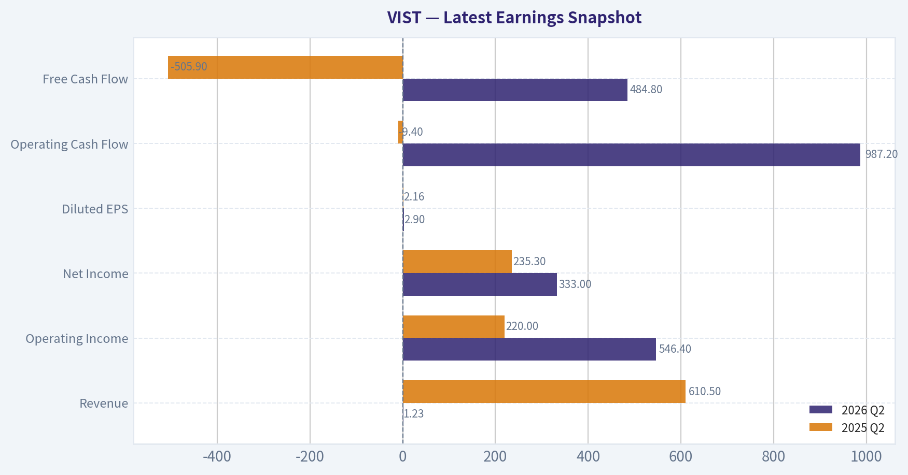

This comparison chart from *Current vs Historical Average Comparison* stacks current figures against historical benchmarks for **VIST**, making it easy to see where the company trades relative to its own averages.

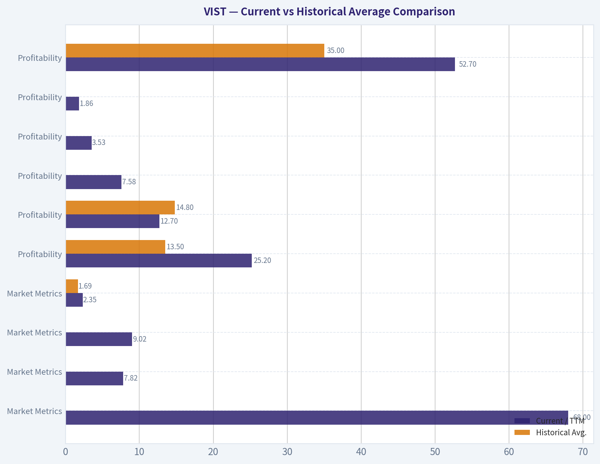

This comparison chart from *Balance Sheet and Financial Strength* stacks current figures against historical benchmarks for **VIST**, making it easy to see where the company trades relative to its own averages.

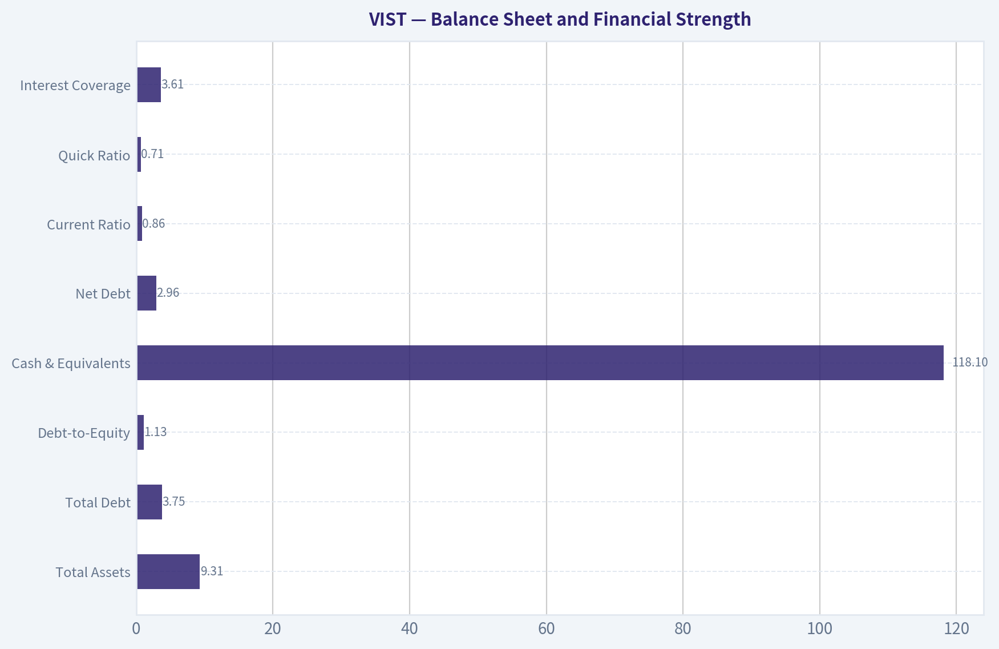

This comparison chart from *Financial Summary* stacks current figures against historical benchmarks for **VIST**, making it easy to see where the company trades relative to its own averages.

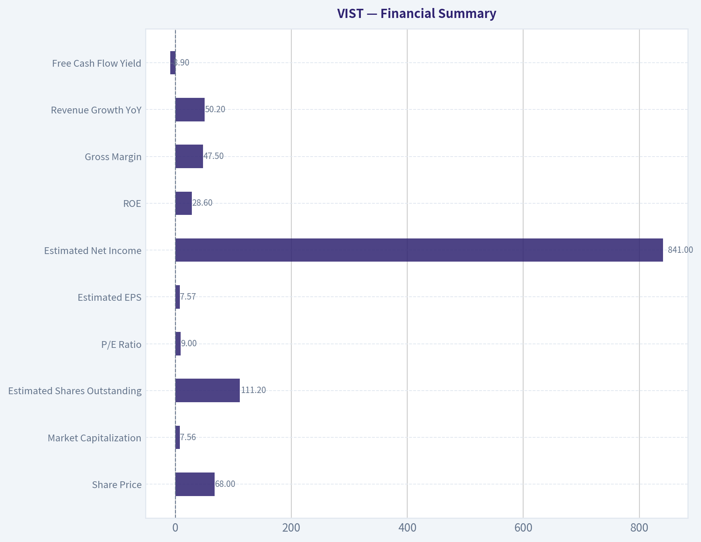

This comparison chart from *Owner Earnings Calculation* stacks current figures against historical benchmarks for **VIST**, making it easy to see where the company trades relative to its own averages.

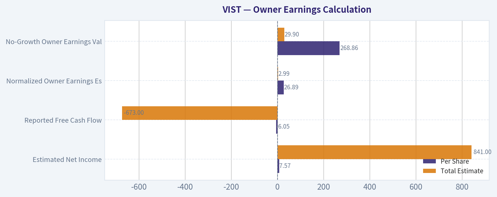

The following chart maps the **VIST** Owner Earnings DCF valuation scenarios (Conservative, Average, Optimistic) to visually represent the margin of safety based on intrinsic value calculations.

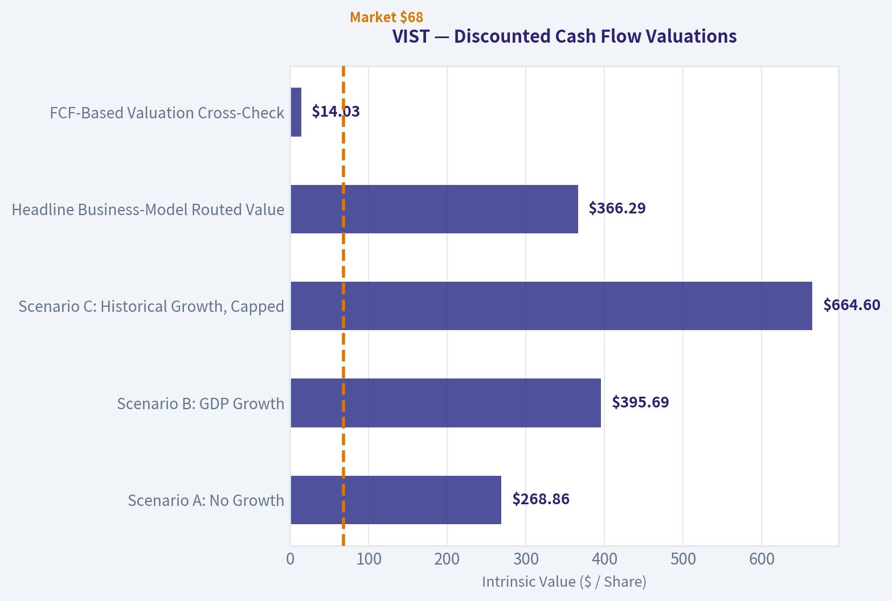

---

### Trend & Growth Analysis (Lynch/Druckenmiller/Fisher)

> *Following Peter Lynch's GARP, Stanley Druckenmiller's macro-aware approach, and Philip Fisher's scuttlebutt methodology.*

ANALYST STANCE: **ADVOCATE**

#### Vista Energy - Growth Inflection Report, VIST

Vista Energy is not a clean software-style compounder; it is a high-growth oil producer tied to Vaca Muerta shale in Argentina. That makes it a **cyclical fast grower**: unusually strong production and earnings growth, but with commodity-price, country, and capital-intensity risks. At roughly **$68 per share**, **9x earnings**, **50%+ YoY revenue growth**, and **28.6% ROE**, the setup is attractive enough for a growth investor, but position sizing should reflect cyclicality.

---

#### 1. Lynch Classification

| Lynch Category | Fit for VIST | Evidence | Growth Investor View |
|---|---:|---|---|
| Slow Grower | No | Revenue growth far above 0-5% | Not applicable |
| Stalwart | No | Growth is too high and volatility is higher | Not applicable |
| Fast Grower | Yes | Revenue growth around 50% YoY; latest coverage cites over 100% revenue growth and 300%+ EPS growth | Core upside driver |
| Cyclical | Yes | Oil producer exposed to crude prices, Argentina policy, and capex cycles | Main risk |
| Turnaround | Partial | Argentina macro normalization could rerate assets | Secondary catalyst |
| Asset Play | Partial | Vaca Muerta acreage has strategic value | Supports downside case |

**Key Takeaways:** Vista is best classified as a **cyclical fast grower**. The growth profile is strong enough for Lynch-style interest, but the business is still tied to oil prices and Argentina risk. This is not a predictable consumer or SaaS compounder; it requires macro-aware sizing.

---

#### 2. The Story in 3 Bullets

| Story Pillar | Simple Explanation |
|---|---|
| Vaca Muerta growth engine | Vista drills in one of the world's most important shale basins, Argentina's Vaca Muerta, where production can grow from a low base for years. |
| Operating leverage | As production scales, infrastructure improves, and well productivity rises, earnings can grow faster than revenue. |
| Valuation disconnect | Despite high growth, Vista trades at roughly **9x earnings**, suggesting the market is discounting oil cyclicality and Argentina risk heavily. |

**Key Takeaways:** The story is understandable: Vista is a fast-scaling shale producer in Argentina with a large resource base. If production keeps growing and Argentina becomes more investable, the market may rerate the stock. The key question is whether growth and policy improvement can overpower commodity cyclicality.

---

#### 3. TAM Analysis and 10x Test

| Item | Estimate / Data Point | Interpretation |
|---|---:|---|
| Current market cap | $7.56B | Mid-cap energy growth name |
| Current revenue growth | 50.2% YoY | Strong fast-grower signal |
| Approximate revenue base | Not provided in tool output; likely low-single-digit billions | Still small relative to global oil markets |
| 10x revenue test | Would require revenue to reach high-teens to $20B+ range | Ambitious but not impossible over a long cycle |
| TAM source | Vaca Muerta oil and gas development, Argentine export expansion, global crude demand | Large resource runway, but commodity-driven |
| 10x test result | **Pass with caveat** | Resource base supports growth, but oil price and infrastructure determine monetization |

**Key Takeaways:** Vista has a real runway because Vaca Muerta is a large, underdeveloped shale basin. A 10x revenue outcome is not as clean as it would be for software, because it depends on oil prices, drilling success, pipelines, exports, and political stability. The long-term opportunity is large, but not linear.

---

#### 4. Revenue Growth Trend

| Metric | Data Point | Signal |
|---|---:|---|
| YoY revenue growth | 50.2% | Strong growth |
| Latest media-cited revenue growth | 102.3% | Possible acceleration in most recent period |
| EPS growth cited in coverage | 332.7% | Major earnings leverage |
| Gross margin | 47.5% | Strong profitability at the gross level |
| ROE | 28.6% | High capital productivity |
| FCF yield | -8.9% | Heavy reinvestment / capex burden |

**Key Takeaways:** Vista's reported growth profile is excellent, with revenue and earnings expanding rapidly. The issue is not demand; the issue is capital intensity, because free cash flow is currently negative. This is acceptable during a high-return drilling ramp, but it must eventually convert into durable free cash flow.

---

#### 5. Unit Economics

Traditional SaaS metrics like LTV/CAC, NRR, and Rule of 40 do not apply to Vista. For an oil producer, the equivalent questions are: well productivity, lifting costs, reinvestment rate, decline rates, realized pricing, and free cash flow conversion.

| Unit Economics Proxy | Current Read | Assessment |
|---|---|---|
| LTV/CAC | Not applicable | Not a customer acquisition model |
| NRR | Not applicable | Not a subscription model |
| Rule of 40 | Not applicable | Not a SaaS business |
| Gross margin | 47.5% | Strong for an upstream producer |
| ROE | 28.6% | Strong capital returns |
| FCF yield | -8.9% | Negative due to growth capex |
| Current ratio | 0.86 | Liquidity needs monitoring |

**Key Takeaways:** Vista's operating economics look attractive at the gross margin and ROE level. However, free cash flow is negative and the current ratio is below 1, which means the company is still in an investment-heavy phase. The investment case depends on capex turning into higher production and future free cash flow.

---

#### 6. Inflection Point Assessment

| Inflection Type | Evidence | Rating |
|---|---|---|
| Product / resource inflection | Scaling Vaca Muerta shale development | Strong |
| Market share inflection | Likely gaining relevance as Argentina shale output grows | Moderate to strong |
| Margin inflection | EPS growth far above revenue growth suggests operating leverage | Strong |
| TAM inflection | Export infrastructure and Argentina energy policy could expand monetizable market | Strong but policy-dependent |
| Competitive inflection | Vaca Muerta remains capital- and execution-intensive, limiting weaker operators | Moderate |
| Investor perception inflection | Druckenmiller initiated; Point72 increased position | Positive |

**Key Takeaways:** Vista appears to be at a genuine growth inflection, not merely a steady-state expansion. Production growth, earnings leverage, and improving investor recognition are all working in the company's favor. The biggest uncertainty is whether Argentina's macro and energy infrastructure allow the opportunity to scale smoothly.

---

#### 7. Macro Setup Evaluation

| Macro Factor | Current Setup | Impact on VIST |
|---|---|---|
| Oil price cycle | Supportive if crude remains firm; risky if global growth weakens | Mixed-positive |
| Interest rates | Lower rates would help emerging-market equities and capital-intensive energy | Positive if easing continues |
| Argentina policy | Potentially improving under market-friendly reforms | Major upside lever |
| Currency risk | Argentine peso and capital controls remain important risks | Negative |
| Secular theme | Energy security, shale productivity, emerging-market resource development | Positive |
| Global energy transition | Long-term oil demand uncertainty | Moderate risk |

**Key Takeaways:** The macro setup is unusually important for Vista. The stock benefits from firm oil prices, Argentina normalization, and better access to capital. It is vulnerable to crude selloffs, policy reversals, currency stress, and export bottlenecks.

---

#### 8. Fisher 15 Points Score

| Fisher Point | Score / 5 | Comment |
|---|---:|---|
| Market potential | 5 | Vaca Muerta provides large resource runway |
| New product / development drive | 4 | Active drilling and field development |
| R&D / technical effectiveness | 4 | Shale execution is technical and operationally demanding |
| Sales organization | 3 | Commodity sales less differentiated |
| Profit margin | 4 | Gross margin strong |
| Improving margins | 4 | EPS leverage suggests improvement |
| Labor relations | 3 | Insufficient data |
| Executive relations | 3 | Insufficient data |
| Management depth | 4 | Experienced leadership; insider option exercises noted |
| Cost analysis / controls | 4 | ROE suggests disciplined capital deployment |
| Moat / differentiation | 3 | Acreage and execution matter, but commodity business |
| Long-range profit outlook | 4 | Strong if production scales and oil holds |
| Dilution risk | 3 | Capital intensity needs monitoring |
| Candor | 3 | Insufficient data |
| Integrity | 3 | No major red flags from provided data |

**Key Takeaways:** Vista scores well on market potential, margins, and long-range profit opportunity. The weaker areas are typical for commodity producers: limited pricing power, less durable moat, and dependence on capital allocation discipline. Overall, the Fisher score is good, but not elite.

**Fisher Score: 54 / 75 - Average to Good**

---

#### 9. Valuation Analysis

| Valuation Metric | Current Data | Interpretation |
|---|---:|---|
| Share price | $68 | Current reference price |
| Market cap | $7.56B | Mid-cap |
| P/E | 8.99x | Very cheap for current growth |
| YoY revenue growth | 50.2% | Strong |
| PEG ratio | ~0.18 using 50% growth | Very attractive, but cyclical earnings caveat |
| ROE | 28.6% | High |
| Headline intrinsic value estimate | $366.29 | Very large implied upside |
| Margin of safety vs. headline IV | 81.4% | Attractive, but model spread is wide |
| Owner earnings value | $268.86 | Bullish |
| FCF DCF value | $14.03 | Bearish due to negative FCF |
| Damodaran FCFF value | $439.36 | Very bullish |

**Key Takeaways:** Vista looks statistically cheap on earnings and growth, with a PEG ratio far below 1. However, valuation dispersion is extreme because free cash flow is currently negative while earnings and FCFF-based models look very strong. This is a classic high-upside cyclical growth setup, not a low-risk compounder.

---

#### 10. Scenario Analysis

| Scenario | Assumptions | Implied View |
|---|---|---|
| Bear Case | Oil prices fall, Argentina risk returns, capex stays heavy, FCF remains weak | Stock could derate materially despite growth |
| Base Case | Production grows strongly, oil remains stable, FCF improves over 2-3 years | Meaningful upside from low P/E and earnings growth |
| Bull Case | Vaca Muerta scales faster, Argentina rerates, exports expand, margins hold | Multi-bagger potential over several years |

**Key Takeaways:** The bear case is driven by macro and free cash flow risk, not lack of growth. The base case is attractive because the valuation is already low. The bull case depends on both operating execution and a country-risk rerating.

---

#### 11. Growth Investor Scorecard

| Criterion | Weight | Score / 5 | Weighted Score |
|---|---:|---:|---:|
| The Story | 10% | 4.0 | 0.40 |
| TAM & Runway | 20% | 4.0 | 0.80 |
| Revenue Growth | 20% | 4.5 | 0.90 |
| Unit Economics | 15% | 3.5 | 0.53 |
| Competitive Position | 10% | 3.5 | 0.35 |
| Management Quality | 10% | 3.5 | 0.35 |
| Macro Setup | 5% | 3.5 | 0.18 |
| Profitability Path | 5% | 3.5 | 0.18 |
| Valuation | 5% | 4.5 | 0.23 |
| **Total** | **100%** |  | **3.92 / 5.00** |

**Key Takeaways:** Vista scores just below 4 out of 5, which supports an **ADVOCATE** stance under the growth framework. The strongest factors are revenue growth, valuation, and runway. The deductions come from cyclicality, Argentina risk, negative free cash flow, and liquidity monitoring.

---

#### 12. Position Size Stance

| Investor Type | Suggested Stance |
|---|---|
| Conservative growth investor | Small starter position only |
| Aggressive growth investor | Medium position acceptable |
| Macro-aware energy investor | Potential core cyclical growth position |
| Risk-averse investor | Watchlist, not a full position |

**Key Takeaways:** Vista deserves attention, but not reckless sizing. Because it is a cyclical emerging-market energy stock, the position should be smaller than a comparable high-quality secular compounder. A staged entry is preferable to a full one-time allocation.

**Position Size View:** **3%-5% maximum for growth portfolios; 5%-8% only for investors comfortable with oil and Argentina risk.**

---

#### 13. Key Risks and Catalysts

| Category | Key Items |
|---|---|
| Major risks | Oil price decline, Argentina policy reversal, currency controls, export bottlenecks, negative FCF, liquidity pressure, capex overruns |
| Financial red flags | FCF yield of -8.9%; current ratio below 1; high model valuation spread |
| Business risks | Commodity pricing, reserve execution, well productivity, infrastructure constraints |
| Catalysts | Continued production growth, positive free cash flow inflection, Argentina reform progress, Vaca Muerta export expansion, reserve upgrades, institutional accumulation |
| Notable investor signal | Druckenmiller initiated a position; Point72 increased shares significantly in latest available 13F data |

**Key Takeaways:** The risk side is real and mostly macro-driven. The catalyst side is also powerful, especially if production growth converts into free cash flow and Argentina continues to normalize. Institutional buying from sophisticated investors adds confirmation, but should not replace independent risk control.

---

#### Final View

Vista Energy is a **high-upside cyclical fast grower** with a rare combination of rapid growth, high ROE, low P/E, and large resource runway. The stock fits a Lynch-style "growth at a reasonable price" setup, while the Druckenmiller angle is the possible macro and country-risk inflection in Argentina. The main caveat is that this is still an oil producer with negative free cash flow and emerging-market risk.

**Bottom line:** **ADVOCATE**, but size as a volatile cyclical growth position, not as a stable secular compounder.

---

### Market Technical Analysis

ANALYST STANCE: **WATCH**

#### VIST Technical Report - as of 2026-08-15

VIST closed the latest trading session, 2026-08-14, at **$68.31**. The stock is in a **long-term uptrend**, but the medium-term picture is still repairing after a sizable correction from the May peak near **$79.25** to the July low near **$60.36**. The recent rebound has been constructive, but price is now approaching a short-term resistance zone near **$69.50-$70.70**, where prior highs and the Bollinger upper band converge.

The best read is: **improving short-term momentum inside a still-fragile medium-term recovery, supported by a rising long-term trend.**

#### Selected Indicators

| Indicator | Latest / Recent Reading | Why It Matters for VIST Now |
|---|---:|---|
| `close_10_ema` | **$66.88** on 2026-08-14 | Captures the short-term rebound; price above this level shows near-term momentum has improved. |
| `close_50_sma` | About **$67.48** on 2026-08-12, declining recently | Key medium-term trend gauge; VIST has been testing/reclaiming this area after the correction. |
| `close_200_sma` | **$61.00** on 2026-08-14 | Confirms the long-term trend remains positive; price is still comfortably above it. |
| `macd` | **+0.15** on 2026-08-14 | Momentum has recovered from deeply negative July readings and has moved slightly positive. |
| `rsi` | **53.82** on 2026-08-14 | Neutral-to-mildly bullish; not overbought, leaving room for continuation if price confirms. |
| `boll_ub` | About **$70.66** on 2026-08-13 | Identifies the nearby upside breakout/resistance zone. |
| `atr` | About **$2.81** recent reading | Useful for risk control; VIST remains volatile enough to require wider stops. |
| `vwma` | **$66.82** on 2026-08-14 | Confirms whether price strength is supported by volume-weighted buying. |

Key Takeaways: The chosen indicators are complementary rather than redundant. They cover short-term trend, medium-term trend, long-term trend, momentum, volatility, breakout resistance, and volume confirmation. Together, they suggest VIST has improved meaningfully from its July weakness, but it still needs a clean breakout above the $70 area to prove the recovery is durable.

---

#### Trend Structure

VIST's long-term trend remains strong. The stock is trading around **12% above its 200-day SMA**, which is a constructive strategic signal. The 200-day SMA has also been rising steadily, from roughly **$56.41 on 2026-06-30** to **$61.00 on 2026-08-14**, showing that the broader trend base is still advancing.

The medium-term trend is less clean. The 50-day SMA has been drifting lower, from around **$71.16 on 2026-06-30** to the high-$67 area in mid-August. That tells us the May-to-July decline is still influencing the medium-term average. However, the latest close at **$68.31** is back above the recent 50-day area, which is a constructive early sign.

Short-term momentum has improved. The 10-day EMA is near **$66.88**, and price closed above it at **$68.31**. This suggests buyers have regained tactical control after the early-August pullback to **$64.04**.

#### Momentum and Reversal Quality

MACD has recovered sharply from deeply negative July levels. It was around **-2.84** in early July and has improved to **+0.15** by 2026-08-14. This transition from negative to slightly positive momentum is important because it shows the downtrend pressure has faded.

RSI confirms the same idea, but with moderation. RSI dropped into oversold territory in early July, with readings near **24-30**, then recovered to the low-to-mid 50s by mid-August. A current RSI of **53.82** is not euphoric; it reflects a healthier recovery rather than an overextended rally.

That said, momentum is not yet explosive. RSI below 60 and MACD only slightly above zero imply the stock is improving, but not yet in a confirmed strong upside phase. A close above **$70.50-$71.00** with RSI pushing toward the 60s would strengthen the bullish case.

#### Resistance, Support, and Volatility

The immediate resistance zone is around **$69.50-$70.70**. VIST reached **$70.45** on 2026-07-31 and then pulled back, while the Bollinger upper band is near **$70.66**. This creates a clear near-term test: if VIST can close above this region, it would signal improving breakout potential.

Support is layered. The first tactical support area is around **$66.80-$67.00**, where the 10-day EMA and VWMA are clustered. Below that, the **$64.00-$65.00** area is important because it caught price several times in late July and early August. A deeper failure below **$64** would weaken the recovery and reopen risk toward the July low near **$60.36**.

ATR near **$2.8** means normal daily movement is still fairly wide. Traders should avoid overly tight stops, because routine volatility could shake out positions even if the recovery remains intact. A stop or risk band of roughly one ATR below a key support level may be more realistic than a narrow price stop.

#### Volume Confirmation

VWMA is near **$66.82**, very close to the 10-day EMA. The latest close at **$68.31** is above VWMA, which means the stock is trading above its volume-weighted short-term benchmark. That is constructive because it suggests the recent price improvement is not purely cosmetic.

However, the volume profile is mixed. The July 23 rally to **$69.06** came with elevated volume, and the July 31 close at **$70.45** also had decent participation. But the latest 2026-08-14 rebound to **$68.31** occurred on moderate volume of about **640,900 shares**, not a major accumulation surge. For a stronger bullish confirmation, traders would ideally want a move above **$70.70** on expanding volume.

#### Trading Interpretation

VIST is not a clean "avoid," because the long-term uptrend is intact and short-term momentum is improving. But it is also not yet a high-conviction "advocate," because the stock is still below the recent resistance band and the 50-day trend has not fully turned upward.

A bullish trader could monitor for a breakout above **$70.50-$71.00**. If that breakout occurs with stronger volume and RSI moving into the upper 50s or low 60s, the next upside focus would likely shift toward the prior rally area around **$74-$76**, and eventually the May peak region near **$79**.

A more cautious trader may prefer waiting for either a confirmed breakout or a pullback toward **$66-$67** that holds above the 10-day EMA/VWMA cluster. Failure below **$64** would be a warning that the recovery is losing structure.

---

#### Final Technical Summary

| Category | Signal | Key Levels / Readings | Trading Implication |
|---|---|---:|---|
| Long-term trend | Bullish | Price **$68.31** vs. 200 SMA **$61.00** | Strategic trend remains intact. |
| Medium-term trend | Repairing | 50 SMA recently around **$67.5** and declining | Reclaim is constructive, but trend needs more confirmation. |
| Short-term trend | Improving | 10 EMA **$66.88** | Price above short-term average favors buyers. |
| Momentum | Mildly bullish | MACD **+0.15**, RSI **53.82** | Downside momentum has faded, but upside strength is not yet decisive. |
| Resistance | Important test nearby | **$69.50-$70.70** | Breakout above this area would improve the setup. |
| Support | Watch closely | **$66.80-$67.00**, then **$64-$65** | Holding these zones keeps recovery intact. |
| Volatility | Elevated/moderate | ATR about **$2.8** | Use wider risk bands; avoid tight stops. |
| Volume | Constructive but not decisive | Close above VWMA **$66.82** | Volume-weighted trend supports recovery, but breakout needs stronger participation. |
| Overall stance | **WATCH** | Bullish above $70.70; weaker below $64 | Setup is improving, but confirmation is still needed. |

Key Takeaways: VIST has rebuilt short-term momentum and remains in a strong long-term uptrend, but it is now approaching an important resistance zone near $70. A breakout above that area would materially improve the technical picture, while a drop below $64 would suggest the recovery is failing. For now, the most balanced stance is to watch for confirmation rather than chase prematurely.

---

### Options Market Analysis

> *Reading options flow - put/call ratios, IV skew, and unusual activity - to gauge institutional positioning and event-driven risk.*

ANALYST STANCE: **WATCH**

#### VIST Options Flow Report - As of 2026-08-15

#### 1. Put/Call Ratio Analysis

| Expiration | Call OI | Put OI | Put/Call OI Ratio | Call Volume | Put Volume | Put/Call Volume Ratio | Read |
|---|---:|---:|---:|---:|---:|---:|---|
| 2026-08-21 | 7,278 | 3,665 | 0.50 | 64 | 289 | 4.52 | Call-heavy open interest, but near-term put volume spike |
| 2026-09-18 | 2,723 | 1,068 | 0.39 | 62 | 144 | 2.32 | Bullish OI base, active put demand |
| 2026-11-20 | 3,538 | 883 | 0.25 | 167 | 28 | 0.17 | Strong call dominance and current call activity |
| **Total Near-Term** | **13,539** | **5,616** | **0.41** | **293** | **461** | **1.57** | Structurally call-heavy, tactically put-heavy |

**Key Takeaways:** VIST's near-term open interest is clearly call-dominated, with a total put/call OI ratio of **0.41**, well below the historical neutral baseline of roughly **0.70**. That suggests the existing options positioning leans bullish or at least upside-oriented. However, today's volume tells a different short-term story: the total put/call volume ratio is **1.57**, indicating fresh demand is skewing toward puts, especially in the August and September expirations.

The main shift from neutral is that **open interest remains bullish**, but **current trading flow is more defensive or bearish**. This can indicate traders are hedging an already bullish book, buying downside protection, or positioning for near-term volatility.

---

#### 2. Implied Volatility Assessment

| Expiration | ATM Call IV | ATM Put IV | Call-Put IV Difference | IV Read |
|---|---:|---:|---:|---|
| 2026-08-21 | 72.4% | 55.6% | Calls +16.8 pts | Very elevated front-week call IV |
| 2026-09-18 | 53.5% | 52.3% | Calls +1.2 pts | Balanced IV |
| 2026-11-20 | 57.0% | 55.7% | Calls +1.3 pts | Slight call premium |

**Key Takeaways:** The standout IV signal is the **2026-08-21 expiration**, where ATM call IV is materially higher than ATM put IV. That points to elevated demand for near-term upside exposure, though it may also reflect wider markets or less liquid quoting. Further out, September and November IV are much more balanced, suggesting the strongest volatility pressure is concentrated in the front week.

True OTM skew data was not provided, so a definitive put-skew versus call-skew comparison cannot be made. Based only on ATM IV, the near-term skew appears to favor **calls**, not puts. That leans toward upside chase or event-driven upside speculation rather than broad downside fear.

No specific known catalyst was provided in the data. Still, front-week ATM call IV above **70%** is elevated enough to suggest traders may be pricing a near-term move or reacting to recent momentum.

---

#### 3. Unusual Options Activity

| Screen | Result |
|---|---|
| Volume greater than 5x open interest | No qualifying contracts found |
| Fresh large directional bets | Not detected in near-term expirations |
| Smart-money sweep/block signal | Not available from current data |
| Retail speculation signal | Not clearly identifiable |

**Key Takeaways:** There were **no contracts where volume exceeded 5x open interest**, so the data does not show clear evidence of fresh, unusual institutional-style positioning. The lack of unusual activity reduces conviction in any aggressive directional read. Current flow is better interpreted as broad positioning rather than a single high-conviction options bet.

Because no strike-level unusual activity was detected, there is no clear contract to classify as ITM, ATM, or OTM. The absence of unusual flow does not mean sentiment is neutral, but it does mean the signal is less forceful.

---

#### 4. Open Interest Concentration and Gamma Levels

| Expiration | Call OI | Put OI | Dominant Side | Potential Pinning / Gamma Read |
|---|---:|---:|---|---|
| 2026-08-21 | 7,278 | 3,665 | Calls | Highest near-term OI; likely important into weekly expiry |
| 2026-09-18 | 2,723 | 1,068 | Calls | Moderate call concentration |
| 2026-11-20 | 3,538 | 883 | Calls | Longer-dated call interest remains meaningful |

**Key Takeaways:** The largest open interest is in the **2026-08-21 calls**, making the front-week expiration the most important positioning window. Across all listed expirations, calls dominate puts, implying upside levels may be more crowded. However, strike-level OI was not provided, so specific gamma walls, max-pain levels, or pinning strikes cannot be identified.

From an expiration-level perspective, the August 21 chain likely has the most influence on near-term trading. If call OI is clustered near the current stock price, it could create pinning or dealer hedging effects, but that cannot be confirmed without strike-level data.

---

#### 5. Overall Options Sentiment Signal

| Component | Signal | Reason |
|---|---|---|
| Open Interest Positioning | Bullish | Put/call OI ratio of **0.41** is well below neutral, showing call dominance |
| Current Volume Flow | Bearish / Defensive | Put/call volume ratio of **1.57** shows near-term put demand |
| Implied Volatility | Mildly Bullish / Event-Sensitive | Front-week call IV is much higher than put IV |
| Unusual Activity | Neutral | No volume > 5x OI contracts detected |
| Liquidity / Confidence | Moderate-Low | Options volume is not extremely thin, but flow is modest and lacks strike-level confirmation |

**Key Takeaways:** VIST's options market shows a split between **bullish existing positioning** and **defensive near-term trading activity**. The strongest structural signal is call-heavy open interest, while the strongest tactical signal is fresh put volume in the front two expirations. Because unusual activity is absent and strike-level gamma data is unavailable, conviction should be kept moderate to low.

#### Final Options Sentiment: **NEUTRAL TO SLIGHTLY BULLISH**

The primary driver is the very low near-term put/call open interest ratio of **0.41**, which indicates that existing positioning remains call-heavy and structurally bullish versus the neutral baseline of roughly **0.70**. However, the elevated put/call volume ratio of **1.57** shows traders are adding near-term downside protection or bearish exposure, preventing a clean bullish call.

In plain terms: **the options book is still positioned for upside, but traders are actively hedging near-term downside risk.** I would read VIST options sentiment as **slightly bullish, but vulnerable to short-term volatility**.

---

#### Summary Table

| Category | Current Reading | Interpretation |
|---|---|---|
| Put/Call Ratio | OI ratio **0.41**; volume ratio **1.57** | Existing positioning bullish, current flow defensive |
| IV Level | Front-week ATM call IV **72.4%**; put IV **55.6%** | Elevated near-term call premium |
| Skew Direction | ATM call IV premium, especially Aug. 21 | Upside chase or event-sensitive call demand |
| Unusual Activity | None detected above 5x OI | No clear fresh institutional directional bet |
| Overall Signal | **Neutral to Slightly Bullish** | Call-heavy OI offsets short-term put buying |

**Key Takeaways:** The options market is not outright bearish despite the active put volume, because open interest remains strongly call-heavy. Front-week call IV is elevated, suggesting traders are still paying up for upside exposure. The best read is **slightly bullish with near-term hedging pressure**, not a high-conviction breakout signal.

---

## Research Team Commentary

> *The Research Manager synthesizes the Bull vs Bear debate into action-free commentary. This is a pre-risk view, not the final stance.*

This was a fantastic debate that perfectly captures the tension between optical value and structural business quality.

The Bull effectively argued that Vista Energy's execution in the Vaca Muerta shale, combined with its low lifting costs and massive 50% year-over-year revenue growth, creates a compelling value proposition at roughly 9x earnings. By pointing to the company's path to double production by 2026, the Bull made a strong case that volume growth can offset commodity price fluctuations, acting as a functional margin of safety.

On the other hand, the Bear correctly dismantled the illusion that a low-cost shale operator possesses a durable, Buffett-style economic moat. The Bear brought much-needed discipline by highlighting the gap between the 28.6% ROE and the 10.8% ROIC-a stark reminder that this "elite" return on equity is heavily juiced by financial leverage. Furthermore, the Bear rightly pointed out the capital-intensive "treadmill" nature of shale, where negative free cash flow during growth phases leaves investors exposed to Argentine macro risks and cyclical commodity peaks.

When I filter this through our adaptive value framework, and specifically reflect on my past mistake with Glencore, the synthesis becomes clear. In the Glencore situation, I slapped a hard AVOID on a commodity business simply because it failed the strict test of being an asset-light, predictable compounder. I ignored a strong technical uptrend and solid macro execution. I cannot make that same mistake with Vista Energy. Vista has undeniable momentum, brilliant management under Miguel Galuccio, and top-tier execution in a world-class shale basin.

However, the Bull is making an equally dangerous error by treating a capital-intensive, price-taking commodity producer in Argentina as if it were a high-moat tech compounder. The 9x P/E is not an automatic margin of safety in energy; cyclical stocks often look cheapest right before the cycle turns.

Here is my detailed investor commentary and final stance.

Core Takeaway
Vista Energy is an exceptionally well-run cyclical growth company, but it is not a traditional Buffett-style value compounder. The correct stance is WATCH. It is too fundamentally flawed by capital intensity and geographic risk for a blind buy-and-hold ADVOCATE label, yet its operational momentum, production growth, and technical uptrend make it too dangerous to flatly AVOID.

Rationale
From a value investing perspective, we have to look past the headline 28.6% ROE. The true unlevered return on invested capital (ROIC) is 10.8%. That is decent, but it confirms the Bear's point: this business requires massive, continuous capital expenditure to fight the natural depletion rates of shale wells. It is a "hungry business."

That said, applying the Glencore lesson, we must respect the market's forward-looking nature. Vista is growing production rapidly. If they successfully scale to their 100,000 boe/d target by 2026, they can mathematically outgrow mild declines in Brent crude prices. Furthermore, the stock is in a long-term uptrend and has rebounded strongly from its July lows. But right now, at $68.31, it is staring directly into a technical resistance zone near $69.50 to $70.70. Buying a negative-free-cash-flow, cyclical Argentine stock right at technical resistance without waiting for a confirmed breakout or a deeper fundamental discount violates our margin of safety.

Monitoring Plan
To potentially upgrade this from a WATCH to an ADVOCATE, or to downgrade it to an AVOID, I will be tracking the following over the next 1 to 4 quarters:

First, free cash flow inflection. I need to see the precise quarter where operating cash flow sustainably outpaces the massive capex required for Vaca Muerta development. A business cannot be a value compounder until it can fund its own growth and return capital.

Second, the ROIC trajectory. If the 10.8% ROIC begins to drift single-digits while ROE stays high, it means they are relying too heavily on debt to mask deteriorating well economics.

Third, Argentine regulatory shifts. Because Vista is export-oriented, it is partially insulated from local inflation, but it is never immune to sovereign desperation. I will watch closely for any newly proposed export tariffs or currency repatriation restrictions from the Argentine government.

Finally, the technical structure. If the stock cleanly breaks out above $70.70 on high volume, it signals the market is confidently pricing in the 2026 production targets, which would justify a conditional, tactical entry. If it breaks down below the recent $60 support, the cyclical peak narrative is likely taking hold.

Until the business proves it can turn its impressive production growth into durable, un-levered free cash flow without sovereign interference, we will observe from the sidelines.

Stance: WATCH

---

## Value Investing Team Commentary

> *The Investor translates the research view into an investment thesis before risk review. This is still not the final stance.*

Applying a Warren Buffett-style framework to Vista Energy (VIST) requires us to distinguish between a **wonderful business** and a **high-performing cyclical.** While the headline metrics-a 28.6% ROE and a 9x P/E-are eye-catching, a disciplined value investor must look "under the hood" at the capital structure and the durability of the cash flows.

### Business Quality and the "Hungry" Moat
Vista Energy is operating in the Vaca Muerta, one of the world's premier shale plays. From a business owner's perspective, Vista possesses a **cost-advantage moat**. Their lifting costs are remarkably low, which provides a cushion during commodity downturns. However, the "Bear" in the provided analysis correctly identified the primary concern: the discrepancy between the **28.6% ROE** and the **10.8% ROIC**.

In Buffett's terms, a business that earns high returns on equity only through significant financial leverage is not as "wonderful" as one that earns those returns through pure operational efficiency. The 10.8% ROIC tells us that this is a capital-intensive "treadmill" business. To grow, Vista must constantly reinvest massive amounts of capital into the ground to combat the steep depletion rates inherent in shale. This explains the negative free cash flow (FCF) despite surging revenues. As a value investor, we prefer businesses that can grow without requiring every dollar of profit to be shoved back into the furnace.

### Selective Contrarian Thinking: The "Argentina Discount" vs. The "Efficiency Premium"
The market often prices Argentine assets with a "fear discount" due to sovereign risk and currency volatility. A contrarian view suggests that if the current administration's macro-stabilization efforts take hold, VIST could see a massive multiple re-rating regardless of oil prices.

However, we must ask: *Is the market being too euphoric about the 2026 production targets?* The "crowd" is currently focused on the 50% YoY growth. A contrarian value approach notes that in the oil patch, **growth is a liability if it's unfunded.** Until Vista reaches the "inflection point" where production is high enough to fund both future capex and shareholder returns (dividends/buybacks) out of FCF, the business remains at the mercy of external capital markets and Brent crude volatility.

### Margin of Safety and Technical Context
The current P/E of 9x might look like a bargain, but for a cyclical company at the potentially middle-to-high end of a production cycle, 9x is often "fair" rather than "cheap." Using our quality-scaled margin-of-safety ladder, a capital-intensive commodity producer in a high-risk jurisdiction requires a **35-40% discount to intrinsic value.**

Technically, the stock is approaching a "ceiling" at $69.50-$70.70. From a business owner's perspective, buying right at a resistance level-when the fundamental "wonderful business" status is still unproven due to negative FCF-is a violation of the margin of safety. We don't need to be the first person at the party; we need to be the person who joins when the business model is proven to be self-sustaining.

### Management and Capital Allocation
Miguel Galuccio is widely regarded as a top-tier operator. His ability to execute in the Vaca Muerta is a significant "soft asset." However, the ultimate test of management for a value investor is **capital allocation.** We are watching to see if management prioritizes "growth for growth's sake" or if they pivot toward maximizing return on invested capital as the basin matures.

### Conclusion
Vista Energy is an impressive growth engine, but it lacks the "predictable earnings power" and "asset-light compounding" characteristics of a core Buffett holding like Apple or American Express. We must respect the **Glencore lesson**: do not ignore a strong business simply because it is cyclical, but do not mistake a cyclical boom for a permanent moat.

We will remain on the sidelines, waiting for the **FCF inflection point** and a clear breakout above technical resistance, which would signal that the market is finally pricing VIST as a mature, self-funding entity rather than a speculative growth play.

ANALYST STANCE: **WATCH**

---

## Deep Values Commentary

> *The Risk Management Team debates and the Risk Judge provides the final action-free verdict. This section determines the final ADVOCATE / WATCH / AVOID stance.*

#### Final Stance Scorecard

This scorecard converts the final research view into a weighted decision frame. It does not replace the narrative judgement, but it makes the main drivers of the verdict easier to scan.

| Criterion | Score | Weight | Commentary |
| --- | ---: | ---: | --- |
| Business Quality | 4.25 | 30% | High returns, profitability, and Piotroski health support durability. |
| Valuation Support | 3.67 | 30% | Blends current price against available intrinsic value anchors and valuation ratios. |
| Financial Strength | 1.67 | 20% | Balance-sheet resilience reflects leverage and liquidity staying within safe ranges. |
| Growth Durability | 3.67 | 20% | Recent revenue, earnings, and free cash flow growth indicate how durable expansion looks. |
| TOTAL / FINAL STANCE | 3.44 | 100% | AVOID |

#### Key Takeaways

The weighted score lands at **3.44 / 5.0**, while the final stance remains **AVOID**. This is useful as a quick calibration aid rather than a mechanical signal.

#### Risk Summary

Higher scores indicate more risk pressure. The watch threshold is a simple guardrail: above it, the position needs tighter monitoring or a wider margin of safety.

| Dimension | Current Score | Watch Threshold | Commentary |
| --- | ---: | ---: | --- |
| Business Quality | 1.75 | 3.00 | High returns, profitability, and Piotroski health support durability. |
| Valuation Support | 2.33 | 3.00 | Blends current price against available intrinsic value anchors and valuation ratios. |
| Financial Strength | 4.33 | 3.00 | Balance-sheet resilience reflects leverage and liquidity staying within safe ranges. |
| Growth Durability | 2.33 | 3.00 | Recent revenue, earnings, and free cash flow growth indicate how durable expansion looks. |

#### Key Takeaways

This view helps readers separate *where* the risk sits: valuation, business quality, balance sheet, or growth durability. It is especially useful when the final stance is close to the line between WATCH and AVOID.
