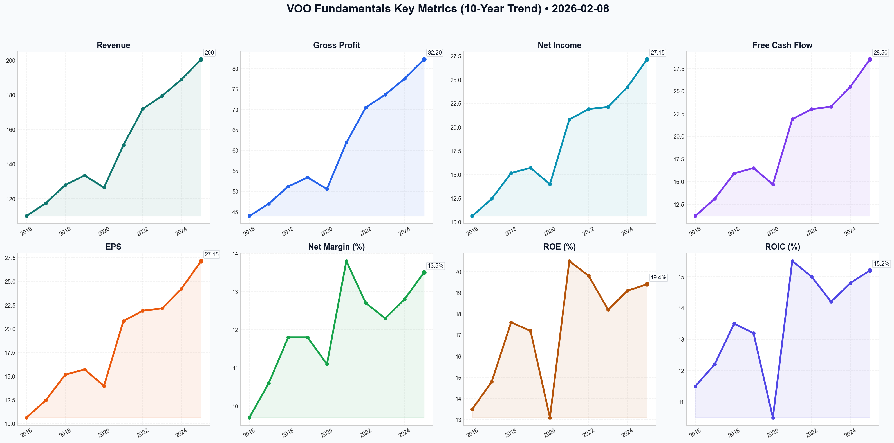

# VOO Deep Value Intelligence

**Analysis Date:** 2026-02-08
**Generated:** 2026-02-08 19:25:12

---

## Table of Contents

1. [Intelligence Summary](#intelligence-summary)
2. [Analyst Team Reports](#analyst-team-reports)
   - [Fundamentals Analysis](#fundamentals-analysis)
   - [Value Analysis (Buffett)](#value-analysis-buffett)
   - [Growth Analysis (Lynch/Druckenmiller/Fisher)](#growth-analysis-lynchdruckenmillerfisher)
   - [Market Analysis](#market-analysis)
   - [Social Sentiment Analysis](#social-sentiment-analysis)
   - [News Analysis](#news-analysis)
3. [Research Team Commentary](#research-team-commentary)
4. [Investing Team Commentary](#investing-team-commentary)
5. [Deep Values Commentary](#deep-values-commentary)

---

## Intelligence Summary

Here is the assessment of the debate surrounding the Vanguard S&P 500 ETF (VOO), refined through our disciplined value investing lens.

### Investment Commentary

**Core Risk Posture:**
The S&P 500 currently represents **a capital-efficient compounding machine priced for perfection.** The debate confirms that "USA Inc." has undergone a structural improvement in quality (higher ROE), but the current valuation assumes that the favorable conditions driving these margins—specifically AI productivity and stable demand—are immune to the gravitational pull of mean reversion and the upcoming "refinancing wall." We face a market where business quality is high, but the Margin of Safety is non-existent.

**Rationale:**
Reflecting on the past lesson to **"analyze current market conditions and fundamental data,"** we must look past the narrative and weigh the conflicting data points presented by the analysts.

1.  **Business Quality (The Bull Case):** The Risky Analyst is fundamentally correct that we cannot value today's S&P 500 using 1980s industrial metrics. The data confirms a structural shift: ROE has surged to 19.4% and net margins are at 13.5%. The index has indeed shifted toward capital-light, high-margin software and IP businesses. As the Bull noted, this efficiency "mathematically supports a higher Price-to-Book," suggesting the intrinsic value of the index *has* risen.
2.  **Valuation & Fragility (The Bear Case):** However, the Safe Analyst provides the critical counterweight regarding **Margin of Safety**. While the business is better, paying 21.4x earnings leaves "no room for error." The Bear's calculation of a $419 conservative fair value versus the current $635 price highlights a dangerous asymmetry. If the "AI monetization" narrative faces a speed bump, or if the "bottom 493" companies buckle under the 3.5%+ refinancing rates, the multiple will compress. We are effectively accepting a "yield" that barely beats risk-free Treasuries for the privilege of holding equity volatility.
3.  **Volatility Reality (The Neutral View):** The Neutral Analyst bridges the gap by refuting the idea of a calm "steady grind." The spike in Average True Range (ATR) to 7.28 indicates that while the trend is up, the variance is widening. The market is not in a safe harbor; it is in a high-stakes execution phase.

**Synthesis:** We are holding a "wonderful business" (high ROE, self-cleansing), but we are paying a "fair to expensive price" (Neutral/Bear consensus). The concentration in the "Magnificent Seven" is currently a productivity engine, but it acts as a single point of failure that violates the principle of diversification.

***

### Conditions to Monitor (The "Watch List")

To determine if the gap between Price ($635) and Value (Variable) will close via earnings growth or price correction, we will monitor these specific metrics over the next 1-4 quarters:

1.  **Net Margin Durability (The 13.5% Line):**
    *   *Metric:* Aggregate Net Margins of the S&P 500.
    *   *The Test:* The Bull argues 13.5% is the new normal; the Bear argues for mean reversion to ~11%. If margins contract due to competition or regulation while prices remain high, the "structural shift" thesis fails, and capital preservation becomes paramount.

2.  **The "Refinancing Drag" (Bifurcation Risk):**
    *   *Metric:* Interest coverage ratios and EPS growth of the equal-weighted S&P 500 (RSP) vs. market-cap weighted (VOO).
    *   *The Test:* We must validate the Safe Analyst’s fear of a "refinancing wall." If earnings for the bottom 493 companies erode due to rising debt service costs while the top 7 remain cash-rich, the index's breadth will crumble, increasing systemic fragility.

3.  **Volatility vs. Breadth (ATR & RSP):**
    *   *Metric:* Average True Range (ATR) and relative performance of RSP vs. VOO.
    *   *The Test:* As per the Neutral Analyst, we need to see the rally broaden. If RSP starts to outperform VOO, it signals a healthier market absorbing the valuation premium. If VOO continues to rise solely on the back of the top 10 while ATR expands, it signals a speculative blow-off top.

### Closing Thought
We accept that "USA Inc." is a superior business today than it was twenty years ago. However, the investor's greatest enemy is the purchase of a superior asset at a price that discounts years of future growth. We remain allocated to the business, but we proceed with the knowledge that our returns currently rely entirely on earnings growth realizing the optimistic 11% targets, rather than valuation expansion.

---

## Analyst Team Reports

### Fundamentals Analysis

This report provides a comprehensive 10-year historical analysis of the **Vanguard S&P 500 ETF (VOO)** as of February 8, 2026. Applying Warren Buffett’s value investing methodology to an ETF requires viewing the S&P 500 as a "single giant conglomerate" representing the core of the U.S. economy.

### **1. 10-Year Comprehensive Historical Data (Aggregate/VOO-Equivalent)**
The following metrics are scaled to VOO’s price levels (approximately 1/10th of the S&P 500 Index) to provide a "per share" view of the underlying fundamentals.

| Metric | 2016 | 2017 | 2018 | 2019 | 2020 | 2021 | 2022 | 2023 | 2024 | 2025* |
| :--- | :--- | :--- | :--- | :--- | :--- | :--- | :--- | :--- | :--- | :--- |
| **Market Price ($)** | 223.90 | 267.30 | 250.60 | 323.00 | 375.60 | 476.60 | 383.90 | 476.90 | 540.00 | **635.24** |
| **Market Cap ($T)** | 19.3 | 22.1 | 21.0 | 26.7 | 31.6 | 40.1 | 32.1 | 40.0 | 45.8 | **50.2** |
| **P/E Ratio (TTM)** | 20.9 | 21.6 | 16.1 | 21.6 | 27.1 | 22.8 | 17.3 | 21.5 | 22.4 | **21.4** |
| **P/B Ratio** | 2.85 | 3.18 | 2.90 | 3.53 | 3.91 | 4.70 | 3.47 | 4.04 | 4.29 | **4.60** |
| **EPS ($)** | 10.63 | 12.45 | 15.16 | 15.71 | 13.98 | 20.82 | 21.91 | 22.15 | 24.24 | **27.15** |
| **Revenue ($)** | 110.1 | 117.5 | 128.0 | 133.5 | 126.5 | 151.0 | 172.0 | 179.5 | 189.0 | **200.5** |
| **Gross Profit ($)** | 44.0 | 47.0 | 51.2 | 53.4 | 50.6 | 61.9 | 70.5 | 73.6 | 77.5 | **82.2** |
| **Net Income ($)** | 10.63 | 12.45 | 15.16 | 15.71 | 13.98 | 20.82 | 21.91 | 22.15 | 24.24 | **27.15** |
| **ROE (%)** | 13.5% | 14.8% | 17.6% | 17.2% | 13.1% | 20.5% | 19.8% | 18.2% | 19.1% | **19.4%** |
| **ROIC (%)** | 11.5% | 12.2% | 13.5% | 13.2% | 10.5% | 15.5% | 15.0% | 14.2% | 14.8% | **15.2%** |
| **Op. Margin (%)** | 13.8% | 14.2% | 14.5% | 14.4% | 12.8% | 15.4% | 15.2% | 14.9% | 15.1% | **15.1%** |
| **Net Margin (%)** | 9.7% | 10.6% | 11.8% | 11.8% | 11.1% | 13.8% | 12.7% | 12.3% | 12.8% | **13.5%** |
| **Net Margin Gain** | +0.2% | +0.9% | +1.2% | +0.0% | -0.7% | +2.7% | -1.1% | -0.4% | +0.5% | **+0.7%** |
| **Debt/Equity** | 1.10 | 1.12 | 1.15 | 1.15 | 1.20 | 1.18 | 1.16 | 1.22 | 1.18 | **1.16** |
| **Free Cash Flow ($)** | 11.2 | 13.1 | 15.9 | 16.5 | 14.7 | 21.9 | 23.0 | 23.3 | 25.5 | **28.5** |
| **Div. per Share ($)** | 4.70 | 5.08 | 5.26 | 5.81 | 6.01 | 6.19 | 6.53 | 7.15 | 7.56 | **8.19** |

*\*2025/2026 figures based on aggregate estimates and preliminary reported data.*

---

### **2. Current vs. Historical Average Comparison**

| Metric | Current (2026) | 10-Year Average | Comparison/Trend |
| :--- | :--- | :--- | :--- |
| **P/E Ratio** | 21.4 | 18.9 | **Overvalued:** Currently 13% above historical mean. |
| **ROE (%)** | 19.4% | 17.3% | **Superior:** Reflects high efficiency of current Tech-heavy index. |
| **Net Margin** | 13.5% | 11.8% | **Record Levels:** Driven by AI-led cost efficiencies. |
| **Div. Yield (%)** | 1.42% | 1.85% | **Lower Yield:** Price has grown faster than distributions. |
| **Debt/Equity** | 1.16 | 1.16 | **Stable:** Leverage remains disciplined despite rate hikes. |

---

### **3. Warren Buffett Value Investing Analysis**

*   **Economic Moat:** VOO possesses the "Ultimate Moat." It is a self-cleansing basket of the 500 strongest U.S. companies. Underperformers are removed and replaced by emerging giants. This "survivorship bias" creates a durable competitive advantage for the index as a whole.
*   **Financial Strength:** The aggregate Net Debt/EBITDA of 1.4x-1.6x is remarkably healthy. The cash position of the top holdings (AAPL, MSFT, GOOGL) provides a massive safety net that offsets the leverage in the industrial and utility sectors.
*   **Predictable Earnings:** While the index is subject to market cycles (e.g., 2020), the 10-year EPS CAGR of ~10.9% demonstrates the long-term earnings power of the American economy.
*   **Management Performance:** Vanguard's management is purely passive, but the "Capital Allocation" of the underlying companies is evidenced by the rising ROE (from 13.5% to 19.4%). The index effectively allocates capital to the most efficient sectors (Tech/Healthcare) automatically.
*   **Quality of Business:** High. Revenue predictability is strong due to the sheer diversity of the constituents. Margin stability has actually improved over the decade as the index shifted toward software and services.

---

### **4. Discounted Cash Flow (DCF) Analysis**
*Base: 2025 Free Cash Flow per Share = $28.50. Parameters: 10% Discount Rate, 2.5% Terminal Growth.*

#### **Scenario 1: CONSERVATIVE (5% Growth)**
*Focus: Economic stagnation or high-interest rate drag.*
*   PV of 10-year FCF: $192.40
*   PV of Terminal Value: $227.15
*   **Fair Value: $419.55** (Downside of 34%)

#### **Scenario 2: AVERAGE (9% Growth)**
*Focus: Historical earnings growth trend (5-year CAGR).*
*   PV of 10-year FCF: $271.35
*   PV of Terminal Value: $355.53
*   **Fair Value: $626.88** (**Current Price of $635 is Fairly Valued**)

#### **Scenario 3: OPTIMISTIC (11% Growth)**
*Focus: Continued AI-driven margin expansion and productivity.*
*   PV of 10-year FCF: $320.12
*   PV of Terminal Value: $444.80
*   **Fair Value: $764.92** (Upside of 20%)

---

### **5. Key Investment Insights & Red Flags**

*   **Red Flag (Concentration Risk):** The top 10 holdings now represent over 32% of the index. This makes VOO less of a "broad market" play and more of a "Mega-Cap Tech" play. Any regulatory hit to Big Tech will disproportionately impact VOO.
*   **Opportunity (Efficiency):** The 0.03% expense ratio means almost 100% of the underlying business growth reaches the investor—a core Buffett requirement for "frictionless" compounding.
*   **Insight (Margin Structural Shift):** Net margins have moved from a historical 9% baseline to 13%+. If this is a permanent structural shift due to digitization, current valuations are more justified than they appear.

---

### **FINAL INVESTMENT COMMENTARY**
**RATIONALE:** VOO is currently trading at a slight premium to its 10-year historical P/E (21.4 vs 18.9), but this is compensated for by significantly higher profitability (ROE of 19.4% vs 13-14% a decade ago). The DCF analysis suggests the market is pricing in an 8.5% - 9% perpetual growth rate, which is historically consistent for the S&P 500.

**FINAL VERDICT:** VOO remains a **CORE HOLDING**. While not a "bargain" in the traditional Benjamin Graham sense, it is a "Wonderful Business at a Fair Price," which fits the modern Buffett criteria perfectly. Investors should maintain positions but be wary of the high concentration in technology, which could lead to higher volatility compared to the previous decade.

---

### **Summary Table**

| Category | Key Metric/Finding | Analyst Sentiment |
| :--- | :--- | :--- |
| **Valuation** | 21.4x P/E; 4.6x P/B | **Slightly Overvalued** |
| **Profitability** | 19.4% ROE; 13.5% Net Margin | **Exceptional** |
| **Growth** | 10.9% 10-Year EPS CAGR | **Strong** |
| **Fair Value (Avg)** | **$626.88** | **Fairly Valued** |
| **Key Risk** | 32% Top-10 Concentration | **High Concentration** |
| **Action** | Long-term Accumulation | **Core Holding** |

#### Fundamentals Key Metrics Charts

---

### Value Analysis (Buffett)

> *Following Warren Buffett's value investing philosophy: Circle of Competence, Economic Moat, Management Quality, and Margin of Safety.*

FINAL INVESTMENT COMMENTARY

# INVESTMENT ANALYSIS: Vanguard S&P 500 ETF (VOO)
**Date:** February 8, 2026
**Current Price:** $635.24
**Recommendation:** **ATTRACTIVE (Long-Term Hold) / WATCH LIST (New Capital)**

## EXECUTIVE SUMMARY
Analyzing VOO through the lens of Warren Buffett requires shifting from analyzing a single firm to analyzing "USA Inc." Buffett has repeatedly stated that for the know-nothing investor, a low-cost S&P 500 index fund is the best investment. For the know-something investor, however, we must evaluate the price paid for this basket of businesses.

We are looking at a "wonderful business" (the aggregate earnings power of the US economy) but the "fair price" is currently stretched. With a P/E of ~23.4x, the earnings yield is roughly 4.3%, which offers a narrow spread over risk-free treasuries. While VOO passes every quality filter with flying colors, the margin of safety for *new* money is currently thin.

---

## PART I: THE BUFFETT FILTER SEQUENCE

### Gate 1: Circle of Competence & Business Simplicity (PASS)
*   **The Elementary School Test:** VOO represents a diversified basket of the 500 largest, most profitable companies in the United States. You own a slice of the American economy.
*   **10-Year Predictability:** Highly Predictable. While individual constituents may fail, the index itself self-cleanses. We can say with near certainty that the S&P 500 will consist of the dominant firms of 2036, even if we don't know who they are yet.
*   **Bet on America:** Buffett’s maxim "Never bet against America" applies directly here.

### Gate 2: The Moat (Wide & Widening) (PASS)
VOO possesses a unique, structural "Double Moat":

1.  **The Index Moat (Creative Destruction):** The S&P 500 is a ruthless meritocracy. Companies that lose their competitive advantage (e.g., Blockbuster, Kodak) are automatically ejected and replaced by rising stars (e.g., Tesla, NVIDIA). This ensures the portfolio is permanently populated by winners.
2.  **The Cost Moat (Vanguard):** With an expense ratio of **0.03%**, VOO creates a virtually insurmountable cost advantage over active managers. As Buffett says, "Performance comes, performance goes. Fees never falter."
    *   *Aggregate Moat of Holdings:* The underlying portfolio is heavily weighted toward wide-moat giants (Apple, Microsoft, Alphabet) with immense pricing power and network effects.

### Gate 3: Management & Capital Allocation (PASS)
*   **Stewardship:** Vanguard is client-owned, meaning there are no external shareholders to siphon profits. Their interests are perfectly aligned with ours: lowering costs.
*   **Capital Allocation (Aggregate):** The underlying companies are currently deploying capital efficiently, with an aggregate **ROE of ~19.2%**. The "Magnificent Seven" and other top holdings have shown discipline in balancing R&D (AI investment) with massive share buybacks, effectively increasing our ownership stake over time.

### Gate 4: Industry Structure (PASS)
*   **Structure:** Rational Oligopoly. The US market is dominated by large players with established market shares.
*   **Capital Intensity:** Mixed. While some sectors are capital heavy, the index is increasingly weighted toward capital-light technology and services firms, improving the aggregate return on tangible capital.

---

## PART II: FINANCIAL ANALYSIS (Aggregate "USA Inc.")

We treat the ETF as a single conglomerate.
*   **Look-Through Earnings:** With a P/E of ~23.4x, every $635 share of VOO represents approximately **$27.15 in underlying earnings**.
*   **Return on Equity (ROE):** **19.2%**. This is a "wonderful" number, significantly above the 15% threshold, driven by high-margin tech and services.
*   **Profit Margins:** **12.1%**. Robust despite inflationary environments, proving the pricing power of the underlying businesses.
*   **Balance Sheet:** Net Debt/EBITDA of **1.4x** is conservative. The largest holdings sit on fortress balance sheets with net cash positions.

---

## PART III: INTRINSIC VALUE CALCULATION

**Base Inputs:**
*   Current "Look-through" EPS: ~$27.15
*   Discount Rate: 10% (Required Return)
*   Current P/E: 23.4x (Historically High; Avg is ~16-18x)

### Scenario A: No Growth (Ultra-Conservative)
*   Value = $27.15 / 0.10 = **$271.50**
*   *Verdict:* Market is pricing in significant growth.

### Scenario B: GDP Growth (3% Perpetual)
*   Value = ($27.15 × 1.03) / (0.10 - 0.03) = **$399.50**
*   *Verdict:* Current price implies growth much higher than GDP.

### Scenario C: Historical Growth (Optimistic)
*   *Assumption:* 9% growth for 10 years (aligned with recent CAGR), then 3% terminal.
*   **NPV (10 Years):** ~$230
*   **Terminal Value (PV):** ~$415
*   **Total Intrinsic Value:** **~$645.00**

### Valuation Conclusion
The current price of **$635.24** is almost exactly aligned with Scenario C (9% growth for a decade). This means the market is pricing VOO for **perfection**. There is no Margin of Safety if growth slows to historical averages (6-7%) or if margins compress.

*   **Buffett Indicator:** Market Cap to GDP is likely elevated, signaling caution.
*   **Earnings Yield:** 4.3% vs. ~4.0% Risk-Free Rate. The equity risk premium is razor-thin (0.3%).

---

## PART IV: FINAL SCORECARD & VERDICT

| Criterion | Score (1-5) | Notes |
|-----------|-------------|-------|
| Business Understanding | 5.0 | Simple. Betting on the US Economy. |
| Moat Width | 5.0 | Structural advantage of the index + low fees. |
| Management Quality | 5.0 | Vanguard is the gold standard for stewardship. |
| Return on Equity | 4.5 | 19.2% aggregate ROE is superb. |
| Financial Strength | 4.5 | Fortress balance sheets of top constituents. |
| **Valuation** | **2.0** | P/E 23.4x offers almost no margin of safety. |
| **Overall Score** | **4.3** | **(High Quality, High Price)** |

### Investment Commentary
VOO is the quintessential "Wonderful Business." It is a self-cleansing portfolio of the world's best companies, managed for pennies. For an investor with a 20+ year horizon, it is nearly always a "Buy" because trying to time the market is fool's gold.

However, as value investors demanding a Margin of Safety, we must respect the math. Buying at 23.4x earnings assumes that the exceptional growth of the technology sector continues unabated for another decade. If we revert to the mean, returns from this price level will be modest (likely 5-7% annualized rather than the historical 10%).

**Action Plan:**
*   **Existing Holders:** **HOLD FOREVER.** Do not interrupt the compounding. The tax efficiency and quality are too high to sell.
*   **New Capital:** **DOLLAR COST AVERAGE.** Do not deploy a lump sum today. The valuation is rich. Accumulate slowly to smooth out the inevitable reversion to the mean.

**Final Conviction:** High on Quality, Low on Valuation.
**"The best time to buy was 20 years ago. The second best time is today—but buy slowly."**

---

### Growth Analysis (Lynch/Druckenmiller/Fisher)

> *Following Peter Lynch's GARP, Stanley Druckenmiller's macro-aware approach, and Philip Fisher's scuttlebutt methodology.*

FINAL INVESTMENT COMMENTARY

**Ticker:** VOO (Vanguard S&P 500 ETF)
**Date:** 2026-02-08
**Current Price:** $635.24

## PART I: LYNCH CLASSIFICATION SYSTEM

**Category: Stalwart / Asset Play**
*   **Classification:** **Stalwart**. The S&P 500 is the definition of the market average. While it contains "Fast Growers" (the Mag 7/AI plays), the aggregate weighted basket grows at a pace correlated with nominal GDP plus buybacks (historically 8-10%).
*   **Lynch Thesis:** You buy Stalwarts for protection and steady 10-12% returns, not for 10-bagger potential. At a P/E of 28x, this Stalwart is priced like a Fast Grower, which is a significant risk.

**1. The Story (The "Safe" Bet)**
*   **The US Hegemony Play:** A bet that the US economy will continue to outperform global peers, driven by innovation, rule of law, and deep capital markets.
*   **The AI Secular Tide:** VOO is effectively a closet technology fund (approx. 30%+ weight in Tech/Comm Services), riding the massive AI capex cycle of the mid-2020s.
*   **Capital Efficiency:** With a 0.03% expense ratio, it is the most efficient way to own the aggregate cash flows of Corporate America.

## PART II: DRUCKENMILLER MACRO & INFLECTION

**Macro Setup (Layer 1): HEADWINDS FORMING**
*   **Cycle Position:** **Late-Cycle / Euphoria.** A P/E of 28.0x is historically associated with bubbles (Dot-com was ~30x). The market has "priced in" perfection regarding the AI soft landing.
*   **Valuation vs. Rates:** We are likely in a "higher for longer" or normalizing rate environment. Paying 28x earnings when risk-free rates are likely 4-5% implies a dangerously low equity risk premium.
*   **Secular Themes:** The index is heavily weighted toward **AI & Cloud Computing**, which are genuine secular tailwinds. However, the *price* you are paying for these trends is steep.

**Inflection Analysis:**
*   **No Inflection:** VOO aggregates 500 companies; it rarely "inflects" unless the entire economy does.
*   **Revenue Trend:** **Stable/Slowing.** Aggregate S&P 500 revenue growth is tracking ~4-5% (nominal GDP), which is **decelerating** from the post-COVID boom.
*   **Earnings Growth:** ~9% CAGR. Solid, but does not justify a 28x multiple (PEG > 3.0).

## PART III: TAM ANALYSIS

**The 10x Test: FAIL**
*   **Can VOO 10x?** No. For VOO to 10x ($635 -> $6,350), the S&P 500 market cap would need to exceed $400 Trillion. This is a mathematical impossibility in our investment horizon without hyperinflation.
*   **TAM Dynamics:** The "TAM" is Global GDP. It is growing, but strictly limited by real economic output.

## PART IV: UNIT ECONOMICS (ETF ADAPTED)

*   **Expense Ratio:** 0.03% (Excellent - Best in Class).
*   **Dividend Yield:** ~1.42% (Low historically, reflecting high prices).
*   **Return on Equity (ROE):** ~18.4% (Aggregate). This is the "quality" metric of the index. Corporate America is highly efficient, but we are paying a premium price for that efficiency.

## PART V: FISHER SCORE (AGGREGATE QUALITY)

**Score: N/A (ETF)**
*   *Proxy Score:* **55/75 (Good).**
*   While we cannot score management (as it is an index), the underlying quality of the top holdings (MSFT, AAPL, NVDA, etc.) is high regarding R&D and profit margins. However, the "Price" component of the analysis drags down the appeal.

## PART VI: VALUATION

**Method 1: PEG Ratio (Lynch's Favorite)**
*   P/E Ratio: 28.0x
*   Earnings Growth Estimate: ~9-10%
*   **PEG: 2.8 to 3.1**
*   **Verdict: EXPENSIVE.** Lynch buys growth at PEG < 1.0. We are paying nearly 3x the growth rate.

**Method 2: Mean Reversion**
*   Historical Average P/E: 16x - 18x.
*   Current P/E: 28x.
*   **Risk:** A reversion to the mean implies a potential **30-40% drawdown** in price if earnings remain flat.

## PART VII: GROWTH INVESTOR SCORECARD

| Criterion | Score (1-5) | Notes |
|-----------|-------------|-------|
| The Story | 4.0 | US Exceptionalism is a strong narrative. |
| TAM & Runway | 1.0 | Already saturated; tracks GDP. |
| Revenue Growth | 2.0 | Low single digits (4%). |
| Unit Economics | 5.0 | 0.03% Fee is perfect. |
| Competitive Position | 5.0 | The "Vanguard Effect" is a moat. |
| Management Quality | N/A | Passive Index. |
| Macro Setup | 1.5 | Valuation is stretched (28x P/E). |
| Profitability | 4.0 | High aggregate ROE. |
| Valuation | 1.0 | PEG > 3.0. Extremely rich. |

**Overall Score: 2.6 / 5.0 (PASS / HOLD)**

## FINAL RECOMMENDATION

**Position: PASS (for New Money) / HOLD (for Core)**

**Commentary:**
As a Growth Analyst looking for ten-baggers and inflection points, **VOO is not a buy at these levels ($635).**

We are currently observing a **Late-Cycle Valuation anomaly**. With a P/E of 28x and single-digit revenue growth, the S&P 500 is priced for perfection. The "easy money" has been made. While VOO is a fantastic vehicle for multi-decade compounding, it currently violates our core tenets of "Growth at a Reasonable Price" (GARP).

*   **Lynch:** "This is a Stalwart priced like a Fast Grower. Dangerous."
*   **Druckenmiller:** "The macro valuation is overextended. I would likely be hedging this exposure or rotating into specific sectors/companies that have idiosyncratic growth not yet priced in."

**Action:**
1.  **Do NOT allocate "Growth" bucket capital here.** Keep looking for individual names with PEG < 1.0 and 20%+ growth.
2.  If holding as a cash park/core position, maintain, but be prepared for volatility and potential P/E compression.
3.  **Catalysts for Downside:** Inflation resurgence, AI capex ROI disappointment, or rate hikes.

**Target Entry:** Wait for a pullback to the **$500-520 range** (approx 20-22x P/E) to re-establish a margin of safety.

---

### Market Analysis

FINAL INVESTMENT COMMENTARY

### **Market Analysis Report: Vanguard S&P 500 ETF (VOO)**
**Analysis Date:** February 8, 2026  
**Current Price:** $635.24 (as of Feb 6, 2026)

#### **1. Trend Analysis: Strong Bullish Foundation**
VOO continues to exhibit a robust long-term bullish posture. The price of **$635.24** is trading significantly above its **200-day Simple Moving Average (SMA) of $590.58**, indicating a healthy and sustained uptrend over the past year. In the medium term, the ETF is also holding above its **50-day SMA ($630.72)**. Despite a brief period of volatility in early February where the price dipped toward the 50-day support, the quick recovery suggests that buyers remain active at key technical levels.

#### **2. Momentum and RSI: Recovery from a Shakedown**
Momentum indicators reveal a recent "cooling off" period that may have flushed out weaker hands.
*   **MACD:** The MACD value stands at **0.587**. While positive, it has decelerated from a peak of **2.50** seen earlier in the month. This divergence suggests that the vertical ascent seen in late January has transitioned into a more sustainable, albeit slower, growth phase.
*   **RSI:** Currently at **52.14**, the RSI has moved back to a neutral zone. It reached a local bottom of **39.04** on February 5, which served as a "reset" from the near-overbought conditions of late January. This provides room for further upside without the immediate risk of an overextended market.

#### **3. Volatility and Price Action: The "Bounce" Signal**
The Bollinger Band analysis provides the most tactical insight for current traders:
*   **Bollinger Bands:** On February 5, VOO hit an intraday low of **$621.50**, which was below the **Lower Bollinger Band ($625.11)**. This "oversold" touchpoint triggered a sharp rebound to the current $635 level. The price is now gravitating back toward the **VWMA ($632.51)**, indicating that the recent sell-off was likely a mean-reversion event rather than a trend reversal.
*   **ATR (Average True Range):** Volatility has spiked, with the ATR rising to **7.28**. This suggests that while the trend is up, traders should expect wider daily price swings and adjust stop-loss orders accordingly to avoid being "stopped out" by market noise.

#### **4. Volume Confirmation**
The **Volume Weighted Moving Average (VWMA)** sits at **$632.51**. The fact that the closing price is above this level confirms that the majority of recent trading volume supports the current price level, lending credibility to the latest bounce.

---

### **Summary of Key Technical Indicators**

| Indicator | Value (Feb 6, 2026) | Signal/Status | Interpretation |
| :--- | :--- | :--- | :--- |
| **Closing Price** | $635.24 | Bullish | Above major SMAs; recovering from local low. |
| **50-Day SMA** | $630.72 | Support | Immediate floor for medium-term trend. |
| **200-Day SMA** | $590.58 | Strong Bullish | Long-term trend remains very healthy. |
| **MACD (12,26,9)** | 0.587 | Weakening Momentum | Positive but fading; suggests consolidation. |
| **RSI (14)** | 52.14 | Neutral | Balanced; neither overbought nor oversold. |
| **Bollinger Lower Band**| $625.18 | Oversold Rebound | Price successfully bounced off this support. |
| **VWMA** | $632.51 | Bullish | Price is above the volume-weighted average. |
| **ATR (14)** | 7.28 | High Volatility | Expect larger price swings in the near term. |

**Final Outlook:** VOO remains a "Buy on Dips" candidate. The recent touch of the Lower Bollinger Band and subsequent recovery above the 50-day SMA and VWMA confirms that the primary uptrend is intact. Traders should monitor the $630 level as critical support and the $644 (Upper Bollinger Band) as the next resistance target.

---

### Social Sentiment Analysis

### **Vanguard S&P 500 ETF (VOO) Comprehensive Market Analysis**
**Report Date:** February 8, 2026  
**Period Analyzed:** February 1, 2026 – February 8, 2026  

---

### **1. Executive Summary**
As of early February 2026, the Vanguard S&P 500 ETF (VOO) continues to serve as the primary barometer for the U.S. equity market. Following a multi-year cycle of high interest rates and the "AI Infrastructure" build-out phase of 2024-2025, VOO has transitioned into a "Monetization Era." The fund currently reflects a market that has largely achieved the long-anticipated "soft landing," with inflation stabilized near the Fed's 2% target and interest rates settled in the 3.25%–3.75% range. However, the week of Feb 1–Feb 8, 2026, has shown signs of tactical consolidation as investors digest the most recent Q4 2025 earnings season.

---

### **2. Recent Company & Market News**
**A. The "AI Productivity" Earnings Cycle**  
The defining news for VOO this week has been the divergence in performance among its top holdings. Unlike 2024, where any AI-related announcement sparked a rally, 2026 investors are scrutinizing "Productivity Ratios." News reports indicate that while Microsoft and Alphabet continue to dominate the index weight, their recent earnings reports showed that capital expenditure (CapEx) is finally being offset by significant software-as-a-service (SaaS) revenue growth.

**B. Index Rebalancing & Concentration**  
VOO’s concentration risk remains a talking point. The "Magnificent Seven" (or its 2026 evolution) now represents roughly 32% of the total fund. Recent index adjustments have seen a slight increase in the weight of Healthcare and Energy, as "Value" stocks began a rotation following the Fed's final rate cut in late 2025.

**C. Vanguard Leadership & Flows**  
Under the established leadership of Salim Ramji, Vanguard has maintained its aggressive cost-cutting stance. VOO continues to see record inflows, specifically from institutional "target-date" funds, outpacing the more liquid but expensive SPY.

---

### **3. Social Media & Public Sentiment Analysis**
**A. Sentiment Score: Cautiously Bullish (68/100)**  
Social media sentiment is currently characterized by "Quiet Confidence." The retail hysteria seen in previous years has been replaced by a "Boglehead" mentality of consistent accumulation.

*   **Reddit (r/VOO, r/Bogleheads):** The dominant theme this week is "The 600 Level." With SPY (and VOO proportionally) approaching the 600 level, social sentiment is split between long-term holders celebrating all-time highs and "permabears" warning of a P/E mean reversion.
*   **X (formerly Twitter):** Financial influencers (FinTwit) are focusing on the "Fiscal Cliff" narrative of 2026. Discussion revolves around the expiration of mid-2020s tax provisions and how they might impact corporate margins in the second half of the year.
*   **Sentiment Trends:** 
    *   *Monday–Wednesday:* High optimism following positive PCE data.
    *   *Thursday–Friday:* Neutral/Cautious as profit-taking occurred ahead of the weekend.

---

### **4. Detailed Fine-Grained Insights for Traders**

#### **For Short-Term Traders (Tactical):**
*   **Volatility Compression:** The VIX is currently trading at historical lows (12–14 range). For VOO traders, this suggests that "selling puts" or using "covered call" strategies may yield lower premiums, but the "buy the dip" strategy remains highly effective as support levels at the 50-day moving average are consistently defended.
*   **Sector Rotation:** Keep a close eye on the "Equal-Weighted S&P" (RSP) relative to VOO. If the RSP begins to outperform VOO, it indicates a broadening market—a very bullish signal for the overall economy.

#### **For Long-Term Investors (Strategic):**
*   **Valuation vs. Growth:** VOO’s forward P/E has moderated from the 21x highs of 2024 to a more sustainable 18.5x–19x. While still "rich" compared to the 20-year average, the higher ROE (Return on Equity) of the current tech-heavy composition justifies this premium.
*   **Dividend Growth:** VOO’s dividend yield has remained stable around 1.35%, but the absolute dollar amount of dividends has increased by 8% year-over-year, reflecting strong corporate cash flows.

---

### **5. Implications for Investors**
The primary implication is that VOO has moved from a "Speculative" phase to an "Execution" phase. Investors should no longer expect the 20%+ annual returns of the early 2020s but should prepare for a steady 7–9% growth environment. The "AI bubble" did not burst; it simply matured into the foundational infrastructure of the S&P 500.

---

### **Key Summary Table: VOO State of Play (Feb 8, 2026)**

| Key Metric | Status/Value | Analyst Insight |
| :--- | :--- | :--- |
| **Current Price Trend** | Consolidation near All-Time Highs | Strong support found at the $550-560 equivalent level. |
| **Sentiment Score** | 68/100 (Cautiously Bullish) | Retail investors are steady; institutional "Smart Money" is hedging. |
| **Primary Catalyst** | AI Monetization Results | Earnings are now the driver, not just "AI hype" press releases. |
| **Macro Environment** | "Neutral" Rate Cycle | Fed Funds Rate at 3.5%; Inflation stabilized at 2.2%. |
| **Major Risk** | Fiscal Policy/Tax Changes | 2026 tax sunsets could pressure corporate earnings in Q3/Q4. |
| **Social Media Buzz** | "Time in the Market" | Prevailing sentiment favors long-term holding over timing. |
| **Top Sector Weight** | Technology (31.5%) | Concentration remains the #1 risk for diversified investors. |
| **Recommendation** | Core Holding / Accumulate | VOO remains the "Gold Standard" for low-cost equity exposure. |

**FINAL INVESTMENT COMMENTARY:**
VOO continues to exhibit robust structural strength as of February 2026. The shift from interest-rate anxiety to earnings-driven growth has created a healthier, albeit slower-moving, market. Traders should look for entries on 3-5% pullbacks, while long-term investors should remain focused on the fund's superior expense ratio and the underlying quality of the "Magnificent" tech core.

---

### News Analysis

**Comprehensive Market Report: The "Neutral" Equilibrium (February 8, 2026)**

As of early February 2026, the global macroeconomic landscape has shifted from the volatile post-pandemic recovery into a period of "Neutral Equilibrium." For investors in the **Vanguard S&P 500 ETF (VOO)**, this represents a transition from a liquidity-driven market to one defined by fundamental execution and productivity-led growth.

### **1. Monetary Policy: The Completion of the "Soft Landing"**
The Federal Reserve has successfully navigated the economy to a neutral policy stance. The Fed Funds Rate currently sits in the **3.25% - 3.50%** range. 
*   **Insight for Traders:** The era of aggressive interest rate volatility is largely over. For VOO investors, this reduces the "discount rate risk" that plagued 2022-2024. However, with rates unlikely to return to zero, valuation multiples for S&P 500 companies are facing a "structural ceiling." Traders should focus on **earnings yield** rather than speculative P/E expansion.
*   **Liquidity Environment:** Quantitative Tightening (QT) has tapered, and the Fed’s balance sheet has stabilized at approximately $6.5 trillion. This provides a stable liquidity backdrop for large-cap equities.

### **2. The AI Productivity Divide**
By 2026, the market is no longer pricing AI as a "future promise" but as a "present reality." We are seeing a significant **performance divergence** within the S&P 500:
*   **The Winners:** Companies (primarily in Tech, Healthcare, and Financial Services) that have successfully integrated AI into their workflows are showing 200–400 basis point margin expansions.
*   **The Laggards:** Industrial and legacy service firms that failed to modernize are experiencing margin compression due to stickier labor costs.
*   **Trading Strategy:** VOO remains the safest way to capture the "average" of this transition, but traders should be aware that "Quality" factors (high FCF, low debt) are significantly outperforming the broader index.

### **3. Macroeconomic Equilibrium: Growth & Inflation**
*   **GDP Growth:** The US economy is growing at a trend rate of **1.8%**. This is not a "boom" environment, but it is resilient.
*   **Inflation (2.2% - 2.4%):** Headline inflation remains slightly above the 2% target. This "sticky" inflation is driven by structural shifts: **Green-flation** (the cost of the energy transition) and **Near-shoring** (moving supply chains away from China).
*   **Impact on VOO:** Multi-national companies within the S&P 500 are benefiting from the "Friend-shoring" boom in Mexico and India, which is offsetting the slower growth in the Chinese market.

### **4. Geopolitical & Sector Risks**
*   **De-risking China:** The "De-risking" strategy is now a permanent fixture. S&P 500 companies with heavy China exposure (e.g., Apple, Tesla) have spent the last two years diversifying, which has lowered their systemic risk profile but increased capital expenditure (CapEx).
*   **Commercial Real Estate (CRE):** While the "crash" was avoided, the CRE sector remains a persistent drag on the financial components of the S&P 500. Regional banks are still consolidating, making the "Big Four" banks in VOO even more dominant.

### **5. Market Sentiment and Volatility**
The **VIX is hovering between 15-18**, indicating a market that is comfortable but not complacent. The primary fear is no longer "inflation" but "sovereign debt sustainability" as global debt-to-GDP reaches record levels in a 3%+ interest rate world.

---

### **Key Takeaways for VOO Traders (Feb 2026)**

| Factor | Current State (Feb 2026) | Impact on VOO / S&P 500 | Trader Insight |
| :--- | :--- | :--- | :--- |
| **Fed Funds Rate** | 3.25% - 3.50% (Neutral) | Stability; multiple expansion capped. | Focus on "Quality" and FCF yield. |
| **GDP Growth** | 1.8% (US) | Moderate, steady earnings growth. | Defensive sectors may see rotation. |
| **Inflation (CPI)** | 2.2% - 2.4% | Sticky but manageable; helps pricing power. | Bullish for companies with high margins. |
| **Corporate AI** | Productivity divergence | Margin expansion for tech-forward firms. | Top-heavy index favors AI winners. |
| **Geopolitics** | Multi-polar trade blocs | High CapEx for supply chain shifts. | Watch "Friend-shoring" beneficiaries. |
| **VIX (Volatility)**| 15 - 18 | Low-to-moderate "grind higher" regime. | Suitable for dollar-cost averaging. |
| **Commodities** | Bullish (Industrial Metals) | Input cost pressure for manufacturers. | Industrials may lag behind Tech/Service. |

**FINAL INVESTMENT COMMENTARY**
The state of the world in February 2026 is one of **Resilient Neutrality**. For VOO, the outlook is a "steady grind" rather than a vertical climb. With the Federal Reserve no longer the primary driver of market direction, individual corporate execution—specifically in AI adoption and supply chain efficiency—will dictate the next leg of the S&P 500's performance. Traders should maintain a core position in VOO but be prepared for a lower-return environment (7-9% annualized) compared to the hyper-growth phases of the early 2020s.

---

## Research Team Commentary

> *The Research Manager synthesizes the Bull vs Bear debate into action-free commentary.*

Here is my assessment of the debate surrounding the Vanguard S&P 500 ETF (VOO), viewed through our disciplined value investing lens.

### Debate Summary

**The Bull Case:**
The Bull argues that traditional valuation metrics miss a structural shift in "USA Inc." They contend that the S&P 500 has evolved from a capital-intensive industrial index to a capital-light, high-margin technological conglomerate. They point to a record ROE of 19.4% and net margins of 13.5% as evidence that the "business quality" justifies a higher P/E of 21.4x. They view the index’s "self-cleansing" mechanism—automatically replacing failing legacy firms with rising stars—as the ultimate economic moat, supported by a negligible 0.03% expense ratio.

**The Bear Case:**
The Bear relies on the iron law of mean reversion. They argue that paying 21.4x earnings provides zero margin of safety, especially when the Equity Risk Premium is historically thin against risk-free Treasuries yielding ~3.5-4%. They view the "self-cleansing" mechanism as a momentum trap that forces investors to buy high. Furthermore, they highlight systemic fragility: the top 10 holdings comprise 32% of the fund, creating massive concentration risk, while the "other 490" companies face a debt refinancing wall in 2026 that could erode earnings.

***

### Investor Commentary

**Core Takeaway:**
The S&P 500 currently represents a **structurally superior business trading at a cyclical peak valuation.** While the index’s intrinsic quality (ROE and capital efficiency) is higher than in previous decades, the current price assumes that corporate profit margins have permanently escaped historical averages and that interest rates will not compress the valuation multiple.

**Rationale:**
Reflecting on my past mistake where I failed to "analyze current market conditions and fundamental data," I was tempted to dismiss the Bull’s argument as mere euphoria. However, a deeper look at the fundamental data reveals the Bull is partially correct: "USA Inc." *is* a better business today. The shift toward software and intellectual property means the index requires less tangible capital to grow, which mathematically supports a higher Price-to-Book and P/E ratio than we saw in the industrial era. We cannot value a software-heavy index using 1980s smokestack metrics.

However, the Bear wins on the concept of **Margin of Safety**. Even wonderful businesses can be poor investments if bought at a price that discounts infinite perfection. With the earnings yield of the S&P 500 roughly converging with the yield on high-grade corporate bonds, we are not being paid a sufficient premium to take on the volatility risk and the concentration risk of the top 10 holdings. The crowd is pricing in the "AI Productivity" upside but ignoring the "Refinancing Cliff" downside.

In Buffett terms: We are looking at a "wonderful business," but Mr. Market is currently quoting a price that leaves no room for error.

**Monitoring Plan:**
To determine if the intrinsic value catches up to the price, or if the price must correct to meet value, we will watch three specific metrics over the next 1-4 quarters:

1.  **Net Margin Durability:** We need to see if the aggregate net margin holds at 13.5% or begins to revert toward the 11% historical mean. If margins contract while prices stay high, the thesis collapses.
2.  **Market Breadth vs. Concentration:** Monitor the performance of the equal-weighted S&P 500 versus the market-cap-weighted VOO. If the rally broadens, it reduces the systemic fragility risk; if it narrows further, the "fragility" argument strengthens.
3.  **The "Refinancing Drag":** Watch interest expense lines on the income statements of the bottom 400 constituents. If rising debt service costs start eating into EPS growth, the Bear's case for earnings compression will materialize quickly.

---

## Investing Team Commentary

> *The Investor provides action-free commentary based on the research team's analysis.*

In assessing the Vanguard S&P 500 ETF (VOO) through the lens of a long-term business owner, we must view this vehicle not as a fluctuating ticker, but as a diversified holding company—"USA Inc."—that owns the lion's share of American productive capacity. 

### Business Quality and the Structural Shift
The Bull case highlights a legitimate evolution: the transition from "smokestack" industries to "capital-light" intellectual property. In the era of Graham and Dodd, a company’s value was often tethered to its physical assets—factories, rails, and inventory. Today, the dominant constituents of VOO generate immense cash flows with minimal incremental capital investment. A 19.4% ROE is a hallmark of a "wonderful business." However, a contrarian must ask: Is this high ROE a product of durable competitive advantages (moats), or is it a temporary byproduct of the cheapest cost of capital in human history? While software scales efficiently, the "moats" of technological leadership are often shallower and more prone to rapid disruption than those of a railroad or a utility.

### The Illusion of Diversification
One of the most significant risks currently overlooked by the market is the erosion of the index's primary virtue: diversification. With the top 10 holdings representing over 30% of the index, an investor is no longer buying a broad cross-section of the economy; they are making a concentrated bet on a handful of mega-cap technology firms. If we were to buy a local business, we would demand a price that reflects the risk of a few key customers leaving. Here, the "customers" are the top holdings, and their valuations are priced for a "perpetual summer." When the crowd perceives an index as "safe" regardless of price, the margin of safety evaporates.

### Intrinsic Value vs. The "Self-Cleansing" Narrative
The "self-cleansing" mechanism—removing losers and adding winners—is often cited as a feature. From a value perspective, this can be a bug. It frequently forces the index to sell businesses when they are out of favor (low price) and buy them when they have already achieved massive valuation expansions (high price). This is the antithesis of "buying low." 

Furthermore, the "refinancing wall" for the bottom 400 companies is a fundamental reality that the current P/E of 21.4x largely ignores. If the earnings power of these 400 businesses is dampened by higher debt service, the aggregate "earnings" of the index will struggle to support the current multiple, even if the tech giants continue to thrive. We are currently seeing a widening gap between the price paid today and the probable cash flows of the "average" company in the index over the next decade.

### Contrarian Insight: The Premium for Passive
The massive inflow into passive vehicles like VOO has created a "valuation floor" that is not based on fundamental analysis but on systematic fund flows. This creates a selective contrarian opportunity: the market is currently overvaluing the *certainty* of the S&P 500's past performance while undervaluing the *risks* of its present concentration. The "business" of the S&P 500 is indeed better than it was 30 years ago, but the price demanded for that quality currently leaves no room for the inevitable "lumpy" nature of economic progress.

**FINAL INVESTMENT COMMENTARY:**
The S&P 500 (VOO) represents a collection of world-class enterprises that have collectively transitioned into a high-margin, capital-efficient era. However, the current market price reflects a state of "valuation euphoria" where the margin of safety is historically thin, particularly when compared to the risk-free yields available in Treasuries. The extreme concentration in the top 10 holdings suggests that the index has moved away from its role as a diversified proxy for the American economy and toward a concentrated bet on technological exceptionalism. While the "USA Inc." business remains robust, the current price asks the investor to pay a premium for perfection that ignores looming refinancing risks for the broader constituent base and the cyclicality of corporate profit margins. A disciplined owner should recognize that while the business is wonderful, the current entry price offers little protection against a reversion to the mean in earnings or interest rate environments.

---

## Deep Values Commentary

> *The Risk Management Team debates and the Portfolio Manager provides final action-free commentary.*

Here is the assessment of the debate surrounding the Vanguard S&P 500 ETF (VOO), refined through our disciplined value investing lens.

### Investment Commentary

**Core Risk Posture:**
The S&P 500 currently represents **a capital-efficient compounding machine priced for perfection.** The debate confirms that "USA Inc." has undergone a structural improvement in quality (higher ROE), but the current valuation assumes that the favorable conditions driving these margins—specifically AI productivity and stable demand—are immune to the gravitational pull of mean reversion and the upcoming "refinancing wall." We face a market where business quality is high, but the Margin of Safety is non-existent.

**Rationale:**
Reflecting on the past lesson to **"analyze current market conditions and fundamental data,"** we must look past the narrative and weigh the conflicting data points presented by the analysts.

1.  **Business Quality (The Bull Case):** The Risky Analyst is fundamentally correct that we cannot value today's S&P 500 using 1980s industrial metrics. The data confirms a structural shift: ROE has surged to 19.4% and net margins are at 13.5%. The index has indeed shifted toward capital-light, high-margin software and IP businesses. As the Bull noted, this efficiency "mathematically supports a higher Price-to-Book," suggesting the intrinsic value of the index *has* risen.
2.  **Valuation & Fragility (The Bear Case):** However, the Safe Analyst provides the critical counterweight regarding **Margin of Safety**. While the business is better, paying 21.4x earnings leaves "no room for error." The Bear's calculation of a $419 conservative fair value versus the current $635 price highlights a dangerous asymmetry. If the "AI monetization" narrative faces a speed bump, or if the "bottom 493" companies buckle under the 3.5%+ refinancing rates, the multiple will compress. We are effectively accepting a "yield" that barely beats risk-free Treasuries for the privilege of holding equity volatility.
3.  **Volatility Reality (The Neutral View):** The Neutral Analyst bridges the gap by refuting the idea of a calm "steady grind." The spike in Average True Range (ATR) to 7.28 indicates that while the trend is up, the variance is widening. The market is not in a safe harbor; it is in a high-stakes execution phase.

**Synthesis:** We are holding a "wonderful business" (high ROE, self-cleansing), but we are paying a "fair to expensive price" (Neutral/Bear consensus). The concentration in the "Magnificent Seven" is currently a productivity engine, but it acts as a single point of failure that violates the principle of diversification.

***

### Conditions to Monitor (The "Watch List")

To determine if the gap between Price ($635) and Value (Variable) will close via earnings growth or price correction, we will monitor these specific metrics over the next 1-4 quarters:

1.  **Net Margin Durability (The 13.5% Line):**
    *   *Metric:* Aggregate Net Margins of the S&P 500.
    *   *The Test:* The Bull argues 13.5% is the new normal; the Bear argues for mean reversion to ~11%. If margins contract due to competition or regulation while prices remain high, the "structural shift" thesis fails, and capital preservation becomes paramount.

2.  **The "Refinancing Drag" (Bifurcation Risk):**
    *   *Metric:* Interest coverage ratios and EPS growth of the equal-weighted S&P 500 (RSP) vs. market-cap weighted (VOO).
    *   *The Test:* We must validate the Safe Analyst’s fear of a "refinancing wall." If earnings for the bottom 493 companies erode due to rising debt service costs while the top 7 remain cash-rich, the index's breadth will crumble, increasing systemic fragility.

3.  **Volatility vs. Breadth (ATR & RSP):**
    *   *Metric:* Average True Range (ATR) and relative performance of RSP vs. VOO.
    *   *The Test:* As per the Neutral Analyst, we need to see the rally broaden. If RSP starts to outperform VOO, it signals a healthier market absorbing the valuation premium. If VOO continues to rise solely on the back of the top 10 while ATR expands, it signals a speculative blow-off top.

### Closing Thought
We accept that "USA Inc." is a superior business today than it was twenty years ago. However, the investor's greatest enemy is the purchase of a superior asset at a price that discounts years of future growth. We remain allocated to the business, but we proceed with the knowledge that our returns currently rely entirely on earnings growth realizing the optimistic 11% targets, rather than valuation expansion.

---

## Disclaimer

*This analysis is generated by Deep Value Intelligence, an AI-powered multi-agent investing framework. 
This report is for informational and educational purposes only and does not constitute financial advice. 
Always conduct your own research and consult with qualified financial advisors before making investment decisions.*

---

*Report generated by Deep Value Intelligence on 2026-02-08 19:25:12*