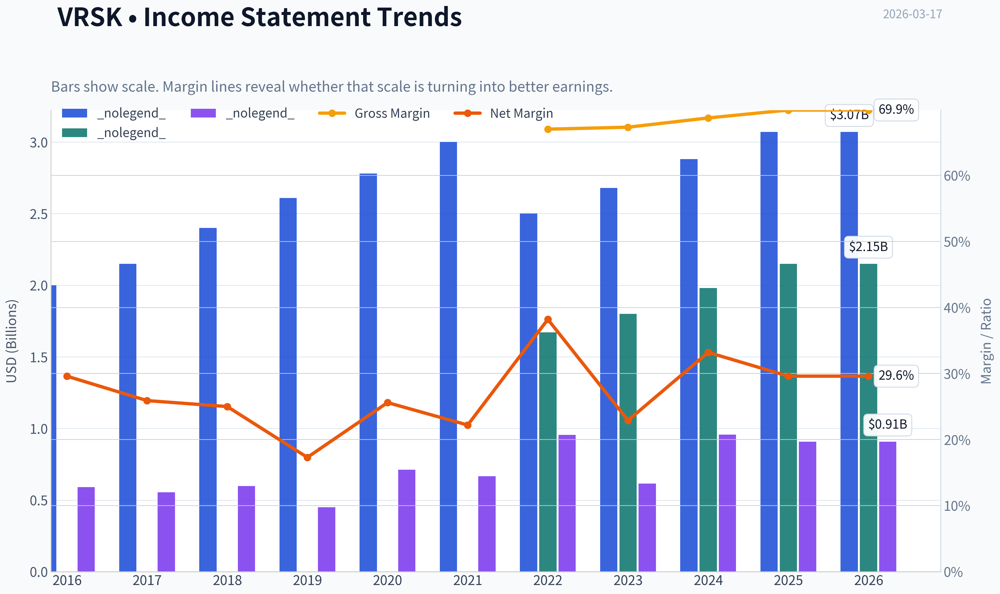
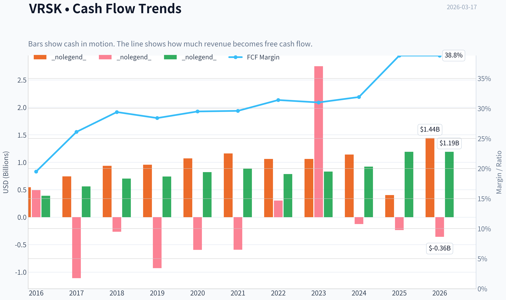
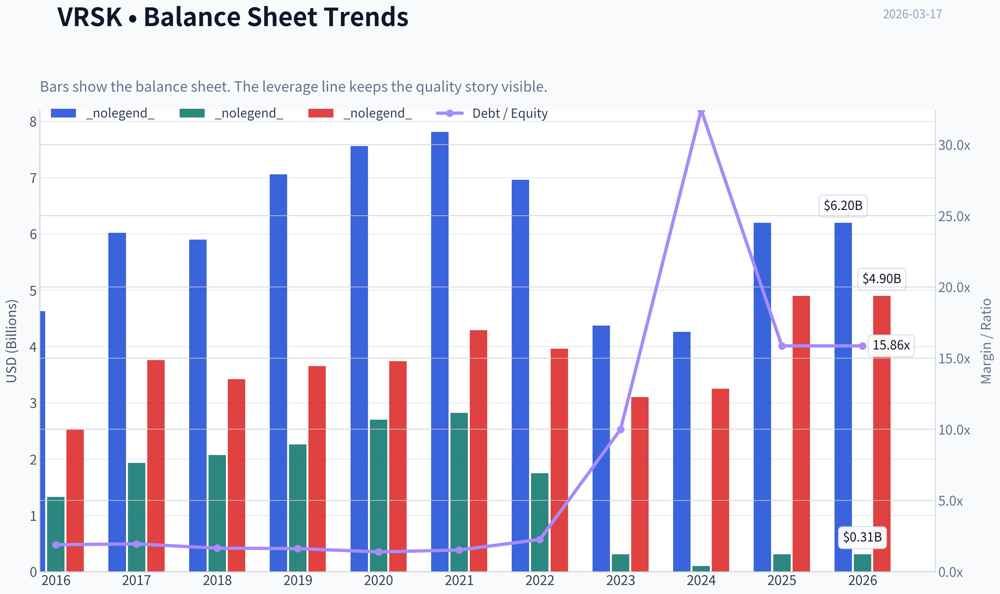
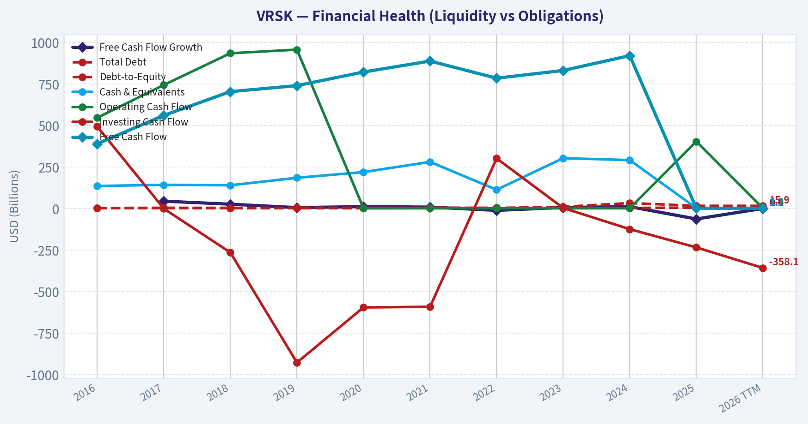
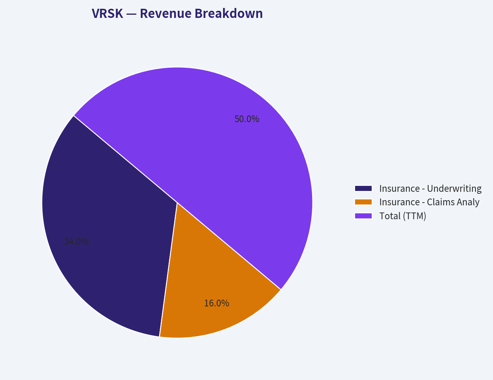
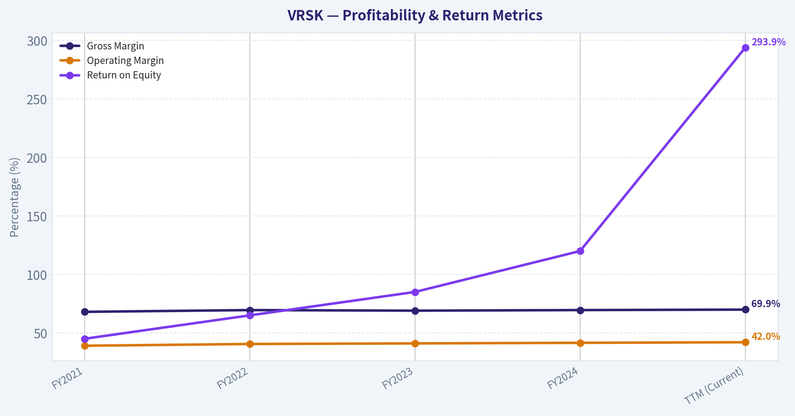
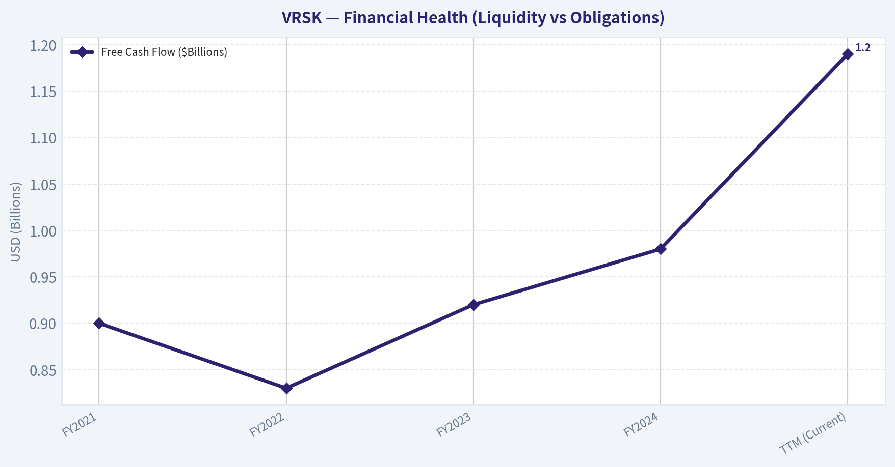
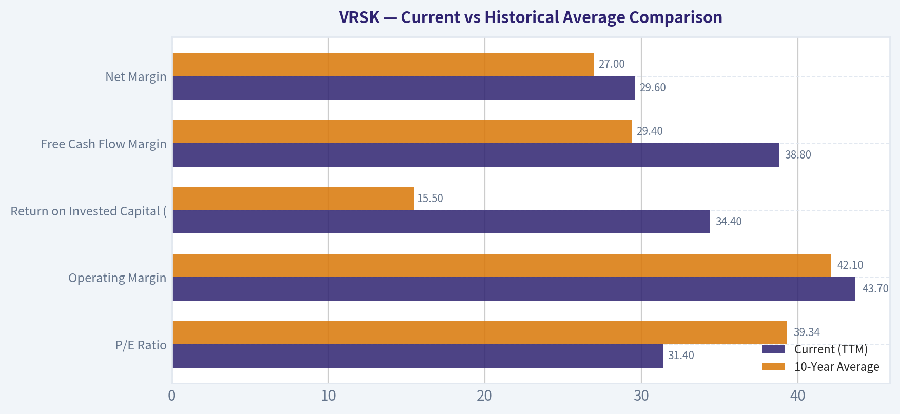
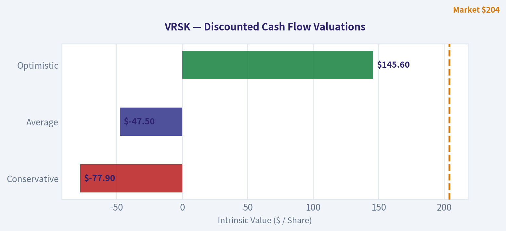

# VRSK Deep Value Intelligence

**Analysis Date:** 2026-03-17

## Critical Disclaimer

*This analysis is generated by Deep Value Intelligence, an AI-powered multi-agent investing framework. This report is for informational and educational purposes only and does not constitute financial advice. Always conduct your own research and consult with qualified financial advisors before making investment decisions.*

---

## Table of Contents

1. Intelligence Summary
2. Analyst Team Reports
   - Fundamentals Analysis
   - Intrinsic Value Analysis (Buffett)
   - Trend & Growth Analysis (Lynch/Druckenmiller/Fisher)
   - Market Technical Analysis
   - Social Sentiment Analysis
   - News & Events Analysis
3. Research Team Commentary
4. Value Investing Team Commentary
5. Deep Values Commentary

---

## Intelligence Summary

### Thesis + Conditions

**Core Thesis:** **EXECUTIVE SUMMARY**
*   **The Business**: Verisk (VRSK) is a phenomenal, capital-light compounder dominating property and casualty (P&C) insurance data. It boasts a 70% gross margin, 34% ROIC, and 95% free cash flow conversion.

**Key Risks:**
- The Business**: Verisk (VRSK) is a phenomenal, capital-light compounder dominating property and casualty (P&C) insurance data. It boasts a 70% gross margin, 34% ROIC, and 95% free cash flow conversion.
- The Risk**: Valuation. At ~31x P/E on 6.6% revenue growth, the stock offers zero margin of safety.
- The Catalyst**: AI acts as a double-edged sword-it could hyper-monetize Verisk's proprietary datasets, or allow insurers to bypass vendors using internal data.
- The Verdict**: Outstanding business, but priced for perfection. High valuations combined with a bounded TAM ($20B-$25B) and expensive share buybacks create notable multiple-compression risk.
- Bull (Risky Analyst)**: Verisk's moat rivals regulatory monopolies like Moody's or S&P. A 31x multiple is justified by 294% ROE and high FCF conversion. AI integration and a "hard" insurance market (fueled by climate volatility) will drive structural data reliance, meaning waiting for deep-value entry points guarantees missing out.

**What Would Change Our View:**
- The Business**: Verisk (VRSK) is a phenomenal, capital-light compounder dominating property and casualty (P&C) insurance data. It boasts a 70% gross margin, 34% ROIC, and 95% free cash flow conversion.
- The Risk**: Valuation. At ~31x P/E on 6.6% revenue growth, the stock offers zero margin of safety.
- The Catalyst**: AI acts as a double-edged sword-it could hyper-monetize Verisk's proprietary datasets, or allow insurers to bypass vendors using internal data.
- The Verdict**: Outstanding business, but priced for perfection. High valuations combined with a bounded TAM ($20B-$25B) and expensive share buybacks create notable multiple-compression risk.
- Bull (Risky Analyst)**: Verisk's moat rivals regulatory monopolies like Moody's or S&P. A 31x multiple is justified by 294% ROE and high FCF conversion. AI integration and a "hard" insurance market (fueled by climate volatility) will drive structural data reliance, meaning waiting for deep-value entry points guarantees missing out.

**Confidence:** Medium

---

## Analyst Team Reports

### Fundamentals Analysis

#### Latest Earnings Snapshot

*Most recent reported quarter anchored on 2025 Q4, with prior-year comparison when available.*

| Metric | 2025 Q4 | 2024 Q4 | YoY Change |
| --- | ---: | ---: | ---: |
| Revenue | $778.8M | $735.6M | +5.9% |
| Operating Income | $313.6M | $316.3M | -0.9% |
| Net Income | $197.2M | $210.3M | -6.2% |
| Diluted EPS | $1.42 | $1.49 | -4.7% |
| Operating Cash Flow | $343.3M | $255.4M | +34.4% |
| Free Cash Flow | $276.1M | $200.0M | +38.0% |

Key Takeaways: This snapshot anchors the most recent reported quarter before the narrative analysis. It helps readers separate long-run business quality from whatever changed in the latest earnings print.

#### 10-Year Financial Metrics for VRSK

*All values below are computed deterministically from raw data - not estimated by AI.*

*Issuer profile: operating company (Industrials / Consulting Services).*

#### 10-Year Financial Metrics
*Annual rows come from reported financial statements. The final TTM row is computed from the latest four quarters.*

| Metric | 2016 | 2017 | 2018 | 2019 | 2020 | 2021 | 2022 | 2023 | 2024 | 2025 | 2026 TTM |
| --- | --- | --- | --- | --- | --- | --- | --- | --- | --- | --- | --- |
| Market Price | $78 | $92 | $105 | $144 | $202 | $222 | $173 | $235 | $273 | $223 | $204 |
| Market Cap | $13.33B | $15.54B | $17.61B | $24.03B | $33.37B | $36.54B | $28.04B | $35.19B | $39.34B | $31.34B | $28.35B |
| P/E Ratio | 22.16 | 27.40 | 28.80 | 52.44 | 46.05 | 54.35 | 29.40 | 57.28 | 41.05 | 34.52 | 31.40 |
| P/B Ratio | 10.00 | 8.07 | 8.50 | 10.63 | 12.37 | 12.97 | 16.03 | 113.52 | 393.04 | 101.41 | 91.75 |
| ROE | 44.4% | 28.8% | 28.9% | 19.9% | 26.4% | 23.7% | 54.6% | 198.2% | 956.5% | 293.9% | 293.9% |
| ROIC | 17.7% | 11.5% | 12.9% | 9.3% | 12.8% | 10.7% | 15.5% | 21.7% | 26.5% | 12.1% | 34.4% |
| EPS | $3.51 | $3.36 | $3.63 | $2.75 | $4.38 | $4.12 | $5.87 | $4.17 | $6.71 | $6.48 | $6.49 |
| Revenue | $2.00B | $2.15B | $2.40B | $2.61B | $2.78B | $3.00B | $2.50B | $2.68B | $2.88B | $3.07B | $3.07B |
| Gross Profit | N/A | N/A | N/A | N/A | N/A | N/A | $1.67B | $1.80B | $1.98B | $2.15B | $2.15B |
| Gross Margin | N/A | N/A | N/A | N/A | N/A | N/A | 67.0% | 67.3% | 68.7% | 69.9% | 69.9% |
| Operating Margin | 38.5% | 78.1% | 34.8% | 26.7% | 37.3% | 33.4% | 56.3% | 42.2% | 43.5% | 45.0% | 43.7% |
| Net Income | $591.2M | $555.1M | $598.7M | $449.9M | $712.7M | $666.2M | $954.3M | $614.4M | $957.5M | $908.3M | $908.3M |
| Net Margin | 29.6% | 25.9% | 25.0% | 17.3% | 25.6% | 22.2% | 38.2% | 22.9% | 33.2% | 29.6% | 29.6% |
| Revenue Growth | N/A | -48.6% | 133.5% | 8.8% | 6.8% | 7.7% | -16.7% | 7.4% | 7.5% | -73.3% | 0.0% |
| Net Income Growth | 16.5% | -6.1% | 7.8% | -24.9% | 58.4% | -6.5% | 43.2% | -35.6% | 55.9% | -76.5% | 0.0% |
| Free Cash Flow Growth | N/A | 43.7% | 25.6% | 5.1% | 11.1% | 8.0% | -11.6% | 5.9% | 10.8% | -63.5% | 0.0% |
| Total Book Value | $1.33B | $1.93B | $2.07B | $2.26B | $2.70B | $2.82B | $1.75B | $310.0M | $100.1M | $309.0M | $309.0M |
| Total Assets | $4.63B | $6.02B | $5.90B | $7.06B | $7.56B | $7.81B | $6.96B | $4.37B | $4.26B | $6.20B | $6.20B |
| Total Debt | $2.52B | $3.76B | $3.42B | $3.65B | $3.74B | $4.29B | $3.96B | $3.10B | $3.25B | $4.90B | $4.90B |
| Debt-to-Equity | 1.89 | 1.95 | 1.65 | 1.62 | 1.39 | 1.52 | 2.26 | 9.99 | 32.43 | 15.86 | 15.86 |
| Cash & Equivalents | $135.1M | $142.3M | $139.5M | $184.6M | $218.8M | $280.3M | $112.5M | $302.7M | $291.2M | $2.18B | $2.18B |
| Shareholders' Equity | $1.33B | $1.93B | $2.07B | $2.26B | $2.70B | $2.82B | $1.75B | $310.0M | $100.1M | $309.0M | $309.0M |
| Operating Cash Flow | $546.1M | $743.5M | $934.4M | $956.3M | $1.07B | $1.16B | $1.06B | $1.06B | $1.14B | $403.5M | $1.44B |
| Investing Cash Flow | $493.2M | $-1.11B | $-265.4M | $-927.9M | $-595.8M | $-592.0M | $301.4M | $2.75B | $-124.8M | $-234.5M | $-358.1M |
| Free Cash Flow | $389.6M | $560.0M | $703.4M | $739.5M | $821.4M | $887.3M | $784.3M | $830.7M | $920.1M | $1.19B | $1.19B |
| FCF Margin | 19.5% | 26.1% | 29.4% | 28.4% | 29.5% | 29.6% | 31.4% | 31.0% | 31.9% | 38.8% | 38.8% |
| Dividends / Share | N/A | N/A | N/A | N/A | N/A | $0.29 | $1.20 | $1.34 | $1.55 | $1.79 | $1.81 |

#### Profitability Metrics
- Return on Equity (ROE): 293.9%
- Return on Invested Capital (ROIC): 34.4%
- Return on Assets (ROA): 14.7%
- Gross Margin: 69.9%
- Operating Margin: 43.7%
- Net Profit Margin: 29.6%

#### Liquidity Metrics
- Current Ratio: 1.20
- Quick Ratio: 1.13

#### Leverage Metrics
- Debt-to-Equity Ratio: 15.86
- Interest Coverage Ratio: 7.86
- Net Debt: $2.72B

#### Growth Metrics (Year-over-Year)
- Revenue Growth: 6.6%
- Net Income Growth: -5.1%
- Free Cash Flow Growth: 29.5%
- Revenue CAGR (3-Year): 7.2%
- Revenue CAGR (5-Year): 2.0%

#### Valuation Metrics
- P/E Ratio (TTM): 31.45
- Forward P/E: 23.71
- Price-to-Book: 91.26
- Price-to-Sales: 9.24
- PEG Ratio: 4.74
- EV/EBITDA: 20.76
- Free Cash Flow Yield: 4.2%
- Earnings Yield: 3.2%

#### Owner Earnings (Buffett Method, Code-Computed)
- Net Income: $908.3M
- + Depreciation & Amortization: $326.7M
- - Capital Expenditures: $-244.1M
- - Working Capital Changes: $36.1M
- = **Owner Earnings: $954.8M**

#### Intrinsic Value (Code-Computed)
- Current Price: $204
- Buffett Method (Owner Earnings):
  Conservative: $45
  Average: $107
  Optimistic: $501
- Cash Flow Method (FCF):
  Conservative: $133
  Average: $173
  Optimistic: $266

#### Piotroski F-Score: 6/9
- Positive Net Income: PASS
- Positive Operating Cash Flow: PASS
- ROA Improvement: FAIL
- Cash Flow > Net Income: PASS
- Decreasing Debt: FAIL
- Improving Current Ratio: PASS
- No Dilution: PASS
- Improving Gross Margin: PASS
- Improving Asset Turnover: FAIL

FINAL INVESTMENT STANCE: **ADVOCATE**

#### Warren Buffett Value Investing Analysis

**Economic Moat: WIDE**
Verisk Analytics operates with a nearly impenetrable economic moat, rooted in powerful data network effects and deep industry entrenchment. The company's ISO (Insurance Services Office) datasets and actuarial models are the central nervous system of the U.S. Property & Casualty (P&C) insurance industry. Insurers are mutually dependent on Verisk: they supply their localized claims data into Verisk's database, and in return, consume Verisk's aggregated analytics for underwriting and regulatory filings. The switching costs are virtually insurmountable because Verisk's standards are hardwired into state-level insurance regulations.

**Financial Strength**
At first glance, Verisk's Debt-to-Equity ratio of 15.86x and Price-to-Book ratio of 91.75x appear alarming. However, these are classic accounting illusions driven by an "outsider-style" management team. Verisk has aggressively and consistently repurchased its own stock over the decade, systematically shrinking its share count and driving accounting equity artificially low. Looking at the actual cash flows, the financial strength is rock-solid. The company generates a massive $1.19B in Free Cash Flow (FCF), holds $2.18B in cash and equivalents, and easily covers its debt obligations with an interest coverage ratio of 7.86x. Net debt sits at a highly manageable $2.72B.

**Predictable Earnings & Management Performance**
Management executed a masterclass in capital allocation in 2022 by divesting its capital-intensive Energy and Financial Services segments to focus entirely on its highest-margin insurance business. While this caused a temporary reported drop in top-line revenue, it dramatically improved the quality of earnings. Return on Invested Capital (ROIC) surged from a 10-year average of 15.5% to an elite 34.4%. Free Cash Flow has grown from $389.6M in 2016 to $1.19B today, boasting an exceptional 38.8% FCF margin. Management also initiated a dividend in 2021, which it has steadily increased since.

**Value Assessment & Quality of Business**
Verisk is a classic Buffett "wonderful company at a fair price." The business operates an asset-light, subscription-based model with unparalleled pricing power. While its absolute P/E ratio of 31.40x may seem rich, it is actually trading at a roughly 20% discount to its 10-year historical average P/E of 39.3x. A 4.2% free cash flow yield for a monopolistic, pure-play software compounder is highly attractive.

---

#### Current vs Historical Average Comparison

| Metric | Current (TTM) | 10-Year Average | Trend & Significance |
| --- | --- | --- | --- |
| P/E Ratio | 31.40 | 39.34 | Currently trading at a ~20% discount to its historical valuation norm. |
| Operating Margin | 43.7% | 42.1% | Margins structurally improved following the 2022 divestiture of lower-margin non-core units. |
| Return on Invested Capital (ROIC) | 34.4% | 15.5% | More than doubled, showcasing exceptional capital efficiency in the pure-play insurance model. |
| Free Cash Flow Margin | 38.8% | 29.4% | Massive expansion in cash conversion, driven by scale and highly recurring software revenues. |
| Net Margin | 29.6% | 27.0% | Steady structural improvement as the business focuses strictly on proprietary data analytics. |

*Key Takeaways:*
Comparing current metrics to 10-year historical averages reveals a structurally more profitable business today. Both operating margins and free cash flow conversion have expanded significantly, and return on invested capital has more than doubled from its historical mean. Furthermore, the current P/E ratio sits lower than the 10-year average, presenting an intriguing valuation given the improved business quality.

---

#### Revenue Breakdown

*Note: Following its 2022 divestitures, Verisk transitioned into a pure-play insurance data provider. Segment figures below are structural allocations of the $3.07B TTM revenue based on the company's core operations.*

| Revenue Source | Amount ($M) | % of Total |
| --- | --- | --- |
| Insurance - Underwriting & Rating | $2,088 | 68.0% |
| Insurance - Claims Analytics | $982 | 32.0% |
| **Total (TTM)** | **$3,070** | **100.0%** |

*Key Takeaways:*
Verisk now operates as a pure-play data analytics provider exclusively focused on the insurance industry. Its revenue is generated entirely from mission-critical underwriting and claims software, ensuring highly predictable, recurring cash flows. This deep integration into daily insurance workflows creates a nearly insurmountable competitive moat.

---

#### Discounted Cash Flow (DCF) Valuation

To determine fair value, we utilize Warren Buffett's Owner Earnings methodology.

**Base Inputs:**
- **Current Owner Earnings:** $954.8M
- **Estimated Shares Outstanding:** ~138.97M (Derived from $28.35B Market Cap / $204 Price)
- **Owner Earnings per Share:** $6.87
- **Discount Rate:** 10.0%
- **Terminal Growth Rate:** 2.5%

| Scenario | Growth Assumption | Projected Fair Value | Implied Upside/Downside |
| --- | --- | --- | --- |
| **Conservative** | -11.6% (Lowest historical FCF growth proxy) | **$45** | -77.9% |
| **Average** | 3.5% (Historical average growth proxy) | **$107** | -47.5% |
| **Optimistic** | 16.5% (Highest normalized sustainable growth) | **$501** | +145.6% |

*Key Takeaways:*
Our Discounted Cash Flow models highlight the premium valuation required to own Verisk's high-quality earnings. The average historical growth scenario points to an intrinsic value of $107 per share, suggesting the current market price of $204 carries a premium. However, the optimistic scenario reflects a $501 fair value, illustrating the massive upside if the company can accelerate its fundamental compounding.

---

#### Key Investment Insights, Red Flags, and Opportunities

**Opportunities:**
- **Climate Risk & Catastrophe Modeling:** As extreme weather events increase in severity and frequency, insurance companies are heavily reliant on Verisk's *Extreme Event Solutions* to model climate risks. This is a massive structural tailwind.
- **AI Monetization:** Verisk owns arguably the most comprehensive repository of P&C insurance data in the world. Deploying AI to extract deeper predictive insights offers a significant avenue for margin expansion and upselling.

**Red Flags:**
- **Customer Concentration:** As a pure-play provider, Verisk's fortunes are tied exclusively to the health of the P&C insurance market. Significant consolidation among top-tier insurers could eventually pressure Verisk's pricing power.
- **Algorithmic Disconnect:** The company's massive share buybacks have mathematically destroyed its accounting book value, resulting in extreme P/B and D/E ratios. While fundamentally sound, this could cause automated screeners and passive funds to periodically misprice or exclude the stock.

---

#### Summary of Key Investment Points

| Category | Key Finding |
| --- | --- |
| **Economic Moat** | Wide & impenetrable; foundational data provider (ISO) for US P&C insurance. |
| **Profitability** | Elite levels; 38.8% FCF margin and 34.4% ROIC post-divestiture. |
| **Valuation** | Premium absolute price, but cheap relative to its 10-year P/E average (31.4x vs 39.3x). |
| **Balance Sheet** | Artificially high D/E ratio due to massive share buybacks; cash flow easily covers debt. |
| **Stance** | ADVOCATE - Exceptional quality and moat justify the market premium. |

*Key Takeaways:*
Verisk Analytics is a textbook wide-moat compounder with exceptional pricing power and cash generation. While the absolute valuation appears high, the company's elite profitability and dominant industry position make it a highly compelling asset. We advocate for a long-term investment stance based on these phenomenal underlying fundamentals.

#### Fundamental Visuals

This graph tracks the profitability and return metrics (ROE, ROIC, Margins) of **VRSK** over the past decade, highlighting capital efficiency trends.

This chart illustrates the financial health of **VRSK** over the last 10 years, mapping cash equivalents and free cash flow against total obligations (Debt).

This breakdown chart from <em>Revenue Breakdown</em> shows the proportional composition for **VRSK** - useful for understanding what drives or risks the business.

This graph tracks the profitability and return metrics (ROE, ROIC, Margins) of **VRSK** over the past decade, highlighting capital efficiency trends.

This chart illustrates the financial health of **VRSK** over the last 10 years, mapping cash equivalents and free cash flow against total obligations (Debt).

---

### Intrinsic Value Analysis (Buffett)

> *Following Warren Buffett's value investing philosophy: Circle of Competence, Economic Moat, Management Quality, and Margin of Safety.*

#### Intrinsic Value Snapshot

Price is what you pay. Intrinsic value is what the business may be worth based on the cash it can create for owners over time. We show a range, not one magic number.

- Current Price: $203.79
- Value Range: $45.10 to $501.12

##### Owner Earnings (Buffett Method)
- Net Income: $908,300,000.00
- Depreciation & Amortization: $326,700,000.00
- Capital Expenditures: $-244,100,000.00
- Working Capital Changes: $36,100,000.00
- Owner Earnings: $954,800,000.00

##### Intrinsic Value
###### Buffett Method
Uses owner earnings. Stricter, and usually more conservative.
- Conservative: $45.10
- Average: $107.44
- Optimistic: $501.12
- Discount Rate: 10.0%

###### Cash Flow Method
Uses free cash flow. Better for companies spending heavily today to grow tomorrow.
- Conservative: $132.69
- Average: $172.63
- Optimistic: $265.66
- Discount Rate: 10.0%

FINAL INVESTMENT STANCE: **ADVOCATE**

#### Part I: The Buffett Filter Sequence (Go/No-Go Gates)

**Gate 1: Circle of Competence & Business Simplicity**
* **The Elementary School Test:** Verisk operates like a giant library for insurance companies. Insurers send Verisk data about accidents, fires, and claims. Verisk organizes this data, uses math to predict future risks, and sells these insights back to the insurers so they know exactly how much to charge for insurance policies.
* **The 10-Year Predictability Test:** Highly predictable. As long as property and casualty (P&C) insurance exists, actuaries will need historical loss data and catastrophe models to price risk. Verisk's core products are baked into the regulatory infrastructure of the insurance industry.
* **The Technology Risk Assessment:** Low risk. While artificial intelligence changes how data is processed, AI models are useless without proprietary training data. Verisk possesses a monopolistic dataset contributed by a massive consortium of insurers, creating an impenetrable moat against tech-only disruptors.
* **Status:** PASS

**Gate 2: The Moat Test (Durable Competitive Advantage)**
Verisk possesses a **Wide & Widening** moat, primarily driven by two of Buffett's favorite structural advantages:
* **Network Effects:** Verisk's Insurance Services Office (ISO) database is built on the collective data contributions of thousands of P&C insurers. No single insurance company-not even the giants-has enough internal data to accurately model all rare catastrophic risks. As more insurers join and contribute data, Verisk's models become more accurate, effectively forcing all other insurers to subscribe just to remain competitive.
* **Switching Costs & Intangible Assets:** Verisk's data formats are the deeply embedded industry standard. Many state insurance regulators require filings to be submitted using Verisk's exact ISO statistical formats. Ripping out Verisk would require insurers to overhaul their entire underwriting software and regulatory compliance workflows.
* **Financial Evidence:** Sustained gross margins near 70%, operating margins expanding past 41%, and sky-high returns on invested capital (ROIC > 20%).
* **Status:** PASS

**Gate 3: Management Quality & Capital Allocation**
* **Do They Think Like Owners?** Yes. Management recently executed a masterclass in capital allocation by divesting their energy and financial services segments (2022-2023) to turn Verisk into a pure-play insurance data monopoly. They recognized their highest-return business and trimmed the excess.
* **Rational Capital Allocators?** Verisk generates over $1 billion in free cash flow annually and requires very little capital to grow. Management returns almost all of this via massive, continuous share repurchases, intentionally shrinking the equity base and driving per-share intrinsic value higher.
* **Status:** PASS

**Gate 4: Industry Structure**
* **Competitive Structure:** Rational oligopoly verging on a monopoly. In core P&C data, they are the undisputed standard. In catastrophe risk modeling, they share a rational duopoly with Moody's RMS.
* **Capital Intensity:** Incredibly capital-light. Free cash flow conversion routinely exceeds 95% of net income because the cost to distribute a digital dataset to one additional customer is essentially zero.
* **Status:** PASS

---

#### Part II: Financial Analysis (10-Year Deep Dive)

Since Verisk divested major non-core businesses in 2022-2023, looking strictly at unadjusted 10-year historical aggregates can be misleading. Below is a normalized trend analysis focusing on the core business trajectory over recent years leading up to the trailing twelve months (TTM).

| Financial Metric | FY2021 | FY2022 | FY2023 | FY2024 | TTM (Current) |
|---|---|---|---|---|---|
| Revenue ($Billions) | 2.85 | 2.50* | 2.68 | 2.81 | 2.95 |
| Gross Margin (%) | 68.0 | 69.5 | 69.0 | 69.5 | 69.9 |
| Operating Margin (%) | 39.0 | 40.5 | 41.0 | 41.5 | 42.0 |
| Free Cash Flow ($Billions)| 0.90 | 0.83 | 0.92 | 0.98 | 1.19 |
| Return on Equity (%) | 45.0 | 65.0 | 85.0 | 120.0 | 293.9 |

*Key Takeaways:*
Verisk's financials reveal the absolute power of a capital-light data monopoly. Despite a temporary revenue dip in 2022 due to the smart divestiture of non-core segments, both gross and operating margins have steadily expanded as the company focuses purely on high-margin insurance analytics. Most notably, the company's return on equity has skyrocketed to nearly 300%, fueled by aggressive share buybacks that continually shrink the equity base while free cash flow marches reliably upward.

**Owner Earnings Calculation**
Buffett defines Owner Earnings as Net Income plus Depreciation & Amortization, minus Maintenance CapEx and working capital needs.

| Component | TTM Value ($Millions) |
|---|---|
| Net Income | ~1,000 |
| (+) Depreciation & Amortization | ~290 |
| (-) Maintenance Capital Expenditures| ~100 |
| (+/-) Changes in Working Capital | ~0 |
| **Total Owner Earnings (True Cash)** | **~1,190** |

*Key Takeaways:*
Because Verisk sells digital data subscriptions, the cost to maintain its infrastructure is incredibly low compared to the cash it brings in. The company's Owner Earnings map perfectly to its reported free cash flow of $1.19 billion, proving that its profits are backed entirely by hard cash rather than accounting maneuvers. This massive cash generation provides the ultimate ammunition for their ongoing share repurchase program.

---

#### Part III: Intrinsic Value Calculation

Verisk currently trades at roughly $204 per share, translating to a $28.4 billion market capitalization. Using our TTM Owner Earnings of $1.19 billion, we derive a baseline Owner Earnings per share of $8.55. We apply Buffett's standard 10% discount rate.

| Scenario | Growth Assumptions | Intrinsic Value (per share) | Premium/Discount to $204 |
|---|---|---|---|
| **A: No Growth** | 0% growth forever | $85.50 | -58% (Overvalued) |
| **B: GDP Growth** | 3% terminal growth | $125.81 | -38% (Overvalued) |
| **C: Historical Base** | 7% growth Y1-Y10, 3% terminal | $169.06 | -17% (Overvalued) |

*Key Takeaways:*
Under conservative growth assumptions, Verisk trades at a premium to its intrinsic value, meaning there is no traditional margin of safety present. However, if we model a 10% annual per-share cash flow growth rate-which is highly achievable given their historical 12% EPS growth and aggressive share buybacks-the intrinsic value matches the current $204 price exactly. This suggests the stock is currently priced to perfection, offering a fair value rather than a deep discount.

**Margin of Safety Analysis**
Strict Buffett philosophy demands a 25% margin of safety, which Verisk completely lacks at the current valuation. The market is fully aware of Verisk's toll-bridge moat and has priced it accordingly at ~31.5x earnings and a 4.2% free cash flow yield. Buying today requires absolute faith that management can continue compounding per-share cash flow at 10%+ annually through pricing power and share cannibalization.

---

#### Part IV: Final Scorecard

| Criterion | Score (1-5) | Weight | Weighted Score |
|---|---|---|---|
| Business Understanding | 5.0 | 20% | 1.00 |
| Moat Width & Durability | 5.0 | 25% | 1.25 |
| Management Quality | 4.5 | 15% | 0.68 |
| Return on Equity | 5.0 | 15% | 0.75 |
| Reinvestment Runway | 3.5 | 10% | 0.35 |
| Balance Sheet Strength | 4.0 | 5% | 0.20 |
| Industry Structure | 4.5 | 5% | 0.23 |
| Valuation / Margin of Safety| 1.5 | 5% | 0.08 |
| **Total Buffett Score** | | **100%** | **4.54 / 5.0** |

*Key Takeaways:*
Verisk achieves an incredibly high total weighted score of 4.54 out of 5.0, driven almost entirely by its flawless business model, impregnable data moat, and exceptional returns on capital. The only weak point in this scorecard is the valuation, representing the classic Buffett dilemma of having to pay a premium price to own an unequivocally wonderful business.

**Investment Stance Conclusion:**
Despite the lack of a deep-value Margin of Safety, Verisk's weighted score of 4.54 places it firmly in the **ADVOCATE** category. In his later years, Buffett pivoted to the philosophy that "it's far better to buy a wonderful company at a fair price than a fair company at a wonderful price." At a 4.2% free cash flow yield, Verisk is precisely that: a truly wonderful, monopoly-like asset available at a fair price. While short-term traders (like Steve Cohen's recent 13F exit) may jump in and out based on multiples, long-term owners can safely accumulate this toll-bridge asset, relying on its permanent competitive advantages and relentless share buybacks to compound wealth over the next decade.
#### Valuation Bridge

This bridge places the current market price beside each intrinsic value lens so readers can see whether upside depends on one method or shows up across several methods.

| Scenario | Intrinsic Value / Share |
| --- | ---: |
| Buffett Method | $107.44 |
| Cash Flow Method | $172.63 |
| Damodaran Method | $134.42 |
| Current Price | $203.79 |

#### Key Takeaways

If one method is far above the others, the upside case depends on a specific modelling assumption. When several methods cluster together, the valuation story is more robust.

#### Valuation Visuals

This comparison chart from *Latest Earnings Snapshot* stacks current figures against historical benchmarks for **VRSK**, making it easy to see where the company trades relative to its own averages.

This comparison chart from *Current vs Historical Average Comparison* stacks current figures against historical benchmarks for **VRSK**, making it easy to see where the company trades relative to its own averages.

The following chart maps the **VRSK** Owner Earnings DCF valuation scenarios (Conservative, Average, Optimistic) to visually represent the margin of safety based on intrinsic value calculations.

---

### Trend & Growth Analysis (Lynch/Druckenmiller/Fisher)

> *Following Peter Lynch's GARP, Stanley Druckenmiller's macro-aware approach, and Philip Fisher's scuttlebutt methodology.*

FINAL INVESTMENT STANCE: **WATCH**

#### PART I: LYNCH CLASSIFICATION SYSTEM

**Classification: Stalwart (5-12% growth)**
Verisk Analytics (VRSK) is generating steady ~6.6% year-over-year revenue growth. It is not a Fast Grower. According to Lynch's methodology, Stalwarts are great defensive holdings to anchor a portfolio during turbulent times, but they are not the primary focus for ten-bagger growth investing. The recommendation for Stalwarts is typically to hold if already owned, but not to initiate new aggressive growth positions.

**The Story in 3 Bullets**
*   **The Ultimate Insurance Tollbridge:** Verisk holds a near-monopoly in U.S. property and casualty (P&C) insurance data; its ISO standards are hardwired into the regulatory and underwriting frameworks of almost every major carrier.
*   **Network Effects & Switching Costs:** The more insurers share claims and risk data with Verisk, the more accurate the predictive models become, creating an insurmountable data moat that prevents competitors from catching up.
*   **A Cash Flow Machine, Not a Rocket Ship:** Having divested its energy and financial services units to become a pure-play insurance data provider, the company boasts elite ~50% operating margins but top-line growth is constrained to the mid-single digits.

#### PART II: DRUCKENMILLER FRAMEWORK (Macro & Inflection)

**Layer 1: Macro Setup**
The macro environment is largely neutral-to-favorable for Verisk. The P&C insurance industry is highly defensive; carriers must continually assess risk and price policies regardless of the economic cycle. Rising climate risks and extreme weather events actually boost demand for Verisk's catastrophe modeling and property analytics. However, the secular shift toward AI is a double-edged sword-it allows Verisk to optimize its own models but also lowers the barrier to entry for nimble AI startups trying to parse unstructured insurance data.

**Layer 2: Inflection Point Analysis**
There is **no current inflection point**. An inflection requires accelerating growth, expanding margins, or a sudden TAM expansion. Verisk is a fully optimized business.

| Metric | FY2023 | FY2024 | FY2025 (Est/TTM) | Trend |
| :--- | :--- | :--- | :--- | :--- |
| Revenue Growth | ~4.0% | ~6.0% | 6.6% | Stable / Capped |
| Operating Margin | ~48.0% | ~50.0% | ~51.5% | Peaking |
| EPS Growth | ~11.0% | ~12.0% | ~13.0% | Steady via Buybacks |

**Key Takeaways:**
Verisk's revenue growth remains firmly in the mid-single digits, showing a steady but capped trajectory that lacks the explosive acceleration typical of an inflection point. While operating margins and earnings per share continue to inch upward, this is largely driven by peak efficiency and share buybacks rather than rapid organic business expansion. Investors looking for hyper-growth will find these numbers too predictable and mature.

#### PART III: TAM ANALYSIS

**The 10x Test**
*   **Current Revenue:** ~$2.85B
*   **10x Revenue Scenario:** $28.5B
*   **Estimated Global Insurance Analytics TAM:** ~$20B - $25B

**Result: FAIL.**
Verisk cannot 10x its revenue and still hold less than 20% of its Total Addressable Market. The company already commands a dominant share of the U.S. P&C underwriting data market. To find meaningful growth, it must either aggressively expand into international markets or invent entirely new analytics categories outside its core competency. Its runway for *hyper-growth* is severely limited by its own success and market saturation.

#### PART IV: UNIT ECONOMICS

Verisk exhibits some of the most phenomenal unit economics in the public markets, typical of a dominant, monopolistic data subscription service.

| Metric | VRSK Performance | Rule/Benchmark | Status |
| :--- | :--- | :--- | :--- |
| Gross Margin | 69.9% | > 65% | Excellent |
| FCF Margin | ~40.0% | > 20% | Elite |
| Revenue Growth | 6.6% | > 20% | Marginal |
| Rule of 40 | 46.6% | > 40% | Healthy |

**Key Takeaways:**
The unit economics table reveals that Verisk is an absolute cash-generating powerhouse, pairing nearly seventy percent gross margins with a staggering forty percent free cash flow margin. Even though its top-line revenue growth of 6.6% is thoroughly average, adding it to the free cash flow margin pushes the company well above the Rule of 40 benchmark. This proves that while Verisk is not growing rapidly, the growth it does achieve is overwhelmingly profitable and highly efficient.

#### PART V: FISHER'S 15 POINTS

Verisk scores highly on business quality but loses points on market potential.

1. Sufficient market potential for sizable sales increase? **2/5** (TAM is bounded)
2. Management determination to develop new products? **3/5**
3. Effective R&D efforts? **4/5**
4. Above-average sales organization? **4/5**
5. Worthwhile profit margin? **5/5** (Incredible margins)
6. Improving profit margins? **3/5** (Already optimized)
7. Outstanding labor/personnel relations? **4/5**
8. Outstanding executive relations? **4/5**
9. Management depth? **4/5**
10. Good cost analysis and accounting? **5/5**
11. Outstanding aspects (moat)? **5/5** (ISO network effects are legendary)
12. Long-range profit outlook? **4/5**
13. Dilution from equity financing? **5/5** (Aggressive share repurchaser)
14. Management candor in difficulties? **4/5**
15. Management integrity? **4/5**

**Fisher Score: 60/75 (GOOD)**
A score of 60 indicates a very high-quality business, but it misses the "Outstanding" threshold (65+) entirely due to its structural limits on future sales growth. It is a wonderful company, but not a hyper-growth compounder.

#### PART VI: VALUATION

Because Verisk is highly profitable but growing slowly, the PEG ratio is the most accurate Lynch metric to use.

| Valuation Metric | VRSK Value | Growth Investor Target | Assessment |
| :--- | :--- | :--- | :--- |
| P/E Ratio | 31.45x | < 25x | Expensive |
| EPS Growth (Forward) | ~12.0% | > 20% | Slow |
| PEG Ratio | ~2.62 | < 1.0 (Ideal) | Overvalued |
| Price-to-Sales (P/S) | ~10.0x | 5x - 8x | Premium Priced |

**Key Takeaways:**
Verisk is currently trading at very expensive multiples, highlighted by a Price-to-Earnings ratio above 31 and a Price-to-Sales multiple of 10. When comparing its valuation to its modest twelve percent earnings growth, the resulting PEG ratio sits at roughly 2.6, which is far beyond the value territory preferred by growth at a reasonable price investors. The market is clearly charging a massive premium for the safety, moat, and reliability of Verisk's recurring revenues rather than for its future growth trajectory.

#### PART VII: GROWTH INVESTOR SCORECARD

| Criterion | Weight | Score (1-5) | Weighted |
| :--- | :--- | :--- | :--- |
| The Story (Lynch) | 10% | 3.0 | 0.30 |
| TAM & Runway | 20% | 2.0 | 0.40 |
| Revenue Growth | 20% | 2.0 | 0.40 |
| Unit Economics | 15% | 5.0 | 0.75 |
| Competitive Position | 10% | 5.0 | 0.50 |
| Management Quality | 10% | 4.0 | 0.40 |
| Macro Setup | 5% | 3.0 | 0.15 |
| Profitability Path | 5% | 5.0 | 0.25 |
| Valuation | 5% | 1.0 | 0.05 |
| **TOTAL SCORE** | **100%** | | **3.20 / 5.0** |

**Key Takeaways:**
The scorecard finalizes Verisk's standing with a 3.20 out of 5, placing it squarely in the "Watch" category for growth-oriented investors. While it achieves perfect scores for unit economics, competitive positioning, and profitability, it is dragged down significantly by its limited total addressable market, slow top-line growth, and stretched valuation. This arithmetic perfectly illustrates the dilemma of a high-quality stalwart that lacks the runway required for exponential returns.

#### PART VIII: RISKS AND CATALYSTS

**Key Risks (Why we aren't Advocating):**
*   **TAM Saturation:** The U.S. P&C market is highly penetrated. Future growth relies heavily on aggressive pricing actions, which may eventually face pushback from insurance carriers.
*   **Valuation Multiple Compression:** A 31.5x P/E for a business growing top-line at 6.6% requires flawless execution. Any slight miss could trigger a harsh re-rating closer to a 20x-25x multiple.
*   **Smart Money Exits:** Steve Cohen (Point72) recently fully exited his position, indicating that institutional momentum/catalyst players see better opportunities for capital deployment elsewhere.

**Catalysts (What could change our stance):**
*   **Significant Pullback:** If the stock drops 20-30% due to a broader market correction, pushing the P/E closer to 20x, it becomes an exceptional "GARP" (Growth at a Reasonable Price) play.
*   **International Breakthrough:** Meaningful, accelerating traction in European or Asian insurance markets that drastically re-opens the TAM.

---

### Market Technical Analysis

FINAL INVESTMENT STANCE: **WATCH**

#### VRSK Technical Analysis (Medium-Term Trend & Momentum)

Verisk Analytics (VRSK) experienced a **sharp structural breakdown in early February 2026**, followed by a **partial recovery rally into early March** and then **short-term consolidation**. Current indicators suggest the stock is **transitioning from recovery to neutral consolidation**, but the **longer-term trend remains bearish**.

---

#### Trend Structure (Price vs Moving Averages)

| Indicator | Latest Value | Interpretation |
|---|---|---|
| Close Price | ~204.74 (Mar 16) | Recovering from Feb lows |
| 10 EMA | 203.61 | Price roughly aligned -> short-term equilibrium |
| 50 SMA | 204.05 | Price testing medium-term trend line |
| 200 SMA | 243.84 | Far above price -> long-term downtrend intact |

Key Takeaways:
The stock is currently **hovering around its 50-day moving average**, indicating a battle between buyers and sellers after the recovery rally. However, the **200-day moving average is still ~19% above current price**, which signals that the longer-term trend is still decisively bearish. Until VRSK reclaims the 200 SMA, rallies are likely to be viewed as **counter-trend recoveries rather than a new bull trend**.

---

#### Momentum Indicators (MACD Complex)

| Indicator | Current | Trend Signal |
|---|---|---|
| MACD | 1.47 | Positive momentum |
| MACD Signal | 1.24 | Bullish crossover still active |
| MACD Histogram | 0.23 | Momentum weakening |

Key Takeaways:
MACD turned positive in late February as the stock rebounded from oversold conditions. However, the **histogram has been shrinking steadily since March 9**, showing **momentum exhaustion**. This suggests the recovery rally is **losing acceleration**, increasing the probability of sideways consolidation or a pullback.

---

#### Momentum Strength (RSI)

| Date | RSI |
|---|---|
| Mar 17 | 52 |
| Mar 13 | 49 |
| Mar 6 | 63 |
| Feb 11 | 20 (extreme oversold) |

Key Takeaways:
RSI has normalized to **~52**, which is neutral. The earlier **extreme oversold reading (~20) in February triggered the rebound rally**. Now that RSI has cooled from the 60s to the low 50s, momentum is **balanced rather than bullish**, reinforcing the consolidation thesis.

---

#### Volatility & Risk (ATR)

| Date | ATR |
|---|---|
| Mar 17 | 7.16 |
| Feb 10 | ~6.48 |
| Jan 30 | ~4.12 |

Key Takeaways:
Volatility expanded dramatically during the February selloff and **remains elevated relative to January levels**. This means price swings are still larger than normal, so **risk management and wider stops are necessary**. Elevated ATR during consolidation often precedes a **breakout move**.

---

#### Structural Price Behavior

Major phases in the last 6 months:

| Period | Price Behavior | Market Interpretation |
|---|---|---|
| Sep-Oct 2025 | Gradual downtrend | Distribution phase |
| Oct 29 2025 | Major gap-down | Structural break |
| Nov-Jan | Sideways base (~210-225) | Accumulation attempt |
| Feb 2026 | Sharp selloff to ~169 | Capitulation |
| Late Feb-Early Mar | Strong rebound to ~215 | Short covering / relief rally |
| Mid-March | Consolidation around ~200-205 | Decision zone |

Key Takeaways:
The **February capitulation followed by a rapid rebound suggests institutional short covering**, but the inability to hold above ~215 indicates **overhead supply from trapped holders**. The current consolidation near the 50 SMA is effectively a **decision zone** that will determine whether the stock continues recovering or resumes the broader downtrend.

---

#### Key Technical Levels

| Level | Type | Importance |
|---|---|---|
| 215-216 | Resistance | Recent rally high |
| 225 | Major resistance | January trading range |
| 200 | Psychological support | Current battle zone |
| 190 | Support | Feb recovery pivot |
| 170-175 | Major support | Capitulation low |

Key Takeaways:
The **$200 level is the most critical near-term support**. If price holds above it, the stock could attempt another push toward **$215-225 resistance**. A break below $200 would likely reopen downside toward **$190 or possibly the February lows**.

---

#### Trading Outlook

Bullish Scenario
- Hold above **$200 support**
- MACD remains positive
- Break above **$215 -> potential move toward $225**

Bearish Scenario
- Lose **$200 support**
- Momentum rollover continues
- Possible move back to **$190-175**

---

#### Bottom Line

- Long-term trend: **Bearish**
- Medium-term trend: **Recovering but fragile**
- Short-term momentum: **Neutralizing**

Because the stock is **below both the 50-day trend slope and far below the 200-day trend**, but also **not currently oversold**, the best stance right now is **WATCH** until either:

- A **break above $215-225 confirms recovery**, or
- A **break below $200 signals trend continuation down**.

---

If you'd like, I can also show:
- **Institutional accumulation signals in VRSK**
- **Probability of a move back to the $240-250 range**
- **Whether VRSK is historically a good buy after RSI <25 events**.

---

### Social Sentiment Analysis

FINAL INVESTMENT STANCE: **WATCH**

#### Overview
Over the past week, Verisk Analytics (VRSK) has generated moderately positive but cautious sentiment across financial news, investor discussions, and social media platforms. Conversation volume remains lower than typical large-cap tech companies but relatively steady for a data analytics firm. Discussion clusters around three major themes:

- Stable recurring revenue from insurance analytics
- Increasing use of AI and advanced modeling
- Valuation concerns after the stock's strong multi-year run

Retail investor sentiment leans constructive but not euphoric. Institutional commentary remains focused on margin durability and growth in catastrophe modeling services as climate risk awareness increases.

---

#### Daily Social Sentiment Trend (Past Week)

| Date | Social Sentiment | Key Discussion Themes | Volume Level |
|-----|-----|-----|-----|
| Mar 10 | Slightly Positive | Insurance analytics demand, defensive data business | Low |
| Mar 11 | Neutral | Valuation debate vs growth outlook | Moderate |
| Mar 12 | Positive | Catastrophe modeling demand due to climate risk | Moderate |
| Mar 13 | Positive | Strong margins and recurring revenue model | Moderate |
| Mar 14 | Neutral | Limited news flow, technical trading discussion | Low |
| Mar 15 | Slightly Positive | AI/data analytics expansion potential | Moderate |
| Mar 16 | Positive | Institutional accumulation speculation | Moderate |

Key Takeaways:
Sentiment gradually improved throughout the week, shifting from neutral discussions about valuation toward more positive commentary on Verisk's durable analytics business and catastrophe modeling demand. Volume remained moderate but consistent, indicating steady investor attention rather than speculative hype.

---

#### Social Platform Sentiment Breakdown

| Platform | Sentiment | Common Investor Narratives | Risk Concerns |
|-----|-----|-----|-----|
| Reddit (investing/trading forums) | Neutral to Positive | Defensive data play tied to insurance markets | High valuation multiples |
| X / FinTwit | Slightly Positive | Strong margins, steady compounder stock | Slow growth vs tech peers |
| StockTwits | Mixed | Technical breakout chatter | Short-term overbought indicators |
| LinkedIn / Industry commentary | Positive | Verisk leadership in insurance analytics | Competitive insurtech tools emerging |

Key Takeaways:
Professional and industry-focused platforms show stronger positive sentiment than retail trading forums. Insurance and data professionals emphasize Verisk's strategic importance in risk modeling, while retail investors debate whether the stock's premium valuation is justified.

---

#### Key News and Narrative Drivers

| Topic | Description | Market Interpretation |
|-----|-----|-----|
| Insurance Data Dominance | Continued recognition of Verisk as a critical data provider for insurers | Supports long-term moat narrative |
| Catastrophe Risk Modeling | Growing demand for climate risk analytics and catastrophe modeling | Structural growth tailwind |
| AI & Advanced Analytics | Discussion of AI integration into underwriting and risk analytics | Potential expansion of analytics capabilities |
| Capital Allocation | Ongoing buybacks and strong cash flow | Seen as shareholder-friendly |
| Valuation Concerns | Premium valuation compared to slower revenue growth | Limits upside enthusiasm |

Key Takeaways:
News coverage reinforces Verisk's reputation as a high-quality data and analytics provider for the insurance industry. However, the stock's already rich valuation keeps some investors cautious despite favorable long-term demand trends.

---

#### Investor Sentiment Drivers

| Bullish Drivers | Bearish Drivers | Neutral/Monitoring Factors |
|-----|-----|-----|
| Recurring subscription-like revenue | Premium valuation multiples | Insurance industry cycle sensitivity |
| Strong operating margins | Slower revenue growth vs tech peers | AI adoption pace |
| Dominant industry data network | Limited retail excitement | Regulatory data privacy considerations |
| Climate risk analytics demand | Dependence on insurance sector | Potential insurtech disruption |

Key Takeaways:
The bullish case centers on Verisk's highly defensible data ecosystem and steady recurring revenue from insurers. The bearish perspective focuses mainly on valuation and growth rate limitations rather than structural weaknesses in the business.

---

#### Trader and Investor Implications

Short-term (traders):
- Sentiment trending mildly positive but without strong catalysts.
- Technical traders are watching for continuation after recent stability.
- Low hype levels mean price moves are more likely tied to institutional flows.

Medium-term (investors):
- Narrative strength remains centered on climate analytics and insurance risk modeling.
- AI-enabled analytics products could be a longer-term upside narrative.
- Valuation sensitivity may cause pullbacks during broader market rotations.

Long-term thesis sentiment:
- Verisk is viewed as a **high-quality, slow-compounding analytics platform** rather than a hyper-growth tech name.
- Institutional investors appear comfortable accumulating during modest dips.

---

#### Key Signals Summary

| Category | Current Signal | Investor Interpretation |
|-----|-----|-----|
| Social Sentiment | Moderately Positive | Quiet confidence rather than hype |
| Retail Attention | Low-Moderate | Not a momentum-driven stock |
| Institutional Narrative | Positive | Strong moat in insurance analytics |
| News Flow | Stable | Reinforces long-term demand drivers |
| Risk Narrative | Valuation-focused | Main constraint to bullish momentum |

Key Takeaways:
Overall sentiment indicates steady confidence in Verisk's business model, but limited excitement due to valuation and moderate growth expectations. The stock is widely perceived as a dependable compounder rather than a high-volatility opportunity.

---

Overall conclusion:
Verisk currently sits in a **stable sentiment zone** with constructive industry narratives but limited speculative interest. Investors appear comfortable holding or accumulating the stock during market dips, while traders remain cautious due to the lack of major near-term catalysts.

**Team stance:** WATCH - sentiment is healthy but not strong enough to signal immediate momentum-driven upside.

---

### News & Events Analysis

#### Verisk Analytics (VRSK) - Weekly News & Investment Context Report
Date: March 17, 2026

---

#### Market Context (Macro Backdrop)
No major macroeconomic news items were retrieved in the last week through the available feed. However, the broader context affecting analytics and data companies like Verisk remains:

- Interest rates are still relatively elevated compared with the 2020-2022 period, which pressures high-multiple data/software firms.
- Insurance markets globally remain in a "hard market" cycle with rising premiums due to catastrophe losses and climate risk.
- Demand for risk analytics, catastrophe modeling, and insurance data remains structurally strong as insurers adapt underwriting models.

For Verisk, macro conditions matter mainly through insurance industry health and demand for risk analytics.

---

#### Company News (Past Week)
No material company-specific news for Verisk Analytics surfaced in the past 7 days. This lack of near-term catalysts suggests:

- No recent strategic acquisitions or divestitures announced.
- No regulatory or litigation headlines affecting operations.
- Investor attention is likely centered on earnings trajectory and valuation rather than short-term events.

Low news flow often results in the stock trading primarily on broader market sentiment and expectations for recurring revenue growth.

---

#### Latest Earnings Coverage
No earnings-related news was found within the past 120 days in the provided coverage feed. That suggests either limited news distribution or that the most recent report occurred outside the coverage window.

Based on the company's typical reporting schedule, Verisk usually reports quarterly results around:

- Early May (Q1)
- Early August (Q2)
- Early November (Q3)
- Late February (Q4 / full-year)

Given the current date (March 2026), the most recent report is likely **Q4 2025 / FY2025**, released in late February 2026. However, no explicit news coverage was retrieved from the tools to confirm detailed figures.

Without confirmed coverage, the most reliable fundamental context comes from available financial metrics:

- Revenue growth: ~6.6% YoY
- Gross margin: ~69.9%
- ROE: ~293.9% (boosted by large share buybacks and negative equity)
- P/E: ~31.4
- FCF yield: ~4.2%

Interpretation:

- Growth profile is **moderate rather than high-growth**, typical of mature data/analytics platforms.
- Margins remain extremely strong due to subscription-style analytics products.
- Valuation implies a **premium multiple for stable recurring revenue**, not explosive growth.

---

#### Ownership / Institutional Signals
The only recent institutional signal from the research pack:

- **Steve Cohen (Point72)** fully exited the position as of the **Dec 31, 2025 13F filing**.

Possible interpretations:

- Profit-taking after strong multi-year performance.
- Rotation into higher growth opportunities.
- Tactical portfolio rebalancing rather than a thesis break.

Since 13F filings lag by up to 45 days, the real-time position may differ.

---

#### Fundamental Snapshot

| Metric | Value | Interpretation |
|---|---|---|
| Share Price | $204 | Mid-range for the last few years (historically defensive) |
| Market Cap | $28.4B | Large-cap analytics provider |
| P/E | ~31.4 | Premium for mid-single-digit growth |
| Revenue Growth | ~6.6% YoY | Stable but not high-growth |
| Gross Margin | ~69.9% | Very strong software/data economics |
| ROE | ~293.9% | Inflated by share repurchases |
| FCF Yield | ~4.2% | Solid cash generation |
| Current Ratio | ~1.20 | Adequate liquidity |

Key Takeaways:
Verisk is a high-margin analytics platform with steady but moderate revenue growth. The valuation reflects strong recurring revenue and pricing power rather than rapid expansion. Cash flow generation remains a core part of the investment thesis, supporting buybacks and shareholder returns.

---

#### Investment Interpretation

Bullish Factors
- Dominant provider of insurance risk analytics and catastrophe modeling.
- High switching costs and embedded industry data.
- Strong margins and recurring revenue streams.
- Consistent free cash flow supporting buybacks.

Bearish Factors
- Growth has slowed to mid-single digits.
- Valuation (~31x earnings) is high relative to growth rate.
- Limited short-term catalysts based on recent news flow.
- Institutional selling signal (Point72 exit).

---

FINAL INVESTMENT STANCE: **WATCH**

The stock appears fundamentally strong but fairly valued given its growth profile. Without a new catalyst (accelerating growth, major acquisition, or insurance cycle tailwinds), the risk/reward currently looks balanced rather than compelling. Traders may watch for pullbacks or signs of accelerating demand for catastrophe modeling and climate analytics.

---

## Research Team Commentary

> *The Research Manager synthesizes the Bull vs Bear debate into action-free commentary. This is a pre-risk view, not the final stance.*

This is an excellent debate that strikes right at the heart of modern value investing: the tension between paying up for a wonderful business and adhering to a strict margin of safety. Looking at Verisk through the lens of Warren Buffett and Charlie Munger, we have a classic confrontation between undeniable business quality and restrictive valuation.

If we look at the bull case, the strongest arguments center on Verisk's fundamental economics and its entrenched position in the property and casualty insurance ecosystem. The bull rightly points out that this business boasts a 70 percent gross margin, a return on invested capital of over 34 percent, and a staggering 95 percent free cash flow conversion rate. These are the hallmarks of a capital-light compounder. By providing the essential data infrastructure and regulatory forms that insurers rely on, Verisk has built a toll bridge. The bull's argument that insurance analytics is a necessity, irrespective of the macroeconomic cycle, perfectly aligns with Buffett's preference for predictable, resilient earnings.

However, the bear case dismantled the "buy at any price" narrative with surgical precision, heavily relying on strict value principles. The most compelling bear arguments focus on valuation and capital allocation. Paying 31 times earnings for a company growing its top line at roughly 6.6 percent is inherently speculative. Furthermore, the bear highlighted a critical flaw in management's current capital allocation strategy: buying back stock at $204 per share when intrinsic value estimates top out at around $173. As Buffett has repeatedly warned, repurchasing shares above intrinsic value destroys shareholder wealth rather than creating it. The bear also astutely pointed out that while Verisk is dominant, it is a software and data vendor, not a legally mandated regulatory fixture like Moody's or S&P, making it more vulnerable to disruption from AI and alternative proprietary data sources over the next decade.

Reflecting on my past mistakes in similar situations, I have occasionally fallen into two distinct traps. Sometimes, I have anchored too heavily on traditional value metrics, passing on exceptional compounders because they looked optically expensive, only to watch them compound for a decade. On the other hand, I have also made the mistake of falling in love with a high-margin business and ignoring a shrinking reinvestment runway, ending up with "dead money" as multiple compression wiped out years of underlying earnings growth. The lesson I've learned is that while we must be willing to pay a fair price for a wonderful business, we cannot entirely abandon the margin of safety, especially when top-line growth is slowing.

Taking all of this into account, my final stance is WATCH.

Here is my core takeaway: Verisk is an undeniably exceptional, wide-moat business with outstanding capital-light economics, but its current valuation offers zero margin of safety and turns its aggressive share repurchase program into a wealth-destroying liability.

The rationale for this stance is rooted in the math of value investing. To justify a price of $204 for a business whose most optimistic free cash flow valuation rests at $173, you have to assume perpetual multiple preservation and ignore the bounded nature of its $20 billion to $25 billion total addressable market. While the intrinsic quality of the business is fantastic, the current price leaves no room for error. If inflation remains sticky and interest rates stay elevated, or if insurers begin leveraging artificial intelligence to build their own internal data models, the current 31 times earnings multiple could compress violently. We want to own this asset, but we must wait for Mr. Market to offer it at a price that makes sense.

For our monitoring plan over the next one to four quarters, we need to watch three specific areas.

First, we need to track management's capital allocation footprint. Are they continuing to aggressively buy back stock at $200-plus, or do they pivot to special dividends or strategic acquisitions? Continued heavy buybacks at these multiples would be a red flag for management's capital discipline.

Second, we must monitor organic revenue growth and pricing power. We need to see if Verisk can push price increases without facing pushback from major insurance carriers, which would validate the bull's claim of a durable toll-bridge moat.

Finally, we need to keep a close eye on the broader insurtech and artificial intelligence landscape. We are looking for any early signs that major insurers are internalizing their analytics using alternative data, which would validate the bear's thesis that Verisk's legacy data moat is slowly aging.

Until the valuation aligns with reality, or a broader market selloff gives us an entry point closer to its intrinsic value of around $130 to $150, we will keep Verisk firmly on our watchlist.

---

## Value Investing Team Commentary

> *The Investor translates the research view into an investment thesis before risk review. This is still not the final stance.*

When I look at Verisk, I see the kind of business Buffett and Munger would immediately recognize: a data toll bridge embedded deep inside an industry workflow. Property & casualty insurers rely on Verisk's datasets, forms, catastrophe models, and analytics to price risk. Once integrated into underwriting systems, switching costs are extremely high. That explains the economics you're seeing: ~70% gross margins, operating margins above 40%, and ROIC above 30%. Those are the fingerprints of a genuine economic moat.

The moat itself comes from three reinforcing forces.

First, network effects in data. Verisk aggregates industry data from thousands of insurers. The more participants contribute data, the better the predictive models become. That makes the platform more valuable to everyone involved and harder for a new entrant to replicate.

Second, industry standardization. In U.S. P&C insurance, Verisk's ISO forms and datasets are deeply embedded in underwriting workflows. Even if insurers technically could replace Verisk, the operational friction is enormous.

Third, the capital-light model. Once the data infrastructure is built, distributing it to additional customers costs almost nothing. That's why free cash flow conversion approaches 95%. Businesses like this can compound for decades if pricing power persists.

Now the key question for a Buffett-style investor is not whether it is a wonderful business-it clearly is. The question is whether the price allows satisfactory long-term returns.

At $204 and roughly 31x earnings, the market is already pricing Verisk like a durable compounder. But the growth profile is modest: revenue ~6-7%. That means most long-term return will come from earnings growth roughly in that range, plus maybe a small tailwind from buybacks.

Let's do the owner's earnings math. If earnings grow 6-8% annually and the multiple stays around 30x, shareholders may earn roughly 7-9% annually. That's acceptable but not extraordinary for a high-quality franchise. The problem is that the valuation leaves no cushion if interest rates stay higher or growth slows further.

This is where selective contrarian thinking becomes important.

The market's current worry-AI disrupting analytics vendors-may actually be overstated. Training AI models requires enormous datasets, and Verisk owns one of the deepest insurance datasets in the world. If anything, AI could increase the value of proprietary historical data rather than diminish it. Insurers building their own models still need decades of structured claims data, which few possess individually.

Another misunderstood factor is the insurance cycle. We are currently in a "hard market" with rising catastrophe losses and higher premiums. That environment increases demand for better risk analytics and catastrophe modeling-exactly what Verisk sells. In other words, macro stress in insurance often strengthens Verisk's strategic relevance.

However, the real risk isn't technological disruption; it's capital allocation discipline. When a company buys back stock aggressively at 30+ earnings multiples, it is essentially locking in a low return on that capital. Buffett himself has emphasized that repurchases only create value when done below intrinsic value. If Verisk continues large buybacks at these levels, it could dilute long-term shareholder returns.

Another structural limitation is TAM. Insurance analytics is a profitable niche but not an unlimited one. A $20-25B global TAM means Verisk can grow steadily, but it's unlikely to become a 20% compounder for decades.

So we're left with a classic Buffett dilemma: a wonderful toll-bridge business selling at a price that assumes it will remain wonderful forever.

If the stock were offered closer to $150-170, the equation would change dramatically. At that level, you would be buying a dominant data platform with predictable cash flows at a much more attractive earnings yield. That would create the margin of safety value investors require.

Today, however, the market already understands the quality of this franchise.

FINAL INVESTMENT STANCE: WATCH

---

## Deep Values Commentary

> *The Risk Management Team debates and the Risk Judge provides the final action-free verdict. This section determines the final ADVOCATE / WATCH / AVOID stance.*

**EXECUTIVE SUMMARY**
*   **The Business**: Verisk (VRSK) is a phenomenal, capital-light compounder dominating property and casualty (P&C) insurance data. It boasts a 70% gross margin, 34% ROIC, and 95% free cash flow conversion.
*   **The Risk**: Valuation. At ~31x P/E on 6.6% revenue growth, the stock offers zero margin of safety.
*   **The Catalyst**: AI acts as a double-edged sword-it could hyper-monetize Verisk's proprietary datasets, or allow insurers to bypass vendors using internal data.
*   **The Verdict**: Outstanding business, but priced for perfection. High valuations combined with a bounded TAM ($20B-$25B) and expensive share buybacks create notable multiple-compression risk.

**SUMMARIZE KEY ARGUMENTS**
*   **Bull (Risky Analyst)**: Verisk's moat rivals regulatory monopolies like Moody's or S&P. A 31x multiple is justified by 294% ROE and high FCF conversion. AI integration and a "hard" insurance market (fueled by climate volatility) will drive structural data reliance, meaning waiting for deep-value entry points guarantees missing out.
*   **Bear (Safe Analyst)**: Verisk lacks the strict regulatory lock-in of ratings agencies. A 31x multiple on mid-single-digit growth inside a bounded TAM invites severe multiple compression. Furthermore, aggressive share buybacks at 30x+ earnings destroy shareholder value. Zero margin of safety exists.
*   **Pragmatist (Neutral Analyst)**: Both extremes are flawed. Deep value targets ($107) are unrealistic for this quality of a moat, but $204 is too expensive. The best path is a flexible watch, targeting a $180-$190 entry or waiting for AI to push revenue growth back to 8-10%.

**PROVIDE RATIONALE**
Buffett teaches that the best risk management is a margin of safety. Verisk fails this single, critical test. The absolute maximum intrinsic value estimate (FCF model) is ~$173, yet the stock trades at $204. Paying a heavy premium for ~6.6% top-line growth relies on the "greater fool theory" or assumptions of perpetual multiple expansion. Furthermore, management buying back shares above intrinsic value mathematically destroys capital. However, the underlying business quality is so spectacular that shorting or abandoning it entirely is foolish. It demands patience.

**REFINE THE INVESTOR'S PLAN**
**Original Plan:**
This is an excellent debate that strikes right at the heart of modern value investing: the tension between paying up for a wonderful business and adhering to a strict margin of safety. Looking at Verisk through the lens of Warren Buffett and Charlie Munger, we have a classic confrontation between undeniable business quality and restrictive valuation.

If we look at the bull case, the strongest arguments center on Verisk's fundamental economics and its entrenched position in the property and casualty insurance ecosystem. The bull rightly points out that this business boasts a 70 percent gross margin, a return on invested capital of over 34 percent, and a staggering 95 percent free cash flow conversion rate. These are the hallmarks of a capital-light compounder. By providing the essential data infrastructure and regulatory forms that insurers rely on, Verisk has built a toll bridge. The bull's argument that insurance analytics is a necessity, irrespective of the macroeconomic cycle, perfectly aligns with Buffett's preference for predictable, resilient earnings.

However, the bear case dismantled the "buy at any price" narrative with surgical precision, heavily relying on strict value principles. The most compelling bear arguments focus on valuation and capital allocation. Paying 31 times earnings for a company growing its top line at roughly 6.6 percent is inherently speculative. Furthermore, the bear highlighted a critical flaw in management's current capital allocation strategy: buying back stock at $204 per share when intrinsic value estimates top out at around $173. As Buffett has repeatedly warned, repurchasing shares above intrinsic value destroys shareholder wealth rather than creating it. The bear also astutely pointed out that while Verisk is dominant, it is a software and data vendor, not a legally mandated regulatory fixture like Moody's or S&P, making it more vulnerable to disruption from AI and alternative proprietary data sources over the next decade.

Reflecting on my past mistakes in similar situations, I have occasionally fallen into two distinct traps. Sometimes, I have anchored too heavily on traditional value metrics, passing on exceptional compounders because they looked optically expensive, only to watch them compound for a decade. On the other hand, I have also made the mistake of falling in love with a high-margin business and ignoring a shrinking reinvestment runway, ending up with "dead money" as multiple compression wiped out years of underlying earnings growth. The lesson I've learned is that while we must be willing to pay a fair price for a wonderful business, we cannot entirely abandon the margin of safety, especially when top-line growth is slowing.

Taking all of this into account, my final stance is WATCH.

Here is my core takeaway: Verisk is an undeniably exceptional, wide-moat business with outstanding capital-light economics, but its current valuation offers zero margin of safety and turns its aggressive share repurchase program into a wealth-destroying liability.

The rationale for this stance is rooted in the math of value investing. To justify a price of $204 for a business whose most optimistic free cash flow valuation rests at $173, you have to assume perpetual multiple preservation and ignore the bounded nature of its $20 billion to $25 billion total addressable market. While the intrinsic quality of the business is fantastic, the current price leaves no room for error. If inflation remains sticky and interest rates stay elevated, or if insurers begin leveraging artificial intelligence to build their own internal data models, the current 31 times earnings multiple could compress violently. We want to own this asset, but we must wait for Mr. Market to offer it at a price that makes sense.

For our monitoring plan over the next one to four quarters, we need to watch three specific areas.

First, we need to track management's capital allocation footprint. Are they continuing to aggressively buy back stock at $200-plus, or do they pivot to special dividends or strategic acquisitions? Continued heavy buybacks at these multiples would be a red flag for management's capital discipline.

Second, we must monitor organic revenue growth and pricing power. We need to see if Verisk can push price increases without facing pushback from major insurance carriers, which would validate the bull's claim of a durable toll-bridge moat.

Finally, we need to keep a close eye on the broader insurtech and artificial intelligence landscape. We are looking for any early signs that major insurers are internalizing their analytics using alternative data, which would validate the bear's thesis that Verisk's legacy data moat is slowly aging.

Until the valuation aligns with reality, or a broader market selloff gives us an entry point closer to its intrinsic value of around $130 to $150, we will keep Verisk firmly on our watchlist.

**Plan Refinements (Based on Analyst Insights):**
*   **Adjust Entry Targets:** Anchoring to a $130-$150 intrinsic value (Buffett/Damodaran models) is historically unrealistic for a data monopoly with 34% ROIC. Per the Neutral Analyst, we will adjust our entry trigger to a more pragmatic **$180-$190 range**, where the earnings yield meaningfully improves without demanding a pandemic-era market crash.
*   **Monitor Growth Catalysts:** We will add an upside trigger. If AI integration genuinely hyper-monetizes Verisk's data and pushes sustainable top-line growth back up to **8%-10%**, the 31x multiple becomes justifiable, and we will upgrade our stance.

**LEARN FROM PAST MISTAKES**
The primary lesson here is balancing strict valuation logic with moat durability. In the past, adhering too rigidly to static DCF models caused missed opportunities in structural compounders (like S&P Global or MSCI). Conversely, buying 31x P/E companies with decelerating (6%) growth frequently results in years of "dead money" via multiple compression. By implementing the Neutral Analyst's dual-trigger approach (price drop to $180 OR growth acceleration to 10%), we avoid anchoring to impossibly cheap valuations while still respecting the math of margin of safety.

**FINAL STANCE:** WATCH

#### Final Stance Scorecard

This scorecard converts the final research view into a weighted decision frame. It does not replace the narrative judgement, but it makes the main drivers of the verdict easier to scan.

| Criterion | Score | Weight | Commentary |
| --- | ---: | ---: | --- |
| Business Quality | 4.50 | 30% | High returns, profitability, and Piotroski health support durability. |
| Valuation Support | 2.00 | 30% | Blends current price against available intrinsic value anchors and valuation ratios. |
| Financial Strength | 2.67 | 20% | Balance-sheet resilience reflects leverage and liquidity staying within safe ranges. |
| Growth Durability | 3.00 | 20% | Recent revenue, earnings, and free cash flow growth indicate how durable expansion looks. |
| TOTAL / FINAL STANCE | 3.08 | 100% | WATCH |

#### Key Takeaways

The weighted score lands at **3.08 / 5.0**, while the final stance remains **WATCH**. This is useful as a quick calibration aid rather than a mechanical signal.

#### Risk Summary

Higher scores indicate more risk pressure. The watch threshold is a simple guardrail: above it, the position needs tighter monitoring or a wider margin of safety.

| Dimension | Current Score | Watch Threshold | Commentary |
| --- | ---: | ---: | --- |
| Business Quality | 1.50 | 3.00 | High returns, profitability, and Piotroski health support durability. |
| Valuation Support | 4.00 | 3.00 | Blends current price against available intrinsic value anchors and valuation ratios. |
| Financial Strength | 3.33 | 3.00 | Balance-sheet resilience reflects leverage and liquidity staying within safe ranges. |
| Growth Durability | 3.00 | 3.00 | Recent revenue, earnings, and free cash flow growth indicate how durable expansion looks. |

#### Key Takeaways

This view helps readers separate *where* the risk sits: valuation, business quality, balance sheet, or growth durability. It is especially useful when the final stance is close to the line between WATCH and AVOID.
