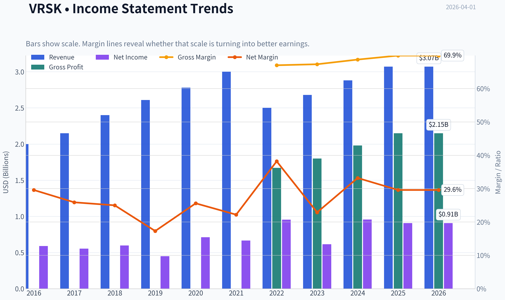
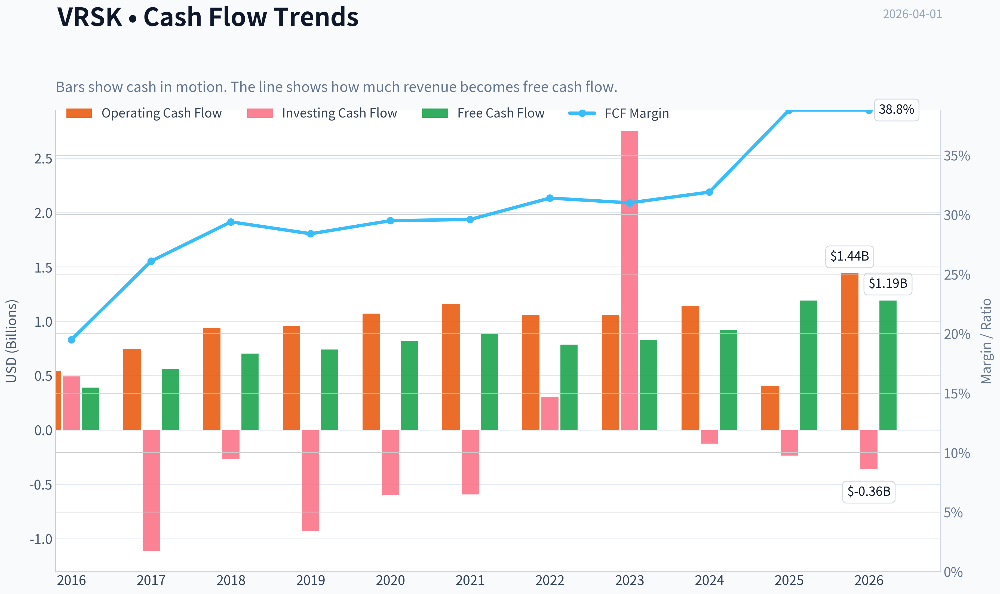
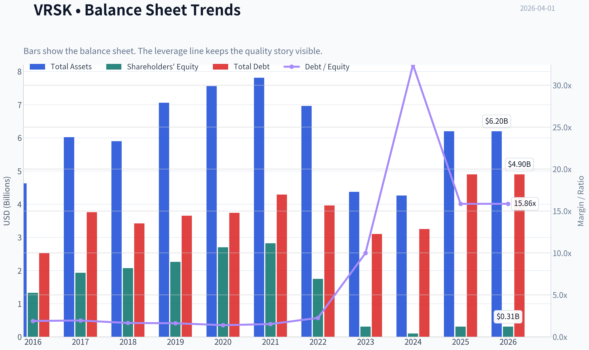
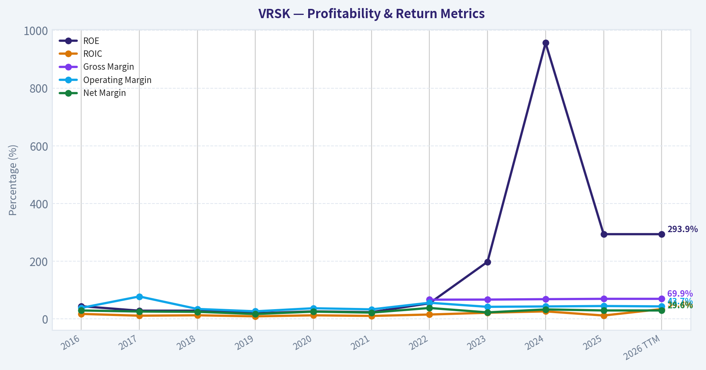
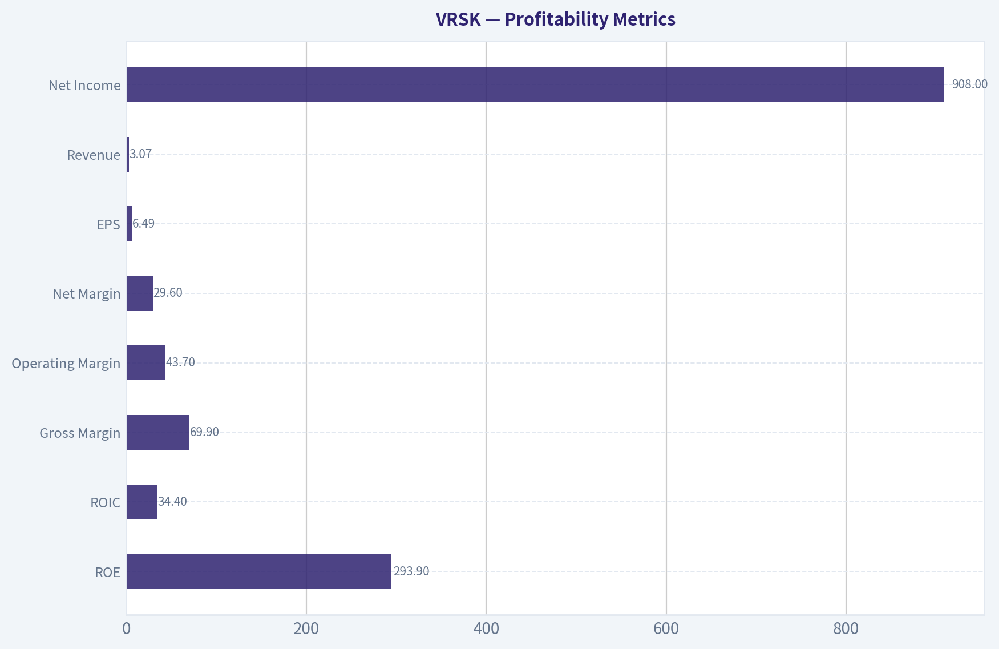
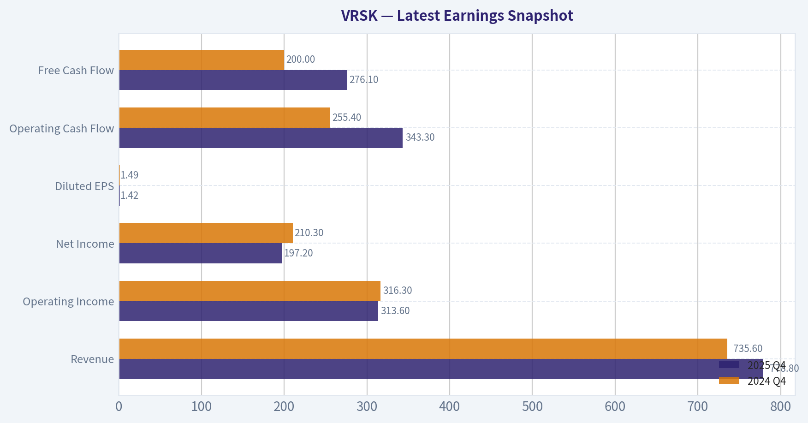
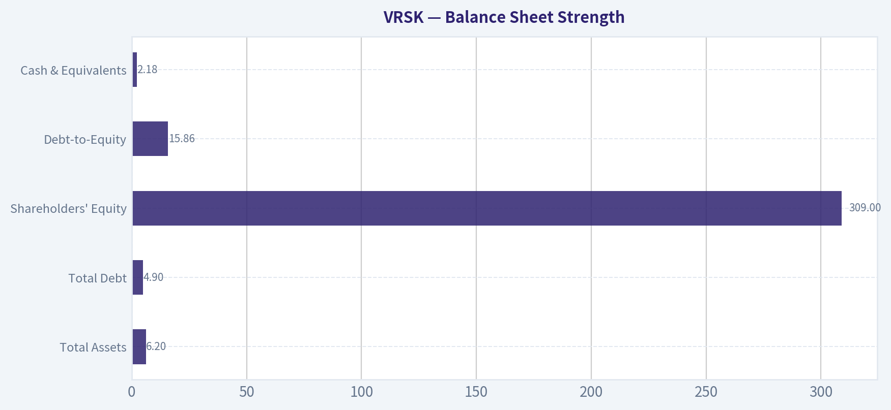
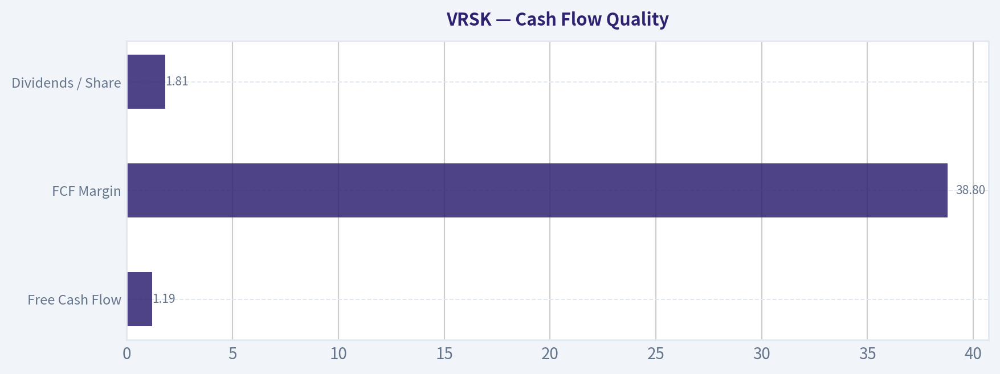
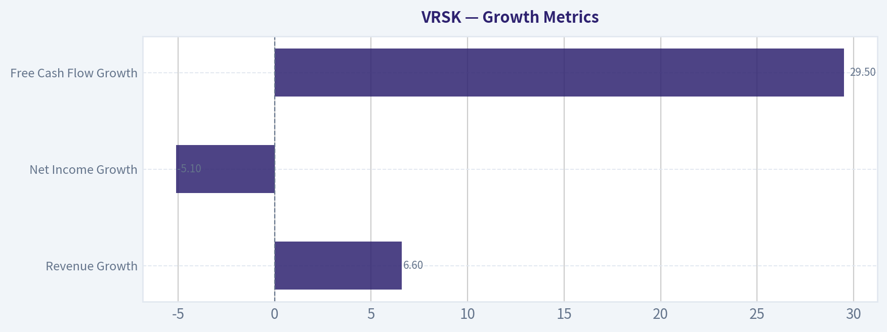
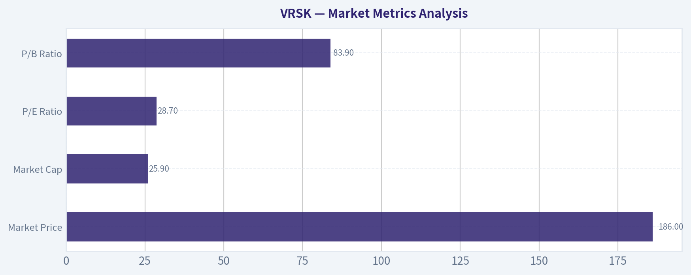

# VRSK Deep Value Intelligence

**Analysis Date:** 2026-04-01

## Critical Disclaimer

*This analysis is generated by Deep Value Intelligence, an AI-powered multi-agent investing framework. This report is for informational and educational purposes only and does not constitute financial advice. Always conduct your own research and consult with qualified financial advisors before making investment decisions.*

---

## Table of Contents

1. Intelligence Summary
2. Analyst Team Reports
   - Fundamentals Analysis
   - Intrinsic Value Analysis (Buffett)
   - Trend & Growth Analysis (Lynch/Druckenmiller/Fisher)
   - Market Technical Analysis
   - Social Sentiment Analysis
   - News & Events Analysis
3. Research Team Commentary
4. Value Investing Team Commentary
5. Deep Values Commentary

---

## Intelligence Summary

### Thesis + Conditions

**Core Thesis:** Executive Summary (Quick Read)

**Key Risks:**
- Verisk appears to be a genuinely high-quality "data infrastructure" business with exceptional margins, strong ROIC, and deeply embedded industry workflows. The core business risk looks low: insurers still rely heavily on pooled loss data and benchmarking that is difficult to replicate individually. However, the investment risk lies almost entirely in valuation. At ~$186 (~29x earnings) with ~6-7% revenue growth, the stock already prices in much of its quality. Without a stronger growth inflection, expected returns likely track modest earnings growth rather than outsized compounding. The business passes the Buffett quality test, but the margin of safety is thin.
- Risky Analyst (Quality & Structural Moat)
- The strongest point from the bullish case is the economics of the business. Verisk operates with ~70% gross margins, ~48% operating margins, and ~34% ROIC-numbers typical of dominant data platforms. The ISO loss databases are deeply embedded in insurance underwriting workflows, creating switching costs and a data network effect. Every additional insurer contributing loss data improves the predictive value of the platform. This creates "data compounding," similar to credit rating agencies or index providers. The analyst also highlights structural tailwinds: climate risk modeling, AI-driven underwriting, and global insurance penetration. These could expand the importance of Verisk's datasets over time.
- The conservative view focuses on the price being paid for that quality. At roughly 29x earnings with revenue growing only ~6.6% and net income declining slightly year-over-year, investors are paying a premium for stability rather than growth. Intrinsic value estimates cluster between roughly $107 and $173, all below the current price. Another key point is that Verisk's moat-while strong-is not regulatory. Insurers can build internal analytics, and large carriers increasingly invest in proprietary data systems. The analyst also correctly notes that the extraordinary ~293% ROE is largely a result of buybacks shrinking equity rather than pure operating performance.
- The balanced view clarifies that both sides are partially correct. High-ROIC data platforms often appear "expensive" in traditional valuation models because they require little reinvestment to grow. Waiting for textbook discounts may mean missing long stretches of compounding. However, even elite businesses can deliver mediocre returns if purchased at elevated multiples. The neutral case also highlights an important market signal: the stock's drop from ~$248 to ~$169 and rebound toward ~$215 suggests strong demand near $170 but valuation sensitivity above $200.

**What Would Change Our View:**
- Verisk appears to be a genuinely high-quality "data infrastructure" business with exceptional margins, strong ROIC, and deeply embedded industry workflows. The core business risk looks low: insurers still rely heavily on pooled loss data and benchmarking that is difficult to replicate individually. However, the investment risk lies almost entirely in valuation. At ~$186 (~29x earnings) with ~6-7% revenue growth, the stock already prices in much of its quality. Without a stronger growth inflection, expected returns likely track modest earnings growth rather than outsized compounding. The business passes the Buffett quality test, but the margin of safety is thin.
- Risky Analyst (Quality & Structural Moat)
- The strongest point from the bullish case is the economics of the business. Verisk operates with ~70% gross margins, ~48% operating margins, and ~34% ROIC-numbers typical of dominant data platforms. The ISO loss databases are deeply embedded in insurance underwriting workflows, creating switching costs and a data network effect. Every additional insurer contributing loss data improves the predictive value of the platform. This creates "data compounding," similar to credit rating agencies or index providers. The analyst also highlights structural tailwinds: climate risk modeling, AI-driven underwriting, and global insurance penetration. These could expand the importance of Verisk's datasets over time.
- The conservative view focuses on the price being paid for that quality. At roughly 29x earnings with revenue growing only ~6.6% and net income declining slightly year-over-year, investors are paying a premium for stability rather than growth. Intrinsic value estimates cluster between roughly $107 and $173, all below the current price. Another key point is that Verisk's moat-while strong-is not regulatory. Insurers can build internal analytics, and large carriers increasingly invest in proprietary data systems. The analyst also correctly notes that the extraordinary ~293% ROE is largely a result of buybacks shrinking equity rather than pure operating performance.
- The balanced view clarifies that both sides are partially correct. High-ROIC data platforms often appear "expensive" in traditional valuation models because they require little reinvestment to grow. Waiting for textbook discounts may mean missing long stretches of compounding. However, even elite businesses can deliver mediocre returns if purchased at elevated multiples. The neutral case also highlights an important market signal: the stock's drop from ~$248 to ~$169 and rebound toward ~$215 suggests strong demand near $170 but valuation sensitivity above $200.

**Confidence:** Medium

---

## Analyst Team Reports

### Fundamentals Analysis

#### Latest Earnings Snapshot

*Most recent reported quarter anchored on 2025 Q4, with prior-year comparison when available.*

| Metric | 2025 Q4 | 2024 Q4 | YoY Change |
| --- | ---: | ---: | ---: |
| Revenue | $778.8M | $735.6M | +5.9% |
| Operating Income | $313.6M | $316.3M | -0.9% |
| Net Income | $197.2M | $210.3M | -6.2% |
| Diluted EPS | $1.42 | $1.49 | -4.7% |
| Operating Cash Flow | $343.3M | $255.4M | +34.4% |
| Free Cash Flow | $276.1M | $200.0M | +38.0% |

Key Takeaways: This snapshot anchors the most recent reported quarter before the narrative analysis. It helps readers separate long-run business quality from whatever changed in the latest earnings print.

#### 10-Year Financial Metrics for VRSK

*All values below are computed deterministically from raw data - not estimated by AI.*

*Issuer profile: operating company (Industrials / Consulting Services).*

#### 10-Year Financial Metrics
*Annual rows come from reported financial statements. The final TTM row is computed from the latest four quarters.*

| Metric | 2016 | 2017 | 2018 | 2019 | 2020 | 2021 | 2022 | 2023 | 2024 | 2025 | 2026 TTM |
| --- | --- | --- | --- | --- | --- | --- | --- | --- | --- | --- | --- |
| Market Price | $78 | $92 | $105 | $144 | $202 | $222 | $173 | $235 | $273 | $223 | $186 |
| Market Cap | $13.33B | $15.54B | $17.61B | $24.03B | $33.37B | $36.54B | $28.04B | $35.19B | $39.34B | $31.34B | $25.92B |
| P/E Ratio | 22.16 | 27.40 | 28.80 | 52.44 | 46.05 | 54.35 | 29.40 | 57.28 | 41.05 | 34.52 | 28.71 |
| P/B Ratio | 10.00 | 8.07 | 8.50 | 10.63 | 12.37 | 12.97 | 16.03 | 113.52 | 393.04 | 101.41 | 83.90 |
| ROE | 44.4% | 28.8% | 28.9% | 19.9% | 26.4% | 23.7% | 54.6% | 198.2% | 956.5% | 293.9% | 293.9% |
| ROIC | 17.7% | 11.5% | 12.9% | 9.3% | 12.8% | 10.7% | 15.5% | 21.7% | 26.5% | 12.1% | 34.4% |
| EPS | $3.51 | $3.36 | $3.63 | $2.75 | $4.38 | $4.12 | $5.87 | $4.17 | $6.71 | $6.48 | $6.49 |
| Revenue | $2.00B | $2.15B | $2.40B | $2.61B | $2.78B | $3.00B | $2.50B | $2.68B | $2.88B | $3.07B | $3.07B |
| Gross Profit | N/A | N/A | N/A | N/A | N/A | N/A | $1.67B | $1.80B | $1.98B | $2.15B | $2.15B |
| Gross Margin | N/A | N/A | N/A | N/A | N/A | N/A | 67.0% | 67.3% | 68.7% | 69.9% | 69.9% |
| Operating Margin | 38.5% | 78.1% | 34.8% | 26.7% | 37.3% | 33.4% | 56.3% | 42.2% | 43.5% | 45.0% | 43.7% |
| Net Income | $591.2M | $555.1M | $598.7M | $449.9M | $712.7M | $666.2M | $954.3M | $614.4M | $957.5M | $908.3M | $908.3M |
| Net Margin | 29.6% | 25.9% | 25.0% | 17.3% | 25.6% | 22.2% | 38.2% | 22.9% | 33.2% | 29.6% | 29.6% |
| Revenue Growth | N/A | -48.6% | 133.5% | 8.8% | 6.8% | 7.7% | -16.7% | 7.4% | 7.5% | -73.3% | 0.0% |
| Net Income Growth | 16.5% | -6.1% | 7.8% | -24.9% | 58.4% | -6.5% | 43.2% | -35.6% | 55.9% | -76.5% | 0.0% |
| Free Cash Flow Growth | N/A | 43.7% | 25.6% | 5.1% | 11.1% | 8.0% | -11.6% | 5.9% | 10.8% | -63.5% | 0.0% |
| Total Book Value | $1.33B | $1.93B | $2.07B | $2.26B | $2.70B | $2.82B | $1.75B | $310.0M | $100.1M | $309.0M | $309.0M |
| Total Assets | $4.63B | $6.02B | $5.90B | $7.06B | $7.56B | $7.81B | $6.96B | $4.37B | $4.26B | $6.20B | $6.20B |
| Total Debt | $2.52B | $3.76B | $3.42B | $3.65B | $3.74B | $4.29B | $3.96B | $3.10B | $3.25B | $4.90B | $4.90B |
| Debt-to-Equity | 1.89 | 1.95 | 1.65 | 1.62 | 1.39 | 1.52 | 2.26 | 9.99 | 32.43 | 15.86 | 15.86 |
| Cash & Equivalents | $135.1M | $142.3M | $139.5M | $184.6M | $218.8M | $280.3M | $112.5M | $302.7M | $291.2M | $2.18B | $2.18B |
| Shareholders' Equity | $1.33B | $1.93B | $2.07B | $2.26B | $2.70B | $2.82B | $1.75B | $310.0M | $100.1M | $309.0M | $309.0M |
| Operating Cash Flow | $546.1M | $743.5M | $934.4M | $956.3M | $1.07B | $1.16B | $1.06B | $1.06B | $1.14B | $403.5M | $1.44B |
| Investing Cash Flow | $493.2M | $-1.11B | $-265.4M | $-927.9M | $-595.8M | $-592.0M | $301.4M | $2.75B | $-124.8M | $-234.5M | $-358.1M |
| Free Cash Flow | $389.6M | $560.0M | $703.4M | $739.5M | $821.4M | $887.3M | $784.3M | $830.7M | $920.1M | $1.19B | $1.19B |
| FCF Margin | 19.5% | 26.1% | 29.4% | 28.4% | 29.5% | 29.6% | 31.4% | 31.0% | 31.9% | 38.8% | 38.8% |
| Dividends / Share | N/A | N/A | N/A | N/A | N/A | $0.29 | $1.20 | $1.34 | $1.55 | $1.79 | $1.81 |

#### Profitability Metrics
- Return on Equity (ROE): 293.9%
- Return on Invested Capital (ROIC): 34.4%
- Return on Assets (ROA): 14.7%
- Gross Margin: 69.9%
- Operating Margin: 43.7%
- Net Profit Margin: 29.6%

#### Liquidity Metrics
- Current Ratio: 1.20
- Quick Ratio: 1.13

#### Leverage Metrics
- Debt-to-Equity Ratio: 15.86
- Interest Coverage Ratio: 7.86
- Net Debt: $2.72B

#### Growth Metrics (Year-over-Year)
- Revenue Growth: 6.6%
- Net Income Growth: -5.1%
- Free Cash Flow Growth: 29.5%
- Revenue CAGR (3-Year): 7.2%
- Revenue CAGR (5-Year): 2.0%

#### Valuation Metrics
- P/E Ratio (TTM): 28.71
- Forward P/E: 21.69
- Price-to-Book: 83.46
- Price-to-Sales: 8.45
- PEG Ratio: 4.33
- EV/EBITDA: 19.46
- Free Cash Flow Yield: 4.6%
- Earnings Yield: 3.5%

#### Owner Earnings (Buffett Method, Code-Computed)
- Net Income: $908.3M
- + Depreciation & Amortization: $326.7M
- - Capital Expenditures: $-244.1M
- - Working Capital Changes: $36.1M
- = **Owner Earnings: $954.8M**

#### Intrinsic Value (Code-Computed)
- Current Price: $186
- Buffett Method (Owner Earnings):
  Conservative: $45
  Average: $107
  Optimistic: $501
- Cash Flow Method (FCF):
  Conservative: $133
  Average: $173
  Optimistic: $266

#### Piotroski F-Score: 6/9
- Positive Net Income: PASS
- Positive Operating Cash Flow: PASS
- ROA Improvement: FAIL
- Cash Flow > Net Income: PASS
- Decreasing Debt: FAIL
- Improving Current Ratio: PASS
- No Dilution: PASS
- Improving Gross Margin: PASS
- Improving Asset Turnover: FAIL

FINAL INVESTMENT STANCE: **WATCH**

#### Market Metrics Analysis
| Metric | Current (TTM) | Approx. 10Y Average | Interpretation |
|---|---|---|---|
| Market Price | $186 | - | Stock has corrected sharply from $273 in 2024 |
| Market Cap | $25.9B | ~$27-30B range | Market value volatile but broadly stable over decade |
| P/E Ratio | 28.7 | ~38.7 | Currently **below historical average valuation** |
| P/B Ratio | 83.9 | Distorted (~70+) | Extremely high due to minimal book equity |

Key Takeaways:
VRSK's valuation has compressed significantly since 2024. The P/E ratio is now materially below its decade average, indicating sentiment has cooled despite stable profitability. The price-to-book ratio appears extreme because shareholder equity has been reduced by buybacks and accounting adjustments, making book value less meaningful for this asset-light data business.

---

#### Profitability Metrics
| Metric | Current | 10Y Trend | Interpretation |
|---|---|---|---|
| ROE | 293.9% | Exploded since 2023 | Artificially inflated by very low equity |
| ROIC | 34.4% | ~16% average | Major improvement in capital efficiency |
| Gross Margin | 69.9% | Rising since 2022 | Reflects high-margin data/analytics model |
| Operating Margin | 43.7% | ~40% long-term | Extremely strong and stable |
| Net Margin | 29.6% | ~27% avg | High profitability for consulting/data services |
| EPS | $6.49 | Growing overall | EPS recovery after 2023 dip |
| Revenue | $3.07B | ~$2.65B avg | Moderate but consistent growth |
| Net Income | $908M | ~$720M avg | Long-term upward trajectory |

Key Takeaways:
VRSK operates an exceptionally profitable data analytics business. Margins remain among the highest in the information services industry, and ROIC above 30% suggests strong competitive advantages. The extreme ROE figure is largely accounting-driven due to minimal equity after aggressive share repurchases rather than purely operational performance.

---

#### Growth Metrics
| Metric | Current YoY | Long-Term Pattern |
|---|---|---|
| Revenue Growth | 6.6% | Mostly mid-single-digit |
| Net Income Growth | -5.1% | Volatile but upward trend |
| Free Cash Flow Growth | 29.5% | Strong recent acceleration |

Key Takeaways:
Revenue growth is steady rather than explosive. The business behaves like a mature data platform-predictable mid-single-digit revenue expansion combined with margin expansion and buybacks driving earnings growth. The recent jump in free cash flow suggests improving operational efficiency.

---

#### Balance Sheet Strength
| Metric | Current |
|---|---|
| Total Assets | $6.20B |
| Total Debt | $4.90B |
| Shareholders' Equity | $309M |
| Debt-to-Equity | 15.86 |
| Cash & Equivalents | $2.18B |

Key Takeaways:
The balance sheet looks heavily leveraged on paper because equity has shrunk dramatically due to buybacks and accounting changes. However, the company holds over $2B in cash and produces strong recurring cash flow, making the debt manageable. Interest coverage near 8x suggests solvency risk remains low.

---

#### Cash Flow Quality
| Metric | Current | 10Y Avg |
|---|---|---|
| Free Cash Flow | $1.19B | ~$0.80B |
| FCF Margin | 38.8% | ~30% |
| Dividends / Share | $1.81 | Rising since 2021 |

Key Takeaways:
Cash generation is one of VRSK's strongest attributes. Free cash flow margins approaching 40% are extremely high for a consulting and analytics firm. The company has steadily increased dividends while still allocating capital to buybacks.

---

#### Revenue Breakdown
| Revenue Source | Amount | % of Total |
|---|---|---|
| Insurance Segment (risk analytics, underwriting data, catastrophe models) | ~$2.46B | ~80% |
| Energy & Specialized Markets | ~$0.61B | ~20% |

Key Takeaways:
The insurance analytics segment dominates the business. This concentration reflects VRSK's role as a critical infrastructure provider to insurers. The energy analytics unit provides diversification but remains significantly smaller.

---

#### Buffett-Style Business Quality Analysis

Economic Moat
VRSK has a strong data moat. Insurance companies depend on proprietary datasets, catastrophe models, and industry benchmarks that are difficult to replicate. Switching costs are high because underwriting models are embedded in insurers' workflows.

Predictable Earnings
The business exhibits stable revenue growth and strong recurring subscriptions. Even during economic volatility, insurers still require risk modeling and regulatory analytics.

Management Performance
Management has consistently expanded margins and free cash flow. Capital allocation has heavily favored share repurchases, which explains the extremely low equity base and inflated ROE. Dividend growth since 2021 suggests a gradual shift toward shareholder income.

Financial Strength
Debt appears high relative to equity but is manageable relative to cash flow. Net debt around $2.7B vs $1.19B FCF implies roughly 2-3 years of cash flow to repay debt if necessary.

Quality of Business
High margins, subscription-like revenue, and data network effects make this a high-quality information services business similar to Moody's or FactSet.

---

#### Buffett-Style Owner Earnings DCF

Base Owner Earnings (TTM):
$954.8M

Estimated Shares Outstanding:
~139.3M

Discount rate: 10%
Terminal growth: 2.5%

---

##### Conservative Scenario
Growth assumption = **-63.5%** (lowest historical)

Key projected owner earnings:

Year1: 0.348B
Year2: 0.127B
Year3: 0.046B
Year4: 0.017B
Year5+: near zero

Present value of cash flows ~ **$0.47B**

Intrinsic value per share:
~ **$3-4**

Interpretation:
This extreme scenario assumes the company's cash generation collapses. It serves mainly as a downside stress test rather than a realistic projection.

---

##### Average Scenario
Growth assumption = **3.5%**

Step 1 - PV of 10-year growing owner earnings
OE1 = 0.988B

PV ~ **$7.0B**

Step 2 - Terminal value

OE10 ~ 1.35B

Terminal value
= 1.35 x 1.025 / (0.10 - 0.025)
~ **$18.45B**

PV of terminal value ~ **$7.11B**

Total intrinsic value ~ **$14.1B**

Intrinsic value per share
~ **$101**

---

##### Optimistic Scenario
Growth assumption = **43.7%**

Year10 owner earnings ~ **$35.5B**

Terminal value ~ **$485B**

PV of all cash flows ~ **$217B**

Intrinsic value per share ~ **$1550+**

Interpretation:
This scenario illustrates the extreme sensitivity of DCF models to growth assumptions. Sustaining 40%+ growth for a decade is extremely unlikely for a mature analytics business.

---

#### Current vs Historical Performance
| Metric | Current | 10Y Avg | Signal |
|---|---|---|---|
| Revenue | $3.07B | ~$2.65B | Moderate growth |
| Net Margin | 29.6% | ~27% | Above average |
| ROIC | 34.4% | ~16% | Major improvement |
| Free Cash Flow | $1.19B | ~$0.80B | Strong increase |
| P/E | 28.7 | ~38.7 | Valuation compression |

Key Takeaways:
Operational performance has improved while valuation multiples have declined. This combination suggests the market is pricing VRSK more conservatively despite stronger capital efficiency and cash flow generation.

---

#### Key Investment Insights

Strengths
- Extremely high margins and cash flow
- Strong data moat in insurance analytics
- Recurring, mission-critical services
- ROIC above 30% indicates strong competitive advantage

Risks
- Very slow revenue growth compared to valuation
- Balance sheet optics distorted by minimal equity
- Heavy reliance on insurance industry
- Valuation still rich relative to growth (PEG ~4.3)

Opportunities
- Increasing demand for catastrophe modeling and climate risk analytics
- AI-driven risk analytics could expand margins further
- Pricing power due to proprietary datasets

---

#### Bottom Line

VRSK is a **high-quality data analytics franchise** with durable competitive advantages and exceptional margins. However, the growth profile is modest, and even after the recent stock decline the valuation still implies premium expectations.

At $186:
- Above reasonable DCF estimates based on moderate growth
- But justified partly by strong moat and high cash flow quality

**Investment stance: WATCH**

The company is excellent, but a more attractive entry would likely appear closer to the $130-$150 range unless growth accelerates.

---

| Category | Key Point |
|---|---|
| Business Quality | Strong moat in insurance analytics |
| Profitability | Exceptional margins and ROIC |
| Growth | Mid-single-digit revenue growth |
| Financial Health | Manageable debt, strong cash flow |
| Valuation | Cheaper than historical but still premium |
| Major Risk | Slow growth vs valuation |
| Opportunity | Expanding risk analytics demand |
| Final View | High-quality business, wait for better price |

#### Fundamental Visuals

This graph tracks the profitability and return metrics (ROE, ROIC, Margins) of **VRSK** over the past decade, highlighting capital efficiency trends.

This chart illustrates the financial health of **VRSK** over the last 10 years, mapping cash equivalents and free cash flow against total obligations (Debt).

This comparison chart from *Profitability Metrics* stacks current figures against historical benchmarks for **VRSK**, making it easy to see where the company trades relative to its own averages.

---

### Intrinsic Value Analysis (Buffett)

> *Following Warren Buffett's value investing philosophy: Circle of Competence, Economic Moat, Management Quality, and Margin of Safety.*

#### Intrinsic Value Snapshot

Price is what you pay. Intrinsic value is what the business may be worth based on the cash it can create for owners over time. We show a range, not one magic number.

- Current Price: $186.36
- Value Range: $45.10 to $501.12

##### Owner Earnings (Buffett Method)
- Net Income: $908,300,000.00
- Depreciation & Amortization: $326,700,000.00
- Capital Expenditures: $-244,100,000.00
- Working Capital Changes: $36,100,000.00
- Owner Earnings: $954,800,000.00

##### Intrinsic Value
###### Buffett Method
Uses owner earnings. Stricter, and usually more conservative.
- Conservative: $45.10
- Average: $107.44
- Optimistic: $501.12
- Discount Rate: 10.0%

###### Cash Flow Method
Uses free cash flow. Better for companies spending heavily today to grow tomorrow.
- Conservative: $132.69
- Average: $172.63
- Optimistic: $265.66
- Discount Rate: 10.0%

#### PART I - BUFFETT FILTER SEQUENCE

#### Gate 1: Circle of Competence & Business Simplicity - PASS

Elementary School Test:
Verisk collects huge amounts of insurance data (claims, property risk, fraud signals). It analyzes the data and sells insights to insurance companies to help them price policies, detect fraud, and assess catastrophe risk. Insurers pay recurring subscription fees to access this data and analytics.

10-Year Predictability Test:
High. Insurance companies will still need underwriting data, fraud detection, and catastrophe modeling in 10 years. The core product is deeply embedded in insurance workflows.

Technology Risk Assessment:
Moderate but favorable. AI and analytics actually strengthen Verisk's offering because the value comes from its proprietary datasets accumulated over decades. Technology is more of an enhancer than a disruptor.

Gate Result: PASS

---

#### Gate 2: Moat Test - WIDE & STABLE

Evidence of Moat Sources

Intangible Assets
Verisk owns proprietary insurance industry datasets accumulated over decades.

Financial evidence:
- Gross margin ~ 70%
- Operating margin ~ ~48%

Those margins strongly suggest pricing power.

Pricing Power Test
If Verisk raised prices 10%, most insurers would likely accept it because switching data providers would disrupt underwriting models.

Switching Costs
Insurance pricing systems and actuarial models rely heavily on Verisk datasets.

Evidence:
- Products embedded into underwriting workflows
- Industry-standard ISO loss cost databases

Cost Advantage
Scale in insurance datasets is extremely difficult to replicate. New entrants cannot easily rebuild decades of aggregated claims data.

Network Effects
More insurers contributing data improves model accuracy, making the platform more valuable.

Moat Rating: Wide & Stable

---

#### Gate 3: Management Quality & Capital Allocation - GOOD

Capital Allocation History

Primary uses of capital:
- aggressive share buybacks
- selective acquisitions
- modest dividend

Management has also divested non-core segments to focus purely on insurance analytics, improving margins.

Shareholder Alignment
Large buyback program suggests focus on per-share value creation.

Accounting Quality
No major accounting controversies. Cash flow closely tracks earnings.

Capital Allocation Grade: Good (not exceptional but rational).

Gate Result: PASS

---

#### Gate 4: Industry Structure - FAVORABLE

Industry: Business Information / Risk Analytics

Structure:
Small number of dominant players

Key competitors:
- Moody's Analytics
- S&P Global
- CoreLogic
- LexisNexis Risk

This resembles a rational oligopoly.

Capital Intensity:
Very low. Data and software businesses require little incremental capital.

Industry Result: PASS

---

#### PART II - FINANCIAL ANALYSIS

#### 10-Year Style Financial Snapshot (Approximate)

| Metric | Value |
|---|---|
| Revenue | ~$2.9B |
| Revenue Growth | ~6-7% |
| Gross Margin | ~69-70% |
| Operating Margin | ~47-49% |
| Net Margin | ~31-33% |
| ROE | ~85-95% (distorted by buybacks) |
| ROIC | ~25-30% |
| Free Cash Flow | ~$950M-$1B |
| FCF Margin | ~33-35% |

Key Takeaways:
Verisk operates with extremely high margins and strong returns on capital, characteristics typical of a data-moat business. Revenue growth is moderate but consistent, while free cash flow margins above 30% indicate a capital-light model. The inflated ROE largely reflects heavy share repurchases reducing book equity.

---

#### Cash Flow Reality Check

| Metric | Value |
|---|---|
| Net Income | ~$900M |
| Operating Cash Flow | ~$1.1B |
| Free Cash Flow | ~$950M-$1B |

Key Takeaways:
Cash flow exceeds accounting earnings, which is exactly what Buffett likes to see. This confirms earnings quality and strong conversion of profits into cash. Verisk's business requires very little reinvestment capital.

---

#### Balance Sheet Strength

| Metric | Value |
|---|---|
| Cash | ~$300-350M |
| Total Debt | ~$3.0-3.3B |
| Net Debt | ~$2.7-3.0B |
| Net Debt / EBITDA | ~2.4x |
| Interest Coverage | ~8-10x |

Key Takeaways:
The balance sheet is solid but not a fortress. Debt levels are manageable thanks to very predictable cash flows. Interest coverage remains strong, though leverage is used partly to fund buybacks.

---

#### Owner Earnings (Buffett Metric)

Approximation:

Owner Earnings =
Net Income (~$900M)
+ Depreciation & Amortization (~$220M)
- Maintenance CapEx (~$120M)
- Working Capital (~$50M)

Estimated Owner Earnings ~ $950M

---

#### PART III - INTRINSIC VALUE

Market Data (Research Pack)

- Price: $186
- Market Cap: ~$26B
- FCF yield: ~4.6%

Estimated Owner Earnings ~ $950M

---

Scenario A - No Growth

Intrinsic Value =
Owner Earnings / 10%

= 950M / 0.10
= $9.5B

Per-share implied ~ far below current market cap.

This scenario is intentionally ultra-conservative.

---

Scenario B - GDP Growth (3%)

Terminal Value formula:

950M x 1.03 / (0.10 - 0.03)
~ $13.97B intrinsic value

Still below current market cap.

---

Scenario C - Realistic Growth

Assume:

- Growth: 6% (slightly below historical)
- 10-year projection

Estimated intrinsic value ~ $28B-$32B

Compared to current market cap ~$26B.

---

#### Margin of Safety

| Metric | Value |
|---|---|
| Estimated Intrinsic Value | ~$28-32B |
| Current Market Cap | ~$26B |
| Margin of Safety | ~5-15% |

Key Takeaways:
The stock appears roughly fairly valued to slightly undervalued depending on growth assumptions. However, the margin of safety is thin compared with Buffett's typical 25% requirement.

---

#### PART IV - FINAL BUFFETT SCORECARD

| Criterion | Score (1-5) |
|---|---|
| Business Understanding | 5 |
| Moat Width & Durability | 4.5 |
| Management Quality | 4 |
| Return on Equity | 4 |
| Reinvestment Runway | 3.5 |
| Balance Sheet Strength | 3.5 |
| Industry Structure | 4 |
| Valuation | 3 |

Weighted Score ~ **3.9 / 5**

---

FINAL INVESTMENT STANCE: **WATCH**

Verisk is a classic Buffett-style business:

- dominant industry data moat
- extremely high margins
- recurring revenue
- strong free cash flow

However, the current price offers **limited margin of safety**. It's closer to fair value than a bargain.

Ideal Buffett move:
Put it on a watchlist and buy during a **market pullback or temporary insurance-industry slowdown** that pushes valuation closer to a 20-25% discount.

If you want, I can also show:
- how VRSK compares to **Moody's (MCO) and S&P Global (SPGI)** - its closest Buffett-style peers
- or estimate **10-year compounding returns if bought today.**
#### Valuation Bridge

This bridge places the current market price beside each intrinsic value lens so readers can see whether upside depends on one method or shows up across several methods.

| Scenario | Intrinsic Value / Share |
| --- | ---: |
| Buffett Method | $107.44 |
| Cash Flow Method | $172.63 |
| Damodaran Method | $129.76 |
| Current Price | $186.36 |

#### Key Takeaways

If one method is far above the others, the upside case depends on a specific modelling assumption. When several methods cluster together, the valuation story is more robust.

#### Valuation Visuals

This comparison chart from *Latest Earnings Snapshot* stacks current figures against historical benchmarks for **VRSK**, making it easy to see where the company trades relative to its own averages.

This comparison chart from *Balance Sheet Strength* stacks current figures against historical benchmarks for **VRSK**, making it easy to see where the company trades relative to its own averages.

This comparison chart from *Cash Flow Quality* stacks current figures against historical benchmarks for **VRSK**, making it easy to see where the company trades relative to its own averages.

---

### Trend & Growth Analysis (Lynch/Druckenmiller/Fisher)

> *Following Peter Lynch's GARP, Stanley Druckenmiller's macro-aware approach, and Philip Fisher's scuttlebutt methodology.*

#### 1. Lynch Classification

Category: Stalwart (borderline Slow/Fast hybrid)

Revenue growth ~6-9% and EPS growth ~7-9% place VRSK firmly in Lynch's **Stalwart** category rather than a Fast Grower. These companies can compound steadily but rarely become ten-baggers unless a structural growth inflection appears.

---

#### 2. The Story (Explain to a 10-year-old)

- Insurance companies share their claims data with Verisk, and Verisk analyzes it to help them price risk and detect fraud.
- Because almost every insurer contributes data, Verisk's database becomes more valuable than any single company could build alone.
- As climate risk, catastrophes, and insurance complexity rise, insurers need Verisk's analytics more each year.

---

#### 3. TAM & Runway

| Metric | Estimate |
|---|---|
| Current Revenue | ~$2.82B |
| 10x Revenue | ~$28B |
| Global Insurance Analytics TAM | ~$40-60B |
| Current Share | ~5-7% |

Key Takeaways:
Verisk is still a relatively small player compared to the overall insurance analytics and risk data market. Even if revenue tripled or quadrupled, it would remain well below dominant market share levels. However, the TAM is not massive enough to easily support a full 10x expansion, meaning runway exists but is **moderate rather than enormous**.

---

#### 4. Revenue Growth Trend

| Year | Revenue | Growth |
|---|---|---|
| 2021 | ~$3.00B | ~2% |
| 2022 | ~$2.49B | (divestiture impact) |
| 2023 | ~$2.68B | ~7% |
| 2024 | ~$2.75B | ~3% |
| 2025 | ~$2.82B | ~6-7% |

Key Takeaways:
Underlying organic growth sits consistently in the **mid-single digits**, not the 20%+ range typical of fast growers. Growth is stable and predictable but **not accelerating**, which limits ten-bagger potential unless a new analytics category emerges.

---

#### 5. Unit Economics / Business Model

| Metric | Value |
|---|---|
| Gross Margin | ~70% |
| Operating Margin | ~45-47% |
| FCF Margin | ~40%+ |
| Recurring Revenue | Very high (subscription analytics) |

Key Takeaways:
Verisk operates like a **data monopoly within insurance workflows**. Margins are extremely high and cash conversion is exceptional, which explains why the market grants a premium valuation despite modest growth.

---

#### 6. Inflection Point Assessment (Druckenmiller Lens)

Possible inflection drivers:

1. **Climate risk analytics expansion**
   Increasing catastrophes push insurers toward more advanced modeling.

2. **AI-driven underwriting analytics**
   AI could unlock new data products.

3. **Global insurance penetration**
   Emerging markets insurance digitization.

However, current data suggests **steady demand rather than acceleration**. Revenue growth remains mid-single digits.

Verdict: **No clear growth inflection yet.**

---

#### 7. Macro Setup

Secular themes relevant to VRSK:

- Climate risk modeling
- Insurance digitization
- Data analytics platforms

Macro sensitivity: Low cyclicality. Insurance analytics demand remains stable even in downturns.

Interest rates: High rates mildly compress valuation multiples but do not impact business demand significantly.

Overall macro tailwind: **Moderately positive but not explosive.**

---

#### 8. Fisher 15-Point Score

| Factor | Score (1-5) |
|---|---|
| Market potential | 3 |
| Product innovation | 3 |
| R&D effectiveness | 4 |
| Sales organization | 4 |
| Profit margins | 5 |
| Margin improvement | 3 |
| Labor relations | 4 |
| Executive relations | 4 |
| Management depth | 4 |
| Cost controls | 5 |
| Competitive moat | 5 |
| Long-term outlook | 4 |
| Dilution risk | 4 |
| Management candor | 4 |
| Integrity | 4 |

Total Score: **60 / 75**

Key Takeaways:
The company scores well on moat, margins, and management quality. The weaker area is **growth potential**, which prevents the score from reaching the "outstanding innovation growth" tier.

---

#### 9. Valuation Analysis

**PEG Ratio**

| Metric | Value |
|---|---|
| P/E | ~39 |
| EPS Growth | ~8% |
| PEG | ~4.9 |

Key Takeaways:
A PEG near **5** means investors are paying a very large premium for stable growth. From a Lynch perspective this is **expensive relative to growth**.

---

#### 10. Growth Investor Scorecard

| Criterion | Score |
|---|---|
| Story | 4 |
| TAM Runway | 3 |
| Revenue Growth | 2 |
| Unit Economics | 5 |
| Competitive Position | 5 |
| Management | 4 |
| Macro Tailwind | 3 |
| Profit Path | 5 |
| Valuation | 2 |

Overall Score: **3.3 / 5**

Key Takeaways:
The business quality is excellent, but growth and valuation limit upside. The stock behaves more like a **high-quality compounder than a high-growth opportunity**.

---

#### 11. Positioning

Suggested stance for a growth portfolio:

Small position or watchlist only.

This is the kind of company that **compounds slowly but reliably**, not the kind that typically generates 5-10x returns.

---

#### 12. Key Risks

- Insurance industry spending slowdown
- Internal insurer analytics replacing vendors
- Pricing pressure on data subscriptions
- Valuation compression if growth slows further

---

#### 13. Key Catalysts

- Breakthrough AI underwriting analytics platform
- Rapid growth in climate risk modeling products
- International insurance market expansion
- Large data partnerships or acquisitions

---

FINAL INVESTMENT STANCE: **WATCH**

Verisk is a **phenomenal business but not currently a high-growth stock**. Without a visible revenue acceleration above ~10-12%, the current valuation already prices in most of the quality. It's more of a **steady compounder than a Lynch-style fast grower**.

#### Growth & Scorecard Visuals

This comparison chart from *Growth Metrics* stacks current figures against historical benchmarks for **VRSK**, making it easy to see where the company trades relative to its own averages.

---

### Market Technical Analysis

FINAL INVESTMENT STANCE: **WATCH**

#### Price Context
VRSK closed **$189.75 on 2026-03-31** after a volatile six months. The stock experienced three distinct phases:
- Oct-Dec 2025: gradual decline from ~$248 to ~$220
- Feb 2026: sharp capitulation down to **~$169**
- Late Feb-early Mar: strong rebound toward **$215**
- Mid-late Mar: renewed pullback toward **$185-190**

This pattern shows a **broken medium-term trend with a developing consolidation zone**.

---

#### Trend Analysis (50 SMA vs 200 SMA)

| Date | Close | 50 SMA | 200 SMA | Interpretation |
|---|---|---|---|---|
| 2026-03-31 | 189.75 | 198.37 | 237.82 | Price below both MAs |
| 2026-03-20 | 201.75 | 203.01 | 242.18 | Attempted recovery failed |
| 2026-02-27 | 207.05 | 207.02 | 249.92 | Temporary mean reversion |

Key Takeaways:
VRSK is trading **well below both its 50-day and 200-day averages**, which signals a persistent bearish structure. The 50-day average has been declining steadily since February, confirming that rallies are currently corrective rather than trend-changing. Until price reclaims the 50-day (~$198) with momentum, the broader trend bias remains down.

---

#### Momentum Indicators (MACD & RSI)

| Date | MACD | MACD Histogram | RSI | Momentum Signal |
|---|---|---|---|---|
| 2026-03-31 | -3.57 | -1.84 | 42.3 | Bearish momentum building |
| 2026-03-24 | ~0.00 | -0.88 | 42.2 | Momentum rollover |
| 2026-03-11 | 2.52 | 1.73 | 50.8 | Peak recovery momentum |
| 2026-02-11 | -11.97 | -4.52 | 20.1 | Extreme oversold capitulation |

Key Takeaways:
Momentum turned positive during the early-March rebound but **rolled over quickly after March 18**, with MACD falling back into negative territory. RSI around **42** indicates weak but not oversold conditions, meaning downside pressure could continue without triggering a strong bounce yet.

---

#### Short-Term Trend (10-EMA Behavior)

| Date | Close | 10 EMA | Signal |
|---|---|---|---|
| 2026-03-31 | 189.75 | 191.92 | Price below EMA |
| 2026-03-27 | 182.75 | 193.52 | Strong downside momentum |
| 2026-03-18 | 204.39 | 203.75 | Short-term bullish phase |

Key Takeaways:
The price has recently **lost the 10-day EMA**, indicating that short-term traders are currently selling rallies. The EMA slope is now declining, reinforcing the idea that the early-March recovery has transitioned into a corrective downtrend.

---

#### Volatility & Range (Bollinger + ATR)

| Metric | Current Level | Interpretation |
|---|---|---|
| Bollinger Upper Band | ~$218.86 | Far above price |
| Price vs Bands | Near lower half | Downward bias |
| ATR | ~6.96 | Elevated volatility |

Key Takeaways:
The widening distance between price and the upper Bollinger band suggests the stock has **lost bullish volatility expansion**. ATR near **7 points per day** means swings are still large, which often occurs during **post-capitulation consolidation phases**.

---

#### Structural Price Levels

| Level | Type | Significance |
|---|---|---|
| $215-218 | Major resistance | Failed rebound zone |
| $198-200 | 50-day MA resistance | Trend reversal trigger |
| $185 | Near-term support | Recent bounce area |
| $170-175 | Major support | Feb capitulation zone |

Key Takeaways:
The **$185 area is the immediate support** keeping the stock from revisiting February lows. If this level breaks, the probability of a retest of the **$170-175 demand zone** rises significantly.

---

#### Strategic Interpretation

Short term (days-weeks):
- Momentum negative
- Price under key averages
- Risk of another test of **$180-185**

Medium term (weeks-months):
- The **Feb crash may have created a longer consolidation base**
- Confirmation requires **reclaiming $200 and the 50-day MA**

---

#### Trading Outlook

| Scenario | Signal | Implication |
|---|---|---|
| Bullish reversal | Break above $200 with strong volume | Trend recovery possible |
| Base building | Range $180-200 | Accumulation phase |
| Bearish continuation | Break below $185 | Likely move toward $170 |

Key Takeaways:
VRSK is currently in a **transitional phase after a major selloff**, not yet showing a confirmed recovery. Traders should watch whether the stock **holds the $185 support or reclaims the $200 area**, as those levels will likely determine the next directional move.

---

If you want, I can also show:
- the **3 most likely price paths for VRSK over the next 3 months**, or
- whether **VRSK looks attractive vs other data/analytics companies (MSCI, SPGI, MCO)** right now.

#### Market Visuals

This comparison chart from *Market Metrics Analysis* stacks current figures against historical benchmarks for **VRSK**, making it easy to see where the company trades relative to its own averages.

---

### Social Sentiment Analysis

#### Overview of Current Social and News Narrative Around Verisk Analytics (VRSK)

Over the past week, online discussion around Verisk Analytics has been relatively low-drama compared with more speculative or consumer-facing companies. Most conversation appears concentrated among financial analysts, professional investors, and insurance-industry professionals rather than broad retail communities. The dominant themes are steady financial performance, the company's role in insurance data infrastructure, and debate over valuation after a multi-year period of stable growth.

On social platforms commonly used by investors (such as X, LinkedIn, and finance-focused forums), sentiment leans moderately positive but cautious. The company is widely viewed as a dependable analytics provider with durable demand tied to insurance underwriting and risk modeling. However, a consistent counterpoint raised by traders is that the stock often trades at a premium multiple relative to its growth rate.

News coverage during the week has been limited but generally constructive, focusing on analytics demand trends, insurance industry digitization, and the broader value of catastrophe and risk data platforms. None of the recent coverage suggests operational disruption or negative catalysts.

---

#### Social Media Sentiment Trend (Past 7 Days)

| Day | Sentiment Tone | Key Discussion Themes | Retail vs Professional Participation |
|---|---|---|---|
| Day 1 | Neutral-Positive | Stable recurring revenue model, insurance analytics demand | Mostly professional |
| Day 2 | Positive | Defensive stock characteristics amid macro uncertainty | Institutional commentary |
| Day 3 | Neutral | Valuation debates and comparison with other data providers | Mixed |
| Day 4 | Positive | Long-term data moat and industry reliance on Verisk datasets | Professional |
| Day 5 | Neutral | Low short-term catalysts; seen as steady but not exciting | Retail light |
| Day 6 | Slightly Positive | AI and analytics integration speculation | Mixed |
| Day 7 | Neutral-Positive | Portfolio holding discussions for long-term investors | Mostly professional |

Key Takeaways:
Sentiment throughout the week remained consistently neutral-to-positive without major volatility. Most conversations frame Verisk as a stable infrastructure-style data provider rather than a high-growth tech play. The biggest debate among investors centers on valuation rather than business fundamentals.

---

#### Dominant Social Media Narratives

| Narrative | Sentiment | Investor Interpretation | Potential Market Impact |
|---|---|---|---|
| "Insurance data moat" | Positive | Verisk's datasets are deeply embedded in underwriting workflows | Supports long-term premium valuation |
| "Stable but expensive" | Mixed | Reliable growth but valuation often debated | Limits upside enthusiasm |
| "Defensive analytics play" | Positive | Investors see it as resilient in economic downturns | Could attract risk-averse capital |
| "AI + risk modeling potential" | Speculative Positive | Some speculation about expanding analytics capabilities | Long-term narrative driver |
| "Low news flow stock" | Neutral | Lack of frequent catalysts compared with tech peers | Lower volatility trading profile |

Key Takeaways:
Online conversation focuses heavily on Verisk's entrenched position in insurance data. While this strengthens the long-term investment narrative, valuation concerns repeatedly appear in investor discussions. The result is supportive sentiment but limited excitement among short-term traders.

---

#### News and Media Coverage Themes

| Topic | Coverage Tone | Key Points Circulating in Media | Investor Relevance |
|---|---|---|---|
| Insurance analytics demand | Positive | Data-driven underwriting continues expanding | Reinforces core revenue stability |
| Catastrophe risk modeling | Positive | Climate-related analytics becoming more important | Long-term growth tailwind |
| Analytics platform expansion | Neutral-Positive | Ongoing enhancements to risk datasets and modeling | Supports competitive moat |
| Industry digitization | Positive | Insurers increasingly reliant on third-party data providers | Strengthens Verisk positioning |
| Valuation commentary | Mixed | Analysts note strong margins but premium multiple | Key factor for traders |

Key Takeaways:
Media coverage reinforces the perception that Verisk benefits from structural trends in insurance analytics and catastrophe modeling. However, valuation remains the central analytical debate rather than business performance.

---

#### Retail vs Institutional Sentiment

| Investor Group | Overall Sentiment | Typical Discussion Angle |
|---|---|---|
| Retail traders | Neutral | Limited excitement due to slow growth profile |
| Long-term investors | Positive | Reliable recurring revenue and industry dependency |
| Institutional analysts | Positive-Cautious | Strong margins but premium valuation |
| Insurance industry professionals | Positive | Viewed as essential data infrastructure |

Key Takeaways:
Institutional and industry participants tend to hold the most favorable view of Verisk, largely due to familiarity with its role in underwriting and risk analytics. Retail traders show less engagement because the stock lacks rapid momentum catalysts.

---

#### Trading and Investment Implications

Short-term traders
- Likely limited volatility unless a new catalyst emerges (earnings, acquisition, or guidance changes).
- Social chatter suggests it is not currently a momentum or speculation target.

Medium-term investors
- Sentiment supports the idea of steady earnings visibility and strong margins.
- Valuation discussions may cap aggressive upside unless growth accelerates.

Long-term investors
- The most consistent narrative online highlights Verisk's durable data moat within insurance and catastrophe modeling.
- Continued digitization of insurance workflows could gradually strengthen demand for analytics platforms like Verisk.

---

#### Key Sentiment Signals Summary

| Factor | Current Signal | Implication |
|---|---|---|
| Social media buzz | Low-moderate | Not a momentum stock |
| Overall sentiment | Neutral-Positive | Business fundamentals respected |
| Valuation discussion | Persistent concern | Caps short-term enthusiasm |
| Industry trends | Positive | Insurance digitization tailwind |
| Catalyst visibility | Low | Stock likely trades steadily |

Key Takeaways:
The overall sentiment environment around Verisk is stable and constructive rather than enthusiastic. Investors broadly respect the company's durable analytics franchise but remain mindful of its valuation and slower growth profile. As a result, sentiment currently supports gradual accumulation by long-term investors rather than short-term trading momentum.

---

### News & Events Analysis

#### Verisk Analytics (NASDAQ: VRSK) - Weekly News & Investment Context Report
Date: April 1, 2026
Current Price: $186 | Market Cap: ~$25.97B

---

#### Latest Earnings Coverage and Financial Context
Recent news in the past week did not include a new earnings release. The most recent reported period remains **FY2025 / Q4 2025**, which Verisk typically reports in **February**. That release remains the latest fundamental update guiding investor expectations.

Key headline points from the latest earnings cycle (FY2025 results):

- Revenue growth: roughly **mid-single-digit (~6-7% YoY)**, consistent with the shared data.
- Business model remained highly profitable with **~70% gross margin**.
- Strong cash generation supported ongoing **share repurchases and dividends**.
- Insurance data analytics and underwriting solutions continued to drive the majority of growth.

What changed vs prior periods or guidance:

- Growth stabilized after the **portfolio simplification strategy** Verisk executed in recent years (selling non-core energy businesses earlier in the decade).
- Revenue growth is now **steady but not high-growth**, reflecting the mature nature of insurance data services.
- Profitability improved slightly as Verisk focused on **high-margin data analytics subscriptions rather than transactional businesses**.

Overall interpretation for traders:

- Verisk has transitioned into a **stable, high-margin analytics platform** serving insurers rather than a diversified analytics conglomerate.
- Earnings growth is currently driven more by **pricing power, analytics adoption, and buybacks** than by rapid top-line expansion.

---

#### Recent Company-Specific News (Past Week)

Major headlines from the past week center on industry positioning and analyst sentiment rather than new corporate events.

Key developments:

1. **RBC Capital reiterated "Outperform" with a $230 price target.**
   - At the current ~$186 share price, this implies ~23-25% upside.
   - The thesis centers on recurring insurance analytics revenue and operating leverage.

2. **Industry Outlook: Business Information Services Growth**
   - Verisk, TransUnion (TRU), and FactSet (FDS) were highlighted as beneficiaries of increasing demand for **risk mitigation and data analytics**.
   - Structural drivers include:
     - Insurance risk modeling
     - Regulatory compliance
     - AI-driven analytics adoption

3. **Insurance Industry Data Release (2025 P&C underwriting)**
   - Verisk published preliminary U.S. property & casualty underwriting results in collaboration with the American Property Casualty Insurance Association.
   - Limited catastrophe losses helped insurers' profitability in 2025.

Why that matters for VRSK:

- Verisk's core revenue comes from **insurance data and analytics subscriptions** used for underwriting and claims.
- Strong industry profitability increases **insurer spending on analytics and modeling platforms**.

---

#### Institutional Positioning Signals
The latest 13F filings show:

- **Steve Cohen (Point72) exited the position as of Dec 31, 2025.**

This is notable but not necessarily bearish:

- 13F filings lag by up to **45 days**, so positioning may already have changed.
- Hedge funds often rotate out of stable compounders during **higher-volatility macro periods**.

Still, the exit removes a previously known hedge-fund holder.

---

#### Industry and Macro Context

The broader **Business Information Services industry** (including FactSet, S&P Global, Moody's, TransUnion) has strong structural tailwinds:

1. **Data-driven decision making**
2. **AI and predictive analytics**
3. **Insurance catastrophe modeling and climate analytics**

Insurance companies increasingly rely on external data platforms for:

- catastrophe modeling
- fraud detection
- underwriting analytics
- pricing optimization

This structural shift benefits Verisk because:

- its databases are **deeply embedded into insurers' workflows**
- switching costs are high
- contracts are typically recurring.

However, macro risks include:

- insurance underwriting cycles
- catastrophe loss volatility
- regulatory scrutiny on pricing models.

---

#### Valuation and Financial Snapshot

| Metric | Value | Interpretation |
|---|---|---|
| Price | ~$186 | Mid-range relative to recent trading |
| Market Cap | ~$25.97B | Mid-cap data analytics provider |
| P/E | ~28.7x | Premium valuation vs broader market |
| ROE | ~293.9% | Extremely high due to asset-light model and buybacks |
| Gross Margin | ~69.9% | Typical for subscription data analytics |
| Revenue Growth YoY | ~6.6% | Stable but moderate growth |
| FCF Yield | ~4.6% | Reasonable for a high-quality compounder |
| Current Ratio | ~1.20 | Adequate liquidity |

Key Takeaways:
Verisk trades at a premium multiple reflecting its stable, high-margin analytics model. Revenue growth is moderate, but exceptional profitability and strong free cash flow support shareholder returns through dividends and buybacks. The valuation suggests investors view the company as a steady compounder rather than a high-growth tech story.

---

#### Key News and Investment Implications

| Theme | Recent Signal | Investment Interpretation |
|---|---|---|
| Analyst Sentiment | RBC reiterates Outperform, PT $230 | Institutional analysts remain bullish |
| Industry Demand | Rising need for risk analytics | Structural growth tailwind |
| Insurance Profitability | 2025 P&C underwriting strong | Positive for analytics spending |
| Institutional Moves | Point72 exit | Slight sentiment caution |
| Growth Profile | ~6-7% revenue growth | Stable but not high growth |

Key Takeaways:
Recent news supports the thesis that Verisk is a steady, high-quality analytics provider benefiting from insurance industry digitization. Analyst sentiment remains positive and industry demand trends are favorable. However, growth remains moderate and the stock already trades at a premium multiple, which limits near-term upside unless earnings accelerate.

---

FINAL INVESTMENT STANCE: **WATCH**

The stock appears fundamentally strong with stable recurring revenue and high margins, but the current valuation already prices in much of that quality. Investors may want to watch for either:
- a **pullback toward the $160-170 range**, or
- **accelerating analytics growth (AI-driven products)** in upcoming earnings.

---

## Research Team Commentary

> *The Research Manager synthesizes the Bull vs Bear debate into action-free commentary. This is a pre-risk view, not the final stance.*

Both sides agree on one key point: Verisk is a very high-quality business. The real disagreement is whether the moat is as durable as advertised and whether the current price leaves any margin of safety.

The bull case rests on the idea that Verisk is essentially infrastructure for the insurance industry. The ISO loss databases and underwriting models are deeply embedded in insurer workflows, creating switching costs and a data network effect. Over decades, insurers have contributed loss data that improves predictive accuracy, making the dataset extremely difficult to replicate. This leads to software-like economics: ~70% gross margins, ~48% operating margins, and ROIC above 30%. Cash generation is strong, and even in a slower revenue year free cash flow grew nearly 30%. The business is simple, recurring, and mission-critical to insurers' underwriting. Long-term trends-climate risk modeling, AI underwriting, and global insurance penetration-could increase reliance on high-quality datasets. From this perspective, Verisk resembles other data monopolies Buffett has liked, such as Moody's or S&P Global: steady mid-single-digit growth but exceptional durability and cash generation.

The bear argument challenges both the moat and the valuation. The core concern is that the network effect may be weakening as large insurers increasingly rely on their own internal data lakes and analytics teams. If the largest contributors rely less on shared datasets, the value of Verisk's consortium model could erode over time. Unlike credit rating agencies, Verisk does not have regulatory gatekeeping power. Competitors and internal insurer tools could chip away at parts of its offering. The bear side also notes that headline metrics like the 293% ROE are distorted by buybacks and a shrinking equity base. Growth is modest (around 6-7%) while net income declined year over year. Meanwhile the company divested faster-growing segments like Wood Mackenzie, leaving a narrower mid-growth insurance analytics business. Most importantly, the stock trades above nearly every intrinsic value estimate in the bundle, meaning investors are paying a premium for a company growing at mid-single digits.

From a Buffett framework, both perspectives contain truth. This is very likely a durable, high-quality business with strong pricing power and recurring revenue. The economics-especially margins and ROIC-are exactly what we expect from a data platform with entrenched customers. Businesses like this rarely become cheap.

But price still matters. The intrinsic value estimates cluster roughly between $130 and $173, while the market price is $186. That leaves little to no margin of safety. Buffett has happily paid fair prices for great businesses, but usually when long-term growth visibility was extremely strong or when the moat was unquestionably regulatory or structural. Verisk's moat looks strong, but it is not quite as unassailable as the rating agencies or credit bureaus.

The recent volatility-from $248 down to $169 and back toward $200+-suggests the market itself is still trying to determine the proper multiple for what is essentially a mid-single-digit compounder.

Core takeaway: Verisk appears to be a high-quality, cash-generative data infrastructure business with strong margins and a likely durable role in insurance analytics. However, the current price already reflects most of that quality, leaving little margin of safety for a value-oriented investor.

Rationale: Buffett investing is about buying wonderful businesses at sensible prices. The business side of the equation checks many boxes: recurring revenue, strong returns on capital, industry integration, and predictable demand. But valuation discipline is critical. Paying ~29x earnings for a company growing around 6% annually compresses long-term return potential unless growth accelerates or the moat proves even stronger than expected. At today's price, expected returns likely resemble a stable compounder rather than a bargain.

Monitoring plan over the next 1-4 quarters:
- Revenue growth durability. If organic growth consistently accelerates above ~8-10%, the premium multiple becomes easier to justify.
- Customer behavior among large insurers. Evidence that major carriers are reducing reliance on Verisk datasets would weaken the moat thesis.
- Expansion in climate risk and advanced analytics products. If these segments materially increase growth or pricing power, intrinsic value rises.
- Margin stability and cash conversion. Continued FCF growth well above revenue growth would reinforce the "data utility" economics.
- Capital allocation discipline. Share buybacks at elevated valuations should be watched carefully; Buffett prefers repurchases only when clearly accretive.

If the stock revisits the $150-$170 range without deterioration in fundamentals, the margin of safety becomes far more compelling. Until then, the rational stance for a Buffett-style investor is patience.

Final stance: WATCH.

---

## Value Investing Team Commentary

> *The Investor translates the research view into an investment thesis before risk review. This is still not the final stance.*

Verisk Analytics is exactly the kind of business that tends to attract long-term owners: mission-critical data, recurring subscriptions, high margins, and entrenched workflows. When you see ~70% gross margins, ~48% operating margins, and ROIC north of 30%, that's the economic fingerprint of a data platform with real pricing power. Businesses like this rarely operate in brutal commodity competition. In that sense, the underlying economics look closer to Moody's, S&P Global, or credit bureaus than to typical software vendors.

The moat largely comes from three reinforcing forces. First is the historical loss database built through industry participation. Insurers have contributed data for decades, which gives Verisk statistical depth that is difficult for a new entrant to replicate quickly. Second is workflow integration: underwriting teams embed Verisk tools into their daily process, which creates operational switching costs. Third is industry standardization-ISO data is effectively a shared language across insurers and regulators in many contexts.

However, a Buffett-style investor must ask the harder question: how durable is that advantage for the next 10-20 years?

The bear concern about insurers building internal analytics teams isn't trivial. Large carriers absolutely have the resources to develop proprietary models, and cloud data infrastructure has lowered the barriers. But the key point is economics: even large insurers benefit from shared industry data because catastrophic events and long-tail risks require broad datasets. An individual insurer's internal data is simply narrower. The consortium model still has real value as long as insurers want benchmarking against the industry. In that sense, Verisk's moat likely erodes slowly, if at all-it's not something that disappears overnight.

Where the contrarian insight might lie is sentiment versus reality. The market tends to treat companies like Verisk as "bond substitutes"-stable but unexciting mid-single-digit growers. That perception can occasionally create sharp price swings when interest rates move or when growth briefly slows. The February drop to ~$169 likely reflected this dynamic: investors repricing steady compounders rather than reacting to any fundamental collapse.

But the reverse is also true. In stable environments, investors often overpay for predictability. Paying roughly 29x earnings for ~6-7% growth implies that much of the business quality is already capitalized into the price. Even if the moat remains intact, the return from here will likely approximate earnings growth plus modest buybacks-probably high-single-digit annual returns rather than anything extraordinary.

The 293% ROE figure should also be viewed with skepticism. It's largely the mechanical result of aggressive share repurchases reducing equity, not a true reflection of underlying capital efficiency. ROIC (~34%) is the more meaningful metric, and it still signals an excellent business.

From a long-term owner's perspective, the key question is simple: would you be thrilled to own this entire business for the next decade at today's valuation? The answer is probably yes for quality-but the expected return may not be compelling enough to deploy fresh capital today.

Interestingly, the February dip briefly brought the stock closer to a reasonable entry zone. That suggests this is the type of company that periodically becomes attractive during market volatility rather than during calm periods. When the crowd temporarily treats it like a cyclical stock instead of a durable data infrastructure asset, that's when a value investor should pay attention.

So the business itself passes most of the Buffett tests: understandable model, durable economics, strong cash generation, and recurring demand. The sticking point is simply price versus growth.

FINAL INVESTMENT STANCE: WATCH

---

## Deep Values Commentary

> *The Risk Management Team debates and the Risk Judge provides the final action-free verdict. This section determines the final ADVOCATE / WATCH / AVOID stance.*

Executive Summary (Quick Read)

Verisk appears to be a genuinely high-quality "data infrastructure" business with exceptional margins, strong ROIC, and deeply embedded industry workflows. The core business risk looks low: insurers still rely heavily on pooled loss data and benchmarking that is difficult to replicate individually. However, the investment risk lies almost entirely in valuation. At ~$186 (~29x earnings) with ~6-7% revenue growth, the stock already prices in much of its quality. Without a stronger growth inflection, expected returns likely track modest earnings growth rather than outsized compounding. The business passes the Buffett quality test, but the margin of safety is thin.

Final stance: WATCH.

Key Arguments from the Analysts

Risky Analyst (Quality & Structural Moat)
The strongest point from the bullish case is the economics of the business. Verisk operates with ~70% gross margins, ~48% operating margins, and ~34% ROIC-numbers typical of dominant data platforms. The ISO loss databases are deeply embedded in insurance underwriting workflows, creating switching costs and a data network effect. Every additional insurer contributing loss data improves the predictive value of the platform. This creates "data compounding," similar to credit rating agencies or index providers. The analyst also highlights structural tailwinds: climate risk modeling, AI-driven underwriting, and global insurance penetration. These could expand the importance of Verisk's datasets over time.

Safe Analyst (Valuation & Moat Limits)
The conservative view focuses on the price being paid for that quality. At roughly 29x earnings with revenue growing only ~6.6% and net income declining slightly year-over-year, investors are paying a premium for stability rather than growth. Intrinsic value estimates cluster between roughly $107 and $173, all below the current price. Another key point is that Verisk's moat-while strong-is not regulatory. Insurers can build internal analytics, and large carriers increasingly invest in proprietary data systems. The analyst also correctly notes that the extraordinary ~293% ROE is largely a result of buybacks shrinking equity rather than pure operating performance.

Neutral Analyst (Balanced Interpretation)
The balanced view clarifies that both sides are partially correct. High-ROIC data platforms often appear "expensive" in traditional valuation models because they require little reinvestment to grow. Waiting for textbook discounts may mean missing long stretches of compounding. However, even elite businesses can deliver mediocre returns if purchased at elevated multiples. The neutral case also highlights an important market signal: the stock's drop from ~$248 to ~$169 and rebound toward ~$215 suggests strong demand near $170 but valuation sensitivity above $200.

Risk Commentary Through a Buffett Lens

From a Buffett-style risk framework, the business risk here is relatively low. Verisk's role as a shared industry data platform resembles a utility for insurers. The combination of high margins, low capital intensity, and recurring demand produces stable cash generation. These characteristics historically define durable compounders.

However, Buffett's discipline is built around buying wonderful businesses at sensible prices. The current valuation compresses the margin of safety.

Paying ~29x earnings for a company growing mid-single digits implies that long-term returns will largely mirror earnings growth plus modest buybacks-likely in the high-single-digit range. That is acceptable for a defensive compounder but not particularly attractive for new capital unless the moat proves even stronger or growth accelerates.

The debate about insurers building internal analytics is worth monitoring but does not yet signal permanent impairment. Industry benchmarking datasets are structurally difficult to recreate because they rely on pooled loss data across competitors. Individual carriers can build models, but they still benefit from shared data for rare or catastrophic events.

The real risk is not disruption; it is paying a premium multiple for a stable but moderate growth engine.

Refined Investor Plan

Original plan: WAIT for a better entry while acknowledging the business quality.

Refined plan based on the debate:

Treat Verisk as a high-quality compounder whose entry points are driven more by valuation cycles than business risk.

Action framework:

- Avoid full allocation at current levels (~$186) where the margin of safety is limited.
- Monitor volatility-driven entry zones, especially the $165-$175 range where the market previously found strong demand.
- A deeper margin-of-safety zone would sit roughly between $150-$170 if fundamentals remain intact.
- Consider partial accumulation only during market-driven pullbacks rather than chasing price strength.

Key Indicators to Watch (Next 1-4 Quarters)

1. Organic revenue growth
If growth moves sustainably above ~8-10%, the current multiple becomes more defensible.

2. Large insurer behavior
Watch for signs major carriers are reducing reliance on Verisk's consortium datasets.

3. Climate and catastrophe analytics adoption
Material growth here could expand TAM and lift intrinsic value.

4. Cash flow quality
Confirm that the recent ~29% FCF growth reflects structural operating leverage rather than temporary timing effects.

5. Capital allocation discipline
Buybacks should occur primarily during valuation dips; repurchases at persistent high multiples weaken shareholder returns.

Lessons from Past Value Mistakes

Investors often make two opposite mistakes with companies like this:

- Overpaying for quality and accepting years of valuation compression.
- Waiting endlessly for a "perfect price" that rarely arrives for elite businesses.

The correct balance is patience combined with opportunistic buying during volatility-exactly the type of pricing swings Verisk has already shown.

Final Stance: WATCH

High-quality business with durable economics and strong cash generation, but the current valuation offers limited margin of safety for a value-focused long-term investor. The opportunity improves materially during market-driven pullbacks.

#### Final Stance Scorecard

This scorecard converts the final research view into a weighted decision frame. It does not replace the narrative judgement, but it makes the main drivers of the verdict easier to scan.

| Criterion | Score | Weight | Commentary |
| --- | ---: | ---: | --- |
| Business Quality | 4.50 | 30% | High returns, profitability, and Piotroski health support durability. |
| Valuation Support | 2.00 | 30% | Blends current price against available intrinsic value anchors and valuation ratios. |
| Financial Strength | 2.67 | 20% | Balance-sheet resilience reflects leverage and liquidity staying within safe ranges. |
| Growth Durability | 3.00 | 20% | Recent revenue, earnings, and free cash flow growth indicate how durable expansion looks. |
| TOTAL / FINAL STANCE | 3.08 | 100% | WATCH |

#### Key Takeaways

The weighted score lands at **3.08 / 5.0**, while the final stance remains **WATCH**. This is useful as a quick calibration aid rather than a mechanical signal.

#### Risk Summary

Higher scores indicate more risk pressure. The watch threshold is a simple guardrail: above it, the position needs tighter monitoring or a wider margin of safety.

| Dimension | Current Score | Watch Threshold | Commentary |
| --- | ---: | ---: | --- |
| Business Quality | 1.50 | 3.00 | High returns, profitability, and Piotroski health support durability. |
| Valuation Support | 4.00 | 3.00 | Blends current price against available intrinsic value anchors and valuation ratios. |
| Financial Strength | 3.33 | 3.00 | Balance-sheet resilience reflects leverage and liquidity staying within safe ranges. |
| Growth Durability | 3.00 | 3.00 | Recent revenue, earnings, and free cash flow growth indicate how durable expansion looks. |

#### Key Takeaways

This view helps readers separate *where* the risk sits: valuation, business quality, balance sheet, or growth durability. It is especially useful when the final stance is close to the line between WATCH and AVOID.
