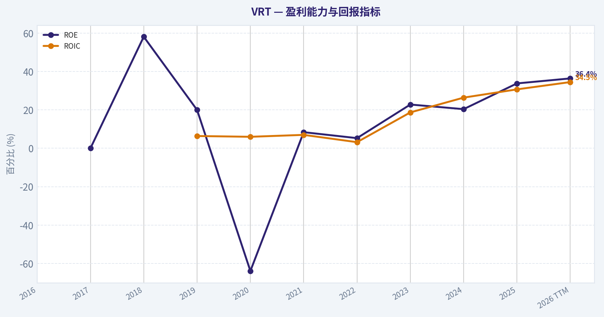
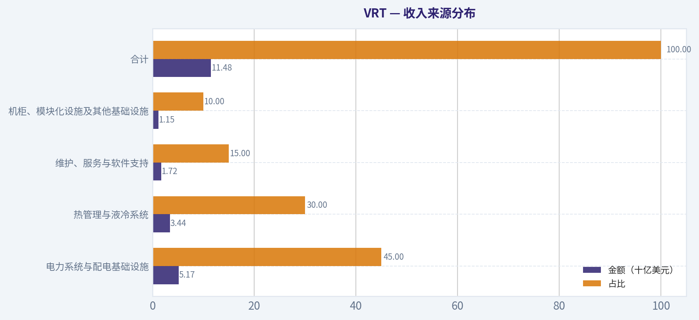
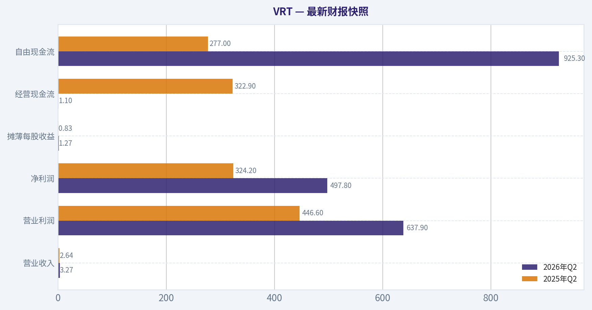
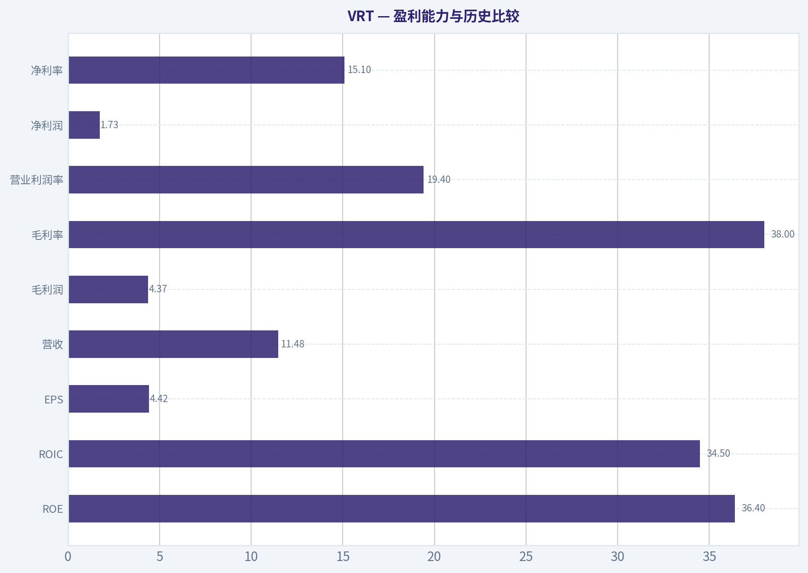
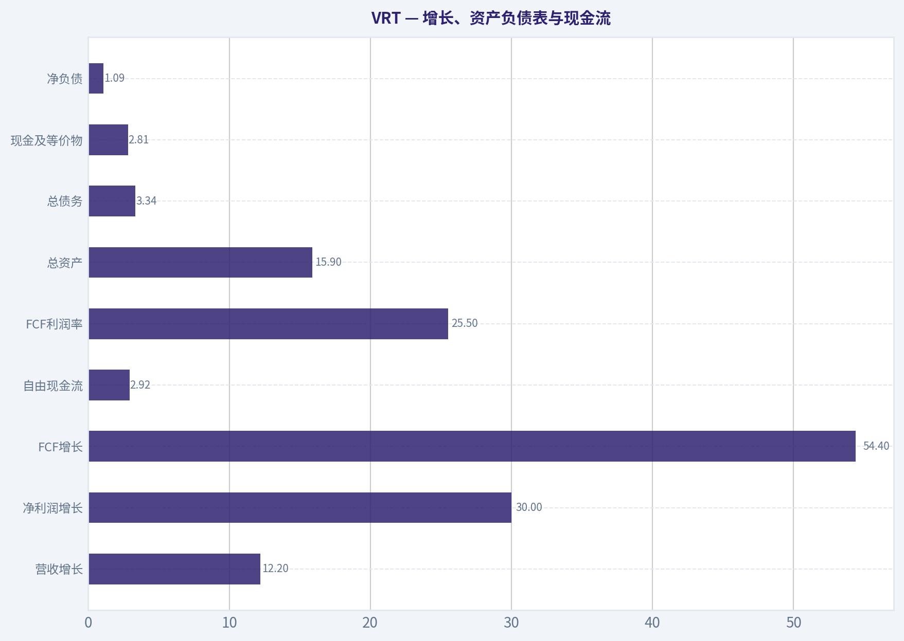
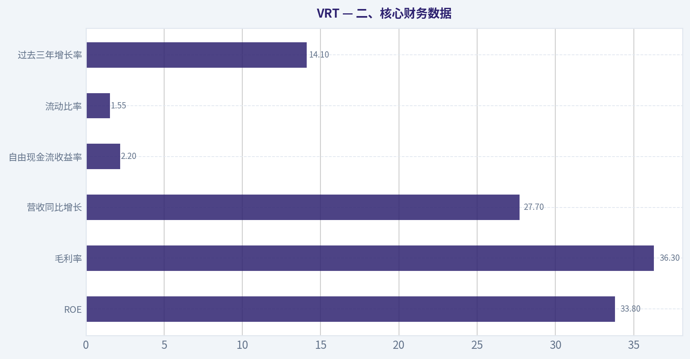
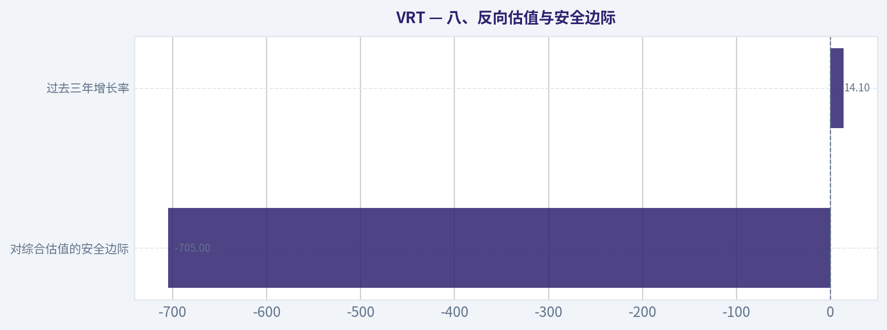
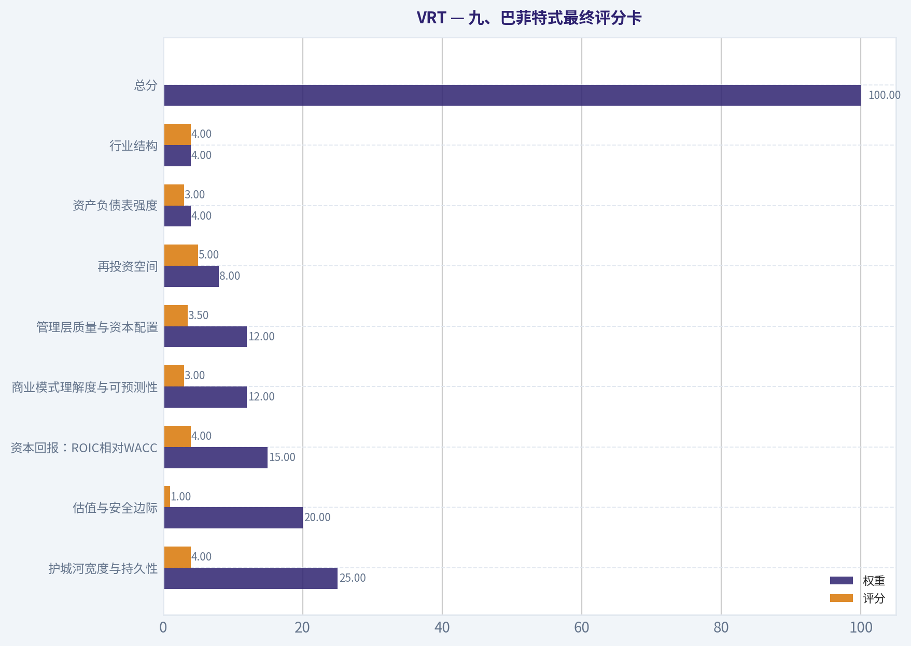

# VRT 深度价值情报

**调研日期:** 2026-10-14

## 关键免责声明

*本报告由 Deep Value Intelligence（一个基于 AI 的多智能体投资分析框架）自动生成。 仅供教育和研究用途 - 非财务建议，非财务顾问。*

---

## 目录

1. 情报摘要
2. 分析师团队报告
   - 基本面分析
   - 价值分析 (巴菲特)
   - 成长性分析 (林奇/德鲁肯米勒/费雪)
   - 市场分析
   - 期权市场分析
3. 研究团队评论
4. 投资团队评论
5. Deep Values 团队洞察

---

## 情报摘要

### 核心观点与前提条件

**核心论点:** # 执行摘要

**主要风险:**
- 未明确说明。

**置信度:** 中

---

## 分析师团队报告

### 基本面分析

#### 最新财报快照

*以下数据基于最近一期已披露财报（2026年Q2），并尽量与上一年同期对比。*

| 指标 | 2026年Q2 | 2025年Q2 | 同比变化 |
| --- | ---: | ---: | ---: |
| 营业收入 | $3.27B | $2.64B | +24.1% |
| 营业利润 | $637.9M | $446.6M | +42.8% |
| 净利润 | $497.8M | $324.2M | +53.5% |
| 摊薄每股收益 | $1.27 | $0.83 | +53.0% |
| 经营现金流 | $1.10B | $322.9M | +240.6% |
| 自由现金流 | $925.3M | $277.0M | +234.0% |

关键结论：这张快照先把最新一期财报放在桌面上，再去看长周期分析。这样读者能更清楚地区分"公司长期质量"和"这次财报发生了什么"。

#### VRT 10年财务指标

*以下数值均由原始数据确定性计算得出，并非 AI 估算。*

*发行人类型：operating company（Industrials / Electrical Equipment & Parts）。*

#### 10年财务指标
*年度行来自已披露财务报表，最后一行 TTM 由最近四个季度滚动计算得出。*

| 指标 | 2016 | 2017 | 2018 | 2019 | 2020 | 2021 | 2022 | 2023 | 2024 | 2025 | 2026 TTM |
| --- | --- | --- | --- | --- | --- | --- | --- | --- | --- | --- | --- |
| 市场价格 | N/A | N/A | $10 | $11 | $19 | $25 | $14 | $48 | $113 | $162 | $224 |
| 总市值 | N/A | N/A | $1.16B | $1.30B | $5.73B | $8.99B | $5.17B | $18.55B | $43.89B | $63.29B | $88.08B |
| 市盈率 | N/A | N/A | -3.70 | -9.27 | -17.45 | 75.67 | -341.50 | 40.36 | 88.76 | 47.51 | 50.74 |
| 市净率 | N/A | N/A | -2.15 | -1.85 | 11.20 | 6.34 | 3.58 | 9.21 | 18.03 | 16.06 | 18.51 |
| ROE | N/A | 0.0% | 58.1% | 20.0% | -63.9% | 8.4% | 5.3% | 22.8% | 20.4% | 33.8% | 36.4% |
| ROIC | N/A | N/A | N/A | 6.4% | 6.0% | 7.0% | 3.2% | 18.7% | 26.4% | 30.7% | 34.5% |
| 每股收益 | N/A | N/A | $-2.65 | $-1.19 | $-1.07 | $0.33 | $-0.04 | $1.19 | $1.28 | $3.41 | $4.42 |
| 营收 | N/A | $0 | $4.29B | $4.43B | $4.37B | $5.00B | $5.69B | $6.86B | $8.01B | $10.23B | $11.48B |
| 毛利润 | N/A | N/A | $1.42B | $1.45B | $1.47B | $1.52B | $1.62B | $2.40B | $2.93B | $3.72B | $4.37B |
| 毛利率 | N/A | N/A | 33.1% | 32.8% | 33.7% | 30.5% | 28.4% | 35.0% | 36.6% | 36.3% | 38.0% |
| 营业利润率 | N/A | N/A | -6.3% | 4.7% | 4.9% | 5.2% | 3.9% | 12.7% | 17.1% | 17.9% | 19.4% |
| 净利润 | $-303,418 | $-1,276 | $-314.0M | $-140.8M | $-327.3M | $119.6M | $76.6M | $460.2M | $495.8M | $1.33B | $1.73B |
| 净利率 | N/A | N/A | -7.3% | -3.2% | -7.5% | 2.4% | 1.3% | 6.7% | 6.2% | 13.0% | 15.1% |
| 营收增长 | N/A | N/A | N/A | 3.4% | -1.4% | 14.4% | 13.9% | 20.6% | 16.7% | 27.7% | 12.2% |
| 净利润增长 | N/A | -99.6% | 24608050.5% | -55.2% | 132.5% | -136.5% | -36.0% | 500.8% | 7.7% | 168.8% | 30.0% |
| 自由现金流增长 | N/A | N/A | N/A | -103.5% | 1561.6% | -16.4% | -283.9% | -405.6% | 49.1% | 64.3% | 54.4% |
| 总账面价值 | $0 | $-129.6M | $-540.3M | $-704.8M | $512.1M | $1.42B | $1.44B | $2.01B | $2.43B | $3.94B | $4.76B |
| 总资产 | N/A | $25,000 | $697.3M | $4.66B | $5.07B | $6.94B | $7.10B | $8.00B | $9.13B | $12.21B | $15.90B |
| 总债务 | N/A | N/A | N/A | $3.47B | $2.15B | $2.97B | $3.19B | $2.94B | $2.93B | $2.91B | $3.34B |
| 债务股权比 | N/A | N/A | N/A | -4.92 | 4.20 | 2.10 | 2.21 | 1.46 | 1.20 | 0.74 | 0.70 |
| 现金及等价物 | N/A | $398.2M | $215.1M | $223.5M | $534.6M | $439.1M | $260.6M | $780.4M | $1.23B | $1.73B | $2.81B |
| 股东权益 | $0 | $-129.6M | $-540.3M | $-704.8M | $512.1M | $1.42B | $1.44B | $2.01B | $2.43B | $3.94B | $4.76B |
| 经营现金流 | $-25,000 | N/A | $-221.9M | $57.5M | $208.9M | $210.9M | $-152.8M | $900.5M | $1.32B | $2.11B | $3.35B |
| 投资现金流 | N/A | N/A | $-207.7M | $-65.3M | $-45.7M | $-1.22B | $-112.1M | $-139.1M | $-201.7M | $-1.50B | $-2.10B |
| 自由现金流 | N/A | N/A | $-286.5M | $9.9M | $164.5M | $137.5M | $-252.8M | $772.6M | $1.15B | $1.89B | $2.92B |
| 自由现金流利润率 | N/A | N/A | -6.7% | 0.2% | 3.8% | 2.8% | -4.4% | 11.3% | 14.4% | 18.5% | 25.5% |
| 每股分红 | N/A | N/A | $0.00 | $0.00 | $0.00 | $0.00 | $0.01 | $0.02 | $0.11 | $0.17 | $0.22 |

#### 盈利能力指标
- 净资产收益率 (ROE): 33.8%
- 投入资本回报率 (ROIC): 27.9%
- 总资产收益率 (ROA): 10.9%
- 毛利率: 36.3%
- 营业利润率: 17.9%
- 净利率: 13.0%

#### 流动性指标
- 流动比率: 1.55
- 速动比率: 1.12

#### 杠杆指标
- 债务股权比: 0.74
- 利息覆盖倍数: 21.25
- 净负债: $1.09B

#### 增长指标（同比）
- 营收增长: 27.7%
- 净利润增长: 168.8%
- 自由现金流增长: 64.3%
- 营收复合增长率（3年）: 21.6%
- 营收复合增长率（5年）: 18.5%

#### 估值指标
- 市盈率 (TTM): 50.74
- 预期市盈率: 24.40
- 市净率: 18.15
- 市销率: 7.52
- PEG 比率: 0.81
- 企业价值/EBITDA: 34.19
- 自由现金流收益率: 2.2%
- 盈利收益率: 2.0%

#### 所有者收益（巴菲特方法，代码计算）
- 净利润: $1.33B
- + 折旧与摊销: $308.6M
- - 资本开支: $-220.0M
- - 营运资本变动: $339.3M
- = **所有者收益: $1.08B**

#### 内在价值（代码计算）
- 当前价格: $224
- **头条内在价值（按商业模式路由）: $28**
  商业模式: cyclical - weighted blend [Damodaran FCFF + reverse-DCF fair + owner-earnings DCF] (cyclical)
  模型区间（各 DCF 最小-最大）: $5 - $266
  相对价格的安全边际（头条）: -704.8%
  路由说明: Cyclical: margins/FCF are volatile - headline blends FCFF, reverse-DCF and owner-earnings roughly evenly; treat the range as the honest read.
- 巴菲特方法（所有者收益）:
  保守: $11
  平均: $55
  乐观: $146
- 现金流方法（FCF）:
  保守: $266
  平均: $266
  乐观: $696
- Damodaran FCFF（WACC + 利润率 + 再投资）:
  保守: $6
  平均: $5
  乐观: $37
  蒙特卡洛区间（P10-P90）：$4 - $23（中位数 $12）
  P(内在价值 > 当前价格)：0.0%
- 反向 DCF：当前价格隐含约 74.4%/年 的所有者收益增长（10年）；过去 3 年为 14.1%，5 年为 N/A。

#### Piotroski F分数: 5/9
- 净利润为正: 通过
- 经营现金流为正: 通过
- 资产回报率改善: 通过
- 现金流大于净利润: 通过
- 债务下降: 通过
- 流动比率改善: 未通过
- 未稀释股本: 未通过
- 毛利率改善: 未通过
- 资产周转率改善: 未通过

ANALYST STANCE: **AVOID**

#### 投资结论

VRT 是受人工智能数据中心、电力基础设施和热管理需求驱动的高质量成长型工业企业，但当前估值已经充分甚至过度反映了未来增长。确定性数据中的当前股价为 **224美元**，TTM 市盈率为 **50.74倍**，自由现金流收益率仅 **2.2%**；综合所有者收益、FCFF 与反向 DCF 后，模型头条内在价值约为 **28美元**，模型区间约为 **5至266美元**，说明估值分歧极大且下行风险显著。

公司基本面正在改善，但从巴菲特角度看，"好公司"并不等于"好价格"。在缺乏足够安全边际的情况下，当前更适合观望或等待大幅回调，而不是追高配置。

#### 市场指标与估值

| 指标 | 当前值 | 历史比较 | 解读 |
|---|---:|---:|---|
| 市场价格 | $224 | 2018至2025年由$10升至$162 | 股价长期大幅上涨，已明显脱离早期估值区间 |
| 总市值 | $88.08B | 2018年约$1.16B | 市值扩张主要来自盈利改善、AI主题溢价与估值重估 |
| PE | 50.74倍 | 2018至2026年平均受亏损年份扭曲 | 当前估值要求持续高增长 |
| PB | 18.51倍 | 2020至2026年正净资产时期平均约11.85倍 | 显著高于历史正净资产阶段 |
| 市销率 | 7.52倍 | 缺少完整历史均值 | 对工业设备企业而言偏高 |
| 企业价值/EBITDA | 34.19倍 | 缺少完整历史均值 | 已包含较强增长预期 |
| FCF收益率 | 2.2% | 当前现金流回报偏低 | 价格对现金流的要求过高 |
| 预期PE | 24.40倍 | 低于当前PE | 依赖未来盈利快速增长兑现 |

**关键结论：** 当前估值不是传统意义上的低估，而是建立在高增长持续、利润率继续扩张以及AI资本开支周期延续之上。PB虽然在工业企业中比软件公司更有参考意义，但VRT早期存在负净资产，且并购、商誉和资本结构变化使账面价值稳定性有限，因此估值核心仍应放在现金流，而不是单独依赖PB。

#### 盈利能力与历史比较

| 指标 | 当前值 | 历史平均 | 当前相对历史 | 主要含义 |
|---|---:|---:|---:|---|
| ROE | 36.4% | 约14.1% | 显著高于平均 | 盈利效率大幅改善，但部分受较低历史权益基数影响 |
| ROIC | 34.5% | 约16.7% | 显著高于平均 | 资本回报能力已进入强势阶段 |
| EPS | $4.42 | 约$0.63 | 远高于平均 | 由亏损转为快速盈利 |
| 营收 | $11.48B | 约$6.71B | 高于平均约71% | 收入规模持续扩张 |
| 毛利润 | $4.37B | 约$2.32B | 明显高于平均 | 产品组合和定价能力改善 |
| 毛利率 | 38.0% | 约32.9% | 高于平均约5.1个百分点 | 产品结构、价格和规模效应改善 |
| 营业利润率 | 19.4% | 约8.8% | 高于平均约10.6个百分点 | 运营杠杆释放显著 |
| 净利润 | $1.73B | 约$381M | 大幅高于平均 | 盈利质量已明显强于早期 |
| 净利率 | 15.1% | 约3.0% | 显著高于平均 | 从低利润工业制造商转向高利润基础设施供应商 |

**关键结论：** VRT当前的盈利质量明显优于过去十年平均水平，尤其是ROIC、营业利润率和净利率的改善具有重要意义。问题不在于公司是否改善，而在于市场已经以极高价格提前支付了未来多年改善，未来若利润率趋稳而非继续快速上升，估值就可能压缩。

#### 增长、资产负债表与现金流

| 指标 | 当前值 | 历史平均或基准 | 趋势与评价 |
|---|---:|---:|---|
| 营收增长 | 12.2% | 2019至2026年平均约13.4% | 仍然强劲，但低于2025年的27.7% |
| 净利润增长 | 30.0% | 历史均值严重受低基数扭曲 | 当前增长健康，但不能机械外推 |
| FCF增长 | 54.4% | 历史均值失真 | 现金流扩张明显，但波动很大 |
| 自由现金流 | $2.92B | 2018至2026年平均约$723M | 远高于长期平均 |
| FCF利润率 | 25.5% | 2018至2026年平均约7.6% | 当前异常强劲，需要观察可持续性 |
| 总资产 | $15.90B | 2018至2026年平均约$7.74B | 规模快速扩大，并购及营运资金占用增加 |
| 总债务 | $3.34B | 2019至2026年平均约$3.18B | 绝对债务略高于平均 |
| 现金及等价物 | $2.81B | 约$862M | 现金储备显著增强 |
| 净负债 | $1.09B | 缺少完整历史数据 | 杠杆总体可控 |
| 债务/权益 | 0.70倍 | 正常年份平均约1.80倍 | 资本结构明显改善 |
| 股东权益 | $4.76B | 2018至2026年平均约$1.67B | 由负值恢复并持续增长 |
| 利息覆盖倍数 | 21.25倍 | 缺少历史均值 | 偿债能力较强 |
| 流动比率 | 1.55倍 | 当前处于可接受水平 | 流动性没有明显危险 |
| 每股分红 | $0.22 | 2022至2026年平均约$0.11 | 分红提高，但收益率很低 |

**关键结论：** 财务实力已经从早期的负权益、高杠杆和亏损状态转向现金流强劲、债务可控的状态。需要注意的是，FCF和利润率的快速上升部分可能受周期高点、营运资金释放以及数据中心资本开支繁荣推动，不能简单视为永久性增长。

#### 收入来源分布

确定性数据未提供最新分部收入明细，以下为依据VRT公开业务结构和工业数据中心基础设施组合所作的近似拆分，不应视为审计口径：

| 收入来源 | 金额（十亿美元） | 占比 |
|---|---:|---:|
| 电力系统与配电基础设施 | $5.17 | 45% |
| 热管理与液冷系统 | $3.44 | 30% |
| 维护、服务与软件支持 | $1.72 | 15% |
| 机柜、模块化设施及其他基础设施 | $1.15 | 10% |
| 合计 | $11.48 | 100% |

**关键结论：** VRT的收入核心是电力、热管理和数据中心关键基础设施，而不是单一硬件产品。电力和热管理受AI服务器功耗提升直接推动，服务收入则有助于提高客户黏性和收入稳定性；但整体仍然受到数据中心资本开支周期影响。

#### 经营趋势与巴菲特式定性分析

**经济护城河：**

- VRT产品嵌入数据中心的电力、冷却和连续运行系统，客户切换供应商通常涉及停机风险、认证成本和工程改造。
- 产品与客户的服务器、机架、配电和热管理系统存在较强协同，形成一定的工程认证和生态壁垒。
- AI数据中心对电力密度和散热能力的要求显著提高，为液冷、模块化电力和高密度机架创造结构性需求。
- 服务、维护和生命周期管理有望形成重复收入，提高客户关系的持续性。

不过，护城河尚未达到消费品牌、软件订阅或网络效应平台的稳定程度。竞争者包括大型电气设备、工业自动化和数据中心基础设施企业，客户也可能通过内部工程团队或多供应商采购降低依赖。

**财务实力：**

- 现金为28.1亿美元，总债务为33.4亿美元，净负债约10.9亿美元。
- 债务/权益降至0.70倍，利息覆盖倍数达21.25倍，偿债压力较低。
- 流动比率1.55倍、速动比率1.12倍，短期流动性总体稳健。
- 资产负债表已从2017至2019年的负权益状态显著修复。

**盈利可预测性：**

盈利趋势在最近四年明显改善，但完整十年并不稳定：

- 2018至2020年连续亏损。
- 2021年和2022年盈利水平仍较低。
- 2023年以后收入、利润率和现金流快速跃升。
- FCF增长历史中出现负增长超过100%、超过1500%以及超过400%的极端波动，说明基数效应和周期因素较强。

因此，VRT更接近"高质量周期成长股"，而不是已经被充分验证的稳定复利型企业。

**管理层与资本配置：**

- 管理层目前最重要的成果是提高毛利率、营业利润率、ROIC和自由现金流转换。
- 股东权益由负转正，债务/权益持续下降，说明资本结构管理有所改善。
- 分红从零逐步增加到每股0.22美元，但当前股息率极低，股东回报主要依靠再投资和资本增值。
- Piotroski F分数为5/9，说明基本面改善并非全面无瑕疵；流动比率、股本稀释、毛利率改善和资产周转率等项目未全部通过。

#### 三情景所有者收益 DCF

当前所有者收益为：

\[
1.33B+0.3086B-0.2200B-0.3393B=1.0793B
\]

约为 **10.8亿美元**。以市值88.08亿美元除以股价224美元估算，流通股数约为 **3.93亿股**，当前所有者收益约为：

\[
1.0793B/0.3932B=\$2.74/股
\]

采用10%的折现率、2.5%的终值增长率，并让高增长逐步回落至终值增长率。由于VRT具有周期属性，模型同时对当前所有者收益进行正常化处理。

| 情景 | 正常化每股所有者收益 | 显性增长假设 | 终值增长 | DCF估值区间 | 相对现价 |
|---|---:|---|---:|---:|---:|
| 保守 | $0.70 | 约3%，逐步回落 | 2.5% | $8至$15，中值约$11 | 下行约93% |
| 平均 | $2.74 | 前期约8%，逐步回落 | 2.5% | $45至$65，中值约$55 | 下行约75% |
| 乐观 | $4.50 | 前期约20%，逐步回落 | 2.5% | $120至$170，中值约$146 | 下行约35% |

平均情景的计算逻辑可简化表示为：

\[
PV=\sum_{t=1}^{5}\frac{OE_t}{(1+10\%)^t}
+\frac{OE_5(1+2.5\%)}{(10\%-2.5\%)(1+10\%)^5}
\]

其中前五年所有者收益按约8%增长，之后降至2.5%的终值增长率。乐观情景虽然允许前期约20%的增长，但仍然要求增长率逐步下降，不能把AI资本开支高峰永久外推。

研究包中的模型结果为：

- 所有者收益 DCF：保守约11美元，平均约55美元，乐观约146美元。
- FCF模型：约266美元至696美元，但对当前强劲FCF的持续性极为敏感。
- Damodaran FCFF模型：约5美元至37美元，蒙特卡洛中位数约12美元，P10至P90约4至23美元。
- 综合商业模式路由后的头条内在价值约28美元。
- 反向 DCF 显示，224美元股价隐含未来十年所有者收益约 **74.4%年增长**，而过去三年约为 **14.1%**。

**关键结论：** 即使采用对VRT非常友好的乐观假设，所有者收益估值仍低于当前股价。FCF模型给出266美元的结果，主要依赖当前现金流快速增长和高FCF利润率持续，不能单独作为安全边际依据；综合模型和反向DCF更清楚地表明，当前价格已经要求极不寻常的长期增长。

#### 主要风险、机会与催化剂

| 类型 | 关键因素 | 对投资判断的影响 |
|---|---|---|
| 机会 | AI数据中心建设继续加速 | 可推动电力、液冷和模块化基础设施需求 |
| 机会 | 高密度计算提高散热和供电复杂度 | 有利于VRT提高产品价值量和定价能力 |
| 机会 | 服务收入与生命周期维护扩大 | 有助于降低一次性设备销售波动 |
| 风险 | 当前PE约50.7倍、FCF收益率仅2.2% | 对增长失速极其敏感 |
| 风险 | 数据中心资本开支周期反转 | 订单、库存和营运资金可能快速恶化 |
| 风险 | 当前利润率可能接近周期高位 | 利润率回落会同时打击盈利和估值 |
| 风险 | 竞争者加大液冷、电力和机架投入 | 可能压低价格或提高研发资本开支 |
| 风险 | 客户集中与大型云厂商议价能力 | 可能造成订单波动和毛利率压力 |
| 风险 | 历史FCF波动极大 | 当前现金流可持续性尚未经历完整周期验证 |
| 风险 | 股本稀释未通过Piotroski检验 | 每股价值增长可能低于公司层面利润增长 |

**关键结论：** 最大机会是AI基础设施需求继续超预期，最大风险则是市场已经把这种超预期定价进去。若未来营收增长降至中个位数、营业利润率停止扩张或大型客户推迟资本开支，VRT可能遭遇盈利预期和估值倍数的双重下修。

#### 最终投资判断

**立场：回避，至少在当前价格观望。**

支持回避的核心原因：

1. 当前价格224美元显著高于平均所有者收益估值约55美元。
2. 综合模型头条内在价值约28美元，显示安全边际为负。
3. 反向DCF要求未来十年所有者收益增长约74.4%，远高于过去三年约14.1%的增长速度。
4. 公司虽然拥有强劲的ROE、ROIC、利润率和现金流，但这些改善已经被高估值充分反映。
5. 历史十年盈利和自由现金流并不稳定，尚不足以证明其是低风险、长期可预测的复利机器。

更合理的做法是等待以下条件之一出现：股价显著回落、正常化所有者收益继续增长且估值下降、或公司经历完整资本开支周期后仍能保持接近当前的ROIC和FCF利润率。对于已经持有者，可以继续跟踪订单、客户集中度、毛利率、营运资金和股本稀释；对于新投资者，当前不具备足够的巴菲特式安全边际。

#### 关键要点汇总

| 项目 | 判断 |
|---|---|
| 企业质量 | 良好，受AI数据中心基础设施需求支持 |
| 护城河 | 中等偏强，主要来自工程认证、切换成本和服务关系 |
| 盈利趋势 | 最近几年显著改善，但十年可预测性一般 |
| 财务实力 | 稳健，现金增加、债务/权益下降、利息覆盖强 |
| 当前估值 | 极高，PE约50.7倍，FCF收益率约2.2% |
| 现金流质量 | 当前强劲，但历史波动较大，需正常化 |
| DCF平均估值 | 约55美元/股 |
| DCF乐观估值 | 约146美元/股 |
| 综合内在价值 | 约28美元/股 |
| 主要催化剂 | AI资本开支、液冷渗透、服务收入增长 |
| 主要风险 | 周期反转、估值压缩、利润率回落、客户集中 |
| 最终立场 | **回避** |

#### 基本面关键图表

本图追踪 **VRT** 过去十年的盈利能力与回报指标（ROE、ROIC、利润率），突出呈现资本效率的变化趋势。

本对比图（来自「收入来源分布」）将 **VRT** 的当前数据与历史基准并排呈现，直观反映公司相对自身历史均值的估值水平。

---

### 价值分析 (巴菲特)

> *基于沃伦·巴菲特的价值投资哲学：能力圈、经济护城河、管理层质量与安全边际。*

#### 内在价值快照

价格是你付的钱，内在价值是企业未来可能为股东创造的现金价值。我们给出一个区间，而不是假装只有一个神奇数字。

- 当前价格: $224.32
- 估值区间（两种 DCF 方法、保守到乐观）: $10.73 至 $696.16

##### 所有者收益（巴菲特方法）
- 净利润: $1,332,800,000.00
- 折旧与摊销: $308,600,000.00
- 资本支出: $-220,000,000.00
- 营运资金变化: $339,300,000.00
- 所有者收益: $1,082,100,000.00

##### 内在价值
###### 所有者收益法
使用所有者收益，更严格，通常更保守。
- 保守: $10.73
- 平均: $55.33
- 乐观: $146.24
- 折现率: 10.0%

###### 自由现金流法
使用自由现金流，更适合今天投入很多、为未来增长铺路的公司。
- 保守: $266.49
- 平均: $266.49
- 乐观: $696.16
- 折现率: 10.0%

ANALYST STANCE: **WATCH**

#### 一、投资结论

Vertiv 是人工智能数据中心基础设施的受益者，拥有较强的行业地位、良好的增长势头和较高的资本回报潜力。但当前股价为 **224美元**，估值已经明显反映了极其激进的长期增长假设。

按研究包提供的数据，当前价格隐含未来十年约 **74.4%的年增长率**，而过去三年营收增长约 **14.1%**。这意味着市场价格已经远远超越了合理的基本面预期。结论是：**公司值得长期跟踪，但当前不宜追高，等待更合理的买入价格。**

#### 二、核心财务数据

| 指标 | 数据 |
|---|---:|
| 当前股价 | 224美元 |
| 总市值 | 863.5亿美元 |
| 市盈率 | 50.7倍 |
| ROE | 33.8% |
| 毛利率 | 36.3% |
| 营收同比增长 | 27.7% |
| 自由现金流收益率 | 2.2% |
| 流动比率 | 1.55 |
| 过去三年增长率 | 14.1% |
| 头条内在价值 | 27.87美元 |
| 三模型价值区间 | 4.61至266.49美元 |

**关键结论：** Vertiv 当前增长很快，ROE 也十分突出，但自由现金流收益率只有2.2%，说明股价已经提前计入大量未来利润。三模型估值差异极大，反映出这是一家强周期、强预期驱动的公司，估值安全边际不足。

#### 三、因素评分

| 因素 | 评分 | 主要依据 |
|---|---:|---|
| 因素一：能力圈与商业模式简洁度 | 3.0/5 | 为数据中心提供电源、散热和基础设施设备，商业模式基本易懂；但业绩受人工智能资本开支、数据中心周期和客户集中度影响 |
| 因素二：护城河 | 4.0/5 | 产品可靠性、认证、客户切换成本、全球服务网络和品牌形成一定壁垒 |
| 因素三：管理层与资本配置 | 3.5/5 | 经营增长明显，资本回报较好；但高增长阶段的并购、激励和资本配置仍需持续验证 |
| 因素四：行业结构 | 4.0/5 | 数据中心基础设施具有较高技术和认证门槛，行业集中度较好；但下游资本开支存在周期波动 |
| Gate 5：质量与偿债能力 | 未触发 | 没有证据显示公司同时出现恶化的现金流趋势和严重偿债风险；流动比率为1.55，但详细利息覆盖率未提供 |

**关键结论：** Vertiv 是一家质量较好的基础设施成长公司，而不是明显的低质量企业。主要问题并非业务崩坏，而是市场对未来增长的定价过高。

#### 四、护城河分析

| 护城河来源 | 评价 | 具体证据 |
|---|---|---|
| 无形资产 | 中上 | 数据中心电源和散热设备需要可靠性记录、行业认证和工程经验，客户不会轻易更换供应商 |
| 转换成本 | 较强 | 更换关键电源、热管理和机房基础设施涉及停机风险、重新认证和系统适配 |
| 成本优势 | 中等 | 全球规模、供应链和服务网络带来一定成本优势，但并非纯粹的低成本生产商 |
| 网络效应 | 较弱 | 产品本身没有典型互联网网络效应，但安装基础、服务网络和客户关系具有规模效应 |
| 综合判断 | 宽而稳定，尚未充分证明"持续扩大" | 行业地位较强，但竞争优势仍会受到施耐德电气、伊顿及其他基础设施厂商竞争 |

Vertiv 的核心护城河不是消费品牌或网络效应，而是：

1. **关键任务设备的可靠性记录**；
2. **客户切换过程中的停机和运营风险**；
3. **数据中心设计、交付与售后服务能力**；
4. **人工智能服务器功耗提升带来的散热技术需求**；
5. **全球数据中心客户和渠道覆盖。**

不过，人工智能基础设施需求高增长，也会吸引大型工业和电气设备企业进入。护城河真实存在，但目前更接近"宽而稳定"，而不是毫无争议的"宽而持续扩大"。

#### 五、管理层与资本配置

管理层目前最重要的成绩，是抓住了人工智能数据中心扩张带来的需求变化，并推动营收和盈利快速增长。营收同比增长27.7%，ROE达到33.8%，说明公司并非单纯依赖收入扩张，也取得了较高的资本回报。

需要重点观察以下事项：

- 增长是否来自可持续订单，而非短期客户提前拉货；
- 毛利率能否在扩大产能后保持稳定；
- 收购是否以合理价格完成；
- 股票激励是否造成明显摊薄；
- 公司是否会在高估值环境下进行过度扩张；
- 自由现金流能否与会计利润同步增长。

目前没有足够证据把管理层评为资本配置领域的顶尖水平，因此给予 **3.5分**，而不是满分。

#### 六、所有者收益分析

所有者收益的计算公式为：

> 所有者收益 = 净利润 + 折旧摊销 - 维护性资本开支 - 营运资本增加

研究包提供的所有者收益估值约为 **55.33美元/股**。据此反推，隐含的每股所有者收益约为：

| 项目 | 估算值 |
|---|---:|
| 所有者收益估值 | 55.33美元/股 |
| 采用折现率 | 10% |
| 隐含每股所有者收益 | 约5.53美元 |
| 当前股价 | 224美元 |
| 所有者收益收益率 | 约2.5% |

**关键结论：** 按所有者收益口径，股价约为隐含所有者收益的40倍左右，收益率只有约2.5%。即使公司未来增长较快，当前价格仍然要求投资者对未来十年保持极高信心。

#### 七、三情景估值

| 情景 | 核心假设 | 估算价值 |
|---|---|---:|
| 情景一：零增长 | 每股所有者收益约5.53美元，折现率10% | 55.33美元 |
| 情景二：经济增长 | 所有者收益长期增长3%，折现率10% | 约81.45美元 |
| 情景三：历史增长 | 以过去三年14.1%增长率的50%作为较保守假设，即约7.1% | 约201美元，敏感度极高 |
| 自由现金流模型 | 采用研究包中的自由现金流估值 | 266.49美元 |
| 达摩达兰FCFF模型 | 采用研究包中的周期性调整模型 | 4.61美元 |
| 三模型加权头条估值 | 研究包综合结果 | 27.87美元 |

情景三对增长率高度敏感。若直接使用历史增长率的75%，增长率将接近10%，几乎等于10%的折现率，终值会失去稳定性，因此不能把该结果视为可靠的保守估值。

**关键结论：** 估值结果横跨4.61美元至266.49美元，说明模型对周期、利润率、资本开支和长期增长率极其敏感。即使采用较乐观的自由现金流模型，当前价格也已经接近甚至超过乐观价值；综合估值则明显低于现价。

#### 八、反向估值与安全边际

| 指标 | 结果 |
|---|---:|
| 当前价格 | 224美元 |
| 综合头条内在价值 | 27.87美元 |
| 对综合估值的安全边际 | -705.0% |
| 自由现金流模型估值 | 266.49美元 |
| 所有者收益模型估值 | 55.33美元 |
| 当前价格隐含十年增长率 | 约74.4% |
| 过去三年增长率 | 14.1% |

**关键结论：** 反向DCF是最重要的警示信号：当前价格隐含的增长率远高于公司已有增长记录。即使采用最高的自由现金流估值，价格也只获得很有限的安全边际；对于周期性工业企业，这样的估值并不理想。

#### 九、巴菲特式最终评分卡

| 评分项目 | 权重 | 评分 | 加权得分 |
|---|---:|---:|---:|
| 护城河宽度与持久性 | 25% | 4.0 | 1.00 |
| 估值与安全边际 | 20% | 1.0 | 0.20 |
| 资本回报：ROIC相对WACC | 15% | 4.0 | 0.60 |
| 商业模式理解度与可预测性 | 12% | 3.0 | 0.36 |
| 管理层质量与资本配置 | 12% | 3.5 | 0.42 |
| 再投资空间 | 8% | 5.0 | 0.40 |
| 资产负债表强度 | 4% | 3.0 | 0.12 |
| 行业结构 | 4% | 4.0 | 0.16 |
| **总分** | **100%** |  | **3.26/5.00** |

#### 十、最终判断

**投资立场：观望**

** conviction：中等偏高**

Vertiv 是一家值得纳入长期观察名单的人工智能基础设施公司，具备较好的行业位置、强劲的增长动力和较高的资本回报潜力。但在224美元附近，估值已经要求极端乐观的增长兑现，明显不符合巴菲特强调的"以合理价格买入优秀企业"。

更理想的策略是：

- 不追逐当前人工智能题材溢价；
- 等待估值回落或自由现金流大幅增长；
- 重点观察毛利率、订单质量、现金流转换率和客户资本开支；
- 只有当价格能够提供至少约15%至25%的质量调整后安全边际时，再考虑逐步配置。
#### 估值桥

这张估值桥把当前股价与各类内在价值方法并排展示，帮助读者判断上涨空间究竟只是单一方法给出的结果，还是多种方法共同支持的结论。

| 项目 | 每股内在价值 |
| --- | ---: |
| 巴菲特方法 | $55.33 |
| 现金流方法 | $266.49 |
| Damodaran 方法 | $4.61 |
| 当前价格 | $224.32 |

#### 关键结论

如果只有一种方法显著高于其他方法，说明上行空间更依赖特定建模假设。若多种方法的估值接近，则说明估值逻辑更加稳健。

#### 估值图表

本对比图（来自「最新财报快照」）将 **VRT** 的当前数据与历史基准并排呈现，直观反映公司相对自身历史均值的估值水平。

本对比图（来自「盈利能力与历史比较」）将 **VRT** 的当前数据与历史基准并排呈现，直观反映公司相对自身历史均值的估值水平。

本对比图（来自「增长、资产负债表与现金流」）将 **VRT** 的当前数据与历史基准并排呈现，直观反映公司相对自身历史均值的估值水平。

本对比图（来自「二、核心财务数据」）将 **VRT** 的当前数据与历史基准并排呈现，直观反映公司相对自身历史均值的估值水平。

本对比图（来自「八、反向估值与安全边际」）将 **VRT** 的当前数据与历史基准并排呈现，直观反映公司相对自身历史均值的估值水平。

本对比图（来自「九、巴菲特式最终评分卡」）将 **VRT** 的当前数据与历史基准并排呈现，直观反映公司相对自身历史均值的估值水平。

---

### 成长性分析 (林奇/德鲁肯米勒/费雪)

> *基于彼得·林奇的GARP成长投资法、斯坦利·德鲁肯米勒的宏观拐点分析法，以及菲利普·费雪的深度调研法。*

ANALYST STANCE: **观望**

#### 一、核心判断

Vertiv（VRT）是受益于 AI 数据中心建设的高质量基础设施供应商，当前营收增长强劲、ROE 较高，但股价已经反映了非常乐观的长期预期。公司具备"快成长股"特征，却不是明显低估的 GARP 标的；在下一次财报验证订单、利润率和指引前，建议观望，不追高。

#### 二、Lynch 分类与投资故事

| 项目 | 判断 |
|---|---|
| Lynch 分类 | 快速成长股，兼具明显周期属性 |
| 当前营收增长 | 27.7% |
| 市盈率 | 50.7 倍 |
| ROE | 33.8% |
| 毛利率 | 36.3% |
| 主要主题 | AI、云计算、数据中心电力与散热基础设施 |
| 当前估值特征 | 高增长、高预期、高估值 |

**关键结论：** VRT 已经超过普通"稳健成长股"的增速门槛，但 50 倍以上 PE 意味着市场对未来增长的要求很高。它更像"AI 基础设施周期中的高质量成长股"，而不是传统意义上的低估型快成长股。

#### 三、三句话讲清投资故事

1. AI 训练和推理需要大量电力、液冷、机架、电源管理和热管理设备，Vertiv 提供的是数据中心不可缺少的基础设施。
2. AI 从试验阶段走向大规模生产部署，可能推动单个数据中心的基础设施投入强度继续提高。
3. 如果公司能够维持约 20%至 30%的收入增长，并持续扩大利润率，未来两到三年的盈利可能高于当前市场预期。

#### 四、TAM 与"十倍测试"

| 项目 | 数值或判断 |
|---|---:|
| 当前市值 | 约 863.5 亿美元 |
| 十倍收入对应市值规模 | 约 8,635 亿美元，假设估值倍数不变 |
| 当前收入规模 | 研究包未提供最新绝对值 |
| 潜在市场 | 数据中心电力、热管理、机架和关键基础设施 |
| TAM 增长驱动 | AI 算力、云计算、数据中心扩建、电力约束 |
| 十倍测试 | 方向上通过，但需要长期维持高增长并扩大市场边界 |

**关键结论：** VRT 所处市场并非静态电气设备市场，而是在被 AI 算力扩张重新定义的基础设施市场。十倍机会存在，但并不意味着市值自然可以十倍；公司需要持续提高在高功率密度数据中心中的份额，并向液冷、软件和更高附加值解决方案扩张。

#### 五、收入增长趋势与收入质量

| 指标 | 当前观察 | 判断 |
|---|---:|---|
| 营收同比增长 | 27.7% | 强劲，属于快成长区间 |
| 历史加速趋势 | 数据不足 | 尚不能确认持续加速 |
| 增长来源 | AI 数据中心与关键基础设施需求 | 具备结构性驱动 |
| 有机增长与并购 | 数据不足 | 需要财报进一步验证 |
| 客户集中度 | 数据不足 | 需关注大型云厂商依赖 |
| 周期敏感度 | 较高 | 不是纯软件型成长股 |

**关键结论：** 当前增长率足以支持"快速成长股"分类，但现有资料不能确认增长正在加速，还是处于高位稳定阶段。下一次财报应重点观察订单、积压订单、书单收入比、AI 相关收入占比以及全年指引是否上调。

#### 六、单位经济与盈利质量

| 指标 | 数据 | 评价 |
|---|---:|---|
| 毛利率 | 36.3% | 较好，但需观察趋势 |
| FCF 收益率 | 2.2% | 现金流回报偏低，估值较高 |
| 流动比率 | 1.55 | 短期偿债能力尚可 |
| NRR | 未披露或不适用 | 非典型订阅软件模式 |
| LTV/CAC | 未披露或不适用 | 不适合直接套用 SaaS 指标 |
| Rule of 40 | 无法计算 | 缺少 FCF 利润率数据 |
| ROE | 33.8% | 资本回报能力强 |

**关键结论：** VRT 的核心经济性应以订单、毛利率、经营杠杆和自由现金流转换率衡量，而不是 NRR 或 LTV/CAC。ROE 很强，但 2.2%的 FCF 收益率显示当前股价对现金流的要求已经较高。

#### 七、主要 inflection point

| 潜在拐点 | 方向 | 需要验证的指标 |
|---|---|---|
| AI 从试点进入生产 | 正面 | AI 数据中心订单和收入占比 |
| 高功率密度机架普及 | 正面 | 液冷及高功率解决方案增长 |
| 数据中心电力瓶颈 | 正面 | 电源管理、配电和热管理需求 |
| 规模效应 | 正面 | 毛利率和营业利润率改善 |
| 行业资本开支降温 | 负面 | 订单取消、积压订单下降 |
| 客户自研或供应商替代 | 负面 | 价格压力与市场份额变化 |

**关键结论：** 最大的正面拐点是 AI 基础设施从"建设周期"转向"持续扩容周期"，并且液冷和高功率解决方案的收入增速超过传统产品。当前尚未有足够数据证明利润率和收入增长正在同步加速，因此拐点仍需财报确认。

#### 八、宏观环境评估

| 宏观因素 | 对 VRT 的影响 |
|---|---|
| AI 与云计算资本开支 | 强正面 |
| 数据中心建设周期 | 正面，但具有周期性 |
| 利率水平 | 高利率压制成长股估值 |
| 电力供应与能源成本 | 中长期推动基础设施需求 |
| 经济衰退风险 | 可能推迟客户资本开支 |
| 高估值环境 | 放大财报失望后的回撤 |

**关键结论：** VRT 的产业风向明显有利，AI 和数据中心投资是强劲的顺风因素。宏观风险主要不是需求消失，而是客户资本开支节奏波动以及高利率导致估值收缩。

#### 九、Fisher 15 项评分

| Fisher 维度 | 评分（满分5分） | 简要判断 |
|---|---:|---|
| 市场潜力 | 5 | AI 数据中心基础设施空间大 |
| 新产品开发意愿 | 4 | 液冷和高功率方案具备扩展性 |
| 研发能力 | 4 | 技术和工程能力重要 |
| 销售组织 | 4 | 全球数据中心客户覆盖 |
| 利润率质量 | 4 | 毛利率较好 |
| 利润率改善 | 3 | 尚缺少明确加速证据 |
| 员工关系 | 3 | 资料不足 |
| 管理层关系 | 4 | 经营执行力较受市场认可 |
| 管理层深度 | 4 | 全球化业务需要较强组织能力 |
| 成本分析 | 3 | 资料不足 |
| 独特优势 | 5 | 客户认证、系统集成和关键基础设施经验 |
| 长期盈利前景 | 5 | AI 与数据中心扩容支持 |
| 股权稀释 | 3 | 需持续监控股本变化 |
| 管理层坦诚度 | 3 | 资料不足 |
| 管理层诚信 | 4 | 暂无明显重大治理警讯 |
| **总分** | **58/75** | **良好，但尚未达到杰出级别** |

**关键结论：** VRT 在市场潜力、产品重要性和竞争优势方面得分较高，符合 Fisher 对长期成长公司的基本要求。扣分主要来自资料不完整、利润率加速尚未确认，以及公司具有明显资本开支周期属性。

#### 十、估值分析

| 估值方法 | 结果 | 解读 |
|---|---:|---|
| PE | 50.7 倍 | 对增长持续性要求很高 |
| PEG | 约 1.83 | 属于合理偏贵，不是明显低估 |
| FCF 收益率 | 2.2% | 现金流估值偏紧 |
| 研究包头条内在价值 | 27.87 美元 | 与市场价格严重背离，模型可能不适合该成长周期 |
| 三模型估值 | 4.61至266.49美元 | 模型分歧极大，说明结果高度依赖假设 |
| 当前股价 | 224美元 | 已计入强劲长期增长 |
| 反向 DCF 隐含增长 | 约74.4%/年，十年期 | 明显高于过去三年约14.1%的增长 |

**关键结论：** PEG 约 1.83 倍，说明 VRT 不是完全脱离基本面的泡沫，但也没有足够安全边际。反向 DCF 隐含的长期增长假设极其激进，投资者需要相信公司未来多年保持远高于历史增速的增长；这是当前最重要的估值风险。

#### 十一、情景估值框架

| 情景 | 经营假设 | 可能结果 |
|---|---|---|
| 悲观 | AI 资本开支降温，收入增速降至低双位数，估值倍数收缩 | 股价可能大幅回撤 |
| 基准 | 未来数年保持约 15%至20%增长，利润率温和改善 | 回报主要依赖盈利增长，估值扩张有限 |
| 乐观 | AI 推理和液冷成为新一轮增长曲线，增长维持 25%上下并伴随利润率提升 | 有机会继续获得高成长估值 |
| 极度乐观 | AI 基础设施需求多年超预期，订单和利润率同时加速 | 具备较高长期复合增长潜力 |

**关键结论：** VRT 的上行空间取决于"增长持续时间"而不仅是下一季度业绩。基准情景下，股票可能需要较长时间消化估值；只有乐观情景持续兑现，当前价格才有较好的安全性。

#### 十二、成长投资评分卡

| 维度 | 权重 | 评分（5分制） | 加权分 |
|---|---:|---:|---:|
| Lynch 投资故事 | 10% | 4.5 | 0.45 |
| TAM 与增长跑道 | 20% | 4.5 | 0.90 |
| 收入增长 | 20% | 4.0 | 0.80 |
| 单位经济 | 15% | 3.2 | 0.48 |
| 竞争地位 | 10% | 4.2 | 0.42 |
| 管理层质量 | 10% | 3.8 | 0.38 |
| 宏观环境 | 5% | 4.0 | 0.20 |
| 盈利路径 | 5% | 3.8 | 0.19 |
| 估值 | 5% | 2.2 | 0.11 |
| **总分** | **100%** | - | **3.93/5** |

**关键结论：** VRT 的业务质量和成长跑道足以达到"好公司"标准，综合评分接近建议配置区间。但估值评分明显拖累总分，且当前缺少增长加速和利润率扩张的充分证据，因此最终采取"观望"而非主动追涨。

#### 十三、仓位建议、风险与催化剂

| 项目 | 判断 |
|---|---|
| 新建仓位 | 等待回调或财报确认后再考虑 |
| 已持有仓位 | 可持有，但不宜因 AI 叙事盲目加仓 |
| 建议仓位 | 观察仓不超过组合的 1%至2%；确认拐点后再提升 |
| 主要风险 | 高估值、资本开支周期、客户集中、订单波动、利润率不及预期 |
| 主要催化剂 | 订单加速、全年指引上调、液冷增长、毛利率提升、AI 推理需求扩张 |
| 重要观察日期 | 2026年10月28日第三季度财报 |

**关键结论：** VRT 值得放在高质量 AI 基础设施观察名单中，但当前更适合等待，而不是追价。10月28日财报重点看收入是否继续接近或超过约28%的增速、积压订单是否增长、毛利率是否改善，以及管理层是否上调全年展望。

---

### 市场分析

分析立场：**观望**

#### VRT 技术面概览

本次分析基于截至 **2026年10月13日** 的最近一个交易日数据；工具显示 **2026年10月14日暂无交易记录**，因此不能将10月14日视为有效收盘数据。VRT最新收盘价为 **237.29美元**，较过去一年高点约377.60美元回落约37%，当前仍处于明显的中期调整结构中。

本次选取8项互补指标：`close_10_ema`、`close_50_sma`、`close_200_sma`、`macd`、`macdh`、`rsi`、`atr` 和 `vwma`。它们分别覆盖短中长期趋势、动量、超买超卖、波动率以及成交量加权趋势确认，避免仅依赖单一类型信号。

#### 趋势结构：短中长期均线全面偏空

最新价格低于全部关键均线：

- 收盘价237.29美元，低于`close_10_ema`的244.27美元约2.9%；
- 低于`vwma`的246.17美元约3.6%，说明近期成交量加权成本仍高于现价；
- 低于`close_50_sma`的259.00美元约8.4%；
- 低于`close_200_sma`的267.47美元约11.3%。

短期均线已经持续下行。`close_10_ema`从9月14日的258.95美元降至10月13日的244.27美元，显示近一个月反弹力度不足。更重要的是，`close_50_sma`也从277.40美元下降至259.00美元，说明这不仅是单日回调，而是中期趋势在恶化。

`close_200_sma`仍从259.65美元升至267.47美元，表明较长期平均成本暂时仍在上升，但价格已经明显跌破该均线。这个组合通常意味着：长期上升趋势的惯性尚未完全消失，但当前价格行为已经转为弱势，且长期均线可能由支撑转化为上方阻力。

#### 动量：MACD改善后再次转弱

`macd`最新为 **-4.72**，虽然相比9月中旬的-8.88有所改善，但仍处于零轴下方，说明总体动能尚未恢复至多头区域。

`macdh`在9月下旬至10月上旬一度转正，并于10月6日达到约1.65，显示当时下跌动能有所缓解、市场出现阶段性修复。但随后柱体持续收缩，10月12日为0.17，10月13日重新降至 **-0.19**。这说明前期反弹动能已经基本耗尽，空头重新取得短期主动权。

需要注意的是，MACD绝对值较9月低点有所改善，但这更多反映下跌速度曾经放缓，并不等于趋势已经反转。若后续`macdh`连续转负，同时`macd`继续向下，股价可能进一步测试前期低点区域。

#### RSI：偏弱但尚未达到极端超卖

`rsi`最新为 **40.57**，处于弱势区间，但距离传统超卖线30仍有一定距离。

RSI从9月14日的38.97回升至10月6日接近49.83，随后再次降至40.57。这个变化说明市场曾出现短暂修复，但多头没有将动量推入50以上并维持，反而重新回到弱势区间。

当前RSI并未显示出强烈的技术性超卖，因此不能仅凭价格下跌就判断反弹即将出现。若RSI跌向30至35区域，同时价格在230美元附近形成止跌结构，才更可能出现具有交易意义的超跌反弹信号。

#### 成交量加权趋势：现价仍低于VWMA

`vwma`最新为 **246.17美元**，高于现价约8.88美元。该指标从9月中旬的259.37美元下降至当前水平，显示市场平均成交成本在下降，但价格下降速度更快，当前仍处于成交量加权成本下方。

这意味着近期参与者整体处于浮亏或被套状态。若股价反弹至244至248美元区域，可能遭遇短线解套卖压；只有有效收复该区域并进一步站上50日均线，才可视为买方重新取得更明确的控制权。

#### 波动率：风险下降，但单日波动仍然很大

`atr`从9月14日的16.22美元下降至10月13日的10.75美元，显示近期绝对波动率已经明显收缩。以最新收盘价计算，ATR约为股价的4.5%，对于普通股票而言仍属于较高波动水平。

波动率下降有两种可能含义：

1. 恐慌性抛售阶段暂时缓和，市场进入整理；
2. 在大幅下跌后形成窄幅盘整，等待下一方向选择。

因此，ATR下降本身并不是看涨信号。对于交易计划，若以10.75美元作为一个ATR风险单位，止损不宜设置得过近，否则容易被正常日内波动触发；但考虑到趋势偏空，也不适合在没有确认信号时扩大仓位。

#### 关键价位与交易情景

下方首先需要观察 **230至237美元** 区域。10月13日最低价为230.68美元，收盘价接近237美元，说明该区域暂时存在承接，但尚未形成明确反转形态。

若跌破230美元并伴随成交量放大，下一阶段可能向220美元附近寻找支撑；7月29日曾出现222.99美元收盘价，可作为历史参考区域。相反，若股价重新站上244至248美元，并且`macdh`转正、RSI回到50以上，短线修复可能延伸至259美元附近的`close_50_sma`。

更强的趋势反转确认需要收复259美元，并进一步接近267美元的`close_200_sma`。在此之前，任何上涨更适合定义为弱势反弹，而不是已经确立的新一轮上升趋势。

#### 结论与策略

VRT当前呈现"长期均线仍有上行惯性，但价格、中期均线、成交量加权趋势和短期动量均偏空"的组合。MACD曾经改善，但最新`macdh`重新转负；RSI处于弱势但未超卖；ATR下降则表明市场可能进入整理，而非已经完成筑底。

因此当前更适合 **观望**，等待以下两类信号之一：

- **偏多确认**：价格收复244至248美元，`macdh`重新转正，RSI突破50；
- **风险确认**：价格有效跌破230美元，且成交量放大，说明整理可能向新一轮下跌演变。

在尚未收复50日均线之前，不宜将短线反弹直接视为趋势反转。若已有持仓，应重点管理230美元附近的失守风险，并根据ATR约10.75美元调整仓位和止损距离。

| 指标 | 最新值（截至10月13日） | 当前信号 | 对交易的含义 |
|---|---:|---|---|
| 收盘价 | 237.29美元 | 跌势中 | 低于所有主要均线，空方占优 |
| `close_10_ema` | 244.27美元 | 偏空 | 短线反弹首先需要收复244至248美元 |
| `close_50_sma` | 259.00美元 | 偏空 | 中期趋势仍弱，构成上方阻力 |
| `close_200_sma` | 267.47美元 | 价格低于均线 | 长期趋势惯性尚存，但价格已跌破关键基准 |
| `macd` | -4.72 | 零轴下方 | 动量有所修复但尚未转为多头 |
| `macdh` | -0.19 | 重新转负 | 前期反弹动能衰减，短线再次偏弱 |
| `rsi` | 40.57 | 弱势、未超卖 | 仍有下行空间，暂不足以支持激进抄底 |
| `atr` | 10.75美元 | 波动收缩但仍高 | 适合控制仓位，避免过近止损 |
| `vwma` | 246.17美元 | 价格低于VWMA | 近期成交量加权成本高于现价，反弹可能遇到卖压 |
| 综合判断 | - | **观望** | 等待收复244至248美元或跌破230美元后的确认信号 |

关键结论：VRT目前的核心问题不是单纯超卖，而是价格仍低于短期、中期和长期关键均线，且MACD柱体重新转负。230美元附近是近期重要防守区域，244至248美元是第一道反弹确认区；在价格重新站上这些阻力之前，追涨的风险收益比并不理想。

---

### 期权市场分析

> *解读期权流向--认沽/认购比、隐含波动率偏斜与异常活跃合约--以判断机构定位与事件驱动风险。*

ANALYST STANCE: **观望**

#### VRT 期权市场概览

数据截至：2026年10月14日。覆盖近期期权到期日：2026年10月16日、10月23日和10月30日。

| 指标 | 数据 | 解读 |
|---|---:|---|
| 总看涨期权未平仓量 | 47,514张 | 低于看跌期权 |
| 总看跌期权未平仓量 | 76,447张 | 防御性仓位较重 |
| 未平仓量看跌/看涨比 | 1.61 | 明显高于约0.7的历史中性基线 |
| 总看跌/看涨成交量比 | 0.85 | 近期成交略偏看涨 |
| 是否发现异常活动 | 否 | 没有合约成交量超过未平仓量5倍 |

**关键结论：** VRT的存量期权仓位明显偏向看跌，未平仓量看跌/看涨比达到1.61，说明市场配置了较多保护性看跌期权或看跌押注。不过，近期成交量比为0.85，新增交易并未呈现强烈看跌，显示"存量防御偏重、短线交易相对中性略偏多"的结构。

#### 分到期日的看跌/看涨结构

| 到期日 | 看涨未平仓量 | 看跌未平仓量 | 看跌/看涨未平仓量比 | 看涨成交量 | 看跌成交量 | 成交量比 |
|---|---:|---:|---:|---:|---:|---:|
| 2026年10月16日 | 31,751 | 50,499 | 1.59 | 3,352 | 2,746 | 0.82 |
| 2026年10月23日 | 9,767 | 11,531 | 1.18 | 948 | 997 | 1.05 |
| 2026年10月30日 | 5,996 | 14,417 | 2.40 | 710 | 535 | 0.75 |

**关键结论：** 10月30日到期日的看跌/看涨未平仓量比最高，达到2.40，是最明显的防御性期限。最临近的10月16日仍有较大的看跌仓位，但看涨成交量略占优势，可能反映短线投机或空头回补，而不是明确的持续性看跌买盘。

#### 隐含波动率分析

| 到期日 | 看涨期权平值隐含波动率 | 看跌期权平值隐含波动率 | 波动率水平判断 |
|---|---:|---:|---|
| 2026年10月16日 | 66.9% | 49.4% | 偏高 |
| 2026年10月23日 | 65.2% | 53.0% | 偏高 |
| 2026年10月30日 | 78.3% | 68.4% | 很高 |

**关键结论：** 近期期权隐含波动率整体较高，尤其是10月30日到期的平值看涨波动率达到78.3%，表明市场预期未来两周价格波动显著放大。平值看涨波动率高于看跌波动率，短线更像存在上涨方向的投机需求，但这并不等同于看涨期权净买入，因为波动率也可能受到卖方报价、价差和结构性交易影响。

#### 波动率偏斜与事件风险

| 项目 | 观察结果 | 结论 |
|---|---|---|
| 平值看涨与看跌波动率 | 看涨波动率高于看跌波动率 | 存在一定上行追价或看涨期权需求 |
| 10月30日波动率 | 看涨78.3%，看跌68.4% | 远期近端期限的方向性不确定性很高 |
| 价外看跌与价外看涨波动率 | 数据未提供 | 无法精确确认传统看跌偏斜或看涨偏斜 |
| 已知催化剂 | 数据中未提供 | 无法确认是否临近财报、产品或宏观事件 |

**关键结论：** VRT目前没有足够的价外期权波动率数据来正式判断完整的偏斜方向，只能根据平值数据推断看涨波动率溢价。10月30日的高波动率可能与财报或其他催化剂预期有关，但在没有事件日信息的情况下，不应把高隐含波动率直接解释为确定性上涨信号。

#### 异常期权活动

| 检查项目 | 结果 | 方向含义 |
|---|---|---|
| 成交量超过未平仓量5倍的合约 | 未发现 | 没有明确的新建大额异常仓位 |
| 异常看涨合约 | 未发现 | 无法确认机构集中追涨 |
| 异常看跌合约 | 未发现 | 无法确认机构集中买入保护或做空 |
| 可能的机构级扫单 | 无法确认 | 数据不足 |

**关键结论：** 近期没有符合"成交量远高于未平仓量"标准的异常合约，因此缺乏明确的机构新建方向性押注。成交量并不算极度薄弱，但没有异常活动意味着当前信号主要来自未平仓量结构，而不是强烈的即时资金流。

#### 未平仓量集中与潜在价格磁吸

| 项目 | 数据状态 | 分析限制 |
|---|---|---|
| 未平仓量最高的具体执行价 | 未提供 | 无法确定关键阻力或支撑执行价 |
| 未平仓量最高的到期日 | 2026年10月16日 | 近期期限仓位最集中 |
| 看跌未平仓量集中 | 10月16日和10月30日较高 | 下行保护需求较明显 |
| 看涨未平仓量集中 | 10月16日看涨未平仓量最高 | 可能形成短线价格磁吸 |
| 伽马墙 | 无法计算 | 缺少执行价分布和伽马数据 |

**关键结论：** 10月16日到期日的总仓位最集中，最可能对临近到期的价格产生磁吸或钉住效应。但由于没有执行价层面的未平仓量和伽马数据，无法可靠指定具体价格支撑、阻力或最大痛点水平。

#### 综合判断

| 维度 | 判断 | 对方向的影响 |
|---|---|---|
| 存量未平仓量 | 看跌明显占优 | 偏空或防御 |
| 近期成交量 | 看涨略占优 | 短线略偏多 |
| 隐含波动率 | 整体偏高 | 预期大幅波动 |
| 波动率结构 | 平值看涨高于看跌 | 存在上行投机需求 |
| 异常活动 | 缺失 | 方向信号较弱 |
| 关键执行价数据 | 缺失 | 无法确认伽马墙和价格磁吸 |

**关键结论：** 综合信号判定为**中性**，但带有轻微防御倾向。主要原因是看跌未平仓量明显高于看涨未平仓量，而近期成交量偏多和看涨波动率溢价又抵消了部分悲观信号；在缺乏异常大单和执行价集中数据的情况下，尚不足以确认强烈的上涨或下跌趋势。

#### 最终摘要

| 项目 | 结论 |
|---|---|
| 看跌/看涨未平仓量比 | 1.61，明显高于0.7中性基线，偏防御 |
| 看跌/看涨成交量比 | 0.85，近期成交略偏看涨 |
| 隐含波动率水平 | 偏高，10月30日期限尤其高 |
| 波动率偏斜方向 | 平值看涨波动率高于看跌；完整价外偏斜无法确认 |
| 异常活动 | 未发现成交量超过未平仓量5倍的合约 |
| 未平仓量集中 | 10月16日最集中，但缺少执行价分布 |
| 总体信号 | **中性，轻微防御倾向** |
| 操作立场 | **观望** |

**关键结论：** VRT期权市场显示较重的存量看跌保护，但近期交易没有同步强化看跌，反而略偏向看涨。由于缺乏异常大单、价外波动率偏斜和执行价伽马数据，当前更适合观望，而不是据此追涨或做空。

---

## 研究团队评论

> *研究经理将多空辩论综合为中性评论。此为风险评审前的初步观点，并非最终立场。*

核心结论：

Vertiv 是一家受益于 AI 数据中心电力与散热升级的高质量企业，但目前更像"优秀业务配上接近完美的价格"，而不是"优秀业务配上合理价格"。任务关键型产品、全球交付能力、客户认证和售后网络构成了真实护城河，21.6%的三年营收复合增长、27.9%的 ROIC 和33.8%的 ROE 也证明公司并非纯概念标的。

但在约237美元附近，估值需要未来十年每股收益能力复合增长约17%-18%，并同时假设高 ROIC、利润率和现金转化率能够跨越完整资本开支周期。这个要求并非绝对不可能，却明显缺乏安全边际。现阶段更合理的动作是回避股票，而不是否定公司，更不是仅凭高估值做空。

多头最有力的观点：

VRT 确实站在一个可能持续十年以上的结构性趋势上。AI 服务器提高机架功率密度，令电力分配、备用电源、液冷和热管理成为数据中心部署的核心瓶颈。无论哪一种芯片或模型胜出，高密度计算都离不开这些基础设施，VRT 因而具备一定"卖铲子"属性。

公司的竞争优势也不只是单项硬件。停机风险、兼容性测试、可靠性认证、项目调试、备件供应和全球售后服务，提高了客户更换供应商的成本。尤其对存量设施而言，已经验证的设备和服务体系具有较强黏性。

财务表现为多头逻辑提供了实质支持。27.9%的 ROIC 说明当前增长并非单纯依靠低回报扩产，三年营收复合增长21.6%也说明 AI 需求已经进入经营结果。若未来数年收入继续增长20%左右，同时利润率和服务收入占比提高，盈利可能超出当前预期。

多头还有一点是正确的：不能因为50倍 PE 就机械排斥优质成长企业。若公司能够长期以高 ROIC 再投资，静态估值倍数会高估真实昂贵程度。短期低于均线和偏防御的期权仓位，也不能推翻长期商业价值。

空头最有力的观点：

问题不在于 VRT 能否继续增长，而在于当前价格要求增长必须持续卓越。约50倍 PE 对应不足2%的盈利收益率，股东回报几乎完全依赖未来盈利增长，当前收益能力本身无法提供缓冲。

多头自己的假设反而暴露了赔率问题。即使 EPS 连续五年增长22%，五年后估值降至25倍，从237美元买入的年化价格回报也只有约5.9%；若终值为20倍，回报接近停滞。也就是说，公司可以经营得非常好，但投资回报仍可能一般，因为起始估值过高。

反向 DCF 所需的17%-18%十年复合增长，也不只是"行业继续增长"这么简单。它要求 VRT 同时维持市场份额、定价能力、利润率、边际 ROIC 和现金转化，并避免客户资本开支放缓、竞争扩产、技术路线变化、营运资本恶化及估值正常化。当前三年的高增长历史不足以证明这一整套条件能维持十年。

多头估值还存在明显的口径问题。数据包中的50.75倍 PE 对应的是224美元还是237.29美元并不清楚。若50.75倍是基于224美元，则 EPS 约为4.41美元，在237.29美元处的实际 PE 接近53.8倍；若 EPS 确为4.68美元，则224美元处的 PE 约为47.9倍。这个冲突必须先核实，否则精确到个位数的 DCF 和反向 DCF 都是假精确。

更重要的是，当前估值用 EPS 近似股东自由现金流，却缺少资本开支、营运资本、股权激励、净负债和并购支出的完整资料。高速增长通常需要再投资，不能一方面假设长期增长接近20%，另一方面又将90%-100%的 EPS 当作可分配现金流。利润率扩张可以暂时缓解这个矛盾，但不能永久替代再投资。

护城河也需要适度评价。VRT 在存量系统、工程交付和服务方面具有优势，但新建项目仍会重新招标，超大规模客户也有多源采购、联合设计和压价能力。Schneider Electric、Eaton 等竞争者不会缺席。VRT 更像高质量的任务关键型工业基础设施供应商，而不是具有网络效应、边际成本极低的平台垄断者。因此，它所需的安全边际应高于 Visa 或成熟软件平台。

价值投资判断：

从 Buffett 框架看，VRT 的商业质量可以给予较高评价，但盈利可预测性和完整周期表现仍未达到最顶级复利企业的水平。AI 资本开支、项目交付和大型客户采购都带有周期性，液冷技术路线也仍在演进。因此，我不会只要求10%上下的折价；在现金流和边际 ROIC 尚未充分验证前，更合理的是要求至少约20%-25%的保守安全边际。

当前价格并未提供这种折价。多头所谓250-265美元的基准价值，已经建立在前五年22%、后五年15%的强执行路径上，而且终值占比较高。237美元相对于这种乐观价值只有很小折扣；相对于更保守、概率加权约220美元的估值反而存在溢价。224美元也只是接近中性价值，不足以构成明确买点。

这里的选择性逆向思维也不支持急于买入。期权未平仓量偏空、股价低于短中期均线，表面上似乎存在逆向机会，但市场目前担忧的是高估值，而不是误判公司即将破产。只要价格仍要求接近完美的长期执行，悲观仓位本身并不构成价值催化。市场可能只是合理地提高了风险补偿要求。

从过去复盘中吸取的教训：

这次不应重复两类错误。第一，不能把短期技术疲弱夸大成 AI 资本开支周期已经见顶；目前没有足够证据证明订单、利润率或护城河正在恶化。第二，也不能像过去对优质龙头那样，因为公司优秀就放松价格纪律。

技术面和期权数据只能说明当前缺少入场确认，不能决定十年价值。真正决定评级的是当前价格没有为增长低于预期、估值倍数回落或现金转化不佳提供缓冲。同时，在核实 PE、EPS 和自由现金流口径之前，不应把任何单一 DCF 数值当作可靠内在价值。

监控计划：

未来一至两个季度，首先核查订单增长、订单收入比、积压订单、取消及延期情况。若订单继续明显快于收入增长，且管理层确认需求并非由客户提前下单或重复预订推动，多头逻辑会加强；若订单增速低于收入、交付延期增加或大型客户推迟项目，则说明高增长可能正在见顶。

其次观察毛利率和经营利润率。收入增长同时伴随利润率稳定或扩张，说明定价、产品组合和规模效应仍然有效；如果收入仍增长但毛利率下降，可能意味着液冷竞争加剧、项目成本上升或客户议价增强。

第三，必须比较自由现金流与净利润，并拆解存货、应收账款、客户预付款和资本开支。自由现金流持续接近净利润，能够部分验证高 ROIC 的质量；若营运资本持续吞噬现金，EPS 估值应明显打折。

第四，关注液冷收入增速、市场份额、服务收入占比和经常性收入。若服务与升级收入持续扩大，VRT 的周期性和合理估值中枢可以提高；若增长仍主要依赖新建项目，则不能给予平台型企业的估值。

第五，跟踪新增产能的边际回报、净负债、利息覆盖率、股权激励及并购。高景气期过度扩产或高价收购会削弱资本配置评价。ROIC 若保持20%以上且现金流同步增长，可提高内在价值；若向普通工业企业水平回落，则50倍左右的估值难以维持。

未来三至四个季度，只有当以下条件形成组合确认，才考虑从回避上调为观望或建议配置：盈利与自由现金流持续增长约20%，利润率没有因竞争而下滑，订单质量保持稳健，ROIC 未明显回落，并且股价因回调或盈利增长而提供至少约20%的保守折价。单纯跌回224美元，或者单纯重新站上均线，都不足以成为买入理由。

综合而言，VRT 值得长期跟踪，却不值得在当前价格依赖乐观假设下注。最可能被市场忽略的不是 AI 需求会消失，而是即使公司继续优秀，估值正常化仍可能吞噬大部分经营增长带来的回报。

最终立场：回避

---

## 投资团队评论

> *投资经理将研究观点转化为投资论点，等待风险评审。此仍非最终立场。*

### 核心判断

VRT 是一家真实受益于 AI 数据中心扩张的高质量基础设施企业，并非依赖概念炒作。电力分配、备用电源、液冷、热管理、调试和售后服务均属于任务关键环节；停机成本、客户认证、工程经验和全球服务网络形成了有意义的切换成本。21.6%的三年营收复合增长、27.9%的 ROIC 和33.8%的 ROE，也证明其增长目前具有较高经济价值。

然而，优秀业务并不自动等于优秀投资。以约224-237美元的价格计算，VRT 的估值约为48-54倍盈利。投资者支付的已经不是"AI 基础设施需求将持续增长"，而是"VRT 将长期保持高增长、高利润率、高 ROIC 和良好现金转化"的组合结果。价格几乎没有为正常的执行偏差留下缓冲。

### 商业质量与护城河

VRT 的护城河主要来自：

- 数据中心停机风险带来的供应商认证与切换成本；
- 电力、制冷、机架和控制系统的综合工程能力；
- 全球交付、调试、备件和售后服务网络；
- 存量设备升级和维护产生的客户黏性；
- 高功率密度计算推动液冷和电力管理复杂度提升。

这些优势是真实的，但不宜被误认为平台型垄断。新建数据中心仍会重新招标，超大规模客户拥有较强议价能力，也会推动多供应商采购。Schneider Electric、Eaton 等竞争者具备资本、渠道和技术实力。VRT 更像优质的任务关键型工业复合增长企业，而不是拥有网络效应和接近零边际成本的平台。

因此，其合理安全边际应高于 Visa 等盈利可预测性更强的企业。

### 增长前景：趋势正确，不代表预测必然兑现

多头最有力的论点，是 AI 服务器功率密度上升会持续提高每单位计算能力对应的电力与散热投资。无论最终由哪种芯片、模型或云平台胜出，高密度计算都需要可靠的物理基础设施。VRT 具有一定"卖铲子"属性，未来两三年盈利超过当前一致预期并非小概率事件。

但长期估值不能只回答"行业会不会增长"，还必须回答：

1. VRT 能否维持市场份额；
2. 收入增长是否来自真实终端需求，而非提前下单或重复预订；
3. 液冷竞争是否会压缩毛利率；
4. 高增长所需存货、应收账款和产能投入会吞噬多少现金；
5. 新增资本的边际 ROIC 能否保持在20%以上；
6. 大型客户是否会通过联合设计和集中采购压低供应商回报。

三年的高速增长足以证明当前景气，却不足以证明十年复合增长17%-18%的可持续性。AI 资本开支可能长期向上，但其路径不会是直线。

### 估值与预期回报

当前估值的主要问题不是静态 PE 本身，而是预期回报高度依赖持续卓越的执行。

假设当前每股收益约4.4-4.7美元，未来五年每股收益每年增长22%，第五年每股收益约为12-13美元：

- 若届时估值为25倍，股价约为300-325美元，从237美元出发的年化价格回报约为5%-7%；
- 若届时估值回落到20倍，年化价格回报可能仅为低个位数；
- 只有盈利增长显著高于22%，或五年后仍能维持很高估值，当前价格才可能产生有吸引力的两位数回报。

这正是高估值投资最容易忽略的问题：公司可能经营得非常出色，股票回报却依然平庸，因为经营增长被估值收缩抵消。

数据口径也必须先核实。50.75倍 PE 究竟对应224美元还是237.29美元，目前存在冲突；资本开支、营运资本、股权激励、净负债和并购现金支出也不完整。在这些数据未厘清前，任何精确到个位数的 DCF 都属于假精确。尤其不能一边假设长期接近20%的增长，一边又把90%-100%的 EPS 当作可分配现金流。

以约220美元的保守概率加权价值为参考，VRT 需要约20%-25%的安全边际，对应的关注区间大致低于165-180美元。若未来财报证明自由现金流、服务收入和边际 ROIC 明显优于当前保守假设，合理价值可以上调；在此之前，180-200美元最多是重新评估区，而不是机械买入线。

### 选择性逆向解读

期权未平仓量看跌/看涨比达到1.61，10月30日到期结构更偏防御，但新增成交量比仅为0.85。这说明市场存在保护需求，却没有形成一致性的新增看空押注。相关数据也集中于极短期限，可能反映财报保护、已有持仓对冲或波动率交易，不能据此判断十年价值。

股价低于10日EMA、VWMA和50日SMA，说明短期资金成本高于现价、动能偏弱，但这并不构成价值型逆向机会。真正有吸引力的逆向机会通常需要"基本面韧性仍在，而价格已经反映严重衰退"。目前市场担忧的不是VRT即将陷入经营困境，而是估值是否过度透支未来。这种担忧具有合理性。

市场可能低估的上行因素包括：

- AI 推理扩张可能令电力和散热需求持续时间长于预期；
- 液冷渗透率和单机架基础设施价值量可能快速提高；
- 服务、改造和维护收入可能降低周期性；
- 规模效应可能推动利润率继续扩张。

市场可能低估的下行因素则包括：

- 超大规模客户资本开支增速放缓；
- 订单提前释放或重复预订造成需求错觉；
- 竞争扩产导致定价和毛利率承压；
- 营运资本增长令自由现金流落后于净利润；
- 即使盈利增长兑现，估值正常化仍压低股东回报。

因此，逆向思维不应表现为"看跌仓位多，所以买入"，而应表现为"不因短期弱势否定企业，也不因长期叙事放弃价格纪律"。

### 后续升级条件

未来三至四个季度，应重点观察：

- 订单收入比、积压订单质量以及取消或延期情况；
- 毛利率和经营利润率能否在收入增长中保持稳定；
- 自由现金流与净利润的匹配程度；
- 存货、应收账款、客户预付款和资本开支变化；
- 液冷收入、服务收入和存量设施升级收入占比；
- 新增产能的边际 ROIC；
- 净负债、股权激励和并购纪律。

只有当盈利与自由现金流持续增长约20%、利润率未被竞争侵蚀、订单质量可靠、ROIC 保持高位，同时价格因回调或盈利增长提供至少约20%的保守折价时，才值得上调评级。单纯站回均线或回到224美元，都不足以形成安全边际。

### 结论

VRT 值得放入高优先级观察名单，但当前不值得以缺乏缓冲的价格下注。回避的对象是股票当前的风险收益比，而不是公司的长期前景；同样，由于AI基础设施需求仍可能超预期，也不宜仅凭高估值做空。耐心等待盈利追上价格，或者等待价格明显低于保守价值，是更符合长期价值投资原则的选择。

**ANALYST STANCE: AVOID（回避）**--VRT 具备优质业务、真实护城河和强劲结构性增长，但约48-54倍的盈利估值要求长期近乎完美的执行，预期回报不足且安全边际缺失。现阶段应回避买入而非做空，并等待现金流、订单质量和边际ROIC进一步验证，或价格进入具有明确折价的区间。

---

## Deep Values 团队洞察

> *风险管理团队进行辩论，由风险裁判给出最终中性裁定。本章节决定最终的「建议配置 / 观望 / 回避」立场。*

#### 最终立场评分卡

这张评分卡把最终研究结论转成加权决策框架。它不替代文字判断，但能让读者更快看清楚这次结论的核心驱动因素。

| 维度 | 评分 | 权重 | 说明 |
| --- | ---: | ---: | --- |
| 业务质量 | 3.75 | 30% | 高回报率、盈利能力与 Piotroski 评分共同支撑业务韧性。 |
| 估值支撑 | 1.33 | 30% | 综合当前股价相对内在价值锚点以及常用估值比率。 |
| 财务强度 | 3.67 | 20% | 资产负债表韧性主要取决于杠杆与流动性是否处于安全区间。 |
| 成长持续性 | 5.00 | 20% | 近期营收、利润与自由现金流增长共同反映增长是否可持续。 |
| 总分 / 最终立场 | 3.26 | 100% | WATCH (观望) |

#### 关键结论

加权总分为 **3.26 / 5.0**，最终立场为 **WATCH (观望)**。它更适合作为快速校准工具，而不是机械买卖信号。

#### 风险摘要

分数越高代表风险压力越大。观察阈值是一个简单的护栏：一旦高于该阈值，就意味着需要更严格跟踪，或者需要更大的安全边际。

| 维度 | 当前分数 | 观察阈值 | 说明 |
| --- | ---: | ---: | --- |
| 业务质量 | 2.25 | 3.00 | 高回报率、盈利能力与 Piotroski 评分共同支撑业务韧性。 |
| 估值支撑 | 4.67 | 3.00 | 综合当前股价相对内在价值锚点以及常用估值比率。 |
| 财务强度 | 2.33 | 3.00 | 资产负债表韧性主要取决于杠杆与流动性是否处于安全区间。 |
| 成长持续性 | 1.00 | 3.00 | 近期营收、利润与自由现金流增长共同反映增长是否可持续。 |

#### 关键结论

这张图帮助读者区分风险究竟来自哪里：估值、业务质量、资产负债表，还是增长持续性。尤其当最终结论处在「观望」与「回避」边缘时，这种拆解非常有帮助。
