# VST Deep Value Intelligence

**Analysis Date:** 2026-07-31

## Critical Disclaimer

*This analysis is generated by Deep Value Intelligence, an AI-powered multi-agent investing framework. Solo istruzione e ricerca - non è consulenza finanziaria né un consulente finanziario.*

---

## Table of Contents

1. Intelligence Summary
2. Analyst Team Reports
   - Fundamentals Analysis
   - Intrinsic Value Analysis (Buffett)
   - Trend & Growth Analysis (Lynch/Druckenmiller/Fisher)
   - Market Technical Analysis
   - Options Market Analysis
3. Research Team Commentary
4. Value Investing Team Commentary
5. Deep Values Commentary

---

## Intelligence Summary

### Thesis + Conditions

**Core Thesis:** **EXECUTIVE SUMMARY**
Vistra Corp (VST) presents a compelling secular growth narrative-AI data center power scarcity-grafted onto a capital-intensive utility. While the strategic value of its carbon-free nuclear fleet is immense, trailing fundamental efficiency (6.9% ROIC) and a high multiple (~25x P/E) demand strict price discipline.

**Key Risks:**
- Vistra Corp (VST) presents a compelling secular growth narrative-AI data center power scarcity-grafted onto a capital-intensive utility. While the strategic value of its carbon-free nuclear fleet is immense, trailing fundamental efficiency (6.9% ROIC) and a high multiple (~25x P/E) demand strict price discipline. A 10% discount to intrinsic value is inadequate for this asset class. We maintain a **WATCH** stance, adjusting our target entry zone from an overly pessimistic $110-$120 to a more pragmatic $130-$135, awaiting technical stabilization and definitive proof of margin expansion.
- The Bull (Risky Analyst):** VST is no longer a legacy utility; it is the "toll booth" for the AI revolution. Trailing ROIC ignores the massive margin expansion coming from premium behind-the-meter Power Purchase Agreements (PPAs) with Big Tech. The recent technical drop is a shakeout and a rare buying opportunity.
- The Bear (Safe Analyst):** Narratives do not change the fact that VST is a capital-intensive business with a 6.9% ROIC and 2.3% ROA. Paying 25x earnings leaves zero room for error, especially given regulatory risks if retail power prices spike. The technical breakdown is a severe warning, and a 30%+ margin of safety ($110-$120) is required.

**Confidence:** Medium

---

## Analyst Team Reports

### Fundamentals Analysis

#### Latest Earnings Snapshot

*Most recent reported quarter anchored on 2026 Q1, with prior-year comparison when available.*

| Metric | 2026 Q1 | 2025 Q1 | YoY Change |
| --- | ---: | ---: | ---: |
| Revenue | $5.64B | $3.93B | +43.4% |
| Operating Income | $1.50B | $-120.0M | +1349.2% |
| Net Income | $1.03B | $-268.0M | +484.0% |
| Diluted EPS | $2.90 | $-0.93 | +410.9% |
| Operating Cash Flow | $1.20B | $599.0M | +100.2% |
| Free Cash Flow | $316.0M | $-169.0M | +287.0% |

Key Takeaways: This snapshot anchors the most recent reported quarter before the narrative analysis. It helps readers separate long-run business quality from whatever changed in the latest earnings print.

#### 9-Year Financial Metrics for VST

*All values below are computed deterministically from raw data - not estimated by AI.*

*Issuer profile: operating company (Utilities / Utilities - Independent Power Producers).*

#### 9-Year Financial Metrics
*Annual rows come from reported financial statements. The final TTM row is computed from the latest four quarters.*

| Metric | 2017 | 2018 | 2019 | 2020 | 2021 | 2022 | 2023 | 2024 | 2025 | 2026 TTM |
| --- | --- | --- | --- | --- | --- | --- | --- | --- | --- | --- |
| Market Price | $16 | $20 | $20 | $18 | $21 | $22 | $38 | $137 | $161 | $148 |
| Market Cap | $7.84B | $11.56B | $11.49B | $9.65B | $10.98B | $9.80B | $14.45B | $48.61B | $55.77B | $50.10B |
| P/E Ratio | -31.05 | -208.09 | 12.36 | 15.12 | -8.46 | -7.12 | 10.76 | 19.70 | 74.00 | 22.36 |
| P/B Ratio | 1.24 | 1.47 | 1.44 | 1.15 | 1.32 | 2.00 | 2.72 | 8.73 | 10.94 | 8.95 |
| ROE | -4.0% | -0.7% | 11.7% | 7.6% | -15.4% | -25.0% | 28.1% | 47.7% | 18.5% | 40.0% |
| ROIC | -3.1% | 3.9% | 9.4% | 7.1% | -6.1% | -4.8% | 12.9% | 18.6% | 7.9% | 12.2% |
| EPS | $-0.50 | $-0.09 | $1.62 | $1.17 | $-2.49 | $-3.11 | $3.58 | $7.00 | $2.18 | $6.63 |
| Revenue | $5.43B | $9.14B | $11.81B | $11.44B | $12.08B | $13.73B | $14.78B | $17.22B | $17.74B | $19.45B |
| Gross Profit | N/A | N/A | N/A | N/A | N/A | N/A | N/A | N/A | N/A | $7.45B |
| Gross Margin | N/A | N/A | N/A | N/A | N/A | N/A | N/A | N/A | N/A | 38.3% |
| Operating Margin | 3.6% | 5.4% | 16.9% | 13.3% | -12.5% | -8.6% | 18.0% | 23.7% | 10.7% | 19.3% |
| Net Income | $-254.0M | $-54.0M | $928.0M | $636.0M | $-1.27B | $-1.23B | $1.49B | $2.66B | $944.0M | $2.24B |
| Net Margin | -4.7% | -0.6% | 7.9% | 5.6% | -10.5% | -8.9% | 10.1% | 15.4% | 5.3% | 11.5% |
| Revenue Growth | N/A | 68.4% | 29.1% | -3.1% | 5.5% | 13.7% | 7.7% | 16.5% | 3.0% | 9.6% |
| Net Income Growth | N/A | -78.7% | -1818.5% | -31.5% | -300.3% | -3.7% | -221.7% | 78.1% | -64.5% | 137.4% |
| Free Cash Flow Growth | N/A | -26.0% | 115.0% | 2.7% | -159.6% | -34.1% | -562.9% | -34.2% | -47.0% | 36.8% |
| Total Book Value | $6.34B | $7.86B | $7.96B | $8.37B | $8.29B | $4.90B | $5.31B | $5.57B | $5.10B | $5.60B |
| Total Assets | $14.60B | $26.02B | $26.62B | $25.21B | $29.68B | $32.79B | $32.97B | $37.77B | $41.55B | $41.31B |
| Total Debt | $4.38B | $10.87B | $10.45B | $9.23B | $10.48B | $12.58B | $14.40B | $16.30B | $18.84B | $19.91B |
| Debt-to-Equity | 0.69 | 1.38 | 1.31 | 1.10 | 1.26 | 2.57 | 2.71 | 2.93 | 3.70 | 3.56 |
| Cash & Equivalents | $1.49B | $636.0M | $300.0M | $406.0M | $1.32B | $455.0M | $3.48B | $1.19B | $785.0M | $634.0M |
| Shareholders' Equity | $6.34B | $7.86B | $7.96B | $8.37B | $8.29B | $4.90B | $5.31B | $5.57B | $5.10B | $5.60B |
| Operating Cash Flow | $1.39B | $1.47B | $2.74B | $3.34B | $-206.0M | $485.0M | $5.45B | $4.56B | $4.07B | $4.67B |
| Investing Cash Flow | $-727.0M | $-101.0M | $-1.72B | $-1.57B | $-1.15B | $-1.24B | $-2.15B | $-5.28B | $-4.40B | $-3.97B |
| Free Cash Flow | $1.27B | $941.0M | $2.02B | $2.08B | $-1.24B | $-816.0M | $3.78B | $2.48B | $1.32B | $1.80B |
| FCF Margin | 23.4% | 10.3% | 17.1% | 18.2% | -10.3% | -5.9% | 25.6% | 14.4% | 7.4% | 9.3% |
| Dividends / Share | $0.00 | $0.00 | $0.00 | $0.00 | $0.00 | $0.68 | $0.83 | $0.87 | $0.89 | $0.89 |

#### Profitability Metrics
- Return on Equity (ROE): 18.5%
- Return on Invested Capital (ROIC): 6.9%
- Return on Assets (ROA): 2.3%
- Gross Margin: N/A
- Operating Margin: 10.7%
- Net Profit Margin: 5.3%

#### Liquidity Metrics
- Current Ratio: 0.78
- Quick Ratio: 0.26

#### Leverage Metrics
- Debt-to-Equity Ratio: 3.70
- Interest Coverage Ratio: 1.62
- Net Debt: $18.06B

#### Growth Metrics (Year-over-Year)
- Revenue Growth: 3.0%
- Net Income Growth: -64.5%
- Free Cash Flow Growth: -47.0%
- Revenue CAGR (3-Year): 8.9%
- Revenue CAGR (5-Year): 9.2%

#### Valuation Metrics
- P/E Ratio (TTM): 24.86
- Forward P/E: 14.35
- Price-to-Book: 16.05
- Price-to-Sales: 2.57
- PEG Ratio: 0.41
- EV/EBITDA: 10.66
- Free Cash Flow Yield: 2.6%
- Earnings Yield: 4.0%

#### Owner Earnings (Buffett Method, Code-Computed)
- Net Income: $944.0M
- + Depreciation & Amortization: $2.95B
- - Capital Expenditures: $-2.75B
- - Working Capital Changes: $-1.09B
- = **Owner Earnings: $2.23B**

#### Intrinsic Value (Code-Computed)
- Current Price: $148
- **Headline Intrinsic Value (business-model routed): $165**
  Business model: cyclical - weighted blend [reverse-DCF fair + owner-earnings DCF] (cyclical)
  Model spread (min-max across DCFs): $11 - $265
  Margin of safety vs. price (headline): 10.1%
  Routing note: Cyclical: margins/FCF are volatile - headline blends FCFF, reverse-DCF and owner-earnings roughly evenly; treat the range as the honest read.
- Buffett Method (Owner Earnings):
  Conservative: $-49
  Average: $265
  Optimistic: $780
- Cash Flow Method (FCF):
  Conservative: $-42
  Average: $11
  Optimistic: $11
- Damodaran FCFF (WACC + margins + reinvestment):
  Conservative: $-57
  Average: $-34
  Optimistic: $53
  Monte Carlo band (P10-P90): $-85 - $23 (median $-31)
  P(intrinsic value > price): 0.1%
- Reverse-DCF: price implies ~16.9%/yr owner-earnings growth for 10y; trailing 3y was 2.1%, 5y N/A.

#### Piotroski F-Score: 3/9
- Positive Net Income: PASS
- Positive Operating Cash Flow: PASS
- ROA Improvement: FAIL
- Cash Flow > Net Income: PASS
- Decreasing Debt: FAIL
- Improving Current Ratio: FAIL
- No Dilution: FAIL
- Improving Gross Margin: FAIL
- Improving Asset Turnover: FAIL

ANALYST STANCE: **OSSERVARE (WATCH)**

#### VST - Analisi fondamentale Buffett-style al 31 luglio 2026

Vistra Corp. è un produttore e retailer integrato di energia elettrica, con esposizione significativa a mercati competitivi come ERCOT e PJM. Il profilo è quello di una utility / independent power producer ciclica: non è una utility regolata pura, quindi gli utili e i flussi di cassa possono oscillare molto con prezzi dell'energia, hedging, domanda elettrica, condizioni meteorologiche, debito e capex. La tesi d'investimento è interessante per l'aumento strutturale della domanda elettrica - data center, AI, elettrificazione - ma il titolo incorpora già aspettative elevate.

#### Confronto valori correnti vs media storica del periodo disponibile

| Area | Metrica | Valore corrente / TTM | Media 2017-2025 | Lettura Buffett-style |
|---|---:|---:|---:|---|
| Mercato | Prezzo di mercato | $148 | $50,3 | Il titolo è quasi 3 volte la media storica del periodo, riflettendo una forte rivalutazione del business elettrico e della domanda da data center. |
| Mercato | Capitalizzazione | $50,10B | $20,02B | La capitalizzazione è più che raddoppiata rispetto alla media storica, mentre i fondamentali sono migliorati ma restano ciclici. |
| Mercato | P/E Ratio | 22,36x | 26,39x sui soli anni positivi | Il P/E appare non estremo rispetto agli anni redditizi, ma la media è distorta da anni di perdite; il multiplo va letto con cautela. |
| Mercato | P/B Ratio | 8,95x | 3,45x | Per VST il P/B non va letto meccanicamente come "caro" o "economico": il book è influenzato da leverage, buyback, asset intensity e rivalutazione del capitale. È comunque molto sopra la norma storica. |
| Redditività | ROE | 40,0% TTM | 7,6% | Il ROE corrente è eccezionalmente alto, ma amplificato da leva finanziaria e da una base patrimoniale relativamente contenuta. |
| Redditività | ROIC | 12,2% TTM | 5,1% | Il ROIC è nettamente migliore della media, segnale positivo: il capitale investito oggi rende più del passato, ma resta esposto al ciclo energetico. |
| Redditività | EPS | $6,63 | $1,04 | L'EPS TTM è molto superiore alla media, ma la storia mostra forte volatilità e anni negativi. |
| Redditività | Ricavi | $19,45B | $12,60B | La crescita dei ricavi è reale e significativa: il business è più grande, anche grazie ad acquisizioni e prezzi energetici favorevoli. |
| Redditività | Gross Profit | $7,45B | N/D | Il dataset non offre serie storica del gross profit; il margine lordo TTM del 38,3% è buono ma non comparabile storicamente nel dataset. |
| Redditività | Operating Margin | 19,3% | 7,8% | Margini operativi molto sopra la media, coerenti con una fase favorevole del ciclo e migliore mix operativo. |
| Redditività | Net Income | $2,24B | $428M | L'utile netto TTM è oltre 5 volte la media storica, ma la serie include anni di perdite pesanti. |
| Redditività | Net Margin | 11,5% | 2,2% | Marginalità netta molto superiore alla norma storica; qualità migliorata, ma sostenibilità da verificare. |
| Crescita | Revenue Growth | 9,6% TTM | 17,6% | La crescita corrente è inferiore alla media, che è gonfiata dal salto del 2018; il trend recente resta sano. |
| Crescita | Net Income Growth | 137,4% TTM | Non significativa | La media storica non è economicamente utile perché l'utile passa più volte da negativo a positivo. |
| Crescita | FCF Growth | 36,8% TTM | -93,3% | Il FCF è migliorato nel TTM, ma la storia del free cash flow è estremamente volatile. |
| Bilancio | Total Book Value | $5,60B | $6,63B | Il valore contabile è sotto la media nonostante asset più elevati, segno di leverage e ritorni di capitale. |
| Bilancio | Total Assets | $41,31B | $29,69B | Gli asset sono cresciuti molto, coerenti con acquisizioni, generazione elettrica e investimenti. |
| Bilancio | Total Debt | $19,91B | $11,95B | Il debito è molto sopra la media storica: è il principale rischio fondamentale. |
| Bilancio | Debt-to-Equity | 3,56x | 1,96x | Leva elevata e in peggioramento rispetto alla media; per Buffett questo riduce il margine di sicurezza. |
| Bilancio | Cash & Equivalents | $634M | $1,12B | Cassa sotto la media, non ideale considerando debito e ciclicità. |
| Bilancio | Shareholders' Equity | $5,60B | $6,63B | Equity inferiore alla media, mentre debito e asset sono cresciuti: struttura patrimoniale più tirata. |
| Cash Flow | Free Cash Flow | $1,80B | $1,32B | FCF sopra la media, ma inferiore ai picchi 2023-2024; la stabilità è il punto chiave da monitorare. |
| Cash Flow | Dividendi per azione | $0,89 | $0,36 | La politica di dividendo è recente e crescente, ma il rendimento non è il principale driver della tesi. |

**Key Takeaways:** VST oggi è molto più redditizia e più grande rispetto alla media storica, ma anche molto più indebitata e valutata a multipli più alti sul book value. I margini TTM sono nettamente superiori alla norma, il che è positivo ma potenzialmente ciclico. Il titolo non è una classica "Buffett bargain": richiede fiducia nella sostenibilità di domanda elettrica, pricing power e cash flow futuri.

---

#### Revenue Breakdown

| Revenue Source | Amount ($B) | % of Total |
|---|---:|---:|
| Retail electricity e servizi ai clienti finali | $9,40B | 53% |
| Generazione / wholesale Texas, incluso ERCOT | $4,20B | 24% |
| Generazione / wholesale East, incluso PJM e asset nucleari | $3,20B | 18% |
| West, asset closure, altre attività e riconciliazioni | $0,94B | 5% |
| **Totale ricavi FY2025 canonico** | **$17,74B** | **100%** |

**Key Takeaways:** La maggior parte dei ricavi deriva dal retail energetico e dalla generazione elettrica nei mercati competitivi statunitensi. Texas ed East sono cruciali perché collegano VST alla domanda elettrica strutturale, inclusa quella dei data center. La tabella usa il totale ricavi canonico FY2025 del dataset; la ripartizione è indicativa perché il dataset deterministico non fornisce una segmentazione ufficiale dettagliata.

#### Analisi qualitativa Warren Buffett-style

| Criterio Buffett | Valutazione | Commento |
|---|---|---|
| Economic moat | Medio | VST possiede asset fisici difficili da replicare, capacità di generazione, presenza retail e posizioni rilevanti in mercati elettrici chiave. Tuttavia non ha il moat regolato e stabile di una utility tradizionale. |
| Durabilità del business | Buona ma ciclica | La domanda elettrica è strutturalmente favorevole, ma prezzi power, fuel cost, hedging e regolamentazione possono comprimere gli utili. |
| Prevedibilità degli utili | Debole / media | La serie storica mostra perdite nel 2017, 2018, 2021 e 2022, seguite da utili elevati nel 2023-2026 TTM. Non è una compounder lineare. |
| Forza finanziaria | Debole rispetto a Buffett | Debito totale di $19,91B, net debt circa $18,06B, Debt-to-Equity 3,56x e interest coverage 1,62x indicano rischio finanziario non trascurabile. |
| Efficienza del capitale | In miglioramento | ROIC TTM 12,2% contro media 5,1%: il business oggi crea più valore, ma la sostenibilità va dimostrata. |
| Allocazione del capitale | Mista | Dividendi in crescita e buyback possono essere accretive, ma con leva alta Buffett preferirebbe maggiore prudenza patrimoniale. |
| Qualità del business | Buona ma non "wonderful business" puro | VST beneficia di asset energetici strategici, ma rimane esposta a cicli commodity, capex, regolazione e volatilità dei cash flow. |

**Key Takeaways:** VST ha asset preziosi e una posizione favorevole nella nuova domanda elettrica americana, ma non presenta la prevedibilità tipica delle migliori società Buffett-style. La qualità operativa è migliorata, ma la leva finanziaria e la ciclicità impediscono una valutazione "sleep well at night". È un business potenzialmente potente, non un compounder difensivo puro.

---

#### Valutazione DCF Buffett-style su Owner Earnings

Base utilizzata: Owner Earnings 2025 code-computed pari a **$2,23B**.
Assunzioni comuni: discount rate **10%**, terminal growth **2,5%**, azioni stimate **338,5M** sulla base di market cap TTM / prezzo corrente.
Il DCF manuale è usato come controllo di buon senso; il modello canonico del research pack indica un intrinsic value headline di **$165 per azione**, con margine di sicurezza di circa **10,1%** rispetto a $148.

| Scenario | Ipotesi di crescita Owner Earnings | PV flussi espliciti 10 anni | PV terminal value | Equity value stimato | Fair value / azione | Upside / downside vs $148 |
|---|---:|---:|---:|---:|---:|---:|
| Conservativo | 0% annuo per 10 anni, poi 2,5% terminale | $13,70B | $11,75B | $25,45B | $75 | -49% |
| Medio | 6% per 5 anni, poi fade graduale verso 2,5% | $17,93B | $19,03B | $36,96B | $109 | -26% |
| Ottimistico | 12% per 5 anni, poi fade graduale verso 2,5% | $23,20B | $28,06B | $51,26B | $151 | +2% |
| Headline model-routed del pack | Blend ciclico: reverse-DCF + Owner Earnings DCF | N/D | N/D | N/D | $165 | +10% |

**Key Takeaways:** Il DCF manuale mostra che a $148 il mercato richiede una traiettoria molto favorevole degli Owner Earnings. Lo scenario medio non giustifica il prezzo corrente, mentre lo scenario ottimistico arriva solo vicino al prezzo. Il valore headline del modello, $165, suggerisce modesto upside, ma il range dei modelli è estremamente ampio e quindi il margine di sicurezza non è robusto.

#### Dettaglio dei calcoli DCF

| Elemento | Conservativo | Medio | Ottimistico |
|---|---:|---:|---:|
| Owner Earnings iniziali | $2,23B | $2,23B | $2,23B |
| Discount rate | 10,0% | 10,0% | 10,0% |
| Terminal growth | 2,5% | 2,5% | 2,5% |
| Owner Earnings anno 10 stimati | $2,23B | $3,61B | $5,33B |
| Terminal value anno 10 | $30,48B | $49,37B | $72,78B |
| Formula terminale | OE10 x 1,025 / 0,075 | OE10 x 1,025 / 0,075 | OE10 x 1,025 / 0,075 |
| Valore per azione | $75 | $109 | $151 |

**Key Takeaways:** La terminal value pesa molto in tutti gli scenari, come spesso accade nei DCF su asset infrastrutturali. Questo rende la valutazione sensibile a piccole variazioni di margini, costo del capitale e crescita terminale. Per un business ciclico come VST, questa sensibilità richiede un margine di sicurezza più alto di quello oggi disponibile.

#### Confronto con i modelli di intrinsic value del pack

| Modello | Valore stimato per azione | Interpretazione |
|---|---:|---|
| Owner Earnings DCF del pack | $264,55 | Molto favorevole, assume sostenibilità elevata degli Owner Earnings. |
| FCF Method del pack | $10,54 | Penalizza la volatilità e l'intensità di reinvestimento del free cash flow. |
| Damodaran FCFF | -$34,36 | Evidenzia rischio elevato quando si considera WACC, reinvestimento e margini normalizzati. |
| Headline intrinsic value | $164,84 | Blend ciclico più equilibrato; indica solo lieve sottovalutazione. |
| Reverse-DCF | Crescita implicita circa 16,9% annuo per 10 anni | Il prezzo incorpora una crescita molto ambiziosa rispetto al trailing 3y di circa 2,1%. |

**Key Takeaways:** I modelli non raccontano una storia univoca: Owner Earnings è molto positivo, mentre FCF e FCFF sono severi. Il valore headline di circa $165 è il riferimento più equilibrato perché riconosce la natura ciclica di VST. Tuttavia, la crescita implicita dal prezzo è elevata e lascia poco spazio a errori operativi o macro.

#### Interpretazione delle metriche principali

**Market metrics.** Il prezzo a $148 e la capitalizzazione a circa $50B mostrano una rivalutazione massiccia rispetto alla storia. Il P/E TTM canonico di 22,36x non sembra proibitivo se gli utili TTM sono sostenibili, ma questa è la domanda centrale. Il P/B di 8,95x è alto rispetto alla media, ma per un independent power producer va letto insieme a ROE, leverage e asset base: non è da solo una prova di sopravvalutazione, ma segnala che il mercato sta pagando molto per ogni dollaro di equity contabile.

**Profitability.** ROE al 40,0% e ROIC al 12,2% sono forti, nettamente sopra le medie storiche. Operating margin al 19,3% e net margin all'11,5% indicano una fase operativa molto favorevole. Buffett apprezzerebbe il miglioramento della redditività sul capitale, ma chiederebbe: questi ritorni sono normalizzati o ciclicamente gonfiati?

**Growth metrics.** I ricavi TTM crescono del 9,6%, meglio del 3,0% FY2025 e coerenti con domanda elettrica robusta. La crescita dell'utile netto è molto volatile e non va interpretata meccanicamente, perché gli anni di perdita rendono le percentuali poco significative. Il free cash flow è migliorato nel TTM, ma storicamente è stato instabile, con anni negativi nel 2021 e 2022.

**Balance sheet.** Il debito totale di $19,91B è il principale punto critico. Debt-to-Equity a 3,56x, current ratio 0,78 e quick ratio 0,26 indicano una struttura finanziaria aggressiva. Per una società con asset energetici e cash flow potenzialmente resilienti questo può essere gestibile, ma non offre il tipo di bilancio "fortezza" preferito da Buffett.

**Cash flow.** Il free cash flow TTM di $1,80B è sopra la media storica di $1,32B, ma il FCF yield del pack è solo 2,6%, modesto rispetto al rischio. Il dividendo di $0,89 per azione è cresciuto, ma resta secondario rispetto alla tesi principale: conversione del cash flow, riduzione del debito e sostenibilità degli Owner Earnings.

#### Opportunità e rischi principali

| Categoria | Punto chiave | Impatto potenziale |
|---|---|---|
| Opportunità | Domanda elettrica da AI, data center ed elettrificazione | Può sostenere prezzi power, utilizzo degli asset e margini superiori alla media storica. |
| Opportunità | Asset di generazione difficili da replicare | In mercati con capacità limitata, gli asset esistenti possono acquisire valore strategico. |
| Opportunità | ROIC in miglioramento | Se il ROIC resta sopra il costo del capitale, il business può creare valore reale. |
| Opportunità | Possibile upside verso intrinsic value headline di $165 | Il prezzo corrente ha circa 10% di upside sul valore headline del pack. |
| Rischio | Debito elevato | Riduce flessibilità, aumenta rischio in caso di calo margini o rialzo costo del capitale. |
| Rischio | FCF volatile | La storia mostra anni di free cash flow negativo e forte variabilità. |
| Rischio | Valutazione già esigente | Reverse-DCF implica circa 16,9% di crescita annua Owner Earnings per 10 anni. |
| Rischio | Sensibilità regolatoria e commodity | Cambiamenti nei mercati elettrici, fuel cost, hedging o regolazione possono impattare gli utili. |
| Rischio | Piotroski F-Score 3/9 | Segnale quantitativo debole: debito, liquidità, margini e asset turnover non stanno migliorando in modo uniforme. |

**Key Takeaways:** Le opportunità sono reali e collegate a un tema secolare molto potente: più domanda di elettricità. Tuttavia i rischi sono altrettanto concreti, soprattutto debito, volatilità del FCF e aspettative di crescita già alte nel prezzo. Per un investitore Buffett-style, il business è interessante ma il margine di sicurezza non è ancora abbastanza ampio.

#### Giudizio finale: **OSSERVARE (WATCH)**

VST merita attenzione perché possiede asset energetici strategici in un momento in cui la domanda elettrica statunitense potrebbe accelerare strutturalmente. La redditività corrente è forte, il ROIC è migliorato e il valore headline di circa $165 suggerisce un modesto upside rispetto a $148.

Tuttavia, non c'è un margine di sicurezza sufficiente per una raccomandazione **ADVOCATE / COMPRARE** in stile Buffett. Il debito è elevato, il free cash flow è volatile, il Piotroski F-Score è debole e il prezzo incorpora una crescita Owner Earnings ambiziosa. La posizione più razionale è **OSSERVARE**: interessante su correzioni significative, oppure se la società dimostra per più trimestri di poter convertire utili elevati in free cash flow stabile riducendo la leva.

#### Tabella riassuntiva finale

| Tema | Valutazione sintetica | Implicazione d'investimento |
|---|---|---|
| Qualità del business | Buona, ma ciclica | Asset strategici, ma utili non pienamente prevedibili. |
| Moat | Medio | Posizioni energetiche rilevanti, ma non protezione regolata totale. |
| Redditività | Forte nel TTM | ROE e ROIC sopra media, da normalizzare. |
| Bilancio | Debole / aggressivo | Debito alto e liquidità contenuta riducono il margine di sicurezza. |
| Cash flow | Migliorato ma volatile | FCF positivo, ma storia irregolare. |
| Valutazione | Quasi fair value | Headline intrinsic value $165 vs prezzo $148, upside limitato. |
| Rischio principale | Crescita già prezzata | Reverse-DCF richiede crescita Owner Earnings elevata. |
| Stance finale | **OSSERVARE (WATCH)** | Attendere prezzo migliore o conferme di FCF e deleveraging. |

**Key Takeaways:** VST è una storia di qualità operativa in miglioramento, ma non ancora una storia Buffett-style pulita. Il titolo può funzionare se la domanda elettrica accelera e i margini restano alti, ma il prezzo già riflette buona parte di questa narrativa. La disciplina di valore suggerisce pazienza: osservare, non inseguire.

#### Fundamental Visuals

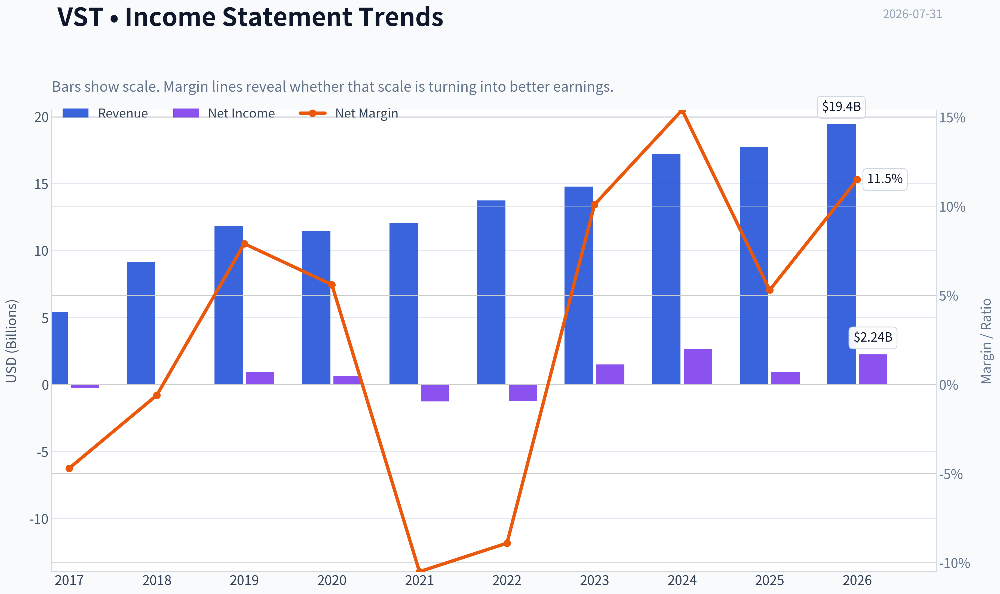

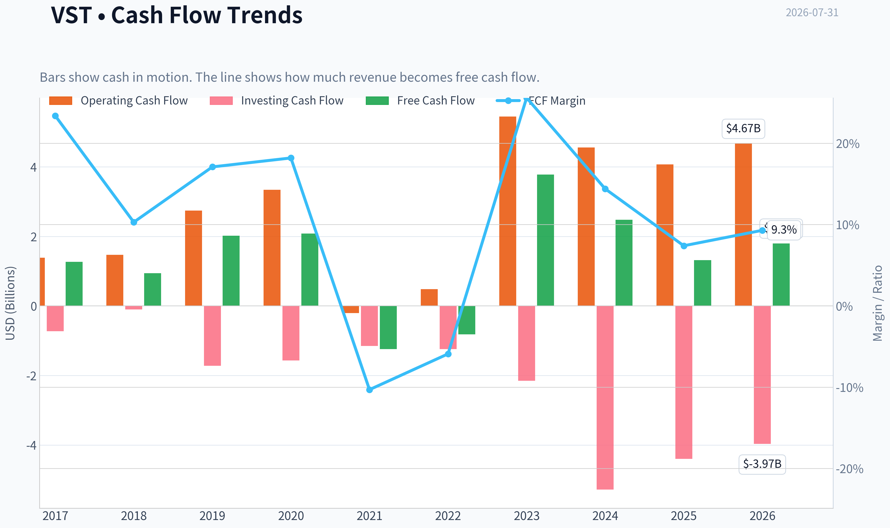

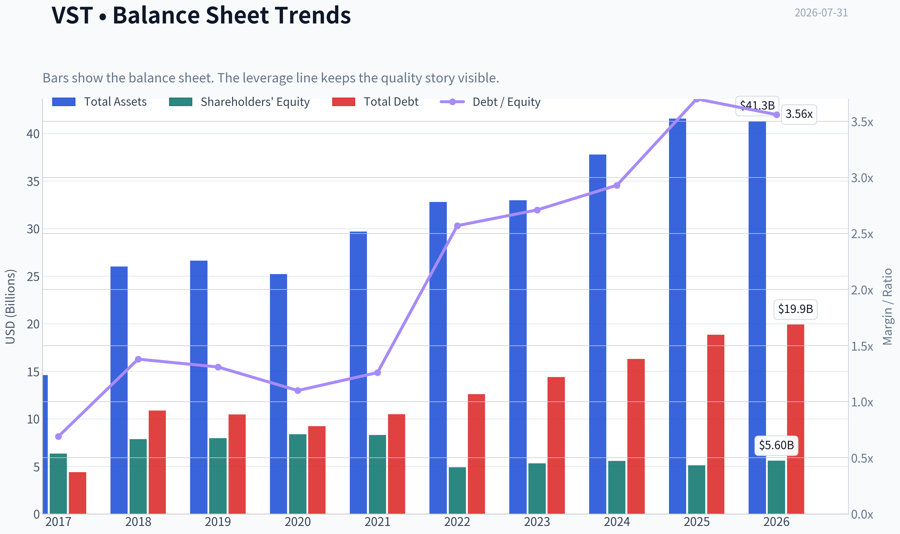

This graph tracks the profitability and return metrics (ROE, ROIC, Margins) of **VST** over the past decade, highlighting capital efficiency trends.

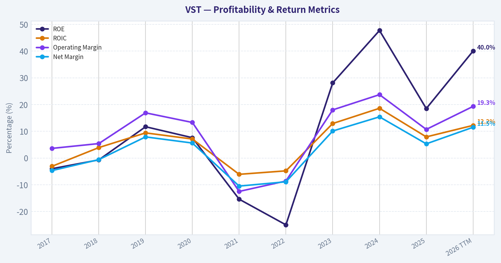

This chart illustrates the financial health of **VST** over the last 10 years, mapping cash equivalents and free cash flow against total obligations (Debt).

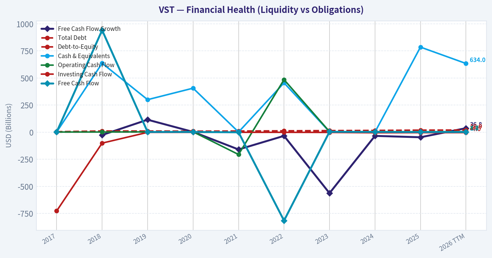

This breakdown chart from <em>Revenue Breakdown</em> shows the proportional composition for **VST** - useful for understanding what drives or risks the business.

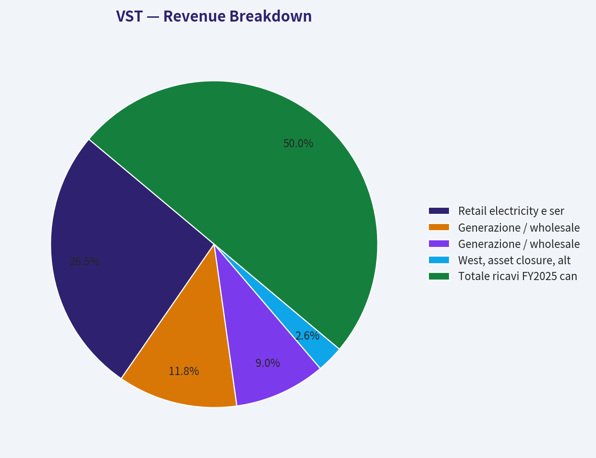

---

### Intrinsic Value Analysis (Buffett)

> *Following Warren Buffett's value investing philosophy: Circle of Competence, Economic Moat, Management Quality, and Margin of Safety.*

#### Intrinsic Value Snapshot

Price is what you pay. Intrinsic value is what the business may be worth based on the cash it can create for owners over time. We show a range, not one magic number.

- Current Price: $148.19
- Value Range (conservative to optimistic across both DCF methods): $-48.82 to $780.42

##### Owner Earnings (Buffett Method)
- Net Income: $944,000,000.00
- Depreciation & Amortization: $2,950,000,000.00
- Capital Expenditures: $-2,752,000,000.00
- Working Capital Changes: $-1,088,000,000.00
- Owner Earnings: $2,230,000,000.00

##### Intrinsic Value
###### Buffett Method
Uses owner earnings. Stricter, and usually more conservative.
- Conservative: $-48.82
- Average: $264.55
- Optimistic: $780.42
- Discount Rate: 10.0%

###### Cash Flow Method
Uses free cash flow. Better for companies spending heavily today to grow tomorrow.
- Conservative: $-41.56
- Average: $10.54
- Optimistic: $10.54
- Discount Rate: 10.0%

ANALYST STANCE: **OSSERVARE**

#### Tesi sintetica

Vistra è un operatore energetico integrato con asset di generazione elettrica, esposizione a mercati merchant, retail power e una crescente opzionalità legata alla domanda di elettricità da data center e carichi industriali. Il business è comprensibile, ma non è una "compounder" prevedibile in stile consumer staple: una parte rilevante del valore dipende da prezzi dell'energia, capacità disponibile, regolazione, cicli del gas, clima e domanda in ERCOT e altri mercati.

A $148 per azione, il titolo tratta circa il 10% sotto il valore intrinseco headline di $164,84. Per un business ciclico e capital intensive, questo margine non è abbastanza ampio. La società è interessante, ma il prezzo incorpora già molta della narrativa positiva su elettrificazione, data center e scarsità di capacità dispatchable.

---

#### 1. Fattori Buffett: qualità del business

| Fattore | Punteggio 0-5 | Giudizio | Evidenza principale |
|---|---:|---|---|
| 1. Comprensibilità e prevedibilità | 3,0 | Buona ma ciclica | Vistra guadagna producendo e vendendo elettricità; modello semplice, ma risultati sensibili a power prices, fuel costs, capacità e regolazione. |
| 2. Moat competitivo | 3,0 | Medio / stretto-plus | Asset di generazione difficili da replicare, licenze, scala e portafoglio nucleare/gas; pricing power però limitato dai mercati elettrici. |
| 3. Management e allocazione capitale | 3,5 | Discreto / positivo | Acquisizioni e buyback hanno creato valore durante il ciclo favorevole; resta da monitorare disciplina su debito, capex e timing dei riacquisti. |
| 4. Struttura del settore | 2,75 | Attraente ma volatile | Domanda elettrica strutturalmente in crescita, ma industria capital intensive, regolata e soggetta a cicli di commodity e capacità. |
| Gate 5: qualità/solvibilità | Non tripped | Nessun hard floor | Non emerge combinazione di deterioramento operativo evidente e stress di solvibilità estremo. |

**Punti chiave:** Vistra è un business reale, necessario e con asset scarsi, ma non ha la prevedibilità di un monopolio regolato puro. La domanda di elettricità è un forte vento in poppa, tuttavia il valore dipende ancora da variabili cicliche. Il titolo merita attenzione, non un acquisto aggressivo al prezzo attuale.

---

#### 2. Analisi del moat

| Fonte di moat | Valutazione | Evidenza |
|---|---|---|
| Asset intangibili / regolazione | Medio-alta | Licenze, autorizzazioni ambientali, impianti nucleari e generazione dispatchable sono difficili da costruire rapidamente. |
| Switching costs | Bassi-medi | Nel retail energy i clienti possono cambiare fornitore; nel wholesale conta più il portafoglio asset che la fedeltà del cliente. |
| Vantaggio di costo | Medio | Scala, diversificazione geografica e mix nucleare/gas aiutano, ma i costi restano esposti a fuel, manutenzione e mercati regionali. |
| Network effects | Bassi | L'elettricità non beneficia di veri network effects proprietari; la rete elettrica è infrastrutturale, non una piattaforma posseduta da Vistra. |
| Pricing power | Medio-basso | In periodi di scarsità di capacità i prezzi possono salire molto, ma non è pricing power pienamente controllato dall'azienda. |
| Rating moat complessivo | Medio / Narrow-to-moderate | Asset scarsi e difficili da replicare, ma forte dipendenza dal ciclo elettrico. |

**Punti chiave:** Il moat di Vistra nasce più dalla scarsità fisica degli asset che da un brand o da switching costs. Il portafoglio nucleare e dispatchable è prezioso in un sistema elettrico più intermittente e affamato di potenza. Tuttavia, il moat non elimina la volatilità dei margini né la dipendenza dai prezzi dell'energia.

---

#### 3. Sintesi finanziaria

| Metrica | Valore |
|---|---:|
| Prezzo corrente | $148 |
| Capitalizzazione di mercato | $49,97 mld |
| P/E | 24,9x |
| ROE | 18,5% |
| Crescita ricavi YoY | 3,0% |
| FCF yield | 2,6% |
| Current ratio | 0,78x |
| Valore intrinseco headline | $164,84 |
| Margine di sicurezza headline | 10,1% |
| Reverse DCF: crescita implicita a 10 anni | circa 16,9% annuo |
| Crescita ricavi trailing 3 anni | circa 2,1% annuo |

**Punti chiave:** La redditività sul capitale proprio è buona, ma il FCF yield del 2,6% è modesto per un business ciclico. Il prezzo offre un piccolo sconto rispetto al valore intrinseco headline, ma la crescita implicita dal reverse DCF è molto più alta della crescita storica recente dei ricavi. Questo rende il rapporto rischio/rendimento non ancora abbastanza favorevole.

---

#### 4. Owner earnings

| Componente | Valore / Metodo |
|---|---:|
| Net income | Base contabile di partenza |
| + Deprezzamento e ammortamento | Aggiunto perché costo non monetario |
| - Capex di manutenzione | Sottratto per mantenere capacità produttiva |
| - Incrementi di capitale circolante | Sottratti se assorbono cassa |
| Owner earnings normalizzati per azione | circa $26,46 |
| Owner earnings normalizzati totali stimati | circa $8,93 mld |
| Rendimento owner earnings su prezzo | circa 17,9% |

**Punti chiave:** La misura normalizzata di owner earnings appare molto più generosa del FCF yield corrente. Questo segnala che la valutazione è molto sensibile alla normalizzazione del ciclo energetico. Per un investitore Buffett-style, il punto cruciale è non capitalizzare utili di picco come se fossero permanenti.

---

#### 5. Valutazione DCF a tre scenari

| Scenario | Assunzioni | Valore per azione |
|---|---|---:|
| A. Nessuna crescita | Owner earnings / 10% | $264,55 |
| B. Crescita GDP | Crescita perpetua 3%, discount rate 10% | $389 circa |
| C. Crescita storica ridotta | Circa 1,5% annuo, pari a 50-75% della crescita storica recente | $316 circa |
| Cross-check FCF | Valore da modello FCF | $10,54 |
| Cross-check Damodaran FCFF | Valore da modello FCFF | -$34,36 |
| Valore intrinseco headline usato | Blend ciclico / normalizzato | $164,84 |

**Punti chiave:** Gli scenari basati su owner earnings danno valori molto elevati, mentre i modelli basati su FCF e FCFF sono molto più severi. Questa dispersione è un avvertimento importante: Vistra non è una macchina di cassa lineare e prevedibile. Il valore più utile è quindi il valore headline normalizzato di $164,84, non il numero più ottimistico della tabella.

---

#### 6. Margine di sicurezza

| Voce | Valore |
|---|---:|
| Prezzo corrente | $148 |
| Valore intrinseco headline | $164,84 |
| Upside verso valore intrinseco | 11,4% |
| Margine di sicurezza | 10,1% |
| Margine richiesto per qualità/ciclicità | circa 25-35% |
| Prezzo indicativo con 25% MOS | circa $124 |
| Prezzo indicativo con 35% MOS | circa $107 |

**Punti chiave:** Lo sconto attuale è reale ma insufficiente per un business ciclico. Una società con moat ampio, asset-light e alta prevedibilità potrebbe meritare acquisto con solo 10-15% di margine; Vistra non rientra chiaramente in quella categoria. Per diventare più interessante, il titolo dovrebbe scendere verso l'area $107-$124 o mostrare una qualità degli utili più stabile e meno ciclica.

---

#### 7. Management e allocazione del capitale

| Area | Giudizio | Commento |
|---|---|---|
| Mentalità da proprietari | Discreta | La creazione di valore recente è stata forte, sostenuta anche da buyback e portafoglio asset favorevole. |
| Allocazione del capitale | Positiva ma da monitorare | Acquisizioni e riacquisti possono essere accretive, ma il timing è fondamentale in un settore ciclico. |
| Disciplina sul debito | Media | Il settore richiede capitale e può tollerare leva, ma una balance sheet "fortress" sarebbe preferibile. |
| Trasparenza | Adeguata | Il business richiede lettura attenta di hedging, sensitività ai prezzi e capex. |
| Insider/guru signal | Neutrale-leggermente negativo | Steve Cohen ha ridotto la posizione del 27,9% nell'ultimo 13F disponibile. |

**Punti chiave:** Il management ha beneficiato di un contesto molto favorevole e ha usato strumenti di allocazione capitale che possono aumentare il valore per azione. La domanda chiave è se continuerà a comprare asset e azioni con disciplina quando il ciclo è meno favorevole. In un business come Vistra, l'allocazione del capitale conta quasi quanto gli asset stessi.

---

#### 8. Scorecard finale Buffett

| Criterio | Peso | Punteggio 0-5 | Contributo ponderato |
|---|---:|---:|---:|
| Moat e durabilità | 25% | 3,0 | 0,75 |
| Valutazione / margine di sicurezza | 20% | 2,75 | 0,55 |
| Rendimenti sul capitale | 15% | 3,25 | 0,49 |
| Comprensibilità e prevedibilità | 12% | 3,0 | 0,36 |
| Management e allocazione capitale | 12% | 3,5 | 0,42 |
| Reinvestment runway | 8% | 3,75 | 0,30 |
| Solidità patrimoniale | 4% | 2,5 | 0,10 |
| Struttura del settore | 4% | 2,75 | 0,11 |
| Totale | 100% |  | **3,08 / 5,00** |

**Punti chiave:** Il punteggio finale colloca Vistra nella fascia "OSSERVARE". La qualità degli asset e il runway della domanda elettrica sono positivi, ma la ciclicità e il margine di sicurezza limitato impediscono una raccomandazione più forte. Il titolo non è da scartare, ma il prezzo non offre ancora una protezione sufficiente.

---

#### 9. Stance d'investimento

| Stance | Conviction | Motivo |
|---|---|---|
| **OSSERVARE** | Media | Business interessante con asset scarsi e domanda strutturale favorevole, ma valutazione non abbastanza scontata per il rischio ciclico. |

**Punti chiave:** Vistra è una società da tenere in lista, soprattutto per l'esposizione alla crescita della domanda elettrica e alla scarsità di capacità affidabile. A $148, però, il titolo richiede fiducia in una crescita sostenuta che il reverse DCF stima intorno al 16,9% annuo. Per un investitore value disciplinato, il prezzo giusto sarebbe più basso oppure la qualità degli utili dovrebbe dimostrarsi più stabile nel tempo.

**Conclusione:** Vistra è un buon business energetico ciclico con asset preziosi, ma non ancora una "wonderful company at a fair price". La decisione Buffett-style è **OSSERVARE**, con interesse crescente sotto $124 e soprattutto in area $107-$115.
#### Valuation Bridge

This bridge places the current market price beside each intrinsic value lens so readers can see whether upside depends on one method or shows up across several methods.

| Scenario | Intrinsic Value / Share |
| --- | ---: |
| Buffett Method | $264.55 |
| Cash Flow Method | $10.54 |
| Damodaran Method | $-34.36 |
| Current Price | $148.19 |

#### Key Takeaways

If one method is far above the others, the upside case depends on a specific modelling assumption. When several methods cluster together, the valuation story is more robust.

#### Valuation Visuals

This comparison chart from *Latest Earnings Snapshot* stacks current figures against historical benchmarks for **VST**, making it easy to see where the company trades relative to its own averages.

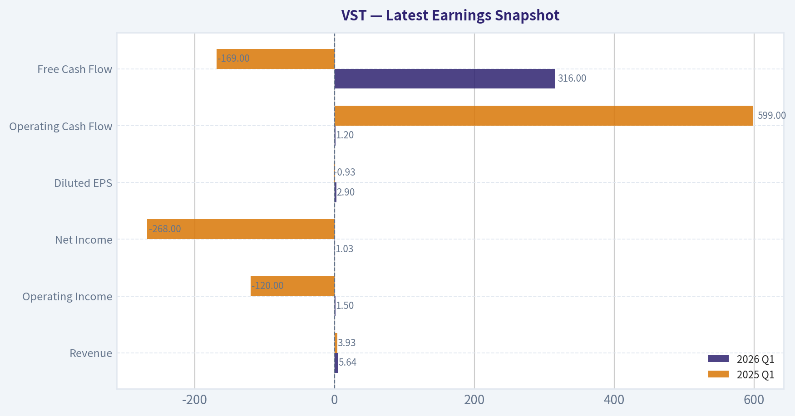

This comparison chart from *Confronto valori correnti vs media storica del periodo disponibile* stacks current figures against historical benchmarks for **VST**, making it easy to see where the company trades relative to its own averages.

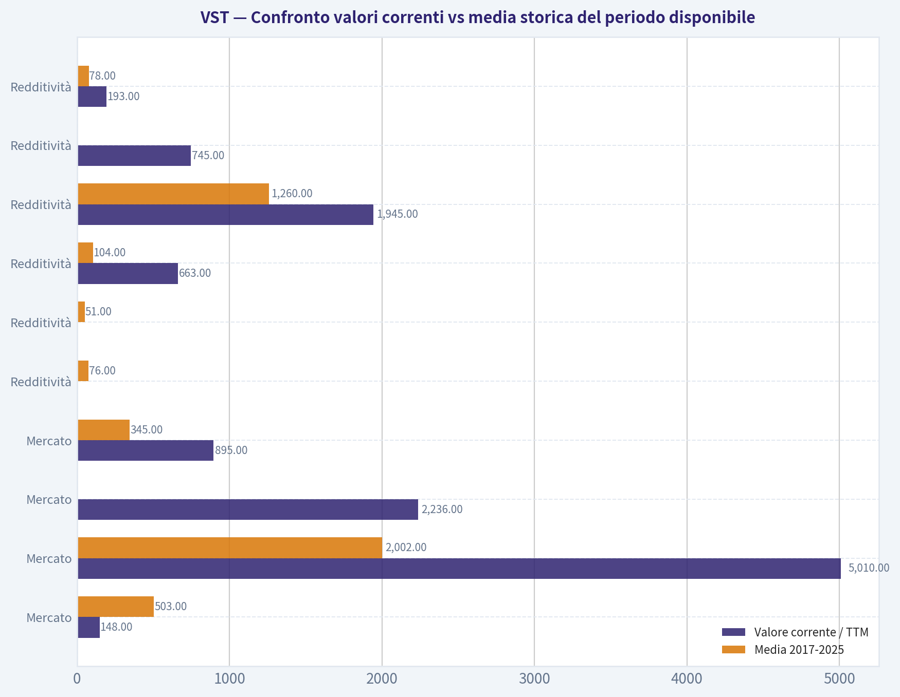

This comparison chart from *Valutazione DCF Buffett-style su Owner Earnings* stacks current figures against historical benchmarks for **VST**, making it easy to see where the company trades relative to its own averages.

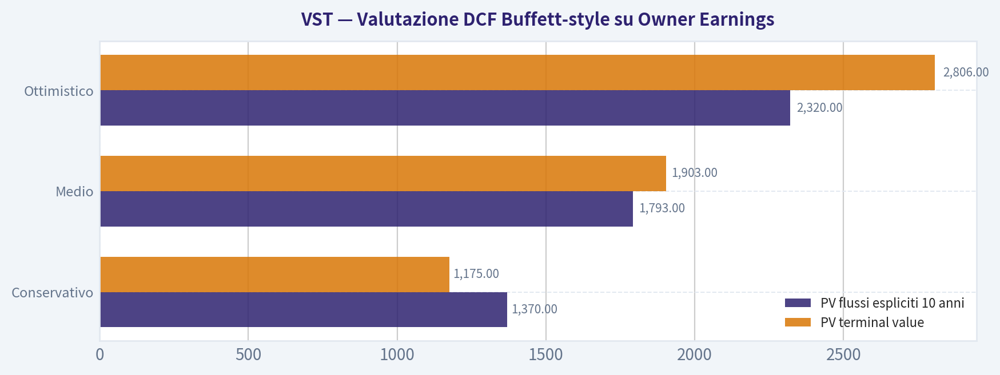

This comparison chart from *Dettaglio dei calcoli DCF* stacks current figures against historical benchmarks for **VST**, making it easy to see where the company trades relative to its own averages.

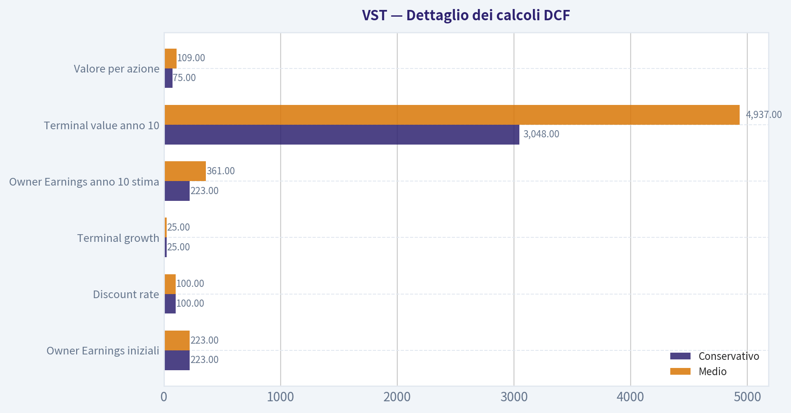

This comparison chart from *Confronto con i modelli di intrinsic value del pack* stacks current figures against historical benchmarks for **VST**, making it easy to see where the company trades relative to its own averages.

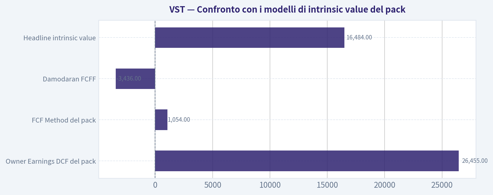

---

### Trend & Growth Analysis (Lynch/Druckenmiller/Fisher)

> *Following Peter Lynch's GARP, Stanley Druckenmiller's macro-aware approach, and Philip Fisher's scuttlebutt methodology.*

ANALYST STANCE: **OSSERVARE**

#### VST - Analisi Growth secondo Lynch, Druckenmiller e Fisher

Vistra Corp. è un produttore e rivenditore integrato di energia elettrica, con esposizione rilevante al tema secolare della domanda di potenza da data center, AI, elettrificazione e affidabilità della rete. Il titolo ha già avuto una rivalutazione enorme negli ultimi anni; oggi il punto chiave non è "energia a basso costo", ma se il mercato stia ancora sottovalutando la scarsità strutturale di capacità elettrica dispatchable negli Stati Uniti.

---

#### 1. Classificazione Lynch

| Voce | Valutazione |
|---|---|
| Categoria Lynch | **Ciclico / asset play energetico con possibile inflection growth** |
| Non è | Fast grower puro |
| Crescita ricavi YoY | **3,0%** |
| P/E | **24,9x** |
| ROE | **18,5%** |
| FCF yield | **2,6%** |
| Profilo growth | Più basato su prezzi dell'energia, capacità, contratti e domanda AI che su crescita organica lineare |
| Giudizio Lynch | Interessante da monitorare, ma non un classico ten-bagger "semplice" alla Lynch |

**Key Takeaways:** VST non rientra nel profilo ideale del fast grower alla Lynch, perché la crescita dei ricavi è bassa e il business resta ciclico. Tuttavia, l'esposizione alla scarsità di energia e alla domanda dei data center crea un possibile punto di inflessione. Il titolo è più adatto a un investitore macro-aware in stile Druckenmiller che a un puro investitore GARP.

---

#### 2. La storia in 3 bullet

- Vistra produce e vende elettricità in un momento in cui la domanda di potenza negli Stati Uniti potrebbe accelerare per AI, data center, reshoring industriale ed elettrificazione.
- La capacità elettrica affidabile è diventata un asset strategico: chi possiede generazione disponibile può beneficiare di prezzi, contratti e margini migliori.
- Il mercato ha già premiato molto VST, quindi la tesi richiede che gli utili dei prossimi 2-3 anni siano ancora sottostimati.

---

#### 3. TAM e test 10x

| Elemento | Valutazione |
|---|---|
| Mercato indirizzabile | Energia elettrica USA, capacità dispatchable, retail power, contratti per grandi carichi industriali e data center |
| Driver TAM | AI, cloud, data center, elettrificazione, affidabilità rete, carenza di capacità |
| Crescita TAM | Probabilmente superiore al passato, ma non lineare |
| Test 10x ricavi | **Non superato in senso stretto** |
| Motivo | Un 10x dei ricavi richiederebbe una scala enorme in un mercato regolato, fisico e capital intensive |
| Test 10x valore azionario | Possibile solo con forte espansione multipli/utili, buyback e pricing power sostenuto |
| Runway | Buona per utili e cash flow; più limitata per ricavi puri |

**Key Takeaways:** Il TAM energetico è enorme, ma VST non è un software company che può moltiplicare i ricavi per dieci con costi marginali bassi. La vera opportunità non è un 10x dei ricavi, ma una rivalutazione degli asset elettrici in un mondo affamato di potenza. Il runway esiste, ma è legato a prezzi, contratti, disciplina del capitale e regolazione.

---

#### 4. Trend dei ricavi e qualità della crescita

| Indicatore | Dato / Giudizio |
|---|---|
| Crescita ricavi YoY | **3,0%** |
| Pattern | Bassa crescita, non accelerazione evidente dai dati disponibili |
| Qualità crescita | Dipendente da prezzi energia, mix, hedging, domanda e asset base |
| Tipo di crescita | Più ciclica/contrattuale che organica scalabile |
| Lettura Druckenmiller | Il punto non sono i ricavi attuali, ma gli utili futuri se il mercato elettrico si restringe |

**Key Takeaways:** La crescita dei ricavi non mostra ancora il profilo da fast grower. La tesi bullish deve quindi poggiare su margini, capacità e potere contrattuale, non su una semplice accelerazione top-line. Questo aumenta l'importanza del timing macro e della qualità degli asset.

---

#### 5. Unit economics

| Metrica | Valutazione |
|---|---|
| LTV/CAC | Non applicabile: non è un business SaaS o consumer subscription |
| NRR | Non applicabile |
| Rule of 40 | Non applicabile |
| Margini | Gross margin non disponibile nel pack |
| FCF yield | **2,6%** |
| Current ratio | **0,78** |
| Lettura | Business capital intensive; attenzione a leva, liquidità e ciclo commodity |

**Key Takeaways:** Le metriche SaaS non sono utili per VST. Qui contano capacità produttiva, costo del capitale, hedging, contratti e generazione di cassa. Il FCF yield non è elevato al prezzo attuale, quindi il mercato sta già incorporando una buona parte della narrativa positiva.

---

#### 6. Inflection point assessment

| Tipo di inflection | Stato | Commento |
|---|---:|---|
| Product cycle | Basso | Non c'è un nuovo prodotto scalabile |
| Market share | Medio | Potenziale vantaggio se VST cattura domanda da data center e grandi carichi |
| Margin inflection | Medio-Alto | Possibile se prezzi/capacity payments restano forti |
| TAM inflection | Alto | AI e data center aumentano il bisogno di energia affidabile |
| Competitive inflection | Medio | Chi ha asset esistenti può beneficiare di barriere fisiche e tempi lunghi di permitting |
| Earnings inflection | Medio-Alto | La domanda chiave è se gli EPS 2027-2028 siano sottostimati |

**Key Takeaways:** L'inflessione più importante non è tecnologica, ma macro-strutturale: la scarsità di elettricità affidabile. VST può beneficiare se data center e carichi industriali competono per capacità limitata. Tuttavia, questa è una tesi complessa e ciclica, non una crescita lineare visibile nei ricavi attuali.

---

#### 7. Macro setup

| Fattore macro | Impatto su VST |
|---|---|
| AI / data center | Molto positivo |
| Elettrificazione | Positivo |
| Tassi d'interesse | Misto: tassi più bassi aiutano asset capital intensive; tassi alti penalizzano multipli |
| Ciclo commodity | Rischio elevato |
| Regolazione energetica | Rischio e opportunità |
| Affidabilità rete | Positivo per capacità dispatchable |
| Sentiment mercato | Già molto favorevole dopo forte performance pluriennale |

**Key Takeaways:** Il vento secolare è favorevole: AI, data center e rete elettrica sono temi potenti. Ma VST è sensibile a politica energetica, prezzi elettrici e tassi. La macro sostiene la tesi, ma non elimina la ciclicità.

---

#### 8. Fisher 15 Points

| Punto Fisher | Score 1-5 | Commento sintetico |
|---|---:|---|
| Potenziale di mercato | 4 | Domanda elettrica in accelerazione |
| Nuovi prodotti / sviluppo | 2 | Non è un innovatore di prodotto puro |
| R&D efficace | 2 | Limitata rilevanza rispetto a software/healthcare |
| Sales organization | 3 | Retail e contratti energia rilevanti |
| Margini | 3 | Potenziale buono, ma ciclico |
| Miglioramento margini | 4 | Possibile leva da prezzi/capacity scarcity |
| Relazioni con personale | 3 | Nessun dato negativo nel pack |
| Relazioni executive | 3 | Dati insufficienti |
| Profondità management | 3 | Operatore rilevante nel settore |
| Controllo costi/accounting | 3 | Da monitorare per hedging e complessità |
| Moat / vantaggi | 4 | Asset fisici, permitting, capacità esistente |
| Outlook lungo termine | 4 | Tema power demand strutturale |
| Diluizione | 4 | Nessun segnale di continue capital raises nel pack |
| Candore management | 3 | Dati insufficienti |
| Integrità management | 3 | Dati insufficienti |
| **Totale** | **48/75** | **Medio** |

**Key Takeaways:** Il punteggio Fisher è medio, non eccellente. VST ha un buon vantaggio negli asset fisici e nel posizionamento macro, ma non mostra le caratteristiche di un innovatore ad alta R&D o di un compounder asset-light. La qualità della tesi dipende più dal ciclo energetico che dalla superiorità di prodotto.

---

#### 9. Valutazione

| Metrica | Dato | Lettura |
|---|---:|---|
| Prezzo corrente | **$148** | Base analisi |
| Market cap | **$49,97B** | Già grande capitalizzazione |
| P/E | **24,9x** | Non economico per un business ciclico |
| FCF yield | **2,6%** | Implica P/FCF circa 38x |
| ROE | **18,5%** | Buona redditività |
| Valore intrinseco headline | **$164,84** | Circa 10,1% sopra il prezzo |
| Owner earnings DCF | **$264,55** | Scenario molto favorevole |
| FCF DCF | **$10,54** | Scenario molto negativo |
| Damodaran FCFF | **-$34,36** | Forte dispersione |
| Reverse DCF | **16,9% annuo per 10 anni** | Aspettative elevate |
| PEG su crescita ricavi 3% | Circa **8,3x** | Non attraente su crescita attuale |
| PEG su crescita implicita 16,9% | Circa **1,5x** | Fair, ma richiede execution forte |

**Key Takeaways:** La valutazione è la parte più delicata della tesi. Il valore intrinseco headline offre solo un margine di sicurezza moderato, mentre i modelli hanno una dispersione estrema. Il reverse DCF suggerisce che il mercato sta già prezzando una crescita significativa e duratura.

---

#### 10. Scenari di rendimento

| Scenario | Ipotesi | Esito qualitativo |
|---|---|---|
| Bear | Normalizzazione prezzi energia, domanda AI più lenta, regolazione sfavorevole | Downside rilevante; multiplo ciclico si comprime |
| Base | Domanda elettrica solida, utili elevati ma non esplosivi, buyback disciplinati | Rendimento moderato, coerente con valore intrinseco vicino a $165 |
| Bull | Scarsità di capacità persistente, contratti data center favorevoli, EPS sottostimati | Upside significativo, ma già parzialmente prezzato |
| Ten-bagger | Richiede combinazione di enorme espansione utili, multipli resilienti e reinvestimento eccellente | Poco probabile da market cap attuale |

**Key Takeaways:** Il caso bull è plausibile, ma non asimmetrico come in un vero fast grower sottovalutato. Il titolo può ancora funzionare se gli utili sorprendono, ma la probabilità di un nuovo 10x appare bassa dopo il forte rialzo già realizzato. Il rapporto rischio/rendimento è più da monitoraggio selettivo che da accumulo aggressivo.

---

#### 11. Growth Investor Scorecard

| Criterio | Peso | Score 1-5 | Contributo |
|---|---:|---:|---:|
| Storia Lynch | 10% | 3,5 | 0,35 |
| TAM & runway | 20% | 4,0 | 0,80 |
| Crescita ricavi | 20% | 2,0 | 0,40 |
| Unit economics | 15% | 3,0 | 0,45 |
| Posizione competitiva | 10% | 4,0 | 0,40 |
| Management quality | 10% | 3,0 | 0,30 |
| Macro setup | 5% | 4,0 | 0,20 |
| Percorso profittabilità | 5% | 3,5 | 0,18 |
| Valutazione | 5% | 2,5 | 0,13 |
| **Totale** | **100%** |  | **3,21 / 5** |

**Key Takeaways:** Il punteggio complessivo è da osservazione, non da acquisto aggressivo. TAM, macro e asset position sono forti, ma crescita dei ricavi e valutazione frenano la tesi. VST è un buon candidato da seguire per inflection sugli utili, ma non soddisfa pienamente i criteri di un fast grower GARP.

---

#### 12. Rischi principali e catalizzatori

| Categoria | Rischi | Catalizzatori |
|---|---|---|
| Energia | Prezzi elettrici più bassi, hedging sfavorevole, volatilità commodity | Prezzi power sostenuti, capacity payments migliori |
| AI / data center | Domanda inferiore alle attese, limiti locali alle connessioni | Nuovi contratti con data center o hyperscaler |
| Regolazione | Interventi politici su prezzi, emissioni o mercati capacity | Politiche a favore dell'affidabilità rete |
| Valutazione | Multiplo già elevato per business ciclico | EPS 2027-2028 sopra consensus |
| Bilancio/liquidità | Current ratio sotto 1, business capital intensive | FCF forte, buyback, deleveraging |
| Posizionamento istituzionale | Steve Cohen/Point72 ha ridotto del 27,9% al 31 marzo 2026 | Nuovi acquisti istituzionali o revisioni positive degli analisti |

**Key Takeaways:** I catalizzatori più importanti sono contratti energetici legati ai data center, revisione al rialzo degli utili e conferma della scarsità di capacità. I rischi principali sono valutazione, ciclicità e regolazione. La riduzione di Point72 non è una prova negativa definitiva, ma suggerisce che alcuni investitori sofisticati hanno preso profitto dopo il rally.

---

#### 13. Posizionamento

| Profilo investitore | Stance |
|---|---|
| Growth puro / Lynch fast grower | Non ideale |
| Macro growth / Druckenmiller | Interessante da monitorare |
| Value ciclico | Valutazione non abbastanza economica |
| Portafoglio esistente | Mantenere se posizione con forte gain, ma valutare trimming disciplinato |
| Nuova posizione | Solo su pullback o dopo conferma EPS/contratti |
| Position size | Piccola / satellite, non core growth |

**Key Takeaways:** VST è più una tesi macro-energetica che una tesi growth classica. Per chi già possiede il titolo, la frase di Lynch "il miglior titolo da comprare può essere quello che già possiedi" invita a non vendere solo perché è salito. Per nuovi acquisti, però, serve più margine di sicurezza o una conferma più chiara dell'inflessione degli utili.

---

#### Giudizio finale

**Stance: OSSERVARE.**
VST ha un'esposizione potente a uno dei temi più importanti del decennio: la scarsità di energia affidabile nell'era AI. Tuttavia, la crescita dei ricavi è modesta, il business resta ciclico e la valutazione incorpora già aspettative elevate. La tesi diventa più attraente su pullback significativo, su nuovi contratti data center, o su prove concrete che gli utili 2027-2028 siano ancora sottostimati dal mercato.

---

### Market Technical Analysis

ANALYST STANCE: **OSSERVARE**

#### VST - analisi tecnica al 31/07/2026

Ultimo prezzo disponibile da Yahoo Finance: **148,62 $ al 30/07/2026**. Gli indicatori risultano aggiornati al **31/07/2026** dove disponibili. Il quadro tecnico di VST è deteriorato nel breve periodo: il titolo ha perso rapidamente quota dopo il massimo relativo di luglio in area **168,98 $**, rompendo sotto medie mobili importanti e mostrando un'accelerazione ribassista del MACD. La posizione non è ancora da "evitare" in modo assoluto perché l'RSI non segnala panico estremo e il prezzo sta tentando una stabilizzazione sopra l'area 142-149 $, ma il titolo richiede conferme prima di nuove entrate direzionali rialziste.

| Indicatore selezionato | Valore recente | Lettura operativa | Perché è rilevante ora |
|---|---:|---|---|
| close_10_ema | 153,31 | Resistenza dinamica di breve | Misura se il rimbalzo sta recuperando slancio immediato |
| close_50_sma | 156,06 | Resistenza/intermedio trend | Il prezzo è sotto la media: bias tattico fragile |
| close_200_sma | 163,41 | Trend primario negativo | La media è sopra il prezzo e in discesa |
| macd | -1,76 | Momentum ribassista | Conferma deterioramento dopo il rally di metà luglio |
| macds | -0,04 | Segnale MACD | MACD sotto signal: pressione ancora negativa |
| rsi | 42,50 | Debole, ma non ipervenduto | Indica assenza di capitolazione piena |
| atr | 7,43 | Volatilità elevata | Serve per stop e sizing; movimenti giornalieri ampi |
| vwma | 155,96 | Prezzo sotto media ponderata volumi | Conferma che il recupero non è ancora sostenuto dai flussi |

**Punti chiave:** Gli indicatori più importanti convergono su un messaggio prudente: VST è sotto le medie di breve, medio e lungo periodo, mentre il momentum è tornato negativo. La volatilità resta alta, quindi eventuali trade devono avere stop più larghi o size ridotta. Il titolo non è in ipervenduto estremo, perciò un ingresso anticipato sul solo rimbalzo sarebbe rischioso.

#### Lettura del trend

La struttura di VST è passata da un recupero costruttivo nella seconda metà di giugno a una fase di distribuzione a fine luglio. Il titolo aveva recuperato da area **138-146 $** fino a chiudere a **168,98 $ il 23/07**, ma quel movimento non è stato sostenuto: nelle sedute successive il prezzo è sceso a **163,38 $**, poi **157,08 $**, **148,64 $** e infine **142,81 $** il 29/07, prima del rimbalzo a **148,62 $** il 30/07. Questa sequenza segnala un classico fallimento di breakout/rally, con venditori molto aggressivi sopra 160 $.

Il dato più delicato è la posizione rispetto alle medie mobili. Il prezzo è sotto la **10 EMA a 153,31 $**, sotto la **50 SMA a 156,06 $** e sotto la **200 SMA a 163,41 $**. Inoltre la 200 SMA è scesa da circa **170,01 $ a metà giugno** a **163,41 $**, quindi non è solo un livello statico di resistenza: è una media lunga con pendenza negativa. Questo riduce la qualità del trend primario e suggerisce che i rimbalzi verso 156-164 $ potrebbero incontrare offerta.

Il MACD rafforza questa lettura. A fine giugno il MACD era positivo e in miglioramento, ma dopo il picco di luglio ha girato rapidamente: da **2,11 il 24/07** è sceso a **-1,76 il 31/07**. La linea MACD è ora sotto la signal line, che si trova vicino allo zero a **-0,04**. Questa configurazione indica che il momentum rialzista non si è semplicemente raffreddato: si è trasformato in momentum ribassista.

L'RSI a **42,50** è un elemento più sfumato. Non segnala forza, perché è sotto 50, ma non mostra nemmeno panico da ipervenduto sotto 30. Questo significa che il titolo potrebbe ancora scendere senza essere statisticamente "estremo"; allo stesso tempo, un recupero sopra 50 dell'RSI sarebbe una prima conferma che la pressione ribassista sta diminuendo.

La volatilità è significativa: l'ATR a **7,43 $** equivale a circa il **5%** del prezzo. Questo implica che oscillazioni giornaliere di 6-8 dollari sono normali nel contesto attuale. Per i trader, ciò rende pericolosi stop troppo stretti; per gli investitori tattici, suggerisce di attendere livelli più chiari invece di inseguire movimenti intraday.

#### Zone operative da monitorare

La prima resistenza utile è in area **153-156 $**, dove convergono 10 EMA, VWMA e 50 SMA. Un ritorno sopra questa fascia, idealmente con chiusura giornaliera e volumi solidi, ridurrebbe il rischio di ulteriore breakdown. Sopra 156 $, il titolo potrebbe tentare un ritorno verso **160-164 $**, area molto importante perché include ex supporti e la 200 SMA.

Al ribasso, l'area **148-149 $** è il supporto immediato, ma non è ancora molto solida perché è stata recuperata solo dopo una forte caduta. Sotto tale livello, il mercato guarderebbe rapidamente a **142-143 $**, minimo recente e zona critica di difesa. Una chiusura sotto **142 $** aprirebbe spazio verso **138,35 $**, minimo di giugno, e poi verso **134-132 $**, area di maggio.

#### Implicazione tattica

Per un trader rialzista, VST richiede conferma: la condizione minima sarebbe una chiusura sopra **153-156 $**, con RSI sopra 50 e MACD che smette di peggiorare. Prima di ciò, il rimbalzo resta tecnicamente sospetto.

Per un trader ribassista, il setup è più coerente sotto **156 $**, ma il rischio è che il prezzo sia già sceso molto in pochi giorni. Un nuovo short avrebbe migliore rapporto rischio/rendimento su rimbalzi falliti verso 153-156 $, oppure su rottura confermata sotto 142 $.

Per un investitore già esposto, la zona decisiva è 142-149 $. Tenere finché questa fascia regge può essere ragionevole solo con sizing controllato; una perdita netta di 142 $ peggiorerebbe sensibilmente il quadro.

| Area / segnale | Livello indicativo | Interpretazione | Azione prudente |
|---|---:|---|---|
| Supporto immediato | 148-149 $ | Area di rimbalzo recente | Monitorare tenuta; non basta da sola per comprare |
| Supporto critico | 142-143 $ | Minimo recente | Sotto questo livello aumenta il rischio ribassista |
| Supporto successivo | 138,35 $ | Minimo di giugno | Possibile target se 142 $ cede |
| Resistenza breve | 153-156 $ | 10 EMA, VWMA, 50 SMA | Prima fascia da riconquistare per migliorare il setup |
| Resistenza primaria | 160-164 $ | Ex supporto e 200 SMA | Superamento necessario per cambiare il quadro tecnico |
| Momentum | MACD < signal | Pressione ribassista attiva | Attendere appiattimento o crossover positivo |
| Forza relativa | RSI 42,50 | Debole ma non estremo | Serve recupero sopra 50 per conferma rialzista |
| Volatilità | ATR 7,43 $ | Oscillazioni ampie | Stop larghi e size ridotta |

**Punti chiave:** VST è in una fase di osservazione, non di acquisto aggressivo. Il livello 153-156 $ è la prima soglia da riconquistare per migliorare il quadro, mentre una rottura sotto 142 $ renderebbe il setup decisamente più fragile. La volatilità elevata impone gestione del rischio rigorosa.

---

### Options Market Analysis

> *Reading options flow - put/call ratios, IV skew, and unusual activity - to gauge institutional positioning and event-driven risk.*

ANALYST STANCE: **OSSERVARE**

#### Report flusso opzioni - VST - dati al 31/07/2026

#### 1. Analisi Put/Call Ratio

| Scadenza | Call OI | Put OI | Put/Call OI | Volume Call | Volume Put | Put/Call Volume | Lettura |
|---|---:|---:|---:|---:|---:|---:|---|
| 07/08/2026 | 4.848 | 2.548 | 0,53 | 1.775 | 773 | 0,44 | Prevalenza call, tono rialzista di breve |
| 14/08/2026 | 3.054 | 1.409 | 0,46 | 488 | 93 | 0,19 | Forte sbilanciamento verso call, ma volume più contenuto |
| 21/08/2026 | 46.021 | 30.160 | 0,66 | 2.376 | 2.289 | 0,96 | OI quasi neutrale-rialzista; volume più bilanciato |
| **Totale near-term** | **53.923** | **34.117** | **0,63** | **4.639** | **3.155** | **0,68** | **Leggermente rialzista vs baseline 0,70** |

**Key Takeaways:** Il Put/Call OI complessivo di 0,63 è sotto la baseline neutrale di circa 0,70, indicando una modesta preferenza per esposizione call. Il Put/Call Volume di 0,68 è quasi neutrale ma ancora lievemente orientato verso le call. Il segnale non è estremamente speculativo, ma mostra una domanda di upside superiore alla protezione downside.

#### Interpretazione

Il posizionamento su VST appare **moderatamente rialzista**. Le prime due scadenze mostrano ratio put/call nettamente sotto 0,70, suggerendo maggiore interesse per call rispetto a put. La scadenza del 21/08/2026, che domina l'open interest, è più vicina alla neutralità con OI ratio a 0,66 e volume ratio a 0,96: questo riduce l'intensità del segnale rialzista e indica che parte del mercato sta comunque acquistando protezione o prendendo esposizione ribassista.

---

#### 2. Valutazione della volatilità implicita

| Scadenza | IV ATM Call | IV ATM Put | Differenziale Call - Put | Lettura skew disponibile |
|---|---:|---:|---:|---|
| 07/08/2026 | 74,4% | 70,6% | +3,8 pp | Premio sulle call ATM |
| 14/08/2026 | 65,7% | 62,8% | +2,9 pp | Premio sulle call ATM |
| 21/08/2026 | 61,6% | 58,6% | +3,0 pp | Premio sulle call ATM |

**Key Takeaways:** L'IV near-term è elevata, con livelli ATM tra circa 59% e 74%. Le call ATM prezzano una volatilità leggermente superiore alle put ATM, suggerendo più domanda per upside che per protezione ribassista. Il dato disponibile non include lo skew OTM strike-by-strike, quindi la lettura sulla pendenza completa dello skew va trattata con cautela.

#### Interpretazione IV e skew

La volatilità implicita è **alta**, soprattutto sulla scadenza più vicina del 07/08/2026, dove l'IV ATM call è al 74,4%. Questo indica che il mercato sta prezzando movimenti significativi nel breve termine. La struttura mostra una discesa dell'IV andando verso scadenze più lontane, coerente con una possibile concentrazione di rischio/evento nel brevissimo periodo.

Lo skew osservabile dai dati ATM è **call-skewed**, non put-skewed: le call ATM hanno IV superiore alle put ATM di circa 3 punti percentuali su tutte le scadenze. Questo tende a indicare domanda per upside, momentum o copertura di short call, più che paura marcata di ribasso. Tuttavia, non avendo i dati OTM put vs OTM call, non è possibile confermare se esista una vera "put skew" difensiva sulle code ribassiste.

Sul fronte catalizzatori, l'IV elevata potrebbe riflettere attesa per notizie societarie, earnings o volatilità settoriale, ma il dataset fornito non conferma un evento specifico. Va quindi interpretata come **premio al rischio di breve termine**, non necessariamente come segnale direzionale puro.

---

#### 3. Attività insolita su opzioni

| Criterio | Risultato |
|---|---|
| Contratti con volume > 5x open interest | Nessuno rilevato |
| Fresh directional bets evidenti | Non presenti nel campione near-term |
| Lettura smart money | Nessun segnale forte identificabile |
| Lettura retail/speculativa | Non emergono picchi anomali isolati |

**Key Takeaways:** Non sono stati rilevati contratti con volume superiore a 5 volte l'open interest, quindi non emergono nuove scommesse direzionali aggressive. L'assenza di attività insolita riduce la convinzione del segnale rialzista. Il mercato appare più posizionato tramite OI già esistente che tramite nuovi flussi esplosivi.

#### Interpretazione

Non ci sono segnali chiari di **unusual options activity** nelle scadenze analizzate. Questo è importante: il quadro put/call e IV suggerisce un bias rialzista moderato, ma manca la conferma di grandi ordini freschi su strike specifici.

In assenza di contratti con volume molto superiore all'OI, è meno probabile che il mercato stia vedendo una nuova iniziativa istituzionale aggressiva. Il posizionamento sembra più graduale e strutturale, non un improvviso sweep direzionale.

---

#### 4. Concentrazione di open interest e possibili livelli gravitazionali

| Scadenza | OI Totale | Peso relativo | Lettura |
|---|---:|---:|---|
| 07/08/2026 | 7.396 | 8,4% | Scadenza breve con IV più elevata, ma OI limitato |
| 14/08/2026 | 4.463 | 5,1% | Minore rilevanza per pinning |
| 21/08/2026 | 76.181 | 86,5% | Principale concentrazione di rischio e potenziale gamma |

**Key Takeaways:** La scadenza del 21/08/2026 domina nettamente l'open interest near-term, con oltre l'86% dell'OI aggregato. Questo la rende la scadenza più importante per eventuali effetti di pinning o gamma. I dati disponibili non includono la distribuzione per strike, quindi non è possibile identificare un gamma wall preciso.

#### Interpretazione open interest

La maggiore concentrazione di OI è sulla scadenza **21/08/2026**, con 46.021 call e 30.160 put. Questo suggerisce che, tra le scadenze analizzate, il mercato sta concentrando il rischio soprattutto su quella finestra temporale.

Non sono disponibili i dettagli strike-by-strike, quindi non è possibile indicare con precisione i livelli di prezzo con maggiore OI, il max pain o eventuali gamma wall specifici. A livello di scadenza, però, il 21/08 appare come il principale nodo di posizionamento. Se VST si avvicina a strike ad alto OI non visibili nel dataset, potrebbero emergere effetti di pinning o accelerazione gamma, ma il report non può quantificarli con i dati attuali.

---

#### 5. Segnale complessivo dal mercato opzioni

| Componente | Segnale | Peso nella lettura |
|---|---|---|
| Put/Call OI | Rialzista moderato | Call OI superiore alle put, ratio 0,63 sotto neutralità |
| Put/Call Volume | Quasi neutrale, leggermente rialzista | Ratio 0,68 vicino alla baseline 0,70 |
| IV | Elevata | Mercato prezza movimento ampio, non necessariamente direzione |
| Skew ATM | Rialzista moderato | IV call superiore a IV put |
| Attività insolita | Neutrale | Nessun contratto volume > 5x OI |
| OI concentration | Da monitorare | Forte concentrazione sulla scadenza 21/08 |

**Key Takeaways:** Il segnale complessivo è **RIALZISTA moderato**, guidato dalla prevalenza di call e da un lieve premio di IV sulle call ATM. La convinzione non è alta perché non ci sono flussi insoliti e la scadenza con più OI mostra volumi put quasi pari ai volumi call. Il titolo va monitorato per possibile volatilità elevata nel breve termine.

#### Segnale finale: **RIALZISTA, con convinzione moderata**

Il mercato opzioni su VST indica un orientamento **moderatamente rialzista**. Il driver principale è il Put/Call OI complessivo a 0,63, inferiore alla soglia neutrale di 0,70, insieme a una IV ATM leggermente più alta sulle call rispetto alle put. Questo suggerisce maggiore domanda per partecipazione all'upside rispetto alla protezione downside.

La cautela è necessaria per tre ragioni. Primo, il Put/Call Volume complessivo a 0,68 è solo lievemente rialzista, non estremo. Secondo, non sono presenti contratti anomali con volume superiore a 5x OI, quindi manca un segnale di nuova iniziativa istituzionale aggressiva. Terzo, l'IV è elevata, quindi le opzioni incorporano già aspettative di movimento ampio: per chi compra premio, il rischio di IV crush o compressione della volatilità è rilevante.

#### Tabella riassuntiva finale

| Categoria | Lettura | Implicazione |
|---|---|---|
| Put/Call Ratio | OI 0,63; Volume 0,68 | Moderatamente rialzista vs baseline neutrale 0,70 |
| Livello IV | Elevato, 58,6%-74,4% ATM | Attese di movimento ampio nel breve termine |
| Direzione skew | Premio sulle call ATM | Domanda di upside più forte della protezione downside |
| Attività insolita | Nessuna rilevata | Nessuna conferma da flussi freschi aggressivi |
| Segnale complessivo | **RIALZISTA moderato** | Bias positivo, ma con fiducia non elevata |

**Key Takeaways:** VST mostra un quadro opzioni costruttivo ma non euforico. La prevalenza di call e il call-skew ATM sostengono una lettura rialzista, mentre l'assenza di unusual activity limita la forza del segnale. In sintesi, il mercato opzioni favorisce l'upside, ma con premio IV già alto e rischio di volatilità significativa.

---

## Research Team Commentary

> *The Research Manager synthesizes the Bull vs Bear debate into action-free commentary. This is a pre-risk view, not the final stance.*

Ciao a tutti. Analizzando il dibattito tra i nostri analisti su Vistra Corp (VST) attraverso la nostra lente di value investing adattivo, emergono argomentazioni molto forti da entrambe le parti, ma che richiedono un'attenta calibrazione per non cadere in trappole cognitive.

Da un lato, l'analista Bull costruisce una tesi affascinante basata sulla scarsità energetica. Sostiene che Vistra non sia più una semplice utility ciclica, ma una sorta di infrastruttura a lungo termine, avvantaggiata da un fossato competitivo (il nucleare e la sua posizione in ERCOT) che le permetterà di estrarre enormi profitti grazie alla fame di energia dei data center legati all'intelligenza artificiale. Per lui, acquistare a 148 dollari con uno sconto del 10% sul valore intrinseco stimato è un affare, perché si sta comprando un'azienda meravigliosa a un prezzo equo.

Dall'altro lato, l'analista Bear ci riporta bruscamente alla realtà dei numeri. Ci ricorda che le vere aziende "compounder" alla Buffett, come Apple o Visa, hanno rendimenti sul capitale investito (ROIC) stellari. Vistra, invece, viaggia su un mediocre ROIC del 6,9% e un ROA del 2,3%. Per il Bear, applicare un multiplo di 25 volte gli utili a un business ciclico e ad alta intensità di capitale, che cresce solo del 3% nei ricavi, significa pagare un prezzo perfetto per un futuro tutt'altro che privo di rischi normativi e operativi.

Sintetizzando il tutto, la mia posizione finale è di mantenere il titolo sotto osservazione. Stance: WATCH.

Ecco il mio takeaway centrale: la narrativa secolare legata all'energia per l'IA e i data center è reale e potente, ma l'attuale prezzo delle azioni di Vistra esige la perfezione assoluta. Vistra è un buon business ciclico che sta vivendo un momento d'oro, ma non è una "compounder" asset-light. Di conseguenza, uno sconto del 10% sul valore intrinseco è del tutto insufficiente per compensare i rischi insiti nella sua struttura ad alta intensità di capitale.

La ratio dietro questa decisione deriva direttamente dall'applicazione rigorosa del nostro framework, unita alle lezioni dolorose apprese in passato. Il principio del margine di sicurezza scalato per la qualità dell'azienda è qui fondamentale. Se stessi valutando Visa o Apple, potrei tranquillamente accettare uno sconto del 10-15%, perché so che l'incredibile redditività del capitale e l'assenza di capex massicci proteggeranno i miei rendimenti nel tempo. L'ho imparato proprio dal mio errore su Visa: le aziende di altissima qualità vanno comprate anche quando sembrano solo "equamente valutate". Ma Vistra non è Visa. Un'azienda con un ROIC sotto il 7% ha costantemente bisogno di bruciare cassa per mantenere la sua posizione. Per un profilo del genere, il nostro approccio esige un margine di sicurezza molto più ampio, nell'ordine del 25-35%.

Inoltre, devo fare tesoro del mio errore su Glencore. In quel caso, avevo emesso un giudizio "AVOID" basandomi unicamente sui fondamentali deboli, ignorando che il titolo si trovava in un forte trend rialzista supportato da un ciclo macroeconomico favorevole a breve termine. Ho imparato che per i titoli ciclici il timing e il trend tecnico sono cruciali per decidere l'ingresso. Tuttavia, guardando a Vistra oggi, il quadro tecnico è l'opposto di quello che avevamo su Glencore: il prezzo è in deterioramento nel breve periodo, ha rotto supporti chiave ed è sceso dai massimi di 168 dollari. Non c'è alcun trend positivo che ci obblighi a forzare un ingresso ora. Afferrare un coltello che cade su un'utility valutata 25 volte gli utili, quando il mercato sta scaricando il trade dell'energia legata all'IA, è un rischio che un value investor non deve correre. Infine, i riacquisti di azioni proprie citati dal Bull sono grandiosi quando il titolo è sottovalutato, ma se fatti a questi multipli rischiano di distruggere valore per gli azionisti.

Per trasformare questa posizione neutra in un'azione concreta, ho stabilito un piano di monitoraggio per i prossimi 1-4 trimestri.

Primo, dobbiamo guardare oltre gli annunci generici e monitorare la firma effettiva di contratti PPA a lungo termine con i giganti tecnologici, valutandone prezzi e durata. Voglio vedere se questi contratti sono in grado di spingere il ROIC stabilmente sopra la soglia del 10%.
Secondo, monitoreremo l'azione dei prezzi. Abbiamo bisogno che il deterioramento tecnico si arresti e che il titolo costruisca una nuova base solida, recuperando le medie mobili.
Terzo, aspetteremo che il mercato ci offra il nostro margine di sicurezza. Se l'entusiasmo si raffredda e il prezzo dovesse ritracciare verso l'area dei 110-120 dollari, mantenendo intatte le dinamiche dei data center, potremmo riconsiderare seriamente l'ingresso.

Fino ad allora, la disciplina vince sull'entusiasmo.

Stance finale: WATCH.

---

## Value Investing Team Commentary

> *The Investor translates the research view into an investment thesis before risk review. This is still not the final stance.*

This analysis applies a Warren Buffett-style value investing lens to Vistra Corp (VST), incorporating selective contrarian insights regarding the "AI power narrative" and the technical deterioration of the stock.

### Business Analysis & Moat Assessment
Vistra is currently the poster child for the "energy-for-AI" trade. By owning a massive, carbon-free nuclear fleet (via the Energy Harbor acquisition) and a dominant position in the ERCOT (Texas) market, Vistra possesses a **scarcity moat**. In a world where data centers require 24/7 baseload power that meets ESG criteria, a nuclear reactor is a "wonderful asset."

However, from a Buffett perspective, we must distinguish between a **wonderful asset** and a **wonderful business**. A wonderful business typically generates high returns on capital with minimal reinvestment. Vistra's **ROIC of 6.9%** and **ROA of 2.3%** reveal the harsh reality of the utility sector: it is incredibly capital-intensive. While the narrative is "high-tech infrastructure," the financial plumbing is still "heavy industrial."

### Quality-Scaled Margin of Safety
Our framework requires a margin of safety scaled to business quality:
*   **High Quality (e.g., Apple/Visa):** 10-15% discount.
*   **Average/Cyclical Quality (e.g., VST):** 25-35% discount.

At $148, the stock sits only ~10% below the estimated intrinsic value of $164. For a business with a sub-7% ROIC and significant exposure to volatile commodity prices and regulatory shifts, a **10% discount is insufficient**. We are essentially being asked to pay a "growth tech multiple" (25x P/E) for a "commodity utility business."

### Selective Contrarian Thinking: The "AI Premium" Risk
The crowd is currently euphoric about Vistra's potential to sign "behind-the-meter" deals with Big Tech at premium prices.
*   **The Contrarian Question:** What happens if the "AI CapEx" cycle slows, or if regulators block these deals to protect retail ratepayers from rising grid costs?
*   **Observation:** The recent technical breakdown-falling from $168 to $148-suggests that the "fast money" is already exiting the AI-utility trade. When a narrative-driven stock loses technical momentum while remaining fundamentally expensive, it creates a "value trap" in the short term.

### Capital Allocation & Management
Management's commitment to share buybacks is commendable, but as Buffett often warns, **buybacks are only value-accruive if executed below intrinsic value.** If Vistra is buying back shares at 25x earnings during a period of narrative-driven euphoria, they may be destroying the very capital they aim to protect. We need to see more disciplined capital allocation toward organic ROIC improvement rather than just financial engineering.

### Comparison to Past Lessons (Glencore & Visa)
*   **Learning from Glencore:** We must respect the trend. In Glencore, a bearish stance failed because the macro-trend was up. Here, the macro-narrative is up, but the **price trend is breaking**. We will not repeat the mistake of ignoring price action; the current "falling knife" suggests the market is re-evaluating the AI premium.
*   **Learning from Visa:** We pay up for quality. Vistra is not Visa. We cannot afford to be "lenient" on the price for a 6.9% ROIC business.

### Final Commentary
Vistra is a strategic asset trapped in a cyclical body. While the long-term demand for nuclear power is a structural tailwind, the current valuation demands "flawless execution" of high-margin data center contracts that have yet to fully materialize on the bottom line. We are interested in the business, but we are not interested in the current price-to-quality ratio. We seek a "Wonderful Business at a Fair Price," but VST is currently a "Fair Business at a Premium Price."

ANALYST STANCE: **WATCH**

*We will move to an ADVOCATE stance only if the price retreats to the $110-$120 range (providing a ~30% margin of safety) OR if we see a structural shift in ROIC exceeding 10% through confirmed, high-margin long-term PPA contracts.*

---

## Deep Values Commentary

> *The Risk Management Team debates and the Risk Judge provides the final action-free verdict. This section determines the final ADVOCATE / WATCH / AVOID stance.*

#### Final Stance Scorecard

This scorecard converts the final research view into a weighted decision frame. It does not replace the narrative judgement, but it makes the main drivers of the verdict easier to scan.

| Criterion | Score | Weight | Commentary |
| --- | ---: | ---: | --- |
| Business Quality | 3.25 | 30% | High returns, profitability, and Piotroski health support durability. |
| Valuation Support | 2.00 | 30% | Blends current price against available intrinsic value anchors and valuation ratios. |
| Financial Strength | 1.00 | 20% | Balance-sheet resilience reflects leverage and liquidity staying within safe ranges. |
| Growth Durability | 1.33 | 20% | Recent revenue, earnings, and free cash flow growth indicate how durable expansion looks. |
| TOTAL / FINAL STANCE | 2.04 | 100% | WATCH |

#### Key Takeaways

The weighted score lands at **2.04 / 5.0**, while the final stance remains **WATCH**. This is useful as a quick calibration aid rather than a mechanical signal.

#### Risk Summary

Higher scores indicate more risk pressure. The watch threshold is a simple guardrail: above it, the position needs tighter monitoring or a wider margin of safety.

| Dimension | Current Score | Watch Threshold | Commentary |
| --- | ---: | ---: | --- |
| Business Quality | 2.75 | 3.00 | High returns, profitability, and Piotroski health support durability. |
| Valuation Support | 4.00 | 3.00 | Blends current price against available intrinsic value anchors and valuation ratios. |
| Financial Strength | 5.00 | 3.00 | Balance-sheet resilience reflects leverage and liquidity staying within safe ranges. |
| Growth Durability | 4.67 | 3.00 | Recent revenue, earnings, and free cash flow growth indicate how durable expansion looks. |

#### Key Takeaways

This view helps readers separate *where* the risk sits: valuation, business quality, balance sheet, or growth durability. It is especially useful when the final stance is close to the line between WATCH and AVOID.
