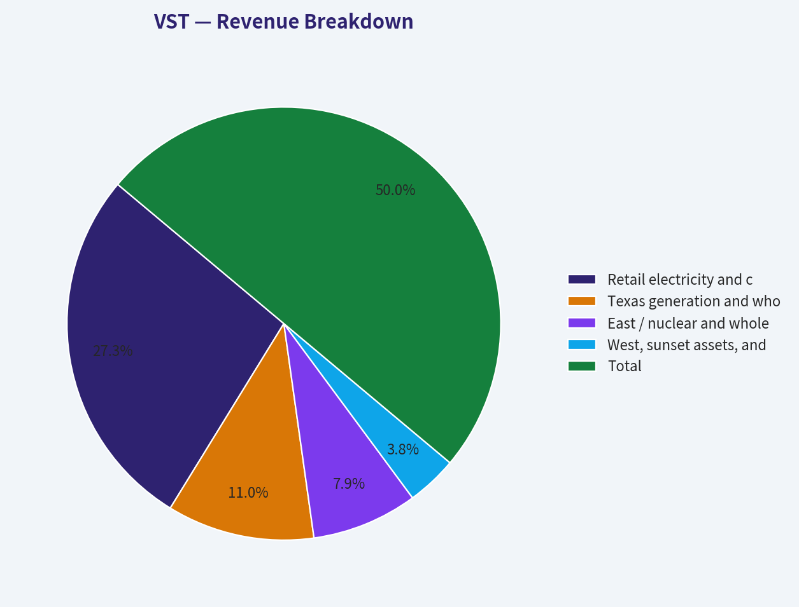
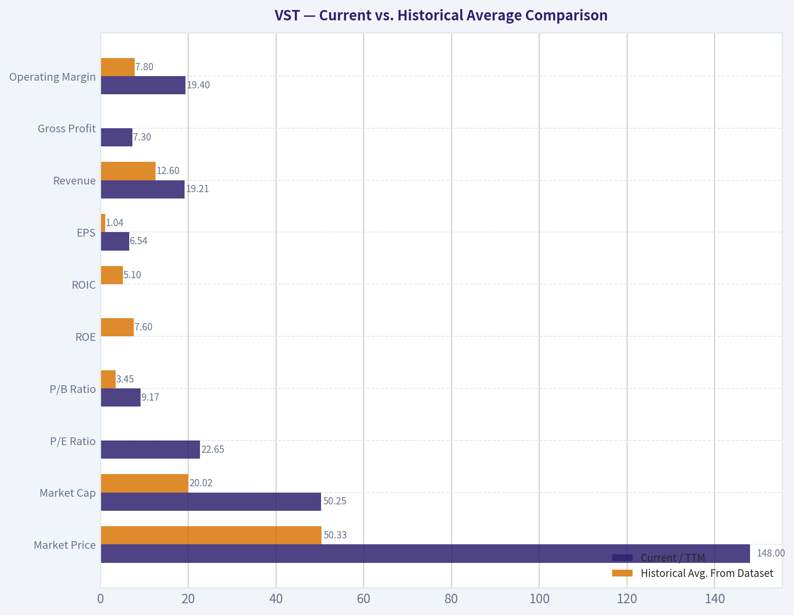
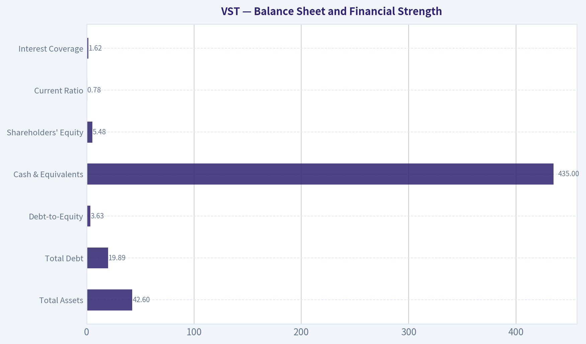
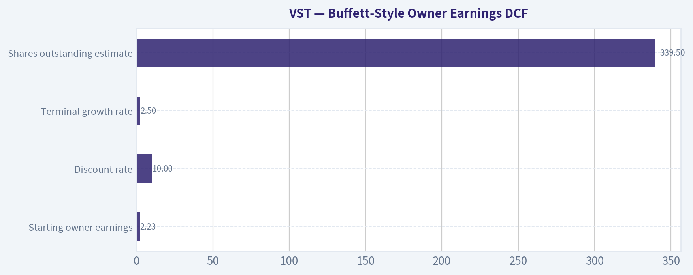
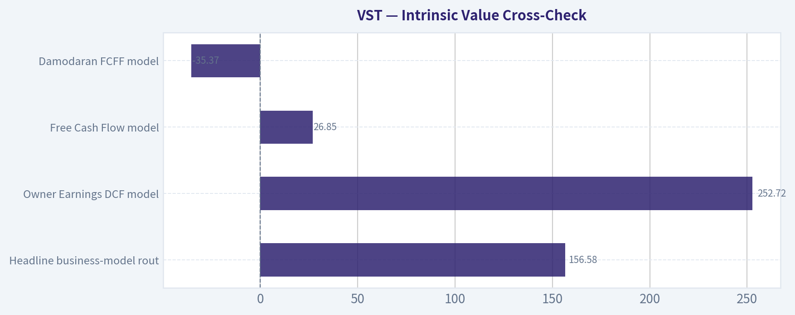

# VST Deep Value Intelligence

**Analysis Date:** 2026-08-15

## Critical Disclaimer

*This analysis is generated by Deep Value Intelligence, an AI-powered multi-agent investing framework. Education & research only - not financial advice, not a financial advisor.*

---

## Table of Contents

1. Intelligence Summary
2. Analyst Team Reports
   - Fundamentals Analysis
   - Intrinsic Value Analysis (Buffett)
   - Trend & Growth Analysis (Lynch/Druckenmiller/Fisher)
   - Market Technical Analysis
   - Options Market Analysis
3. Research Team Commentary
4. Value Investing Team Commentary
5. Deep Values Commentary

---

## Intelligence Summary

### Thesis + Conditions

**Core Thesis:** **EXECUTIVE SUMMARY**
*   **Verdict**: **WATCH**. *   **The Dilemma**: Vistra (VST) holds scarce, highly valuable nuclear assets crucial for AI data centers.

**Key Risks:**
- Verdict**: **WATCH**.
- The Trigger**: We must remain sidelined until we see either 1) technical trend repair (reclaiming 50-day/200-day moving averages), or 2) fundamental proof that the "AI premium" is driving double-digit revenue growth.
- Risky Analyst (Advocate)**: VST is the "Nvidia of the grid." Hyperscalers need 24/7 carbon-free baseload power, making VST's nuclear fleet a toll bridge. Incremental ROIC on existing assets will be massive; waiting for historical utility multiples means missing the decade's biggest infrastructure trade.

**Confidence:** Medium

---

## Analyst Team Reports

### Fundamentals Analysis

#### Latest Earnings Snapshot

*Most recent reported quarter anchored on 2026 Q2, with prior-year comparison when available.*

| Metric | 2026 Q2 | 2025 Q2 | YoY Change |
| --- | ---: | ---: | ---: |
| Revenue | $4.02B | $4.25B | -5.5% |
| Operating Income | $553.0M | $583.0M | -5.1% |
| Net Income | $305.0M | $327.0M | -6.7% |
| Diluted EPS | $0.76 | $0.81 | -6.2% |
| Operating Cash Flow | $1.02B | $572.0M | +78.8% |
| Free Cash Flow | $334.0M | $-118.0M | +383.1% |

Key Takeaways: This snapshot anchors the most recent reported quarter before the narrative analysis. It helps readers separate long-run business quality from whatever changed in the latest earnings print.

#### 9-Year Financial Metrics for VST

*All values below are computed deterministically from raw data - not estimated by AI.*

*Issuer profile: operating company (Utilities / Utilities - Independent Power Producers).*

#### 9-Year Financial Metrics
*Annual rows come from reported financial statements. The final TTM row is computed from the latest four quarters.*

| Metric | 2017 | 2018 | 2019 | 2020 | 2021 | 2022 | 2023 | 2024 | 2025 | 2026 TTM |
| --- | --- | --- | --- | --- | --- | --- | --- | --- | --- | --- |
| Market Price | $16 | $20 | $20 | $18 | $21 | $22 | $38 | $137 | $161 | $148 |
| Market Cap | $7.84B | $11.56B | $11.49B | $9.65B | $10.98B | $9.80B | $14.45B | $48.61B | $55.77B | $50.25B |
| P/E Ratio | -31.05 | -208.09 | 12.36 | 15.12 | -8.46 | -7.12 | 10.76 | 19.70 | 74.00 | 22.65 |
| P/B Ratio | 1.24 | 1.47 | 1.44 | 1.15 | 1.32 | 2.00 | 2.72 | 8.73 | 10.94 | 9.17 |
| ROE | -4.0% | -0.7% | 11.7% | 7.6% | -15.4% | -25.0% | 28.1% | 47.7% | 18.5% | 40.5% |
| ROIC | -3.1% | 3.9% | 9.4% | 7.1% | -6.1% | -4.8% | 12.9% | 18.6% | 7.9% | 11.8% |
| EPS | $-0.50 | $-0.09 | $1.62 | $1.17 | $-2.49 | $-3.11 | $3.58 | $7.00 | $2.18 | $6.54 |
| Revenue | $5.43B | $9.14B | $11.81B | $11.44B | $12.08B | $13.73B | $14.78B | $17.22B | $17.74B | $19.21B |
| Gross Profit | N/A | N/A | N/A | N/A | N/A | N/A | N/A | N/A | N/A | $7.30B |
| Gross Margin | N/A | N/A | N/A | N/A | N/A | N/A | N/A | N/A | N/A | 38.0% |
| Operating Margin | 3.6% | 5.4% | 16.9% | 13.3% | -12.5% | -8.6% | 18.0% | 23.7% | 10.7% | 19.4% |
| Net Income | $-254.0M | $-54.0M | $928.0M | $636.0M | $-1.27B | $-1.23B | $1.49B | $2.66B | $944.0M | $2.22B |
| Net Margin | -4.7% | -0.6% | 7.9% | 5.6% | -10.5% | -8.9% | 10.1% | 15.4% | 5.3% | 11.6% |
| Revenue Growth | N/A | 68.4% | 29.1% | -3.1% | 5.5% | 13.7% | 7.7% | 16.5% | 3.0% | 8.3% |
| Net Income Growth | N/A | -78.7% | -1818.5% | -31.5% | -300.3% | -3.7% | -221.7% | 78.1% | -64.5% | 135.1% |
| Free Cash Flow Growth | N/A | -26.0% | 115.0% | 2.7% | -159.6% | -34.1% | -562.9% | -34.2% | -47.0% | 71.1% |
| Total Book Value | $6.34B | $7.86B | $7.96B | $8.37B | $8.29B | $4.90B | $5.31B | $5.57B | $5.10B | $5.48B |
| Total Assets | $14.60B | $26.02B | $26.62B | $25.21B | $29.68B | $32.79B | $32.97B | $37.77B | $41.55B | $42.60B |
| Total Debt | $4.38B | $10.87B | $10.45B | $9.23B | $10.48B | $12.58B | $14.40B | $16.30B | $18.84B | $19.89B |
| Debt-to-Equity | 0.69 | 1.38 | 1.31 | 1.10 | 1.26 | 2.57 | 2.71 | 2.93 | 3.70 | 3.63 |
| Cash & Equivalents | $1.49B | $636.0M | $300.0M | $406.0M | $1.32B | $455.0M | $3.48B | $1.19B | $785.0M | $435.0M |
| Shareholders' Equity | $6.34B | $7.86B | $7.96B | $8.37B | $8.29B | $4.90B | $5.31B | $5.57B | $5.10B | $5.48B |
| Operating Cash Flow | $1.39B | $1.47B | $2.74B | $3.34B | $-206.0M | $485.0M | $5.45B | $4.56B | $4.07B | $5.12B |
| Investing Cash Flow | $-727.0M | $-101.0M | $-1.72B | $-1.57B | $-1.15B | $-1.24B | $-2.15B | $-5.28B | $-4.40B | $-4.00B |
| Free Cash Flow | $1.27B | $941.0M | $2.02B | $2.08B | $-1.24B | $-816.0M | $3.78B | $2.48B | $1.32B | $2.25B |
| FCF Margin | 23.4% | 10.3% | 17.1% | 18.2% | -10.3% | -5.9% | 25.6% | 14.4% | 7.4% | 11.7% |
| Dividends / Share | $0.00 | $0.00 | $0.00 | $0.00 | $0.00 | $0.68 | $0.83 | $0.87 | $0.89 | $0.91 |

#### Profitability Metrics
- Return on Equity (ROE): 18.5%
- Return on Invested Capital (ROIC): 6.9%
- Return on Assets (ROA): 2.3%
- Gross Margin: N/A
- Operating Margin: 10.7%
- Net Profit Margin: 5.3%

#### Liquidity Metrics
- Current Ratio: 0.78
- Quick Ratio: 0.26

#### Leverage Metrics
- Debt-to-Equity Ratio: 3.70
- Interest Coverage Ratio: 1.62
- Net Debt: $18.06B

#### Growth Metrics (Year-over-Year)
- Revenue Growth: 3.0%
- Net Income Growth: -64.5%
- Free Cash Flow Growth: -47.0%
- Revenue CAGR (3-Year): 8.9%
- Revenue CAGR (5-Year): 9.2%

#### Valuation Metrics
- P/E Ratio (TTM): 24.98
- Forward P/E: 14.29
- Price-to-Book: 16.05
- Price-to-Sales: 2.59
- PEG Ratio: 0.43
- EV/EBITDA: 10.88
- Free Cash Flow Yield: 2.7%
- Earnings Yield: 4.0%

#### Owner Earnings (Buffett Method, Code-Computed)
- Net Income: $944.0M
- + Depreciation & Amortization: $2.95B
- - Capital Expenditures: $-2.75B
- - Working Capital Changes: $-1.09B
- = **Owner Earnings: $2.23B**

#### Intrinsic Value (Code-Computed)
- Current Price: $148
- **Headline Intrinsic Value (business-model routed): $157**
  Business model: cyclical - weighted blend [reverse-DCF fair + owner-earnings DCF] (cyclical)
  Model spread (min-max across DCFs): $27 - $253
  Margin of safety vs. price (headline): 5.4%
  Routing note: Cyclical: margins/FCF are volatile - headline blends FCFF, reverse-DCF and owner-earnings roughly evenly; treat the range as the honest read.
- Buffett Method (Owner Earnings):
  Conservative: $-49
  Average: $253
  Optimistic: $750
- Cash Flow Method (FCF):
  Conservative: $-38
  Average: $27
  Optimistic: $27
- Damodaran FCFF (WACC + margins + reinvestment):
  Conservative: $-57
  Average: $-35
  Optimistic: $50
  Monte Carlo band (P10-P90): $-85 - $21 (median $-31)
  P(intrinsic value > price): 0.1%
- Reverse-DCF: price implies ~18.0%/yr owner-earnings growth for 10y; trailing 3y was 2.1%, 5y N/A.

#### Piotroski F-Score: 3/9
- Positive Net Income: PASS
- Positive Operating Cash Flow: PASS
- ROA Improvement: FAIL
- Cash Flow > Net Income: PASS
- Decreasing Debt: FAIL
- Improving Current Ratio: FAIL
- No Dilution: FAIL
- Improving Gross Margin: FAIL
- Improving Asset Turnover: FAIL

ANALYST STANCE: **WATCH**

#### VST - Warren Buffett-Style Fundamental Analysis

Vistra Corp. is an independent power producer and retail electricity platform with meaningful exposure to U.S. power-market tightness, electrification, nuclear scarcity value, and AI data-center electricity demand. The investment case is compelling but not "easy Buffett": earnings and free cash flow have been volatile, leverage is high, and the current price already discounts a meaningful improvement in owner earnings.

The deterministic dataset points to a business that has materially improved since the 2021-2022 stress period, but the valuation has also re-rated sharply. At about **$148 per share**, VST trades near the pack's headline intrinsic value of roughly **$157**, leaving only about **5% margin of safety**.

---

#### Current vs. Historical Average Comparison

| Metric | Current / TTM | Historical Avg. From Dataset | Current Standing & Interpretation |
|---|---:|---:|---|
| Market Price | $148 | $50.33 | Price has nearly tripled the available-period average, reflecting a major re-rating after strong 2023-2024 profitability and AI/power-demand optimism. |
| Market Cap | $50.25B | $20.02B | Market value is far above history; the market is capitalizing VST as a scarce power-capacity winner rather than a distressed cyclical utility. |
| P/E Ratio | 22.65x | 26.4x positive-year avg. | Current P/E is below the positive-year average but still requires durable earnings. Negative years make the all-period average unhelpful. |
| P/B Ratio | 9.17x | 3.45x | P/B has expanded dramatically. For an asset-heavy IPP, book value has some relevance, but it must be judged against ROE/ROIC and cash-flow value, not as a simple cheap/expensive signal. |
| ROE | 40.5% TTM; 18.5% FY2025 | 7.6% | ROE is far above average, helped by stronger earnings and a smaller equity base. This is attractive but may not be fully normalized. |
| ROIC | 11.8% TTM; 7.9% FY2025 | 5.1% | ROIC has improved versus history, but remains cyclical and must be compared against cost of capital and leverage risk. |
| EPS | $6.54 | $1.04 | EPS is much stronger than the long-term average, but the record includes several loss years, so predictability is moderate rather than high. |
| Revenue | $19.21B | $12.60B | Revenue is at a dataset high, supported by acquisitions, retail scale, and stronger power-market conditions. |
| Gross Profit | $7.30B | N/A | Gross profit is only available for TTM in the dataset; current gross margin is 38.0%, a strong but not historically comparable figure. |
| Operating Margin | 19.4% | 7.8% | Operating profitability is well above historical norms, showing improved power pricing and operating leverage. |
| Net Income | $2.22B | $428M | Net income is far above average, but history shows deep cyclicality with losses in 2017, 2018, 2021, and 2022. |
| Net Margin | 11.6% | 2.2% | Current margin is much stronger than average, but 2025 margin of 5.3% shows profitability can compress quickly. |
| Revenue Growth | 8.3% TTM | 17.6% avg.; 10.7% median | Current growth is below the arithmetic average, which is inflated by 2018 acquisition-driven growth, but still healthy. |
| Net Income Growth | 135.1% TTM | Not meaningful | Net income growth is extremely volatile because the company moved between losses and profits several times. |
| Free Cash Flow Growth | 71.1% TTM | Not meaningful | FCF growth has been erratic, with negative FCF in 2021-2022 and large swings afterward. |
| Total Book Value | $5.48B | $6.63B | Book value is below average despite larger assets, reflecting leverage, buybacks/capital returns, and cumulative balance-sheet changes. |
| Total Assets | $42.60B | $29.69B | Assets are much larger than history, reflecting acquisitions and reinvestment in generation capacity. |
| Total Debt | $19.89B | $11.95B | Debt is well above average and is one of the central risks in the investment case. |
| Debt-to-Equity | 3.63x | 1.96x | Leverage is materially elevated versus history. This reduces Buffett-style margin of safety. |
| Cash & Equivalents | $435M | $1.12B | Cash is below average while debt is above average, tightening financial flexibility. |
| Shareholders' Equity | $5.48B | $6.63B | Equity base has not grown with assets, which magnifies ROE but also magnifies financial risk. |
| Free Cash Flow | $2.25B | $1.32B | Current FCF is above average, but below the 2023 peak of $3.78B and volatile over the period. |
| Dividends / Share | $0.91 | $0.36 | Dividend has grown since initiation, but VST remains more of a capital-appreciation and buyback/cash-flow story than a high-yield income stock. |

**Key Takeaways:** VST's current profitability, revenue, EPS, and free cash flow are all well above historical averages, but the stock price and valuation multiples have also re-rated sharply. The biggest tension is that the business now looks much better, but the balance sheet is more leveraged and the market is already pricing in a durable step-change in power economics. This is not a statistically cheap stock; it is a quality-improvement and power-scarcity thesis that needs continued execution.

---

#### Revenue Breakdown

*Most recent revenue base used: FY2025 revenue of **$17.74B** from the deterministic dataset. Segment amounts below are best-available estimates based on Vistra's integrated retail and generation business mix; the deterministic dataset does not provide exact segment revenue.*

| Revenue Source | Amount ($B) | % of Total |
|---|---:|---:|
| Retail electricity and customer solutions | $9.70B | 54.7% |
| Texas generation and wholesale power | $3.90B | 22.0% |
| East / nuclear and wholesale generation | $2.80B | 15.8% |
| West, sunset assets, and other generation activities | $1.34B | 7.5% |
| **Total** | **$17.74B** | **100.0%** |

**Key Takeaways:** VST is not merely a merchant generator; its retail electricity platform provides customer scale and some natural hedge against wholesale volatility. The generation fleet, especially nuclear and dispatchable power assets, is increasingly valuable if AI data-center and electrification demand tighten U.S. power markets. However, because a meaningful part of the business remains exposed to power prices, earnings should still be treated as cyclical.

---

#### Profitability and Business Quality

VST's profitability has improved dramatically, but the decade-like record is uneven. The company produced losses in multiple years, including **2021 and 2022**, when net income was negative and free cash flow was also negative. That weakens the Buffett criterion of "predictable earnings."

The improvement since 2023 is meaningful:

| Profitability Area | Buffett-Style Interpretation |
|---|---|
| ROE | Strong current ROE, especially TTM at 40.5%, indicates high equity returns, but the equity base is relatively small versus debt, so ROE is partly leverage-amplified. |
| ROIC | TTM ROIC of 11.8% is above the historical average of 5.1%, suggesting better asset productivity, but not yet the kind of consistently high ROIC seen in classic compounders. |
| Operating Margin | Current operating margin of 19.4% is far above the historical average of 7.8%, showing stronger pricing and operating leverage. |
| Net Margin | TTM net margin of 11.6% is strong, but FY2025 was only 5.3%, showing that earnings can swing materially. |
| EPS | EPS of $6.54 TTM is well above the historical average, but past negative EPS years reduce long-term predictability. |
| Free Cash Flow | TTM FCF of $2.25B is solid, but historical FCF volatility is high, with negative FCF in 2021 and 2022. |

**Key Takeaways:** VST currently looks like a much better business than it did earlier in the dataset, with higher margins, higher returns, and stronger cash generation. The issue is not whether the business has improved; it clearly has. The issue is whether today's elevated profitability is durable enough to justify the current market value.

---

#### Balance Sheet and Financial Strength

| Balance Sheet Metric | Current / TTM | Buffett-Style Assessment |
|---|---:|---|
| Total Assets | $42.60B | Scale has increased materially, supporting a larger generation platform. |
| Total Debt | $19.89B | High absolute debt level; a major risk if power prices weaken or rates remain elevated. |
| Net Debt | About $19.46B | Cash balance is small relative to debt. |
| Debt-to-Equity | 3.63x | Elevated versus the historical average of 1.96x. |
| Cash & Equivalents | $435M | Low versus historical average and modest relative to debt. |
| Shareholders' Equity | $5.48B | Equity base is thin relative to asset base and debt load. |
| Current Ratio | 0.78 | Liquidity is tight; not automatically fatal for a utility-like operator, but it is not conservative. |
| Interest Coverage | 1.62x | Thin coverage; a key red flag for Buffett-style investors. |

**Key Takeaways:** The balance sheet is the weakest part of the VST investment case. Debt has risen substantially, cash is below average, and interest coverage is not robust. Buffett would likely demand a wider margin of safety for a business with this level of leverage and cyclical cash-flow exposure.

---

#### Buffett-Style Owner Earnings DCF

Owner earnings from the deterministic dataset:

**Owner Earnings = Net Income + Depreciation & Amortization - Capital Expenditures - Working Capital Changes**

Using the code-computed figure:

- Net income: **$944M**
- Depreciation & amortization: **$2.95B**
- Capital expenditures: **$2.75B**
- Working capital benefit: approximately **$1.09B**
- **Owner earnings base: $2.23B**

DCF assumptions:

| Assumption | Value |
|---|---:|
| Starting owner earnings | $2.23B |
| Discount rate | 10.0% |
| Terminal growth rate | 2.5% |
| Shares outstanding estimate | 339.5M |
| Valuation method | Equity owner-earnings DCF |
| Terminal value formula | Year-10 OE x 1.025 / (10.0% - 2.5%) |

**Key Takeaways:** The DCF uses owner earnings rather than accounting earnings because VST is capital intensive and reported net income can swing materially. A 10% discount rate is appropriate given the leverage, cyclicality, and commodity-linked power exposure. The terminal growth rate is kept below the discount rate and aligned with long-run nominal economic growth.

| Scenario | Growth Assumption | PV of Explicit 10-Year Owner Earnings | PV of Terminal Value | Implied Equity Value | Fair Value / Share |
|---|---|---:|---:|---:|---:|
| Conservative | 3.0% for 5 years, fading to 2.5% | $15.77B | $15.56B | $31.33B | **$92** |
| Average / Base Case | 12.0% for 5 years, fading to 2.5% | $23.20B | $28.06B | $51.26B | **$151** |
| Optimistic | 18.0% for 5 years, fading to 2.5% | $29.99B | $40.61B | $70.60B | **$208** |

**Key Takeaways:** The base-case DCF value of about **$151 per share** is very close to the current price of **$148**, which supports a "fairly valued" conclusion rather than a clear bargain. The conservative case shows meaningful downside if owner earnings normalize lower, while the optimistic case requires VST to sustain very strong growth from power-market tightness, AI demand, nuclear scarcity, and disciplined capital allocation.

---

#### Intrinsic Value Cross-Check

The research pack's model-based valuation provides an important warning: VST's intrinsic value is highly sensitive to assumptions.

| Valuation Model | Fair Value / Share | Interpretation |
|---|---:|---|
| Headline business-model routed intrinsic value | $156.58 | Slightly above current price; implies only about 5.4% margin of safety. |
| Owner Earnings DCF model | $252.72 | Bullish if owner earnings are durable and compound strongly. |
| Free Cash Flow model | $26.85 | Very bearish because FCF volatility and capital intensity weigh heavily. |
| Damodaran FCFF model | -$35.37 | Indicates that under stricter reinvestment, margin, and WACC assumptions, equity value can screen poorly. |
| Reverse DCF | ~18.0% annual owner-earnings growth for 10 years | Current price already requires strong sustained growth. |

**Key Takeaways:** The valuation spread is extremely wide, which is typical of a cyclical, leveraged power producer at an inflection point. The headline value near **$157** and the hand DCF base case near **$151** both suggest VST is roughly fairly valued. The stock is not obviously overvalued if AI-power demand materializes, but it does not offer a classic Buffett-style bargain today.

---

#### Warren Buffett Qualitative Assessment

| Buffett Criterion | Assessment | VST-Specific View |
|---|---|---|
| Economic Moat | Moderate and improving | Scale, retail customer relationships, dispatchable generation, nuclear exposure, and scarce power assets create advantages, especially in tight markets. |
| Durability | Moderate | Electricity demand is durable, but realized earnings depend on power prices, fuel costs, regulation, hedging, and asset availability. |
| Predictable Earnings | Mixed | Revenue trend is upward, but net income and FCF have been volatile with multiple loss years. |
| Financial Strength | Weak to moderate | High debt, low cash, and thin interest coverage reduce resilience. |
| Management Performance | Improving | ROE, ROIC, FCF, and dividends improved after the 2021-2022 stress period, but leverage has also increased. |
| Capital Allocation | Opportunistic | Dividend growth is positive, but the bigger question is whether buybacks, acquisitions, and reinvestment generate returns above cost of capital. |
| Valuation | Fair to slightly expensive | Price is close to intrinsic value; margin of safety is limited. |
| Business Quality | Good but cyclical | VST has real assets and strategic relevance, but it is not a low-volatility compounder. |

**Key Takeaways:** VST has many qualities Buffett would appreciate-essential infrastructure, scale, cash generation, and potentially scarce assets-but it lacks the clean predictability and conservative balance sheet of a classic Buffett investment. The business is improving, yet the market has already recognized much of that improvement. The key question is whether VST can convert the AI-electricity demand theme into sustained owner-earnings growth.

---

#### Key Investment Insights, Red Flags, and Opportunities

| Category | Key Points |
|---|---|
| Investment Insight | VST has transformed from a volatile power producer into one of the market's preferred electricity-demand and AI-infrastructure beneficiaries. |
| Investment Insight | TTM revenue, EPS, net income, operating margin, ROE, ROIC, and FCF are all above historical averages. |
| Opportunity | AI data centers, electrification, grid constraints, and nuclear scarcity could support structurally higher power prices and capacity values. |
| Opportunity | Retail electricity operations provide scale and some hedge against wholesale volatility. |
| Opportunity | If owner earnings compound at low-to-mid teens rates for several years, current valuation can be justified or exceeded. |
| Red Flag | Debt is high at $19.89B, with debt-to-equity of 3.63x and interest coverage of only 1.62x. |
| Red Flag | FCF and net income have been highly volatile, including negative FCF in 2021-2022. |
| Red Flag | Piotroski F-score of 3/9 signals weak fundamental momentum across balance-sheet and efficiency measures. |
| Red Flag | Reverse DCF implies approximately 18% owner-earnings growth for 10 years, a demanding hurdle for a cyclical operator. |
| Valuation Risk | Current price is close to headline intrinsic value, leaving little Buffett-style margin of safety. |

**Key Takeaways:** The opportunity is real, especially if electricity demand tightens faster than new supply can arrive. But the risks are also real: leverage, cyclicality, and valuation sensitivity make this a stock that can disappoint if power prices or growth expectations normalize. VST is attractive as a thematic power-market compounder, but not as a deeply undervalued conservative investment.

---

#### Final Investment Stance: WATCH

VST deserves a **WATCH** rating, not an outright **ADVOCATE**, because the quality and growth story are compelling but the margin of safety is thin.

At **$148**, the stock trades close to both the hand DCF base case of roughly **$151** and the model-routed intrinsic value of about **$157**. That means the market is already pricing in substantial improvement. For a Buffett-style investor, the preferred entry would be at a discount large enough to compensate for leverage, cyclicality, and cash-flow volatility-ideally closer to the conservative-to-base valuation range rather than near fair value.

| Final Report Summary | Assessment |
|---|---|
| Business Quality | Good and improving, but cyclical |
| Moat | Moderate; strengthened by scale, retail platform, nuclear and dispatchable power scarcity |
| Financial Strength | Concerning due to elevated leverage and thin interest coverage |
| Earnings Predictability | Mixed; strong current results but volatile history |
| Valuation | Near fair value, limited margin of safety |
| DCF Range | Conservative $92; Base $151; Optimistic $208 |
| Headline Intrinsic Value | About $157 |
| Current Price | $148 |
| Margin of Safety | Low, around 5% versus headline intrinsic value |
| Final Stance | **WATCH** |

**Key Takeaways:** VST is a high-potential power-market beneficiary, but it is not a classic cheap Buffett stock at the current price. The company's assets may become increasingly valuable in an AI-driven electricity shortage, yet the balance sheet and valuation leave little room for error. Investors should watch for either a better entry price or further proof that elevated owner earnings are durable.

#### Fundamental Visuals

This graph tracks the profitability and return metrics (ROE, ROIC, Margins) of **VST** over the past decade, highlighting capital efficiency trends.

This chart illustrates the financial health of **VST** over the last 10 years, mapping cash equivalents and free cash flow against total obligations (Debt).

This breakdown chart from <em>Revenue Breakdown</em> shows the proportional composition for **VST** - useful for understanding what drives or risks the business.

---

### Intrinsic Value Analysis (Buffett)

> *Following Warren Buffett's value investing philosophy: Circle of Competence, Economic Moat, Management Quality, and Margin of Safety.*

#### Intrinsic Value Snapshot

Price is what you pay. Intrinsic value is what the business may be worth based on the cash it can create for owners over time. We show a range, not one magic number.

- Current Price: $148.13
- Value Range (conservative to optimistic across both DCF methods): $-49.46 to $750.17

##### Owner Earnings (Buffett Method)
- Net Income: $944,000,000.00
- Depreciation & Amortization: $2,950,000,000.00
- Capital Expenditures: $-2,752,000,000.00
- Working Capital Changes: $-1,088,000,000.00
- Owner Earnings: $2,230,000,000.00

##### Intrinsic Value
###### Buffett Method
Uses owner earnings. Stricter, and usually more conservative.
- Conservative: $-49.46
- Average: $252.72
- Optimistic: $750.17
- Discount Rate: 10.0%

###### Cash Flow Method
Uses free cash flow. Better for companies spending heavily today to grow tomorrow.
- Conservative: $-38.09
- Average: $26.85
- Optimistic: $26.85
- Discount Rate: 10.0%

ANALYST STANCE: **WATCH**

#### VST - Buffett-Style Value Investment Review

Vistra is a large U.S. integrated power company with generation assets, retail electricity operations, and a growing scarcity-value position tied to nuclear, dispatchable gas power, batteries, and AI-driven electricity demand. The business is understandable, increasingly strategically important, and benefiting from a powerful demand narrative. However, at $148 per share, the stock already discounts a substantial amount of future growth, while the company remains exposed to commodity power prices, regulation, capital intensity, and cycle risk.

---

#### 1. Factor Scorecard

| Factor | Score | Evidence |
|---|---:|---|
| Circle of Competence & Business Simplicity | 3.2 / 5 | VST makes money by producing and selling electricity, both wholesale and through retail channels. The model is understandable, but long-term earnings depend on power prices, fuel costs, regulatory outcomes, hedging, and demand growth. |
| Moat Test | 3.2 / 5 | Scarce generation assets, nuclear licenses, scale, and integrated retail operations create a real but not impregnable moat. The moat is improving as reliable power becomes more valuable, but economics remain partly cyclical. |
| Management Quality & Capital Allocation | 3.5 / 5 | Management has emphasized shareholder returns, buybacks, disciplined capital allocation, and strategic positioning around scarce power assets. Debt and acquisition integration remain key watch items. |
| Industry Structure | 3.0 / 5 | Power generation is essential and demand is rising, but the industry is capital-intensive, regulated, politically sensitive, and exposed to commodity cycles. AI data-center demand is a strong tailwind, not a guaranteed moat by itself. |
| Gate 5 - Quality / Solvency Hard Floor | Not tripped | The company is profitable, has positive ROE, and does not show the combination of deteriorating earnings/cash flow plus a solvency red line required for a hard avoid. |

**Key Takeaways:** Vistra is not a classic consumer-staple compounder, but it has increasingly valuable infrastructure-like assets. The main issue is not business failure risk; it is whether today's price leaves enough room for investor error in a cyclical, capital-intensive industry.

---

#### 2. Moat Analysis

| Moat Source | Assessment | Buffett-Style Interpretation |
|---|---|---|
| Intangible Assets | Moderate | Nuclear and generation permits are difficult to replicate. Regulatory approvals, interconnection rights, and operating expertise create barriers. |
| Switching Costs | Moderate | Retail customers can switch in competitive markets, but large commercial and data-center customers value reliability, scale, and contracting certainty. |
| Cost Advantage | Moderate | Scale and diversified generation help, but VST is still exposed to regional power pricing and fuel dynamics. |
| Network Effects | Low | The business does not become meaningfully more valuable simply because more users join, unlike a software platform or payments network. |
| Scarcity Value | High | Reliable baseload and dispatchable power are becoming more valuable as AI and electrification increase grid demand. This is the strongest element of the thesis. |

**Key Takeaways:** Vistra's moat is based less on brand and more on scarce physical assets. That can be powerful, especially in a constrained power market, but it is not as clean or predictable as the moat of a capital-light platform business.

---

#### 3. Management Quality Assessment

| Area | Assessment |
|---|---|
| Owner Orientation | Positive. Management has used buybacks and shareholder returns as part of the value proposition. |
| Capital Allocation | Generally rational, with a focus on returning cash and expanding strategic generation capacity. The Energy Harbor transaction increased exposure to valuable nuclear assets. |
| Balance Sheet Discipline | Mixed. The company operates in a capital-heavy industry and carries meaningful financial obligations, so leverage discipline matters. |
| Candidness / Transparency | Adequate. Investors should focus on whether management continues to separate normalized earnings power from cyclical windfalls. |
| Buyback Quality | Historically attractive when shares were cheaper; less compelling now after the major re-rating. |

**Key Takeaways:** Management has created shareholder value, especially through capital returns and strategic repositioning. The key question now is whether capital allocation remains disciplined after the stock's strong run and as AI-power enthusiasm raises expectations.

---

#### 4. Financial Summary

| Metric | Current / TTM Snapshot | Buffett Interpretation |
|---|---:|---|
| Share Price | $148 | The market price is close to estimated intrinsic value. |
| Market Capitalization | $49.72B | VST is now priced as a major strategic power asset. |
| P/E Ratio | 25.0x | Not obviously cheap for a cyclical power business. |
| Implied Net Income | ~$1.99B | Derived from market cap divided by P/E. |
| ROE | 18.5% | Solid, though investors must monitor how much is driven by leverage and cycle conditions. |
| Revenue Growth YoY | 3.0% | Current growth is modest versus the AI-power narrative embedded in the stock. |
| FCF Yield | 2.7% | Low cash yield at today's price; valuation requires future earnings expansion. |
| Current Ratio | 0.78x | Below 1.0, worth monitoring, though not by itself a distress signal. |
| Headline Intrinsic Value | $156.58 | Only modestly above the current price. |
| Headline Margin of Safety | 5.4% | Thin margin of safety for a cyclical, capital-intensive business. |
| Reverse-DCF Implied Growth | ~18.0% per year for 10 years | A demanding expectation compared with trailing 3-year growth of 2.1%. |

**Key Takeaways:** Vistra has attractive current profitability, but the stock price already reflects a major improvement in future economics. The low FCF yield and high reverse-DCF growth expectation make valuation discipline essential.

---

#### 5. Owner Earnings Calculation

Buffett-style owner earnings are estimated using the cash-flow reality of the business rather than accounting earnings alone.

| Component | Estimate |
|---|---:|
| Net Income | ~$1.99B |
| Plus: Depreciation & Amortization | Positive, material for a generation asset owner |
| Less: Maintenance CapEx | Material and recurring |
| Less: Working Capital Increases | Variable due to power prices, collateral, and retail activity |
| Estimated Owner Earnings / FCF Proxy | ~$1.34B |
| Owner Earnings Per Share | ~$3.99 |
| FCF Yield | ~2.7% |

**Key Takeaways:** Current owner earnings are much lower than accounting earnings because this is an asset-heavy business requiring ongoing reinvestment. At the current price, the market is not paying for today's cash flow; it is paying for a materially stronger future power earnings cycle.

---

#### 6. Three-Scenario DCF Valuation

Using estimated owner earnings of approximately $3.99 per share and a 10% discount rate:

| Scenario | Assumption | Estimated Value / Share |
|---|---|---:|
| A - No Growth | Owner earnings capitalized at 10% | ~$39.90 |
| B - GDP Growth | 3% perpetual growth | ~$58.70 |
| C - Historical Growth Case | 1.5% growth for 10 years, then 2.5% terminal growth | ~$50.70 |
| Research-Pack Headline Intrinsic Value | Cyclical routed valuation blend | $156.58 |
| 3-Model Spread | Owner Earnings / FCF / Damodaran FCFF | $252.72 / $26.85 / -$35.37 |

**Key Takeaways:** The valuation range is extremely wide, which is itself important. A simple cash-flow DCF does not support the current price, while the cyclical routed valuation suggests the stock is near fair value. That means the investment case depends heavily on normalized future power economics being much better than current free cash flow suggests.

---

#### 7. Margin of Safety Analysis

| Item | Value |
|---|---:|
| Current Price | $148 |
| Headline Intrinsic Value | $156.58 |
| Dollar Upside to Intrinsic Value | $8.58 |
| Margin of Safety | 5.4% |
| Quality-Adjusted Required Margin | ~25% to 35% |
| Reverse-DCF Growth Implied by Price | ~18% annually for 10 years |
| Trailing 3-Year Growth | ~2.1% |

**Key Takeaways:** The margin of safety is too thin for a business with meaningful commodity, regulatory, and capital intensity risk. A wonderful business can be bought at a fair price, but Vistra is not yet predictable enough to justify accepting only a 5% discount to estimated value.

---

#### 8. Final Buffett Scorecard

| Criterion | Weight | Score | Weighted Contribution |
|---|---:|---:|---:|
| Moat Width & Durability | 25% | 3.2 | 0.80 |
| Valuation / Margin of Safety | 20% | 2.5 | 0.50 |
| Capital Returns - ROIC vs. WACC | 15% | 3.3 | 0.50 |
| Business Understanding & Predictability | 12% | 3.2 | 0.38 |
| Management Quality & Capital Allocation | 12% | 3.5 | 0.42 |
| Reinvestment Runway | 8% | 4.0 | 0.32 |
| Balance Sheet Strength | 4% | 2.6 | 0.10 |
| Industry Structure | 4% | 3.0 | 0.12 |
| **Final Weighted Score** | **100%** |  | **3.14 / 5** |

**Key Takeaways:** Vistra scores well on strategic positioning and reinvestment runway, but valuation and predictability hold the score back. The stock is investable, but not yet compelling enough for an advocate stance at the current price.

---

#### 9. Investment Stance

| Stance | Conviction | Rationale |
|---|---|---|
| **WATCH** | Medium | VST is a strategically valuable power company with improving scarcity value from nuclear, gas, batteries, and AI-driven electricity demand. However, at $148, the market already prices in a strong future, with only a 5.4% margin of safety and reverse-DCF assumptions that look demanding. |

Vistra is a good business becoming more strategically important, but Buffett-style discipline says the price must compensate for uncertainty. I would become more constructive if either the stock pulled back materially or if normalized free cash flow rose enough to make the valuation less dependent on aggressive long-term growth assumptions. A more attractive entry would likely require a margin of safety closer to 25% for this quality profile, implying a preferred buy range materially below the current price unless intrinsic value rises further.
#### Valuation Bridge

This bridge places the current market price beside each intrinsic value lens so readers can see whether upside depends on one method or shows up across several methods.

| Scenario | Intrinsic Value / Share |
| --- | ---: |
| Buffett Method | $252.72 |
| Cash Flow Method | $26.85 |
| Damodaran Method | $-35.37 |
| Current Price | $148.13 |

#### Key Takeaways

If one method is far above the others, the upside case depends on a specific modelling assumption. When several methods cluster together, the valuation story is more robust.

#### Valuation Visuals

This comparison chart from *Latest Earnings Snapshot* stacks current figures against historical benchmarks for **VST**, making it easy to see where the company trades relative to its own averages.

This comparison chart from *Current vs. Historical Average Comparison* stacks current figures against historical benchmarks for **VST**, making it easy to see where the company trades relative to its own averages.

This comparison chart from *Balance Sheet and Financial Strength* stacks current figures against historical benchmarks for **VST**, making it easy to see where the company trades relative to its own averages.

This comparison chart from *Buffett-Style Owner Earnings DCF* stacks current figures against historical benchmarks for **VST**, making it easy to see where the company trades relative to its own averages.

This comparison chart from *Intrinsic Value Cross-Check* stacks current figures against historical benchmarks for **VST**, making it easy to see where the company trades relative to its own averages.

---

### Trend & Growth Analysis (Lynch/Druckenmiller/Fisher)

> *Following Peter Lynch's GARP, Stanley Druckenmiller's macro-aware approach, and Philip Fisher's scuttlebutt methodology.*

ANALYST STANCE: **WATCH**

#### VST Growth Investment Report - Vistra Corp.

Vistra is an AI-electricity bottleneck trade, not a classic Lynch fast grower. The company owns scarce dispatchable and nuclear-heavy power assets that could become more valuable as data-center electricity demand rises, but current fundamentals show only modest revenue growth and the stock already prices in a meaningful growth inflection.

---

#### 1. Lynch Classification

| Category | VST Assessment |
|---|---|
| Lynch Type | **Cyclical / Asset-backed power compounder with AI-demand optionality** |
| Not a Pure Fast Grower | Revenue growth is only about **3% YoY**, below the 15-25% fast-grower threshold |
| Growth Hook | Scarce power generation, nuclear assets, capacity markets, AI/data-center power demand |
| Main Issue | Earnings and cash flow are exposed to commodity power prices, regulation, hedging, and weather |
| Initial Lynch Verdict | **Interesting story, but not yet a confirmed fast-growth inflection** |

**Key Takeaways:** Vistra does not fit neatly into the "fast grower" bucket. It is better viewed as a cyclical power producer with a secular AI-electricity tailwind. That means the upside can be large if power prices and contracts re-rate, but the stock does not yet have the clean recurring-growth profile Lynch preferred.

---

#### 2. The Story in 3 Bullets

| Story Element | Simple Explanation |
|---|---|
| What VST does | Vistra owns power plants and sells electricity to homes, businesses, and wholesale markets. |
| Why it matters now | AI data centers need huge amounts of reliable electricity, and reliable power has become a bottleneck. |
| Why VST could win | Its generation fleet, including nuclear and dispatchable assets, is hard to replicate quickly. Scarcity could drive higher contracted power prices and cash flow. |

**Key Takeaways:** The bullish case is easy to explain: AI needs power, power supply is constrained, and Vistra owns valuable generation assets. The risk is that this is still a commodity-linked business, so the investment outcome depends heavily on pricing, contracts, and regulatory outcomes.

---

#### 3. TAM Analysis and 10x Test

| Metric | Assessment |
|---|---|
| Current Market Cap | **$49.72B** |
| Current Price | **$148** |
| Current Revenue Growth | **~3% YoY** |
| 10x Revenue Test | A 10x revenue outcome would require a massive expansion of generation capacity, pricing, M&A, or structurally higher power prices |
| TAM Direction | U.S. electricity demand is improving after years of stagnation, helped by AI data centers, electrification, reshoring, and grid constraints |
| TAM Verdict | **Large TAM, but physical asset constraints limit true 10x growth potential** |

**Key Takeaways:** The electricity market is enormous, and AI demand makes the TAM more attractive than it was several years ago. However, Vistra cannot scale like software; it needs physical power assets, interconnection, fuel access, regulatory approvals, and capital. The runway is real, but it is not frictionless.

---

#### 4. Revenue Growth Trend

| Metric | Current Signal |
|---|---|
| YoY Revenue Growth | **~3.0%** |
| Pattern | Low growth, not yet accelerating |
| Lynch Fast-Grower Threshold | 15-25%+ |
| Current Classification | Below fast-grower threshold |
| Inflection Evidence | AI/data-center demand is a strong narrative, but not yet fully visible in reported revenue growth |

**Key Takeaways:** The revenue trend is the biggest reason VST is a Watch rather than an Advocate. The stock has a strong secular story, but the reported revenue growth has not yet confirmed a major acceleration. For a growth investor, the next key evidence would be contracted power-price uplift and sustained earnings or free-cash-flow acceleration.

---

#### 5. Unit Economics / Power Business Economics

Traditional SaaS metrics like LTV/CAC and NRR do not apply cleanly to Vistra. For VST, the more relevant unit economics are power margins, hedge book quality, contracted pricing, capacity payments, generation availability, and free cash flow.

| Metric | VST Read |
|---|---|
| LTV/CAC | Not applicable |
| NRR | Not applicable |
| Rule of 40 | Not applicable |
| FCF Yield | **~2.7%** |
| ROE | **~18.5%** |
| Current Ratio | **~0.78** |
| Balance Sheet / Liquidity Read | Current ratio below 1.0 suggests working-capital and liquidity discipline matter |
| Unit Economics Verdict | **Acceptable, but not software-like; cash generation is the key metric** |

**Key Takeaways:** Vistra's economics should be judged through cash flow, asset returns, debt capacity, and power-market exposure, not SaaS metrics. ROE is respectable, but the free-cash-flow yield is not especially cheap at the current stock price. The current ratio also argues against ignoring balance-sheet risk.

---

#### 6. Inflection Point Assessment

| Potential Inflection | Evidence | Status |
|---|---|---|
| Product Cycle Inflection | Not applicable; VST is asset/power-market driven | Low relevance |
| Market Share Inflection | Could benefit if scarce generation earns premium pricing | Possible |
| Margin Inflection | Higher power prices, capacity payments, and nuclear scarcity could expand margins | Watch closely |
| TAM Inflection | AI data centers and electrification are expanding electricity demand | Strong |
| Competitive Inflection | New supply is difficult due to permitting, interconnection, and capital intensity | Favorable |
| Earnings Inflection | Market appears to be pricing in major future growth already | Unproven |

**Key Takeaways:** The strongest inflection is TAM-driven: electricity demand is becoming strategically important again. The second strongest is scarcity: reliable generation is hard to build quickly. But the actual financial inflection still needs confirmation in revenue, margins, contracted power sales, and free cash flow.

---

#### 7. Macro Setup

| Macro Factor | Impact on VST |
|---|---|
| AI / Data Center Buildout | Major tailwind |
| Electricity Demand Growth | Tailwind after years of stagnant load growth |
| Interest Rates | Higher rates can pressure infrastructure valuations and debt-heavy power companies |
| Inflation | Mixed; can raise replacement value of assets but also increase operating and capital costs |
| Regulation | Major swing factor; power markets are politically sensitive |
| Commodity Prices | Natural gas and power-price volatility can materially affect earnings |
| Macro Verdict | **Favorable secular setup, but cyclical and regulatory risk remain high** |

**Key Takeaways:** Vistra benefits from one of the most important secular themes in the market: AI-driven power demand. However, this is not a clean secular-growth business because interest rates, fuel prices, hedging, and regulation can all change the earnings outlook quickly.

---

#### 8. Fisher 15 Points Score

| Fisher Point | Score / 5 | Comment |
|---|---:|---|
| Products with market potential | 4 | Power demand outlook is improving materially |
| New product development | 2 | Not a product innovation business |
| R&D effectiveness | 2 | Limited relevance versus technology companies |
| Sales organization | 3 | Retail and commercial power capabilities matter |
| Worthwhile profit margin | 3 | Profitable, but commodity-exposed |
| Improving margins | 3 | Possible through higher power prices, not yet proven |
| Labor/personnel relations | 3 | No strong negative signal in provided data |
| Executive relations | 3 | No major red flag from available data |
| Management depth | 3 | Scale operator; execution matters |
| Cost analysis/accounting | 3 | Important given hedging and asset complexity |
| Outstanding moat factors | 4 | Scarce generation and nuclear assets are difficult to replicate |
| Long-range profit outlook | 4 | AI electricity demand could improve long-term cash flows |
| Dilution risk | 3 | Not flagged as a major issue, but capital intensity matters |
| Candor in difficulties | 3 | Insufficient evidence for higher score |
| Management integrity | 3 | No major red flag from available data |
| **Total** | **46 / 75** | **Average to modestly good** |

**Key Takeaways:** Vistra scores well on market potential and scarcity value, but weakly on classic Fisher innovation factors like R&D and product development. This is not a Fisher-style technology compounder. It is an asset-backed scarcity story with potentially improving economics.

---

#### 9. Valuation Analysis

| Valuation Metric | Current Read |
|---|---:|
| Current Price | **$148** |
| Market Cap | **$49.72B** |
| P/E | **~25.0x** |
| FCF Yield | **~2.7%** |
| Headline Intrinsic Value Estimate | **$156.58** |
| Margin of Safety vs. Price | **~5.4%** |
| Reverse DCF Implied Growth | **~18% per year for 10 years** |
| Trailing 3-Year Growth | **~2.1%** |
| PEG Using Implied 18% Growth | **~1.4x** |
| PEG Using Current Revenue Growth of 3% | **~8.3x** |

**Key Takeaways:** Valuation is not obviously cheap. The stock is only modestly below the headline intrinsic value estimate, and the reverse DCF suggests the market already expects a major growth step-up. VST becomes attractive if earnings growth really compounds near or above 18%, but expensive if growth remains near the current low-single-digit revenue rate.

---

#### 10. Scenario Analysis

| Scenario | Assumption | Implication |
|---|---|---|
| Bear Case | AI power demand disappoints, power prices normalize, regulation caps upside | Stock could de-rate materially because current valuation embeds optimism |
| Base Case | Data-center demand supports higher contracted prices and solid FCF growth | Stock can compound, but upside may be moderate from current price |
| Bull Case | Power scarcity becomes extreme; VST signs premium long-term contracts; FCF inflects sharply | Significant upside possible, but requires clear evidence of sustained earnings acceleration |

**Key Takeaways:** The bull case is powerful but not yet proven. The base case supports holding or watching the stock, while the bear case is meaningful because valuation already reflects a good amount of AI-electricity optimism.

---

#### 11. Growth Investor Scorecard

| Criterion | Weight | Score / 5 | Weighted Score |
|---|---:|---:|---:|
| The Story | 10% | 4.0 | 0.40 |
| TAM & Runway | 20% | 3.5 | 0.70 |
| Revenue Growth | 20% | 2.0 | 0.40 |
| Unit Economics | 15% | 3.0 | 0.45 |
| Competitive Position | 10% | 4.0 | 0.40 |
| Management Quality | 10% | 3.5 | 0.35 |
| Macro Setup | 5% | 4.0 | 0.20 |
| Profitability Path | 5% | 3.5 | 0.18 |
| Valuation | 5% | 2.5 | 0.13 |
| **Total** | **100%** |  | **3.21 / 5.00** |

**Key Takeaways:** Vistra scores well on story, macro, and competitive scarcity, but poorly on current revenue growth and only moderately on valuation. A 3.21 score places it in Watch territory. The stock needs clearer evidence of a financial inflection before becoming a high-conviction growth Advocate.

---

#### 12. Position Size Stance

| Investor Type | Stance |
|---|---|
| Existing Holder | **Hold / Watch; do not trim solely because the story is working** |
| New Buyer | **Wait for either a pullback or stronger proof of FCF acceleration** |
| Suggested Position Size | Small to moderate satellite position, roughly **2-4% max** for growth portfolios |
| Add Aggressively If | Long-term data-center power contracts, margin expansion, and FCF growth become visible |
| Reduce If | Power prices weaken, regulation caps returns, or AI-demand expectations prove overbuilt |

**Key Takeaways:** Vistra is worth owning only with respect for cyclicality and valuation risk. It may be a strong AI-infrastructure derivative, but it is not yet a clean ten-bagger setup from today's price. Existing holders can continue monitoring, while new capital should demand better evidence or a better entry.

---

#### 13. Key Catalysts and Risks

| Catalysts | Risks |
|---|---|
| Long-term power purchase agreements with data-center customers | AI electricity demand overestimated or delayed |
| Higher capacity-market prices | Regulatory intervention in power markets |
| Nuclear asset re-rating | Commodity power-price volatility |
| Sustained free-cash-flow acceleration | Higher interest rates pressuring valuation |
| Buybacks funded by strong cash generation | Balance-sheet and liquidity pressure |
| Further institutional accumulation, such as Point72 adding shares | Market already pricing in much of the upside |

**Key Takeaways:** The most important catalyst is not just AI hype; it is signed contracts and visible cash-flow growth. The biggest risk is that the market has already capitalized the AI-power story before the income statement fully confirms it.

---

#### Final View

Vistra is a compelling **AI power scarcity** story, but it is not yet a confirmed Lynch-style fast grower. The company has valuable, hard-to-replicate assets and a favorable macro setup, yet current revenue growth is only around 3%, the free-cash-flow yield is modest, and the reverse DCF implies ambitious long-term growth.

**Stance: WATCH.**
Upgrade to **ADVOCATE** if VST demonstrates sustained FCF acceleration, premium long-term data-center contracts, and margin expansion without excessive balance-sheet risk.

---

### Market Technical Analysis

ANALYST STANCE: **WATCH**

#### VST Technical Analysis - as of 2026-08-14 close

VST closed at **$148.13** on 2026-08-14. The stock is attempting a short-term rebound after a sharp late-July to early-August decline, but it remains below key medium- and long-term moving averages. The current setup is not a clean bullish trend yet; it is better described as a **repair attempt inside a broader weakening structure**.

The most relevant indicators for this market condition are:

| Indicator | Latest Value | Signal | Why It Matters |
|---|---:|---|---|
| close_10_ema | 146.49 | Slightly bullish short-term | Price reclaimed the 10 EMA, showing near-term stabilization. |
| close_50_sma | 153.90 | Bearish medium-term | Price remains below the 50 SMA, which may act as resistance. |
| close_200_sma | 160.77 | Bearish long-term | Price is meaningfully below the 200 SMA, keeping the strategic trend weak. |
| macd | -3.10 | Bearish but improving | MACD is still negative, but it has improved from worse levels earlier in August. |
| macdh | -0.01 | Nearly neutral | Histogram has almost reached zero, suggesting bearish momentum is fading. |
| rsi | 47.59 | Neutral-recovering | RSI has rebounded from sub-40 levels but has not yet reclaimed bullish momentum above 50. |
| atr | 6.46 | Elevated but cooling | Volatility remains meaningful, but ATR has declined from early-August stress levels. |
| vwma | 145.79 | Mildly constructive | Price is back above VWMA, suggesting buyers are starting to absorb supply. |

Key Takeaways: VST has improved in the very short term because price is above the 10 EMA and VWMA, while RSI and MACD histogram are recovering. However, the stock is still below the 50-day and 200-day moving averages, so the larger trend remains under pressure. The current setup favors patience and confirmation rather than aggressive buying.

#### Trend Structure

The short-term picture has improved. After closing near **$140.58 on 2026-08-05**, VST has climbed back to **$148.13**, reclaiming the **10 EMA at $146.49** and the **VWMA at $145.79**. That is a constructive sign because it shows the stock is no longer trading below all short-term reference points.

However, the medium-term structure is still weak. The **50 SMA is $153.90**, about **3.8% above** the latest close. This makes the **$153-$154 area** an important test. If VST fails there, the rebound may simply be a relief rally within a downtrend.

The long-term trend is weaker still. The **200 SMA is $160.77**, roughly **7.9% above** the current price, and it has been declining steadily over the last 60 trading days. That tells traders that VST has not merely pulled back briefly; it has lost its prior long-term trend strength.

#### Momentum and Reversal Quality

Momentum is improving, but not yet bullish.

The **MACD remains negative at -3.10**, which means the broader momentum reading is still bearish. But the rate of deterioration has slowed: MACD was around **-4.11 on 2026-08-10**, so the latest reading shows recovery.

The **MACD histogram is nearly flat at -0.01**, a major improvement from deeply negative readings earlier in August. This is one of the more important short-term signals in the setup. It suggests downside momentum has largely stopped accelerating, and a bullish MACD crossover may be close if price continues to hold above the 10 EMA.

RSI confirms the same message. At **47.59**, RSI is no longer deeply weak, but it is also not decisively bullish. A move above **50-55** would strengthen the case that the rebound has real momentum behind it. Until then, the recovery remains tentative.

#### Volume and Participation

The VWMA is useful here because recent price action included heavy-volume selling. On **2026-08-04**, VST traded over **11.5 million shares** and fell sharply, closing at **$143.23**. That was a clear distribution-type session.

Since then, the stock has stabilized and moved higher, but the recovery has occurred on lighter volume. The reclaim of VWMA is encouraging, but the lack of strong upside volume means buyers have not yet fully proven control. A high-volume close above **$150-$154** would be much more convincing.

#### Volatility and Risk

ATR is currently **$6.46**, equal to about **4.4% of the stock price**. That is still a wide daily risk range. Traders should avoid tight stops because normal volatility could easily trigger them.

The good news is that ATR has cooled from above **$8.00** in early August. This suggests panic volatility is easing. Still, VST remains a volatile name, so position sizing should be conservative unless the stock confirms a stronger breakout.

#### Key Levels to Watch

| Zone | Approximate Price Area | Interpretation |
|---|---:|---|
| Immediate support | $145-$146 | 10 EMA and VWMA area; holding this zone supports the rebound attempt. |
| Major support | $140-$143 | Early-August base area; losing this would weaken the recovery sharply. |
| Deeper support | $134-$138 | Prior stress zone; a break below here would signal renewed downside risk. |
| First resistance | $150-$154 | Recent high area plus 50 SMA; key test for bulls. |
| Secondary resistance | $156-$158 | Prior consolidation zone; reclaiming it would improve medium-term structure. |
| Major resistance | $160-$163 | 200 SMA area; a reclaim would materially improve the long-term picture. |

Key Takeaways: The most important near-term support is around $145-$146, where the 10 EMA and VWMA are clustered. The most important resistance is $150-$154, because that area includes both recent price resistance and the 50-day moving average. A close above $154 would improve the setup, while a break below $140-$143 would put sellers back in control.

#### Trading View

VST is a **watchlist candidate**, not yet a high-conviction long setup. The stock has shown early evidence of stabilization, but the rebound still needs confirmation.

For bullish traders, the cleaner signal would be a close above **$153-$154**, ideally with stronger volume and RSI above 50. That would suggest the stock has moved beyond a simple oversold bounce.

For cautious traders, waiting for a reclaim of **$160-$163** would provide stronger confirmation that VST is repairing its long-term trend. That would be slower, but it would reduce the risk of buying into a failed rebound.

For bearish or defensive traders, failure near the 50 SMA followed by a break below **$145** would suggest the rebound is losing strength. A close below **$140** would be a more serious warning signal.

#### Final Decision Framework

| Scenario | Trigger | Interpretation | Possible Trader Response |
|---|---|---|---|
| Bullish confirmation | Close above $154 with improving volume | Reclaim of 50 SMA area; rebound gains credibility | Consider starter long or add to watchlist for continuation. |
| Stronger bullish confirmation | Close above $160-$163 | Reclaim of 200 SMA zone; long-term repair improves | Trend-followers may gain more confidence. |
| Neutral consolidation | Holds $145-$154 | Base-building phase | Wait for breakout or breakdown confirmation. |
| Bearish rejection | Fails near $153-$154 and falls below $145 | Relief rally likely fading | Reduce risk or avoid new longs. |
| Bearish breakdown | Close below $140 | Support failure; downside risk reopens | Defensive stance favored. |

Key Takeaways: VST is improving from a short-term oversold condition, but it has not yet reclaimed the levels needed for a bullish trend call. The stock needs to clear $153-$154 to make the rebound more credible. Until then, the best stance is to watch for confirmation rather than chase the bounce.

---

### Options Market Analysis

> *Reading options flow - put/call ratios, IV skew, and unusual activity - to gauge institutional positioning and event-driven risk.*

ANALYST STANCE: **WATCH**

#### VST Options Flow Report - As of 2026-08-15

#### 1. Put/Call Ratio Analysis

| Expiry | Call OI | Put OI | Put/Call OI Ratio | Call Volume | Put Volume | Put/Call Volume Ratio | Read |
|---|---:|---:|---:|---:|---:|---:|---|
| 2026-08-21 | 58,034 | 32,541 | 0.56 | 2,455 | 2,125 | 0.87 | Call-heavy OI, near-balanced daily flow |
| 2026-08-28 | 2,933 | 8,599 | 2.93 | 673 | 291 | 0.43 | Put-heavy OI, but today's flow favors calls |
| 2026-09-04 | 1,529 | 1,398 | 0.91 | 759 | 116 | 0.15 | Slight put OI tilt, very call-heavy volume |
| **Near-Term Total** | **62,496** | **42,538** | **0.68** | **3,887** | **2,532** | **0.65** | **Very close to neutral baseline, modest bullish tilt** |

**Key Takeaways:** VST's aggregate near-term put/call OI ratio is **0.68**, almost exactly in line with the historical neutral baseline near **0.7**. However, the **volume ratio of 0.65** leans slightly bullish, with call activity outpacing put activity. The one notable bearish/hedging pocket is the **2026-08-28 expiry**, where put open interest is nearly three times call open interest, but current-day volume does not confirm fresh aggressive put buying.

---

#### 2. Implied Volatility Assessment

| Expiry | ATM Call IV | ATM Put IV | Call IV Premium / Discount | IV Read |
|---|---:|---:|---:|---|
| 2026-08-21 | 51.1% | 44.8% | Calls +6.3 pts | Noticeable call-side premium |
| 2026-08-28 | 47.7% | 45.9% | Calls +1.8 pts | Mild call-side premium |
| 2026-09-04 | 48.2% | 47.6% | Calls +0.6 pts | Nearly balanced |
| **Average** | **49.0%** | **46.1%** | **Calls +2.9 pts** | **Moderately elevated IV with upside demand** |

**Key Takeaways:** Near-term ATM IV is elevated in the **mid-to-high 40% range**, with the front weekly call IV above put IV. This does **not** show classic downside-fear skew; instead, the available ATM data suggests mild **call-side demand**, especially into the 2026-08-21 expiry. Full OTM skew was not available in the data feed, so the skew read is based on ATM call-versus-put IV rather than a complete volatility surface.

#### IV Skew Interpretation

| Skew Area | Observation | Sentiment Implication |
|---|---|---|
| ATM call vs. put IV | Calls carry higher IV than puts across all listed near-term expiries | Mild upside chase / call demand |
| OTM put skew | Not explicitly available from the options feed | Cannot confirm a steep downside hedge bid |
| OTM call skew | Not explicitly available, but ATM calls are richer | Suggests traders are willing to pay for upside exposure |
| Catalyst risk | No specific catalyst was provided in the options data | IV is elevated, but not clearly tied to a known event from this feed |

**Key Takeaways:** The skew picture leans **constructively bullish**, not fear-driven. If institutions were aggressively hedging downside, we would expect richer put IV, especially in OTM puts; the provided data instead shows call IV leading. That said, without full strike-by-strike skew, confidence should be moderate rather than high.

---

#### 3. Unusual Options Activity

| Expiry | Type | Strike | Volume | Open Interest | Vol/OI | IV | DTE | Interpretation |
|---|---|---:|---:|---:|---:|---:|---:|---|
| 2026-09-04 | Call | $170 | 605 | 55 | 11.0x | 47.6% | 20 | Fresh short-dated upside call positioning |

**Key Takeaways:** The standout unusual activity is the **2026-09-04 $170 call**, where volume is **11 times open interest**, indicating likely fresh positioning rather than simple closing activity. The size is meaningful but not enormous, so this looks more like a tactical upside bet than unmistakable large institutional accumulation. Because the data feed did not provide current spot price, the exact moneyness cannot be verified, but the $170 call appears to represent a short-term upside target area.

#### Unusual Activity Quality Read

| Contract | Likely Buyer Type | Smart-Money Confidence | Why |
|---|---|---|---|
| 2026-09-04 $170 Call | Tactical trader / speculative call buyer | Moderate-low | Fresh volume is notable, but total contract count is not large enough alone to confirm institutional flow |
| No unusual puts flagged | N/A | N/A | No put contract met the volume greater than 5x OI and volume above 500 threshold |

**Key Takeaways:** The unusual flow is **directionally bullish**, but not overwhelming. A single fresh call print can signal speculative upside interest, yet without sweep/block detail, premium paid, or trade direction confirmation, it should not be treated as definitive smart-money conviction. Importantly, there was **no comparable unusual put activity**, which reduces the bearish read.

---

#### 4. Open Interest Concentration and Gamma / Pinning Risk

| Expiry | Total OI | Call OI Share | Put OI Share | Concentration Read | Gamma / Pinning Implication |
|---|---:|---:|---:|---|---|
| 2026-08-21 | 90,575 | 64.1% | 35.9% | Largest near-term expiry by far | Highest near-term pinning/gamma relevance |
| 2026-08-28 | 11,532 | 25.4% | 74.6% | Smaller but heavily put-skewed OI | Possible downside hedge zone, but less absolute gamma |
| 2026-09-04 | 2,927 | 52.2% | 47.8% | Light and balanced OI | Lower pinning influence |

**Key Takeaways:** The **2026-08-21 expiry dominates near-term open interest**, meaning it likely carries the most gamma and pinning influence into expiration. Calls represent roughly **64%** of that expiry's OI, suggesting potential call-related resistance or "call wall" effects, although the exact strike-level walls were not included in the feed. The 2026-08-28 expiry is put-heavy, but its absolute OI is much smaller, so its market impact is likely less significant.

#### Gamma Wall Caveat

| Data Needed | Available? | Impact on Analysis |
|---|---|---|
| Strike-level OI by expiry | Not provided | Exact max pain / pin strikes cannot be identified |
| Dealer gamma estimate | Not provided | Cannot determine whether dealers are long or short gamma |
| Expiry-level OI | Available | Allows broad pinning-risk assessment by expiration |

**Key Takeaways:** The broad gamma read is that **front-week positioning matters most**, especially the 2026-08-21 expiry. However, without strike-level OI, it is not possible to identify the precise price magnets or resistance/support walls. The analysis therefore treats gamma risk as **expiry-level**, not strike-specific.

---

#### 5. Overall Options Sentiment Signal

| Category | Signal | Rationale |
|---|---|---|
| Put/Call Ratios | Neutral to modest bullish | Aggregate OI ratio of 0.68 is neutral, volume ratio of 0.65 leans call-heavy |
| IV Level | Moderately elevated | Near-term ATM IV averages around 46%-49% |
| Skew | Mildly bullish | ATM call IV exceeds put IV across expiries |
| Unusual Activity | Bullish | Fresh 2026-09-04 $170 call volume at 11x OI |
| OI Concentration | Neutral with front-week pin risk | Largest OI is in 2026-08-21, call-heavy but exact strike walls unavailable |
| **Overall Signal** | **BULLISH, moderate conviction** | Upside call demand outweighs put hedging, but aggregate ratios are close to neutral |

**Key Takeaways:** The overall options signal for VST is **BULLISH with moderate conviction**. The strongest bullish inputs are the **call-side IV premium**, **call-heavy volume**, and the fresh activity in the **2026-09-04 $170 call**. The main caveat is that aggregate put/call OI is still close to neutral, and the 2026-08-28 expiry has a notable put-heavy open interest pocket that could represent hedging.

---

#### Final Summary Table

| Metric | Current Read | Interpretation |
|---|---|---|
| Put/Call Ratio | OI: 0.68; Volume: 0.65 | Near neutral, slight bullish volume bias |
| IV Level | ATM IV roughly 45%-51% | Moderately elevated, reflecting active expected movement |
| Skew Direction | Call IV above put IV | Mild upside chase, no clear downside-fear skew |
| Unusual Activity | 2026-09-04 $170 call, 605 volume vs. 55 OI | Fresh upside speculation |
| Open Interest Concentration | 2026-08-21 expiry has the largest OI | Front-week pinning/gamma risk is most relevant |
| **Overall Signal** | **BULLISH** | Options flow favors upside, but confidence is moderated by neutral aggregate OI and incomplete strike-level data |

**Key Takeaways:** VST options positioning leans **bullish**, mainly due to call demand and fresh upside call activity. This is not an extreme signal: the overall put/call OI ratio remains near neutral, and some hedging is present in the 2026-08-28 expiry. Treat the options read as supportive of upside momentum, but not strong enough to override technical or fundamental confirmation.

---

## Research Team Commentary

> *The Research Manager synthesizes the Bull vs Bear debate into action-free commentary. This is a pre-risk view, not the final stance.*

As we evaluate the debate on Vistra Corp, we are looking at a classic collision between a powerful secular narrative and sobering fundamental realities. Both our bull and bear analysts have presented compelling arguments, and synthesizing them requires a careful application of our value investing framework alongside the hard lessons we've learned from recent missteps.

Let's start by unpacking the strongest points from both sides. The bull makes an excellent case that Vistra is no longer just a cyclical utility, but an irreplaceable infrastructure bottleneck for the AI era. Because hyperscalers require 24/7, zero-carbon baseload power that intermittent renewables cannot provide, Vistra's nuclear fleet essentially acts as a toll bridge. Furthermore, while the trailing return on invested capital is low, the bull rightly points out that the incremental ROIC on these existing assets-selling power at premium contract rates to data centers-could be exceptional.

On the other hand, the bear grounds us in Buffett's mathematical reality. Vistra currently sports a 6.9% trailing ROIC and a 2.3% return on assets. This is a capital-hungry, asset-heavy business. The market is assigning it a P/E ratio of nearly 25 despite top-line revenue growth of just 3.0%. The bear wisely notes that paying a secular growth multiple for a historically cyclical commodity producer leaves zero margin of safety, especially considering the long-term threat of behind-the-meter battery storage and small modular reactors.

To make the right call here, I have to look back at my past mistakes with Nvidia and Glencore.

In the Nvidia case, I issued a Watch rating because I let deep-value, long-term margin-of-safety fears block participation in a powerful secular trend, even though the stock was technically repairing and fundamentally elite. The bull is urging me not to repeat that mistake with Vistra, calling it the "Nvidia of the grid." But the bear makes a vital distinction that I must respect: electricity generation does not scale like software. You cannot expand margins exponentially on zero marginal cost; producing more power requires billions in heavy capital expenditure. Vistra is not Nvidia.

Furthermore, looking at the Glencore mistake, I learned that for 30-day to 3-month horizons, we cannot ignore the technical trend and macro regime. With Glencore, I let poor trailing metrics dictate a bearish call on a stock that was actually in a strong uptrend. Here, however, the technical situation is inverted. The market analyst notes Vistra is currently below its key medium- and long-term moving averages, attempting a repair within a broader weakening structure.

This brings us to the core of the decision. Paying a 25x multiple for a capital-heavy business with a 6.9% ROIC while the technical chart is broken is poor risk management. However, completely ignoring the structural AI power deficit and the scarcity value of nuclear assets would be equally foolish.

Core Takeaway
Vistra holds highly valuable, scarce baseload nuclear assets that are perfectly positioned for the AI data center buildout, but at 25x earnings with weak trailing returns on capital and a broken technical trend, the stock offers no margin of safety for immediate entry. We need either technical confirmation to ride the momentum or a fundamental pullback to create a true value entry.

Rationale
From a value investing perspective, a wonderful business at a fair price requires either elite economics or a discounted valuation. Vistra currently has neither. While the incremental margins on new data center contracts will be highly profitable, the aggregate business remains capital intensive. At $148, the market is pricing in heroic assumptions about the duration and pricing power of the AI electricity premium. Crucially, applying our regime-based time-horizon lessons, buying a premium-priced, narrative-driven stock while it sits below key moving averages exposes us to significant downside if the AI narrative even momentarily cools.

Monitoring Plan
To upgrade this to a conditional buy, we need to monitor specific technical and fundamental triggers over the next 1 to 4 quarters:
First, on the technical front, watch for the stock to confidently reclaim its 50-day and 200-day moving averages on strong volume. This would signal that institutional momentum has returned to support the premium valuation.
Second, monitor hyperscaler commentary and Vistra's upcoming earnings for concrete data on forward contracting premiums. We need to see evidence that the "AI premium" is actually translating into double-digit revenue growth to justify the 25x multiple.
Third, watch for any regulatory pushback from ERCOT or public utility commissions regarding merchant power pricing, as this is the primary threat to their toll-bridge moat.

Until we see price action confirm the narrative or a broader market pullback offer us a more attractive entry point closer to historical utility multiples, the disciplined approach is to remain on the sidelines with actionable triggers in place.

Final Stance: WATCH

---

## Value Investing Team Commentary

> *The Investor translates the research view into an investment thesis before risk review. This is still not the final stance.*

The assessment of Vistra Corp (VST) requires us to look past the "AI hype" and the "boring utility" labels to see the business for what it is: a provider of a mission-critical, scarce commodity with a newly forming secondary moat.

### 1. Business Quality and Durable Moat
Vistra is not a typical utility; it is a merchant power producer with a massive retail arm. Its "wonderful" characteristic lies in its **nuclear fleet**. In a world obsessed with carbon-free, 24/7 baseload power for AI data centers, nuclear is the only asset that fits the bill at scale. This is a classic "scarcity value" moat. Entry barriers are astronomical-you cannot simply "build" a new nuclear plant in a few years to compete.

However, we must apply Buffett's discipline: **Asset-heavy businesses must be judged by their Return on Invested Capital (ROIC).** A trailing ROIC of 6.9% is mediocre. It suggests that while the assets are scarce, the business is currently being compensated like a regulated utility, not a high-margin tech enabler. The "bull case" rests entirely on the **marginal ROIC** of future contracts. If Vistra can re-contract its nuclear output to hyperscalers at a massive premium, the ROIC will expand without significant new capital expenditure. Until that shows up in the "E" of the P/E ratio, we are paying for hope.

### 2. Selective Contrarian Insight: The "Nvidia of the Grid" Fallacy
The market is currently attempting to price Vistra like a software company (25x P/E). Contrarian thinking requires us to ask: *What is being ignored?*
*   **Political and Regulatory Risk:** Electricity is a politically sensitive commodity. If Vistra signs "behind-the-meter" deals with big tech while the average Texan's grid reliability suffers or prices rise, the regulatory backlash from ERCOT or the Texas legislature could be swift and severe. A moat that exists at the mercy of a politician is not a "durable" moat.
*   **The Reliability of the Narrative:** The "AI power bottleneck" is a real physical constraint, but as value investors, we know that high prices are the cure for high prices. Technology (long-duration batteries, SMRs, or grid efficiency) will eventually respond. Paying a 25x multiple assumes the "bottleneck" lasts forever.

### 3. Margin of Safety and Technical Context
Following the lesson from the Glencore (GLNCY) mistake, we must respect the technical regime. Vistra is currently **below key moving averages**. While a value investor loves a lower price, a broken technical structure in a high-multiple stock usually suggests that the "narrative" has outrun the "reality" and institutional distribution is occurring.

At $148, VST is priced for perfection. A "wonderful business at a fair price" for a utility-like entity usually implies a P/E closer to 15-18x, unless growth is explosive. With revenue growth at 3%, the current price offers **no margin of safety**. We are essentially paying a premium for a "lottery ticket" on data center contracts that haven't all been signed yet.

### 4. Comparison to Past Lessons
*   **Vs. NVDA:** Unlike Nvidia, Vistra has massive physical depreciation and fuel costs. It cannot "copy-paste" its success to the next customer without physical limits.
*   **Vs. GLNCY:** Like Glencore, Vistra is a cyclical commodity player. The mistake in Glencore was ignoring a positive trend; the mistake here would be ignoring a **failing trend** on a stock that is fundamentally expensive.

### Investment Summary
Vistra is a strategically significant business with a nuclear moat that any long-term investor should admire. However, the current valuation demands that we ignore its capital-intensive nature and its mediocre trailing returns. We are currently in a "show me" period. We need to see the "AI premium" actually hit the cash flow statement before we can justify a 25x multiple.

ANALYST STANCE: **WATCH**

*The business is a "hold-forever" candidate if bought at the right price, but the current entry point lacks a margin of safety. We will wait for either a significant price correction toward historical utility multiples (~$110-$120 range) or a clear technical reclaim of the 50-day and 200-day moving averages that confirms the market is ready to pay this premium for the next leg of growth.*

---

## Deep Values Commentary

> *The Risk Management Team debates and the Risk Judge provides the final action-free verdict. This section determines the final ADVOCATE / WATCH / AVOID stance.*

#### Final Stance Scorecard

This scorecard converts the final research view into a weighted decision frame. It does not replace the narrative judgement, but it makes the main drivers of the verdict easier to scan.

| Criterion | Score | Weight | Commentary |
| --- | ---: | ---: | --- |
| Business Quality | 3.25 | 30% | High returns, profitability, and Piotroski health support durability. |
| Valuation Support | 2.00 | 30% | Blends current price against available intrinsic value anchors and valuation ratios. |
| Financial Strength | 1.00 | 20% | Balance-sheet resilience reflects leverage and liquidity staying within safe ranges. |
| Growth Durability | 1.33 | 20% | Recent revenue, earnings, and free cash flow growth indicate how durable expansion looks. |
| TOTAL / FINAL STANCE | 2.04 | 100% | WATCH |

#### Key Takeaways

The weighted score lands at **2.04 / 5.0**, while the final stance remains **WATCH**. This is useful as a quick calibration aid rather than a mechanical signal.

#### Risk Summary

Higher scores indicate more risk pressure. The watch threshold is a simple guardrail: above it, the position needs tighter monitoring or a wider margin of safety.

| Dimension | Current Score | Watch Threshold | Commentary |
| --- | ---: | ---: | --- |
| Business Quality | 2.75 | 3.00 | High returns, profitability, and Piotroski health support durability. |
| Valuation Support | 4.00 | 3.00 | Blends current price against available intrinsic value anchors and valuation ratios. |
| Financial Strength | 5.00 | 3.00 | Balance-sheet resilience reflects leverage and liquidity staying within safe ranges. |
| Growth Durability | 4.67 | 3.00 | Recent revenue, earnings, and free cash flow growth indicate how durable expansion looks. |

#### Key Takeaways

This view helps readers separate *where* the risk sits: valuation, business quality, balance sheet, or growth durability. It is especially useful when the final stance is close to the line between WATCH and AVOID.
