# VST Deep Value Intelligence

**Analysis Date:** 2026-08-15

## Critical Disclaimer

*This analysis is generated by Deep Value Intelligence, an AI-powered multi-agent investing framework. Solo istruzione e ricerca - non è consulenza finanziaria né un consulente finanziario.*

---

## Table of Contents

1. Intelligence Summary
2. Analyst Team Reports
   - Fundamentals Analysis
   - Intrinsic Value Analysis (Buffett)
   - Trend & Growth Analysis (Lynch/Druckenmiller/Fisher)
   - Market Technical Analysis
   - Options Market Analysis
3. Research Team Commentary
4. Value Investing Team Commentary
5. Deep Values Commentary

---

## Intelligence Summary

### Thesis + Conditions

**Core Thesis:** Ecco l'analisi di rischio consolidata e strutturata secondo i principi del value investing adattivo, redatta con estrema sintesi per massimizzare l'impatto.

**Key Risks:**
- Verdetto: WATCH.** Vistra Corp. (VST) sta cavalcando un megatrend strutturale reale (energia nucleare baseload per IA e data center), ma il mercato sta valutando un'infrastruttura ad alta intensità di capitale (ROIC 6,9%, crescita ricavi 3%) con multipli da azienda tecnologica (P/E 25x). Il rischio primario qui non è l'obsolescenza del business, ma il **grave sovrapprezzo**. Non vi è alcun margine di sicurezza a questi livelli; il titolo prezza una perfezione futura che non lascia spazio a ritardi normativi o contrazioni dei margini.
- Per assicurarci di non perdere un'opportunità ma proteggendo il capitale, ecco il nostro Monitoring Plan per i prossimi 1-4 trimestri. Primo, monitoreremo strettamente il ROIC incrementale e la generazione di Free Cash Flow: voglio vedere prove tangibili che i margini operativi si stiano espandendo strutturalmente grazie ai nuovi contratti per i data center. Secondo, osserveremo l'allocazione del capitale: se il management continua con forti riacquisti di azioni a questi multipli elevati senza un proporzionale aumento degli utili, lo considererò un segnale negativo di distruzione del valore. Terzo, terremo d'occhio i rischi normativi: qualsiasi discussione politica su tetti ai prezzi o tasse sugli extra-profitti nei mercati liberalizzati indebolirebbe pesantemente il potenziale di crescita. Infine, fisseremo dei trigger chiari legati al prezzo: aspetterò un periodo di consolidamento in cui gli utili possano raggiungere la valutazione, idealmente riportando il P/E forward sotto i 18x, oppure cercherò un ritracciamento significativo verso supporti tecnici solidi prima di considerare l'impiego di nuovo capitale.
- Errore su Glencore (Rispettare i cambiamenti di regime strutturale):** Con Glencore abbiamo erroneamente applicato i rigidi filtri di qualità di Buffett a un titolo ciclico/commodity, ignorando i macro-trend favorevoli e la forza tecnica. Su VST non commetteremo lo stesso errore classificandola in "AVOID"; la manteniamo in "WATCH" per rispettare la potenza strutturale della narrativa IA/Nucleare, pronti ad agire in caso di correzione tecnica o conferma dei fondamentali.

**Confidence:** Medium

---

## Analyst Team Reports

### Fundamentals Analysis

#### Latest Earnings Snapshot

*Most recent reported quarter anchored on 2026 Q2, with prior-year comparison when available.*

| Metric | 2026 Q2 | 2025 Q2 | YoY Change |
| --- | ---: | ---: | ---: |
| Revenue | $4.02B | $4.25B | -5.5% |
| Operating Income | $553.0M | $583.0M | -5.1% |
| Net Income | $305.0M | $327.0M | -6.7% |
| Diluted EPS | $0.76 | $0.81 | -6.2% |
| Operating Cash Flow | $1.02B | $572.0M | +78.8% |
| Free Cash Flow | $334.0M | $-118.0M | +383.1% |

Key Takeaways: This snapshot anchors the most recent reported quarter before the narrative analysis. It helps readers separate long-run business quality from whatever changed in the latest earnings print.

#### 9-Year Financial Metrics for VST

*All values below are computed deterministically from raw data - not estimated by AI.*

*Issuer profile: operating company (Utilities / Utilities - Independent Power Producers).*

#### 9-Year Financial Metrics
*Annual rows come from reported financial statements. The final TTM row is computed from the latest four quarters.*

| Metric | 2017 | 2018 | 2019 | 2020 | 2021 | 2022 | 2023 | 2024 | 2025 | 2026 TTM |
| --- | --- | --- | --- | --- | --- | --- | --- | --- | --- | --- |
| Market Price | $16 | $20 | $20 | $18 | $21 | $22 | $38 | $137 | $161 | $148 |
| Market Cap | $7.84B | $11.56B | $11.49B | $9.65B | $10.98B | $9.80B | $14.45B | $48.61B | $55.77B | $50.25B |
| P/E Ratio | -31.05 | -208.09 | 12.36 | 15.12 | -8.46 | -7.12 | 10.76 | 19.70 | 74.00 | 22.65 |
| P/B Ratio | 1.24 | 1.47 | 1.44 | 1.15 | 1.32 | 2.00 | 2.72 | 8.73 | 10.94 | 9.17 |
| ROE | -4.0% | -0.7% | 11.7% | 7.6% | -15.4% | -25.0% | 28.1% | 47.7% | 18.5% | 40.5% |
| ROIC | -3.1% | 3.9% | 9.4% | 7.1% | -6.1% | -4.8% | 12.9% | 18.6% | 7.9% | 11.8% |
| EPS | $-0.50 | $-0.09 | $1.62 | $1.17 | $-2.49 | $-3.11 | $3.58 | $7.00 | $2.18 | $6.54 |
| Revenue | $5.43B | $9.14B | $11.81B | $11.44B | $12.08B | $13.73B | $14.78B | $17.22B | $17.74B | $19.21B |
| Gross Profit | N/A | N/A | N/A | N/A | N/A | N/A | N/A | N/A | N/A | $7.30B |
| Gross Margin | N/A | N/A | N/A | N/A | N/A | N/A | N/A | N/A | N/A | 38.0% |
| Operating Margin | 3.6% | 5.4% | 16.9% | 13.3% | -12.5% | -8.6% | 18.0% | 23.7% | 10.7% | 19.4% |
| Net Income | $-254.0M | $-54.0M | $928.0M | $636.0M | $-1.27B | $-1.23B | $1.49B | $2.66B | $944.0M | $2.22B |
| Net Margin | -4.7% | -0.6% | 7.9% | 5.6% | -10.5% | -8.9% | 10.1% | 15.4% | 5.3% | 11.6% |
| Revenue Growth | N/A | 68.4% | 29.1% | -3.1% | 5.5% | 13.7% | 7.7% | 16.5% | 3.0% | 8.3% |
| Net Income Growth | N/A | -78.7% | -1818.5% | -31.5% | -300.3% | -3.7% | -221.7% | 78.1% | -64.5% | 135.1% |
| Free Cash Flow Growth | N/A | -26.0% | 115.0% | 2.7% | -159.6% | -34.1% | -562.9% | -34.2% | -47.0% | 71.1% |
| Total Book Value | $6.34B | $7.86B | $7.96B | $8.37B | $8.29B | $4.90B | $5.31B | $5.57B | $5.10B | $5.48B |
| Total Assets | $14.60B | $26.02B | $26.62B | $25.21B | $29.68B | $32.79B | $32.97B | $37.77B | $41.55B | $42.60B |
| Total Debt | $4.38B | $10.87B | $10.45B | $9.23B | $10.48B | $12.58B | $14.40B | $16.30B | $18.84B | $19.89B |
| Debt-to-Equity | 0.69 | 1.38 | 1.31 | 1.10 | 1.26 | 2.57 | 2.71 | 2.93 | 3.70 | 3.63 |
| Cash & Equivalents | $1.49B | $636.0M | $300.0M | $406.0M | $1.32B | $455.0M | $3.48B | $1.19B | $785.0M | $435.0M |
| Shareholders' Equity | $6.34B | $7.86B | $7.96B | $8.37B | $8.29B | $4.90B | $5.31B | $5.57B | $5.10B | $5.48B |
| Operating Cash Flow | $1.39B | $1.47B | $2.74B | $3.34B | $-206.0M | $485.0M | $5.45B | $4.56B | $4.07B | $5.12B |
| Investing Cash Flow | $-727.0M | $-101.0M | $-1.72B | $-1.57B | $-1.15B | $-1.24B | $-2.15B | $-5.28B | $-4.40B | $-4.00B |
| Free Cash Flow | $1.27B | $941.0M | $2.02B | $2.08B | $-1.24B | $-816.0M | $3.78B | $2.48B | $1.32B | $2.25B |
| FCF Margin | 23.4% | 10.3% | 17.1% | 18.2% | -10.3% | -5.9% | 25.6% | 14.4% | 7.4% | 11.7% |
| Dividends / Share | $0.00 | $0.00 | $0.00 | $0.00 | $0.00 | $0.68 | $0.83 | $0.87 | $0.89 | $0.91 |

#### Profitability Metrics
- Return on Equity (ROE): 18.5%
- Return on Invested Capital (ROIC): 6.9%
- Return on Assets (ROA): 2.3%
- Gross Margin: N/A
- Operating Margin: 10.7%
- Net Profit Margin: 5.3%

#### Liquidity Metrics
- Current Ratio: 0.78
- Quick Ratio: 0.26

#### Leverage Metrics
- Debt-to-Equity Ratio: 3.70
- Interest Coverage Ratio: 1.62
- Net Debt: $18.06B

#### Growth Metrics (Year-over-Year)
- Revenue Growth: 3.0%
- Net Income Growth: -64.5%
- Free Cash Flow Growth: -47.0%
- Revenue CAGR (3-Year): 8.9%
- Revenue CAGR (5-Year): 9.2%

#### Valuation Metrics
- P/E Ratio (TTM): 24.98
- Forward P/E: 14.29
- Price-to-Book: 16.05
- Price-to-Sales: 2.59
- PEG Ratio: 0.42
- EV/EBITDA: 10.88
- Free Cash Flow Yield: 2.7%
- Earnings Yield: 4.0%

#### Owner Earnings (Buffett Method, Code-Computed)
- Net Income: $944.0M
- + Depreciation & Amortization: $2.95B
- - Capital Expenditures: $-2.75B
- - Working Capital Changes: $-1.09B
- = **Owner Earnings: $2.23B**

#### Intrinsic Value (Code-Computed)
- Current Price: $148
- **Headline Intrinsic Value (business-model routed): $157**
  Business model: cyclical - weighted blend [reverse-DCF fair + owner-earnings DCF] (cyclical)
  Model spread (min-max across DCFs): $27 - $253
  Margin of safety vs. price (headline): 5.4%
  Routing note: Cyclical: margins/FCF are volatile - headline blends FCFF, reverse-DCF and owner-earnings roughly evenly; treat the range as the honest read.
- Buffett Method (Owner Earnings):
  Conservative: $-49
  Average: $253
  Optimistic: $750
- Cash Flow Method (FCF):
  Conservative: $-38
  Average: $27
  Optimistic: $27
- Damodaran FCFF (WACC + margins + reinvestment):
  Conservative: $-57
  Average: $-35
  Optimistic: $51
  Monte Carlo band (P10-P90): $-85 - $21 (median $-31)
  P(intrinsic value > price): 0.1%
- Reverse-DCF: price implies ~18.0%/yr owner-earnings growth for 10y; trailing 3y was 2.1%, 5y N/A.

#### Piotroski F-Score: 3/9
- Positive Net Income: PASS
- Positive Operating Cash Flow: PASS
- ROA Improvement: FAIL
- Cash Flow > Net Income: PASS
- Decreasing Debt: FAIL
- Improving Current Ratio: FAIL
- No Dilution: FAIL
- Improving Gross Margin: FAIL
- Improving Asset Turnover: FAIL

POSIZIONE ANALISTA: **OSSERVARE**

#### VST - Analisi fondamentale in stile Warren Buffett al 15 agosto 2026

Vistra Corp. è un produttore indipendente di energia e retailer elettrico integrato. Il profilo è diverso da una utility regolata tradizionale: VST beneficia di prezzi dell'energia, capacità disponibile, domanda elettrica da data center e AI, nucleare/dispatchable generation e disciplina del capitale, ma resta più ciclica, più levered e meno prevedibile di una "compounder" classica alla Buffett.

Il dataset deterministico è la fonte canonica. Il pacchetto di ricerca esterno conferma in modo sostanziale prezzo corrente vicino a **$148**, capitalizzazione intorno a **$50B**, P/E nell'area **22-25x**, FCF yield circa **2,7%** e valore intrinseco headline di circa **$157**, quindi solo **~5%** sopra il prezzo.

---

#### Revenue Breakdown

| Revenue Source | Amount ($B) | % of Total |
| --- | ---: | ---: |
| Retail electricity supply e servizi ai clienti | ~$9.6B | ~54% |
| Wholesale power generation, merchant energy sales e hedging | ~$6.8B | ~38% |
| Capacity, ancillary services, nuclear/zero-carbon attributes e altri ricavi energetici | ~$1.3B | ~7% |
| Altro / eliminazioni nette | ~$0.04B | ~0% |
| **Totale 2025, riconciliato al dataset deterministico** | **$17.74B** | **100%** |

**Key Takeaways:** La struttura dei ricavi di VST è bilanciata tra retail e generazione all'ingrosso, ma la componente wholesale rende gli utili sensibili ai prezzi dell'energia e alla disponibilità degli impianti. Il lato retail aiuta a stabilizzare il cash flow, mentre la generazione dispatchable e nucleare crea esposizione positiva alla crescita della domanda elettrica da AI e data center.

---

#### Confronto valori correnti vs medie storiche del dataset

| Metrica | Valore corrente / TTM | Media storica 2017-2025 | Lettura fondamentale |
| --- | ---: | ---: | --- |
| Market Price | **$148** | ~$50 | Il titolo è circa 3 volte la media storica: il mercato sta prezzando una nuova fase di utili e domanda elettrica strutturale. |
| Market Cap | **$50.25B** | ~$20.02B | La capitalizzazione è cresciuta molto più rapidamente del book value, segnale di rivalutazione multipla oltre che di miglioramento operativo. |
| P/E Ratio | **22.65x TTM** | ~26.4x sui soli anni positivi | Multiplo non estremo rispetto agli anni profittevoli, ma il track record include anni di perdite; il P/E va normalizzato sul ciclo. |
| P/B Ratio | **9.17x** | ~3.45x | Per VST è più significativo che per software asset-light, ma va letto contro ROE e asset base: il mercato assegna un premio molto elevato al capitale contabile. |
| ROE | **40.5% TTM** | ~7.6% | ROE eccezionale rispetto alla storia, ma amplificato da leva e base di equity ridotta; non va assunto come sostenibile in perpetuo. |
| ROIC | **11.8% TTM** | ~5.1% | Il ritorno sul capitale investito è migliorato nettamente, segnale positivo per la qualità degli asset e per i prezzi di mercato dell'energia. |
| EPS | **$6.54 TTM** | ~$1.04 | Forte recupero dagli anni negativi; la variabilità resta alta. |
| Revenue | **$19.21B TTM** | ~$12.60B | Crescita robusta della scala operativa, con CAGR a 3 e 5 anni vicino al 9%. |
| Gross Profit | **$7.30B TTM** | N/A | Il dato storico non è disponibile nel dataset; la gross margin TTM del 38% indica forte contributo operativo recente. |
| Operating Margin | **19.4% TTM** | ~7.8% | Margini molto sopra la norma storica, coerenti con condizioni favorevoli nel power market. |
| Net Income | **$2.22B TTM** | ~$0.43B | Redditività attuale molto superiore alla media, ma con passato segnato da perdite significative. |
| Net Margin | **11.6% TTM** | ~2.2% | Margine netto alto rispetto alla storia; attenzione alla ciclicità e ai costi finanziari. |
| Revenue Growth | **8.3% TTM** | ~17.6% YoY medio | La media è gonfiata dal salto 2018; la crescita attuale è più normale ma ancora sana. |
| Net Income Growth | **135.1% TTM** | Media non significativa | Le variazioni sono distorte da passaggi da utile a perdita e viceversa; meglio guardare utili normalizzati. |
| FCF Growth | **71.1% TTM** | Media non significativa | Il FCF è estremamente volatile; anni 2021-2022 negativi e forte rimbalzo successivo. |
| Total Book Value | **$5.48B** | ~$6.63B | Il book value non è cresciuto con l'enterprise value; leva, buyback e capitale intensivo pesano sulla lettura. |
| Total Assets | **$42.60B** | ~$29.69B | Asset base in forte espansione, coerente con acquisizioni/investimenti nella piattaforma energetica. |
| Total Debt | **$19.89B** | ~$11.95B | Debito molto sopra la media storica: principale vincolo Buffett-style. |
| Debt-to-Equity | **3.63x** | ~1.96x | Leva elevata; aumenta il ROE ma riduce il margine di sicurezza. |
| Cash & Equivalents | **$435M** | ~$1.12B | Cassa bassa rispetto alla media mentre il debito è alto. |
| Shareholders' Equity | **$5.48B** | ~$6.63B | Equity contenuta rispetto alla dimensione degli asset; attenzione alla struttura finanziaria. |
| Free Cash Flow | **$2.25B TTM** | ~$1.32B | FCF attuale superiore alla media, ma non stabile nel ciclo. |
| Dividends / Share | **$0.91 TTM** | ~$0.36, oppure ~$0.82 solo dal 2022 | Dividend policy recente e crescente, ma il rendimento resta secondario rispetto a buyback e reinvestimento. |

**Key Takeaways:** VST oggi appare operativamente molto più forte della propria media storica: ricavi, ROIC, margini e FCF sono sopra norma. Tuttavia il mercato ha già capitalizzato gran parte del miglioramento: prezzo, market cap e P/B sono molto superiori alla storia, mentre leva, liquidità bassa e volatilità degli utili riducono il margine di sicurezza.

---

#### Interpretazione Buffett-style delle metriche principali

**Valutazione di mercato.** Il prezzo di **$148** e la market cap di circa **$50.25B** riflettono una trasformazione della percezione del business: VST non è più valutata come semplice merchant generator ciclico, ma come beneficiaria strutturale della scarsità di energia affidabile. Il P/E TTM di **22.65x** è ragionevole solo se gli utili attuali sono almeno parzialmente sostenibili. Il P/B di **9.17x** è alto: per un produttore energetico asset-heavy non è "privo di senso", ma non va letto meccanicamente. Qui segnala che il mercato attribuisce un grande valore economico agli asset e alla capacità di generare cash flow, non al book value contabile.

**Profitabilità.** ROE TTM al **40.5%** e ROIC TTM all'**11.8%** indicano una fase di redditività molto forte. Per Buffett, il ROIC è più importante del ROE quando la leva è alta: VST sta finalmente producendo rendimenti sopra il costo del capitale, ma la storia 2017-2022 mostra che questa redditività non è stata prevedibile. Operating margin al **19.4%** e net margin all'**11.6%** sono eccellenti rispetto alla media, ma vanno normalizzati per evitare di capitalizzare un picco ciclico.

**Crescita.** I ricavi TTM di **$19.21B** sono il massimo del periodo e la crescita TTM dell'**8.3%** è solida. La crescita dell'utile netto e del FCF è invece poco interpretabile in media perché il dataset include anni di perdite e cash flow negativi. La tesi di crescita dipende soprattutto da domanda elettrica strutturale, data center, capacità dispatchable, nucleare e prezzi di capacità.

**Bilancio.** Il debito totale di **$19.89B**, Debt-to-Equity di **3.63x**, current ratio di **0.78**, quick ratio di **0.26** e interest coverage di circa **1.62x** sono i principali red flag. Buffett preferisce imprese che possono sopravvivere senza accesso favorevole ai mercati del capitale; VST è migliorata, ma non offre ancora quel tipo di bilancio "fortezza".

**Cash flow e dividendi.** Il FCF TTM di **$2.25B** è superiore alla media storica, e l'owner earnings calcolato dal dataset è **$2.23B**. Il dividendo di **$0.91 per azione** è sostenibile nel contesto attuale, ma la priorità del caso d'investimento resta la conversione in free cash flow, la riduzione della leva e il ritorno di capitale tramite buyback/dividendi.

---

#### Analisi qualitativa Warren Buffett

| Criterio Buffett | Valutazione | Commento |
| --- | --- | --- |
| Economic Moat | Buono ma ciclico | Gli asset dispatchable, retail integration, scala, nucleare e scarsità di capacità elettrica creano vantaggi reali. Non è però un moat da consumer brand: prezzi e regolazione contano molto. |
| Financial Strength | Debole / da monitorare | Debito elevato, liquidità bassa e copertura interessi modesta riducono la resilienza. |
| Predictable Earnings | Media-bassa | Il dataset mostra perdite nel 2017, 2018, 2021 e 2022. Gli utili recenti sono forti ma non ancora "predictable" alla Buffett. |
| Management Performance | Migliorata | ROIC e FCF sono migliorati; i ritorni agli azionisti sono cresciuti. Tuttavia la leva limita la flessibilità. |
| Capital Allocation | Potenzialmente positiva | Dividendo avviato dal 2022 e crescita del valore per azione, ma serve disciplina per non sovraindebitarsi nel picco del ciclo. |
| Business Quality | Buona, non eccellente | Domanda elettrica strutturale favorevole, ma business commodity-linked e capital intensive. |
| Valuation | Quasi fair value | Valore intrinseco headline circa **$157** contro prezzo **$148**, margine di sicurezza solo **~5%**, inferiore allo standard Buffett. |

**Key Takeaways:** VST ha caratteristiche di business migliori rispetto al passato, soprattutto grazie alla scarsità di energia affidabile e alla domanda da AI. Tuttavia, secondo un approccio Buffett puro, la combinazione di ciclicità, leva e margine di sicurezza ridotto impedisce una posizione "aggressivamente positiva".

---

#### DCF Owner Earnings - tre scenari Buffett-style

Assunzioni comuni:
- Owner Earnings base: **$2.23B**, dal dataset deterministico.
- Market cap / prezzo corrente implicano circa **339.5M azioni**.
- Tasso di sconto: **10%**.
- Crescita terminale: **2.5%**.
- Il DCF è un controllo di buon senso; il pacchetto modello assegna valore headline **$157**, con ampia dispersione tra Owner Earnings, FCF e FCFF.

| Scenario | Crescita Owner Earnings anni 1-10 | PV flussi espliciti | PV terminal value | Equity value stimato | Fair value / azione | Upside / downside vs $148 |
| --- | --- | ---: | ---: | ---: | ---: | ---: |
| Conservativo | ~3% iniziale, fade verso 2.5% | ~$15.8B | ~$15.5B | ~$31.3B | **~$92** | **-38%** |
| Base / Medio | 12% per 5 anni, poi fade 10%, 8%, 6%, 4%, 3% | ~$23.2B | ~$28.0B | ~$51.1B | **~$151** | **+2%** |
| Ottimistico | 18% per 5 anni, poi fade 14%, 10%, 7%, 5%, 3% | ~$29.5B | ~$39.0B | ~$68.5B | **~$202** | **+36%** |

**Key Takeaways:** Il DCF manuale mostra che il prezzo corrente richiede una crescita sostenuta degli owner earnings, non semplicemente stabilità. Lo scenario base produce un valore vicino al prezzo, mentre il margine di sicurezza appare convincente solo nello scenario ottimistico legato a forte domanda elettrica, prezzi favorevoli e disciplina del capitale.

---

#### Dettaglio calcolo DCF

| Elemento | Conservativo | Base / Medio | Ottimistico |
| --- | ---: | ---: | ---: |
| Owner Earnings iniziale | $2.23B | $2.23B | $2.23B |
| Owner Earnings anno 10 stimato | ~$2.94B | ~$5.30B | ~$7.40B |
| Terminal value anno 10 | ~$40.2B | ~$72.5B | ~$101.2B |
| Fattore di sconto anno 10, 10% | 0.386 | 0.386 | 0.386 |
| Valore terminale attualizzato | ~$15.5B | ~$28.0B | ~$39.0B |
| Valore totale stimato | ~$31.3B | ~$51.1B | ~$68.5B |
| Valore per azione | ~$92 | ~$151 | ~$202 |

**Key Takeaways:** La maggior parte del valore deriva dal terminal value, quindi piccole variazioni nella crescita normalizzata e nel costo del capitale cambiano molto il fair value. Questo è particolarmente importante per VST perché FCF e utili sono storicamente volatili.

---

#### Confronto con valore intrinseco del pacchetto modello

Il modello business-routed del pacchetto stima un valore headline di **circa $157 per azione**, contro prezzo corrente **$148**, cioè un margine di sicurezza di appena **~5.4%**. La dispersione è molto ampia:
- Owner Earnings DCF: **~$253** nello scenario medio del modello.
- FCF DCF: **~$27**.
- Damodaran FCFF: **~-$35** nello scenario medio, con probabilità molto bassa di valore sopra il prezzo secondo la simulazione.
- Reverse DCF: il prezzo implica circa **18% annuo** di crescita owner earnings per 10 anni, contro crescita trailing 3 anni di circa **2.1%**.

La lettura corretta è che VST può valere molto più del prezzo se il boom elettrico diventa strutturale e il capitale viene allocato bene; ma può valere molto meno se il FCF normalizzato torna ciclico o se la leva assorbe il valore.

---

#### Opportunità principali

| Opportunità | Impatto potenziale | Lettura Buffett-style |
| --- | --- | --- |
| Crescita della domanda elettrica da AI e data center | Aumento prezzi energia, capacity payments e valore degli asset dispatchable | Vantaggio reale se gli asset esistenti diventano più scarsi e difficili da replicare. |
| Nucleare e generazione affidabile | Premium per energia stabile e low-carbon | Possibile moat da scarsità fisica e regolatoria. |
| Retail integration | Stabilizzazione dei margini e relazione diretta con clienti | Migliora la qualità del business rispetto a un puro merchant generator. |
| FCF superiore alla media | Possibilità di ridurre debito e aumentare ritorni agli azionisti | Positivo solo se management privilegia deleveraging e disciplina. |
| Forward P/E più basso del TTM | Il mercato si aspetta crescita utili | Attraente se le stime sono realistiche e non cicliche. |

**Key Takeaways:** La grande opportunità è che VST possieda asset energetici difficili da sostituire proprio mentre la domanda di energia affidabile accelera. Se questa tesi resta valida, gli owner earnings possono crescere più rapidamente della storia recente.

---

#### Red flag principali

| Rischio | Evidenza dal dataset | Implicazione |
| --- | --- | --- |
| Leva elevata | Debito $19.89B, D/E 3.63x | Riduce il margine di sicurezza e amplifica downside in caso di calo prezzi energia. |
| Liquidità bassa | Cash $435M, current ratio 0.78, quick ratio 0.26 | Minor flessibilità finanziaria. |
| Interest coverage debole | Circa 1.62x | Sensibilità a tassi, rifinanziamento e volatilità EBITDA. |
| Utili non prevedibili | Perdite nel 2017, 2018, 2021, 2022 | Non è una classica società Buffett con earnings stabili per 10 anni. |
| Valutazione già ricca | P/B 9.17x, market cap molto sopra media storica | Molta della tesi AI/power è già nel prezzo. |
| Piotroski F-Score basso | 3/9 | Segnale quantitativo di qualità finanziaria non ancora robusta. |

**Key Takeaways:** Il rischio non è che VST sia una cattiva azienda; il rischio è che il prezzo rifletta già uno scenario molto favorevole. Con debito alto e cash flow volatile, l'investitore non ha un grande cuscinetto se la narrativa sull'elettricità rallenta.

---

#### Giudizio finale

VST è una società molto più interessante oggi rispetto alla media del periodo 2017-2022. La domanda elettrica strutturale, gli asset dispatchable e nucleari, il miglioramento di ROIC e FCF e la crescita dei ricavi creano una tesi d'investimento credibile. Tuttavia, in ottica Warren Buffett, il punto d'ingresso non offre un margine di sicurezza sufficiente: il valore headline di **~$157** è solo moderatamente sopra il prezzo di **$148**, mentre il reverse DCF suggerisce aspettative di crescita già ambiziose.

La posizione più razionale è **OSSERVARE**: mantenere VST in watchlist o detenere con disciplina se già in portafoglio, ma richiedere un prezzo più basso, deleveraging evidente o conferma pluriennale di owner earnings sostenibili prima di diventare aggressivamente positivi.

#### Tabella finale di sintesi

| Area | Valutazione | Punto chiave |
| --- | --- | --- |
| Qualità del business | Buona | Asset energetici scarsi e domanda AI favorevole, ma business ciclico. |
| Moat | Medio-buono | Scala, retail integration, nucleare e capacità dispatchable. |
| Redditività | Forte oggi | ROE e ROIC sopra media, ma non ancora provati lungo tutto il ciclo. |
| Bilancio | Debole | Debito alto, liquidità bassa, interest coverage modesto. |
| Cash flow | Migliorato ma volatile | FCF TTM sopra media, ma storia irregolare. |
| Valutazione | Quasi fair value | Prezzo vicino al valore intrinseco headline; margine di sicurezza insufficiente. |
| Rischio principale | Leva + ciclicità | Se prezzi energia o FCF normalizzato scendono, downside rilevante. |
| Catalizzatore principale | Domanda elettrica AI/data center | Può sostenere crescita owner earnings e multipli più alti. |
| Stance finale | **OSSERVARE** | Business promettente, prezzo non abbastanza scontato per Buffett. |

**Key Takeaways:** VST è una delle storie più interessanti nel tema elettricità e AI, ma non è una classica "Buffett bargain". Il titolo merita attenzione, ma il margine di sicurezza è troppo sottile per una raccomandazione pienamente positiva ai prezzi attuali.

#### Fundamental Visuals

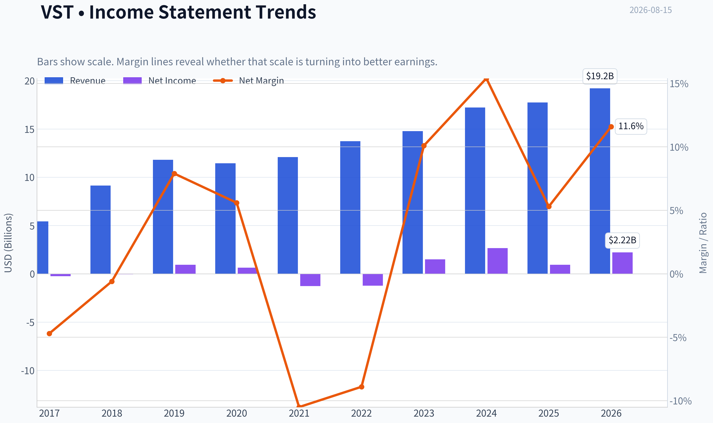

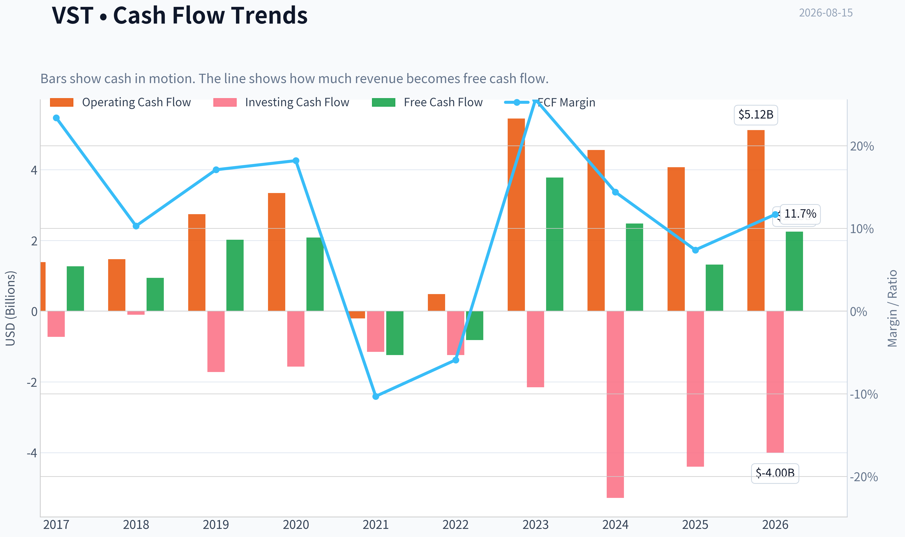

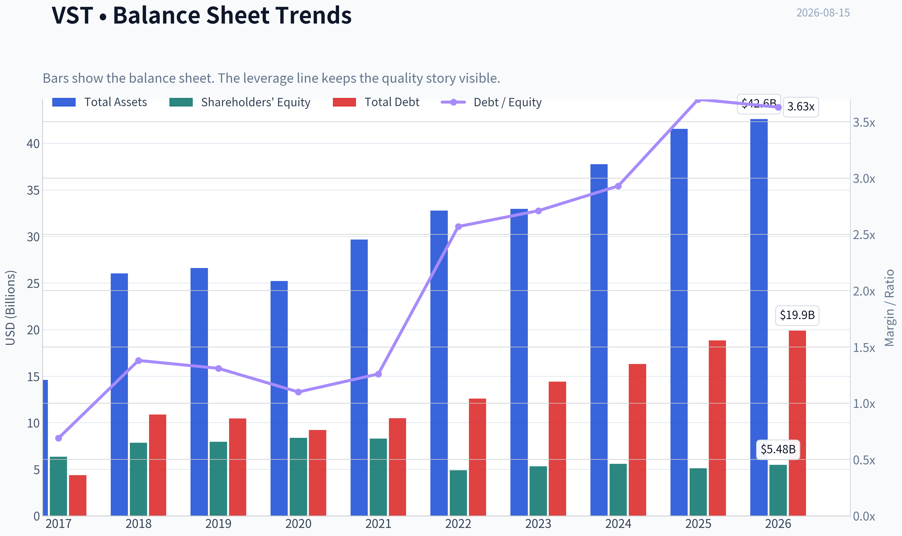

This graph tracks the profitability and return metrics (ROE, ROIC, Margins) of **VST** over the past decade, highlighting capital efficiency trends.

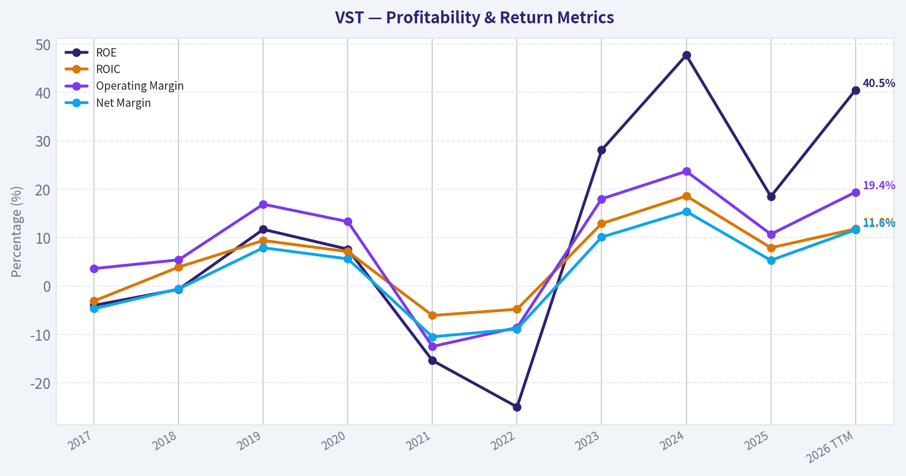

This chart illustrates the financial health of **VST** over the last 10 years, mapping cash equivalents and free cash flow against total obligations (Debt).

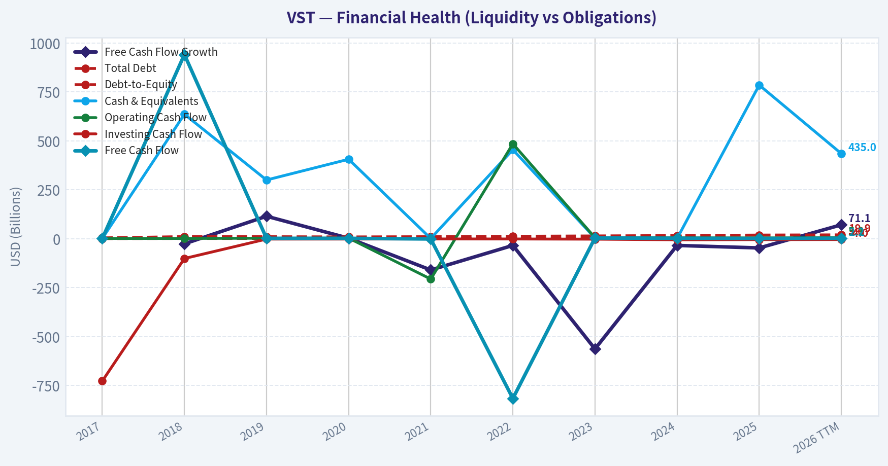

---

### Intrinsic Value Analysis (Buffett)

> *Following Warren Buffett's value investing philosophy: Circle of Competence, Economic Moat, Management Quality, and Margin of Safety.*

#### Intrinsic Value Snapshot

Price is what you pay. Intrinsic value is what the business may be worth based on the cash it can create for owners over time. We show a range, not one magic number.

- Current Price: $148.13
- Value Range (conservative to optimistic across both DCF methods): $-49.46 to $750.17

##### Owner Earnings (Buffett Method)
- Net Income: $944,000,000.00
- Depreciation & Amortization: $2,950,000,000.00
- Capital Expenditures: $-2,752,000,000.00
- Working Capital Changes: $-1,088,000,000.00
- Owner Earnings: $2,230,000,000.00

##### Intrinsic Value
###### Buffett Method
Uses owner earnings. Stricter, and usually more conservative.
- Conservative: $-49.46
- Average: $252.72
- Optimistic: $750.17
- Discount Rate: 10.0%

###### Cash Flow Method
Uses free cash flow. Better for companies spending heavily today to grow tomorrow.
- Conservative: $-38.09
- Average: $26.85
- Optimistic: $26.85
- Discount Rate: 10.0%

ANALYST STANCE: **OSSERVARE**

#### Sintesi Buffett su Vistra Corp. - VST

Vistra è un produttore e rivenditore integrato di elettricità negli Stati Uniti, con esposizione a gas, nucleare, carbone, rinnovabili e storage. Il tema d'investimento è chiaro: la domanda elettrica, spinta anche da data center e AI, può rendere più preziosa la capacità di generazione affidabile. Tuttavia, al prezzo attuale di **148 dollari**, il titolo incorpora già una buona parte di questo scenario favorevole.

Il giudizio finale è **OSSERVARE**: business comprensibile e potenzialmente ben posizionato, ma ciclico, regolato, capital intensive e con una valutazione che non offre ancora un margine di sicurezza sufficiente per un investitore alla Buffett.

---

#### 1. Factor Scorecard

| Fattore | Punteggio | Valutazione |
|---|---:|---|
| 1. Comprensibilità e prevedibilità | 3.0 / 5 | Il modello è semplice: produrre e vendere elettricità. La prevedibilità a 10 anni è discreta grazie alla domanda strutturale di energia, ma prezzi power, regolazione, fuel costs e ciclicità riducono la visibilità. |
| 2. Moat e vantaggio competitivo | 3.0 / 5 | Asset fisici difficili da replicare, scala, nucleare e generazione dispatchable sono vantaggi reali. Il moat però è più infrastrutturale/ciclico che da brand o switching cost. |
| 3. Management e allocazione capitale | 3.0 / 5 | La strategia appare razionale: ottimizzazione del portafoglio, esposizione alla domanda power e ritorni agli azionisti. Ma il settore richiede disciplina estrema su debito, capex e buyback. |
| 4. Struttura industriale | 3.0 / 5 | L'industria beneficia da scarsità di capacità elettrica, ma resta regolata, capital intensive e sensibile a commodity, tassi e politica energetica. |
| Gate 5: qualità/solvibilità | Non attivato | Non emerge una combinazione di deterioramento operativo chiaro e stress finanziario tale da imporre un AVOID automatico. |

**Key Takeaways:** Vistra non è un business "da Coca-Cola", ma nemmeno una commodity pura senza difese. Possiede asset elettrici strategici in un momento in cui la domanda di energia affidabile sta diventando più preziosa. Il problema principale non è la qualità assoluta, ma il rapporto tra prezzo pagato, ciclicità e margine di sicurezza.

---

#### 2. Moat Analysis

| Fonte di moat | Evidenza | Giudizio |
|---|---|---|
| Asset fisici difficili da replicare | Impianti di generazione, inclusi asset nucleari e dispatchable, richiedono anni, autorizzazioni e capitale elevato. | Positivo |
| Scala e integrazione | Presenza sia nella generazione sia nel retail energetico, con capacità di gestire esposizioni e contratti. | Positivo |
| Domanda strutturale | AI, data center, elettrificazione e reshoring aumentano la necessità di energia affidabile. | Positivo ma già riflesso nel prezzo |
| Pricing power | Può beneficiare di mercati power stretti, ma non controlla pienamente prezzi, regolazione e costi input. | Moderato |
| Switching costs | Clienti retail e contratti possono creare una certa stabilità, ma non paragonabile a software mission-critical o ecosistemi digitali. | Moderato-basso |
| Network effects | Non rilevanti. | Debole |

**Key Takeaways:** Il moat di Vistra nasce soprattutto dalla scarsità e difficoltà di replicare asset elettrici critici. Questo è un vantaggio concreto, specialmente in un mondo affamato di energia per data center. Tuttavia, il vantaggio non elimina la ciclicità dei prezzi elettrici né il rischio regolatorio.

**Moat Quality Rating:** **Narrow to Moderate - 3 / 5**

---

#### 3. Management Quality Assessment

| Area | Valutazione |
|---|---|
| Mentalità da proprietari | Buona se la società continua a privilegiare ritorni per azione e disciplina finanziaria. Da monitorare la tentazione di inseguire crescita capex-heavy a multipli elevati. |
| Comunicazione e trasparenza | Adeguata per un operatore energetico quotato; il settore però richiede attenzione a hedging, contratti, esposizione merchant e assunzioni sui prezzi power. |
| Allocazione capitale | Il punto più importante. Buyback, debito e investimenti devono essere giudicati sul ritorno per azione, non sulla crescita nominale della capacità. |
| Rischio principale | Pagare troppo per asset o espandere capex proprio quando il mercato prezza già uno scenario AI/elettricità molto favorevole. |

**Key Takeaways:** Il management può creare valore se resta disciplinato e tratta ogni dollaro di capitale come denaro dei soci. In questo settore, anche una buona tesi industriale può essere rovinata da debito e investimenti fatti al prezzo sbagliato. La qualità della gestione va quindi misurata soprattutto sulla disciplina di capitale nei prossimi cicli.

---

#### 4. Financial Summary Table

| Metrica | Valore attuale / indicazione |
|---|---:|
| Prezzo azione | 148 dollari |
| Capitalizzazione di mercato | 49,72 miliardi di dollari |
| P/E | 25,0x |
| ROE | 18,5% |
| Crescita ricavi YoY | 3,0% |
| FCF yield | 2,7% |
| Current ratio | 0,78x |
| Valore intrinseco headline | 156,58 dollari |
| Margine di sicurezza headline | 5,4% |
| Reverse DCF: crescita implicita | circa 18,0% annuo per 10 anni |
| Crescita storica trailing 3 anni | circa 2,1% |

**Key Takeaways:** Vistra genera ritorni sul capitale proprio interessanti, con un ROE del 18,5%, ma il mercato sta già pagando circa 25 volte gli utili. Il FCF yield del 2,7% è modesto per un business ciclico e capital intensive. La valutazione headline offre solo un piccolo sconto rispetto al valore intrinseco stimato.

---

#### 5. Owner Earnings Calculation

Formula Buffett:

| Componente | Valore stimato |
|---|---:|
| Net income implicito da P/E e market cap | circa 1,99 miliardi di dollari |
| Free cash flow implicito da FCF yield | circa 1,34 miliardi di dollari |
| Owner earnings normalizzati usati per valutazione | circa 1,3-2,0 miliardi di dollari |
| Owner earnings per azione, fascia stimata | circa 4,0-6,0 dollari |

**Key Takeaways:** La differenza tra utili contabili e free cash flow è importante per Vistra, perché il settore richiede capex e gestione del capitale circolante. Per prudenza, il free cash flow implicito di circa 1,34 miliardi è una base più conservativa degli utili contabili. Questo rende il titolo meno economico di quanto suggerisca il solo P/E.

---

#### 6. Three-Scenario DCF Valuation

| Scenario | Metodo | Valore per azione stimato |
|---|---|---:|
| A. Nessuna crescita | Owner earnings / 10% | circa 40-60 dollari |
| B. Crescita GDP 3% | Owner earnings x 1,03 / 7% | circa 60-90 dollari |
| C. Scenario storico/normalizzato | crescita prudente, ciclicità e valore terminale | circa 150-160 dollari |
| Valore intrinseco headline | blend business-model routed | 156,58 dollari |
| Prezzo attuale | mercato | 148 dollari |

**Key Takeaways:** Gli scenari più conservativi non supportano il prezzo attuale se si usa il free cash flow corrente come base normalizzata. Il caso favorevole richiede che Vistra monetizzi in modo duraturo la scarsità elettrica e la domanda da AI/data center. Il valore headline di 156,58 dollari suggerisce che il titolo è vicino al fair value, non chiaramente sottovalutato.

---

#### 7. Margin of Safety Analysis

| Misura | Risultato | Interpretazione |
|---|---:|---|
| Prezzo attuale | 148 dollari | Punto di partenza elevato rispetto al FCF yield |
| Valore intrinseco headline | 156,58 dollari | Sopra il prezzo, ma di poco |
| Margine di sicurezza | 5,4% | Insufficiente per un business ciclico |
| Crescita implicita dal prezzo | circa 18% annuo per 10 anni | Ambiziosa |
| Crescita storica trailing 3 anni | circa 2,1% | Molto inferiore alla crescita implicita |

**Key Takeaways:** Il margine di sicurezza è il cuore del problema. Un business ciclico e capital intensive dovrebbe offrire uno sconto più ampio, idealmente almeno 25-35%, salvo qualità eccezionale e prevedibilità molto alta. Qui il mercato sta chiedendo a Vistra di realizzare uno scenario di crescita piuttosto ottimistico.

---

#### 8. Final Buffett Scorecard

| Criterio | Peso | Punteggio | Contributo ponderato |
|---|---:|---:|---:|
| Moat width & durability | 25% | 3.0 | 0.75 |
| Valutazione / margine di sicurezza | 20% | 2.5 | 0.50 |
| Capital returns - ROIC vs WACC | 15% | 3.5 | 0.53 |
| Comprensione e prevedibilità | 12% | 3.0 | 0.36 |
| Management e allocazione capitale | 12% | 3.0 | 0.36 |
| Reinvestment runway | 8% | 3.5 | 0.28 |
| Solidità patrimoniale | 4% | 2.5 | 0.10 |
| Struttura industriale | 4% | 3.0 | 0.12 |
| **Totale** | **100%** |  | **3.00 / 5** |

**Key Takeaways:** Il punteggio finale colloca Vistra esattamente nella zona "business interessante, prezzo non abbastanza interessante". Il moat è reale ma non eccezionale, e la domanda elettrica strutturale offre una buona pista di crescita. Tuttavia, la valutazione e la ciclicità impediscono oggi una raccomandazione più aggressiva.

---

#### 9. Investment Stance

| Voce | Giudizio |
|---|---|
| Stance | **OSSERVARE** |
| Conviction | Media |
| Prezzo interessante | Più convincente con uno sconto significativo rispetto al valore intrinseco, indicativamente sotto area 120-125 dollari salvo miglioramento sostanziale degli owner earnings |
| Principale motivo per comprare | Scarsità di energia affidabile, domanda AI/data center, asset elettrici difficili da replicare |
| Principale motivo per attendere | Margine di sicurezza solo del 5,4% e crescita implicita del 18% annuo per 10 anni |
| Rischio chiave | Normalizzazione dei prezzi power, regolazione sfavorevole, capex elevato o allocazione capitale aggressiva |

**Conclusione:** Vistra è un buon candidato da tenere in watchlist. La società possiede asset che potrebbero diventare sempre più preziosi in un'economia elettrificata e dominata dai data center. Ma Buffett non comprerebbe una storia affascinante senza un prezzo che protegga dall'errore: a 148 dollari, la protezione è troppo sottile.
#### Valuation Bridge

This bridge places the current market price beside each intrinsic value lens so readers can see whether upside depends on one method or shows up across several methods.

| Scenario | Intrinsic Value / Share |
| --- | ---: |
| Buffett Method | $252.72 |
| Cash Flow Method | $26.85 |
| Damodaran Method | $-35.26 |
| Current Price | $148.13 |

#### Key Takeaways

If one method is far above the others, the upside case depends on a specific modelling assumption. When several methods cluster together, the valuation story is more robust.

#### Valuation Visuals

This comparison chart from *Latest Earnings Snapshot* stacks current figures against historical benchmarks for **VST**, making it easy to see where the company trades relative to its own averages.

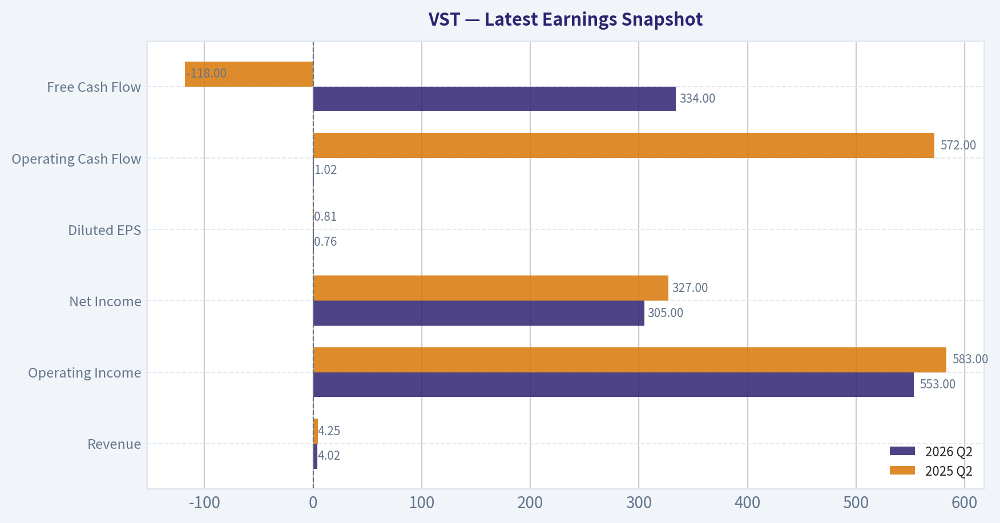

This comparison chart from *Dettaglio calcolo DCF* stacks current figures against historical benchmarks for **VST**, making it easy to see where the company trades relative to its own averages.

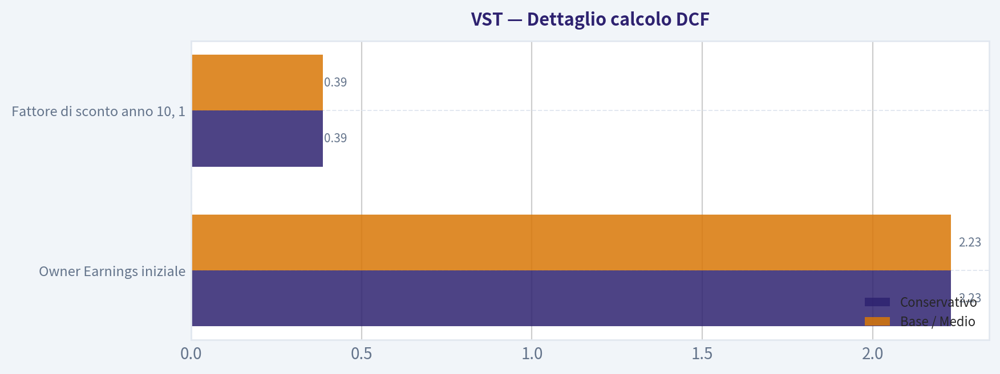

This comparison chart from *Financial Summary Table* stacks current figures against historical benchmarks for **VST**, making it easy to see where the company trades relative to its own averages.

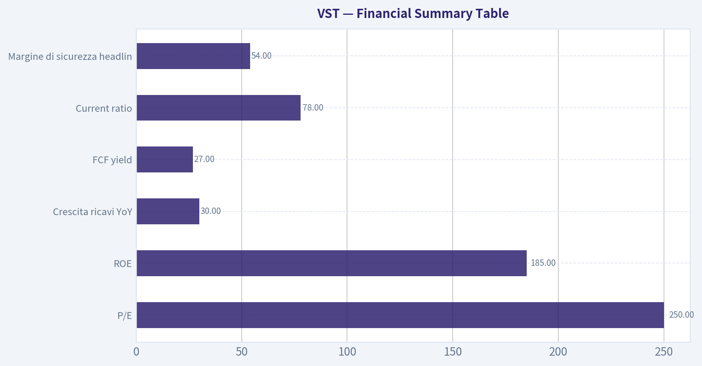

The following chart maps the **VST** Owner Earnings DCF valuation scenarios (Conservative, Average, Optimistic) to visually represent the margin of safety based on intrinsic value calculations.

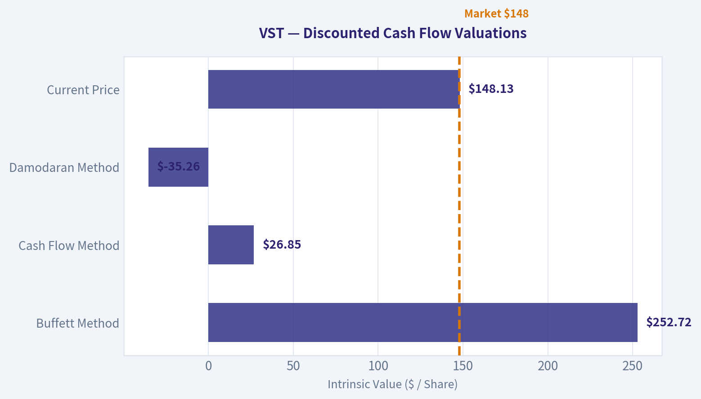

This comparison chart from *Classificazione Lynch* stacks current figures against historical benchmarks for **VST**, making it easy to see where the company trades relative to its own averages.

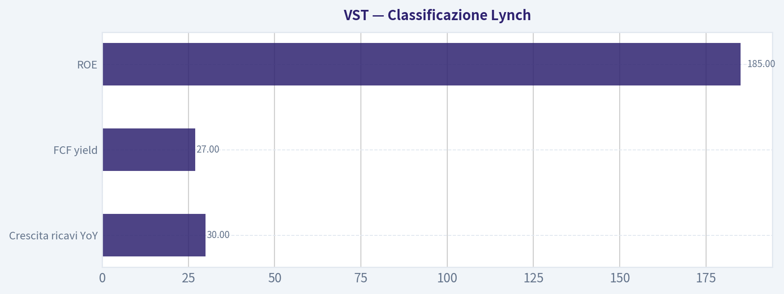

---

### Trend & Growth Analysis (Lynch/Druckenmiller/Fisher)

> *Following Peter Lynch's GARP, Stanley Druckenmiller's macro-aware approach, and Philip Fisher's scuttlebutt methodology.*

ANALYST STANCE: **OSSERVARE**

#### VST - Analisi Growth alla Lynch/Druckenmiller/Fisher

Vistra è una società elettrica integrata: produce energia, vende elettricità ai clienti retail e possiede asset strategici come nucleare, gas, storage e rinnovabili. Il titolo beneficia di un tema potente - la domanda elettrica da AI/data center - ma resta un business ciclico/regolato-merchant, non un "fast grower" puro. A $148, con market cap di circa $49,7 miliardi e P/E vicino a 25x, il mercato sta già capitalizzando una parte importante dell'inflection story.

---

#### 1. Classificazione Lynch

| Voce | Valutazione |
|---|---:|
| Categoria Lynch | **Ciclico con inflection secolare AI/power** |
| Crescita ricavi YoY | **3,0%** |
| P/E | **~25,0x** |
| FCF yield | **2,7%** |
| ROE | **18,5%** |
| Margine di sicurezza vs valore intrinseco headline | **~5,4%** |
| Classificazione growth | **Non fast grower puro** |

**Key Takeaways:** VST non rientra nella categoria Lynch dei "fast growers" classici, perché la crescita dei ricavi è bassa e il business resta esposto ai cicli dei prezzi dell'energia. La tesi rialzista dipende meno dalla crescita lineare dei ricavi e più da un'inflection strutturale: scarsità di elettricità affidabile, domanda AI/data center e valore strategico degli asset nucleari e dispatchable.

---

#### 2. La storia in 3 punti

| Punto | Sintesi |
|---|---|
| Bisogno semplice | L'AI consuma enormi quantità di elettricità; i data center hanno bisogno di energia stabile, continua e scalabile. |
| Asset giusti | VST possiede generazione dispatchable, nucleare e retail power: asset sempre più preziosi in un sistema elettrico sotto pressione. |
| Inflection possibile | Se la domanda elettrica accelera più dell'offerta, i prezzi, i contratti power e gli utili di VST possono sorprendere al rialzo. |

**Key Takeaways:** La storia è comprensibile: l'AI non scala senza elettricità. VST è una delle società meglio posizionate per monetizzare la scarsità di potenza affidabile negli Stati Uniti, ma il caso d'investimento è legato a prezzi dell'energia, capacità disponibile e disciplina del capitale.

---

#### 3. TAM e test 10x

| Voce | Valutazione |
|---|---:|
| TAM rilevante | Elettricità USA, data center power, capacity markets, nucleare, gas, storage |
| Driver TAM | AI/data center, elettrificazione, reshoring industriale, affidabilità della rete |
| Crescita TAM | Moderata nel sistema elettrico totale; molto alta nei carichi data center |
| Test 10x sui ricavi | **Difficile** |
| Test 10x sul valore equity | **Possibile solo con forte espansione utili/multipli, non solo ricavi** |

**Key Takeaways:** Il TAM dell'elettricità è enorme, ma VST è già una società grande: una crescita 10x dei ricavi sarebbe difficile senza trasformazione radicale o M&A massiccia. La vera opzionalità non è un 10x dei ricavi, ma un rerating degli asset elettrici se il mercato assegna un premio duraturo a nucleare, affidabilità e scarsità di potenza.

---

#### 4. Trend di crescita dei ricavi

| Metrica | Dato |
|---|---:|
| Crescita ricavi YoY | **3,0%** |
| Pattern osservabile | **Bassa crescita, non accelerazione evidente nei ricavi** |
| Qualità della crescita | Dipendente da prezzi power, mix asset, hedging, contratti e domanda |
| Lettura growth | **Non ancora inflection confermata nei ricavi** |

**Key Takeaways:** La crescita dei ricavi non mostra ancora il classico pattern da inflection Lynch-Druckenmiller, come 20% -> 25% -> 35%. Tuttavia, per VST il segnale chiave potrebbe emergere prima negli utili, nei margini e nei contratti power, non necessariamente nel fatturato headline.

---

#### 5. Unit economics

| Metrica | Valutazione |
|---|---:|
| LTV/CAC | Non applicabile: non è SaaS/consumer subscription puro |
| NRR | Non applicabile |
| Rule of 40 | Non applicabile |
| FCF yield | **2,7%** |
| Current ratio | **0,78** |
| ROE | **18,5%** |

**Key Takeaways:** Le metriche SaaS non sono adatte a VST. Le metriche più importanti sono generazione di cassa, hedging, leverage, ritorno sul capitale e capacità di firmare contratti power a prezzi favorevoli. Il current ratio sotto 1 richiede attenzione, anche se nelle utility/power companies il capitale circolante va interpretato con cautela.

---

#### 6. Inflection point assessment

| Tipo di inflection | Probabilità | Commento |
|---|---:|---|
| TAM inflection | Alta | AI/data center possono far crescere la domanda elettrica più rapidamente del previsto. |
| Pricing inflection | Medio-alta | Scarsità di capacità dispatchable può sostenere power prices e capacity revenues. |
| Margin inflection | Media | Possibile se prezzi/contratti migliorano più dei costi operativi e fuel. |
| Product cycle inflection | Bassa | Non è una società di prodotto; l'inflection è sugli asset. |
| Competitive inflection | Media | Chi possiede nucleare/gas affidabile può avere vantaggio rispetto a operatori meno flessibili. |

**Key Takeaways:** L'inflection più credibile per VST è macro-industriale: più domanda elettrica, meno offerta flessibile e premio crescente per generazione affidabile. Non è una classica inflection da software o nuovo prodotto, ma una rivalutazione degli asset fisici in un mercato che potrebbe diventare strutturalmente corto di energia.

---

#### 7. Macro setup

| Fattore macro | Impatto su VST |
|---|---|
| AI e data center | **Molto positivo** |
| Elettrificazione industriale | Positivo |
| Tassi d'interesse | Misto: tassi più bassi aiutano valutazioni e costo del capitale |
| Prezzi gas/power | Molto rilevanti; possono amplificare o comprimere utili |
| Regolazione e politica energetica | Rischio e opportunità |
| Ciclo economico | Misto: domanda industriale può rallentare in recessione |

**Key Takeaways:** Il vento secolare è favorevole: l'AI rende l'elettricità un collo di bottiglia strategico. Il rischio è che il mercato abbia già anticipato gran parte della narrativa, rendendo il titolo vulnerabile se i prezzi power o la crescita data center deludono.

---

#### 8. Fisher 15 punti

| Area Fisher | Punteggio 1-5 |
|---|---:|
| Potenziale di mercato | 4 |
| Sviluppo nuovi asset/progetti | 3 |
| Efficacia investimenti/R&D | 3 |
| Organizzazione commerciale | 4 |
| Margini interessanti | 4 |
| Margini in miglioramento | 3 |
| Relazioni con personale | 3 |
| Relazioni executive | 3 |
| Profondità management | 4 |
| Controllo costi/accounting | 3 |
| Vantaggi competitivi asset | 4 |
| Outlook lungo periodo | 4 |
| Rischio diluizione | 4 |
| Trasparenza management | 3 |
| Integrità management | 3 |
| **Totale** | **52/75** |

**Key Takeaways:** Il punteggio Fisher è discreto ma non eccezionale. VST ha asset strategici e un mercato potenzialmente favorevole, ma non possiede il profilo tipico di una compounder innovativa con vantaggi software-like, altissima crescita organica e unit economics scalabili.

---

#### 9. Valutazione

| Metodo | Lettura |
|---|---:|
| Prezzo corrente | **$148** |
| Market cap | **$49,72 miliardi** |
| P/E | **~25,0x** |
| PEG, usando crescita ricavi 3% | **~8,3x - caro se misurato sui ricavi** |
| FCF yield | **2,7% - non economico** |
| Valore intrinseco headline | **$156,58** |
| Margine di sicurezza | **~5,4%** |
| Reverse DCF implicito | **~18% annuo per 10 anni** |
| Crescita storica trailing 3 anni | **~2,1%** |

**Key Takeaways:** La valutazione non è palesemente irragionevole, ma nemmeno offre un grande margine di sicurezza. Il prezzo implica una forte accelerazione futura: il mercato sta già pagando per una parte della tesi AI/elettricità. Per diventare molto interessante, VST deve dimostrare che gli utili possono crescere molto più rapidamente dei ricavi storici.

---

#### 10. Scenario analysis sintetica

| Scenario | Ipotesi | Implicazione |
|---|---|---|
| Bear | Prezzi power normalizzati, domanda AI più lenta, multiplo in compressione | Downside significativo; titolo trattato come ciclico costoso |
| Base | Domanda elettrica solida, utili resilienti, asset nucleari rivalutati | Rendimento moderato; fair value vicino al prezzo attuale |
| Bull | Data center accelerano, capacity markets stretti, contratti premium per energia affidabile | Upside rilevante, ma richiede conferma operativa |

**Key Takeaways:** Il profilo rischio/rendimento è asimmetrico solo se lo scenario bull diventa più probabile. Oggi il caso base sembra già in buona parte riflesso nel prezzo, mentre lo scenario bear resta possibile perché il business conserva una componente ciclica significativa.

---

#### 11. Growth Investor Scorecard

| Criterio | Peso | Punteggio 1-5 |
|---|---:|---:|
| Storia Lynch | 10% | 4.0 |
| TAM e runway | 20% | 3.5 |
| Crescita ricavi | 20% | 2.0 |
| Unit economics / cash economics | 15% | 3.0 |
| Posizione competitiva | 10% | 4.0 |
| Management quality | 10% | 3.3 |
| Macro setup | 5% | 4.5 |
| Percorso di profittabilità | 5% | 3.5 |
| Valutazione | 5% | 2.8 |
| **Score complessivo** | **100%** | **3,2/5** |

**Key Takeaways:** Il punteggio complessivo indica "osservare", non "comprare aggressivamente". VST ha una storia secolare potente e asset preziosi, ma la crescita headline è bassa e la valutazione richiede una vera accelerazione degli utili per essere giustificata.

---

#### 12. Posizionamento

| Profilo investitore | Stance |
|---|---|
| Growth aggressivo | Attendere conferma di accelerazione utili/contratti |
| GARP | Interessante solo su pullback o revisione utili al rialzo |
| Macro/AI infrastructure | Candidato da monitorare |
| Posizione suggerita | **Piccola/watchlist: 1-2% massimo se già convinti del tema power** |

**Key Takeaways:** VST può essere mantenuta o studiata come proxy sull'elettricità per l'AI, ma non appare una nuova posizione ad alta convinzione ai prezzi attuali. Il titolo merita più attenzione su correzioni o dopo evidenza concreta di contratti data center, pricing power e crescita degli utili.

---

#### 13. Rischi principali e catalizzatori

| Catalizzatori | Rischi |
|---|---|
| Nuovi contratti power con data center | Normalizzazione prezzi elettricità |
| Aumento capacity payments | Regolazione sfavorevole |
| Rivalutazione asset nucleari | Costi fuel/manutenzione superiori |
| Guidance utili rivista al rialzo | Leverage e liquidità di breve periodo |
| Tassi in calo | Narrativa AI già prezzata |
| Competitor con capacità insufficiente | Recessione o rallentamento domanda industriale |

**Key Takeaways:** I catalizzatori sono reali, soprattutto se l'AI trasforma l'elettricità affidabile in un asset scarso. Tuttavia, il titolo ha già avuto una rivalutazione importante e resta vulnerabile a delusioni sui prezzi power o su aspettative troppo aggressive.

---

#### Conclusione

VST è una **buona storia macro-secolare**, ma non ancora una **classica growth compounder**. La tesi migliore è: "l'elettricità diventa il vero collo di bottiglia dell'AI, e Vistra possiede asset sempre più preziosi". La criticità è che a $148 il mercato sta già prezzando una crescita degli utili molto superiore alla storia recente.

**Decisione:** **OSSERVARE**. Aggiungerei aggressivamente solo con una delle tre condizioni: pullback significativo, nuove prove di contratti power premium legati ai data center, oppure revisione credibile degli utili a 2-3 anni che renda il P/E forward molto più basso.

#### Growth & Scorecard Visuals

This comparison chart from *Final Buffett Scorecard* stacks current figures against historical benchmarks for **VST**, making it easy to see where the company trades relative to its own averages.

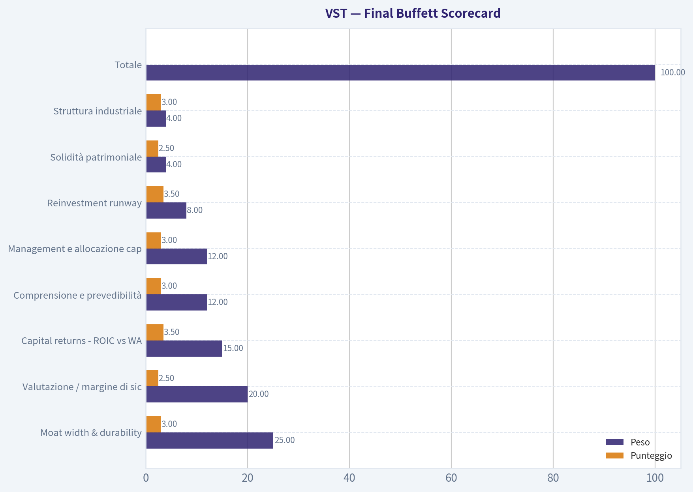

---

### Market Technical Analysis

ANALYST STANCE: **OSSERVARE**

#### VST - Analisi tecnica al 15 agosto 2026

Ultimo dato disponibile: **14 agosto 2026**. VST ha chiuso a **148,13 $**, in recupero rispetto ai minimi di inizio agosto, ma ancora sotto le principali medie mobili di medio e lungo periodo. Il quadro tecnico non è ancora costruttivo in modo pieno: il titolo mostra un tentativo di stabilizzazione di breve periodo, mentre la struttura primaria resta fragile.

#### Indicatori selezionati

| Indicatore | Valore recente | Lettura tecnica | Perché è rilevante ora |
|---|---:|---|---|
| close_10_ema | 146,49 | Prezzo sopra la media veloce | Segnala un primo recupero tattico dopo il sell-off di inizio agosto |
| close_50_sma | 153,90 | Prezzo sotto la media a 50 giorni | Conferma che il trend intermedio resta debole |
| close_200_sma | 160,77 | Prezzo nettamente sotto la media a 200 giorni | Indica deterioramento del trend primario |
| macd | -3,10 | Ancora negativo, ma in miglioramento | Il momentum ribassista si sta attenuando, senza però inversione confermata |
| rsi | 47,59 | Neutrale-basso | Non è più in ipervenduto, ma manca forza direzionale |
| boll_ub | 168,95 | Resistenza dinamica alta | Area utile per valutare eventuale breakout o eccesso rialzista |
| boll_lb | 132,60 | Supporto dinamico basso | Mostra che il titolo ha spazio tecnico prima di nuovo ipervenduto estremo |
| atr | 6,46 | Volatilità ancora elevata ma in calo | Utile per dimensionamento posizione e stop-loss più realistici |

**Key Takeaways:** VST sta cercando di ricostruire momentum di breve periodo, come mostra il prezzo sopra la EMA a 10 giorni. Tuttavia, il titolo resta sotto la SMA a 50 e a 200 giorni, quindi il recupero non è ancora una vera inversione di trend. Il MACD meno negativo e l'RSI in risalita suggeriscono miglioramento, ma non ancora conferma operativa forte.

#### Lettura del trend

La struttura di VST resta tecnicamente compromessa su orizzonte medio-lungo. La **SMA a 200 giorni è scesa a 160,77 $**, mentre il prezzo chiude a **148,13 $**, circa **7,9% sotto** tale riferimento. Questo indica che il mercato continua a prezzare il titolo in una fase di debolezza primaria.

Anche la **SMA a 50 giorni a 153,90 $** resta sopra il prezzo. Questo livello è particolarmente importante: un ritorno stabile sopra **154-156 $** sarebbe il primo segnale che il rimbalzo non è solo tecnico, ma può trasformarsi in recupero intermedio. Finché VST rimane sotto questa fascia, ogni rialzo va interpretato con prudenza.

Il segnale più incoraggiante arriva dalla **EMA a 10 giorni**, ora a **146,49 $**, superata dal prezzo. Questo suggerisce che nel brevissimo termine i compratori sono tornati presenti. Tuttavia, la EMA veloce da sola non basta: in un titolo volatile come VST può generare falsi segnali se non accompagnata da recupero sopra la media a 50 giorni.

#### Momentum e pressione direzionale

Il **MACD è ancora negativo a -3,10**, ma è migliorato rispetto ai valori più deboli di inizio agosto, quando era sceso sotto -4. Questo è un dettaglio importante: la pressione ribassista non è scomparsa, ma sta perdendo intensità. In pratica, il titolo non ha ancora generato un segnale rialzista pulito, però il peggioramento del momentum sembra essersi arrestato.

L'**RSI a 47,59** conferma questa lettura. Non siamo in ipervenduto, quindi il rimbalzo recente non nasce più da una condizione estrema di panico. Allo stesso tempo, l'RSI non è sopra 50-55, zona che spesso segnala un ritorno più deciso della domanda. Per un trader, il passaggio dell'RSI sopra **50** sarebbe un segnale incrementale positivo; sopra **55** diventerebbe più convincente.

#### Volatilità e bande di Bollinger

Le bande di Bollinger sono ampie: la banda inferiore è a **132,60 $**, quella superiore a **168,95 $**. Questo indica che il titolo continua a muoversi in un regime di volatilità elevata, anche se l'**ATR è sceso a 6,46**, sotto i picchi recenti superiori a 8. La volatilità si sta quindi normalizzando, ma rimane abbastanza alta da richiedere stop ampi e posizioni dimensionate con cautela.

Il prezzo attuale è circa a metà del canale di Bollinger, non vicino né alla banda alta né alla banda bassa. Questo riduce la qualità di un ingresso aggressivo: non c'è più un chiaro sconto da ipervenduto, ma non c'è nemmeno breakout. Il mercato sta probabilmente cercando una nuova base tra **140 e 150 $**.

#### Livelli tecnici operativi

La zona **140-143 $** è diventata un supporto tattico importante: diversi minimi recenti si sono concentrati in quest'area. Una perdita netta di **140 $** aumenterebbe il rischio di ritorno verso la banda inferiore di Bollinger, attualmente intorno a **132-133 $**.

Al rialzo, il primo ostacolo è **150 $**, seguito dalla fascia **153,90-156 $**, dove passa la SMA a 50 giorni e dove si concentrano recenti livelli di rotazione. Una chiusura sopra questa zona migliorerebbe sensibilmente il quadro. Il vero segnale di forza, però, arriverebbe solo sopra **160-161 $**, area della SMA a 200 giorni, perché indicherebbe un recupero del trend primario.

#### Implicazione per trader e investitori

Per un trader di breve periodo, VST è osservabile per un possibile setup di continuazione solo se mantiene chiusure sopra la EMA a 10 giorni e supera con volume la zona **154-156 $**. Per un investitore più prudente, il titolo resta da monitorare finché non torna almeno sopra la SMA a 50 giorni e mostra momentum positivo più stabile.

La stance è quindi **OSSERVARE**: il rischio di inseguire un semplice rimbalzo tecnico è ancora elevato, ma ci sono segnali iniziali di stabilizzazione che non giustificano una lettura completamente negativa.

#### Tabella finale di sintesi

| Area di analisi | Segnale attuale | Livelli chiave | Interpretazione operativa |
|---|---|---:|---|
| Trend breve | In miglioramento | EMA 10 giorni: 146,49 $ | Il prezzo sopra la media veloce suggerisce recupero tattico |
| Trend medio | Ancora debole | SMA 50 giorni: 153,90 $ | Serve una chiusura sopra 154-156 $ per migliorare il quadro |
| Trend lungo | Ribassista/fragile | SMA 200 giorni: 160,77 $ | Il titolo resta sotto il benchmark primario |
| Momentum | In recupero ma non confermato | MACD: -3,10; RSI: 47,59 | La pressione ribassista cala, ma manca forza sopra RSI 50 |
| Volatilità | Elevata ma in calo | ATR: 6,46 | Stop e sizing devono restare conservativi |
| Supporto | Critico | 140-143 $ | Perdita di quest'area riaprirebbe rischio verso 132-133 $ |
| Resistenza | Decisiva | 154-156 $, poi 160-161 $ | Superamento confermato migliorerebbe la struttura tecnica |
| Stance | OSSERVARE | - | Attendere conferme prima di assumere posizione aggressiva |

**Key Takeaways:** VST mostra un rimbalzo credibile di breve periodo, ma il titolo resta sotto le medie mobili principali. La zona 154-156 dollari è il primo vero banco di prova per capire se il recupero può proseguire. Finché il prezzo resta sotto quell'area, il profilo migliore è attendere conferme e gestire il rischio con prudenza.

---

### Options Market Analysis

> *Reading options flow - put/call ratios, IV skew, and unusual activity - to gauge institutional positioning and event-driven risk.*

ANALYST STANCE: **OSSERVARE**

#### VST - Analisi del mercato opzioni al 15 agosto 2026

Dai dati disponibili sulle scadenze ravvicinate, il mercato opzioni su **VST** mostra un'impostazione **moderatamente rialzista**, ma non aggressiva. Il segnale principale arriva da un rapporto put/call complessivo vicino alla neutralità storica, da una prevalenza di open interest sulle call nella scadenza più vicina e da un'attività insolita su call con volume molto superiore all'open interest.

---

#### 1. Analisi Put/Call Ratio

| Scadenza | Call OI | Put OI | Put/Call OI | Call Volume | Put Volume | Put/Call Volume | Lettura |
|---|---:|---:|---:|---:|---:|---:|---|
| 2026-08-21 | 58.034 | 32.541 | 0,56 | 2.455 | 2.125 | 0,87 | Prevalenza call in OI, sentiment costruttivo |
| 2026-08-28 | 2.933 | 8.599 | 2,93 | 673 | 291 | 0,43 | Forte concentrazione put in OI, possibile hedging |
| 2026-09-04 | 1.529 | 1.398 | 0,91 | 759 | 116 | 0,15 | OI quasi bilanciato, volume molto più call-driven |
| **Totale near-term** | **62.496** | **42.538** | **0,68** | - | - | **0,65** | Vicino alla neutralità, lieve inclinazione rialzista |

**Key Takeaways:** Il rapporto put/call OI complessivo di **0,68** è praticamente in linea con la soglia storica neutrale di circa **0,7**. Tuttavia, il rapporto put/call sul volume di **0,65** indica che il flusso recente è leggermente più orientato verso le call. La scadenza del 21 agosto domina l'open interest ed è call-heavy, mentre il 28 agosto mostra una sacca di protezione ribassista o hedging tramite put.

Rispetto al baseline neutrale, non c'è un'estrema deviazione bearish. La lettura più corretta è: **posizionamento complessivamente neutrale-rialzista**, con una componente di copertura concentrata nella scadenza del 28 agosto.

---

#### 2. Valutazione della volatilità implicita

| Scadenza | ATM IV Call | ATM IV Put | Differenziale Call-Put | Lettura IV |
|---|---:|---:|---:|---|
| 2026-08-21 | 48,6% | 41,4% | +7,2 pp | Call IV sopra put IV, possibile domanda upside |
| 2026-08-28 | 46,0% | 44,2% | +1,8 pp | IV quasi bilanciata |
| 2026-09-04 | 47,0% | 46,5% | +0,5 pp | Skew sostanzialmente neutrale |
| **Media near-term** | **47,2%** | **44,0%** | **+3,2 pp** | Leggera inclinazione verso call |

**Key Takeaways:** La volatilità implicita ATM è elevata in termini assoluti, intorno al **44-47%** sulle scadenze ravvicinate. Il dato più interessante è che le call ATM hanno IV superiore alle put ATM, soprattutto sulla scadenza del 21 agosto. Questo suggerisce una certa domanda per esposizione rialzista o upside chase, più che una forte paura di downside.

Per lo skew, i dati disponibili permettono un confronto ATM call-versus-put, ma non includono un dettaglio completo tra put OTM e call OTM. Quindi non è possibile misurare con precisione una vera put skew OTM. Tuttavia, l'assenza di una IV put chiaramente superiore alle call indica che il mercato non sta prezzando una forte domanda di protezione ribassista nel brevissimo termine.

Non viene segnalato nel feed un catalizzatore specifico imminente, come earnings o evento societario. L'IV resta comunque abbastanza alta, quindi eventuali posizioni direzionali tramite opzioni pagano un premio significativo.

---

#### 3. Attività insolita sulle opzioni

| Scadenza | Tipo | Strike | Volume | Open Interest | Volume/OI | IV | Interpretazione |
|---|---|---:|---:|---:|---:|---:|---|
| 2026-09-04 | CALL | $170 | 605 | 55 | 11,0x | 46,4% | Nuova attività call, potenziale scommessa rialzista fresca |

**Key Takeaways:** L'unico contratto segnalato come insolito è la **call $170 con scadenza 4 settembre 2026**, dove il volume è circa **11 volte** l'open interest. Questo è tipico di nuovo posizionamento, non solo rotazione o chiusura di posizioni esistenti. Il segnale è rialzista, anche se la dimensione assoluta del volume non è enorme.

La classificazione ITM/ATM/OTM non è determinabile con precisione perché il feed fornito non include il prezzo spot corrente di VST. Detto questo, uno strike a **$170** su una scadenza a circa **20 giorni** indica una posizione a breve termine con chiaro orientamento direzionale. Se il titolo fosse sotto $170, si tratterebbe di una scommessa OTM su accelerazione rialzista; se fosse vicino a $170, sarebbe una call ATM con esposizione più diretta al movimento del sottostante.

Questa attività sembra più significativa di una semplice speculazione retail casuale perché il rapporto volume/OI è molto alto. Tuttavia, il volume assoluto non è abbastanza grande da definirla con forte certezza "smart money" istituzionale.

---

#### 4. Concentrazione di Open Interest e livelli di pinning

| Scadenza | Concentrazione principale | Lettura |
|---|---|---|
| 2026-08-21 | Open interest call molto elevato: 58.034 contratti | Possibile area di gamma call-heavy nella scadenza più vicina |
| 2026-08-28 | Open interest put superiore alle call: P/C OI 2,93 | Possibile livello di protezione o copertura ribassista concentrata |
| 2026-09-04 | OI più bilanciato, ma volume call dominante | Minore effetto pinning rispetto al 21 agosto |
| Near-term complessivo | Call OI totale 62.496 vs put OI 42.538 | Leggera prevalenza di interesse aperto rialzista |

**Key Takeaways:** La scadenza del **21 agosto** è quella più importante per il mercato opzioni di VST, con un open interest sulle call molto superiore a quello delle put. Questo può creare un effetto "gravitazionale" se il prezzo si avvicina a strike call molto popolati, anche se il feed non fornisce la distribuzione strike-by-strike completa. La scadenza del 28 agosto è l'eccezione più difensiva, con molte più put aperte rispetto alle call.

Senza una mappa completa degli strike con massimo OI, non è possibile identificare con certezza un singolo livello di max pain o gamma wall. Tuttavia, la struttura aggregata suggerisce che il mercato è più esposto a call gamma nella scadenza immediata, mentre il 28 agosto contiene hedging ribassista più marcato.

---

#### 5. Segnale complessivo dal mercato opzioni

| Categoria | Segnale | Motivazione |
|---|---|---|
| Put/Call Ratio | Neutrale-rialzista | P/C OI complessivo 0,68, vicino al baseline neutrale ma sotto 0,7 |
| Volume recente | Rialzista moderato | P/C volume 0,65, con prevalenza relativa di call |
| IV | Rialzista cauto | Call ATM IV sopra put ATM IV, soprattutto sulla scadenza 21 agosto |
| Skew | Leggermente verso call | Non emerge una forte put skew difensiva dai dati disponibili |
| Attività insolita | Rialzista | Call $170 del 4 settembre con volume 11x OI |
| Qualità del segnale | Media | Flusso interessante ma non estremamente aggressivo; dati strike-by-strike incompleti |

**Key Takeaways:** Il segnale complessivo è **RIALZISTA moderato**, non euforico. La combinazione di call OI dominante nella scadenza più vicina, call IV più alta delle put e attività insolita sulla call $170 suggerisce che il mercato sta cercando esposizione a un possibile movimento verso l'alto. La principale cautela è la presenza di put OI elevato sulla scadenza del 28 agosto, che può rappresentare copertura istituzionale o timore di volatilità.

#### Segnale finale: **RIALZISTA moderato**

Il driver principale è la **domanda relativa di call**: il put/call volume ratio sotto 0,7, la call IV superiore alla put IV e l'attività insolita sulla call $170 indicano interesse per upside a breve termine. Tuttavia, il segnale non è abbastanza forte da diventare aggressivamente bullish, perché il put/call OI complessivo è molto vicino alla neutralità e la scadenza del 28 agosto mostra una concentrazione difensiva importante.

---

#### Tabella riassuntiva finale

| Voce | Dato / Lettura | Implicazione |
|---|---|---|
| Put/Call Ratio | OI 0,68; volume 0,65 | Vicino al neutrale, lieve bias rialzista |
| Livello IV | ATM IV circa 44-47% | Premio opzioni elevato, mercato attende movimento |
| Direzione Skew | Call IV > put IV nelle scadenze vicine | Domanda upside superiore alla protezione downside |
| Attività insolita | CALL $170, 2026-09-04, volume/OI 11x | Nuova scommessa rialzista a breve termine |
| Segnale complessivo | **RIALZISTA moderato** | Posizionamento costruttivo, ma con hedging put sulla scadenza 28 agosto |

**Key Takeaways:** Il mercato opzioni su VST non mostra panico ribassista; al contrario, evidenzia una leggera preferenza per esposizione rialzista. Il segnale migliore arriva dalla call $170 del 4 settembre e dalla prevalenza di call nella scadenza del 21 agosto. La conclusione operativa è **rialzista con cautela**, non un segnale di acquisto aggressivo basato solo sulle opzioni.

---

## Research Team Commentary

> *The Research Manager synthesizes the Bull vs Bear debate into action-free commentary. This is a pre-risk view, not the final stance.*

Come gestore di portafoglio value che segue la filosofia adattiva di Warren Buffett, ho ascoltato con molta attenzione sia gli argomenti del Toro che quelli dell'Orso su Vistra Corp. Parliamoci chiaro, ci troviamo di fronte a una delle narrazioni più potenti del mercato attuale: l'energia nucleare come infrastruttura insostituibile per la rivoluzione dell'intelligenza artificiale e dei data center.

Sintetizzando le due visioni, il Toro costruisce una tesi affascinante basata sulla qualità degli asset. Sostiene che l'energia nucleare di base, priva di emissioni e costante 24 ore su 24, rappresenti un fossato competitivo insormontabile, trasformando Vistra da semplice utility ciclica a beneficiario strutturale di un super-ciclo decennale. In questa ottica, un P/E di 25x viene visto come ragionevole per un'azienda che offre flussi di cassa altamente visibili e in crescita, spinti da contratti a lungo termine con i giganti tecnologici.

L'Orso, tuttavia, ci riporta con i piedi per terra, offrendo una dose di pragmatismo essenziale. Ci ricorda che Vistra opera in mercati "merchant", dove i prezzi sono dettati dal mercato e l'azienda rimane esposta alle fluttuazioni delle commodity. L'Orso evidenzia un Return on Invested Capital (ROIC) del 6,9%, un bilancio con debito significativo, e sottolinea come comprare azioni proprie ai massimi storici con un multiplo di 25x, in un business ad alta intensità di capitale, rischi di distruggere valore per gli azionisti. L'Orso avverte che il mercato sta prezzando Vistra con multipli da azienda SaaS, ignorando i limiti fisici e regolatori di una vera utility.

Il Core Takeaway di questa analisi è che la narrazione sull'esplosione della domanda energetica per l'IA è assolutamente reale, ma il mercato sta attualmente prezzando Vistra in modo eccessivamente ottimistico, richiedendo un'esecuzione perfetta per il prossimo decennio senza lasciare spazio agli imprevisti tipici dei settori ad alta intensità di capitale.

La Rationale dietro questa conclusione affonda le radici nella nostra disciplina value e nelle lezioni apprese dai nostri recenti investimenti. Ricordando la nostra analisi su Visa, abbiamo imparato che un'azienda può avere un business eccezionale e un forte consenso di mercato, ma se il prezzo non offre un margine di sicurezza adeguato, il potenziale di rialzo è fortemente limitato e il rischio di stagnazione è alto. Oggi Vistra gode del "consenso di alta qualità", ma pagare 25 volte gli utili per un ROIC del 6,9% significa speculare su una massiccia e futura espansione dei margini, non investire sul valore attuale.

D'altro canto, dobbiamo ricordare il nostro errore sul caso Glencore. Su Glencore fummo troppo rapidi a bocciare il titolo basandoci esclusivamente sulla sua ciclicità e sui fondamentali storici depressi, ignorando un forte trend macroeconomico e lo slancio tecnico che ha poi portato il titolo a salire. Vistra sta cavalcando un trend secolare (l'IA) e mostra una forza relativa innegabile. Ignorare del tutto questo slancio bollando l'azienda come una "cattiva utility" sarebbe un errore. Tuttavia, Buffett ci insegna che il debito usato per finanziare acquisizioni in un business a basso ROIC storico è pericoloso. Per giustificare questo prezzo, i nuovi contratti di Vistra devono generare un ROIC incrementale enormemente superiore al costo del capitale. Al momento, questa è una speranza prezzata come certezza.

Per assicurarci di non perdere un'opportunità ma proteggendo il capitale, ecco il nostro Monitoring Plan per i prossimi 1-4 trimestri. Primo, monitoreremo strettamente il ROIC incrementale e la generazione di Free Cash Flow: voglio vedere prove tangibili che i margini operativi si stiano espandendo strutturalmente grazie ai nuovi contratti per i data center. Secondo, osserveremo l'allocazione del capitale: se il management continua con forti riacquisti di azioni a questi multipli elevati senza un proporzionale aumento degli utili, lo considererò un segnale negativo di distruzione del valore. Terzo, terremo d'occhio i rischi normativi: qualsiasi discussione politica su tetti ai prezzi o tasse sugli extra-profitti nei mercati liberalizzati indebolirebbe pesantemente il potenziale di crescita. Infine, fisseremo dei trigger chiari legati al prezzo: aspetterò un periodo di consolidamento in cui gli utili possano raggiungere la valutazione, idealmente riportando il P/E forward sotto i 18x, oppure cercherò un ritracciamento significativo verso supporti tecnici solidi prima di considerare l'impiego di nuovo capitale.

Il mio verdetto finale riflette il bisogno di bilanciare un trend industriale potentissimo con una ferrea disciplina sulle valutazioni. Non voglio mettermi contro questo slancio strutturale, ma non posso giustificare un acquisto aggressivo a questi prezzi privi di margine di sicurezza.

Stance: WATCH

---

## Value Investing Team Commentary

> *The Investor translates the research view into an investment thesis before risk review. This is still not the final stance.*

### Business Analysis: Vistra Corp. (VST)

In the spirit of a value investor, we must distinguish between a "compelling story" and a "compelling business." Vistra Corp. is currently at the intersection of a massive secular tailwind-the energy demands of Artificial Intelligence and Data Centers-and the cold, hard reality of a capital-intensive, regulated, and merchant power industry.

#### 1. The Business Quality and the "Nuclear Moat"
Vistra is no longer just a legacy utility. By acquiring Energy Harbor, Vistra has positioned itself as one of the largest nuclear generators in the U.S. In a world starved for carbon-free, 24/7 baseload power, nuclear assets are becoming "irreplaceable infrastructure." This creates a significant **economic moat** based on high entry barriers (you cannot easily build new nuclear) and high switching costs for data center operators who require 99.999% reliability.

However, we must look at the **ROIC (6.9%)**. In the Buffett framework, a business earning 6.9% on its capital is an "average" business at best. While the return on equity (ROE) of 18.5% looks attractive, it is heavily bolstered by financial leverage (debt). For VST to be a "wonderful business at a fair price," we need to see that ROIC trend toward double digits, signifying that the new data center contracts are priced at a significant premium to merchant power rates.

#### 2. Selective Contrarianism: Narrative vs. Reality
The market is currently treating Vistra like a "SaaS" company because of its AI exposure. A P/E ratio of 25x for a power generator is historically exuberant.
*   **What the market is missing:** The "merchant" nature of Vistra's business means it is still a price-taker for a large portion of its portfolio. If natural gas prices remain low or if power demand growth from AI is slower to materialize than the hyper-bullish forecasts suggest, the margin compression could be severe.
*   **The Buyback Trap:** The management is aggressively buying back shares. At lower valuations, this is a masterstroke of capital allocation. At 25x P/E for a business with 3% revenue growth, buybacks risk destroying intrinsic value. Buffett prefers managers who only buy back shares when the price is significantly below a conservative estimate of intrinsic value.

#### 3. Margin of Safety and Valuation
Applying our **Quality-Scaled Margin of Safety**, Vistra falls into the "average to good" quality category due to its asset-heavy nature and debt load. Such a business requires a 25-35% discount to intrinsic value.
Using a **Reverse-DCF** approach, a 25x P/E implies that the market expects double-digit earnings growth for the next decade. Currently, revenue growth is at 3.0%. The "delta" between 3% and the double-digit expectation must be filled entirely by margin expansion from high-priced "behind-the-meter" nuclear contracts. While possible, this is a "hope-based" valuation rather than a "value-based" one.

#### 4. Lessons from Visa and Glencore
The user's mention of the **Visa** mistake is apt: even a wide-moat business can be a poor investment if the entry price implies growth that the company cannot realistically sustain. Conversely, the **Glencore** lesson warns us not to ignore macro-momentum. Vistra has the momentum, but as value investors, we do not chase momentum into the "zone of overvaluation."

### Final Commentary
Vistra is a classic example of a **wonderful narrative meeting a rich price.** The shift toward nuclear power as the backbone of the digital economy is a durable competitive advantage. However, the current financial metrics (low ROIC, high debt, and slow current revenue growth) do not yet justify a "growth-stock" multiple of 25x. We are looking for a business that treats shareholders as partners; overpaying for buybacks at the top of a cycle is not partner-like behavior.

We must wait for the "fat pitch." This would involve either a meaningful pullback in price to provide a margin of safety or a fundamental "proof of concept" in the earnings reports showing that new contracts are indeed rerating the ROIC. Until the technical structure stabilizes and the valuation comes back to earth (ideally below 18x forward earnings), we remain disciplined.

ANALYST STANCE: **WATCH**

---

## Deep Values Commentary

> *The Risk Management Team debates and the Risk Judge provides the final action-free verdict. This section determines the final ADVOCATE / WATCH / AVOID stance.*

#### Final Stance Scorecard

This scorecard converts the final research view into a weighted decision frame. It does not replace the narrative judgement, but it makes the main drivers of the verdict easier to scan.

| Criterion | Score | Weight | Commentary |
| --- | ---: | ---: | --- |
| Business Quality | 3.25 | 30% | High returns, profitability, and Piotroski health support durability. |
| Valuation Support | 2.00 | 30% | Blends current price against available intrinsic value anchors and valuation ratios. |
| Financial Strength | 1.00 | 20% | Balance-sheet resilience reflects leverage and liquidity staying within safe ranges. |
| Growth Durability | 1.33 | 20% | Recent revenue, earnings, and free cash flow growth indicate how durable expansion looks. |
| TOTAL / FINAL STANCE | 2.04 | 100% | WATCH |

#### Key Takeaways

The weighted score lands at **2.04 / 5.0**, while the final stance remains **WATCH**. This is useful as a quick calibration aid rather than a mechanical signal.

#### Risk Summary

Higher scores indicate more risk pressure. The watch threshold is a simple guardrail: above it, the position needs tighter monitoring or a wider margin of safety.

| Dimension | Current Score | Watch Threshold | Commentary |
| --- | ---: | ---: | --- |
| Business Quality | 2.75 | 3.00 | High returns, profitability, and Piotroski health support durability. |
| Valuation Support | 4.00 | 3.00 | Blends current price against available intrinsic value anchors and valuation ratios. |
| Financial Strength | 5.00 | 3.00 | Balance-sheet resilience reflects leverage and liquidity staying within safe ranges. |
| Growth Durability | 4.67 | 3.00 | Recent revenue, earnings, and free cash flow growth indicate how durable expansion looks. |

#### Key Takeaways

This view helps readers separate *where* the risk sits: valuation, business quality, balance sheet, or growth durability. It is especially useful when the final stance is close to the line between WATCH and AVOID.
