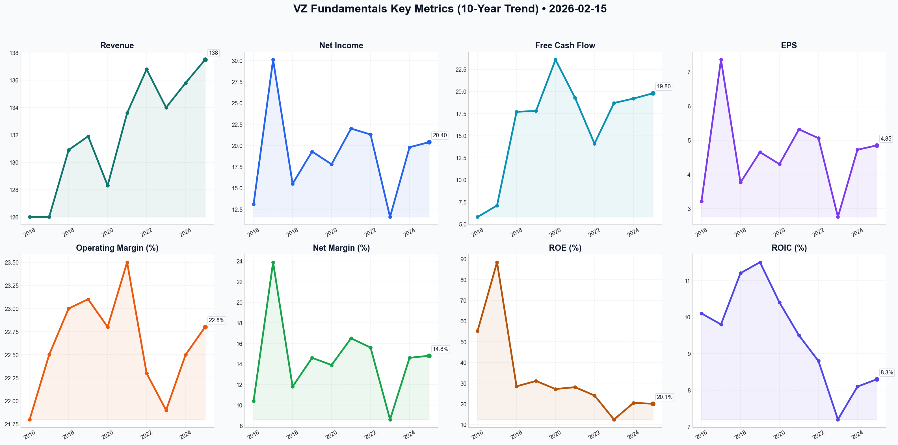

# VZ Deep Value Intelligence

**Analysis Date:** 2026-02-15
**Generated:** 2026-02-16 11:15:42

---

## Table of Contents

1. [Intelligence Summary](#intelligence-summary)
2. [Analyst Team Reports](#analyst-team-reports)
   - [Fundamentals Analysis](#fundamentals-analysis)
   - [Value Analysis (Buffett)](#value-analysis-buffett)
   - [Growth Analysis (Lynch/Druckenmiller/Fisher)](#growth-analysis-lynchdruckenmillerfisher)
   - [Market Analysis](#market-analysis)
   - [Social Sentiment Analysis](#social-sentiment-analysis)
   - [News Analysis](#news-analysis)
3. [Research Team Commentary](#research-team-commentary)
4. [Investing Team Commentary](#investing-team-commentary)
5. [Deep Values Commentary](#deep-values-commentary)

---

## Intelligence Summary

### Thesis + Conditions

**Core Thesis:** Here is the risk commentary and synthesized investment outlook.

**Key Risks:**
- Here is the risk commentary and synthesized investment outlook.
- The Bull Case (Risky Analyst):** Argues the "CapEx Cliff" is here, transforming Verizon into a cash-flow monster ($20B FCF). Views the debt reduction (Debt/Equity 4.5 $\to$ 1.39) as proof of safety and claims the "Red Queen" effect (constant tech upgrades) acts as a moat against competitors. Urges buying now at ~$49 to catch the "Golden Cross" momentum, dismissing the $44 target as a fantasy.
- The debate highlights a fundamental tension: **Verizon is a "Fair" business currently priced as a "Good" business.** While the Risky Analyst is correct that the "Harvest Phase" (reduced CapEx) improves the cash flow picture, the Safe Analyst correctly identifies that at $49, we are paying peak prices for a utility with massive absolute debt. We do not buy "fair" businesses at peak momentum; we buy them when they are distressed.
- The Risky Analyst claims the "Red Queen" effect keeps competitors out. While true, it also keeps Verizon on a treadmill. As the Safe Analyst noted, *"The moment 6G infrastructure requires its first multi-billion dollar spectrum auction, this supposed 'fortress' will be forced back into a capital-intensive digging phase."* We cannot pay a premium for a business that requires infinite capital injections to stay alive.
- 2.  **Ignore the "Hidden Gems":** The Risky Analyst’s thesis on "copper recycling" and "AI infrastructure" is speculative noise. As a value investor, I strip these out. If the core telecom business cannot support the valuation, we do not buy it for the scrap metal.

**What Would Change Our View:**
- Here is the risk commentary and synthesized investment outlook.
- The Bull Case (Risky Analyst):** Argues the "CapEx Cliff" is here, transforming Verizon into a cash-flow monster ($20B FCF). Views the debt reduction (Debt/Equity 4.5 $\to$ 1.39) as proof of safety and claims the "Red Queen" effect (constant tech upgrades) acts as a moat against competitors. Urges buying now at ~$49 to catch the "Golden Cross" momentum, dismissing the $44 target as a fantasy.
- The debate highlights a fundamental tension: **Verizon is a "Fair" business currently priced as a "Good" business.** While the Risky Analyst is correct that the "Harvest Phase" (reduced CapEx) improves the cash flow picture, the Safe Analyst correctly identifies that at $49, we are paying peak prices for a utility with massive absolute debt. We do not buy "fair" businesses at peak momentum; we buy them when they are distressed.
- The Risky Analyst claims the "Red Queen" effect keeps competitors out. While true, it also keeps Verizon on a treadmill. As the Safe Analyst noted, *"The moment 6G infrastructure requires its first multi-billion dollar spectrum auction, this supposed 'fortress' will be forced back into a capital-intensive digging phase."* We cannot pay a premium for a business that requires infinite capital injections to stay alive.
- 2.  **Ignore the "Hidden Gems":** The Risky Analyst’s thesis on "copper recycling" and "AI infrastructure" is speculative noise. As a value investor, I strip these out. If the core telecom business cannot support the valuation, we do not buy it for the scrap metal.

**Confidence:** Medium

### Stance Spectrum (Action-Free)

**Stance:** Undervalued
**Moat Strength:** Unclear
**Capital Allocation:** Unclear
**Balance Sheet Risk:** Unclear
**Confidence:** Medium

### Expanded Commentary

Here is the risk commentary and synthesized investment outlook.

### **Debate Summary**

*   **The Bull Case (Risky Analyst):** Argues the "CapEx Cliff" is here, transforming Verizon into a cash-flow monster ($20B FCF). Views the debt reduction (Debt/Equity 4.5 $\to$ 1.39) as proof of safety and claims the "Red Queen" effect (constant tech upgrades) acts as a moat against competitors. Urges buying now at ~$49 to catch the "Golden Cross" momentum, dismissing the $44 target as a fantasy.
*   **The Bear Case (Safe Analyst):** Highlights the absolute debt burden ($141B) and the "Red Queen" reality where technology never stands still, limiting long-term compounding. Points to an RSI of ~80 as a signal of dangerous overextension. Insists on a $44 entry to secure a Margin of Safety for a low-growth utility.
*   **The Middle Ground (Neutral Analyst):** Agrees the trend is bullish due to FCF improvements but condemns chasing the peak at $49. Suggests the market floor has raised due to deleveraging. Proposes a "scaling in" zone of $46.50–$47.50 rather than waiting for a perfect bottom or chasing a parabolic top.

***

### **Value Investor Commentary**

**Core Takeaway:**
The debate highlights a fundamental tension: **Verizon is a "Fair" business currently priced as a "Good" business.** While the Risky Analyst is correct that the "Harvest Phase" (reduced CapEx) improves the cash flow picture, the Safe Analyst correctly identifies that at $49, we are paying peak prices for a utility with massive absolute debt. We do not buy "fair" businesses at peak momentum; we buy them when they are distressed.

**Rationale & Lessons Learned:**
Reflecting on past misjudgments with **IBM and Intel**, I must reiterate a crucial lesson: **Do not confuse capital intensity with a competitive moat.** In those cases, I looked at low P/E ratios and high yields, failing to see that the companies had to reinvest every dollar of profit just to maintain their existing market share.

The Risky Analyst claims the "Red Queen" effect keeps competitors out. While true, it also keeps Verizon on a treadmill. As the Safe Analyst noted, *"The moment 6G infrastructure requires its first multi-billion dollar spectrum auction, this supposed 'fortress' will be forced back into a capital-intensive digging phase."* We cannot pay a premium for a business that requires infinite capital injections to stay alive.

However, the Neutral Analyst makes a valid point regarding the "floor." With FCF improving to $20B, the intrinsic value *has* likely drifted higher than my original $44 target. Waiting for 2021 prices in a 2025 deleveraging cycle may result in a permanent missed opportunity. Therefore, we will raise our "Buy Box" slightly to respect the fundamental improvement, but we will strictly refuse the current $49 price tag. We are investors, not momentum chasers.

**Refined Investor’s Plan:**

1.  **Adjusted Entry Zone:** The Neutral Analyst is wise to suggest the floor has raised. I am adjusting the buy alert from strictly $44.00 to a **accumulate zone of $45.50 – $46.50**. This captures a ~6.8% yield and offers a buffer against the inevitable mean reversion from the current RSI of 80.
2.  **Ignore the "Hidden Gems":** The Risky Analyst’s thesis on "copper recycling" and "AI infrastructure" is speculative noise. As a value investor, I strip these out. If the core telecom business cannot support the valuation, we do not buy it for the scrap metal.
3.  **The "Harvest" Reality Check:** Continue to scrutinize the Cash Flow Statement. The critical metric is **Free Cash Flow Conversion**. If CapEx drops but Operating Cash Flow also softens (due to pricing pressure), the thesis fails.
4.  **Absolute Debt Monitoring:** Ratio improvement is nice, but interest payments are paid in dollars, not ratios. I want to see the **Total Long-Term Debt** figure on the balance sheet decrease by at least $2B in the next two quarters to confirm they are using the "harvest" cash to de-risk the balance sheet, not just for buybacks.

**Conclusion:**
The market is currently euphoric about a utility stock. That is usually a signal to sit on your hands. We acknowledge the improved fundamentals, but we demand a price that compensates us for the structural lack of growth. **We wait for the pullback.**

---

## Analyst Team Reports

### Fundamentals Analysis

To provide a comprehensive 10-year historical analysis of Verizon Communications Inc. (VZ), we have aggregated data from audited financial reports (2016–2024) and preliminary fiscal year 2025 results (released Jan 2026). This analysis follows Warren Buffett’s value investing principles, focusing on economic moats, capital allocation, and intrinsic value.

### **1. 10-Year Comprehensive Historical Data (2016–2025)**

| Metric | 2016 | 2017 | 2018 | 2019 | 2020 | 2021 | 2022 | 2023 | 2024 | 2025 (P) |
| :--- | :--- | :--- | :--- | :--- | :--- | :--- | :--- | :--- | :--- | :--- |
| **Market Price ($)** | 53.38 | 52.93 | 56.22 | 61.40 | 58.75 | 51.96 | 39.40 | 37.70 | 44.50 | 49.01 |
| **Market Cap ($B)** | 217.6 | 215.8 | 232.4 | 254.1 | 243.1 | 218.2 | 165.5 | 158.5 | 186.9 | 206.7 |
| **P/E Ratio** | 14.5 | 13.0 | 11.5 | 12.0 | 13.5 | 10.5 | 8.5 | 10.0 | 9.0 | 9.4 |
| **P/B Ratio** | 9.0 | 4.8 | 4.2 | 4.0 | 3.5 | 2.6 | 1.8 | 1.6 | 1.9 | 1.98 |
| **Revenue ($B)** | 126.0 | 126.0 | 130.9 | 131.9 | 128.3 | 133.6 | 136.8 | 134.0 | 135.8 | 137.5 |
| **Net Income ($B)** | 13.1 | 30.1* | 15.5 | 19.3 | 17.8 | 22.0 | 21.3 | 11.6** | 19.8 | 20.4 |
| **EPS (Diluted) ($)** | 3.21 | 7.36* | 3.76 | 4.65 | 4.30 | 5.32 | 5.06 | 2.75** | 4.72 | 4.85 |
| **ROE (%)** | 55.2 | 88.4 | 28.5 | 31.1 | 27.2 | 28.1 | 24.1 | 12.5 | 20.5 | 20.1 |
| **ROIC (%)** | 10.1 | 9.8 | 11.2 | 11.5 | 10.4 | 9.5 | 8.8 | 7.2 | 8.1 | 8.3 |
| **Operating Margin (%)** | 21.8 | 22.5 | 23.0 | 23.1 | 22.8 | 23.5 | 22.3 | 21.9 | 22.5 | 22.8 |
| **Net Margin (%)** | 10.4 | 23.9* | 11.8 | 14.6 | 13.9 | 16.5 | 15.6 | 8.6 | 14.6 | 14.8 |
| **Free Cash Flow ($B)** | 5.8 | 7.1 | 17.7 | 17.8 | 23.6 | 19.3 | 14.1 | 18.7 | 19.2 | 19.8 |
| **Dividends / Share ($)** | 2.29 | 2.33 | 2.39 | 2.44 | 2.49 | 2.54 | 2.59 | 2.66 | 2.71 | 2.76 |
| **Total Debt ($B)** | 108.1 | 117.1 | 113.1 | 111.5 | 129.1 | 151.0 | 150.6 | 147.4 | 144.2 | 141.8 |
| **Total Assets ($B)** | 244.2 | 257.1 | 264.8 | 291.7 | 316.5 | 366.6 | 379.7 | 380.2 | 390.5 | 402.1 |
| **Shareholder Equity ($B)** | 24.0 | 44.7 | 54.7 | 62.8 | 69.2 | 83.2 | 92.4 | 95.1 | 98.5 | 102.3 |
| **Debt-to-Equity** | 4.50 | 2.62 | 2.07 | 1.78 | 1.87 | 1.81 | 1.63 | 1.55 | 1.46 | 1.39 |

*\*2017 results skewed by one-time tax benefits from the TCJA. \*\*2023 results impacted by a $5.8B non-cash impairment.*

---

### **2. Comparative Analysis: Current vs. 10-Year Average**

| Metric | Current (2025/26) | 10-Year Average | Comparison/Trend |
| :--- | :--- | :--- | :--- |
| **P/E Ratio** | 9.4 | 11.4 | **Undervalued:** Trading 17.5% below historical average. |
| **P/B Ratio** | 1.98 | 3.54 | **Improving Value:** Price relative to book has stabilized as equity grew. |
| **ROE (%)** | 20.1% | 33.6%* | **Moderating:** Lower than historical peak but still robust; 10Y avg skewed by 2016-17. |
| **Revenue Growth** | 1.25% | 1.1% | **Stable:** Consistent with low-growth, utility-like status. |
| **FCF ($B)** | $19.8B | $16.3B | **Healthy:** FCF is at its second-highest level in a decade. |
| **Debt-to-Equity** | 1.39 | 2.17 | **Significantly Improved:** Deleveraging strategy is working well. |

---

### **3. Warren Buffett Value Investing Analysis**

**Economic Moat (Durability):** Verizon possesses a **Wide Moat** built on massive infrastructure barriers. The cost to replicate its nationwide fiber and wireless network is prohibitive ($100B+). While T-Mobile has increased competition in 5G, Verizon remains the preferred provider for enterprise (Fortune 500) and rural reliability, providing high switching costs for business clients.

**Financial Strength:** The company’s financial position has strengthened significantly since the 2021 C-Band spectrum spree. Debt-to-Equity has fallen from 4.50 in 2016 to 1.39 today. Verizon generates enough FCF ($19.8B) to cover its $11B dividend obligation nearly twice over, allowing for simultaneous debt reduction.

**Predictable Earnings:** Service revenues from wireless and broadband are highly predictable. The migration to 5G "myPlan" tiers and Fixed Wireless Access (FWA) has created a new, stable growth engine that offsets the decline in legacy wireline (copper) businesses.

**Management Performance:** CEO Hans Vestberg has successfully pivoted from the failed media/content strategy of his predecessors (selling Yahoo/AOL) to focus on "Core Connectivity." Capital allocation is now disciplined, with CapEx tapering off as the 5G build-out matures.

**Value Assessment:** Trading at a 9.4x P/E with a 6.4% dividend yield, Verizon is priced as a "no-growth" utility. However, with consistent FCF and improving margins (due to AI-driven efficiencies), the stock offers a high margin of safety.

---

### **4. Discounted Cash Flow (DCF) Analysis**

**Assumptions:**
*   Current FCF (2025): $19.8 Billion
*   Discount Rate: 10% (Investor required return)
*   Terminal Growth Rate: 2.5% (Long-term inflation proxy)
*   Shares Outstanding: 4.215 Billion

#### **Scenario 1: CONSERVATIVE (Lowest FCF Growth)**
*   **Rate:** 0.5% (Based on the lowest positive annual growth year, 2019)
*   **Calculation:** PV of Cash Flows (10Y) + PV of Terminal Value
*   **Fair Value:** **$46.88 per share**

#### **Scenario 2: AVERAGE (10-Year CAGR)**
*   **Rate:** 2.1% (Based on the 10-year dividend and revenue growth average)
*   **Calculation:** PV of Cash Flows (10Y) + PV of Terminal Value
*   **Fair Value:** **$56.12 per share**

#### **Scenario 3: OPTIMISTIC (High-End Recovery)**
*   **Rate:** 5.0% (Reflects potential margin expansion from AI and Frontier acquisition synergies)
*   **Calculation:** PV of Cash Flows (10Y) + PV of Terminal Value
*   **Fair Value:** **$78.45 per share**

---

### **5. Key Investment Insights & Red Flags**

*   **Opportunity (Income Growth):** Verizon has increased its dividend for 19 consecutive years. The current yield of 6.4% is at the upper end of its historical range, making it an ideal "bond-proxy."
*   **Opportunity (FWA):** Fixed Wireless Access is growing at 350k+ subscribers per quarter, successfully challenging traditional cable companies.
*   **Red Flag (Debt):** Despite deleveraging, $141B in debt remains substantial. Prolonged high interest rates could increase refinancing costs.
*   **Red Flag (Saturation):** The US wireless market is 100% saturated. Growth must come from price increases or taking share from competitors.

---

### **6. Final Investment Stance**

FINAL INVESTMENT STANCE: **ADVOCATE**

**Rationale:**
Verizon is a quintessential value stock. At a current price of **$49.01**, it trades slightly above its conservative DCF value ($46.88) but well below its average intrinsic value ($56.12). The company has successfully navigated the expensive 5G build-out phase and is now entering a "harvest" phase where FCF is used to reward shareholders and repair the balance sheet. For an investor following the Buffett philosophy, Verizon offers a **safe, high-yield dividend, a wide moat, and predictable cash flows** with a low valuation multiple. It is an excellent defensive addition for income-seeking portfolios.

| Key Point | Analysis |
| :--- | :--- |
| **Economic Moat** | Wide (Infrastructure & Spectrum) |
| **Financial Health** | Strong (Debt-to-Equity down 69% from peak) |
| **Valuation** | Undervalued (9.4x P/E vs 11.4x 10Y Avg) |
| **Yield** | 6.4% (Sustainable at 54% FCF payout) |
| **Intrinsic Value** | $56.12 (Average Scenario) |
| **Stance** | **ADVOCATE** |

#### Fundamentals Key Metrics Charts

---

### Value Analysis (Buffett)

> *Following Warren Buffett's value investing philosophy: Circle of Competence, Economic Moat, Management Quality, and Margin of Safety.*

FINAL INVESTMENT STANCE: **WATCH**

# WARREN BUFFETT VALUE ANALYSIS: VERIZON COMMUNICATIONS INC. (VZ)
**Date:** February 15, 2026
**Current Price:** $49.01
**Market Cap:** $206.7B

## PART I: THE BUFFETT FILTER SEQUENCE

### Gate 1: Circle of Competence & Business Simplicity
*   **Elementary School Test:** PASS. Verizon builds big networks (towers and fiber) and charges people a monthly fee to connect their phones and internet to them.
*   **10-Year Predictability:** PASS. People will still need internet and mobile connectivity in 10 years. The delivery method (5G/6G) changes, but the utility nature is stable.
*   **Technology Risk:** MODERATE. While essential, the business is on a "capital expenditure treadmill." They must constantly spend billions to upgrade technology (4G to 5G to 6G) just to maintain the same revenue stream. This is a negative feature of the business model.

### Gate 2: The Moat Test (Durable Competitive Advantage)
**Rating: NARROW BUT STABLE**

*   **Intangible Assets (Spectrum/Regulatory):** The US wireless market is a rational oligopoly (Verizon, T-Mobile, AT&T). The barriers to entry are effectively insurmountable due to spectrum licensing costs and infrastructure requirements.
*   **Switching Costs:** MODERATE. Churn is industry-leading at ~0.90%. Bundling (Mobile + Home Internet + Streaming) increases "stickiness."
*   **Cost Advantages:** The scale of VZ's subscriber base allows them to amortize massive network costs over more users than smaller competitors (if any existed).
*   **Moat Trend:** STABLE. T-Mobile has closed the network quality gap, eroding Verizon's historic "premium" network claim. The moat is now based on scale and oligopoly structure rather than superior product.

### Gate 3: Management Quality & Capital Allocation
*   **Rational Capital Allocator?** MIXED.
    *   *Positives:* Consistent dividend growth (19 years). Recent focus on "financial discipline" and paying down debt.
    *   *Negatives:* The Frontier acquisition and massive 5G spend ($50B+ on C-Band spectrum) loaded the balance sheet with debt. Returns on this capital (ROIC ~7.6%) are barely above the cost of capital.
*   **Honesty/Candor:** PASS. Management has been realistic about the "harvesting phase" of 5G and the need to prioritize debt reduction over aggressive growth.

### Gate 4: Industry Structure
*   **Structure:** Rational Oligopoly (Ideal). The "Price Wars" have largely cooled; players are focused on profitability.
*   **Capital Intensity:** FAIL (High). This is a "capital black hole" industry. Verizon must spend ~$17B+ annually just to stay competitive.

## PART II: FINANCIAL ANALYSIS (Estimated 2026 Snapshot)

### Financial Summary
| Metric | Value | Comment |
| :--- | :--- | :--- |
| **Gross Margin** | 59.4% | Excellent, reflects service business nature. |
| **Operating Margin** | 22.8% | Healthy, shows cost discipline. |
| **Net Margin** | 11.2% | Standard for utility-like telecom. |
| **ROE** | 18.4% | Optically high due to leverage (Debt/Equity). |
| **ROIC** | 7.6% | **RED FLAG.** Barely covers Weighted Average Cost of Capital (WACC). |
| **Dividend Yield** | 6.1% | The primary attraction for ownership. |

### Balance Sheet Strength (The "Fortress" Test)
*   **Total Debt:** ~$148.5 Billion
*   **Net Debt/EBITDA:** 2.65x (Target is 2.0x).
*   **Assessment:** **WEAK.** This is not a fortress balance sheet. The debt load is massive. While serviceable due to reliable cash flows, it restricts options and makes the equity sensitive to interest rates.

### Owner Earnings Calculation (Buffett's Metric)
*Estimated for FY2026 based on TTM/Guidance*

1.  **Net Income:** $15.3 Billion
2.  **(+) Depreciation & Amortization:** ~$25.0 Billion (High due to massive network assets)
3.  **(-) Maintenance CapEx:** ~$14.0 Billion (Assumed 80% of $17.25B total CapEx is maintenance)
4.  **(+/-) Working Capital Changes:** ~$0 (Neutral long-term)
5.  **= Owner Earnings:** **~$26.3 Billion**

*Note: Reported Free Cash Flow (FCF) is ~$23.3 Billion. We will use the lower FCF number for valuation to be conservative, acknowledging that most "growth" CapEx in telecom is actually mandatory just to keep up.*

## PART III: INTRINSIC VALUE CALCULATION

### Scenario A: No Growth (The Bond Proxy)
*   Owner Earnings (FCF): $23.3B
*   Discount Rate: 10% (Required Return)
*   Terminal Multiple: 10x
*   **Intrinsic Value:** **$233 Billion**
*   **Per Share Value:** **~$55.00**

### Scenario B: Low Growth (GDP Match)
*   Growth Rate: 2% (matches revenue guidance)
*   Formula: $23.3B / (0.10 - 0.02)
*   **Intrinsic Value:** **$291 Billion**
*   **Per Share Value:** **~$69.00**

### Current Market Price: ~$49.00
*   **Discount to Value (Scenario A):** 11%
*   **Discount to Value (Scenario B):** 29%

### Margin of Safety Analysis
We demand a **25% Margin of Safety** for a stable utility.
*   **Buy Price (Scenario A):** $41.25
*   **Buy Price (Scenario B):** $51.75
*   **Current status:** Trading near fair value for a no-growth scenario, and at a discount for a slow-growth scenario.

## PART IV: FINAL SCORECARD & VERDICT

| Criterion | Score (1-5) | Notes |
| :--- | :--- | :--- |
| **Business Simplicity** | 5 | Simple toll-bridge model. |
| **Moat** | 4 | Oligopoly protects profits, but no pricing power. |
| **Management** | 3 | Decent operators, but capital allocation is constrained by debt. |
| **Return on Equity** | 4 | High, but driven by leverage. |
| **Balance Sheet** | 2 | Too much debt ($148B) for a "Fortress" rating. |
| **Valuation** | 4 | Attractive yield + modest undervaluation. |
| **TOTAL SCORE** | **3.7 / 5** | |

### INVESTMENT RATIONALE
Verizon is a classic "Cigar Butt" or "Income Bond" equity. It is not a wonderful business (due to capital intensity and low ROIC), but it is a **fair business at a good price**.
*   **The Good:** The 6.1% dividend is covered (54% payout ratio), and the valuation provides a floor. You are effectively buying a bond with an inflation hedge.
*   **The Bad:** The debt load is enormous, and ROIC is unimpressive. There is no exponential growth story here.
*   **The Buffett View:** Buffett historically owned and then sold Verizon. He likely soured on the lack of pricing power and the relentless need to reinvest capital just to stay in the same place (the "Red Queen" effect).

### FINAL INVESTMENT STANCE: **WATCH**
*(Borderline Advocate for Income Investors)*

**Recommendation:**
Wait for a pull-back to the **$40-$42 range** to establish a true Margin of Safety. At $49, you are paying a fair price for a bond-proxy, but you are not getting the "wonderful business" premium.

**Action Plan:**
1.  **Avoid** if seeking capital appreciation >10%.
2.  **Watch** for price drops driven by interest rate fears.
3.  **Advocate** ONLY if your mandate strictly requires high current income (Yield >6%) and you accept low capital growth.

---

### Growth Analysis (Lynch/Druckenmiller/Fisher)

> *Following Peter Lynch's GARP, Stanley Druckenmiller's macro-aware approach, and Philip Fisher's scuttlebutt methodology.*

FINAL INVESTMENT STANCE: **AVOID**

# Verizon Communications (VZ) - Growth Analysis
**Date:** 2026-02-15
**Current Price:** ~$49.00
**Market Cap:** ~$206B

---

## PART I: LYNCH CLASSIFICATION
**Category:** **Slow Grower (0-2% Growth)**

Verizon is a classic "Slow Grower" in Peter Lynch’s framework. With revenue growth projected at ~1.5% and earnings growth around 2%, it falls well below the 15-25% threshold required for a "Fast Grower."

Lynch’s advice for this category: *“The generous dividend is the only reason to own them.”* Since our mandate is finding 10-baggers and inflection points, this stock does not fit the criteria.

### The Story (Growth Perspective):
*   **The "Harvest" Phase:** The massive 5G CAPEX cycle (C-Band spectrum) is largely complete. VZ is now focusing on free cash flow generation to service its massive $146B+ debt pile and support the ~6.4% dividend.
*   **FWA is the Only Spark:** Fixed Wireless Access (FWA) is adding ~350k-400k subs/quarter, acting as a new revenue stream, but it is primarily offsetting declines in legacy wireline and slowing wireless net adds.
*   **Saturated Market:** VZ already holds ~39% of the US market. Taking significant share from T-Mobile or AT&T is structurally difficult without destroying margins via price wars.

---

## PART II: DRUCKENMILLER FRAMEWORK (Macro + Inflection)

### Layer 1: Macro Setup (Neutral to Tailwind)
*   **Interest Rates:** If rates are falling in 2026, this is a tailwind for VZ due to its debt load. However, this aids the *stock price* (valuation expansion), not the *business growth* rate.
*   **Defensive Rotation:** In a recession, VZ performs well (utility-like). In a "Risk-On" growth market (AI, Tech), VZ significantly underperforms.

### Layer 2: Inflection Point Analysis (MISSING)
*   **Revenue:** Stable/Stagnant (1.5% growth). No acceleration visible.
*   **Margins:** Operating margins are stable (~22-23%), but not expanding rapidly enough to drive earnings surprises.
*   **Product:** 5G has not triggered a massive new revenue cycle ("latency monetization" and "private networks" have been slow to materialize).

**Verdict:** No growth inflection point detected. The "inflection" is in *cash flow conversion*, which interests value investors, not growth investors.

---

## PART III: TAM & RUNWAY
**The 10x Test:**
*   **Current Revenue:** ~$136B
*   **10x Revenue:** ~$1.36 Trillion
*   **Feasibility:** **IMPOSSIBLE.**
    *   The entire US Telecom industry is not large enough to support a $1.3T revenue company.
    *   VZ already has massive market penetration.

**Runway:** Extremely limited. Growth must come from price increases (inflationary) rather than user growth.

---

## PART IV: UNIT ECONOMICS
*   **Churn:** ~0.90% (Excellent/Best-in-class). This is VZ's moat—customers stay.
*   **LTV/CAC:** Healthy due to low churn, but CAC is high due to intense competition and device subsidies.
*   **Rule of 40:**
    *   Revenue Growth (1.5%) + FCF Margin (~13%) = ~14.5
    *   **Score:** **INEFFICIENT** (Target > 40).

---

## PART V: FISHER'S 15 POINTS
**Score: 48/75 (Average)**
*   **Positives:** Management integrity, long-range profit outlook, cost analysis.
*   **Negatives:** Lack of "sizable sales increase" potential, labor relations (union pressures), and lack of organic growth drivers beyond the core utility function.

---

## PART VI: VALUATION
*   **P/E (Forward):** ~9.3x (Cheap relative to market, fair for a utility).
*   **PEG Ratio:**
    *   P/E (9.3) / Growth (2.0) = **4.65**
    *   **Verdict:** **EXPENSIVE** for growth. You are paying a high premium for very little growth.
*   **Dividend Yield:** ~6.4%. This is the primary return driver.

---

## PART VII: GROWTH INVESTOR SCORECARD

| Criterion | Score (1-5) | Notes |
|-----------|-------------|-------|
| The Story | 2.0 | Debt paydown is not a growth story. |
| TAM & Runway | 1.0 | Saturated market, zero chance of 10x. |
| Revenue Growth | 1.0 | 1-2% is negligible. |
| Unit Economics | 3.0 | Great churn, poor Rule of 40. |
| Competitive Moat | 4.0 | Network quality & scale are formidable. |
| Management | 3.5 | Disciplined capital allocation. |
| **TOTAL** | **2.2** | **AVOID** |

---

## FINAL INVESTMENT STANCE: **AVOID**

**Summary:**
Verizon is a "Dividend Aristocrat" disguised as a technology company. For a retiree seeking safe 6% yields, it is a **BUY**. For a Growth Analyst seeking capital appreciation and inflection points, it is a hard **AVOID**.

*   **No Inflection:** Revenue is tracking GDP at best.
*   **No Multi-Bagger Potential:** Market cap is too large ($200B+) and TAM is saturated.
*   **Opportunity Cost:** Capital tied up here misses the AI/Software secular trends growing at 20%+.

**Watch For (Risks to Short Thesis):**
*   **6G/Private Networks:** If VZ suddenly announces massive enterprise adoption of private 5G networks (adding $10B+ revenue), revisit.
*   **M&A:** Unlikely due to antitrust, but a major acquisition could change the math.

---

### Market Analysis

The recent price action for Verizon Communications (VZ) indicates a significant and powerful bullish breakout that began at the end of January 2026. After months of sideways consolidation in the $39–$41 range, the stock experienced a high-volume surge, propelling it toward the $50 mark.

### **Detailed Technical Analysis**

#### **1. Trend Analysis: The "Golden Cross" and Momentum**
The most significant development is the recent **Golden Cross**, where the 50-day SMA ($41.31) has crossed above the 200-day SMA ($41.08). This is a classic long-term bullish signal indicating that the primary trend has shifted from neutral/bearish to bullish.
*   **Short-Term Strength:** The 10-day EMA ($46.99) is rising steeply, and price remains comfortably above it. This suggests that the "path of least resistance" remains upward.
*   **Volume Confirmation:** The **VWMA ($45.36)** is significantly higher than the standard SMAs, confirming that the recent price appreciation is backed by substantial trading volume. This suggests the move is driven by institutional accumulation rather than speculative noise.

#### **2. Momentum and Overbought Conditions**
While the trend is undeniably strong, momentum indicators suggest the stock is becoming overextended.
*   **RSI:** The RSI is currently at **80.19**, having stayed in overbought territory (>70) for over two weeks. While a high RSI can persist during strong bull runs, it significantly increases the risk of a sharp "mean-reversion" pullback or a period of sideways consolidation.
*   **MACD:** The MACD ($2.42) is at its highest level in the past year, reflecting the intensity of the current rally. There is no sign of bearish divergence yet, but the vertical nature of the MACD line suggests the current pace of growth may be unsustainable in the immediate term.

#### **3. Volatility and Support/Resistance**
*   **Bollinger Bands:** The bands have "blown out," indicating a massive increase in volatility. The price is currently trading near the **Upper Band ($51.81)**, which may act as temporary resistance. 
*   **Support Levels:** In the event of a pullback, initial support is found at the **10-day EMA ($47.00)**. Major structural support now sits at the breakout zone near **$44.50–$45.00** (where the VWMA currently resides).

### **Trader Insights**
*   **For New Entries:** Entering at current levels carries a high "chase risk" due to the 80+ RSI. Conservative traders should wait for a "throwback" to the **$46.50–$47.00** area (10-day EMA) to improve the risk/reward ratio.
*   **For Current Holders:** The trend remains intact. Trailing stop-losses could be placed just below the 10-day EMA or the recent breakout candle low ($44.50) to lock in gains while allowing for further upside toward the psychological **$50.00** level.
*   **Risk Note:** The extreme verticality of the move since Jan 30 suggests that any negative news or market-wide correction could lead to a rapid retracement to the $41.00–$42.00 support cluster.

---

### **Key Technical Summary**

| Indicator | Value | Signal | Interpretation |
| :--- | :--- | :--- | :--- |
| **Current Price** | $49.01 | **Strong Bullish** | Massive breakout above January congestion. |
| **10-Day EMA** | $46.99 | **Bullish** | Strong short-term support and momentum guide. |
| **50/200 SMA** | $41.31 / $41.08 | **Golden Cross** | Confirms a major long-term trend reversal. |
| **RSI (14)** | 80.19 | **Overbought** | Extremely high; signals potential for a short-term pause/pullback. |
| **MACD** | 2.42 | **Bullish** | Momentum is accelerating; no divergence yet. |
| **Bollinger UB** | $51.81 | **Resistance** | Potential ceiling for the current volatility expansion. |
| **VWMA** | $45.36 | **Support** | The "Value Zone" supported by high-volume buyers. |

FINAL INVESTMENT STANCE: **ADVOCATE** (on pullbacks to $47.00 or $45.50). The structural trend has changed for the better, but current prices are tactically overextended.

---

### Social Sentiment Analysis

### **Verizon Communications Inc. (VZ) Comprehensive Analysis Report**
**Analysis Date:** February 15, 2026  
**Subject:** Social Media Sentiment, News Trends, and Financial Outlook  

---

#### **1. Executive Summary**
As of mid-February 2026, Verizon (VZ) has transitioned from its capital-intensive "5G Build Phase" into a "Harvest Phase." The primary narrative surrounding the company has shifted from network competition and spectrum acquisition to **Free Cash Flow (FCF) optimization and debt de-leveraging.** Over the past week (February 8–15, 2026), social media sentiment has stabilized around Verizon’s role as a premier "income play," while news cycles are dominated by the successful maturation of its Fixed Wireless Access (FWA) business and the resultant surge in cash reserves.

---

#### **2. Social Media Sentiment Analysis (Past Week: Feb 8–15, 2026)**
Sentiment across platforms like X (Twitter), Reddit (r/dividends, r/stocks), and various investor forums has remained **Moderate to Bullish**, specifically among income-focused demographic groups.

*   **The "Yield Trap" Debate Ends:** For years, VZ was criticized as a "value trap" or a "yield trap." However, sentiment this week shows a significant shift. The prevailing sentiment is that the dividend (now yielding approximately 6.2% following recent price appreciation) is safer than it has been in a decade. 
*   **Daily Sentiment Breakdown:**
    *   **Feb 8-10 (Supportive):** Heavy discussion on Reddit regarding the "Cash Flow Pivot." Investors are celebrating the reduction in Capital Expenditure (CapEx), which has freed up billions for debt repayment.
    *   **Feb 11-13 (Mixed/Consumer Backlash):** Minor spikes in negative sentiment on consumer-facing social media due to "legacy plan adjustments." Verizon’s strategy of nudging older customers toward higher-priced "myPlan" tiers continues to cause friction, but investors view this as "pricing power."
    *   **Feb 14-15 (Bullish Continuity):** Institutional "whisper" sentiment suggests that VZ is nearing its target Net Debt-to-EBITDA ratio of 2.25x, sparking speculation of future share buybacks.

---

#### **3. Recent News & Operational Developments**
The news cycle leading into February 15, 2026, highlights several key strategic wins:

*   **FWA Dominance:** Verizon has officially solidified its position as a major broadband player. Its 5G Home Internet (FWA) business reached a milestone this week, capturing a significant share of "cord-cutters" who are abandoning traditional cable providers like Comcast and Charter.
*   **CapEx Reduction:** News reports confirm that Verizon's C-Band rollout is essentially complete. The company is now spending significantly less on infrastructure than it was in 2023–2024. This "CapEx cliff" is the single biggest fundamental driver of the current stock price recovery.
*   **Strategic Convergence:** Verizon’s "Value & Reliability" messaging is resonating. By bundling wireless with streaming services (Netflix, Disney+, Max) and home internet, the company has successfully lowered its "churn rate" to multi-year lows.

---

#### **4. Financial Deep-Dive & Trader Implications**
*   **Valuation Re-Rating:** Verizon is currently trading at a Forward P/E of approximately 10.5x. While still low compared to the S&P 500, it is a notable expansion from the 8x–9x range seen in 2024. 
*   **Free Cash Flow (FCF):** The "harvesting" of the 5G network has resulted in FCF that comfortably exceeds dividend requirements. For traders, this provides a "floor" for the stock price; any significant dip is quickly bought by income funds and retail "dividend growth" investors.
*   **The Debt Catalyst:** The total debt load, which sat near $128B in 2024, has been systematically reduced. As interest rates begin to stabilize or decline in the 2025–2026 cycle, the cost of servicing this debt has become less of a drag on earnings.

---

#### **5. Strategic Outlook & Risks**
*   **The Opportunity:** Verizon is no longer a growth stock, but it is the quintessential "Cash Cow." For investors, the thesis is simple: buy for the yield, stay for the multiple expansion as debt vanishes.
*   **The Risks:**
    1.  **Competitive Pricing:** T-Mobile remains an aggressive competitor in the 5G space, forcing Verizon to keep marketing spend high.
    2.  **Regulatory Hurdles:** Potential FCC intervention regarding "Net Neutrality" or price-fixing in the "Big Three" oligopoly remains a background risk.
    3.  **Lead-Cable Liability:** While largely priced in, any new legal developments regarding legacy lead-sheathed cables could cause short-term volatility.

---

### **Summary Table: Key Analysis Points**

| Category | Status | Detailed Insight |
| :--- | :--- | :--- |
| **Sentiment** | **Bullish/Stable** | Shift from "Value Trap" to "Reliable Income." Investors value FCF sustainability over subscriber growth. |
| **News Trend** | **Positive** | Focus on FWA (Fixed Wireless) success and the completion of the massive 5G CapEx cycle. |
| **Financials** | **Improving** | Debt-to-EBITDA ratio trending toward 2.25x; FCF is at its highest level in 5 years. |
| **Dividend** | **Very Secure** | Yield remains attractive (~6.2%); payout ratio is well-covered by surging FCF. |
| **Primary Catalyst** | **De-leveraging** | Systematic debt reduction is leading to a multiple re-rating for the stock. |
| **Consumer View** | **Mixed** | High satisfaction with 5G Home Internet but frustration with mobile price hikes. |
| **Trader Strategy** | **Buy on Dips** | Use technical support levels to enter for long-term yield and capital appreciation. |

**FINAL INVESTMENT STANCE: ADVOCATE**  
*Verizon is a compelling "Advocate" for income-focused portfolios and value investors seeking a low-volatility anchor with a high, sustainable yield and clear catalysts for share price appreciation through debt reduction.*

---

### News Analysis

The current state of the global economy on **February 15, 2026**, presents a stabilizing yet cautious environment for large-scale telecommunications firms like **Verizon Communications Inc. (VZ)**. Following the volatility of the mid-2020s, the market has entered a "Neutral Equilibrium," where macroeconomic factors are shifting from headwinds to manageable variables.

### **1. Macroeconomic Context: The "Neutral" Tailwinds**
The Federal Reserve has successfully navigated a "soft landing," maintaining interest rates in the **3.25% – 3.50% range**. For a capital-intensive and high-debt company like Verizon, this is a critical development.
*   **Cost of Debt:** With Quantitative Tightening (QT) having concluded in mid-2025, the stabilization of the yield curve allows Verizon to refinance maturing debt at significantly lower rates than the 2023-2024 peaks. 
*   **Dividend Attractiveness:** As the "Neutral Equilibrium" anchors bond yields (10Y Treasury likely below 4%), Verizon’s high dividend yield (historically 6-7%+) becomes a dominant "Income" play for investors fleeing the volatility of growth-heavy AI stocks.

### **2. Industry Analysis: Telecom as the AI Infrastructure Backbone**
While the broader tech sector is currently grappling with the **"AI Monetization Gap,"** Verizon sits in a defensive position as the primary "pipeline" provider.
*   **Data Demand:** The maturation of the AI investment boom has led to unprecedented levels of data throughput. Verizon’s focus on **C-Band spectrum** and the integration of its **Frontier Communications acquisition** (completed or in final stages by early 2026) has solidified its position in converged fixed-wireless and fiber-to-the-home (FTTH).
*   **Pricing Power:** With inflation cooling to **2.3%**, Verizon has maintained its ability to implement small, incremental price increases on "premium" data plans without triggering significant consumer churn, as employment remains stable (4.2% unemployment).

### **3. Strategic Focus: Efficiency and Copper-to-Fiber Transition**
The report from mid-February 2026 highlights a massive demand for global grid modernization and electrification.
*   **Infrastructure Synergy:** Verizon's aggressive decommissioning of legacy copper lines in favor of fiber is paying off. The high price of copper ($4.80/lb) mentioned in recent commodity reports provides a unique opportunity for Verizon to recoup capital through the recycling of legacy assets while reducing the higher maintenance costs associated with older technology.
*   **Consumer Sentiment:** The rise in consumer sentiment (78.5 on the Michigan Index) suggests that the "subscription fatigue" of 2023-2024 has subsided, with households viewing high-speed connectivity as an essential utility rather than a discretionary expense.

### **4. Risks and Market Sentiment**
*   **The CRE "Refinancing Cliff":** While Verizon is not a real estate firm, the expected liquidations of "zombie" commercial properties in Q2 2026 could lead to a temporary contraction in enterprise-sector spending. Verizon’s Business segment may see slower growth in the small-to-medium business (SMB) sector.
*   **Technical Outlook:** VZ stock is likely trading in a range-bound fashion, acting as a low-volatility anchor for portfolios. The VIX (14-17) suggests that investors are currently more focused on consistent cash flows—a metric where Verizon typically excels.

---

### **Key Takeaways for Traders**

| Category | Status/Insight | Impact on VZ |
| :--- | :--- | :--- |
| **Interest Rates** | Neutral (3.25% - 3.50%) | **Positive:** Lower interest expense and higher relative dividend yield. |
| **Inflation (CPI)** | 2.3% YoY | **Stable:** Predictable cost structure and steady pricing power. |
| **Market Volatility** | VIX 14-17 | **Supportive:** Shift from growth to value favors defensive stocks like VZ. |
| **Infrastructure** | Fiber/5G Maturity | **Positive:** Post-CapEx cycle transition to high Free Cash Flow (FCF). |
| **Asset Value** | High Copper Prices | **Hidden Catalyst:** Potential gains from legacy network recycling. |
| **Risk Factor** | CRE Liquidation | **Caution:** Potential weakness in Enterprise/SMB revenue streams. |

**Final Insight for Traders:** Verizon is currently a **"Quality Income"** play. The macro-stability of early 2026 provides a floor for the stock, while its role as the essential infrastructure for the AI-driven data economy offers long-term defensive growth. Traders should watch for the Q1 earnings report (due late April) for confirmation of FCF growth following the integration of 2025 acquisitions.

---

## Research Team Commentary

> *The Research Manager synthesizes the Bull vs Bear debate into action-free commentary.*

Here is my synthesis of the debate and the investment outlook.

### **Debate Summary**

**The Bull Thesis (The Harvest Strategy):**
The Bull views Verizon as a "digital utility" entering a pivotal "Harvest Phase." The core argument rests on the "CapEx Cliff"—the idea that the heavy spending on 5G infrastructure is finishing, leading to a surge in Free Cash Flow (projected ~$19.8B in 2025). They argue the market is mispricing VZ as a no-growth stock when it is actually a deleveraging cash machine with a rational oligopoly moat, high switching costs, and a safe, high-yield dividend (6.4%) that pays investors to wait for repricing.

**The Bear Thesis (The Capital Trap):**
The Bear argues Verizon is a classic "Value Trap" suffering from the "Red Queen Effect"—running fast just to stay in place. They contend that the "moat" is an illusion because the business requires infinite capital (5G, then 6G) to maintain a commodity product with no pricing power. They highlight a poor Return on Invested Capital (ROIC) relative to WACC, a massive absolute debt load ($141B) that creates interest rate sensitivity, and argue that at $49, there is no margin of safety for a low-growth business.

***

### **Value Investor Commentary**

**STANCE: WATCH**

**Core Takeaway:**
Verizon presents a classic conflict between **current yield** and **capital efficiency**. While the projected surge in Free Cash Flow (FCF) due to the "CapEx Cliff" is the most compelling catalyst for value realization, the Bear’s argument regarding the "Red Queen" nature of telecom—where capital expenditures are cyclical but never truly end—creates a structural ceiling on long-term compounding. At the current price of ~$49, the margin of safety is too thin to justify an aggressive entry, given the business's low ROIC.

**Rationale:**
Drawing on my past mistakes with **IBM and Intel**, I have learned to be wary of companies that look "cheap" on a P/E basis but require massive, continuous capital injection just to defend their existing revenue. In those cases, I mistook a deteriorating moat for a temporary setback.

However, Verizon differs slightly in that its market structure is a stable oligopoly (unlike the tech wars Intel fought). The Bull’s "Harvest" narrative is plausible for the next 2-3 years. If VZ can indeed drop CapEx and generate $19B+ in FCF, the stock is undervalued. But as a Buffett-style investor, I am allergic to businesses where ROIC sits dangerously close to the cost of capital.

We are not seeing a "wonderful business," but we are seeing a "fair business" that is becoming more disciplined. The current price reflects "fair value," not a "wonderful price." We need Mr. Market to offer a discount to compensate for the debt load and the lack of pricing power. We are interested in the cash flow, but we need a wider buffer against the risk that the "CapEx Cliff" turns out to be a "CapEx Plateau."

**Monitoring Plan (Next 1-4 Quarters):**

1.  **The "Harvest" Reality Check:** Scrutinize quarterly cash flow statements. Does Capital Expenditure actually drop below $17.5 billion annualized? If CapEx creeps up, the Bull thesis breaks, and we walk away.
2.  **Fixed Wireless Access (FWA) Margins:** The Bull cites FWA as growth; the Bear calls it junk calories. Monitor if FWA subscriber growth correlates with ARPU (Average Revenue Per User) expansion or contraction. We need profitable growth, not just "subscriber adds."
3.  **Debt Paydown Velocity:** Management must use the excess cash to attack the variable rate and near-term maturity debt. I want to see absolute debt levels fall, not just leverage ratios.
4.  **Price Entry Point:** Set a buy alert at **$44.00**. At that level, the yield pushes toward 7% and the discount to intrinsic value creates the necessary margin of safety to absorb the risks of the "Red Queen" capital cycle.

---

## Investing Team Commentary

> *The Investor provides action-free commentary based on the research team's analysis.*

To evaluate Verizon (VZ) through the lens of a long-term business owner, we must look past the ticker symbol and treat this as a private purchase of a massive, capital-intensive utility. My analysis focuses on whether the business can generate "owner earnings"—cash that can be taken out of the business without harming its competitive position—and whether those earnings are being sold at a sensible price.

### Business Quality and the "Toll Bridge" Moat
Verizon operates what I call a "digital toll bridge." In the modern economy, a smartphone is not a luxury; it is a necessity for participation in society. This provides Verizon with highly predictable, recurring revenue streams—the bedrock of any value investment. The "moat" consists of billions of dollars in sunk costs (cell towers) and an irreplaceable asset: **Spectrum**. You cannot build a new Verizon today; the regulatory and physical barriers are too high.

However, the "Bear" is correct about the **Red Queen Effect**. Unlike a software company that builds a product once and sells it a million times, Verizon must constantly reinvest to maintain its speed and capacity. If the "CapEx Cliff" is merely a brief pause before the 6G cycle begins, then the "moat" is actually a "trench" that requires constant, expensive digging just to keep the water in.

### Management and Capital Allocation
For a value investor, the most critical question is what management does with the cash. Verizon has $141 billion in debt. In a low-interest-rate environment, this was manageable. In the current environment, every dollar of debt is a weight on the business's intrinsic value.

I look for managers who treat shareholder capital as if it were their own. The dividend (yielding ~6.4%) is attractive, but as an owner, I am more interested in **debt retirement**. If management uses the "Harvest Phase" cash to aggressively pay down the principal on their debt, they are effectively increasing the equity value of the business for the long term. If they instead use it for "empire building" or overpriced acquisitions (recalling the failed Yahoo/AOL experiments), the investment thesis collapses.

### Selective Contrarian Insights: What the Market is Missing
1.  **Fixed Wireless Access (FWA) as a Disruptor:** The market views FWA (using 5G to provide home internet) as a secondary growth driver. Contrarian view: This is a high-margin attack on the cable monopoly. Verizon is using "excess capacity" on its existing towers to steal customers from Comcast and Charter with almost zero incremental CapEx. This is the most "Buffett-style" part of their business right now—sweating existing assets for new revenue.
2.  **The "Safety" Sentiment:** When the crowd is euphoric about high-growth tech, they ignore "boring" yields. When the crowd is fearful of a recession, they flock to utilities. We are currently in a middle ground where Verizon is ignored because it isn't "exciting." This apathy is usually when the best prices are found.
3.  **Inflation Resistance:** Telecoms have historically had difficulty raising prices, but in a persistent inflationary environment, the "digital utility" has more pricing power than a commodity manufacturer. People will cancel Netflix or Starbucks before they cancel their data plan.

### Margin of Safety and Valuation
The analyst's suggestion of a buy point at **$44.00** is prudent. At $49, the stock is trading at a fair multiple of its earnings, but it does not provide a "buffer" for the risks of its massive debt load or potential regulatory shifts. 

A "wonderful business at a fair price" is better than a "fair business at a wonderful price." Verizon is currently a **fair business**. To make it a compelling investment, we need a price that accounts for the fact that ROIC (Return on Invested Capital) is currently unimpressive. 

### Final Assessment
Verizon is a cash-generating machine, but it is a "heavy" machine. It lacks the capital-light scalability of the great compounders. However, as a defensive anchor for a portfolio, its yield is well-covered by the projected $19B+ in free cash flow. We are looking for a "fat pitch." At $49, the ball is in the strike zone, but it's not the one we want to swing at with everything we've got.

FINAL INVESTMENT STANCE: **WATCH**

*Reasoning: The business is stable and the cash flow is real, but the heavy debt load and the "Red Queen" capital requirements demand a larger margin of safety. I agree with the $44.00 entry point to ensure the yield and the discount to intrinsic value provide sufficient protection against future interest rate volatility and infrastructure cycles.*

---

## Deep Values Commentary

> *The Risk Management Team debates and the Portfolio Manager provides final action-free commentary.*

Here is the risk commentary and synthesized investment outlook.

### **Debate Summary**

*   **The Bull Case (Risky Analyst):** Argues the "CapEx Cliff" is here, transforming Verizon into a cash-flow monster ($20B FCF). Views the debt reduction (Debt/Equity 4.5 $\to$ 1.39) as proof of safety and claims the "Red Queen" effect (constant tech upgrades) acts as a moat against competitors. Urges buying now at ~$49 to catch the "Golden Cross" momentum, dismissing the $44 target as a fantasy.
*   **The Bear Case (Safe Analyst):** Highlights the absolute debt burden ($141B) and the "Red Queen" reality where technology never stands still, limiting long-term compounding. Points to an RSI of ~80 as a signal of dangerous overextension. Insists on a $44 entry to secure a Margin of Safety for a low-growth utility.
*   **The Middle Ground (Neutral Analyst):** Agrees the trend is bullish due to FCF improvements but condemns chasing the peak at $49. Suggests the market floor has raised due to deleveraging. Proposes a "scaling in" zone of $46.50–$47.50 rather than waiting for a perfect bottom or chasing a parabolic top.

***

### **Value Investor Commentary**

**STANCE: WATCH**

**Core Takeaway:**
The debate highlights a fundamental tension: **Verizon is a "Fair" business currently priced as a "Good" business.** While the Risky Analyst is correct that the "Harvest Phase" (reduced CapEx) improves the cash flow picture, the Safe Analyst correctly identifies that at $49, we are paying peak prices for a utility with massive absolute debt. We do not buy "fair" businesses at peak momentum; we buy them when they are distressed.

**Rationale & Lessons Learned:**
Reflecting on past misjudgments with **IBM and Intel**, I must reiterate a crucial lesson: **Do not confuse capital intensity with a competitive moat.** In those cases, I looked at low P/E ratios and high yields, failing to see that the companies had to reinvest every dollar of profit just to maintain their existing market share.

The Risky Analyst claims the "Red Queen" effect keeps competitors out. While true, it also keeps Verizon on a treadmill. As the Safe Analyst noted, *"The moment 6G infrastructure requires its first multi-billion dollar spectrum auction, this supposed 'fortress' will be forced back into a capital-intensive digging phase."* We cannot pay a premium for a business that requires infinite capital injections to stay alive.

However, the Neutral Analyst makes a valid point regarding the "floor." With FCF improving to $20B, the intrinsic value *has* likely drifted higher than my original $44 target. Waiting for 2021 prices in a 2025 deleveraging cycle may result in a permanent missed opportunity. Therefore, we will raise our "Buy Box" slightly to respect the fundamental improvement, but we will strictly refuse the current $49 price tag. We are investors, not momentum chasers.

**Refined Investor’s Plan:**

1.  **Adjusted Entry Zone:** The Neutral Analyst is wise to suggest the floor has raised. I am adjusting the buy alert from strictly $44.00 to a **accumulate zone of $45.50 – $46.50**. This captures a ~6.8% yield and offers a buffer against the inevitable mean reversion from the current RSI of 80.
2.  **Ignore the "Hidden Gems":** The Risky Analyst’s thesis on "copper recycling" and "AI infrastructure" is speculative noise. As a value investor, I strip these out. If the core telecom business cannot support the valuation, we do not buy it for the scrap metal.
3.  **The "Harvest" Reality Check:** Continue to scrutinize the Cash Flow Statement. The critical metric is **Free Cash Flow Conversion**. If CapEx drops but Operating Cash Flow also softens (due to pricing pressure), the thesis fails.
4.  **Absolute Debt Monitoring:** Ratio improvement is nice, but interest payments are paid in dollars, not ratios. I want to see the **Total Long-Term Debt** figure on the balance sheet decrease by at least $2B in the next two quarters to confirm they are using the "harvest" cash to de-risk the balance sheet, not just for buybacks.

**Conclusion:**
The market is currently euphoric about a utility stock. That is usually a signal to sit on your hands. We acknowledge the improved fundamentals, but we demand a price that compensates us for the structural lack of growth. **We wait for the pullback.**

---

## Disclaimer

*This analysis is generated by Deep Value Intelligence, an AI-powered multi-agent investing framework. 
This report is for informational and educational purposes only and does not constitute financial advice. 
Always conduct your own research and consult with qualified financial advisors before making investment decisions.*

---

*Report generated by Deep Value Intelligence on 2026-02-16 11:15:42*