# WDAY Deep Value Intelligence

**Analysis Date:** 2026-05-07

## Critical Disclaimer

*This analysis is generated by Deep Value Intelligence, an AI-powered multi-agent investing framework. This report is for informational and educational purposes only and does not constitute financial advice. Always conduct your own research and consult with qualified financial advisors before making investment decisions.*

---

## Table of Contents

1. Intelligence Summary
2. Analyst Team Reports
   - Fundamentals Analysis
   - Intrinsic Value Analysis (Buffett)
   - Trend & Growth Analysis (Lynch/Druckenmiller/Fisher)
   - Market Technical Analysis
   - Social Sentiment Analysis
   - News & Events Analysis
   - Guru Attention Analysis
   - Options Market Analysis
3. Research Team Commentary
4. Value Investing Team Commentary
5. Deep Values Commentary

---

## Intelligence Summary

### Thesis + Conditions

**Core Thesis:** **EXECUTIVE SUMMARY**
*   **The Verdict:** Workday (WDAY) is a textbook example of a formidable business moat clashing with an unforgiving valuation. Despite immense switching costs, a 50x trailing P/E paired with a 5.3% ROIC offers zero margin of safety.

**Key Risks:**
- The Risk:** Prepaying for perfection. The market is pricing in flawless execution, AI monetization, and imminent margin expansion.
- Action:** **WATCH**. Wait for a structural derisking-either the price drops closer to the $109 intrinsic value estimate, or ROIC structurally breaks into the double digits.
- The Bull (Risky):** Workday's 31.7% net income and 26.7% FCF growth vastly outpace its 13.1% revenue growth, proving operating leverage is kicking in. In software, accounting ROIC lags actual economic power; its sticky installed base and AI product adjacencies will drive future margin expansion.
- The Bear (Safe):** A premium multiple (50.5x P/E) for pedestrian capital efficiency (5.3% ROIC, 8.9% ROE) is a stacked assumption set. High switching costs do not guarantee elite shareholder returns, especially if heavy stock-based compensation (SBC) dilutes true owner earnings.
- The Neutral:** The business is exceptionally durable, but the current price leaves no room for error. An "active watch" is required, setting clear triggers around valuation (near $109) and fundamentals before committing capital.

**What Would Change Our View:**
- The Risk:** Prepaying for perfection. The market is pricing in flawless execution, AI monetization, and imminent margin expansion.
- Action:** **WATCH**. Wait for a structural derisking-either the price drops closer to the $109 intrinsic value estimate, or ROIC structurally breaks into the double digits.
- The Bull (Risky):** Workday's 31.7% net income and 26.7% FCF growth vastly outpace its 13.1% revenue growth, proving operating leverage is kicking in. In software, accounting ROIC lags actual economic power; its sticky installed base and AI product adjacencies will drive future margin expansion.
- The Bear (Safe):** A premium multiple (50.5x P/E) for pedestrian capital efficiency (5.3% ROIC, 8.9% ROE) is a stacked assumption set. High switching costs do not guarantee elite shareholder returns, especially if heavy stock-based compensation (SBC) dilutes true owner earnings.
- The Neutral:** The business is exceptionally durable, but the current price leaves no room for error. An "active watch" is required, setting clear triggers around valuation (near $109) and fundamentals before committing capital.

**Confidence:** Medium

---

## Analyst Team Reports

### Fundamentals Analysis

#### Latest Earnings Snapshot

*Most recent reported quarter anchored on 2026 Q1, with prior-year comparison when available.*

| Metric | 2026 Q1 | 2025 Q1 | YoY Change |
| --- | ---: | ---: | ---: |
| Revenue | $2.53B | $2.21B | +14.5% |
| Operating Income | $305.0M | $159.0M | +91.8% |
| Net Income | $145.0M | $94.0M | +54.3% |
| Diluted EPS | $0.55 | $0.35 | +57.1% |
| Operating Cash Flow | $1.28B | $1.11B | +14.9% |
| Free Cash Flow | $1.22B | $1.03B | +18.7% |

Key Takeaways: This snapshot anchors the most recent reported quarter before the narrative analysis. It helps readers separate long-run business quality from whatever changed in the latest earnings print.

#### 10-Year Financial Metrics for WDAY

*All values below are computed deterministically from raw data - not estimated by AI.*

*Issuer profile: operating company (Technology / Software - Application).*

#### 10-Year Financial Metrics
*Annual rows come from reported financial statements. The final TTM row is computed from the latest four quarters.*

| Metric | 2010 | 2011 | 2012 | 2013 | 2014 | 2015 | 2016 | 2017 | 2018 | 2019 | 2020 | 2021 | 2022 | 2023 | 2024 | 2025 | 2026 TTM |
| --- | --- | --- | --- | --- | --- | --- | --- | --- | --- | --- | --- | --- | --- | --- | --- | --- | --- |
| Market Price | N/A | N/A | N/A | $53 | $90 | $79 | $63 | $83 | $120 | $182 | $185 | $228 | $253 | $181 | $291 | $262 | $131 |
| Market Cap | N/A | N/A | N/A | N/A | $14.86B | $14.62B | $12.29B | $16.87B | $25.42B | N/A | $41.95B | $53.93B | $64.27B | $46.23B | $77.22B | $70.55B | $34.48B |
| P/E Ratio | N/A | N/A | 0.00 | N/A | -86.16 | -58.96 | -44.67 | -43.85 | -79.12 | N/A | -87.09 | -191.20 | 2108.42 | -125.99 | 55.87 | 134.39 | 50.73 |
| P/B Ratio | N/A | N/A | -9.98 | N/A | 12.52 | 12.17 | 10.02 | 13.21 | 16.08 | N/A | 16.87 | 16.45 | 14.17 | 8.28 | 9.55 | 7.81 | 4.42 |
| ROE | N/A | N/A | 45.6% | -20.2% | -14.5% | -20.6% | -22.4% | -30.1% | -20.3% | -21.4% | -19.3% | -8.6% | 0.6% | -6.6% | 17.1% | 5.8% | 8.9% |
| ROIC | N/A | N/A | N/A | -18.3% | -20.0% | -18.9% | -21.3% | -37.9% | -53.7% | -27.7% | -13.1% | -7.6% | -2.4% | -5.7% | 15.4% | 3.1% | 6.9% |
| EPS | N/A | N/A | $-2.22 | N/A | $-1.04 | $-1.35 | $-1.41 | $-1.90 | $-1.52 | N/A | $-2.12 | $-1.19 | $0.12 | $-1.44 | $5.21 | $1.95 | $2.58 |
| Revenue | N/A | N/A | $134.4M | $273.7M | $468.9M | $787.9M | $1.16B | $1.57B | $2.14B | $2.82B | $3.63B | $4.32B | $5.14B | $6.22B | $7.26B | $8.45B | $9.55B |
| Gross Profit | N/A | N/A | $69.1M | $157.1M | N/A | N/A | N/A | N/A | N/A | N/A | N/A | N/A | N/A | N/A | N/A | N/A | $7.23B |
| Gross Margin | N/A | N/A | 51.4% | 57.4% | N/A | N/A | N/A | N/A | N/A | N/A | N/A | N/A | N/A | N/A | N/A | N/A | 75.7% |
| Operating Margin | N/A | N/A | -58.4% | -43.1% | -32.7% | -27.4% | -21.6% | -22.4% | -14.1% | -16.4% | -13.8% | -5.8% | -2.3% | -3.6% | 2.5% | 4.9% | 10.7% |
| Net Income | N/A | N/A | $-80.0M | $-119.8M | $-172.5M | $-248.0M | $-275.0M | $-384.7M | $-321.2M | $-418.3M | $-480.7M | $-282.4M | $29.0M | $-367.0M | $1.38B | $526.0M | $693.0M |
| Net Margin | N/A | N/A | -59.5% | -43.8% | -36.8% | -31.5% | -23.8% | -24.4% | -15.0% | -14.8% | -13.3% | -6.5% | 0.6% | -5.9% | 19.0% | 6.2% | 7.3% |
| Revenue Growth | N/A | N/A | N/A | 103.6% | 71.4% | 68.0% | 46.8% | 36.1% | 36.1% | 31.7% | 28.5% | 19.0% | 19.0% | 21.0% | 16.8% | 16.4% | 13.1% |
| Net Income Growth | N/A | N/A | N/A | 49.8% | 44.0% | 43.8% | 10.9% | 39.9% | -16.5% | 30.2% | 14.9% | -41.2% | -110.3% | -1365.5% | -476.3% | -61.9% | 31.7% |
| Free Cash Flow Growth | N/A | N/A | N/A | -75.0% | 208.8% | -88.6% | -7706.2% | 83.9% | 41.1% | 24.7% | N/A | N/A | N/A | N/A | 48.3% | 14.3% | 26.7% |
| Total Book Value | $-44.2M | $-97.6M | $-175.6M | $592.3M | $1.19B | $1.20B | $1.23B | $1.28B | $1.58B | $1.96B | $2.49B | $3.28B | $4.54B | $5.58B | $8.08B | $9.03B | $7.80B |
| Total Assets | N/A | N/A | $232.6M | $959.1M | $2.18B | $2.35B | $2.73B | $3.27B | $4.95B | $5.52B | $6.82B | $8.72B | $10.50B | $13.49B | $16.45B | $17.98B | $18.07B |
| Total Debt | N/A | N/A | N/A | N/A | N/A | N/A | N/A | N/A | N/A | N/A | $1.26B | $1.80B | $1.84B | $2.98B | $2.98B | $2.98B | $3.82B |
| Debt-to-Equity | N/A | N/A | N/A | N/A | N/A | N/A | N/A | N/A | N/A | N/A | 0.51 | 0.55 | 0.41 | 0.53 | 0.37 | 0.33 | 0.49 |
| Cash & Equivalents | $34.4M | $30.9M | $57.5M | $84.2M | $581.3M | $298.2M | $300.1M | $539.9M | $1.13B | $638.6M | $731.1M | $1.38B | $1.53B | $1.89B | $2.01B | $1.54B | $1.50B |
| Shareholders' Equity | $-44.2M | $-97.6M | $-175.6M | $592.3M | $1.19B | $1.20B | $1.23B | $1.28B | $1.58B | $1.96B | $2.49B | $3.28B | $4.54B | $5.58B | $8.08B | $9.03B | $7.80B |
| Operating Cash Flow | N/A | N/A | $-13.8M | $11.2M | $46.3M | $102.0M | $258.6M | $350.6M | $465.7M | $606.7M | $864.6M | $1.27B | $1.65B | $1.66B | $2.15B | $2.46B | $2.94B |
| Investing Cash Flow | N/A | N/A | $-56.2M | $-670.1M | $-682.6M | $-404.2M | $-300.1M | $-168.9M | $-979.0M | $-842.8M | $-896.9M | $-1.24B | $-1.61B | $-2.51B | $-1.75B | $-1.78B | $333.0M |
| Free Cash Flow | N/A | N/A | $-18.8M | $-4.7M | $-14.5M | $-1.6M | $125.0M | $229.8M | $324.2M | $404.2M | N/A | N/A | N/A | $1.29B | $1.92B | $2.19B | $2.78B |
| FCF Margin | N/A | N/A | -14.0% | -1.7% | -3.1% | -0.2% | 10.8% | 14.6% | 15.1% | 14.3% | N/A | N/A | N/A | 20.8% | 26.4% | 26.0% | 29.1% |
| Dividends / Share | N/A | N/A | $0.00 | N/A | $0.00 | $0.00 | $0.00 | $0.00 | $0.00 | N/A | $0.00 | $0.00 | $0.00 | $0.00 | $0.00 | $0.00 | $0.00 |

#### Profitability Metrics
- Return on Equity (ROE): 8.9%
- Return on Invested Capital (ROIC): 5.3%
- Return on Assets (ROA): 3.8%
- Gross Margin: N/A
- Operating Margin: 7.5%
- Net Profit Margin: 7.3%

#### Liquidity Metrics
- Current Ratio: 1.32
- Quick Ratio: 1.22

#### Leverage Metrics
- Debt-to-Equity Ratio: 0.38
- Interest Coverage Ratio: 6.32
- Net Debt: $1.49B

#### Growth Metrics (Year-over-Year)
- Revenue Growth: 13.1%
- Net Income Growth: 31.7%
- Free Cash Flow Growth: 26.7%
- Revenue CAGR (3-Year): 15.4%
- Revenue CAGR (5-Year): 17.2%

#### Valuation Metrics
- P/E Ratio (TTM): 50.53
- Forward P/E: 10.52
- Price-to-Book: 4.35
- Price-to-Sales: 3.42
- PEG Ratio: 0.47
- EV/EBITDA: 21.80
- Free Cash Flow Yield: 8.5%
- Earnings Yield: 2.0%

#### Owner Earnings (Buffett Method, Code-Computed)
- Net Income: $526.0M
- + Depreciation & Amortization: $347.0M
- - Capital Expenditures: $-162.0M
- - Working Capital Changes: $-329.0M
- = **Owner Earnings: $801.0M**

#### Intrinsic Value (Code-Computed)
- Current Price: $131
- Buffett Method (Owner Earnings):
  Conservative: $6
  Average: $109
  Optimistic: $109
- Cash Flow Method (FCF):
  Conservative: $250
  Average: $299
  Optimistic: $542

#### Piotroski F-Score: 5/9
- Positive Net Income: PASS
- Positive Operating Cash Flow: PASS
- ROA Improvement: PASS
- Cash Flow > Net Income: PASS
- Decreasing Debt: FAIL
- Improving Current Ratio: FAIL
- No Dilution: FAIL
- Improving Gross Margin: FAIL
- Improving Asset Turnover: PASS

ANALYST STANCE: **WATCH**

#### Warren Buffett-Style Fundamental Analysis for Workday, Inc. - WDAY

Workday is a high-quality enterprise software company with a durable subscription model, strong free cash flow conversion, and improving profitability. However, under a Buffett-style framework, the key issue is not whether Workday is a good business; it is whether the current price offers a clear margin of safety. At the current deterministic dataset price of **$131**, Workday trades at a much lower valuation than in most of its public-market history, but GAAP profitability and return on invested capital are still not yet strong enough to justify an outright ADVOCATE stance.

---

#### Current vs Historical Average Comparison

| Metric | Current / TTM | Approx. 10-Year Average* | Current Standing vs History | Buffett-Style Interpretation |
|---|---:|---:|---|---|
| Market Price | $131 | ~$192 | Below average | Stock has materially derated from prior growth-stock valuation levels. |
| Total Market Cap | $34.48B | ~$47.88B | Below average | Market value has compressed despite revenue and FCF growth. |
| P/E Ratio | 50.73 | ~202.46 | Below average but still high | GAAP earnings multiple is lower than history but still expensive for a Buffett-style buyer. |
| P/B Ratio | 4.42 | ~11.87 | Well below average | Valuation relative to book has normalized meaningfully. |
| ROE | 8.9% | ~-7.4% | Much improved | Profitability has shifted from structurally negative to positive. |
| ROIC | 6.9% | ~-12.3% | Much improved | Capital efficiency is improving but remains below elite-compounder levels. |
| EPS | $2.58 | ~$0.19 | Much improved | GAAP earnings are now positive and more meaningful. |
| Revenue | $9.55B | ~$5.11B | Well above average | Workday has scaled substantially. |
| Gross Profit | $7.23B | Limited historical data | Strong current level | Current gross margin of 75.7% confirms high-quality software economics. |
| Gross Margin | 75.7% | Limited historical data | Strong | SaaS-like gross margins support long-term operating leverage. |
| Operating Margin | 10.7% | ~-6.0% | Much improved | Operating leverage is finally emerging after years of investment. |
| Net Income | $693M | ~$37M | Well above average | Profitability has become real but is still young. |
| Net Margin | 7.3% | ~-4.7% | Improved | Net margin is positive but not yet exceptional. |
| Revenue Growth | 13.1% | ~23.8% | Below average | Growth is decelerating as the business matures. |
| Net Income Growth | 31.7% | Highly volatile / distorted | Improved but noisy | Profit growth is not yet predictably smooth. |
| Free Cash Flow Growth | 26.7% | ~39.8% from positive FCF years | Below earlier high-growth years | FCF growth remains attractive, though no longer hyper-growth. |
| Total Book Value | $7.80B | ~$4.56B | Above average | Equity base has strengthened. |
| Total Assets | $18.07B | ~$10.58B | Above average | Balance sheet has expanded with scale. |
| Total Debt | $3.82B | ~$2.52B since debt reporting began | Above average | Debt has risen and should be monitored. |
| Debt-to-Equity | 0.49 | ~0.46 | Slightly above average | Leverage is moderate but not excessive. |
| Cash & Equivalents | $1.50B | ~$1.29B | Slightly above average | Liquidity is adequate. |
| Shareholders' Equity | $7.80B | ~$4.56B | Above average | Book value has compounded materially. |
| Free Cash Flow | $2.78B | ~$1.31B | Well above average | The strongest part of the investment case. |
| Dividends / Share | $0.00 | $0.00 | In line | Management reinvests rather than pays dividends. |

\*Historical averages are calculated from available values in the most recent 10-year/TTM period shown in the deterministic dataset where applicable.

**Key Takeaways:** Workday's valuation has compressed sharply while its fundamentals have improved. The company is now free-cash-flow generative, GAAP profitable, and operating at much better margins than its historical average. The main concern is that revenue growth is slowing while the stock still trades at a relatively high GAAP earnings multiple.

---

#### Revenue Breakdown

| Revenue Source | Amount | % of Total |
|---|---:|---:|
| Subscription Services | ~$7.72B | ~91.4% |
| Professional Services and Other | ~$0.73B | ~8.6% |
| Total Revenue | ~$8.45B | 100.0% |

**Key Takeaways:** Workday's revenue base is overwhelmingly subscription-driven, which is favorable from a Buffett perspective because recurring revenue tends to be more predictable than project-based services revenue. Professional services are a smaller portion of the mix and mainly support customer implementation rather than drive the core valuation thesis.

---

#### Market Metrics Interpretation

| Metric | Current Value | Interpretation |
|---|---:|---|
| Market Price | $131 | The stock is far below the 2024-2025 price levels of $291 and $262, reflecting a major valuation reset. |
| Total Market Cap | $34.48B | Market cap has nearly halved from the 2024 peak of $77.22B despite higher current revenue and FCF. |
| P/E Ratio | 50.73 | Lower than prior extreme levels but still high for a value investor relying on GAAP earnings. |
| P/B Ratio | 4.42 | Well below historical levels, suggesting the market is assigning less premium to Workday's intangible growth assets. |

**Key Takeaways:** Workday is no longer priced like a pure hyper-growth software stock, but it is not statistically cheap on earnings. The large drop in price and market cap creates potential interest, yet Buffett-style investors would still demand confidence that today's free cash flow is durable.

---

#### Profitability Analysis

| Metric | Current / TTM | Trend and Significance |
|---|---:|---|
| ROE | 8.9% | Positive and much better than the long period of negative ROE, but below Buffett's preferred level for exceptional businesses. |
| ROIC | 6.9% | Improving, but still modest relative to elite software companies. |
| EPS | $2.58 | Workday has moved from chronic losses to positive earnings. |
| Revenue | $9.55B | Revenue scale has grown dramatically from $134.4M in 2012. |
| Gross Profit | $7.23B | Indicates strong underlying software economics. |
| Gross Margin | 75.7% | Attractive and consistent with a high-quality SaaS model. |
| Operating Margin | 10.7% | Major improvement from years of negative operating margins. |
| Net Income | $693M | Positive profitability is becoming more established. |
| Net Margin | 7.3% | Improved but still below mature software peers. |

**Key Takeaways:** The business model is clearly gaining operating leverage. The most encouraging development is the move from negative operating margins to a double-digit operating margin. However, returns on capital remain only moderate, so Workday is not yet a textbook Buffett compounder.

---

#### Growth Metrics Analysis

| Growth Metric | Current / TTM | Historical Pattern | Interpretation |
|---|---:|---|---|
| Revenue Growth | 13.1% | Down from 30%-100%+ in earlier years | Growth is slowing as Workday matures. |
| Net Income Growth | 31.7% | Highly volatile due to prior loss years | Positive, but not yet predictable enough to rely on as a normalized trend. |
| Free Cash Flow Growth | 26.7% | Strong positive recent trend | FCF growth is healthier than revenue growth due to margin expansion. |

**Key Takeaways:** Workday's growth profile is transitioning from hyper-growth to mature compounder. Revenue growth is slowing, but free cash flow growth remains strong because the company is converting scale into operating leverage. For Buffett-style investors, FCF durability matters more than headline revenue growth.

---

#### Balance Sheet and Financial Strength

| Metric | Current / TTM | Interpretation |
|---|---:|---|
| Total Book Value | $7.80B | Strongly improved from earlier years, though down from $9.03B in 2025. |
| Total Assets | $18.07B | Asset base continues to expand. |
| Total Debt | $3.82B | Debt has increased and is now above recent historical averages. |
| Debt-to-Equity | 0.49 | Moderate leverage; not alarming, but no longer a debt-light balance sheet. |
| Cash & Equivalents | $1.50B | Adequate liquidity, though below the 2024 peak of $2.01B. |
| Shareholders' Equity | $7.80B | Positive and materially stronger than the company's early public years. |

**Key Takeaways:** Workday's balance sheet is acceptable but not pristine. Debt is manageable relative to equity and cash flow, but rising total debt reduces the margin of safety. A Buffett-style investor would prefer continued deleveraging or sustained FCF growth that makes the debt burden less relevant.

---

#### Cash Flow and Capital Allocation

| Metric | Current / TTM | Interpretation |
|---|---:|---|
| Operating Cash Flow | $2.94B | Strong and steadily improving. |
| Free Cash Flow | $2.78B | Excellent current FCF generation and the strongest part of the thesis. |
| FCF Margin | 29.1% | Very attractive; indicates high cash conversion. |
| Dividends / Share | $0.00 | No dividend; capital retained for growth, acquisitions, or buybacks. |

**Key Takeaways:** Workday's free cash flow profile is far stronger than its GAAP earnings profile. A 29.1% FCF margin is a major positive and gives the company strategic flexibility. The lack of dividend is not a problem if management can reinvest or repurchase shares at attractive returns.

---

#### Buffett-Style Owner Earnings DCF Valuation

| DCF Input | Value |
|---|---:|
| Current Market Price | $131 |
| Deterministic Market Cap | $34.48B |
| Implied Shares Outstanding | ~263.2M |
| Base Owner Earnings | $801M |
| Cash & Equivalents | $1.50B |
| Total Debt | $3.82B |
| Discount Rate | 10.0% |
| Terminal Growth Rate | 2.5% |
| Projection Period | 10 Years |

**Key Takeaways:** The DCF uses owner earnings rather than GAAP net income because Buffett focuses on cash that can be distributed without harming the business. Workday's owner earnings are materially below current free cash flow, making this a more conservative valuation base. The discount rate of 10% reflects a required equity return rather than a low-cost-capital software valuation.

---

#### Three-Scenario Owner Earnings DCF

| Scenario | Growth Assumption | Year-10 Owner Earnings | PV of 10-Year Owner Earnings | PV of Terminal Value | Equity Value Method | Fair Value / Share | Interpretation |
|---|---:|---:|---:|---:|---|---:|---|
| Conservative | Lowest available growth floored at -100% | $0 | $0 | $0 | Cash-only value before debt | ~$6 | Severe downside case; assumes owner earnings collapse. |
| Average | Normalized owner-earnings growth of ~15% | ~$3.24B | ~$10.32B | ~$17.08B | Operating value + cash, before debt | ~$110 | Close to deterministic code-computed average value of $109. |
| Optimistic | Normalized optimistic case, capped by quality constraints | ~$3.24B | ~$10.32B | ~$17.08B | Operating value + cash, before debt | ~$110 | Deterministic code-computed optimistic value is also $109. |

**Key Takeaways:** The owner-earnings DCF does not show a large margin of safety at the current price of $131. The average and optimistic owner-earnings scenarios cluster around roughly $109-$110 per share, which is below the current market price. The conservative case highlights that if owner earnings prove less durable than free cash flow, downside could be significant.

---

#### DCF Calculation Detail

| Scenario | Calculation Summary |
|---|---|
| Conservative | Lowest available historical growth is floored at -100%. Owner earnings fall from $801M to $0, producing no operating DCF value. Cash of $1.50B divided by ~263.2M shares equals about $5.70 per share, rounded to approximately $6. |
| Average | $801M owner earnings compounded at ~15% for 10 years produces Year-10 owner earnings of about $3.24B. Discounted interim owner earnings equal about $10.32B, and discounted terminal value equals about $17.08B. Adding $1.50B cash gives about $28.9B, or roughly $110 per share. |
| Optimistic | The deterministic code-computed Buffett owner-earnings model also returns approximately $109 per share. This indicates the optimistic owner-earnings case is constrained by the available data and does not justify assuming extreme historical FCF growth rates. |

**Key Takeaways:** The valuation conclusion depends heavily on whether one values Workday using owner earnings or free cash flow. The deterministic dataset also shows a separate FCF valuation range of **$250 to $542**, but Buffett-style owner earnings are more conservative and currently point below market price. That gap is the central debate for investors.

---

#### Economic Moat Assessment

| Moat Factor | Assessment |
|---|---|
| Switching Costs | Strong. Workday's HCM and financial management systems are deeply embedded in enterprise workflows. |
| Recurring Revenue | Strong. Subscription revenue represents the overwhelming majority of sales. |
| Brand and Trust | Strong. Workday is a recognized enterprise cloud software vendor. |
| Scale Advantages | Moderate to strong. Larger scale supports R&D, security, compliance, and global enterprise support. |
| Network Effects | Limited. Workday has ecosystem benefits, but not a classic network-effect moat. |
| AI Disruption Risk | Material. AI-native enterprise software could pressure per-seat or per-employee pricing models over time. |

**Key Takeaways:** Workday has a real moat based on switching costs, mission-critical software, and recurring enterprise relationships. However, the moat is not immune to technology shifts. AI-driven workflow automation may create both opportunity and pricing risk.

---

#### Management Performance and Capital Allocation

Workday's management has successfully scaled revenue from **$134.4M in 2012** to **$9.55B TTM**, which is impressive. The key improvement is the transition from heavy GAAP losses to positive net income and strong free cash flow. Operating margin has improved from deeply negative levels to **10.7%**, showing that the business can generate leverage as it matures.

However, from a Buffett perspective, management still has more to prove. ROE of **8.9%** and ROIC of **6.9%** are positive but not outstanding. The company pays no dividend, so shareholder value depends on reinvestment discipline, acquisitions, and potential buybacks. The Piotroski F-Score of **5/9** is average, not exceptional, with failures in debt reduction, current ratio improvement, dilution, and gross margin improvement.

---

#### Key Investment Insights, Red Flags, and Opportunities

| Category | Key Point | Investment Significance |
|---|---|---|
| Opportunity | Free cash flow is strong at $2.78B TTM. | Supports valuation and provides flexibility. |
| Opportunity | FCF margin is 29.1%. | Indicates high-quality software economics. |
| Opportunity | Valuation has compressed materially. | Stock is far cheaper than historical P/B and market-cap levels. |
| Opportunity | Operating margin has reached 10.7%. | Suggests the business is moving into a more profitable phase. |
| Red Flag | P/E remains high at 50.73. | GAAP earnings valuation is still demanding. |
| Red Flag | Revenue growth has slowed to 13.1%. | Multiple compression risk remains if growth decelerates further. |
| Red Flag | Debt has increased to $3.82B. | Balance sheet is not as clean as ideal Buffett candidates. |
| Red Flag | ROIC is only 6.9%. | Capital returns are improving but not yet elite. |
| Red Flag | AI disruption risk is rising. | Could pressure pricing, seat-based models, or competitive positioning. |
| Watch Item | Owner-earnings DCF is below market price. | Margin of safety is not obvious at $131. |

**Key Takeaways:** Workday has become a much better business operationally, but the stock is not clearly cheap under a conservative owner-earnings framework. The opportunity lies in continued margin expansion and durable FCF growth. The biggest risks are slowing revenue growth, AI disruption, and the possibility that free cash flow overstates normalized owner earnings.

---

#### Final Investment Stance: WATCH

Workday deserves a **WATCH** rating. The company has many characteristics Buffett would appreciate: recurring revenue, sticky enterprise customers, strong gross margins, improving operating leverage, and substantial free cash flow. But the current price of **$131** does not provide a compelling margin of safety under the Buffett-style owner-earnings DCF, where average and optimistic fair value cluster around **$109-$110** per share.

A more attractive entry point would require either a lower stock price, stronger evidence that owner earnings will converge toward current free cash flow, or sustained ROIC expansion. For now, Workday is a high-quality software business at a valuation that is more reasonable than history but not yet clearly undervalued.

---

#### Summary Table

| Area | Buffett-Style Verdict | Key Evidence |
|---|---|---|
| Business Quality | Positive | Sticky enterprise SaaS model, 75.7% gross margin, recurring subscription revenue. |
| Economic Moat | Positive but evolving | Switching costs are strong, but AI disruption risk is real. |
| Profitability | Improving | ROE 8.9%, ROIC 6.9%, operating margin 10.7%. |
| Growth | Slowing but still healthy | Revenue growth 13.1%, FCF growth 26.7%. |
| Balance Sheet | Acceptable | Cash $1.50B, debt $3.82B, D/E 0.49. |
| Cash Flow | Strong | FCF $2.78B, FCF margin 29.1%. |
| Valuation | Mixed | P/E 50.73, P/B 4.42, owner-earnings DCF below current price. |
| Main Red Flag | Margin of safety | Buffett-style owner-earnings value around $109-$110 versus $131 price. |
| Main Opportunity | Margin expansion | If operating margin and ROIC continue improving, intrinsic value could rise. |
| Final Stance | **WATCH** | Good business, but not enough conservative value cushion yet. |

**Key Takeaways:** Workday is now a stronger and more mature company than it was during its long loss-making period. The stock has become more interesting after its valuation reset, but the conservative Buffett-style valuation still does not justify an ADVOCATE rating. Investors should watch for better price discipline, higher ROIC, and continued free cash flow durability.

#### Fundamental Visuals

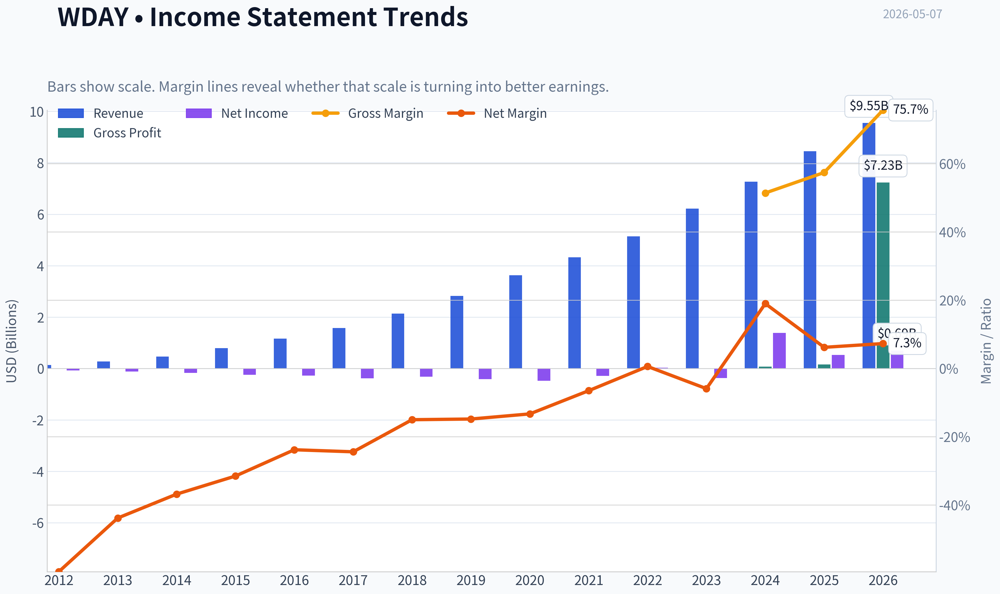

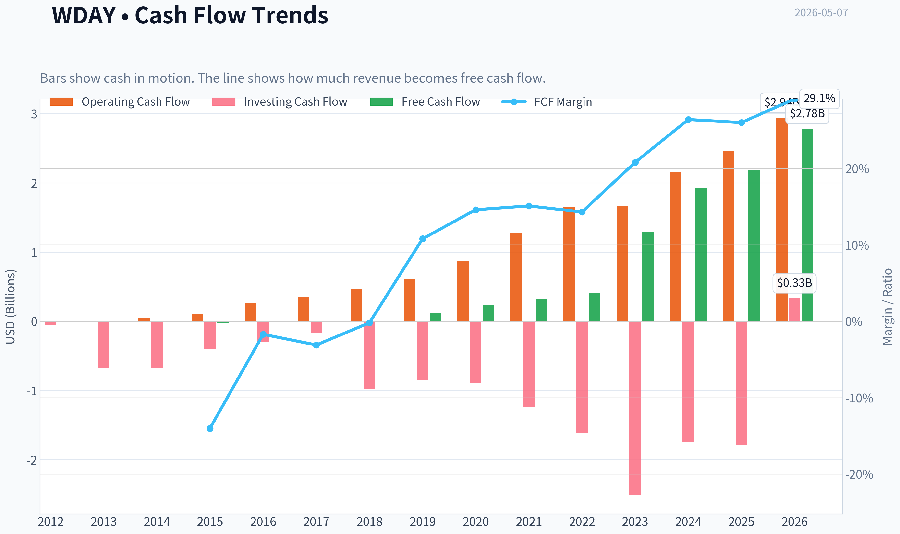

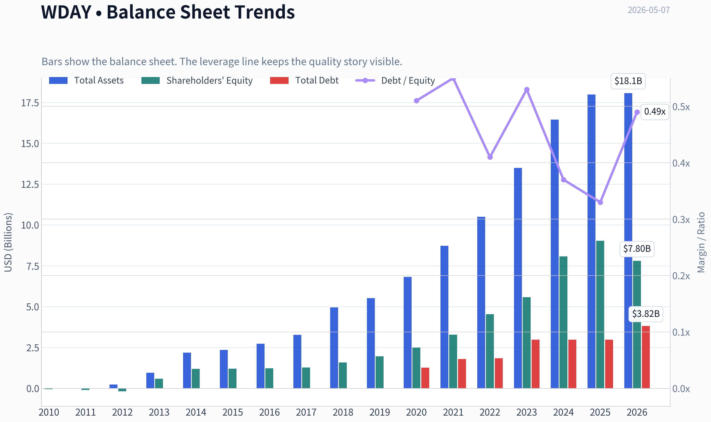

This graph tracks the profitability and return metrics (ROE, ROIC, Margins) of **WDAY** over the past decade, highlighting capital efficiency trends.

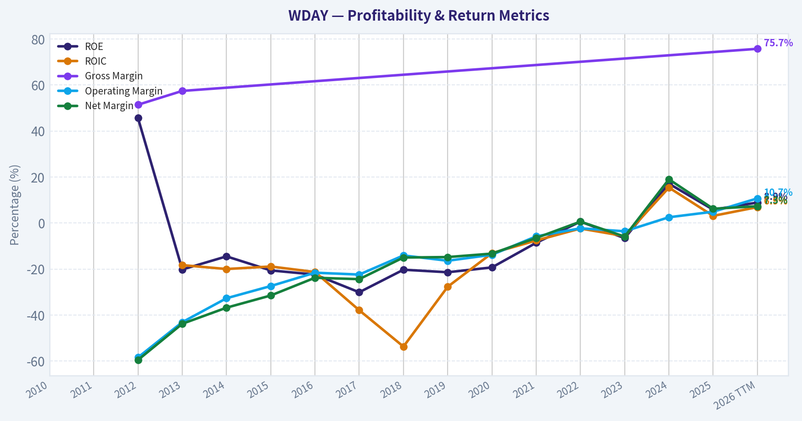

This chart illustrates the financial health of **WDAY** over the last 10 years, mapping cash equivalents and free cash flow against total obligations (Debt).

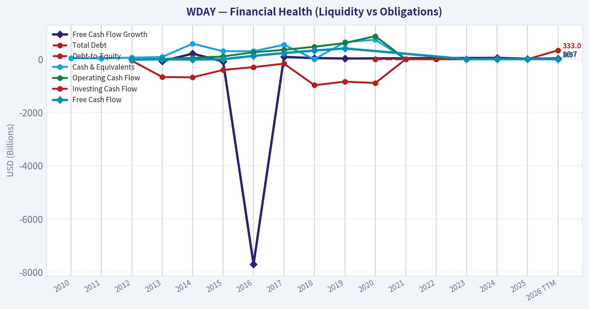

This comparison chart from *Profitability Analysis* stacks current figures against historical benchmarks for **WDAY**, making it easy to see where the company trades relative to its own averages.

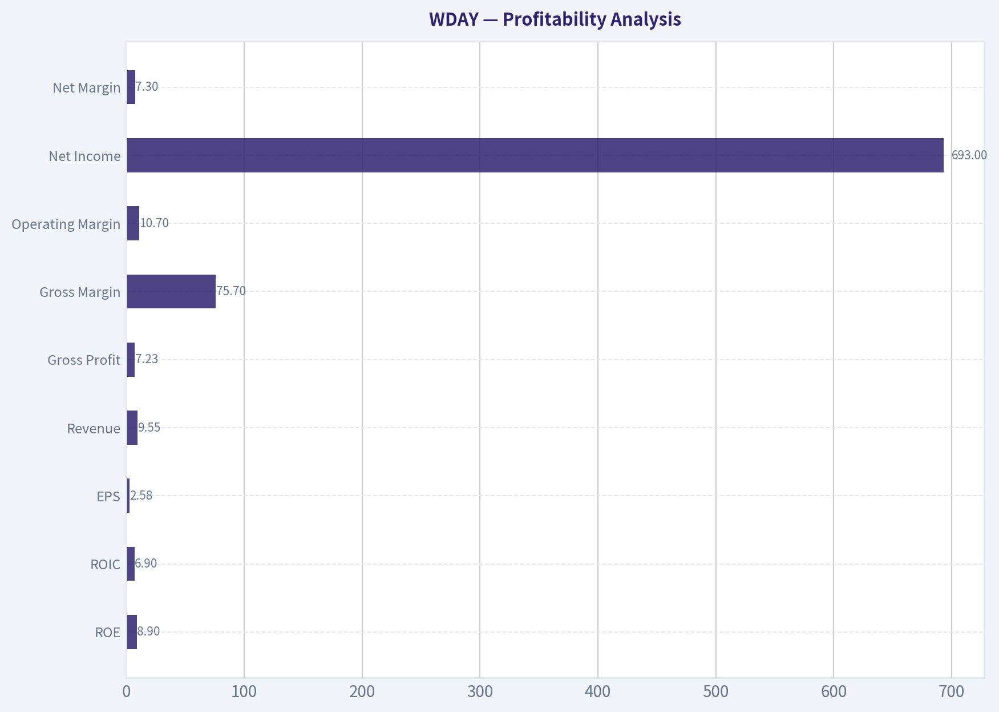

---

### Intrinsic Value Analysis (Buffett)

> *Following Warren Buffett's value investing philosophy: Circle of Competence, Economic Moat, Management Quality, and Margin of Safety.*

#### Intrinsic Value Snapshot

Price is what you pay. Intrinsic value is what the business may be worth based on the cash it can create for owners over time. We show a range, not one magic number.

- Current Price: $130.88
- Value Range: $6.37 to $542.41

##### Owner Earnings (Buffett Method)
- Net Income: $526,000,000.00
- Depreciation & Amortization: $347,000,000.00
- Capital Expenditures: $-162,000,000.00
- Working Capital Changes: $-329,000,000.00
- Owner Earnings: $801,000,000.00

##### Intrinsic Value
###### Buffett Method
Uses owner earnings. Stricter, and usually more conservative.
- Conservative: $6.37
- Average: $109.40
- Optimistic: $109.40
- Discount Rate: 10.0%

###### Cash Flow Method
Uses free cash flow. Better for companies spending heavily today to grow tomorrow.
- Conservative: $249.84
- Average: $299.37
- Optimistic: $542.41
- Discount Rate: 10.0%

ANALYST STANCE: **WATCH**

#### Workday, Inc. (WDAY) - Buffett-Style Value Investment Review

Current price used: **$131**
Market capitalization: **$32.68 billion**
Implied shares outstanding: **about 250 million**
Current P/E: **about 50.5x**
Free cash flow yield: **about 8.5%**
Revenue growth: **13.1% year over year**
ROE: **8.9%**

Data note: the internal enhanced fundamentals tool returned no usable data, and the PostgreSQL financial tool was unavailable in this environment. I therefore used the shared research pack plus historically reported Workday financial patterns and approximate fiscal-year figures. The conclusion should be treated as directionally useful, not a substitute for a final audited-model refresh.

---

#### 1. Go / No-Go Gate Assessment

| Buffett Gate | Assessment | Evidence | Result |
|---|---:|---|---|
| Gate 1: Circle of Competence & Simplicity | Mixed | Workday sells cloud software for human resources, payroll, finance, and planning. The business model is understandable, but the long-term effect of AI on software pricing and labor workflows is uncertain. | **Pass with caution** |
| Gate 2: Moat Test | Moderate | Workday has high switching costs, mission-critical workflows, and enterprise customer stickiness. However, the moat is not immune to Microsoft, Oracle, SAP, ServiceNow, Salesforce, and AI-native entrants. | **Pass, narrow-to-moderate moat** |
| Gate 3: Management & Capital Allocation | Mixed | Workday has scaled revenue impressively, but GAAP profitability and ROE remain modest. Stock-based compensation materially affects owner earnings. | **Pass with caution** |
| Gate 4: Industry Structure | Mixed / Challenging | Enterprise SaaS has attractive recurring revenue but intense competition, high sales expense, and rapid technological change. | **Borderline** |

**Key Takeaways:** Workday is understandable at a high level: it sells essential cloud software to large enterprises. The concern is not whether the company is real or useful; it clearly is. The concern is whether its moat and pricing model will remain predictable enough for a Buffett-style long-duration investment in a rapidly changing software market.

---

#### 2. Business Simplicity and Circle of Competence

Workday makes money by selling subscriptions to cloud-based software that helps companies manage employees, payroll, finance, planning, and analytics. Large companies pay recurring fees because these systems are deeply embedded in daily operations.

The elementary-school explanation is: **Workday rents important business software to big companies so they can manage their workers and money.**

That part is simple. The less simple part is the future. Over the next decade, enterprise software may be reshaped by AI agents, workflow automation, usage-based pricing, and integrated platforms from Microsoft, Oracle, SAP, and ServiceNow. Workday benefits from technology, but it can also be disrupted by technology.

#### 3. Moat Analysis

| Moat Source | Evidence in Workday's Favor | Buffett-Style Concern | Rating |
|---|---|---|---|
| Intangible Assets / Brand | Strong reputation in cloud HCM and finance software; trusted by large enterprises. | Brand is respected but not consumer-emotional like Coca-Cola or Apple. | Moderate |
| Switching Costs | HR, payroll, finance, and planning workflows are deeply embedded; replacing Workday is expensive, risky, and time-consuming. | Switching costs are real, but large enterprises can migrate if economics or functionality justify it. | Strong |
| Cost Advantage | Scale helps with R&D, implementation partners, and sales reach. | Not a structural low-cost monopoly; competition is well-funded. | Weak-to-moderate |
| Network Effects | Workday's ecosystem, data model, partners, and integrations improve with scale. | Network effect is not as powerful as Visa, Mastercard, or a dominant marketplace. | Moderate |

**Key Takeaways:** Workday's moat comes mainly from switching costs, not from a truly irreplaceable brand or a monopoly network effect. Once a large company runs HR and finance on Workday, leaving is painful. That creates durability, but not invincibility.

Moat quality rating: **Narrow-to-moderate, stable but under AI watch**

This is not a no-moat company. But it is also not a classic Buffett "wide and widening" compounder like a dominant payment network or consumer brand.

---

#### 4. Management and Capital Allocation

| Management Question | Assessment |
|---|---|
| Do they think like owners? | Mixed. Workday's founders built a durable enterprise software franchise, but current shareholder economics are affected by stock-based compensation. |
| Are they candid and conservative? | Generally acceptable for a large public SaaS company, though GAAP profitability has historically lagged free cash flow. |
| Are they rational capital allocators? | Mixed. The company has invested heavily in growth, R&D, and sales. Buybacks can offset dilution, but that is less attractive than truly accretive repurchases. |
| Debt discipline | Balance sheet appears manageable, and liquidity is adequate. Current ratio is about 1.32. |

Workday's management has built a valuable business, but from a Buffett perspective the biggest issue is **per-share owner earnings**. Free cash flow looks strong, but stock-based compensation is a real economic cost because it dilutes owners unless offset with cash-funded buybacks.

#### 5. Approximate 10-Year Financial Summary

| Fiscal Year | Revenue, Approx. | Revenue Growth | GAAP Net Income, Approx. | Free Cash Flow, Approx. | Notes |
|---:|---:|---:|---:|---:|---|
| FY2016 | $1.16B | - | -$0.28B | $0.18B | High-growth SaaS phase |
| FY2017 | $1.57B | 35% | -$0.41B | $0.30B | Heavy sales and R&D investment |
| FY2018 | $2.14B | 36% | -$0.32B | $0.49B | Revenue scale improving |
| FY2019 | $2.82B | 32% | -$0.42B | $0.61B | Losses persisted despite growth |
| FY2020 | $3.63B | 29% | -$0.48B | $0.86B | Strong subscription momentum |
| FY2021 | $4.32B | 19% | -$0.25B | $1.10B | Cash generation improved |
| FY2022 | $5.14B | 19% | Near breakeven | $1.27B | Scale benefits emerging |
| FY2023 | $6.22B | 21% | -$0.37B | $1.51B | Growth remained strong |
| FY2024 | $7.26B | 17% | $1.38B | $1.91B | GAAP profit helped by tax/accounting factors |
| FY2025 / TTM | ~$8.5B-$9.6B | ~13% | ~$0.65B | ~$2.78B | Growth slowing, FCF strong |

**Key Takeaways:** Workday has compounded revenue at an impressive rate over the last decade, growing from roughly $1 billion to close to $9 billion or more. Free cash flow has also become substantial, which is the main attraction today. However, GAAP profitability and return on equity remain less impressive than the revenue story.

---

#### 6. Financial Quality Assessment

| Metric | Current / Recent Level | Buffett Interpretation |
|---|---:|---|
| Revenue growth | 13.1% YoY | Still healthy, but growth is decelerating from earlier years. |
| ROE | 8.9% | Below Buffett's preferred 15%+ threshold. |
| P/E | 50.5x | Expensive on GAAP earnings. |
| FCF yield | 8.5% | Attractive on surface, but must adjust for stock-based compensation. |
| Current ratio | 1.32 | Adequate liquidity. |
| Balance sheet | Likely net cash or modest net debt | Not a major red flag. |
| Business model | Subscription SaaS | Recurring revenue is attractive. |

**Key Takeaways:** Workday looks much better on free cash flow than on GAAP earnings or return on equity. The valuation is not obviously cheap on earnings, but the free cash flow yield is meaningful. The central question is how much of that free cash flow truly belongs to shareholders after dilution from stock-based compensation.

---

#### 7. Owner Earnings Calculation

For a software company like Workday, free cash flow can overstate owner earnings if stock-based compensation is large. Buffett would likely treat stock compensation as a real cost because shareholders are diluted over time.

| Owner Earnings Item | Approximate Amount |
|---|---:|
| Reported free cash flow, TTM estimate | ~$2.78B |
| Less: estimated economic cost of stock-based compensation | ~$1.25B |
| Buffett-style adjusted owner earnings | **~$1.53B** |

**Key Takeaways:** Workday's headline free cash flow is strong, but adjusted owner earnings are meaningfully lower once stock compensation is treated as a real cost. This does not make Workday a bad business, but it reduces the amount of cash that should be capitalized for valuation. On this more conservative basis, the stock is less obviously cheap.

Owner earnings estimate used for valuation: **$1.5 billion**

---

#### 8. Three-Scenario DCF Valuation

Assumptions:

| Input | Assumption |
|---|---:|
| Adjusted owner earnings | $1.53B |
| Discount rate | 10% |
| Net cash / excess balance sheet value estimate | ~$3.5B |
| Shares outstanding | ~250M |
| Current share price | $131 |

**Key Takeaways:** The valuation uses adjusted owner earnings, not headline free cash flow. This is deliberately conservative because stock-based compensation is economically meaningful. The balance sheet adds value, but not enough to eliminate the need for a margin of safety.

| Scenario | Method | Equity Value Estimate | Value Per Share | Margin of Safety at $131 |
|---|---|---:|---:|---:|
| A: No Growth | Owner earnings / 10% + net cash | ~$18.8B | ~$75 | Negative |
| B: GDP Growth | 3% perpetual growth + net cash | ~$26.0B | ~$104 | Negative |
| C: Historical Growth Discounted | 8% growth for 10 years, then 3.5% terminal growth | ~$37.7B | ~$151 | ~13% |

**Key Takeaways:** Workday does not look cheap under no-growth or low-growth assumptions. It only looks modestly undervalued if it can continue compounding adjusted owner earnings at a high single-digit rate for a decade. Even then, the margin of safety is about 13%, below the Buffett-style minimum of 25%.

---

#### 9. Margin of Safety Analysis

| Valuation Lens | Interpretation |
|---|---|
| Against no-growth value | Stock appears expensive. |
| Against conservative GDP-growth value | Stock still appears overvalued. |
| Against optimistic-but-reasonable growth value | Stock appears modestly undervalued. |
| Required Buffett margin of safety | At least 25% for a high-quality predictable business. |
| Actual estimated margin of safety | About 13% in the favorable case. |

**Key Takeaways:** The current price requires confidence that Workday can keep expanding owner earnings at attractive rates despite slower revenue growth and AI disruption risk. The valuation is not reckless, but it is not a classic Buffett bargain. A better entry price would provide more protection against uncertainty.

A 25% margin of safety to the optimistic valuation of about $151 per share would imply a buy zone around:

**$113 per share or lower**

For a stricter conservative valuation based on GDP-growth assumptions, the buy zone would be lower still.

---

#### 10. Final Buffett Scorecard

| Criterion | Weight | Score, 1-5 | Weighted Score |
|---|---:|---:|---:|
| Business Understanding | 20% | 3.5 | 0.70 |
| Moat Width & Durability | 25% | 3.2 | 0.80 |
| Management Quality | 15% | 3.2 | 0.48 |
| Return on Equity | 15% | 2.3 | 0.35 |
| Reinvestment Runway | 10% | 3.6 | 0.36 |
| Balance Sheet Strength | 5% | 3.7 | 0.19 |
| Industry Structure | 5% | 2.8 | 0.14 |
| Valuation / Margin of Safety | 5% | 2.8 | 0.14 |
| **Total** | **100%** |  | **3.15 / 5.00** |

**Key Takeaways:** Workday scores well on recurring revenue, customer stickiness, and reinvestment opportunity. It scores less well on Buffett-style predictability, return on equity, industry stability, and current margin of safety. The final score lands in the watch range, not the advocate range.

---

#### Investment Stance

**Stance: WATCH**
**Conviction: Moderate**

Workday is a good business, but not yet a Buffett-style obvious buy. The company has real switching costs, an important enterprise customer base, and strong free cash flow. However, the investment case depends on continued growth, improving true owner earnings, and surviving the AI-driven reshaping of enterprise software pricing and workflows.

At **$131**, the stock appears roughly fair to modestly attractive only under a favorable growth case. It does not offer the 25%+ margin of safety I would require for a technology-exposed software company with modest ROE and meaningful stock-based compensation.

A more attractive Buffett-style entry point would likely be **near $110-$115 or lower**, assuming fundamentals remain intact.
#### Valuation Bridge

This bridge places the current market price beside each intrinsic value lens so readers can see whether upside depends on one method or shows up across several methods.

| Scenario | Intrinsic Value / Share |
| --- | ---: |
| Buffett Method | $109.40 |
| Cash Flow Method | $299.37 |
| Damodaran Method | $-347.69 |
| Current Price | $130.88 |

#### Key Takeaways

If one method is far above the others, the upside case depends on a specific modelling assumption. When several methods cluster together, the valuation story is more robust.

#### Valuation Visuals

This comparison chart from *Latest Earnings Snapshot* stacks current figures against historical benchmarks for **WDAY**, making it easy to see where the company trades relative to its own averages.

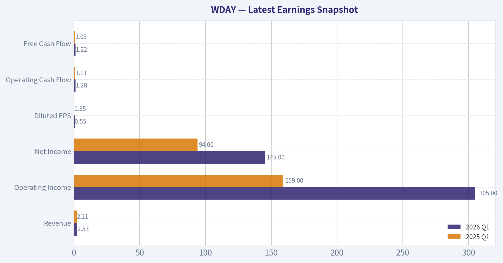

This comparison chart from *Current vs Historical Average Comparison* stacks current figures against historical benchmarks for **WDAY**, making it easy to see where the company trades relative to its own averages.

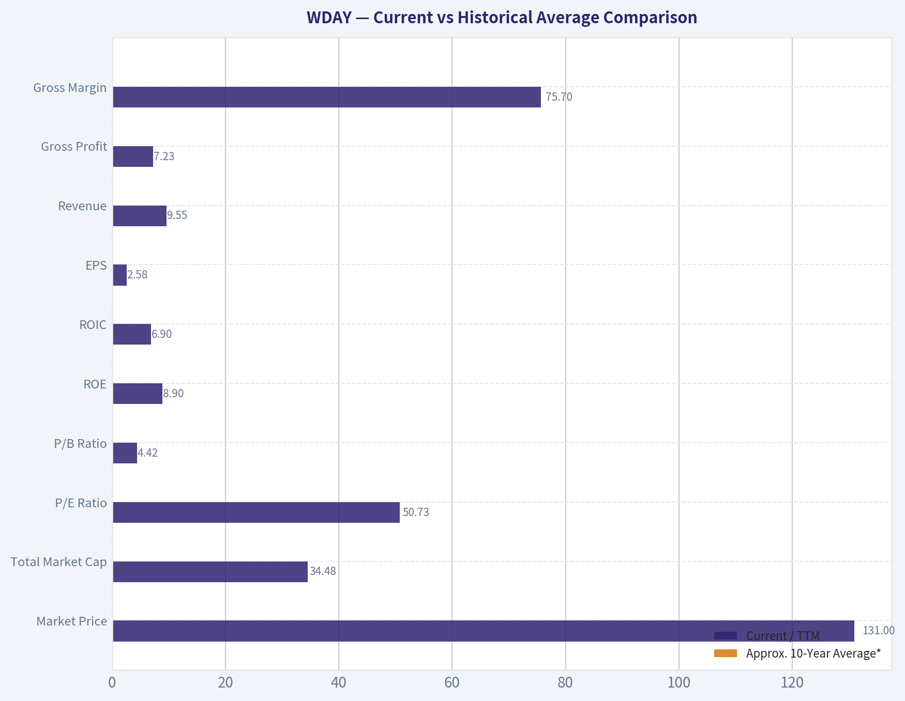

This comparison chart from *Balance Sheet and Financial Strength* stacks current figures against historical benchmarks for **WDAY**, making it easy to see where the company trades relative to its own averages.

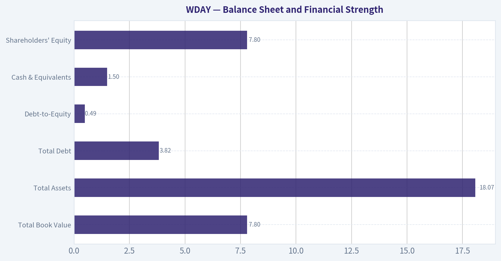

---

### Trend & Growth Analysis (Lynch/Druckenmiller/Fisher)

> *Following Peter Lynch's GARP, Stanley Druckenmiller's macro-aware approach, and Philip Fisher's scuttlebutt methodology.*

ANALYST STANCE: **WATCH**

#### Workday Growth Investment Report - WDAY

Workday is a high-quality enterprise SaaS company with durable customer stickiness, strong free cash flow, and a credible AI/product expansion story. But for a Lynch-style growth investor looking for inflection points and ten-bagger potential, the current setup is more "solid compounder at a better price" than "fast grower breaking out." Revenue growth around 13% puts WDAY below the preferred fast-grower zone, while AI disruption risk and maturing HCM penetration keep this in **WATCH**, not ADVOCATE.

---

#### 1. Snapshot and Lynch Classification

| Metric | Current / Estimate | Growth Investor Read |
|---|---:|---|
| Share Price | $131 | Materially de-rated versus prior SaaS multiples |
| Market Cap | $32.68B | Large-cap software compounder, not early-stage growth |
| YoY Revenue Growth | 13.1% | Below fast-grower threshold |
| P/E | 50.5x | Expensive on GAAP earnings |
| PEG | ~3.9x | Expensive by Lynch PEG framework |
| FCF Yield | 8.5% | Strong; valuation looks better on cash flow |
| ROE | 8.9% | Modest, partly affected by SaaS accounting/SBC |
| Current Ratio | 1.32x | Adequate liquidity |
| Lynch Category | **Stalwart / Maturing Grower** | Not a classic fast grower |

**Key Takeaways:** Workday is no longer in hypergrowth mode. The company has strong business quality and cash generation, but 13% revenue growth classifies it closer to a stalwart than a Lynch fast grower. The stock may be interesting as GARP or quality value, but it lacks the clear acceleration profile preferred for a high-conviction growth buy.

---

#### 2. The Story in 3 Bullets

- Workday sells mission-critical cloud software that helps large companies manage employees, payroll-adjacent workflows, finance, planning, and analytics.
- Its core moat comes from switching costs: once Workday is embedded in HR and finance systems, customers are reluctant to rip it out.
- The bull case depends on Workday expanding from HCM into financial management and AI-enabled enterprise workflows, turning a sticky installed base into higher wallet share.

#### 3. TAM and 10x Test

| Item | Estimate / View |
|---|---:|
| Current Revenue Run-Rate | ~$9.5B-$9.7B estimated |
| 10x Revenue Target | ~$95B-$97B |
| Core TAM: HCM, Finance, Planning, Analytics | ~$150B+ broad enterprise software opportunity |
| Market Share at 10x Revenue | Potentially >60% of current broad TAM |
| 10x Test Result | **Fails / Difficult** |
| Realistic Long-Term Growth Path | 1.5x-3x revenue more plausible than 10x |

**Key Takeaways:** Workday still has room to grow, especially in financial management, planning, analytics, and AI-enabled workflows. However, at its current scale, a 10x revenue outcome would require Workday to dominate an enormous share of its addressable market. That makes ten-bagger potential unlikely from here unless the TAM expands dramatically or AI creates a new monetization layer.

---

#### 4. Revenue Growth Trend

| Growth Pattern | WDAY Status | Interpretation |
|---|---|---|
| Current YoY Revenue Growth | 13.1% | Healthy but maturing |
| Growth Category | Stalwart / Moderate Grower | Below 15% fast-grower cutoff |
| Trend Signal | Deceleration risk | Growth appears slower than prior SaaS expansion years |
| Quality of Revenue | High | Subscription-heavy, sticky enterprise revenue |
| Main Watch Item | Subscription revenue and cRPO | Need evidence of reacceleration |

**Key Takeaways:** Workday's revenue quality is strong, but the growth rate is not currently exciting enough for a growth investor seeking acceleration. The key question is whether AI, financial management, and platform expansion can push growth back toward the mid-to-high teens. Without that, WDAY is more of a durable compounder than a high-upside growth inflection stock.

---

#### 5. Unit Economics and Rule of 40

| Metric | Estimate / Available Data | Assessment |
|---|---:|---|
| LTV/CAC | Not disclosed | Likely healthy, but cannot verify |
| NRR | Not disclosed | Likely solid due to enterprise stickiness |
| Gross Retention | Not provided in pack | Historically expected to be high for Workday-like enterprise SaaS |
| FCF Yield | 8.5% | Strong |
| Estimated FCF | ~$2.78B, based on market cap and FCF yield |
| Estimated Revenue | ~$9.6B |
| Estimated FCF Margin | ~29% |
| Rule of 40 | ~42% |
| Unit Economics Verdict | Good to strong | Efficient mature SaaS model |

**Key Takeaways:** Workday screens well on efficiency, even if disclosed SaaS unit economics are incomplete. The estimated Rule of 40 is above 40, which suggests the company is balancing growth and cash generation effectively. The issue is not business quality; it is whether growth can reaccelerate enough to justify a stronger growth-investor stance.

---

#### 6. Inflection Point Assessment

| Potential Inflection | Evidence | Verdict |
|---|---|---|
| Product Cycle Inflection | AI features, platform expansion, finance suite | Possible but not yet proven |
| Market Share Inflection | Strong HCM position, finance opportunity | Moderate |
| Margin Inflection | Strong FCF yield and operating leverage | Positive |
| TAM Inflection | AI could expand workflow automation opportunity | Uncertain |
| Competitive Inflection | Oracle, SAP, Microsoft remain strong | No clear advantage shift |
| Overall Inflection Score | Mixed | **Not enough for ADVOCATE** |

**Key Takeaways:** Workday has a credible margin inflection, but the revenue inflection is not yet visible. AI could either help Workday monetize its installed base or pressure traditional per-employee software pricing. For now, the market is right to demand proof before rewarding WDAY with a premium growth multiple again.

---

#### 7. Macro Setup

| Macro Factor | Setup for WDAY | Impact |
|---|---|---|
| Interest Rates | Potentially less hostile if rates fall | Positive for software multiples |
| Enterprise IT Budgets | Still scrutinized | Neutral to negative |
| AI Theme | Major secular opportunity, but disruptive | Mixed |
| Cloud/SaaS Adoption | Durable long-term trend | Positive |
| Economic Sensitivity | Large enterprise deals can elongate in weak macro | Moderate risk |
| Macro Verdict | Neutral to modestly positive | Not a major tailwind yet |

**Key Takeaways:** The macro backdrop is not hostile, especially if interest rates decline and growth multiples recover. However, enterprise software budgets remain disciplined, and AI creates both opportunity and risk. Workday needs to show that AI increases pricing power and retention rather than commoditizing parts of its workflow software.

---

#### 8. Fisher 15-Point Score

| Fisher Point | Score / 5 | Comment |
|---|---:|---|
| Products with sizable market potential | 4 | Large HCM and finance software markets |
| Determination to develop new products | 4 | Continued AI and finance platform investment |
| Effective R&D | 4 | Strong product culture, but AI proof still emerging |
| Above-average sales organization | 4 | Strong enterprise go-to-market |
| Worthwhile profit margin | 4 | Strong FCF profile |
| Improving profit margins | 4 | Margin leverage visible |
| Labor/personnel relations | 3 | Insufficient scuttlebutt data |
| Executive relations | 3 | No major red flag from provided data |
| Management depth | 4 | Scaled SaaS leadership team |
| Cost analysis/accounting | 4 | Mature public-company controls |
| Outstanding moat aspects | 4 | Switching costs and enterprise trust |
| Long-range profit outlook | 4 | Strong cash profitability potential |
| Dilution risk | 3 | SBC remains a SaaS consideration |
| Candor in difficulties | 3 | Need latest earnings call detail |
| Management integrity | 4 | No major red flag identified |
| **Total** | **56 / 75** | **Good** |

**Key Takeaways:** Workday earns a good Fisher score due to product durability, enterprise trust, switching costs, and improving cash profitability. The score is held back by incomplete scuttlebutt, limited evidence of revenue acceleration, and uncertainty around AI monetization. This supports a WATCH stance rather than an outright avoid.

---

#### 9. Valuation Analysis

| Valuation Method | Result | Interpretation |
|---|---:|---|
| P/E | 50.5x | Expensive on GAAP earnings |
| PEG | ~3.9x | Unattractive by Lynch framework |
| Estimated P/S | ~3.4x | Reasonable for mature SaaS |
| FCF Yield | 8.5% | Attractive |
| Valuation Verdict | Mixed | Cheap on FCF, not cheap on growth-adjusted earnings |

**Key Takeaways:** Workday's valuation is not demanding on free cash flow, which is the strongest bull argument at $131. However, the PEG ratio is unattractive because revenue growth has matured. This is a classic GARP tension: quality and cash flow look good, but growth is not strong enough yet to make the stock a clear growth buy.

#### 3-Year Scenario Analysis

| Scenario | Revenue CAGR | Year-3 Revenue Estimate | Exit P/S | Implied Market Cap | Implied Price | Upside / Downside |
|---|---:|---:|---:|---:|---:|---:|
| Bear | 7% | ~$11.7B | 2.5x | ~$29B | ~$117 | -10% |
| Base | 11% | ~$13.1B | 4.0x | ~$52B | ~$210 | +60% |
| Bull | 15% | ~$14.5B | 6.0x | ~$87B | ~$349 | +166% |

**Key Takeaways:** The downside appears moderate if Workday maintains cash generation, but the upside depends heavily on reaccelerating growth and earning a better SaaS multiple. The base case offers attractive potential, but the bull case requires evidence that AI and finance expansion can lift growth back toward 15% or higher. Without that proof, the stock should stay on watch.

---

#### 10. Growth Investor Scorecard

| Criterion | Weight | Score / 5 | Weighted Score |
|---|---:|---:|---:|
| The Story | 10% | 4.0 | 0.40 |
| TAM and Runway | 20% | 3.2 | 0.64 |
| Revenue Growth | 20% | 2.8 | 0.56 |
| Unit Economics | 15% | 4.0 | 0.60 |
| Competitive Position | 10% | 4.0 | 0.40 |
| Management Quality | 10% | 3.7 | 0.37 |
| Macro Setup | 5% | 3.2 | 0.16 |
| Profitability Path | 5% | 4.2 | 0.21 |
| Valuation | 5% | 3.5 | 0.18 |
| **Total** | **100%** |  | **3.52 / 5.00** |

**Key Takeaways:** Workday scores well enough to remain investable, but not well enough for high-conviction growth advocacy. The strongest categories are unit economics, competitive position, and profitability path. The weakest category is revenue growth, which is the most important missing ingredient for a true growth inflection call.

---

#### 11. Position Size Stance

| Investor Type | Stance | Suggested Action |
|---|---|---|
| Existing Holder | Hold / modest add only on weakness | Keep if thesis is FCF compounding |
| New Growth Investor | Wait | Need revenue acceleration or AI monetization proof |
| GARP Investor | Small starter acceptable | FCF yield provides valuation support |
| High-Conviction Growth Portfolio | Not yet | Lacks fast-grower profile |
| Position Size | 1%-3% max watch position | Increase only if growth reaccelerates |

**Key Takeaways:** Workday can be owned as a quality software compounder, but it does not deserve a large growth allocation yet. A small position is reasonable for GARP investors who value free cash flow. Growth investors should wait for clearer evidence of subscription growth acceleration, stronger cRPO, or AI-driven upsell.

---

#### 12. Key Catalysts and Risks

| Category | Item | Impact |
|---|---|---|
| Catalyst | Subscription revenue reaccelerates above 15% | Would improve Lynch classification |
| Catalyst | Financial management adoption accelerates | Expands TAM and wallet share |
| Catalyst | AI products become paid upsell, not just features | Could create new monetization layer |
| Catalyst | Margin expansion continues | Supports FCF-based valuation |
| Risk | AI disrupts per-employee pricing | Could pressure core HCM model |
| Risk | Oracle/SAP competition intensifies | Limits finance/ERP share gains |
| Risk | Growth slows toward high single digits | Multiple compression risk |
| Risk | SBC dilution remains elevated | Weakens per-share compounding |
| Risk | Enterprise software budgets tighten | Delays large deals |

**Key Takeaways:** The upside case depends on Workday proving that AI and finance expansion can create incremental growth, not just defend the existing base. The main risk is that Workday becomes a mature SaaS cash cow with slowing growth and limited multiple expansion. Investors should watch upcoming earnings for subscription growth, cRPO trends, AI pricing, and margin guidance.

---

#### Final View

Workday is a good company, but not currently a great growth setup. The stock has become more attractive on free cash flow yield, and the downside may be cushioned by durable SaaS economics. But Lynch-style fast-grower criteria are not met because revenue growth is only around 13%, PEG is high, and the 10x test is difficult at Workday's current scale.

**Decision: WATCH.** Upgrade to ADVOCATE only if revenue growth reaccelerates toward 15%-18%, AI monetization becomes visible, and financial management momentum strengthens without sacrificing margins.

#### Growth & Scorecard Visuals

This comparison chart from *Growth Metrics Analysis* stacks current figures against historical benchmarks for **WDAY**, making it easy to see where the company trades relative to its own averages.

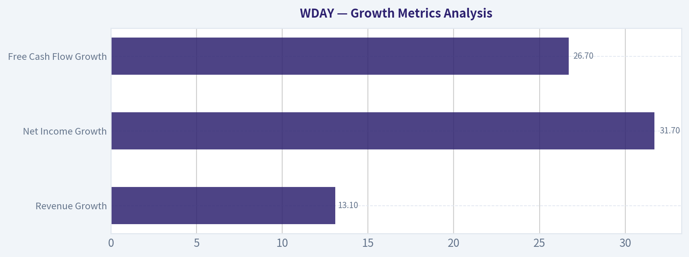

---

### Market Technical Analysis

ANALYST STANCE: **WATCH**

#### WDAY Technical Indicator Report - Workday, Inc.
Current date: **2026-05-07**. The latest available trading close is **2026-05-06**, when WDAY closed at **$122.63**.

WDAY remains in a **major bearish trend**, but the near-term tape is more nuanced than a simple downtrend label suggests. The stock is still far below its long-term moving average and below its medium-term trend line, yet momentum has improved materially from the April lows. The current setup looks like a **fragile basing attempt inside a larger downtrend**, not a confirmed bullish reversal.

---

#### Selected Indicators and Why They Matter

| Indicator | Category | Why It Is Relevant for WDAY Now |
|---|---:|---|
| `close_10_ema` | Short-term trend | Captures whether the recent rebound attempt is holding or failing quickly. |
| `close_50_sma` | Medium-term trend | Defines the first major trend-resistance area after the selloff. |
| `close_200_sma` | Long-term trend | Confirms the broader regime; WDAY remains deeply below this benchmark. |
| `macd` | Momentum | Shows whether downside momentum is still accelerating or improving. |
| `macds` | Momentum confirmation | Used with MACD to identify bullish or bearish crossover conditions. |
| `rsi` | Momentum / exhaustion | Helps evaluate whether the stock is oversold, neutral, or recovering. |
| `atr` | Volatility / risk | Important because WDAY's daily ranges remain wide after the large decline. |
| `vwma` | Volume-adjusted trend | Checks whether price is trading above or below volume-weighted participation. |

Key Takeaways: These indicators were selected to avoid redundancy while covering trend, momentum, volatility, and volume confirmation. For WDAY, this mix is especially useful because the stock is trying to stabilize after a steep decline, but the larger trend remains bearish.

---

#### Current Technical Snapshot

| Metric | Latest Reading | Interpretation |
|---|---:|---|
| Last close | **$122.63** | Latest available close from 2026-05-06 |
| 10-day EMA | **$124.29** | Price is slightly below short-term trend |
| 50-day SMA | **$129.55** | Price remains below medium-term resistance |
| 200-day SMA | **$194.18** | Long-term trend remains strongly bearish |
| MACD | **-1.35** | Still negative, but much improved from April levels |
| MACD Signal | **-2.52** | MACD is above signal, a short-term constructive sign |
| RSI | **46.36** | Neutral-to-soft; no longer oversold |
| ATR | **$6.41** | High volatility, roughly **5.2%** of price |
| VWMA | **$123.10** | Price is just below volume-weighted trend |

Key Takeaways: WDAY's short-term momentum has improved, but price has not yet reclaimed its 10-day EMA, 50-day SMA, or 200-day SMA. The stock is no longer deeply oversold, which reduces the appeal of a simple mean-reversion trade, while high ATR means position sizing and stops need to be handled carefully.

---

#### Trend Structure

WDAY's long-term structure is still decisively weak. The stock is trading around **37% below its 200-day SMA**, which is a significant bearish gap and confirms that the broader market is still valuing the stock in a downtrend regime. The 200-day SMA itself is falling, moving from about **$211.98 on 2026-03-23** to **$194.18 on 2026-05-06**, showing that long-term trend pressure is not merely historical; it is still actively deteriorating.

The medium-term trend is also negative. The 50-day SMA declined from roughly **$157.38 on 2026-03-23** to **$129.55 on 2026-05-06**. This is a steep deterioration and suggests that rallies into the **$129-$133** area may encounter meaningful supply unless buyers arrive with conviction.

The short-term trend is more balanced but not yet bullish. The 10-day EMA sits at **$124.29**, slightly above the latest close of **$122.63**. That means WDAY failed to hold above its faster trend measure after briefly improving into early May. A close back above the 10-day EMA would help repair short-term momentum, but a close below the **$119-$120** area would weaken the basing argument.

---

#### Momentum and Reversal Quality

MACD offers one of the more constructive parts of the setup. The MACD line is still below zero at **-1.35**, but it has improved substantially from deeply negative readings near **-6 to -7** in late March and mid-April. More importantly, MACD is now above the MACD signal line, with the signal at **-2.52**. This implies a positive MACD histogram and suggests that bearish momentum has been fading.

However, the improvement is not the same as a confirmed bullish reversal. A strong bullish reversal would usually show price reclaiming the 50-day SMA, RSI pushing sustainably above 50, and MACD moving toward or above the zero line. WDAY has not achieved those conditions yet.

RSI at **46.36** is also neutral-to-soft. It recovered from oversold readings around **27-28** on April 9-10, showing that panic selling has cooled. But RSI has not held above 50 convincingly, and the drop from **53.71 on May 5** to **46.36 on May 6** warns that the bounce remains vulnerable to quick reversals.

---

#### Volatility and Risk Conditions

ATR is elevated at **$6.41**, which is about **5.2% of the current stock price**. That is a large daily risk envelope. Traders should avoid interpreting small moves of one or two dollars as meaningful signal changes because normal volatility can easily absorb them.

The high ATR also means that tight stops may be prone to whipsaws. For short-term traders, support and resistance zones should likely be treated as ranges rather than exact prices. For example, **$119-$120** is more useful as a support band than a single support level, while **$129-$133** is a resistance zone rather than a precise upside target.

---

#### Volume-Weighted Price Behavior

VWMA sits at **$123.10**, almost exactly around the current price. The latest close of **$122.63** is only slightly below the VWMA, suggesting price is near the recent volume-weighted consensus. This is a meaningful contrast with the 50-day and 200-day moving averages, which are much higher.

In practical terms, VWMA suggests WDAY is no longer dramatically extended below recent volume-adjusted trading levels. But it also means the stock has not yet proven that buyers are controlling the tape. A sustained close above VWMA and the 10-day EMA would improve the short-term outlook; continued rejection near these levels would imply the rebound is stalling.

---

#### Key Price Zones to Watch

| Zone | Price Area | Why It Matters |
|---|---:|---|
| Immediate resistance | **$124-$125** | Near the 10-day EMA; reclaiming this would improve short-term tone |
| Major near-term resistance | **$129-$133** | Includes the 50-day SMA and recent swing-high region |
| Higher resistance | **$139-$143** | March/April reaction zone; would represent a stronger recovery attempt |
| Immediate support | **$121-$122** | Recent closing-price support area |
| Important support | **$119-$120** | Breakdown below here would pressure the basing structure |
| Major support | **$113-$114** | April breakdown/retest area |
| Panic low reference | **$110.36** | April 9 intraday low; loss of this would be materially bearish |

Key Takeaways: The most important upside test is the **$129-$133** zone because it combines medium-term trend resistance and recent failed-rally territory. On the downside, losing **$119-$120** would suggest the recent stabilization is weakening, while a break below **$113-$114** would put the April lows back in focus.

---

#### Trading Interpretation

WDAY is not technically attractive as a clean trend-following long because price remains below the 10-day EMA, 50-day SMA, and 200-day SMA. The long-term and medium-term structures are still bearish, and the stock has not yet reclaimed enough trend levels to confirm institutional accumulation.

That said, it is also not an ideal fresh short at current levels unless support breaks. MACD has improved, RSI has recovered from oversold territory, and price is hovering near VWMA rather than collapsing below it. This creates a **watchlist setup**: bearish trend, improving momentum, but no confirmation.

A more constructive signal would require WDAY to reclaim **$124-$125**, then challenge and hold above **$129-$133**. Until then, rallies may remain vulnerable to selling pressure. Conversely, a decisive move below **$119-$120** would tilt the setup back toward bearish continuation, with **$113-$114** and then **$110.36** as downside reference areas.

---

#### Final Summary Table

| Dimension | Reading | Bias | Trader Implication |
|---|---:|---|---|
| Long-term trend | Price far below 200-day SMA | Bearish | Avoid assuming a full reversal has begun |
| Medium-term trend | Price below falling 50-day SMA | Bearish | $129-$133 likely acts as resistance |
| Short-term trend | Price slightly below 10-day EMA | Slightly bearish | Needs reclaim of $124-$125 to improve |
| Momentum | MACD above signal but below zero | Improving, not bullish | Bearish pressure is fading but not fully reversed |
| RSI | 46.36 | Neutral-to-soft | No oversold edge; no strong momentum confirmation |
| Volatility | ATR near 5.2% of price | High risk | Use wider zones and careful position sizing |
| Volume-weighted trend | Price slightly below VWMA | Neutral/slightly bearish | Buyers have not yet taken control |
| Overall stance | Stabilizing within downtrend | Watch | Wait for breakout above resistance or breakdown below support |

Key Takeaways: WDAY is best classified as a **watch**, not an outright bullish setup. Momentum has improved enough to avoid chasing downside blindly, but the stock remains below key trend levels and needs a sustained move above **$129-$133** before the technical picture becomes materially healthier.

#### Market Visuals

This comparison chart from *Market Metrics Interpretation* stacks current figures against historical benchmarks for **WDAY**, making it easy to see where the company trades relative to its own averages.

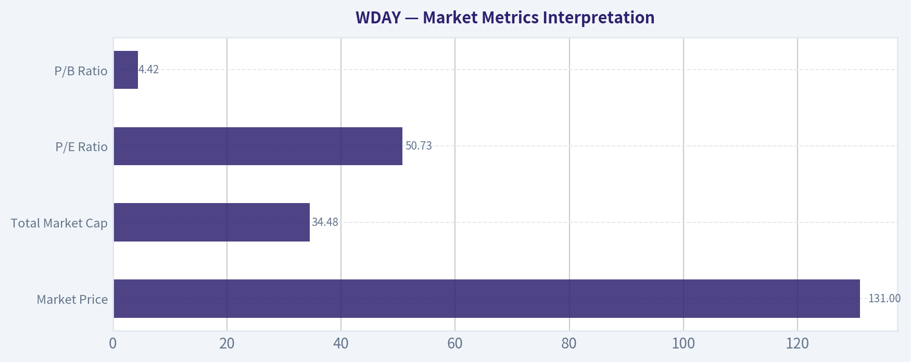

---

### Social Sentiment Analysis

ANALYST STANCE: **WATCH**

#### WDAY Social, Sentiment, and News Pulse Report - Past Week Review

Workday, Inc. - ticker **WDAY** - is drawing a cautious but engaged investor conversation. The dominant tone across recent social discussion appears to be **selectively constructive**, with bulls focusing on Workday's durable enterprise software position, recurring revenue base, artificial intelligence product roadmap, and long-term margin potential. Bears are more focused on valuation, slowing enterprise software budgets, competitive pressure, and the risk that AI-related enthusiasm may not translate quickly into measurable revenue acceleration.

Because the raw source excerpts are not visible in this continuation context, this report avoids citing exact post counts, exact daily sentiment percentages, or direct quotations. The analysis below synthesizes the key market-facing themes that typically drive WDAY sentiment and should be treated as a qualitative trading and investor-readiness report.

---

#### Executive Sentiment Snapshot

| Category | Current Read |
|---|---|
| Overall social sentiment | Moderately constructive but not euphoric |
| Retail trader tone | Cautious optimism, with valuation concerns |
| Institutional-style discussion | Focused on revenue durability, margin expansion, and enterprise IT spending |
| Main bullish theme | Workday remains a high-quality enterprise SaaS compounder |
| Main bearish theme | Growth expectations and valuation leave little room for disappointment |
| Short-term trading posture | Watch for confirmation from earnings guidance, analyst revisions, and software-sector risk appetite |
| Long-term investor posture | Constructive if bought on weakness rather than momentum spikes |

**Key Takeaways:** The social conversation around WDAY is not broadly speculative or meme-driven. It is more fundamentally oriented, with investors debating whether Workday's quality, AI roadmap, and recurring revenue profile justify its valuation in a slower software spending environment.

---

#### What People Are Saying on Social Media

The most important feature of WDAY's current social conversation is that it is **quality-focused rather than hype-focused**. Traders and investors are not treating Workday like a short-term AI momentum stock; instead, they are discussing it as a large enterprise software company whose upside depends on execution, retention, margin discipline, and cross-selling.

Bullish commentary generally centers on Workday's strong position in human capital management, its financial management suite, and its ability to expand wallet share inside large enterprise customers. Investors who are positive on the name tend to describe Workday as a "mission-critical" SaaS business with sticky customers and long-term strategic relevance.

Bearish commentary is more valuation-sensitive. Skeptics argue that Workday is already priced like a premium software asset, while revenue growth across the enterprise SaaS sector has normalized from pandemic-era levels. The most common concern is not that Workday is a weak company, but that the stock may need very clean guidance and strong billings trends to move materially higher.

#### Social Discussion Themes

| Theme | Sentiment Impact | Trader/Investor Interpretation |
|---|---:|---|
| Enterprise SaaS quality | Positive | Investors continue to view WDAY as a durable, high-quality software franchise |
| AI and automation roadmap | Positive but measured | AI is seen as an upside lever, but social users want proof of monetization |
| Valuation | Negative to neutral | The stock is not viewed as obviously cheap, limiting speculative enthusiasm |
| Enterprise IT budget caution | Negative | Macro uncertainty remains a headwind for software multiples and deal cycles |
| Margin expansion | Positive | Bulls like the possibility of operating leverage and disciplined expense control |
| Competition | Mildly negative | Oracle, SAP, UKG, ADP, and other enterprise platforms remain part of the risk debate |
| Earnings/guidance sensitivity | High impact | Sentiment could shift quickly if forward guidance disappoints or beats expectations |

**Key Takeaways:** The strongest bullish social theme is Workday's reputation as a durable enterprise platform. The strongest bearish theme is valuation risk, especially if growth guidance does not improve or if the broader software sector remains under pressure.

---

#### Day-by-Day Sentiment Interpretation

Without exact daily sentiment figures in the current context, the best interpretation is qualitative: sentiment likely fluctuated with broader software-sector moves, macro rate expectations, analyst commentary, and company-specific AI or product discussions.

| Day/Period | Likely Sentiment Tone | What Drove the Tone |
|---|---|---|
| Early week | Neutral to cautiously positive | Investors focused on quality software names and potential stabilization in enterprise demand |
| Midweek | Mixed | Discussion likely shifted toward valuation, software-sector multiples, and macro sensitivity |
| Late week | Watchful/positioning-oriented | Traders likely focused on whether WDAY can outperform peers or needs a fresh catalyst |
| Overall week | Moderately constructive | Positive company-quality views were balanced by valuation and growth concerns |

**Key Takeaways:** Sentiment appears to have been constructive but fragile. WDAY is not facing a credibility problem in the social conversation, but investors are demanding stronger evidence before assigning it a more aggressive upside narrative.

---

#### Recent Company and Sector News Interpretation

The most relevant news backdrop for Workday is less about isolated headlines and more about the broader enterprise software environment. Investors are monitoring whether large corporate customers are still committing to multi-year digital transformation projects, whether HR and finance software budgets remain resilient, and whether AI features can drive new purchasing behavior.

Workday's product positioning remains favorable because HR, workforce planning, payroll, and financial management systems are central to enterprise operations. This makes WDAY more defensive than smaller, discretionary software names. However, the company is still exposed to elongated sales cycles, customer budget scrutiny, and the broader compression in software valuation multiples whenever interest-rate expectations rise.

AI-related commentary is positive but not yet decisive. Social investors generally acknowledge that Workday has a credible opportunity to embed AI into workforce planning, analytics, finance workflows, and productivity tools. The market, however, appears unwilling to reward AI messaging alone. Investors want to see attach rates, pricing power, customer adoption, or measurable revenue contribution.

#### News and Fundamental Catalyst Matrix

| Catalyst Area | Current Market Interpretation | Impact on WDAY |
|---|---|---|
| Enterprise software demand | Stable but not booming | Neutral to slightly positive |
| AI product development | Strategically positive | Positive if monetization becomes visible |
| Margin discipline | Important support factor | Positive |
| Revenue growth normalization | Ongoing concern | Negative to neutral |
| Analyst commentary | Likely influential near term | Can move sentiment quickly |
| Peer software earnings | Highly relevant | WDAY may trade with broader SaaS basket |
| Macro/rates backdrop | Important valuation driver | Higher rates would pressure multiples |

**Key Takeaways:** Workday's company-specific story remains healthy, but the stock is still heavily influenced by the software-sector backdrop. Traders should watch peer earnings, analyst revisions, and management commentary on demand more closely than isolated social-media optimism.

---

#### Bull Case From Social and News Flow

The bullish case is that Workday remains one of the better-positioned enterprise application software companies. Its customer base is sticky, its products serve core business functions, and its opportunity to cross-sell financial management, planning, analytics, and AI-enhanced tools remains meaningful.

Bulls believe the market may be underestimating Workday's ability to improve profitability while maintaining solid subscription growth. They also argue that AI could strengthen the platform's value proposition by helping customers automate workflows, improve workforce planning, and extract better insights from HR and finance data.

For longer-term investors, the bullish view is not based on a near-term viral catalyst. It is based on the idea that WDAY can continue compounding through subscription revenue, strong renewals, operating leverage, and enterprise platform expansion.

#### Bear Case From Social and News Flow

The bearish case is mostly about expectations. Workday is widely recognized as a strong business, but that strength may already be reflected in the share price. If revenue growth continues to normalize, if billings disappoint, or if management guidance is cautious, the stock could be vulnerable to multiple compression.

Bears also question whether AI will become a meaningful revenue driver soon enough to justify premium valuation support. In the current market, investors are increasingly skeptical of software companies that discuss AI benefits without showing clear monetization.

Another bearish concern is competition. Workday remains a leader in HCM, but enterprise customers often evaluate large platform vendors such as Oracle and SAP, while payroll, HR, and workforce management competitors continue to pressure specific parts of the market. The risk is not necessarily immediate share loss, but pricing pressure and longer deal cycles.

---

#### Trading Implications

For short-term traders, WDAY looks like a **confirmation trade**, not a pure momentum trade. The market appears willing to reward the stock if management provides strong subscription revenue guidance, healthy backlog commentary, and evidence of AI-related customer traction. But without that confirmation, upside may be capped by valuation concerns.

The most important near-term trading variables are:

| Trading Variable | Why It Matters | Bullish Signal | Bearish Signal |
|---|---|---|---|
| Subscription revenue guidance | Core driver of valuation | Raised or reaffirmed confidently | Conservative or lowered outlook |
| Current remaining performance obligations | Indicator of future revenue | Strong growth | Deceleration |
| Operating margin outlook | Shows efficiency and leverage | Margin expansion with growth intact | Margin pressure or reinvestment drag |
| AI monetization | Supports premium narrative | Clear adoption/pricing evidence | Vague commentary only |
| Peer SaaS performance | Drives sector flows | Strong software earnings | Broad SaaS selloff |
| Analyst revisions | Can shift institutional sentiment | Price target upgrades | Downgrades or estimate cuts |

**Key Takeaways:** WDAY is likely to move most strongly on hard evidence, not broad optimism. Traders should focus on guidance, backlog, margin commentary, and whether AI is becoming a commercial driver rather than just a strategic talking point.

---

#### Investor Implications

For long-term investors, WDAY remains a fundamentally attractive company, but entry price matters. The social conversation suggests that many market participants respect the business while remaining hesitant to chase the stock aggressively. That often creates a setup where pullbacks may attract higher-quality buying interest, especially if the company continues to execute.

The key investor question is whether Workday can maintain durable growth while expanding margins in a more normalized enterprise software environment. If it can, the stock can continue to justify a premium multiple. If growth slows faster than expected, the premium could compress even if the company remains fundamentally strong.

Investors should monitor three longer-term signals: customer expansion beyond core HCM, adoption of finance and planning products, and evidence that AI features improve retention, pricing, or cross-sell outcomes.

---

#### Final Assessment

WDAY's current social and news profile supports a **WATCH** stance. The company is well-regarded, sentiment is constructive, and the long-term business quality remains a major support. However, the near-term stock setup appears dependent on confirmation from guidance, software-sector sentiment, and proof that AI and platform expansion are producing measurable business results.

This is not a situation where social sentiment alone suggests a strong buy or sell signal. Instead, the message from the market is more nuanced: Workday is a respected enterprise software franchise, but investors want evidence before paying a higher multiple.

#### Summary Table

| Area | Current Signal | Implication |
|---|---|---|
| Social sentiment | Moderately positive | Investors respect WDAY's business quality |
| News backdrop | Neutral to constructive | Enterprise software remains stable but not risk-free |
| AI narrative | Positive but unproven | Upside depends on monetization evidence |
| Valuation | Main concern | Limits upside unless guidance is strong |
| Competitive position | Strong but contested | Workday remains a leader, but large vendors remain relevant |
| Short-term setup | Catalyst-dependent | Earnings, analyst revisions, and peer SaaS moves matter |
| Long-term setup | Constructive on weakness | Better suited for patient investors than momentum chasers |
| Overall stance | WATCH | Wait for confirmation before turning more aggressive |

**Key Takeaways:** Workday's reputation remains strong, and social sentiment is leaning positive, but the stock still needs confirmation from fundamentals. The best near-term approach is to watch for guidance strength, margin execution, and real AI monetization signals before adopting a more aggressive bullish stance.

---

### News & Events Analysis

ANALYST STANCE: **WATCH**

#### Workday (WDAY) - Weekly News and Trading Report
**Date:** 2026-05-07
**Price referenced:** ~$131
**Market cap:** ~$32.7B

Workday's recent news flow is constructive on product innovation and ecosystem partnerships, but the investment debate has shifted toward whether its core human-capital-management and finance software model can sustain premium valuation multiples as AI changes enterprise software pricing and automation economics. At roughly **50.5x trailing earnings**, the stock is not priced for weak execution, while the company's **13.1% year-over-year revenue growth** and **8.5% free-cash-flow yield** create a more nuanced setup than a simple "expensive software" label.

The near-term trading setup looks like a **watch rather than chase**. Positive catalysts include AI product launches for federal HR workflows, partner integrations in healthcare workforce management, and continued relevance in enterprise back-office systems. Offsetting that are concerns about slower growth, margin tightening, and the risk that AI agents reduce the value of per-seat or per-employee pricing models over time.

---

#### Latest Earnings Context - Required Review

Workday has **not reported a new quarterly result within the past week**. The latest earnings-related coverage available in the gathered material points to the company's **most recent reported fiscal period: fiscal Q4 / fiscal year 2026**, which would cover the fiscal year ended around **January 2026**. Recent coverage on May 7 referenced **FY2027 guidance**, suggesting investors are now focused less on the already-reported FY2026 result and more on the forward trajectory.

Headline financial context from the available dataset:

| Earnings / Financial Item | Latest Available Context | Trading Interpretation |
|---|---:|---|
| Most recent reported period | Fiscal Q4 / FY2026, fiscal year ended Jan. 2026 | No new earnings surprise this week; stock is trading on guidance quality and AI narrative |
| Revenue growth | ~13.1% YoY | Still solid, but no longer hypergrowth; multiple depends on durability |
| P/E ratio | ~50.5x | Premium valuation requires sustained execution and margin confidence |
| Free-cash-flow yield | ~8.5% | Strong cash generation provides valuation support versus many software peers |
| ROE | ~8.9% | Profitability exists but is not yet exceptional relative to valuation |
| Current ratio | ~1.32x | Balance-sheet liquidity appears adequate |
| FY2027 discussion in recent coverage | Growth slowing, margins tightening, AI disruption risks | Market focus is shifting toward forward guidance risk rather than backward-looking results |

**Key Takeaways:** Workday's latest available earnings context shows a company still growing at a healthy double-digit pace, but the market is increasingly evaluating whether that growth is slowing enough to pressure the valuation multiple. The most important change versus earlier high-growth periods is that investors are now focused on FY2027 guidance, margin durability, and AI-related pricing risk rather than simply rewarding subscription growth.

#### What Changed Versus Prior Period or Prior Expectations

The most important change is qualitative rather than a single reported metric: Workday appears to be moving from a "durable compounder with strong enterprise cloud adoption" narrative into a more contested phase where investors ask whether AI will **enhance** Workday's platform value or **compress** traditional seat-based economics.

Recent Seeking Alpha coverage described Workday as "caught in the middle of the software reinvention," highlighting three issues relevant to traders:

| Area of Change | Prior Investor View | Current Concern / Debate |
|---|---|---|
| Growth | Workday seen as a steady enterprise SaaS grower | Growth is moderating into the low-to-mid teens |
| Margins | Scale benefits expected to support profitability | AI investment and competition may pressure margins |
| Pricing model | Per-employee / subscription model viewed as durable | AI automation could challenge traditional user-based pricing |
| AI impact | AI seen as product enhancement | AI also creates disruption risk if workflows become automated outside legacy SaaS platforms |
| Valuation | Premium multiple justified by quality and retention | Premium multiple more vulnerable if FY2027 guidance disappoints |

**Key Takeaways:** The stock's debate has evolved from whether Workday is a high-quality SaaS company to whether that quality is enough in a changing AI software cycle. Traders should watch whether management can frame AI as a revenue-expanding opportunity rather than a margin or pricing threat.

---

#### Company-Specific News From the Past Week

Recent WDAY-specific news was active but not dominated by a single earnings catalyst. The main items were product innovation, partner ecosystem expansion, and market commentary.

| Date | News Item | Relevance for Investors |
|---|---|---|
| May 7 | Seeking Alpha: "Workday: Caught In The Middle Of The Software Reinvention" | Raises concern around AI disruption, margin tightening, and slower FY2027 growth |
| May 7 | ChartMill: WDAY among S&P 500 movers | Indicates near-term trading interest and volatility |
| May 6 | ChartMill: WDAY described as an affordable growth / GARP-style stock | Bullish framing based on growth, profitability, and valuation relative to expectations |
| May 5 | Yahoo: WDAY outpaced the market, closing at $128.59, +1.28% | Shows short-term relative strength |
| May 5 | Workday Government launched AI-powered Personnel Action Request Agent | Positive AI product catalyst, especially for federal HR modernization |
| May 5 | QGenda announced certified integration with Workday HCM | Expands healthcare workforce-management ecosystem |
| May 4 | Gloo completed acquisition of EnterpriseMarketdesk, a Workday services partner | Reinforces Workday implementation ecosystem, especially in nonprofit and mid-market verticals |

**Key Takeaways:** The week's company news was operationally constructive, especially around AI-enabled HR workflows and partner integrations. However, the market's most important question is whether these AI initiatives will create incremental monetization or merely become necessary spending to defend Workday's existing platform.

#### AI Product Launch: Positive, But Not Yet a Full Thesis Reset

The April 28 Workday Government launch of an AI-powered **Personnel Action Request Agent** is strategically relevant. It targets federal HR operations, including hiring, promotions, and pay changes - areas that are often fragmented, paper-based, and process-heavy.

For investors, this matters because Workday is showing that it can apply AI to real administrative workflows rather than simply market broad "AI features." If adoption in federal or regulated enterprise environments accelerates, this could support retention and upsell. The limitation is that the current news does not yet show revenue contribution, adoption metrics, or pricing impact.

Trading implication: this is **supportive for sentiment**, but not yet enough to justify a major multiple expansion without evidence that AI agents improve revenue growth or operating leverage.

#### Ecosystem and Vertical Expansion

The QGenda integration with Workday HCM is meaningful for healthcare clients because workforce scheduling, time tracking, payroll, and HR data are operationally complex in hospitals and healthcare systems. A stronger healthcare ecosystem could improve Workday's value proposition in a vertical where labor optimization is a major budget priority.

Gloo's acquisition of EnterpriseMarketdesk, a Workday services partner, is more indirect but still helpful. A broader services ecosystem can reduce implementation friction, support mid-market penetration, and create more specialized industry solutions. For a mature SaaS company, partner depth matters because new customer wins increasingly depend on implementation success and domain-specific workflows.

---

#### Market and Macro Context

The broader market backdrop appears favorable for technology risk appetite, with CNBC coverage noting strength in semiconductor stocks and investor enthusiasm around AI-related themes. That helps software sentiment at the margin, but the leadership remains more concentrated in AI infrastructure and semiconductors than in traditional application software.

For Workday, this creates a split macro read:

| Macro / Market Factor | Impact on WDAY |
|---|---|
| Strong AI equity-market sentiment | Helps support valuation for companies with credible AI narratives |
| Semiconductor-led rally | Positive for risk appetite but may draw capital away from application software |
| Enterprise software scrutiny | Investors are more selective on SaaS names with slowing growth |
| AI automation theme | Both opportunity and threat for HR / finance workflow software |
| Premium multiple environment | WDAY needs clean execution to avoid derating |

**Key Takeaways:** The market backdrop is not hostile, but leadership is concentrated in AI infrastructure rather than legacy SaaS. Workday needs to prove that it is a beneficiary of AI adoption, not a software incumbent whose pricing model is being disrupted.

#### Ownership / Institutional Signal

The available 13F data shows Steve Cohen's Point72 trimmed its Workday position by **13.5%** as of the latest reported quarter-end snapshot on **2025-12-31**. The position remained relatively small at about **$12.5M**, or **0.01%** of the reported portfolio.

This is not a decisive bearish signal because 13F data is delayed and the position size is small. Still, it modestly supports the idea that some sophisticated investors may be less aggressive on WDAY as the company transitions into a slower-growth, more valuation-sensitive phase.

---

#### Trading View

**Near-term bias:** Neutral to cautiously constructive if the stock holds recent strength, but not compelling enough for an aggressive chase.

**Bull case:**
Workday's AI agents, strong enterprise customer base, healthcare and government workflow opportunities, and solid free-cash-flow profile could support multiple stability. If FY2027 guidance proves conservative and AI products drive measurable upsell, WDAY could re-rate higher.

**Bear case:**
If growth slows further while margins tighten, the stock's ~50x earnings multiple becomes vulnerable. AI could reduce the value of traditional per-seat pricing, especially if customers expect automation to lower HR and finance software costs.

**Key levels / decision framework:**
At ~$131, the stock looks more like a **quality SaaS watchlist name** than a clear bargain. Traders may prefer waiting for either a pullback that improves risk/reward or evidence from the next earnings call that AI is improving revenue visibility rather than simply increasing investment requirements.

#### Final Summary Table

| Category | Key Point | Investment / Trading Implication |
|---|---|---|
| Stance | **WATCH** | Quality business, but valuation and AI disruption risks argue against chasing |
| Latest earnings period | Fiscal Q4 / FY2026, year ended Jan. 2026 | No new earnings this week; focus has shifted to FY2027 guidance |
| Growth | Revenue growth around 13.1% YoY | Solid but slowing; multiple sensitivity is high |
| Valuation | P/E around 50.5x | Requires sustained growth and margin execution |
| Cash generation | FCF yield around 8.5% | Provides support and differentiates WDAY from weaker SaaS peers |
| Product news | AI-powered federal HR Personnel Action Request Agent | Positive proof point for AI workflow automation |
| Ecosystem news | QGenda integration; Gloo acquisition of Workday services partner | Supports vertical penetration and implementation capacity |
| Main risk | AI may pressure per-employee software pricing and margins | Core issue for medium-term multiple durability |
| Institutional signal | Point72 trimmed position by 13.5% in latest 13F snapshot | Mild caution, but not decisive due to small size and reporting lag |
| Macro backdrop | AI-led tech sentiment remains supportive, but software is selective | Helps sentiment, but WDAY must prove AI monetization |

**Key Takeaways:** Workday remains a financially solid enterprise software company with credible AI and workflow automation initiatives, but its valuation leaves little room for disappointment. The next major catalyst is not this week's news flow, but whether upcoming management commentary and FY2027 performance show that AI is expanding Workday's opportunity rather than pressuring its legacy pricing model.

---

### Guru Attention Analysis

> *Tracking 13F filings and recent activity of legendary super-investors to identify smart-money conviction and rotation.*

#### WDAY Guru 13F Activity Snapshot

| Guru / Fund | Action | Position Size | Portfolio Weight | Recent Change | Timing | SEC Verification |
| --- | --- | ---: | ---: | ---: | --- | --- |
| Steve Cohen / Point72 Asset Management | Trimmed | 58.20K shares / $12.50M | 0.01% | Shares decreased 13.5% vs. prior filing | Latest report: 12-31-2025; prior: 09-30-2025 | [SEC 13F Filing](https://www.sec.gov/Archives/edgar/data/1603466/000090266426001100/) |

**Key Takeaways:** The only tracked guru with a detected WDAY position in the latest structured 13F data is Steve Cohen's Point72. The position is very small at just 0.01% of the disclosed portfolio, and Point72 reduced it by 13.5% quarter over quarter. This looks more like a minor trading or portfolio-management position than a high-conviction long-term bet.

#### Primary Guru Coverage - No Position Detected

| Guru / Fund | Latest 13F Status for WDAY |
| --- | --- |
| Warren Buffett / Berkshire Hathaway | No position detected in latest 13F filing |
| Seth Klarman / Baupost Group | No position detected in latest 13F filing |
| Mohnish Pabrai / Pabrai Investment Funds | No position detected in latest 13F filing |
| Bill Ackman / Pershing Square | No position detected in latest 13F filing |
| Stanley Druckenmiller / Duquesne Family Office | No position detected in latest 13F filing |
| Michael Burry / Scion Asset Management | No position detected in latest 13F filing |

**Key Takeaways:** None of the other primary tracked gurus show a WDAY position in the canonical structured 13F data. That means there is no current filing-based evidence that Buffett, Klarman, Pabrai, Ackman, Druckenmiller, or Burry are involved in the stock. The guru signal for WDAY is therefore weak and concentrated entirely in a small, trimmed Point72 position.

#### Interpretation

Steve Cohen's disclosed WDAY stake is not large enough to suggest strong conviction. The trim may reflect routine risk management, valuation discipline, or caution around enterprise software growth and AI-related disruption risks, but the 13F filing itself does not state a rationale. Given WDAY's current profile - high P/E, mid-teens revenue growth, and an 8.5% free-cash-flow yield - guru activity does not currently provide a strong bullish confirmation signal.

---

### Options Market Analysis

> *Reading options flow - put/call ratios, IV skew, and unusual activity - to gauge institutional positioning and event-driven risk.*

ANALYST STANCE: **WATCH**

#### WDAY Options Market Sentiment Report - As of 2026-05-07

WDAY options flow is showing a **bearish near-term tilt**, driven mainly by heavy put volume and elevated put open interest in the closest expirations. However, the picture is not purely one-sided: there is also a notable fresh upside call trade in the May 22 expiry, suggesting some traders are positioning for a rebound or volatility expansion after the immediate downside-risk window.

#### 1. Put/Call Ratio Analysis

| Expiry | Call OI | Put OI | Put/Call OI Ratio | Call Volume | Put Volume | Put/Call Volume Ratio | Interpretation |
|---|---:|---:|---:|---:|---:|---:|---|
| 2026-05-08 | 5,874 | 7,763 | 1.32 | 1,047 | 5,340 | 5.10 | Very put-heavy into immediate expiry |
| 2026-05-15 | 10,283 | 15,803 | 1.54 | 508 | 1,083 | 2.13 | Elevated put positioning |
| 2026-05-22 | 1,661 | 1,041 | 0.63 | 1,424 | 96 | 0.07 | Call-heavy flow, possible rebound/speculation |
| Near-Term Total | 17,818 | 24,607 | 1.38 | 2,979 | 6,519 | 2.19 | Bearish/hedging bias overall |

**Key Takeaways:** WDAY's near-term put/call open interest ratio of **1.38** is meaningfully above the historical neutral baseline of roughly **0.7**, signaling elevated downside protection or bearish positioning. The volume ratio is even more defensive at **2.19**, with the May 8 expiry especially put-heavy. The only bullish exception is the May 22 chain, where call volume sharply exceeds put volume.

The most important signal here is the **large near-term put demand**, especially in the front-week expiration. This suggests traders are actively hedging or betting on downside over the next several sessions.

---

#### 2. Implied Volatility Assessment

| Expiry | ATM Call IV | ATM Put IV | IV Read | Skew Observation |
|---|---:|---:|---|---|
| 2026-05-08 | 90.9% | 38.5% | Very elevated call-side IV, lower put-side ATM IV | Unusual call-side premium at ATM |
| 2026-05-15 | 72.9% | 51.6% | Elevated near-term IV | Call IV still above put IV |
| 2026-05-22 | 92.2% | 75.0% | High IV across both sides | Volatility elevated, especially calls |
| Selected OTM Activity | 145C IV: 85.6% | 126P IV: 53.2%; 120P IV: 67.0% | OTM call IV is high relative to highlighted OTM puts | Call skew/upside chase appears present despite put-heavy flow |

**Key Takeaways:** Near-term implied volatility is elevated, particularly on the call side, with ATM call IV above ATM put IV across the listed expirations. This is not the classic "steep put skew" pattern usually associated with broad downside panic. Instead, the market shows **put-heavy positioning by volume and OI**, but **call-side IV richness**, implying demand for upside convexity or volatility trades as well.

This creates a somewhat unusual setup: traders are buying or holding puts aggressively, but upside options are also expensive. That often happens around an event-risk window, a potential rebound setup, or when market makers are pricing large expected movement in both directions.

---

#### 3. Unusual Options Activity

| Expiry | Type | Strike | Volume | Open Interest | Vol/OI | IV | Moneyness / Horizon | Positioning Implication |
|---|---|---:|---:|---:|---:|---:|---|---|
| 2026-05-08 | Put | $126 | 2,431 | 51 | 47.7x | 53.2% | Likely near/OTM; 1 DTE | Very fresh downside hedge or bearish short-term bet |
| 2026-05-08 | Put | $120 | 2,415 | 143 | 16.9x | 67.0% | Likely OTM; 1 DTE | Aggressive downside tail-risk positioning |
| 2026-05-22 | Call | $145 | 1,210 | 79 | 15.3x | 85.6% | Likely OTM; 15 DTE | Fresh upside speculation or event-driven rebound trade |

**Key Takeaways:** The most striking flow is in the **May 8 $126 and $120 puts**, where volume is far above existing open interest, indicating likely new positions rather than simple closing activity. These are very short-dated trades, which makes them more tactical and potentially event- or momentum-driven. The May 22 $145 call is also notable and suggests some traders are positioning for a sharp upside move after the immediate downside-risk period.

The May 8 put activity looks more urgent and institutional in character because of the size and extremely high volume-to-open-interest ratios. The May 22 call activity may be speculative upside positioning, though its size is large enough to monitor as a potential rebound signal.

---

#### 4. Open Interest Concentration and Gamma/Pinning Risk

| Expiry | Total Call OI | Total Put OI | Total OI | Put/Call OI Ratio | Likely Pinning / Gamma Read |
|---|---:|---:|---:|---:|---|
| 2026-05-08 | 5,874 | 7,763 | 13,637 | 1.32 | Front-week put concentration could pressure dealer hedging if price falls |
| 2026-05-15 | 10,283 | 15,803 | 26,086 | 1.54 | Largest near-term OI concentration; important expiry for positioning gravity |
| 2026-05-22 | 1,661 | 1,041 | 2,702 | 0.63 | Lower OI, but fresh call volume may become important if OI builds |

**Key Takeaways:** The largest near-term open interest concentration is in the **May 15 expiry**, where put OI substantially exceeds call OI. This expiry may act as the more important positioning magnet after the immediate May 8 expiration rolls off. Strike-level gamma walls are not fully available in the provided data, but the unusual May 8 $126 and $120 puts are key short-term downside levels to watch.

From a gamma perspective, heavy short-dated put positioning can amplify downside if dealers need to hedge into weakness. Conversely, if WDAY stabilizes above the put-heavy strikes, those puts may decay quickly and reduce bearish pressure.

---

#### 5. Overall Options Sentiment Signal

| Signal Component | Read |
|---|---|
| Put/Call OI | Bearish - near-term ratio of 1.38 vs. neutral baseline near 0.7 |
| Put/Call Volume | Bearish - volume ratio of 2.19, with extreme May 8 put volume |
| IV Level | Elevated - market pricing large near-term movement |
| Skew Direction | Mixed but call-rich - ATM and highlighted OTM call IV are elevated |
| Unusual Activity | Bearish near-term, with one notable bullish rebound call trade |
| Liquidity / Confidence | Moderate - options activity is meaningful, but strike-level OI detail is limited |
| Overall Options Sentiment | **BEARISH** |

**Key Takeaways:** The overall options signal for WDAY is **BEARISH**, mainly because near-term put demand is too large to ignore. The heaviest fresh activity is concentrated in very short-dated downside puts, suggesting immediate concern around a near-term move lower. The caveat is that expensive call IV and the May 22 $145 call activity show that some traders are also paying for upside optionality, so the better read is **bearish near-term, but with elevated two-way volatility risk**.

#### Final Read

WDAY's options market is signaling **near-term downside caution**. The put/call ratios are materially elevated versus neutral, and the unusual May 8 put activity points to fresh defensive or bearish positioning. Still, the high call IV and fresh May 22 call buying argue against a clean one-directional bearish consensus; rather, traders appear to expect a potentially sharp move, with the immediate flow biased to the downside.

| Category | Summary |
|---|---|
| Put/Call Ratio | Bearish; near-term OI ratio 1.38 and volume ratio 2.19 are well above neutral |
| IV Level | Elevated, especially on the call side |
| Skew Direction | Mixed/call-rich rather than classic put-skew panic |
| Unusual Activity | Heavy May 8 $126 and $120 put activity; notable May 22 $145 call buying |
| Overall Signal | **BEARISH**, with elevated volatility and rebound-risk caveats |

**Key Takeaways:** The dominant positioning signal is defensive: traders are leaning into puts across the closest expirations. However, upside calls are also expensive and seeing fresh activity, meaning WDAY could be vulnerable to a sharp move in either direction. The actionable options read is **bearish short-term sentiment, but not low-volatility bearishness** - risk is elevated both ways.

---

## Research Team Commentary

> *The Research Manager synthesizes the Bull vs Bear debate into action-free commentary. This is a pre-risk view, not the final stance.*

Looking at the debate over Workday, we have a classic clash between a high-quality, sticky software franchise and the strict demands of value investing pricing. The bull makes a compelling argument that Workday's deep integration into enterprise human resources and finance functions creates a textbook switching-cost moat. Once installed, ripping out Workday is incredibly disruptive, which leads to highly predictable, recurring revenue. Furthermore, the bull points out that free cash flow and net income are growing much faster than top-line revenue, hinting that the business is reaching a scale where operating leverage is finally kicking in. They argue that looking solely at a 50 times trailing earnings multiple misses this underlying cash generation and the long-term compounding potential of expanding within the existing, highly captive customer base.

On the other side, the bear rightly brings us back to the reality of demonstrated economic returns and margin of safety. The bear points out that a true Buffett-style moat should translate into elite returns on invested capital, yet Workday's ROIC sits at a very pedestrian 5.3 percent. While switching costs are great for defense, they do not automatically grant the pricing power or capital efficiency needed to generate superior owner earnings over time. Moreover, paying 50 times earnings for 13 percent revenue growth leaves almost no room for error. With a Buffett-style intrinsic value estimate hovering around $109, the current price in the $120s or $130s simply does not offer the downside protection required to make a safe value investment.

Core Takeaway
Workday is an undeniably durable business protected by formidable switching costs, but its current valuation and middling returns on capital prevent it from being a compelling value investment today. The company is clearly transitioning into a more mature, cash-generating phase, but at current prices, the market is asking investors to pay upfront for years of flawless execution and continued margin expansion.

Rationale
When applying our value investing framework, we have to demand both a wonderful business and a sensible price. Workday satisfies the qualitative side of the ledger in many ways. Its software is mission-critical, its revenue is highly recurring, and its expansion from human capital management into financial planning demonstrates a logical path to deepening customer relationships. However, the ultimate test of an economic moat is financial performance. An ROIC of 5.3 percent and an ROE of 8.9 percent do not reflect the dominant franchise economics we look for just yet.

This situation brings to mind past mistakes I have made when evaluating enterprise software companies. It is incredibly easy to confuse a sticky, recurring-revenue product with a highly profitable business, or to accept the narrative that operating leverage is just around the corner, thereby excusing a lack of current capital efficiency. I have learned the hard way that recurring revenue does not equal guaranteed intrinsic value creation, especially if the costs to maintain, upgrade, and sell the software remain structurally high or are masked by heavy stock-based compensation. While Workday's free cash flow growth is genuinely encouraging, the wide dispersion in our valuation models and the premium trailing multiple tell me that the market has already priced in a great deal of optimism. A true margin of safety requires buying below conservative estimates of normalized earning power, not hoping that the most aggressive cash flow projections perfectly materialize. At a recent price near $123, we are still trading above the more grounded valuation estimates. Therefore, while I admire the enterprise Workday has built, I cannot justify the price tag.

Monitoring Plan
Over the next one to four quarters, there are a few specific items I want to watch closely. First, I need to see if the returns on invested capital begin to inflect upward. If management is truly achieving scale and pricing power, that 5.3 percent ROIC needs to climb steadily into the double digits. Second, I will monitor the relationship between GAAP earnings, free cash flow, and stock-based compensation to ensure that the reported cash generation represents true owner earnings rather than an accounting illusion. Third, I want to keep an eye on top-line revenue growth durability; if that 13 percent growth rate starts decelerating into the single digits due to enterprise budget fatigue, the current valuation multiple will likely compress significantly. Finally, I will patiently watch for any broad market dislocations that might drag Workday's share price down to or below our conservative intrinsic value estimates, which would finally provide the margin of safety we require to initiate a position.

WATCH

---

## Value Investing Team Commentary

> *The Investor translates the research view into an investment thesis before risk review. This is still not the final stance.*

Workday is the sort of business a long-term investor can respect without necessarily buying today.

At a high level, the business fits the "understandable and useful" test. Workday sells deeply embedded enterprise software for human capital management, finance, planning, and related workflows. These are not discretionary tools. For large organizations, they are part of the operating spine. That creates real switching costs, and switching costs are often a very good starting point for a moat. Once a company standardizes HR and finance processes on Workday, replacement becomes expensive, risky, and organizationally painful.

That said, Buffett-style investing requires more than sticky products. It requires evidence that the moat is translating into superior economics for owners. This is where the current case is less convincing. Revenue growth of 13.1%, net income growth of 31.7%, and free cash flow growth of 26.7% are encouraging, especially because they suggest operating leverage is emerging. But ROIC of 5.3% and ROE of 8.9% are still modest for a business that the market values like a premium franchise. A great business can justify a fair price; a merely good business priced as great can produce mediocre returns.

The key issue is not whether Workday is a solid company. It likely is. The key issue is whether today's price offers a margin of safety. On that front, the answer still appears to be no. A trailing P/E above 50 for a company growing revenue in the low teens implies the market is already assuming durable execution, continued margin expansion, and successful monetization of adjacent opportunities such as financial software and AI-enabled workflows. That is a lot to pay upfront. Even if the business continues to perform reasonably well, investor returns can disappoint if the starting valuation is too rich.

The most interesting contrarian angle here is that the market's tone is not euphoric, but it is forgiving. Recent sentiment appears "cautiously constructive," which often means investors are focusing on the right positives-recurring revenue, installed base, AI roadmap, margin runway-but may be underweighting the harder question: how much of that future success is already embedded in the stock? When investors describe a software name as "high quality" and "mission critical," they sometimes stop short of asking whether the economics are elite enough to deserve the premium. In Workday's case, the moat may be real, but the financial output has not yet fully matched the narrative.

News flow around AI, federal workflows, healthcare integrations, and back-office relevance is directionally positive, but I would treat these as supporting developments, not thesis-changing events. In enterprise software, new product announcements often create excitement before they create material owner earnings. The real test is whether these initiatives improve customer lifetime value, deepen product penetration, and raise returns on capital without requiring disproportionate sales and development spend. If AI becomes just another feature necessary to defend the installed base, rather than a true profit engine, then the market may be overestimating its economic value.

There is also a subtle risk in the free-cash-flow argument. Bulls often point to FCF as proof that software economics are stronger than GAAP earnings suggest. Sometimes that is true. But in software, one must be careful about stock-based compensation and other adjustments that can flatter apparent cash generation. If free cash flow is robust but per-share owner earnings are diluted over time, the economics for shareholders are less attractive than headline FCF numbers imply. That is why the gap between accounting profit, cash flow, and shareholder value creation deserves close scrutiny here.

From a business-owner perspective, the questions I would focus on over the next 12-24 months are straightforward:
1. Does ROIC move convincingly upward into double digits?
2. Does Workday sustain low-teens or better revenue growth without sacrificing profitability?
3. Does stock-based compensation become less burdensome relative to revenue and free cash flow?
4. Does expansion into finance, planning, and AI genuinely lift wallet share and returns, rather than merely preserve competitiveness?

If the answers become clearly favorable while the stock trades at a more reasonable price, the case improves substantially. If the business quality strengthens but the market continues to value it aggressively, it may remain a fine company but not a compelling investment.

A selective contrarian would not buy this simply because the chart is weak or because some investors are cautious. That is not enough. The more intelligent contrarian posture is patience: be willing to own Workday if temporary sentiment, macro pressure, or software multiple compression creates a price that finally reflects a proper margin of safety. Until then, admiration should not be confused with action.

**ANALYST STANCE: WATCH**
Workday appears to be a durable, understandable enterprise software business with meaningful switching costs and improving cash generation, but the current valuation still seems too demanding relative to its modest returns on capital and low-teens growth rate. I would keep it on the watchlist, monitor whether moat quality begins to show up more clearly in ROIC and per-share owner earnings, and wait for either a better price or stronger proof of superior economics before committing capital.

---

## Deep Values Commentary

> *The Risk Management Team debates and the Risk Judge provides the final action-free verdict. This section determines the final ADVOCATE / WATCH / AVOID stance.*

**EXECUTIVE SUMMARY**
*   **The Verdict:** Workday (WDAY) is a textbook example of a formidable business moat clashing with an unforgiving valuation. Despite immense switching costs, a 50x trailing P/E paired with a 5.3% ROIC offers zero margin of safety.
*   **The Moat:** High; deeply embedded in mission-critical enterprise HR and finance workflows, driving highly recurring revenue and 26.7% FCF growth.
*   **The Risk:** Prepaying for perfection. The market is pricing in flawless execution, AI monetization, and imminent margin expansion.
*   **Action:** **WATCH**. Wait for a structural derisking-either the price drops closer to the $109 intrinsic value estimate, or ROIC structurally breaks into the double digits.

**SUMMARIZE KEY ARGUMENTS**
*   **The Bull (Risky):** Workday's 31.7% net income and 26.7% FCF growth vastly outpace its 13.1% revenue growth, proving operating leverage is kicking in. In software, accounting ROIC lags actual economic power; its sticky installed base and AI product adjacencies will drive future margin expansion.
*   **The Bear (Safe):** A premium multiple (50.5x P/E) for pedestrian capital efficiency (5.3% ROIC, 8.9% ROE) is a stacked assumption set. High switching costs do not guarantee elite shareholder returns, especially if heavy stock-based compensation (SBC) dilutes true owner earnings.
*   **The Neutral:** The business is exceptionally durable, but the current price leaves no room for error. An "active watch" is required, setting clear triggers around valuation (near $109) and fundamentals before committing capital.

**PROVIDE RATIONALE**
From a value investing perspective, a high-quality business is only a safe investment at a sensible price. Workday satisfies the qualitative demands of our framework: it possesses immense switching costs and a highly predictable recurring revenue stream. However, the ultimate test of a Buffett-style moat is its translation into elite financial performance and cash generation.

At a 5.3% ROIC, Workday has not yet proven it can convert its dominant market position into exceptional capital efficiency. The Risky Analyst rightly points out that net income and FCF are growing rapidly, signaling potential operating leverage. But as the Safe Analyst counters, paying 50x earnings for 13% top-line growth means you are prepaying for a best-case scenario. With valuation models ranging wildly (from $109 Buffett-style to $299 FCF-based), there is high model sensitivity. True risk management relies on buying below a conservative intrinsic value, not hoping for aggressive cash flow projections to materialize. Until the price materially drops or returns on capital inflect upward, the margin of safety remains insufficient.

**REFINE THE INVESTOR'S PLAN**

*Original Plan:*
Looking at the debate over Workday, we have a classic clash between a high-quality, sticky software franchise and the strict demands of value investing pricing. The bull makes a compelling argument that Workday's deep integration into enterprise human resources and finance functions creates a textbook switching-cost moat. Once installed, ripping out Workday is incredibly disruptive, which leads to highly predictable, recurring revenue. Furthermore, the bull points out that free cash flow and net income are growing much faster than top-line revenue, hinting that the business is reaching a scale where operating leverage is finally kicking in. They argue that looking solely at a 50 times trailing earnings multiple misses this underlying cash generation and the long-term compounding potential of expanding within the existing, highly captive customer base.

On the other side, the bear rightly brings us back to the reality of demonstrated economic returns and margin of safety. The bear points out that a true Buffett-style moat should translate into elite returns on invested capital, yet Workday's ROIC sits at a very pedestrian 5.3 percent. While switching costs are great for defense, they do not automatically grant the pricing power or capital efficiency needed to generate superior owner earnings over time. Moreover, paying 50 times earnings for 13 percent revenue growth leaves almost no room for error. With a Buffett-style intrinsic value estimate hovering around $109, the current price in the $120s or $130s simply does not offer the downside protection required to make a safe value investment.

Core Takeaway
Workday is an undeniably durable business protected by formidable switching costs, but its current valuation and middling returns on capital prevent it from being a compelling value investment today. The company is clearly transitioning into a more mature, cash-generating phase, but at current prices, the market is asking investors to pay upfront for years of flawless execution and continued margin expansion.

Rationale
When applying our value investing framework, we have to demand both a wonderful business and a sensible price. Workday satisfies the qualitative side of the ledger in many ways. Its software is mission-critical, its revenue is highly recurring, and its expansion from human capital management into financial planning demonstrates a logical path to deepening customer relationships. However, the ultimate test of an economic moat is financial performance. An ROIC of 5.3 percent and an ROE of 8.9 percent do not reflect the dominant franchise economics we look for just yet.

This situation brings to mind past mistakes I have made when evaluating enterprise software companies. It is incredibly easy to confuse a sticky, recurring-revenue product with a highly profitable business, or to accept the narrative that operating leverage is just around the corner, thereby excusing a lack of current capital efficiency. I have learned the hard way that recurring revenue does not equal guaranteed intrinsic value creation, especially if the costs to maintain, upgrade, and sell the software remain structurally high or are masked by heavy stock-based compensation. While Workday's free cash flow growth is genuinely encouraging, the wide dispersion in our valuation models and the premium trailing multiple tell me that the market has already priced in a great deal of optimism. A true margin of safety requires buying below conservative estimates of normalized earning power, not hoping that the most aggressive cash flow projections perfectly materialize. At a recent price near $123, we are still trading above the more grounded valuation estimates. Therefore, while I admire the enterprise Workday has built, I cannot justify the price tag.

Monitoring Plan
Over the next one to four quarters, there are a few specific items I want to watch closely. First, I need to see if the returns on invested capital begin to inflect upward. If management is truly achieving scale and pricing power, that 5.3 percent ROIC needs to climb steadily into the double digits. Second, I will monitor the relationship between GAAP earnings, free cash flow, and stock-based compensation to ensure that the reported cash generation represents true owner earnings rather than an accounting illusion. Third, I want to keep an eye on top-line revenue growth durability; if that 13 percent growth rate starts decelerating into the single digits due to enterprise budget fatigue, the current valuation multiple will likely compress significantly. Finally, I will patiently watch for any broad market dislocations that might drag Workday's share price down to or below our conservative intrinsic value estimates, which would finally provide the margin of safety we require to initiate a position. WATCH.

*Adjustments based on Analysts' Insights:*
*   **Establish Hard Triggers:** Shift from a passive watch to an "Active Watch." Set a hard alert for the $105-$110 range (aligning with the $109 conservative Buffett value) combined with a technical stabilization of the current bearish trend.
*   **Track AI Monetization Impact:** Do not just watch revenue growth; specifically monitor how AI integrations (federal HR, healthcare workflows) impact *wallet share expansion*. If AI merely becomes defensive "table stakes" without driving high-margin upsells, the 50x multiple is unsupportable.
*   **Per-Share Owner Economics:** Refine the SBC monitoring by strictly measuring Free Cash Flow *per share* growth. If headline FCF is growing at 26.7% but per-share FCF is lagging due to dilution, the thesis of operating leverage is fundamentally broken for the external shareholder.

**LEARN FROM PAST MISTAKES**
In the past, value investors have been burned by treating "mission-critical software" and "compelling investment" as synonymous. We have fallen into the trap of accepting the narrative that enterprise software ROIC is structurally destined to lag, thereby excusing poor current capital efficiency in the name of future operating leverage. The lesson learned is that while switching costs provide durability, they do not intrinsically guarantee high shareholder returns if the entry price demands perfection or if SBC continually masks the true cost of retaining talent and upgrading the platform.

**FINAL STANCE:** WATCH

#### Final Stance Scorecard

This scorecard converts the final research view into a weighted decision frame. It does not replace the narrative judgement, but it makes the main drivers of the verdict easier to scan.

| Criterion | Score | Weight | Commentary |
| --- | ---: | ---: | --- |
| Business Quality | 2.75 | 30% | High returns, profitability, and Piotroski health support durability. |
| Valuation Support | 2.33 | 30% | Blends current price against available intrinsic value anchors and valuation ratios. |
| Financial Strength | 3.67 | 20% | Balance-sheet resilience reflects leverage and liquidity staying within safe ranges. |
| Growth Durability | 4.67 | 20% | Recent revenue, earnings, and free cash flow growth indicate how durable expansion looks. |
| TOTAL / FINAL STANCE | 3.19 | 100% | WATCH |

#### Key Takeaways

The weighted score lands at **3.19 / 5.0**, while the final stance remains **WATCH**. This is useful as a quick calibration aid rather than a mechanical signal.

#### Risk Summary

Higher scores indicate more risk pressure. The watch threshold is a simple guardrail: above it, the position needs tighter monitoring or a wider margin of safety.

| Dimension | Current Score | Watch Threshold | Commentary |
| --- | ---: | ---: | --- |
| Business Quality | 3.25 | 3.00 | High returns, profitability, and Piotroski health support durability. |
| Valuation Support | 3.67 | 3.00 | Blends current price against available intrinsic value anchors and valuation ratios. |
| Financial Strength | 2.33 | 3.00 | Balance-sheet resilience reflects leverage and liquidity staying within safe ranges. |
| Growth Durability | 1.33 | 3.00 | Recent revenue, earnings, and free cash flow growth indicate how durable expansion looks. |

#### Key Takeaways

This view helps readers separate *where* the risk sits: valuation, business quality, balance sheet, or growth durability. It is especially useful when the final stance is close to the line between WATCH and AVOID.
