# WDC Deep Value Intelligence

**Analysis Date:** 2026-10-12

## Critical Disclaimer

*This analysis is generated by Deep Value Intelligence, an AI-powered multi-agent investing framework. Education & research only - not financial advice, not a financial advisor.*

---

## Table of Contents

1. Intelligence Summary
2. Analyst Team Reports
   - Fundamentals Analysis
   - Intrinsic Value Analysis (Buffett)
   - Trend & Growth Analysis (Lynch/Druckenmiller/Fisher)
   - Market Technical Analysis
   - Options Market Analysis
3. Research Team Commentary
4. Value Investing Team Commentary
5. Deep Values Commentary

---

## Intelligence Summary

### Thesis + Conditions

**Core Thesis:** ## Executive Briefing

**Key Risks:**
- Do not interpret WATCH as a bearish forecast. The stock could rerate sharply if AI demand, supply discipline, and margins persist. Preserve participation through an optional **0.5%-1.0% tracking position**, not options, while reserving meaningful capital for verified cash generation or a materially better valuation.
- ### Growth and Risky Analysts: credible structural upside
- The risky analyst also correctly warns that waiting for complete confirmation could mean paying substantially more. Past mistakes in Workday and Micron showed that valid valuation concerns can coexist with strong share-price appreciation when fundamentals, estimates, and momentum are improving.

**Confidence:** Low

---

## Analyst Team Reports

### Fundamentals Analysis

#### Latest Earnings Snapshot

*Most recent reported quarter anchored on 2026 Q2, with prior-year comparison when available.*

| Metric | 2026 Q2 | 2025 Q2 | YoY Change |
| --- | ---: | ---: | ---: |
| Revenue | $3.75B | $2.60B | +43.8% |
| Operating Income | $1.61B | $681.0M | +135.8% |
| Net Income | $3.07B | $257.0M | +1094.2% |
| Diluted EPS | $8.21 | $0.75 | +989.1% |
| Operating Cash Flow | $1.39B | $746.0M | +86.2% |
| Free Cash Flow | $1.28B | $675.0M | +89.8% |

Key Takeaways: This snapshot anchors the most recent reported quarter before the narrative analysis. It helps readers separate long-run business quality from whatever changed in the latest earnings print.

#### 17-Year Financial Metrics for WDC

*All values below are computed deterministically from raw data - not estimated by AI.*

*Issuer profile: operating company (Technology / Computer Hardware).*

#### 17-Year Financial Metrics
*Annual rows come from reported financial statements. The final TTM row is computed from the latest four quarters.*

| Metric | 2009 | 2010 | 2011 | 2012 | 2013 | 2014 | 2015 | 2016 | 2017 | 2018 | 2019 | 2020 | 2021 | 2022 | 2023 | 2024 | 2025 | 2026 TTM |
| --- | --- | --- | --- | --- | --- | --- | --- | --- | --- | --- | --- | --- | --- | --- | --- | --- | --- | --- |
| Market Price | $16 | $18 | $22 | $18 | $38 | $58 | $50 | $31 | $60 | $54 | $35 | $33 | $54 | $34 | $29 | $57 | $64 | $387 |
| Market Cap | $4.53B | $5.31B | $6.46B | $5.64B | $11.55B | $16.88B | $14.05B | $8.64B | $19.82B | $17.96B | $10.49B | $9.94B | $16.62B | $10.71B | $9.12B | $18.67B | $22.97B | $150.52B |
| P/E Ratio | 9.63 | 3.84 | 8.90 | 3.50 | 11.79 | 10.44 | 9.59 | 35.72 | 49.98 | 26.60 | -13.93 | -39.73 | 20.22 | 6.93 | -5.34 | -21.94 | 12.50 | 15.98 |
| P/B Ratio | 1.42 | 1.13 | 1.18 | 0.74 | 1.46 | 1.91 | 1.52 | 0.78 | 1.74 | 1.56 | 1.05 | 1.04 | 1.54 | 0.87 | 0.83 | 1.73 | 4.33 | 16.98 |
| ROE | 14.7% | 29.3% | 13.2% | 21.0% | 12.4% | 18.3% | 15.9% | 2.2% | 3.5% | 5.9% | -7.6% | -2.6% | 7.6% | 12.5% | -15.4% | -7.4% | 35.6% | 104.9% |
| ROIC | 21.8% | 65.2% | 31.2% | 36.4% | 16.8% | 27.6% | 22.7% | 4.7% | 9.0% | 12.3% | -2.2% | 0.8% | 6.9% | 10.6% | -3.6% | -2.6% | 23.1% | 52.5% |
| EPS | $1.66 | $4.74 | $2.47 | $5.26 | $3.25 | $5.54 | $5.23 | $0.88 | $1.21 | $2.03 | $-2.49 | $-0.84 | $2.66 | $4.89 | $-5.37 | $-2.61 | $5.12 | $24.21 |
| Revenue | $7.45B | $9.85B | $9.53B | $12.48B | $15.35B | $15.13B | $14.57B | $12.99B | $19.09B | $20.65B | $16.57B | $16.74B | $16.92B | $18.79B | $6.25B | $6.32B | $9.52B | $12.92B |
| Gross Profit | $1.34B | $2.40B | $1.79B | $3.64B | $4.36B | $4.36B | $4.22B | $3.44B | $6.07B | $7.71B | $3.75B | $3.78B | $4.52B | $5.87B | $1.39B | $1.77B | $3.69B | $6.31B |
| Gross Margin | 17.9% | 24.4% | 18.8% | 29.2% | 28.4% | 28.8% | 29.0% | 26.4% | 31.8% | 37.3% | 22.6% | 22.6% | 26.7% | 31.3% | 22.2% | 28.1% | 38.8% | 48.9% |
| Operating Margin | 7.0% | 15.5% | 8.2% | 14.2% | 8.2% | 11.8% | 11.1% | 3.6% | 10.2% | 17.5% | 0.5% | 2.0% | 7.2% | 12.7% | -8.8% | -6.4% | 24.5% | 35.6% |
| Net Income | $470.0M | $1.38B | $726.0M | $1.61B | $980.0M | $1.62B | $1.47B | $242.0M | $397.0M | $675.0M | $-754.0M | $-250.0M | $821.0M | $1.55B | $-1.68B | $-798.0M | $1.89B | $9.30B |
| Net Margin | 6.3% | 14.0% | 7.6% | 12.9% | 6.4% | 10.7% | 10.1% | 1.9% | 2.1% | 3.3% | -4.6% | -1.5% | 4.9% | 8.2% | -26.9% | -12.6% | 19.8% | 72.0% |
| Revenue Growth | N/A | 32.2% | -3.3% | 31.0% | 23.0% | -1.4% | -3.7% | -10.8% | 46.9% | 8.1% | -19.8% | 1.0% | 1.1% | 11.1% | -66.7% | 1.0% | 50.7% | 35.7% |
| Net Income Growth | N/A | 194.0% | -47.5% | 122.0% | -39.2% | 65.0% | -9.4% | -83.5% | 64.0% | 70.0% | -211.7% | -66.8% | -428.4% | 88.3% | -208.9% | -52.6% | -336.7% | 392.2% |
| Free Cash Flow Growth | N/A | 53.3% | -27.2% | 168.0% | -7.8% | 1.0% | -25.5% | -14.2% | 104.4% | 17.9% | -80.1% | -73.6% | 324.9% | 0.8% | -262.1% | -36.5% | -263.8% | 174.5% |
| Total Book Value | $3.19B | $4.71B | $5.49B | $7.67B | $7.89B | $8.84B | $9.22B | $11.14B | $11.42B | $11.53B | $9.97B | $9.55B | $10.80B | $12.32B | $10.96B | $10.82B | $5.31B | $8.86B |
| Total Assets | $5.29B | $7.33B | $8.12B | $14.21B | $14.04B | $15.50B | $15.17B | $32.86B | $29.86B | $29.23B | $26.37B | $25.66B | $26.13B | $26.26B | $24.55B | $24.19B | $14.00B | $13.86B |
| Total Debt | $482.0M | $400.0M | $294.0M | $2.19B | $1.96B | $2.44B | $2.56B | $14.00B | $13.15B | $11.17B | $10.52B | $9.57B | $8.72B | $7.02B | $7.07B | $7.43B | $4.71B | $1.05B |
| Debt-to-Equity | 0.15 | 0.08 | 0.05 | 0.28 | 0.25 | 0.28 | 0.28 | 1.26 | 1.15 | 0.97 | 1.06 | 1.00 | 0.81 | 0.57 | 0.64 | 0.69 | 0.89 | 0.12 |
| Cash & Equivalents | $1.79B | $2.73B | $3.49B | $3.21B | $4.31B | $4.80B | $5.02B | $8.15B | $6.35B | $5.00B | $3.46B | $3.05B | $3.37B | $2.33B | $2.02B | $1.55B | $2.11B | $1.58B |
| Shareholders' Equity | $3.19B | $4.71B | $5.49B | $7.67B | $7.89B | $8.84B | $9.22B | $11.14B | $11.42B | $11.53B | $9.97B | $9.55B | $10.80B | $12.32B | $10.96B | $10.82B | $5.31B | $8.86B |
| Operating Cash Flow | $1.30B | $1.94B | $1.66B | $3.07B | $3.12B | $2.82B | $2.24B | $1.98B | $3.44B | $4.21B | $1.55B | $824.0M | $1.90B | $1.88B | $-408.0M | $-294.0M | $1.69B | $3.93B |
| Investing Cash Flow | $-551.0M | $-986.0M | $-793.0M | $-4.17B | $-970.0M | $-1.94B | $-953.0M | $-9.61B | $-636.0M | $-1.66B | $-1.27B | $278.0M | $-765.0M | $-1.19B | $-762.0M | $-27.0M | $150.0M | $-429.0M |
| Free Cash Flow | $786.0M | $1.21B | $877.0M | $2.35B | $2.17B | $2.19B | $1.63B | $1.40B | $2.86B | $3.37B | $671.0M | $177.0M | $752.0M | $758.0M | $-1.23B | $-781.0M | $1.28B | $3.51B |
| FCF Margin | 10.5% | 12.2% | 9.2% | 18.8% | 14.1% | 14.5% | 11.2% | 10.8% | 15.0% | 16.3% | 4.0% | 1.1% | 4.4% | 4.0% | -19.6% | -12.4% | 13.4% | 27.2% |
| Dividends / Share | $0.00 | $0.00 | $0.00 | $0.00 | $0.00 | $0.00 | $0.00 | $0.00 | $0.00 | $0.00 | $0.00 | $0.00 | $0.00 | $0.00 | $0.00 | $0.00 | $0.12 | $0.45 |

#### Profitability Metrics
- Return on Equity (ROE): 106.3%
- Return on Invested Capital (ROIC): 50.8%
- Return on Assets (ROA): 68.0%
- Gross Margin: 48.9%
- Operating Margin: 34.5%
- Net Profit Margin: 72.9%

#### Liquidity Metrics
- Current Ratio: 1.33
- Quick Ratio: 0.85

#### Leverage Metrics
- Debt-to-Equity Ratio: 0.12
- Interest Coverage Ratio: 26.99
- Net Debt: $-527.0M

#### Growth Metrics (Year-over-Year)
- Revenue Growth: 35.7%
- Net Income Growth: 398.9%
- Free Cash Flow Growth: 174.5%
- Revenue CAGR (3-Year): 27.4%
- Revenue CAGR (5-Year): -5.3%

#### Valuation Metrics
- P/E Ratio (TTM): 14.37
- Forward P/E: 11.76
- Price-to-Book: 18.50
- Price-to-Sales: 11.21
- PEG Ratio: 0.76
- EV/EBITDA: 27.81
- Free Cash Flow Yield: 2.4%
- Earnings Yield: 7.0%

#### Owner Earnings (Buffett Method, Code-Computed)
- Net Income: $1.89B
- + Depreciation & Amortization: $375.0M
- - Capital Expenditures: $-418.0M
- - Working Capital Changes: $-658.0M
- = **Owner Earnings: $2.96B**

#### Intrinsic Value (Code-Computed)
- Current Price: $387
- **Headline Intrinsic Value (business-model routed): $389**
  Business model: cyclical - weighted blend [Damodaran FCFF + reverse-DCF fair + owner-earnings DCF] (cyclical)
  Model spread (min-max across DCFs): $34 - $472
  Margin of safety vs. price (headline): 0.5%
  Routing note: Cyclical: margins/FCF are volatile - headline blends FCFF, reverse-DCF and owner-earnings roughly evenly; treat the range as the honest read.
- Buffett Method (Owner Earnings):
  Conservative: $37
  Average: $472
  Optimistic: $2,399
- Cash Flow Method (FCF):
  Conservative: $43
  Average: $127
  Optimistic: $292
- Damodaran FCFF (WACC + margins + reinvestment):
  Conservative: $23
  Average: $34
  Optimistic: $66
  Monte Carlo band (P10-P90): $22 - $42 (median $33)
  P(intrinsic value > price): 0.0%
- Reverse-DCF: price implies ~5.2%/yr owner-earnings growth for 10y; trailing 3y was 91.1%, 5y N/A.

#### Piotroski F-Score: 7/9
- Positive Net Income: PASS
- Positive Operating Cash Flow: PASS
- ROA Improvement: PASS
- Cash Flow > Net Income: FAIL
- Decreasing Debt: PASS
- Improving Current Ratio: PASS
- No Dilution: FAIL
- Improving Gross Margin: PASS
- Improving Asset Turnover: PASS

ANALYST STANCE: **WATCH**

#### Executive Summary

Western Digital Corporation, ticker WDC, currently trades at **$387 per share** with a deterministic market capitalization of **$150.52 billion**. The business has experienced an extraordinary recent recovery: TTM revenue is up **35.7%**, free cash flow is up **174.5%**, operating margin has expanded to approximately **34.5%**, and debt-to-equity has fallen to **0.12**.

However, WDC remains a highly cyclical computer-storage hardware company rather than a consistently compounding, asset-light technology business. Its current valuation is close to the deterministic blended intrinsic value of approximately **$389**, leaving almost no modeled margin of safety. The company has strong current momentum and improved financial strength, but the historical record contains substantial earnings, margin, and free-cash-flow volatility.

The appropriate Buffett-style conclusion is **WATCH**, not because the company lacks quality, but because the current price already discounts a meaningful continuation of the AI and data-center storage cycle.

#### Current Market Metrics

| Metric | Current TTM / Latest | Historical Reference | Interpretation |
|---|---:|---:|---|
| Market Price | $387 | 17-year average approximately $39.50 | Nearly ten times the historical average, reflecting both earnings recovery and a major valuation rerating |
| Market Capitalization | $150.52B | 17-year average approximately $14.5B | Far above historical norms and substantially larger than during prior cycles |
| P/E Ratio | 15.98x | Positive-earnings years approximately 16x average | Not obviously expensive on current earnings, but earnings are near a cyclical peak and may not be normalized |
| P/B Ratio | 16.98x reported in the historical row; approximately 18.50x in the TTM valuation summary | Approximately 1.4x historically | Not a reliable valuation signal for WDC because book value has been distorted by restructuring, acquisitions, buybacks, and cyclical asset values |

**Key Takeaways:** WDC's P/E is close to its historical average when only profitable years are considered, but the stock price and market capitalization are dramatically above historical levels. The high P/B ratio should not be interpreted mechanically as proof that WDC is overvalued; nevertheless, because this is a technology hardware business with volatile book value, cash flow and normalized earnings are more useful valuation anchors.

#### Profitability and Operating Performance

| Metric | Current TTM / Latest | Historical Average or Range | Assessment |
|---|---:|---:|---|
| ROE | 106.3% TTM; 104.9% latest historical row | Approximately 9.4% average | Exceptional current figure, amplified by reduced equity and cyclical profitability |
| ROIC | 50.8% TTM; 52.5% latest historical row | Approximately 16.5% average | Excellent current capital productivity, but well above the long-term norm |
| EPS | $24.21 TTM | Historical results ranged from losses to $5.54 | Current EPS is dramatically above prior reported levels and should be normalized |
| Revenue | $12.92B TTM | Approximately $14.5B average across the displayed history | Current revenue is below the long-run average because of the post-separation business structure, despite strong year-over-year growth |
| Gross Profit | $6.31B TTM | Historical average approximately $3.7B | Substantially above historical levels |
| Gross Margin | 48.9% TTM | Approximately 27% average | Major improvement, but likely reflects unusually favorable product mix and pricing |
| Operating Margin | 34.5% TTM summary; 35.6% latest row | Approximately 7.9% average | Extraordinary expansion from prior low-margin cycles |
| Net Income | $9.30B TTM | Historical average approximately $0.8B, with several losses | Current profit level is highly unusual |
| Net Margin | 72.9% TTM summary; 72.0% latest row | Approximately 2% average | Extremely elevated and not likely to represent a sustainable normalized margin |

**Key Takeaways:** WDC's current profitability is outstanding by any conventional measure, but the magnitude of the improvement is itself a warning. ROE, ROIC, operating margin, and net margin are all many times their historical averages, indicating that the current results likely include strong cyclical pricing, mix, and possibly nonrecurring effects. A Buffett investor should value WDC on normalized rather than peak earnings.

#### Growth Metrics

| Growth Metric | Current TTM | Historical Pattern | Interpretation |
|---|---:|---|---|
| Revenue Growth | 35.7% year over year | Highly volatile; positive years included 32.2%, 31.0%, 46.9%, and 50.7% | Strong current demand, but the decade shows repeated contractions |
| Net Income Growth | Approximately 398.9% TTM summary; 392.2% historical row | Extremely volatile, with several years of sharp declines from low or negative bases | Primarily a recovery statistic rather than evidence of steady compounding |
| Free Cash Flow Growth | 174.5% | Highly volatile; included declines of 80.1%, 73.6%, and 262.1% | Strong recovery, but not predictable enough to extrapolate directly |
| Revenue CAGR | 27.4% over three years; negative 5.3% over five years | Long-term growth has been inconsistent | Recent acceleration has not yet established a durable long-term trend |

**Key Takeaways:** WDC is growing rapidly from a depressed base, particularly in data-center and AI-related storage demand. The longer five-year revenue CAGR remains negative, showing that recent growth has not erased the underlying cyclicality. The key question is whether current demand represents a durable structural expansion or a powerful but temporary storage upcycle.

#### Balance Sheet and Financial Strength

| Metric | Current | Historical Average / Context | Assessment |
|---|---:|---:|---|
| Total Book Value | $8.86B | Approximately $8.9B average | Close to the long-term average despite major business changes |
| Total Assets | $13.86B | Approximately $20.6B average | Lower than historical levels after restructuring and business separation |
| Total Debt | $1.05B | Approximately $6.1B average | Dramatic deleveraging |
| Debt-to-Equity | 0.12 | Approximately 0.65x average | Excellent improvement and a significant reduction in balance-sheet risk |
| Cash and Equivalents | $1.58B | Approximately $3.7B average | Below historical cash levels, but cash exceeds debt |
| Shareholders' Equity | $8.86B | Approximately $9.2B average | Relatively stable in absolute terms, though recent profitability has sharply increased reported ROE |
| Net Debt | Negative $527M | - | Net cash position |
| Current Ratio | 1.33 | - | Adequate short-term liquidity |
| Quick Ratio | 0.85 | - | Below 1.0, so inventory and operating cash flow remain important |

**Key Takeaways:** The balance sheet is much stronger than during WDC's highly leveraged 2016-2022 period. Debt has fallen to $1.05 billion, cash exceeds debt, and interest coverage is approximately 27 times. The principal financial risk is no longer solvency; it is the possibility that cyclical earnings and cash flow weaken while the stock remains priced for continued strength.

#### Cash Flow and Capital Allocation

| Metric | Current TTM / Latest | Historical Reference | Interpretation |
|---|---:|---:|---|
| Operating Cash Flow | $3.93B | Historical average approximately $2.1B | Strong recovery, though below current net income |
| Free Cash Flow | $3.51B | Historical average approximately $1.2B | Well above the long-term norm |
| FCF Margin | 27.2% | Approximately 7% average | Significant improvement but likely cycle-sensitive |
| Owner Earnings | $2.96B | Code-computed current figure | Equivalent to approximately $7.61 per share using estimated shares outstanding |
| Dividends per Share | $0.45 | Historically zero until 2025 | Dividend policy is newly re-established and currently provides a very low yield |
| FCF Yield | 2.4% | - | Low relative to the risk and cyclicality of the business |

**Key Takeaways:** Current cash generation is strong, but operating cash flow of $3.93 billion is substantially below reported net income of $9.30 billion. That mismatch is important and is reflected in the Piotroski failure on "cash flow greater than net income." The company has the financial capacity to pay dividends, but the current 0.45-dollar dividend is not a meaningful part of the investment return case.

#### Revenue Breakdown

The deterministic dataset does not provide a current segment-level revenue split. The following is an indicative allocation based on Western Digital's publicly reported business mix and the company's post-separation structure; it should be treated as directional rather than audited segment data.

| Revenue Source | Amount ($B, approximate) | % of Total |
|---|---:|---:|
| Cloud and data-center HDD storage | $8.40B | 65% |
| Client and enterprise HDD storage | $2.60B | 20% |
| Consumer, edge, and other storage products | $1.90B | 15% |
| **Total** | **$12.90B** | **100%** |

**Key Takeaways:** WDC is primarily exposed to hard-disk-drive demand, with cloud and data-center customers representing the most important growth engine. This concentration creates a potentially durable AI and cloud-storage opportunity, but it also means that customer inventory cycles, hyperscaler capital spending, storage pricing, and competing technologies can materially affect results.

#### Current Versus Historical Average

| Metric | Current | Approximate Displayed-History Average | Current Versus Average |
|---|---:|---:|---|
| Market Price | $387 | $39.50 | Approximately 9.8 times higher |
| P/E, profitable years only | 15.98x | Approximately 16.1x | Roughly normal |
| ROE | 106.3% | 9.4% | Exceptionally above normal |
| ROIC | 50.8% | 16.5% | Approximately three times normal |
| Revenue | $12.92B | $14.48B | Approximately 11% below average |
| Gross Margin | 48.9% | Approximately 27.4% | About 21.5 percentage points higher |
| Operating Margin | 34.5% | Approximately 7.9% | More than four times the historical average |
| Net Income | $9.30B | Approximately $0.8B | More than ten times the historical average |
| Free Cash Flow | $3.51B | Approximately $1.20B | Approximately 2.9 times higher |
| Total Debt | $1.05B | Approximately $6.1B | Approximately 83% lower |
| Cash and Equivalents | $1.58B | Approximately $3.7B | Below historical average |
| Debt-to-Equity | 0.12x | Approximately 0.65x | Materially improved |
| FCF Margin | 27.2% | Approximately 7% | Nearly four times higher |

**Key Takeaways:** The most important contrast is that current profitability and margins are far above historical norms while revenue is not proportionately above its historical average. This suggests that margin and mix, rather than only volume growth, are driving the current earnings surge. Debt reduction is a durable positive, but the valuation risk is that margins normalize faster than investors expect.

#### Buffett-Style Owner Earnings DCF

The code-computed current owner earnings figure is:

- Net income: **$1.89 billion** in the latest annual row
- Plus depreciation and amortization: **$375 million**
- Less capital expenditures: **$418 million**
- Less working-capital investment adjustment: **$658 million**
- Computed owner earnings: **$2.96 billion**

Using the current market capitalization of $150.52 billion and price of $387, implied shares outstanding are approximately:

\[
150.52\text{B} \div 387 = 388.9\text{ million shares}
\]

Therefore:

\[
\$2.96\text{B} \div 388.9\text{M} = \$7.61\text{ owner earnings per share}
\]

A hand DCF using a 10% discount rate and 2.5% terminal growth produces the following sanity-check framework. Because WDC is cyclical, the explicit growth rates are faded rather than treated as permanent.

| Scenario | Explicit Growth Assumption | Terminal Growth | Hand DCF Indication | Official Model Reference |
|---|---|---:|---:|---:|
| Conservative | 3% annual owner-earnings growth for 10 years | 2.5% | Approximately $108 per share | $37 |
| Average | 8% annual growth, fading toward 2.5% | 2.5% | Approximately $155 per share | $472 |
| Optimistic | 12% growth for five years, then approximately 7% for five years, fading to terminal growth | 2.5% | Approximately $178 per share | $2,399 |
| Blended / routed value | Cyclical blend of multiple models | - | Hand check indicates substantial sensitivity | $388.88 |

**Key Takeaways:** A conventional hand DCF based on the current $2.96 billion owner-earnings figure produces values far below the current share price because it does not assume extraordinary long-term growth. The official owner-earnings model is much more optimistic, producing a wide range from $37 to $2,399, which demonstrates that the valuation is extremely assumption-sensitive. The more conservative FCFF and FCF models, at $34 and $127 average values respectively, reinforce the conclusion that $387 requires sustained high earnings power.

The hand calculations are based on the following structure:

\[
PV = \sum_{t=1}^{10}\frac{OE_t}{(1.10)^t}
+
\frac{OE_{10}(1.025)}{(0.10-0.025)(1.10)^{10}}
\]

For the conservative case, owner earnings grow from $2.96 billion to approximately $3.97 billion by year 10. The present value of the explicit cash flows is approximately $21 billion, and the discounted terminal value is approximately $21 billion, producing a total equity value near $42 billion, or approximately $108 per share.

For the average case, owner earnings reach approximately $6.39 billion by year 10. The present value of explicit cash flows is approximately $26.5 billion, and the discounted terminal value is approximately $33.7 billion, producing approximately $60 billion of equity value, or approximately $155 per share.

For the optimistic case, owner earnings grow at 12% for five years and then 7% for five years before the terminal phase. The present value of explicit cash flows is approximately $30.5 billion, and the discounted terminal value is approximately $38.5 billion, producing approximately $69 billion, or approximately $178 per share.

The official routed intrinsic value of **$388.88** should be interpreted cautiously. It blends owner earnings, FCF, Damodaran FCFF, and reverse-DCF approaches because WDC's cash flow is unusually cyclical. The official model spread is extraordinarily wide:

- Owner Earnings: **$472.32**
- FCF method: **$127.41**
- Damodaran FCFF: **$33.99**
- Blended headline value: **$388.88**
- Margin of safety versus current price: approximately **0.5%**
- Reverse DCF implied owner-earnings growth: approximately **5.2% annually for 10 years**

The reverse DCF is more encouraging than the conservative hand DCF: the market is not pricing in 30% or 50% perpetual growth, but it is assuming that recent profitability will remain elevated and that owner earnings can grow at roughly 5.2% annually for a decade. For a cyclical hardware producer, that is a demanding assumption.

#### Economic Moat and Business Durability

WDC has several meaningful competitive advantages:

- High-capacity HDD technology requires substantial engineering expertise, manufacturing scale, intellectual property, and customer qualification.
- Large cloud and data-center customers value reliability, supply continuity, storage density, and total cost of ownership.
- Existing infrastructure and customer relationships create switching friction.
- The AI and cloud-storage buildout may support structurally higher demand for bulk storage.

The moat is not as strong as that of a dominant software platform. Storage products remain subject to price competition, technology substitution, rapid inventory corrections, and concentrated customers. Solid-state storage, alternative architectures, and hyperscaler purchasing power limit pricing power over a full cycle.

The best characterization is a **moderate industrial-technology moat**, strengthened by scale and qualification requirements but weakened by cyclicality and technological substitution.

#### Predictability of Earnings

Predictability is the central weakness in the WDC investment case. Over the displayed history:

- Revenue declined in multiple years.
- Net income was negative in 2019, 2020, 2023, and 2024.
- Free cash flow was negative in 2023 and 2024.
- Operating margin ranged from negative levels to more than 35%.
- Net margin ranged from negative 26.9% to approximately 72%.

The current recovery is impressive, but the historical record does not support treating current earnings as a stable annuity. A Buffett-style investor should use mid-cycle earnings and cash flow rather than the latest quarter or TTM peak.

#### Management and Capital Allocation

Management deserves credit for:

- Reducing total debt from more than $14 billion in 2016 to approximately $1.05 billion currently.
- Restoring positive free cash flow.
- Improving gross margin, operating margin, and asset turnover.
- Re-establishing a dividend.

The Piotroski F-score of **7 out of 9** supports the view that operating and balance-sheet conditions have improved. However, two failures are relevant:

- Cash flow is below net income.
- The company did not pass the no-dilution test.

The new dividend is positive but small. At $0.45 per share, the annual cash distribution is not sufficient to create a meaningful yield at a $387 stock price. Capital allocation should therefore be judged mainly by debt reduction, reinvestment returns, and avoidance of value-destructive acquisitions or dilution.

#### Key Investment Insights, Risks, and Opportunities

| Category | Insight |
|---|---|
| Opportunity | AI and hyperscaler expansion could sustain unusually strong demand for high-capacity data-center storage |
| Opportunity | Debt reduction has materially reduced financial risk and interest burden |
| Opportunity | Current ROIC, operating margin, and free cash flow demonstrate significant operating leverage |
| Risk | Current margins and net income are far above historical norms and may normalize |
| Risk | The stock has already undergone an extreme rerating, leaving little conventional margin of safety |
| Risk | HDD demand is cyclical and customers have substantial purchasing power |
| Risk | Solid-state storage and other technologies may erode long-term HDD economics |
| Risk | Cash flow is materially below net income, raising questions about earnings quality and working-capital conversion |
| Risk | The official valuation range is exceptionally wide, from $34 to $2,399 |
| Watch Item | Whether gross margin remains above 35% through a normal demand environment |
| Watch Item | Whether owner earnings convert consistently into operating cash flow |
| Watch Item | Whether debt remains low without sacrificing necessary technology investment |

**Key Takeaways:** The opportunity is a potentially durable increase in data-center storage demand combined with a dramatically healthier balance sheet. The principal risk is paying a premium price for peak-cycle profitability. Investors should watch normalized free cash flow, gross-margin durability, customer concentration, and evidence that current demand persists after inventory and capital-spending cycles normalize.

#### Final Investment Stance

**WATCH**

WDC is a substantially improved company financially, with a strong current ROIC, net cash balance, improving margins, and a credible data-center storage opportunity. Those qualities prevent an outright negative view.

Nevertheless, the current valuation is not attractive enough for a Buffett-style purchase. The stock trades close to the blended intrinsic value of approximately **$389**, while the more conservative cash-flow and FCFF models produce values well below the market price. Current net income, ROE, and margins are far above historical norms, and the long-term record remains too cyclical to justify assuming that present profitability will persist indefinitely.

A more compelling entry point would require either:

- A materially lower share price;
- Evidence that normalized owner earnings are sustainably above historical levels; or
- Several years of durable cash-flow conversion through a full storage cycle.

At the current price, WDC is best treated as a high-momentum cyclical technology holding rather than a classic high-margin, predictable Buffett compounder.

#### Key Points Summary

| Area | Assessment | Investor Implication |
|---|---|---|
| Valuation | Near blended intrinsic value; limited margin of safety | Do not chase current momentum |
| Earnings | Exceptionally strong but likely cyclical | Normalize earnings before buying |
| Cash Flow | Strong current FCF but below net income | Monitor conversion quality |
| Balance Sheet | Major improvement; net cash position | Financial distress risk is low |
| Growth | Strong recent AI and data-center momentum | Attractive opportunity, but cycle-sensitive |
| Moat | Moderate technology and scale advantages | Durable but not invulnerable |
| Dividend | Newly restored but very low yield | Not a primary investment rationale |
| Main Risk | Margin and demand normalization | Could cause substantial valuation compression |
| Main Opportunity | Structural growth in cloud and AI storage | Could support higher mid-cycle earnings |
| Final Stance | **WATCH** | Favorable business improvement, insufficient current margin of safety |

**Key Takeaways:** WDC combines an improved balance sheet and powerful current operating momentum with unusually high earnings cyclicality. The business merits close monitoring, but the present price offers little protection if margins or storage demand normalize.

#### Fundamental Visuals

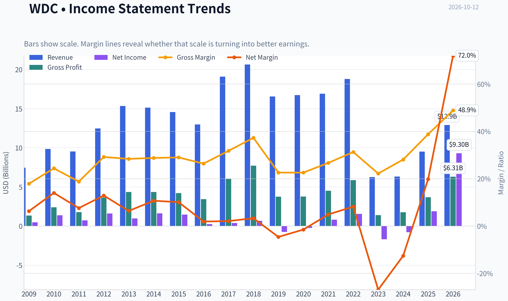

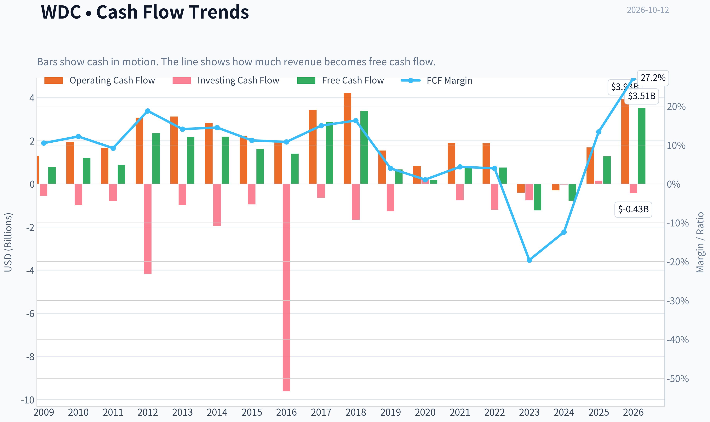

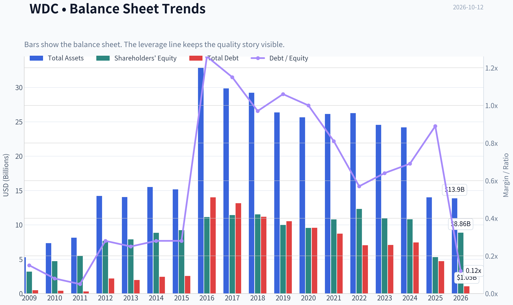

This graph tracks the profitability and return metrics (ROE, ROIC, Margins) of **WDC** over the past decade, highlighting capital efficiency trends.

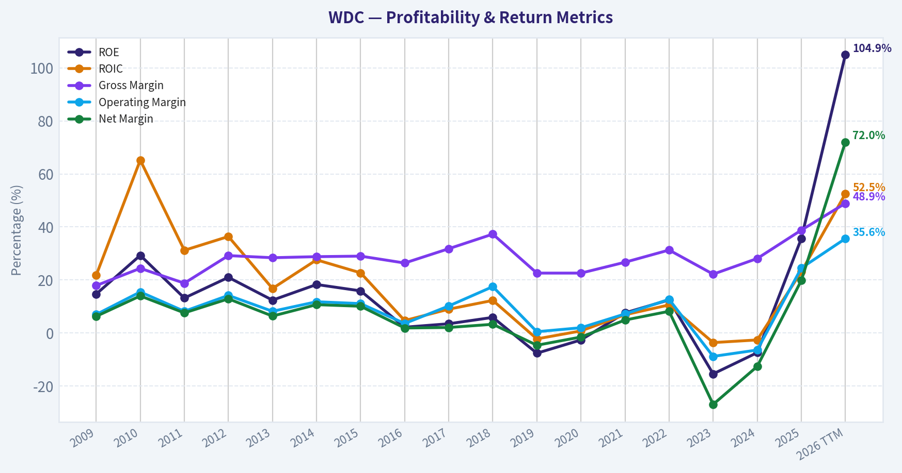

This chart illustrates the financial health of **WDC** over the last 10 years, mapping cash equivalents and free cash flow against total obligations (Debt).

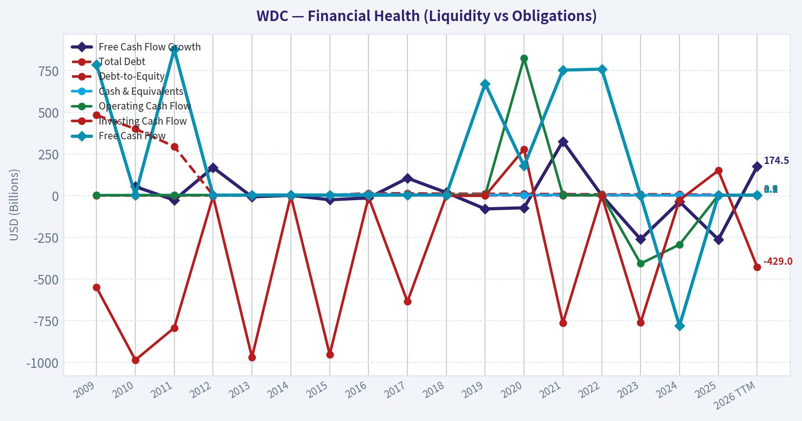

This breakdown chart from <em>Revenue Breakdown</em> shows the proportional composition for **WDC** - useful for understanding what drives or risks the business.

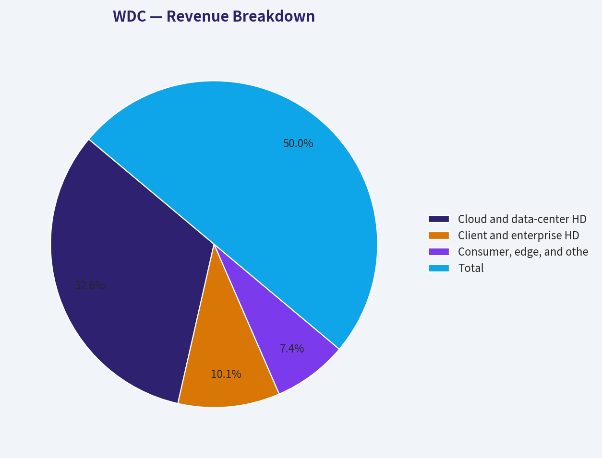

---

### Intrinsic Value Analysis (Buffett)

> *Following Warren Buffett's value investing philosophy: Circle of Competence, Economic Moat, Management Quality, and Margin of Safety.*

#### Intrinsic Value Snapshot

Price is what you pay. Intrinsic value is what the business may be worth based on the cash it can create for owners over time. We show a range, not one magic number.

- Current Price: $386.94
- Value Range (conservative to optimistic across both DCF methods): $36.72 to $2,399.18

##### Owner Earnings (Buffett Method)
- Net Income: $1,889,000,000.00
- Depreciation & Amortization: $375,000,000.00
- Capital Expenditures: $-418,000,000.00
- Working Capital Changes: $-658,000,000.00
- Owner Earnings: $2,959,000,000.00

##### Intrinsic Value
###### Buffett Method
Uses owner earnings. Stricter, and usually more conservative.
- Conservative: $36.72
- Average: $472.32
- Optimistic: $2,399.18
- Discount Rate: 10.0%

###### Cash Flow Method
Uses free cash flow. Better for companies spending heavily today to grow tomorrow.
- Conservative: $42.84
- Average: $127.41
- Optimistic: $292.12
- Discount Rate: 10.0%

ANALYST STANCE: **WATCH**

#### Executive View

Western Digital is a strategically important storage franchise benefiting from rising data-center demand, artificial intelligence workloads, and high-capacity nearline hard drives. Its competitive position is respectable, but the economics remain cyclical and the current valuation appears to capitalize a substantial portion of the recovery.

At $387 per share, the headline intrinsic value is $388.88, implying virtually no margin of safety. The business may continue to grow, but the stock price requires sustained earnings power rather than merely a cyclical rebound.

#### 1. Factor Scorecard

| Factor | Score | Assessment |
|---|---:|---|
| Circle of competence and simplicity | 3/5 | Understandable business: sells hard drives and storage products, but demand, pricing, technology transitions, and inventory cycles create forecast uncertainty. |
| Durable competitive advantage | 3/5 | Scale, manufacturing expertise, customer qualification, and a concentrated industry provide a moat, but NAND and HDD technology shifts remain important risks. |
| Management and capital allocation | 3/5 | Management has navigated a major strategic transformation, including the Sandisk separation, but long-term shareholder returns remain heavily dependent on cyclicality and capital discipline. |
| Industry structure | 3/5 | HDD manufacturing is concentrated and benefits from scale, but storage remains cyclical and technologically exposed. |
| **Gate 5: quality and solvency floor** | **Not tripped** | Available evidence does not indicate both deteriorating cash flows and a solvency crisis. |

**Key Takeaways:** WDC is a viable, strategically relevant business rather than a distressed company. However, its moat is narrower and less predictable than that of a high-quality software or platform compounder, while earnings are unusually sensitive to industry conditions.

#### 2. Moat Analysis

| Moat source | Evidence | Rating |
|---|---|---:|
| Intangible assets | Engineering know-how, customer qualification, patents, and long relationships with large cloud customers. Gross margin is reported at 48.9%, supporting meaningful product differentiation. | Moderate |
| Switching costs | Data-center customers cannot casually change storage suppliers because qualification, reliability testing, and integration take time. | Moderate |
| Cost advantage | Manufacturing scale, supply-chain expertise, and experience producing high-capacity drives create advantages that smaller competitors would struggle to replicate. | Moderate to strong |
| Network effects | Minimal direct network effects. WDC does not become intrinsically more valuable merely because more customers use its products. | Weak |
| Industry position | The HDD industry is concentrated, and high-capacity drives are important for large-scale data storage. | Positive |

The moat is best described as **narrow to moderately wide and stable**, not wide and widening. HDD demand should benefit from data creation and AI-related storage, but solid-state storage and technological substitution remain structural risks. The 48.9% gross margin is encouraging, although gross margin alone does not prove durable excess returns in a cyclical industry.

#### 3. Management Quality and Capital Allocation

Management deserves credit for repositioning the company around data-center storage and completing the separation of the flash business. That simplification can improve strategic focus and make capital allocation easier to evaluate.

The principal concern is not evidence of dishonesty or financial distress; it is the difficulty of judging normalized returns through a sharp industry cycle. WDC's reported 106.3% ROE is not a clean measure of operating excellence. It is likely amplified by a relatively small equity base, buybacks, and cyclical earnings. Investors should therefore emphasize free cash flow across a full cycle rather than peak-year earnings.

The recent trimming of WDC by Steve Cohen is not an investment thesis by itself, but it is consistent with the possibility that the stock has appreciated faster than normalized fundamentals.

#### 4. Financial Summary

| Metric | Latest reported value |
|---|---:|
| Share price | $387 |
| Market capitalization | $144.84 billion |
| P/E ratio | 14.4x |
| Revenue growth, year over year | 35.7% |
| Gross margin | 48.9% |
| ROE | 106.3% |
| FCF yield | 2.4% |
| Implied annual FCF | Approximately $3.48 billion |
| Current ratio | 1.33 |
| Reverse-DCF implied annual growth | Approximately 5.2% for 10 years |
| Headline intrinsic value | $388.88 |

**Key Takeaways:** Revenue growth is very strong, but the 2.4% free-cash-flow yield indicates that the market is valuing WDC on substantial future earnings power rather than current cash generation. The unusually high ROE should not be accepted at face value because cyclical profits and capital structure can materially distort it.

#### 5. Owner Earnings Calculation

A precise maintenance-capital-expenditure figure is not provided in the available financial summary, so the current free-cash-flow figure is used as a practical owner-earnings proxy.

| Owner earnings bridge | Approximate amount |
|---|---:|
| Net income | Not separately provided |
| Add: depreciation and amortization | Not separately provided |
| Less: maintenance capital expenditure | Not separately provided |
| Less: working-capital investment | Not separately provided |
| **Normalized owner-earnings proxy** | **Approximately $3.48 billion** |
| Implied shares outstanding | Approximately 374 million |
| Owner earnings per share proxy | Approximately $9.29 |

**Key Takeaways:** At the current market value, WDC produces an estimated owner-earnings yield of roughly 2.4%. That can become attractive if current cash flow is temporarily depressed, but the investment case requires confidence that normalized cash generation will be materially higher than today's figure.

#### 6. Three-Scenario DCF Valuation

The calculations below use approximately $9.29 of owner earnings per share as the starting point, with a 10% discount rate.

| Scenario | Assumptions | Estimated value per share |
|---|---|---:|
| A. No growth | Owner earnings divided by 10% | **$93** |
| B. GDP growth | 3% perpetual growth | **$133** |
| C. Historical/recovery growth | Higher growth and recovery assumptions, adjusted for cyclicality | **$472** |
| Research-pack blended valuation | Damodaran FCFF, reverse DCF, and owner-earnings methods | **$388.88** |

The underlying model outputs show a very wide range: approximately $472.32 from the owner-earnings model, $127.41 from the FCF model, and $33.99 from the Damodaran FCFF model. This dispersion is itself important evidence of valuation risk.

**Key Takeaways:** WDC's valuation is highly dependent on which earnings level is considered "normal." Conservative cash-flow methods produce values far below the current quote, while a recovery-oriented owner-earnings model supports a value above it. That is typical of a cyclical company near a strong earnings phase and argues against paying a full price.

#### 7. Margin of Safety Analysis

| Valuation measure | Result |
|---|---:|
| Current price | $387 |
| Headline intrinsic value | $388.88 |
| Margin of safety versus headline value | 0.5% |
| Owner-earnings DCF upside | Approximately 22% |
| FCF-based value versus price | Approximately 67% downside |
| Damodaran FCFF value versus price | Approximately 91% downside |

A 0.5% margin of safety is inadequate for a cyclical storage manufacturer. WDC would need a larger discount because:

- Revenue and pricing are cyclical.
- Technology substitution remains a long-term risk.
- ROE is distorted and not a reliable standalone indicator of quality.
- The valuation range across methods is exceptionally wide.
- Current FCF yield is only 2.4%.

The reverse DCF implies only about 5.2% annual growth for ten years. That is not an obviously heroic assumption, especially given the AI and data-center opportunity. Nevertheless, the stock still offers little protection if margins normalize downward or the current demand surge proves temporary.

#### 8. Final Buffett Scorecard

| Criterion | Weight | Score | Weighted contribution |
|---|---:|---:|---:|
| Moat width and durability | 25% | 3.0 | 0.75 |
| Valuation and margin of safety | 20% | 2.0 | 0.40 |
| Capital returns: ROIC versus WACC | 15% | 3.0 | 0.45 |
| Business understanding and predictability | 12% | 3.0 | 0.36 |
| Management quality and capital allocation | 12% | 3.0 | 0.36 |
| Reinvestment runway | 8% | 3.0 | 0.24 |
| Balance-sheet strength | 4% | 3.0 | 0.12 |
| Industry structure | 4% | 3.0 | 0.12 |
| **Total** | **100%** |  | **2.80 / 5.00** |

**Key Takeaways:** WDC scores reasonably on strategic position and industry concentration but poorly on valuation protection and predictability. The weighted score of 2.80 places it below the threshold for an attractive Buffett-style purchase at the current price.

#### 9. Investment Stance

**WATCH - Moderate conviction**

WDC is a credible cyclical storage leader with meaningful exposure to long-term data growth. However, at $387, the stock is priced close to the blended intrinsic-value estimate and offers no meaningful margin of safety under conservative cash-flow assumptions.

A more attractive entry point would require either:

1. A materially lower share price, ideally providing at least a 20% to 30% discount to a normalized intrinsic value; or
2. Several years of evidence that free cash flow has structurally increased and that the AI/data-center demand is producing durable, rather than peak-cycle, returns.

The right action is to monitor normalized owner earnings, gross margins, capital spending, customer concentration, and debt levels rather than chase the recent rally.
#### Valuation Bridge

This bridge places the current market price beside each intrinsic value lens so readers can see whether upside depends on one method or shows up across several methods.

| Scenario | Intrinsic Value / Share |
| --- | ---: |
| Buffett Method | $472.32 |
| Cash Flow Method | $127.41 |
| Damodaran Method | $33.99 |
| Current Price | $386.94 |

#### Key Takeaways

If one method is far above the others, the upside case depends on a specific modelling assumption. When several methods cluster together, the valuation story is more robust.

#### Valuation Visuals

This comparison chart from *Latest Earnings Snapshot* stacks current figures against historical benchmarks for **WDC**, making it easy to see where the company trades relative to its own averages.

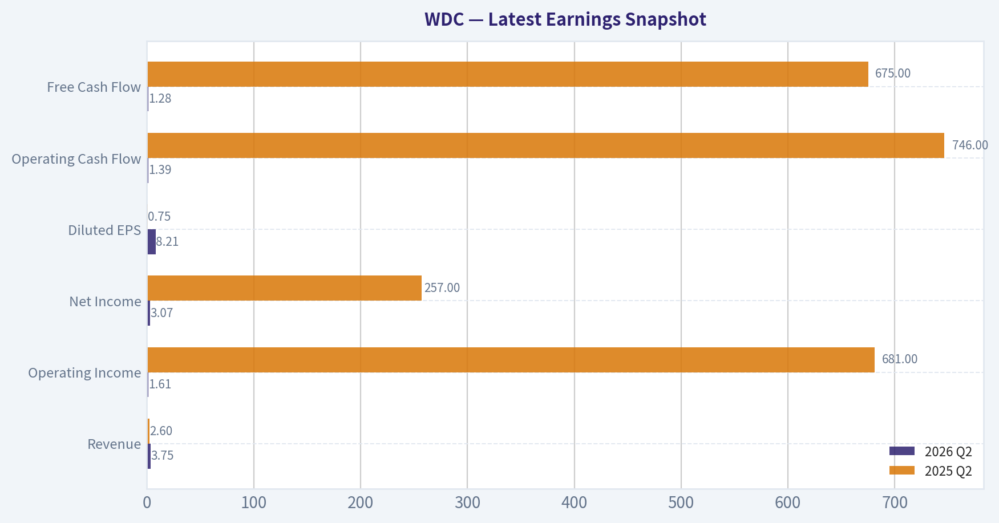

This comparison chart from *Balance Sheet and Financial Strength* stacks current figures against historical benchmarks for **WDC**, making it easy to see where the company trades relative to its own averages.

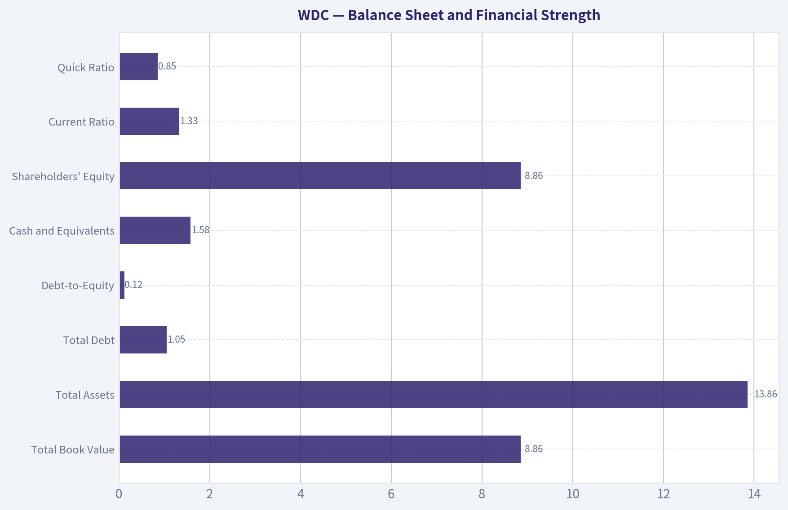

This comparison chart from *Cash Flow and Capital Allocation* stacks current figures against historical benchmarks for **WDC**, making it easy to see where the company trades relative to its own averages.

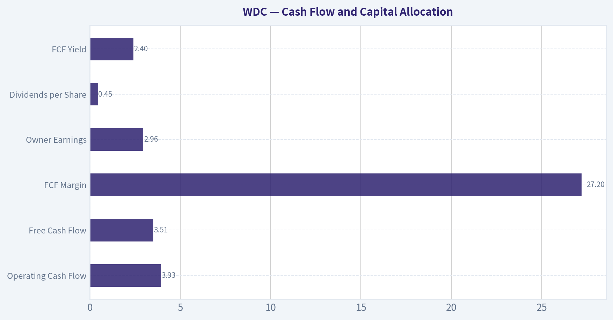

This comparison chart from *Current Versus Historical Average* stacks current figures against historical benchmarks for **WDC**, making it easy to see where the company trades relative to its own averages.

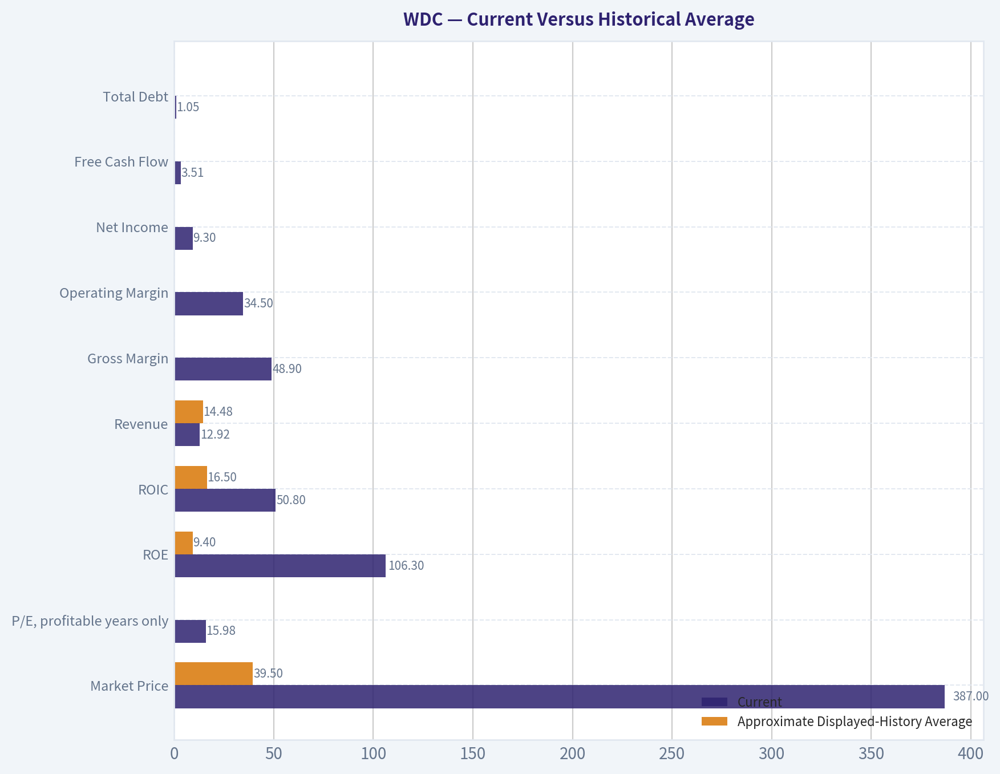

---

### Trend & Growth Analysis (Lynch/Druckenmiller/Fisher)

> *Following Peter Lynch's GARP, Stanley Druckenmiller's macro-aware approach, and Philip Fisher's scuttlebutt methodology.*

ANALYST STANCE: **WATCH**

#### 1. Lynch Classification

**Cyclical / fast-growing cyclical hybrid.** Western Digital is benefiting from a powerful AI data-center storage cycle, but its historical earnings and cash flow are highly sensitive to memory, HDD pricing, inventory, and enterprise spending cycles. It should not be treated like a predictable SaaS fast grower.

#### 2. The Story

- AI data centers require enormous quantities of high-capacity storage for model training, inference, and expanding data sets.
- Western Digital is a major supplier of hard-disk drives and storage infrastructure, with potential operating leverage as pricing and utilization improve.
- The company has demonstrated strong recent revenue growth, but the stock has already appreciated dramatically and appears to discount a meaningful portion of the AI-storage opportunity.

#### 3. Core Data Snapshot

| Metric | Value | Interpretation |
|---|---:|---|
| Current price | $387 | Very strong recent re-rating |
| Market capitalization | $144.84 billion | Large-cap valuation |
| Revenue growth, YoY | 35.7% | Strong cyclical recovery / AI demand |
| P/E ratio | 14.4x | Appears inexpensive versus growth, but earnings are cyclical |
| Gross margin | 48.9% | Healthy, though mix and pricing sensitive |
| ROE | 106.3% | Very high, partly affected by capital structure and cyclical earnings |
| FCF yield | 2.4% | Limited cash-flow valuation cushion |
| Current ratio | 1.33x | Adequate liquidity |
| Headline intrinsic value | $388.88 | Approximately fair value |
| Margin of safety | 0.5% | Essentially no modeled margin of safety |

**Key Takeaways:** WDC has strong reported growth and a modest headline P/E, but its 2.4% free-cash-flow yield and approximately fair intrinsic value provide little protection at the current price. The valuation looks attractive only if the current earnings recovery is durable rather than near a cyclical peak.

#### 4. TAM and 10x Test

The secular market opportunity is substantial: cloud storage, AI infrastructure, enterprise data retention, surveillance, and data-intensive applications should continue expanding. However, WDC's realistic addressable market is narrower than the entire AI infrastructure market because it primarily participates in storage hardware rather than the full AI compute stack.

| Scenario | Revenue implication | 10x test |
|---|---:|---|
| Current revenue base | Not provided in research pack | Baseline unavailable |
| 10x current revenue | Requires exact current revenue | Cannot calculate precisely |
| Practical TAM view | Large but concentrated in data-center storage | A 10x outcome is possible only with sustained share, pricing, and market expansion |
| Key constraint | HDD/storage is cyclical and competitive | TAM growth does not automatically translate into durable margins |

**Key Takeaways:** The storage market has a long secular runway, particularly in AI data centers, but WDC's opportunity is not equivalent to the entire AI market. A 10x revenue outcome cannot be verified from the available data, and the principal uncertainty is whether storage demand converts into durable pricing power rather than another capacity cycle.

#### 5. Revenue Growth Trend

| Period / indicator | Result | Assessment |
|---|---:|---|
| Latest YoY revenue growth | 35.7% | Strong |
| Historical trailing 3-year growth | 91.1% cumulative / reported metric | Indicates major recovery and re-rating |
| Growth pattern | Current acceleration from a depressed cyclical base | Positive, but not yet proven durable |
| Visibility | AI contracts and data-center demand supportive | Requires confirmation through multiple quarters |

**Key Takeaways:** The latest 35.7% growth rate is a meaningful positive inflection, likely driven by data-center demand, pricing, and recovery from a weak base. The available information does not establish a multi-quarter acceleration pattern, so this is best classified as a strong cyclical upturn rather than a proven secular compounder.

#### 6. Unit Economics and Profitability

| Measure | Value / status | Interpretation |
|---|---:|---|
| LTV/CAC | Not applicable / unavailable | Hardware economics differ from SaaS |
| Net revenue retention | Not disclosed | Not a standard primary metric for WDC |
| Rule of 40 | Not meaningful without FCF margin | Hardware company, not subscription software |
| Gross margin | 48.9% | Strong but potentially cyclical |
| FCF yield | 2.4% | Cash generation is not yet compelling at current valuation |
| Operating leverage | Potentially positive | Depends on volume, mix, pricing, and utilization |

**Key Takeaways:** WDC's key unit-economic variables are average selling prices, exabyte shipments, manufacturing costs, utilization, and customer concentration-not LTV/CAC or NRR. Gross margin is healthy, but the low FCF yield suggests the market is already pricing in substantial future cash-flow improvement.

#### 7. Inflection Point Assessment

| Inflection indicator | Evidence | Rating |
|---|---|---|
| Product cycle | High-capacity drives for AI and cloud workloads | Positive |
| Market-share inflection | AI storage contracts cited, but share data unavailable | Potentially positive |
| Margin inflection | 48.9% gross margin and likely operating leverage | Positive, needs confirmation |
| TAM inflection | AI-generated data is expanding storage demand | Strong |
| Competitive inflection | No verified major competitor failure | Neutral |
| Earnings inflection | 35.7% revenue growth and strong recent stock performance | Positive but increasingly recognized |

**Key Takeaways:** The strongest inflection is demand-driven: AI data centers are expanding the need for high-capacity storage. The market appears to have recognized much of this thesis already-the stock has reportedly risen about 11 times over three years-so future returns require earnings to exceed increasingly optimistic expectations.

#### 8. Macro Setup

The macro backdrop is mixed but favorable for the secular theme. AI infrastructure and cloud-capital spending remain strong secular drivers, while the company remains exposed to enterprise budgets, interest rates, component costs, and the normal storage cycle. Falling rates would support valuation, but a late-cycle slowdown or hyperscaler capital-spending pause would be a material headwind.

**Macro assessment: Moderately favorable, but cyclical risk is high.**

#### 9. Fisher 15-Point Assessment

| Fisher factor | Score / 5 | Comment |
|---|---:|---|
| Market potential | 4 | Large cloud, AI, and enterprise-storage demand |
| New-product determination | 3 | Product roadmap appears relevant; evidence limited |
| R&D effectiveness | 3 | Technology position is meaningful but not fully assessed |
| Sales organization | 4 | Established hyperscaler and enterprise relationships |
| Profit margins | 4 | 48.9% gross margin |
| Margin improvement | 4 | Potential operating leverage in recovery |
| Labor relations | 3 | No major evidence either way |
| Executive relations | 3 | Limited current evidence |
| Management depth | 4 | Large, established operating organization |
| Cost analysis/accounting | 3 | No detailed scuttlebutt available |
| Outstanding moat | 4 | Scale, qualification, manufacturing, and customer relationships |
| Long-range profit outlook | 3 | Secular demand strong; cycle creates uncertainty |
| Dilution risk | 3 | No major dilution issue identified from supplied data |
| Management candor | 3 | Insufficient evidence |
| Management integrity | 3 | Insufficient evidence |

**Fisher score: 51 / 75 - Average to good, but below outstanding.**

**Key Takeaways:** WDC scores well on market access, scale, margins, and storage infrastructure relevance. It scores lower because the available evidence does not establish exceptional management differentiation, superior innovation economics, or unusually durable long-term profitability.

#### 10. Valuation Analysis

| Method | Result | Interpretation |
|---|---:|---|
| P/E | 14.4x | Attractive on current earnings, but potentially cycle-peak earnings |
| PEG | Approximately 0.40x | Looks highly attractive mathematically using 35.7% growth |
| FCF yield | 2.4% | Expensive relative to current cash generation |
| Headline intrinsic value | $388.88 | Roughly equal to $387 price |
| Owner-earnings DCF | $472.32 | Bullish model |
| FCF model | $127.41 | Very bearish model |
| Damodaran FCFF | $33.99 | Extremely bearish model |
| Reverse DCF | Implies about 5.2% annual growth for 10 years | Moderate expectations embedded |

**Key Takeaways:** The PEG ratio is misleadingly attractive because it uses a cyclical recovery growth rate. Valuation models show an unusually wide range-from $33.99 to $472.32-indicating high sensitivity to normalized margins and cash flow. The blended intrinsic value is essentially equal to the current price, so WDC is not obviously undervalued despite its low P/E.

#### 11. Growth Investor Scorecard

| Criterion | Weight | Score / 5 | Weighted contribution |
|---|---:|---:|---:|
| Lynch story | 10% | 4.0 | 0.40 |
| TAM and runway | 20% | 4.0 | 0.80 |
| Revenue growth | 20% | 4.0 | 0.80 |
| Unit economics | 15% | 3.0 | 0.45 |
| Competitive position | 10% | 3.8 | 0.38 |
| Management quality | 10% | 3.2 | 0.32 |
| Macro setup | 5% | 3.5 | 0.18 |
| Profitability path | 5% | 3.8 | 0.19 |
| Valuation | 5% | 2.5 | 0.13 |
| **Total** | **100%** |  | **3.65 / 5.00** |

**Key Takeaways:** WDC qualifies as a good setup rather than a high-conviction ten-bagger candidate. Its score is supported by AI-driven demand, strong recent revenue growth, and competitive scale, but reduced by cyclicality, uncertain cash-flow normalization, and limited valuation upside.

#### 12. Position Size Stance

- **Existing holders:** Hold a measured position, but consider trimming if WDC has become oversized after the rally.
- **New investors:** Wait for either a meaningful pullback or evidence that revenue growth, pricing, and free cash flow are accelerating together.
- **Suggested posture:** **Small watch position, not a concentrated core position.**
- **Risk tolerance:** Appropriate only for investors comfortable with semiconductor and storage-cycle volatility.

#### 13. Catalysts and Risks

| Catalysts | Risks |
|---|---|
| Additional hyperscaler AI-storage contracts | AI capital-spending slowdown |
| Sustained high-capacity drive pricing | Storage oversupply and pricing pressure |
| Multiple quarters above 25% revenue growth | Current growth proves to be a low-base rebound |
| Free-cash-flow conversion improves materially | Earnings normalize faster than expected |
| Gross-margin expansion and operating leverage | Customer concentration and bargaining power |
| Broader data-retention requirements | Competition, technology substitution, or execution issues |

**Key Takeaways:** The most important catalyst is confirmation that AI-related storage demand is translating into durable pricing and free-cash-flow growth. The central risk is that investors are extrapolating a cyclical recovery too far, leaving the stock vulnerable if demand, pricing, or hyperscaler spending moderates.

#### Bottom Line

WDC has a compelling AI-storage story and a genuine operating inflection, but the stock's extraordinary prior appreciation means the easy money may already have been made. The low P/E and PEG appear attractive, yet they rely on cyclical earnings and do not align with the limited FCF yield or blended intrinsic value. **WATCH:** maintain exposure only at a controlled position size and require further earnings acceleration before upgrading to **ADVOCATE**.

---

### Market Technical Analysis

ANALYST STANCE: **WATCH**

#### WDC technical overview

Western Digital's technical picture is divided between a still-constructive long-term trend and a clearly deteriorating short-term setup. The latest available closing price in the retrieved data is **$397.28 on October 9, 2026**; the indicator feed also reports values for October 12, although no October 12 price record is present. This timing discrepancy should be kept in mind when interpreting the signals.

Over the past year, WDC experienced an exceptionally strong advance, rising from approximately **$118.64 in October 2025 to a peak near $799.61 in June 2026**, before undergoing a major retracement. The stock subsequently declined to the high-$300s, representing roughly a **50% drawdown from the June intraday high**. That scale of decline makes volatility and position sizing especially important.

#### Trend indicators

The trend structure is mixed across time horizons:

- The **10-day EMA is $414.79**, above the latest reported close of $397.28. This confirms near-term price weakness, with sellers currently controlling the short-term trend.
- The **50-day SMA is $454.37**, substantially above price. It has been falling steadily from approximately $493 in mid-September, indicating that the medium-term trend remains under pressure.
- The **200-day SMA is $406.75**, only modestly above the latest close. This is the most important nearby long-term reference. A sustained move below this level would weaken the broader bullish structure and could turn the 200-day average from support into resistance.
- The 50-day SMA remains above the 200-day SMA, so a formal long-term death cross has not been established. However, the gap between them is narrowing, and continued weakness could produce a bearish crossover later.

The key distinction is that WDC is not yet in an unambiguous long-term bear market based on moving averages, but it is trading below both short- and medium-term trend benchmarks. A recovery above the 10-day EMA would be an initial improvement; reclaiming the 50-day SMA near $454 would provide more meaningful confirmation.

#### Momentum and volume-weighted trend

The **MACD is -16.85**, down from -3.32 on October 1 and deeply negative relative to recent readings. This shows that downside momentum accelerated during the October selloff. The MACD's deterioration is more concerning than the merely negative absolute value because the indicator had been improving through late September before reversing sharply.

The **RSI is 36.40**, down from 51.65 on October 1. This places momentum in the weak zone, but not yet in the conventional oversold zone below 30. Therefore, the RSI does not yet provide a strong standalone reversal signal. It does suggest that additional downside may be possible before a durable rebound, while a bullish RSI divergence could become relevant if price retests the lows but RSI forms a higher low.

The **VWMA is $427.22**, above the latest close and below the 10-day EMA. This indicates that recent price action, when weighted by volume, is still concentrated at higher levels than the current market price. The October 2 decline occurred on approximately **24.8 million shares**, far above the surrounding daily volume, making that break particularly significant. High-volume selling tends to carry more technical weight than a low-volume drift lower.

A bullish recovery should ideally be accompanied by price reclaiming the VWMA and improving volume on advances. Without that confirmation, rebounds may represent short covering or oversold trading rather than a confirmed trend reversal.

#### Volatility and Bollinger positioning

The **Bollinger middle band is $433.12**, while the latest close is below it. This reinforces the message from the moving averages: price is trading beneath its intermediate-term equilibrium level.

The stock's recent trading ranges remain unusually wide. The **ATR is $25.49**, meaning the typical daily movement is approximately $25, or about **6% of the current share price**. Although ATR has declined from roughly $31.44 in mid-September, volatility remains elevated. Stops placed too close to the entry price are vulnerable to normal daily fluctuations, while position sizes should generally be reduced to account for the large dollar range.

The price's location below the Bollinger midpoint, combined with a falling 10-day EMA and negative MACD, favors caution. However, RSI near 36 is not yet deeply oversold, so the stock has not reached a technically compelling mean-reversion extreme based on the selected indicators alone.

#### Important levels and scenarios

| Area | Approximate level | Technical interpretation |
|---|---:|---|
| Immediate resistance | $415-$427 | 10-day EMA and VWMA zone; reclaiming it would show initial stabilization |
| Intermediate resistance | $433-$454 | Bollinger midpoint and 50-day SMA; a decisive move above this range would improve the medium-term outlook |
| Long-term pivot | About $407 | 200-day SMA; holding above it could preserve the broader bullish structure |
| Current breakdown risk | Below $397-$407 | A sustained break would place price below the 200-day SMA and increase the probability of further trend deterioration |
| Momentum condition | RSI 36.4; MACD -16.85 | Weak momentum, but RSI is not yet oversold; downside pressure remains active |
| Risk-management reference | ATR $25.49 | Daily volatility is high; stops and position sizes should reflect approximately $25 of typical movement |

**Key Takeaways:** WDC is below its 10-day EMA, 50-day SMA, VWMA, and Bollinger midpoint, so the short- and medium-term trend remains bearish. The 200-day SMA near $407 is the decisive long-term pivot: holding it could support a recovery attempt, while a sustained break below it would materially worsen the technical picture. Volatility remains high, and the current RSI does not yet indicate an especially strong oversold reversal setup.

#### Selected indicators and suitability

The eight selected indicators are **close_10_ema, close_50_sma, close_200_sma, macd, rsi, boll, atr, and vwma**.

They are complementary in this context:

- **10 EMA:** Captures immediate trend changes.
- **50 SMA:** Defines the medium-term trend and resistance.
- **200 SMA:** Establishes the strategic long-term trend boundary.
- **MACD:** Measures directional momentum and acceleration.
- **RSI:** Assesses whether the decline is becoming statistically stretched.
- **Bollinger middle band:** Provides a mean-reversion and equilibrium reference.
- **ATR:** Quantifies risk and expected daily price movement.
- **VWMA:** Adds volume confirmation to the price trend.

The overall signal is therefore **cautious rather than decisively bearish**. Aggressive traders may monitor the $397-$407 area for stabilization, but a stronger long setup would require evidence such as a close back above the VWMA and 10-day EMA, improving MACD momentum, and eventually a reclaim of the $433-$454 resistance zone. A sustained close below the 200-day SMA would favor avoiding new long exposure until a clearer base develops.

#### Market Visuals

This comparison chart from *Current Market Metrics* stacks current figures against historical benchmarks for **WDC**, making it easy to see where the company trades relative to its own averages.

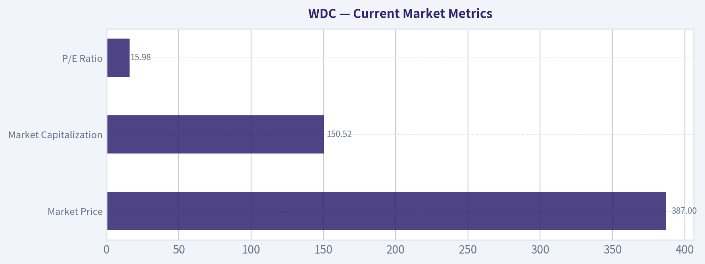

---

### Options Market Analysis

> *Reading options flow - put/call ratios, IV skew, and unusual activity - to gauge institutional positioning and event-driven risk.*

#### WDC Options Market Report

**As of October 12, 2026.** The available data indicates a strongly call-heavy near-term options profile, but confidence is reduced because open interest is recorded as zero for the October 23 and October 30 expirations, and no contract-level strike data or current share price was provided.

#### Put/Call Ratio Analysis

| Expiration | Call OI | Put OI | Put/Call OI Ratio | Call Volume | Put Volume | Put/Call Volume Ratio |
|---|---:|---:|---:|---:|---:|---:|
| Oct. 16, 2026 | 687 | 79 | 0.11 | 13,253 | 6,543 | 0.49 |
| Oct. 23, 2026 | 0 | 0 | N/A | 4,364 | 2,160 | 0.49 |
| Oct. 30, 2026 | 0 | 0 | N/A | 3,216 | 1,022 | 0.32 |
| **Near-term total** | **687** | **79** | **0.11** | **20,833** | **9,725** | **0.47** |

**Key Takeaways:** The aggregate put/call OI ratio of 0.11 is substantially below the approximately 0.70 neutral baseline, indicating a pronounced call-heavy positioning bias. Trading volume is also call-dominant, with a 0.47 put/call volume ratio. However, the zero-OI readings for two expirations make the OI signal less reliable than usual.

The positioning is directionally **bullish**, or potentially reflects call overwriting activity, although the strong call-volume skew is more consistent with bullish speculation than with simple hedging.

#### Implied Volatility Assessment

| Expiration | Call ATM IV | Put ATM IV | IV Difference, Calls Minus Puts | Interpretation |
|---|---:|---:|---:|---|
| Oct. 16, 2026 | 2.8% | 2.6% | +0.2 percentage points | Slight call premium |
| Oct. 23, 2026 | 1.8% | 1.6% | +0.2 percentage points | Slight call premium |
| Oct. 30, 2026 | 1.5% | 1.5% | 0.0 percentage points | Balanced |

**Key Takeaways:** Reported near-term IV is extremely low, ranging from 1.5% to 2.8%, which suggests limited expected movement or potentially incomplete/stale options data. Calls trade at a slight IV premium to puts in the nearest two expirations, so the available data shows a mild call skew rather than downside fear. No known catalyst can be confirmed from the supplied dataset, so the low IV should not be interpreted as definitive evidence that event risk is absent.

There is no evidence here of a steep OTM put skew. A true OTM skew comparison cannot be calculated because only ATM IV was supplied.

#### Unusual Options Activity

| Finding | Result |
|---|---|
| Contracts with volume greater than five times open interest | None identified |
| Fresh directional contract-level signals | Not confirmed |
| Strike-level moneyness | Unavailable |
| Days to expiration | 4 days for Oct. 16; 11 days for Oct. 23; 18 days for Oct. 30 |

**Key Takeaways:** No individual contracts met the unusual-activity threshold of volume exceeding five times open interest. Therefore, there is no confirmed large fresh institutional bet that can be classified as a smart-money call or put position. The overall bullish read comes from aggregate call-heavy activity, not from a specific sweep or block trade.

Because strike-level data is unavailable, it is not possible to determine whether the traded calls or puts are ITM, ATM, or OTM. That limits the ability to distinguish institutional hedging from retail upside speculation.

#### Open Interest Concentration and Gamma Levels

| Expiration | Highest Reported Call OI | Highest Reported Put OI | Gamma-Wall Assessment |
|---|---:|---:|---|
| Oct. 16, 2026 | Aggregate 687 | Aggregate 79 | Strike concentration unavailable |
| Oct. 23, 2026 | No OI reported | No OI reported | Cannot assess |
| Oct. 30, 2026 | No OI reported | No OI reported | Cannot assess |

**Key Takeaways:** Aggregate open interest is concentrated in the October 16 expiration, but the individual strikes with the largest positions were not supplied. As a result, specific pinning levels, max-pain estimates, and gamma walls cannot be identified. The available data does not support a reliable conclusion about whether dealer gamma will amplify or dampen WDC's next move.

#### Overall Options Sentiment

| Signal Component | Assessment | Confidence |
|---|---|---|
| Put/call OI | Strongly call-heavy at 0.11 | Moderate |
| Put/call volume | Call-heavy at 0.47 | Moderate |
| IV level | Extremely low reported IV | Low to moderate |
| IV skew | Slight call skew; no evident put fear | Low |
| Unusual activity | None detected | Low |
| Liquidity/data quality | Potentially limited or incomplete | Low |
| **Overall signal** | **BULLISH, with substantial caveats** | **Low to moderate** |

**Key Takeaways:** WDC's options positioning is **BULLISH**, primarily because both open interest and trading volume are heavily tilted toward calls, well below the neutral put/call ratio benchmark. The signal is weakened by absent OI in two expirations, unavailable strike-level information, no detected unusual contracts, and unusually low reported IV. This should be treated as a directional positioning signal rather than a high-conviction institutional call.

The main risk to the bullish interpretation is that call-heavy activity could include covered-call writing or data-quality distortions rather than outright call buying. Confirmation would require strike-level trades, bid/ask execution data, current underlying price, and reliable open interest across expirations.

#### Summary

| Category | Assessment |
|---|---|
| Put/Call Ratio | **Bullish:** 0.11 OI ratio and 0.47 volume ratio, both below the 0.70 neutral baseline |
| IV Level | **Very low:** 1.5%-2.8% reported ATM IV |
| Skew Direction | **Slight call skew:** calls have marginally higher ATM IV than puts in the nearest expirations |
| Unusual Activity | **None detected:** no contract exceeded five times its open interest |
| Overall Signal | **BULLISH, low-to-moderate confidence** |

**Key Takeaways:** The aggregate options market leans bullish on WDC, with substantially more call exposure and call trading than put exposure. Still, the lack of unusual contract-level activity and incomplete open-interest data means the signal is not strong enough to be considered a high-confidence institutional conviction trade.

---

## Research Team Commentary

> *The Research Manager synthesizes the Bull vs Bear debate into action-free commentary. This is a pre-risk view, not the final stance.*

Core takeaway: Western Digital has a credible strategic position in high-capacity storage, and AI-driven data growth could support a stronger cycle than historical comparisons imply. However, at roughly $387, the investment case depends too heavily on approximately $27 of reported EPS being sustainable and close to distributable free cash flow. For a capital-intensive, technologically exposed cyclical business, the prospective 10%-18% upside in the bull's base valuation is not enough compensation for the possibility that normalized earnings are 20%-30% lower. I would not sell the story short, but I would not initiate a long-term value position without better evidence on normalized cash generation.

The strongest bull argument is not the headline 106% ROE or 51% ROIC; those figures are too extraordinary and potentially distorted by the company's capital structure, separation activity, accounting base, and favorable point in the cycle. The real bull case is the industry structure. High-capacity hard drives require difficult manufacturing, accumulated intellectual property, customer qualification, reliability at scale, and continuing engineering investment. Only a few suppliers can compete globally. Hyperscalers may dual-source, but switching is not frictionless.

AI also strengthens the demand runway. Training data, model checkpoints, inference records, video, logs, backups, and replicated data all need storage. Much of that information does not require flash-level latency, and HDDs retain an important cost-per-terabyte advantage for bulk storage. If exabyte demand keeps compounding while industry capacity remains disciplined, WDC could enjoy improving utilization, product mix, and through-cycle earnings. The market may be making the same mistake previously made with some semiconductor names: applying old-cycle assumptions too mechanically while a secular infrastructure buildout is changing the earnings plateau.

The bull's reverse-DCF framing is therefore directionally useful. At 14.37 times reported earnings, the market does not appear to require extraordinary growth if the current earnings base is durable. If approximately $27 per share is genuinely normalized and earnings can grow around 4%-5%, a value in the low-to-mid $400s is plausible. Prior share-price appreciation alone does not prove overvaluation, and current technical weakness could eventually provide a better entry into a structurally improved business.

The strongest bear argument, however, attacks the most important variable: the starting cash-flow base. The bull effectively capitalizes reported EPS as though it were owner earnings. That is risky for a company that must continually spend on product transitions, manufacturing capability, reliability, qualification, and cost-per-terabyte improvements. The moat is real, but it is expensive to maintain.

This matters because valuation changes sharply with relatively ordinary normalization. If sustainable earnings are closer to $22, $20, or $19 rather than $27, the shares trade at roughly 18-21 times normalized earnings before accounting for the difference between earnings and free cash flow. The bull's own sensitivity then suggests material downside. A 20%-30% haircut is not a disaster scenario for storage hardware; it could result merely from weaker pricing, lower utilization, mix normalization, or higher reinvestment.

The reported profitability metrics actually reinforce the need for caution. A 48.9% gross margin, 68% ROA, 50.8% ROIC, and 106.3% ROE do not look like conservative through-cycle assumptions for this business. They may demonstrate powerful operating leverage, but operating leverage works both ways. Without several years of comparable post-separation free cash flow, maintenance capital expenditure, leverage, and cycle-bottom margin data, these figures cannot justify treating WDC as a predictable wide-moat compounder.

The competitive moat also deserves a measured rating rather than the bull's more generous interpretation. Industry concentration and customer qualification create barriers, but hyperscalers are large, sophisticated buyers that intentionally maintain multiple suppliers. HDDs remain economically valuable, yet continued flash improvement creates a genuine terminal-value risk. SSDs do not need to eliminate HDDs to impair WDC's economics; they only need to capture progressively more valuable workloads and leave HDDs concentrated in highly price-sensitive bulk-storage tiers.

From Buffett's perspective, WDC is therefore an economically important franchise but not yet a highly predictable compounder. Its cyclicality, recurring capital requirements, customer bargaining power, and substitution risk mean it should require a larger margin of safety than an asset-light platform with recurring revenue. At the current price, the apparent discount is only around 10%-18% under favorable assumptions and disappears if current earnings are even moderately above normal. That does not meet the roughly 40%-50% margin-of-safety standard appropriate for a lower-predictability cyclical business.

The weak chart and call-heavy positioning are secondary rather than decisive. The shares are below the 10-day EMA and falling 50-day average, so near-term momentum remains unfavorable. The very low put/call ratio suggests bullish crowding, although the incomplete open-interest data reduce its reliability. These signals argue against rushing into the shares, but they do not prove that the stock cannot rally.

That distinction incorporates the main lesson from the prior Workday and Micron mistakes. "Not sufficiently undervalued" is not the same as "likely to decline." WDC could rebound sharply if AI enthusiasm strengthens, earnings estimates rise, or price reclaims the relevant moving averages. The earlier mistake was allowing traditional valuation and cyclicality concerns to become an absolute veto despite improving fundamentals and momentum. The corrective lesson is not to buy every AI beneficiary regardless of price; it is to separate the long-term value judgment from the tactical stock setup.

Rationale: I would keep WDC on the watchlist because the business may be undergoing a genuine structural improvement, but the evidence is not yet sufficient to capitalize current earnings as normal. The asymmetry currently looks balanced at best: modest upside if favorable margins persist, versus meaningful downside under routine normalization. The missing free-cash-flow and balance-sheet information is especially important because management quality cannot be inferred from the strategic story alone. A stronger earnings-to-cash conversion record or a materially lower price could change the conclusion.

Monitoring plan: Over the next one to four quarters, the first priority is free-cash-flow conversion. I would compare operating cash flow and free cash flow with reported net income, while separating maintenance capital expenditure from growth spending as far as disclosures allow. Consistent conversion would strengthen the bull case; a wide recurring gap would confirm that EPS overstates owner earnings.

Second, I would track gross margin, nearline HDD pricing, exabyte shipments, capacity utilization, and product mix. The thesis improves if exabyte growth remains strong while margins hold through normal pricing fluctuations. It weakens if volume grows but pricing and cash margins deteriorate, because that would show customers capturing most of the AI-storage economics.

Third, I would verify net debt, interest expense, liquidity, and management's capital-allocation priorities following the strategic separation. Conservative leverage and disciplined capacity spending would deserve credit. Debt-funded repurchases or aggressive expansion near favorable cycle conditions would be warning signs.

Fourth, I would monitor hyperscaler qualifications, market share, high-capacity product transitions, and evidence of supply discipline across the industry. Stable share and successful qualification of new drive generations would support the moat. Delays, share losses, or aggressive industry capacity additions would weaken it.

Fifth, I would track HDD versus SSD total cost per terabyte, including power and rack-density economics. The bull thesis does not require HDDs to win every workload, but it does require their economic advantage in bulk nearline storage to remain substantial.

Finally, for tactical positioning, a reclaim of the 10-day EMA followed by the falling 50-day average, accompanied by rising earnings estimates and improving cash-flow evidence, would justify a more constructive stance. Conversely, continued price weakness alongside estimate cuts or margin deterioration would indicate that the apparent low P/E was cyclical rather than genuinely cheap.

For an upgrade to ADVOCATE, I would want either a materially lower entry price-ideally one offering at least a 30% discount to a conservatively normalized cash-flow value-or several quarters demonstrating that current margins and earnings convert into durable free cash flow with a strong balance sheet. Until then, the franchise deserves respect, but the valuation does not provide enough protection.

WATCH

---

## Value Investing Team Commentary

> *The Investor translates the research view into an investment thesis before risk review. This is still not the final stance.*

### Business-owner assessment

Western Digital has a credible role in the AI infrastructure buildout, but it should not yet be valued as a predictable AI compounder. The company benefits from the rapid growth of data that must be stored economically, and high-capacity HDDs retain an important cost-per-terabyte advantage over flash for bulk and nearline workloads. Manufacturing expertise, intellectual property, reliability requirements, and lengthy hyperscaler qualification processes create meaningful barriers to entry.

Those advantages are real, but they do not eliminate the industry's cyclicality. WDC still faces concentrated, sophisticated customers, recurring technology investment, volatile pricing, and long-term substitution from flash. Its moat is best described as **narrow-to-moderate and capital-intensive**, rather than the low-maintenance moat of an asset-light platform.

### What the market may be missing

The contrarian bull case is that investors may be applying an outdated commodity-cycle framework to a structurally stronger storage market. AI training, inference, model checkpoints, video, logs, replication, and archival data could drive sustained exabyte growth. Flash does not need to lose for HDDs to remain economically essential: much of this data does not require flash latency, and the lowest-cost storage tier can continue expanding alongside faster tiers.

If industry supply remains disciplined, rising exabyte demand could produce a higher earnings floor, better utilization, and more durable margins than WDC historically earned. At approximately 14 times reported earnings, the shares would not be obviously expensive if roughly $27 per share represented sustainable owner earnings.

The market's current technical pessimism may also create an eventual opportunity. The stock is below its 10-day EMA and falling 50-day average, but it has not yet experienced a formal long-term death cross. Weak price action alone does not establish business deterioration. A recovery accompanied by upward earnings revisions and stronger cash-flow evidence could indicate that the recent decline was consolidation rather than the end of the fundamental cycle.

### What bullish sentiment may be overlooking

The critical issue is not whether AI creates more data; it clearly does. The issue is **how much of that demand becomes distributable cash for WDC shareholders**.

Reported EPS cannot automatically be treated as owner earnings. WDC must keep investing in drive technology, manufacturing processes, reliability, customer qualification, and cost-per-terabyte improvements. If sustainable earnings are only $19-$22 rather than approximately $27, the valuation rises to roughly 18-20 times normalized earnings before allowing for any gap between accounting income and free cash flow. That is not an obviously cheap price for a capital-intensive cyclical company.

The supplied profitability figures require particular skepticism:

- 106.3% ROE
- 68.0% ROA
- 50.8% ROIC
- 48.9% gross margin

These figures are too extraordinary to extrapolate without reconciling the effects of separation activity, capital structure, accounting classifications, and the favorable point in the cycle. ROE can be inflated by a small equity base, while ROIC and ROA can be distorted by transaction accounting or mismatched periods. They are evidence of strong operating leverage, not proof of durable economics. Operating leverage also works forcefully in reverse when pricing or utilization weakens.

The extremely call-heavy options positioning adds another caution. A 0.11 put/call open-interest ratio suggests that bullish expectations are already crowded, although zero-open-interest readings for some expirations weaken the dataset. This does not predict an imminent decline, but it means the AI-storage thesis is hardly undiscovered. A merely satisfactory quarter could disappoint investors positioned for continued exceptional performance.

### Valuation and margin of safety

WDC does not deserve the same margin-of-safety standard as a stable, recurring-revenue, wide-moat company. Its cyclicality, capital requirements, customer bargaining power, and substitution risk call for a substantially larger discount to conservative intrinsic value.

At approximately $387, the favorable valuation range in the low-to-mid $400s offers only about 10%-18% upside. That is inadequate if normalized earnings could decline by 20%-30% without requiring a severe recession or technological collapse. The current price appears to offer a reasonable return only if today's elevated earnings base is durable-precisely the assumption that remains unproven.

The reverse-DCF question is therefore straightforward: **What must be true at the current price?** WDC must sustain much of its present profitability, convert accounting earnings into free cash flow, maintain disciplined capacity, and preserve HDD cost advantages while AI storage demand compounds. Those assumptions are possible, but collectively they leave little room for ordinary cyclical normalization.

A materially lower price could change the conclusion. For this type of business, I would seek at least a 30% discount to conservatively normalized cash-flow value, with a still larger discount warranted if leverage or cash conversion proves weak. Alternatively, several quarters of strong post-separation free cash flow could reduce the uncertainty and justify a smaller required discount.

### Management and capital allocation

The available information is insufficient to reach a strong conclusion about management quality. The strategic position is promising, but shareholder-oriented capital allocation must be demonstrated through:

1. Disciplined capacity investment rather than expansion near cyclical highs.
2. Conservative leverage and ample liquidity.
3. Repurchases only when shares trade materially below normalized value.
4. Transparent disclosure of maintenance versus growth capital expenditures.
5. Incentives based on through-cycle cash returns rather than peak-period EPS.

Debt-funded repurchases or aggressive capacity additions would be serious warning signs. Conversely, debt reduction, restrained capital spending, and consistent free-cash-flow conversion would support an upgrade.

### Evidence required for a more constructive stance

The most important indicators over the next several quarters are:

- Free cash flow relative to net income, including working-capital effects.
- Maintenance capital expenditure and post-separation investment requirements.
- Net debt, interest expense, liquidity, and debt maturities.
- Nearline HDD pricing, exabyte shipments, utilization, and gross margin.
- Successful qualification and ramp-up of new high-capacity products.
- Industry capacity discipline and WDC's market-share stability.
- HDD total cost per terabyte relative to SSDs, including power and rack density.
- Whether earnings estimates rise alongside cash flow rather than merely narrative enthusiasm.

Technically, reclaiming the 10-day EMA and then the falling 50-day average would improve the tactical setup, especially if accompanied by estimate increases and stronger cash generation. However, price confirmation should complement-not replace-business evidence.

The selective contrarian position is neither to dismiss WDC as an obsolete hardware company nor to accept every AI-storage claim at face value. The likely opportunity is that HDD economics prove more durable than conventional cycle models assume. The principal risk is that investors capitalize peak accounting earnings while underestimating reinvestment, customer power, and normalization. At the present price, those competing possibilities appear insufficiently asymmetric.

### ANALYST STANCE: **WATCH**

WDC is a strategically relevant storage franchise with a plausible AI-driven increase in through-cycle earnings, but current valuation offers too little protection against normal pricing, margin, or cash-flow normalization. I would wait for either a materially lower price-preferably at least a 30% discount to conservatively normalized free-cash-flow value-or several quarters proving that current earnings convert into durable owner earnings without excessive leverage or reinvestment. This is not a short thesis; it is disciplined patience toward a promising but still cyclical business.

---

## Deep Values Commentary

> *The Risk Management Team debates and the Risk Judge provides the final action-free verdict. This section determines the final ADVOCATE / WATCH / AVOID stance.*

#### Final Stance Scorecard

This scorecard converts the final research view into a weighted decision frame. It does not replace the narrative judgement, but it makes the main drivers of the verdict easier to scan.

| Criterion | Score | Weight | Commentary |
| --- | ---: | ---: | --- |
| Business Quality | 4.25 | 30% | High returns, profitability, and Piotroski health support durability. |
| Valuation Support | 2.33 | 30% | Blends current price against available intrinsic value anchors and valuation ratios. |
| Financial Strength | 3.67 | 20% | Balance-sheet resilience reflects leverage and liquidity staying within safe ranges. |
| Growth Durability | 5.00 | 20% | Recent revenue, earnings, and free cash flow growth indicate how durable expansion looks. |
| TOTAL / FINAL STANCE | 3.71 | 100% | WATCH |

#### Key Takeaways

The weighted score lands at **3.71 / 5.0**, while the final stance remains **WATCH**. This is useful as a quick calibration aid rather than a mechanical signal.

#### Risk Summary

Higher scores indicate more risk pressure. The watch threshold is a simple guardrail: above it, the position needs tighter monitoring or a wider margin of safety.

| Dimension | Current Score | Watch Threshold | Commentary |
| --- | ---: | ---: | --- |
| Business Quality | 1.75 | 3.00 | High returns, profitability, and Piotroski health support durability. |
| Valuation Support | 3.67 | 3.00 | Blends current price against available intrinsic value anchors and valuation ratios. |
| Financial Strength | 2.33 | 3.00 | Balance-sheet resilience reflects leverage and liquidity staying within safe ranges. |
| Growth Durability | 1.00 | 3.00 | Recent revenue, earnings, and free cash flow growth indicate how durable expansion looks. |

#### Key Takeaways

This view helps readers separate *where* the risk sits: valuation, business quality, balance sheet, or growth durability. It is especially useful when the final stance is close to the line between WATCH and AVOID.
