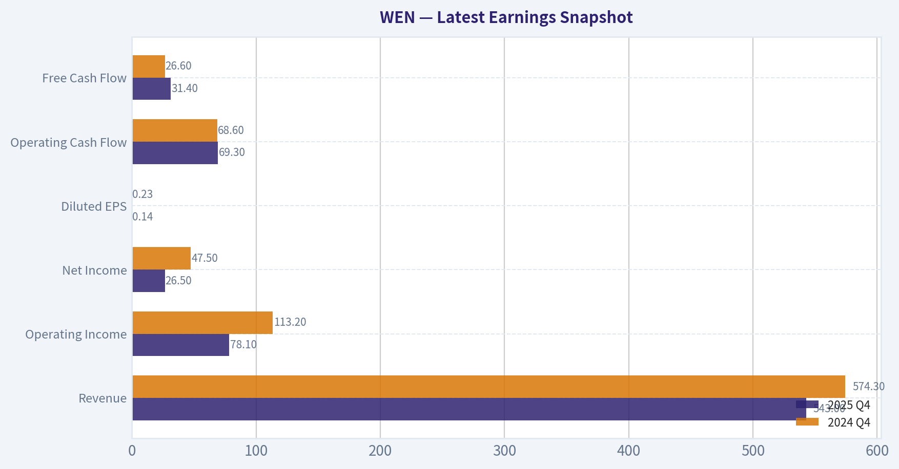
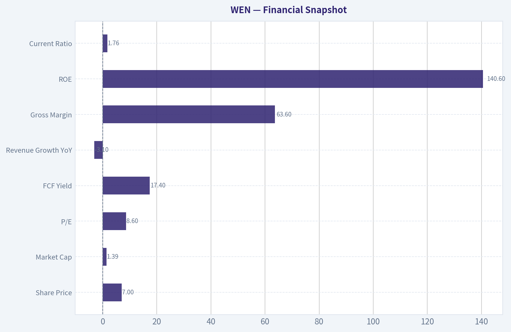
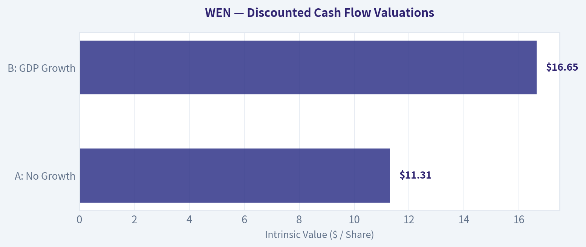
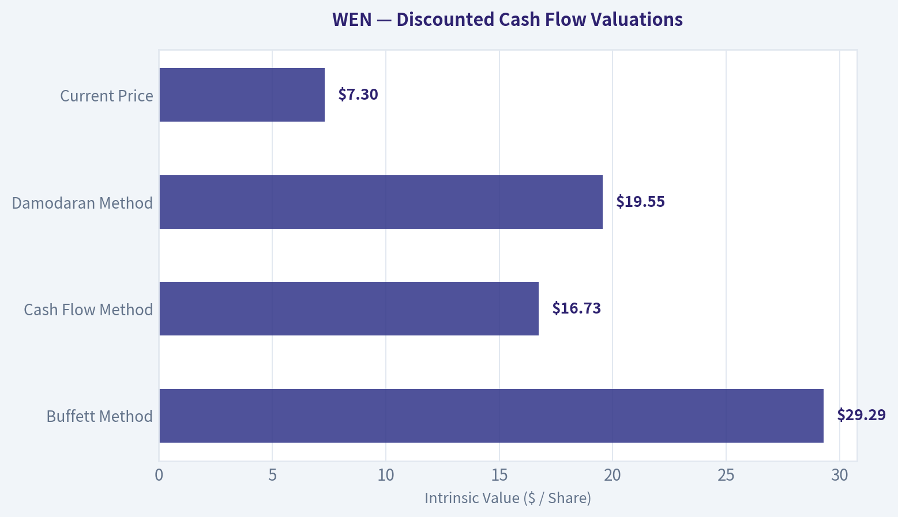
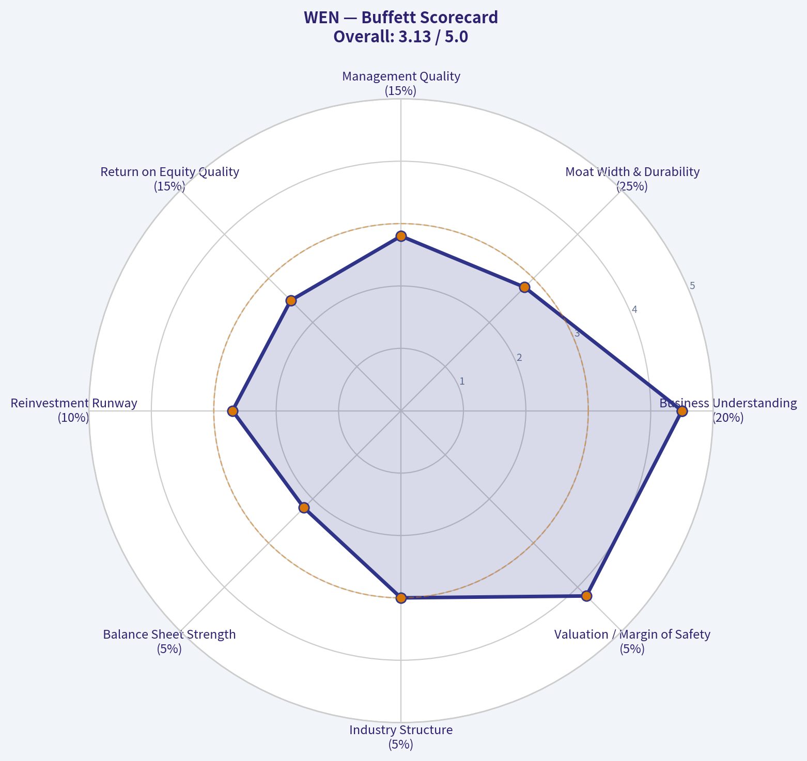
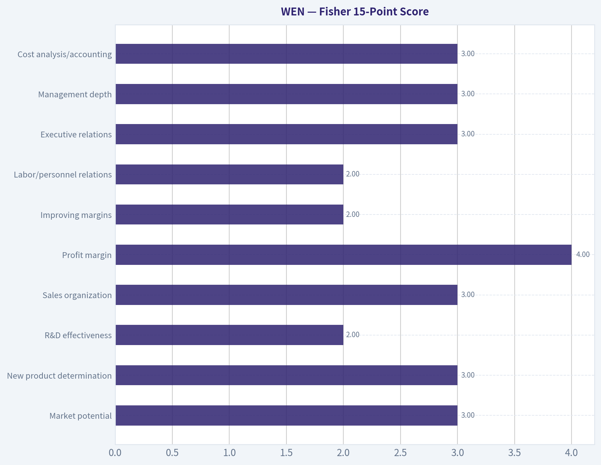
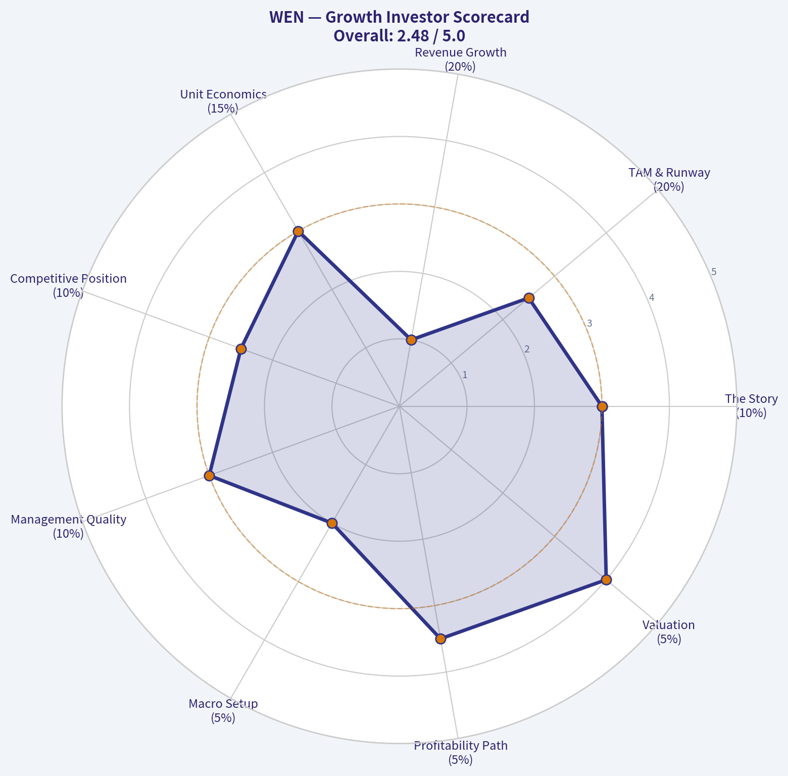
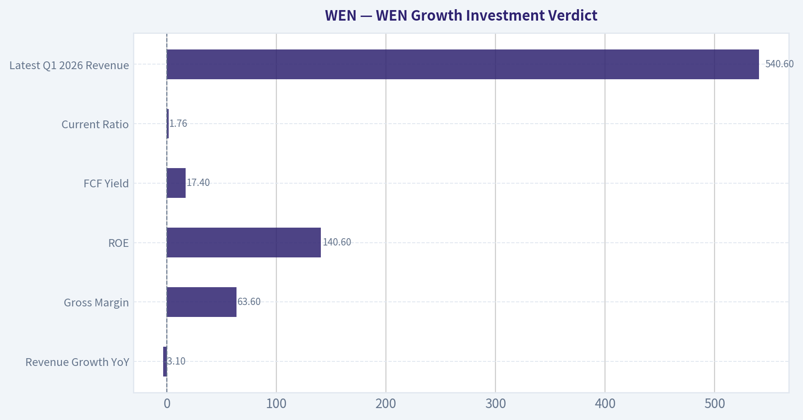

# WEN Deep Value Intelligence

**Analysis Date:** 2026-05-08

## Critical Disclaimer

*This analysis is generated by Deep Value Intelligence, an AI-powered multi-agent investing framework. This report is for informational and educational purposes only and does not constitute financial advice. Always conduct your own research and consult with qualified financial advisors before making investment decisions.*

---

## Table of Contents

1. Intelligence Summary
2. Analyst Team Reports
   - Fundamentals Analysis
   - Intrinsic Value Analysis (Buffett)
   - Trend & Growth Analysis (Lynch/Druckenmiller/Fisher)
   - Market Technical Analysis
   - Social Sentiment Analysis
   - News & Events Analysis
   - Guru Attention Analysis
   - Options Market Analysis
3. Research Team Commentary
4. Value Investing Team Commentary
5. Deep Values Commentary

---

## Intelligence Summary

### Thesis + Conditions

**Core Thesis:** **EXECUTIVE SUMMARY**
*   **Verdict:** Optically cheap, fundamentally fragile. Wendy's is trading at distressed multiples (8.5x P/E, 17.4% FCF yield) but suffers from deteriorating unit economics (Revenue -3.1%, FCF -7.0%, negative comps).

**Key Risks:**
- Stance:** **WATCH**
- The Risky Analyst (Bullish)** argues the market has over-discounted Wendy's into near-distress territory. At a 17.4% FCF yield, the stock only needs a "less bad than feared" operational stabilization-not perfection-to trigger a violent rerating toward intrinsic value estimates ($16-$29).
- Applying the Buffett value investing framework, the Safe Analyst wins this debate. The core tenant of long-term risk management is distinguishing between temporary market volatility and permanent business impairment.
- The Risky Analyst relies on valuation spreads (price vs. historical intrinsic value models). However, **a lesson learned from past value investing mistakes is confusing a low multiple with a true margin of safety.** A 17% free cash flow yield provides zero protection if the free cash flow itself is structurally eroding due to permanent traffic loss to competitors.
- Furthermore, we must reject the Neutral Analyst's suggestion to take a "small starter position." Buffett's philosophy demands swinging heavily only at high-conviction "fat pitches." Buying a deteriorating business just because it is cheap violates the mandate to prioritize *Quality over Volatility*. Wendy's asset-light franchise model (63.6% gross margin) is a derivative of franchisee unit economics; if franchisees are squeezed by inflation and value-menu wars, the parent company's moat evaporates. We need proof of a durable moat, not just a distressed price.

**What Would Change Our View:**
- Stance:** **WATCH**
- The Risky Analyst (Bullish)** argues the market has over-discounted Wendy's into near-distress territory. At a 17.4% FCF yield, the stock only needs a "less bad than feared" operational stabilization-not perfection-to trigger a violent rerating toward intrinsic value estimates ($16-$29).
- Applying the Buffett value investing framework, the Safe Analyst wins this debate. The core tenant of long-term risk management is distinguishing between temporary market volatility and permanent business impairment.
- The Risky Analyst relies on valuation spreads (price vs. historical intrinsic value models). However, **a lesson learned from past value investing mistakes is confusing a low multiple with a true margin of safety.** A 17% free cash flow yield provides zero protection if the free cash flow itself is structurally eroding due to permanent traffic loss to competitors.
- Furthermore, we must reject the Neutral Analyst's suggestion to take a "small starter position." Buffett's philosophy demands swinging heavily only at high-conviction "fat pitches." Buying a deteriorating business just because it is cheap violates the mandate to prioritize *Quality over Volatility*. Wendy's asset-light franchise model (63.6% gross margin) is a derivative of franchisee unit economics; if franchisees are squeezed by inflation and value-menu wars, the parent company's moat evaporates. We need proof of a durable moat, not just a distressed price.

**Confidence:** Low

---

## Analyst Team Reports

### Fundamentals Analysis

#### Latest Earnings Snapshot

*Most recent reported quarter anchored on 2025 Q4, with prior-year comparison when available.*

| Metric | 2025 Q4 | 2024 Q4 | YoY Change |
| --- | ---: | ---: | ---: |
| Revenue | $543.0M | $574.3M | -5.5% |
| Operating Income | $78.1M | $113.2M | -31.0% |
| Net Income | $26.5M | $47.5M | -44.2% |
| Diluted EPS | $0.14 | $0.23 | -39.1% |
| Operating Cash Flow | $69.3M | $68.6M | +1.0% |
| Free Cash Flow | $31.4M | $26.6M | +18.0% |

Key Takeaways: This snapshot anchors the most recent reported quarter before the narrative analysis. It helps readers separate long-run business quality from whatever changed in the latest earnings print.

{10}

---

### Intrinsic Value Analysis (Buffett)

> *Following Warren Buffett's value investing philosophy: Circle of Competence, Economic Moat, Management Quality, and Margin of Safety.*

#### Intrinsic Value Snapshot

Price is what you pay. Intrinsic value is what the business may be worth based on the cash it can create for owners over time. We show a range, not one magic number.

- Current Price: $7.30
- Value Range: $13.48 to $140.41

##### Owner Earnings (Buffett Method)
- Net Income: $165,075,000.00
- Depreciation & Amortization: $170,869,000.00
- Capital Expenditures: $-101,927,000.00
- Working Capital Changes: $-51,555,000.00
- Owner Earnings: $285,572,000.00

##### Intrinsic Value
###### Buffett Method
Uses owner earnings. Stricter, and usually more conservative.
- Conservative: $13.60
- Average: $29.29
- Optimistic: $140.41
- Discount Rate: 10.0%

###### Cash Flow Method
Uses free cash flow. Better for companies spending heavily today to grow tomorrow.
- Conservative: $13.48
- Average: $16.73
- Optimistic: $51.16
- Discount Rate: 10.0%

ANALYST STANCE: **WATCH**

#### Wendy's (WEN) Buffett-Style Value Analysis - May 8, 2026

Current price: **$7.00**
Market cap: **$1.39 billion**
P/E: **8.6x**
FCF yield: **17.4%**
Gross margin: **63.6%**
Revenue growth YoY: **-3.1%**
Current ratio: **1.76x**
Reported ROE: **140.6%**, but this is **not clean Buffett-quality ROE** because Wendy's capital structure is highly levered and equity is likely very small or distorted.

Important limitation: the internal audited financials tool failed during this continuation run, and the enhanced fundamentals tool returned no data. This report therefore relies on the shared research pack and publicly understood characteristics of Wendy's business model. The conclusion should be treated as a high-level investment stance, not a full audited 10-year model.

---

#### 1. Go / No-Go Gate Assessment

| Buffett Gate | Result | Evidence | Buffett Interpretation |
|---|---:|---|---|
| Gate 1: Business Simplicity | Pass | Wendy's sells hamburgers, chicken, fries, drinks, breakfast, and collects revenue from company-operated restaurants plus royalties and fees from franchisees. | Easy to understand. This passes the "elementary school test." |
| Gate 1: 10-Year Predictability | Partial Pass | Fast food will still exist in 10 years, but Wendy's competitive position is less certain than McDonald's, Chick-fil-A, or larger global systems. | Predictable category, but not a dominant compounder. |
| Gate 1: Technology Risk | Pass | Technology helps ordering, delivery, loyalty, and labor productivity. It is unlikely to destroy Wendy's core business. | Technology is more enabler than disruptor. |
| Gate 2: Moat | Narrow / Stable | Brand is real, but not dominant. Pricing power exists, but traffic weakness and value competition limit it. | Narrow moat, not wide moat. |
| Gate 3: Management / Capital Allocation | Mixed | Turnaround initiatives are underway, but revenue is declining and leverage is material. Capital allocation must be judged cautiously. | Not enough evidence of exceptional owner-oriented allocation. |
| Gate 4: Industry Structure | Mixed | QSR is attractive versus full-service restaurants, but burger fast food is highly competitive. | Better than restaurants generally, but not a protected oligopoly. |

**Key Takeaways:** Wendy's is a simple and understandable business, which Buffett would appreciate. However, simplicity alone is not enough. The company has a recognizable brand, but its moat is narrower than best-in-class restaurant franchises, and current same-store sales weakness makes the long-term compounding case less certain.

---

#### 2. Moat Analysis

| Moat Source | Wendy's Evidence | Rating |
|---|---|---:|
| Brand / Intangible Asset | Wendy's is a nationally recognized QSR brand with differentiated menu identity around "fresh, never frozen" beef and a strong social-media presence. | Moderate |
| Pricing Power | Gross margin of **63.6%** suggests strong restaurant/franchise economics, but recent revenue decline and traffic weakness indicate price increases are not frictionless. | Moderate to Weak |
| Switching Costs | Customers can switch instantly to McDonald's, Burger King, Chick-fil-A, Taco Bell, or local options. Franchisees have some contractual lock-in, but end customers do not. | Weak |
| Cost Advantage | Scale exists, but Wendy's is materially smaller than McDonald's and lacks the same purchasing, real estate, and global operating leverage. | Moderate to Weak |
| Network Effects | Limited. More Wendy's locations help convenience and brand awareness, but the product does not become materially better because more people use it. | Weak |
| Overall Moat | Recognized brand and franchise system, but intense competition and weak switching costs. | **Narrow / Stable** |

**Key Takeaways:** Wendy's has a real brand, but it does not have the fortress-like moat of McDonald's. Customers have many alternatives and can switch with no penalty. The company's moat is good enough to survive, but not strong enough to confidently underwrite decades of superior compounding without close monitoring.

---

#### 3. Management Quality and Capital Allocation

| Question | Assessment | Buffett View |
|---|---|---|
| Do they think like owners? | Insufficient evidence from available data. Wendy's has historically returned capital through dividends and buybacks, but high leverage reduces flexibility. | Mixed |
| Are they candid? | Current earnings coverage acknowledges turnaround needs, margin pressure, inflation, and slower traffic. | Neutral to Positive |
| Are they rational capital allocators? | The current valuation implies the market doubts growth and capital allocation effectiveness. Buybacks can create value at low prices, but only if debt risk is controlled and business decline is not structural. | Mixed |
| Debt discipline | Concern. Wendy's operates an asset-light/franchise-heavy model, but leverage appears significant. Reported ROE is extremely high, which likely reflects financial leverage rather than extraordinary business economics. | Negative |

**Key Takeaways:** Management may have tools to create value, especially if buybacks are done at depressed prices. But Buffett would be cautious because high reported ROE appears distorted by leverage. The key question is whether management prioritizes balance-sheet strength and durable per-share value over short-term shareholder returns.

---

#### 4. Financial Snapshot

| Metric | Current / Recent Data | Buffett Interpretation |
|---|---:|---|
| Share Price | **$7.00** | Stock is priced for pessimism. |
| Market Cap | **$1.39B** | Small relative to brand recognition. |
| P/E | **8.6x** | Cheap if earnings are durable. |
| FCF Yield | **17.4%** | Very attractive if free cash flow is sustainable. |
| Implied FCF | Approximately **$242M** | $1.39B market cap x 17.4%. |
| Revenue Growth YoY | **-3.1%** | Negative sign; weak traffic or pricing pressure. |
| Gross Margin | **63.6%** | Strong, consistent with franchise-heavy economics. |
| ROE | **140.6%** | Not reliable as quality signal; likely leverage-driven. |
| Current Ratio | **1.76x** | Near-term liquidity appears acceptable. |

**Key Takeaways:** Wendy's looks statistically cheap, especially on free cash flow yield and earnings multiple. The problem is quality and durability, not headline valuation. A high free cash flow yield is attractive only if the cash flow is not being eroded by declining traffic, inflation, debt, or weak reinvestment opportunities.

---

#### 5. Owner Earnings Estimate

Using the shared data:

- Market cap: **$1.39B**
- FCF yield: **17.4%**
- Implied free cash flow: **$242M**
- For a high-level owner earnings proxy, I use **$220M to $240M** to allow for maintenance capital needs, working-capital variability, and cyclicality.

| Owner Earnings Component | Estimate |
|---|---:|
| Reported / Implied FCF | ~$242M |
| Conservatism Adjustment | -$10M to -$20M |
| Normalized Owner Earnings Estimate | **~$220M to $230M** |
| Owner Earnings Yield on Market Cap | **15.8% to 16.5%** |

**Key Takeaways:** On a normalized owner earnings basis, Wendy's appears cheap. A mid-teens owner earnings yield is attractive in isolation. But the major caveat is whether these earnings are durable, because a shrinking or highly levered business can look cheap before value is impaired.

---

#### 6. Three-Scenario DCF Valuation

Assumptions:

- Normalized owner earnings: **$225M**
- Discount rate: **10%**
- Shares / per-share valuation inferred using market cap and price:
  $1.39B / $7.00 ~ **199 million shares**
- These are equity-level estimates based on owner earnings available to equity holders.

| Scenario | Assumption | Equity Value Estimate | Value Per Share | Margin of Safety vs $7 |
|---|---|---:|---:|---:|
| A: No Growth | Owner earnings / 10% | **$2.25B** | **$11.31** | **38% discount to value** |
| B: GDP Growth | 3% perpetual growth | **$3.31B** | **$16.65** | **58% discount to value** |
| C: Turnaround / Historical-Style Recovery | 5% growth for 10 years, then 3% terminal | **~$3.7B** | **~$18.50** | **62% discount to value** |

**Key Takeaways:** The valuation looks attractive if Wendy's can merely maintain current owner earnings. At $7 per share, the stock appears to offer a numerical margin of safety. However, the DCF is highly sensitive to whether free cash flow is sustainable, because the business is facing revenue decline, competitive pressure, and leverage concerns.

---

#### 7. Margin of Safety Analysis

| Factor | Positive | Negative |
|---|---|---|
| Valuation | Low P/E and high FCF yield suggest pessimism is already priced in. | Cheap stocks can get cheaper if fundamentals deteriorate. |
| Brand | Wendy's has durable consumer recognition. | Brand is weaker than McDonald's and Chick-fil-A. |
| Cash Flow | Current FCF yield is very high. | Sustainability is uncertain amid negative revenue growth. |
| Balance Sheet | Current ratio is acceptable. | High leverage reduces margin of safety. |
| Turnaround Potential | Project Fresh and operational improvements may help. | Latest coverage suggests "no recovery in sight" and margin pressure. |

**Key Takeaways:** Wendy's appears to have a statistical margin of safety, but not a Buffett-quality business margin of safety. The stock price is low enough to be interesting, yet the company's competitive position and leverage prevent a high-conviction "wonderful business" conclusion. This is a watchlist candidate rather than an obvious compounder.

---

#### 8. Buffett Scorecard

| Criterion | Weight | Score 1-5 | Weighted Score |
|---|---:|---:|---:|
| Business Understanding | 20% | 4.5 | 0.90 |
| Moat Width & Durability | 25% | 2.8 | 0.70 |
| Management Quality | 15% | 2.8 | 0.42 |
| Return on Equity Quality | 15% | 2.5 | 0.38 |
| Reinvestment Runway | 10% | 2.7 | 0.27 |
| Balance Sheet Strength | 5% | 2.2 | 0.11 |
| Industry Structure | 5% | 3.0 | 0.15 |
| Valuation / Margin of Safety | 5% | 4.2 | 0.21 |
| Total | 100% | - | **3.14 / 5.00** |

**Key Takeaways:** Wendy's scores well on simplicity and valuation, but less well on moat, balance sheet, and reinvestment quality. The total score lands in the watch range. This means the stock is interesting, but not yet compelling enough for a Buffett-style advocate rating.

---

#### 9. Final Investment Stance

| Category | Conclusion |
|---|---|
| Stance | **WATCH** |
| Conviction | **Medium-Low** |
| Business Quality | Good but not great |
| Valuation | Attractive |
| Main Risk | Value trap from declining traffic, inflation, leverage, and weak competitive position |
| Upgrade Trigger | Evidence of sustained same-store sales recovery, debt reduction, stable margins, and disciplined buybacks |
| Downgrade Trigger | Continued revenue decline, margin compression, rising leverage, or dividend/buyback activity that weakens the balance sheet |

Wendy's is a **simple, recognizable, cash-generative restaurant franchise**, and at **$7 per share** the valuation is clearly interesting. The stock appears cheap on P/E and free cash flow yield, and a no-growth owner earnings estimate suggests upside.

But this is not a classic Buffett "wonderful company at a fair price." The moat is narrower than elite QSR peers, customer switching costs are minimal, revenue is declining, and leverage makes the reported ROE misleading. For now, Wendy's belongs on the watchlist as a potentially undervalued turnaround or cash-flow stock, not as a high-confidence long-term compounder.
#### Valuation Bridge

This bridge places the current market price beside each intrinsic value lens so readers can see whether upside depends on one method or shows up across several methods.

| Scenario | Intrinsic Value / Share |
| --- | ---: |
| Buffett Method | $29.29 |
| Cash Flow Method | $16.73 |
| Damodaran Method | $19.55 |
| Current Price | $7.30 |

#### Key Takeaways

If one method is far above the others, the upside case depends on a specific modelling assumption. When several methods cluster together, the valuation story is more robust.

#### Valuation Visuals

This comparison chart from *Latest Earnings Snapshot* stacks current figures against historical benchmarks for **WEN**, making it easy to see where the company trades relative to its own averages.

This comparison chart from *Financial Snapshot* stacks current figures against historical benchmarks for **WEN**, making it easy to see where the company trades relative to its own averages.

The following chart maps the **WEN** Owner Earnings DCF valuation scenarios (Conservative, Average, Optimistic) to visually represent the margin of safety based on intrinsic value calculations.

The following chart maps the **WEN** Owner Earnings DCF valuation scenarios (Conservative, Average, Optimistic) to visually represent the margin of safety based on intrinsic value calculations.

---

### Trend & Growth Analysis (Lynch/Druckenmiller/Fisher)

> *Following Peter Lynch's GARP, Stanley Druckenmiller's macro-aware approach, and Philip Fisher's scuttlebutt methodology.*

ANALYST STANCE: **AVOID**

#### WEN Growth Investment Verdict

Wendy's is **not a Lynch-style fast grower** today. It is a mature quick-service restaurant brand with **negative reported revenue growth**, pressured traffic, and a turnaround plan that may stabilize results but does not yet create a clear ten-bagger setup. The stock looks optically cheap on **P/E and FCF yield**, but for a growth mandate, cheapness is not enough without accelerating revenue, improving unit economics, and a credible long runway.

| Item | Current Read |
|---|---:|
| Ticker | WEN |
| Current Price | ~$7 |
| Market Cap | ~$1.39B |
| P/E | ~8.6x |
| Revenue Growth YoY | -3.1% |
| Gross Margin | 63.6% |
| ROE | 140.6% |
| FCF Yield | 17.4% |
| Current Ratio | 1.76x |
| Latest Q1 2026 Revenue | $540.6M |
| Latest News Tone | Earnings beat, but comp sales and traffic remain pressured |

**Key Takeaways:** Wendy's screens as statistically cheap, with a low earnings multiple and high free cash flow yield. However, the key growth signal is weak: revenue is declining year over year, and recent commentary points to margin pressure and slower traffic. For a growth investor, this looks more like a possible value or turnaround situation than a durable compounding growth story.

---

#### 1. Lynch Classification

| Lynch Category | Fit for WEN | Rationale |
|---|---|---|
| Slow Grower | Partial fit | Mature restaurant brand with limited organic growth |
| Stalwart | Weak fit | Recognizable brand, but current growth is below stalwart quality |
| Fast Grower | No | Revenue growth is negative, not 15-25%+ |
| Cyclical | Partial | Restaurant traffic is sensitive to consumer spending and inflation |
| Turnaround | Best fit | Management's Project Fresh and menu innovation are attempts to revive sales |
| Asset Play | No clear fit | Brand value exists, but not the main thesis |

**Key Takeaways:** Wendy's should be classified primarily as a **turnaround**, not a fast grower. That matters because Lynch-style growth investors make most of their money in companies with expanding sales, expanding markets, and underappreciated acceleration. Wendy's currently lacks the acceleration needed for a growth classification.

#### 2. The Story in 3 Bullets

| Story Element | Assessment |
|---|---|
| Simple business | Wendy's sells burgers, chicken, breakfast, and drinks through company-owned and franchised restaurants. |
| Growth claim | Management is trying to reignite sales through menu innovation, Project Fresh, digital initiatives, and operational improvements. |
| Problem | Same-store sales and traffic remain weak, and inflation is pressuring margins. |

**Key Takeaways:** The business is very easy to understand, which Lynch would like. But the growth story is not yet compelling because the company is trying to recover lost momentum rather than scale into a new high-growth market. A turnaround can work, but it requires evidence that traffic, comps, and margins have inflected.

---

#### 3. TAM and 10x Test

| Metric | Estimate / View |
|---|---:|
| Current annualized revenue using Q1 2026 | ~$2.16B |
| 10x revenue target | ~$21.6B |
| Relevant market | Global quick-service restaurant and burger market |
| TAM size | Large, likely hundreds of billions globally |
| Can WEN theoretically 10x and remain below 20% TAM share? | Yes, theoretically |
| Practical 10x likelihood | Low without major international expansion, brand reinvention, or M&A |

**Key Takeaways:** Wendy's technically passes the TAM size test because the global quick-service restaurant market is very large. But the practical runway is much less attractive than the theoretical runway. Wendy's would need a dramatic improvement in unit growth, franchise economics, international expansion, or brand relevance to become a true 10x revenue compounder.

#### 4. Revenue Growth Trend

| Period / Data Point | Signal |
|---|---|
| Reported YoY revenue growth | -3.1% |
| Q1 2026 result | Revenue beat expectations at $540.6M |
| Same-store sales commentary | Pressured / falling comps noted in coverage |
| Traffic commentary | Slower traffic remains a concern |
| Growth pattern | Decelerating / negative |
| Growth investor interpretation | Warning signal |

**Key Takeaways:** The revenue trend is the main reason this is not investable as a growth stock. A single earnings beat can produce a short-term stock pop, but the underlying pattern still points to weak traffic and negative year-over-year growth. For a Druckenmiller-style inflection, we would need to see sustained acceleration, not just a better-than-feared quarter.

---

#### 5. Unit Economics and Efficiency

| Metric | WEN Read |
|---|---|
| LTV/CAC | Not applicable / not disclosed for restaurant model |
| NRR | Not applicable |
| Rule of 40 | Not applicable; WEN is not SaaS |
| Gross Margin | Strong at 63.6% |
| FCF Yield | Very high at 17.4% |
| Current Ratio | Healthy at 1.76x |
| Restaurant unit economics | Need evidence of traffic recovery, franchisee health, wage/rent/commodity control |

**Key Takeaways:** Wendy's has some attractive financial characteristics, especially gross margin and free cash flow yield. However, restaurant unit economics depend heavily on traffic, franchisee profitability, labor costs, food inflation, and average unit volumes. Without clear same-store sales acceleration, the strong cash flow profile may represent mature value rather than growth efficiency.

#### 6. Inflection Point Assessment

| Potential Inflection | Evidence Today | Rating |
|---|---|---|
| Product cycle inflection | Menu innovation helping Q1 beat, but not enough yet | Weak to moderate |
| Market share inflection | No clear evidence of accelerating share gains | Weak |
| Margin inflection | Inflation and traffic pressure still concerns | Weak |
| TAM inflection | QSR market is large but mature in core geographies | Weak |
| Competitive inflection | McDonald's, Burger King, Chick-fil-A, and others remain intense competitors | Weak |
| Turnaround inflection | Project Fresh could help, but evidence is early | Watch item |

**Key Takeaways:** Wendy's does not yet show a clear growth inflection. The most plausible catalyst is a turnaround inflection from Project Fresh, menu innovation, and operational execution. But the burden of proof remains high because current sales trends are negative and competition remains intense.

---

#### 7. Macro Setup

| Macro Factor | Impact on WEN |
|---|---|
| Consumer health | Mixed to negative; lower-income consumers are pressured |
| Inflation | Negative; food and labor inflation pressure margins |
| Interest rates | Lower rates would help valuation and refinancing, but not core traffic |
| Secular theme exposure | Weak; not directly tied to AI, cloud, cybersecurity, or healthcare innovation |
| Restaurant industry backdrop | Competitive, promotional, traffic-sensitive |
| Overall macro setup | Neutral to negative |

**Key Takeaways:** The macro backdrop is not ideal for Wendy's. Inflation, wage pressure, and a cautious consumer can hurt restaurant traffic and margins. Falling rates could help the stock multiple, but they do not solve the core issue of weak comps.

#### 8. Fisher 15-Point Score

| Fisher Point | Score 1-5 | Comment |
|---|---:|---|
| Market potential | 3 | Large QSR market, but mature |
| New product determination | 3 | Menu innovation exists |
| R&D effectiveness | 2 | Limited compared with technology or healthcare innovators |
| Sales organization | 3 | Strong brand presence, but traffic weak |
| Profit margin | 4 | Gross margin is strong |
| Improving margins | 2 | Inflation pressure remains |
| Labor/personnel relations | 2 | Restaurant labor market is challenging |
| Executive relations | 3 | No major red flag from available data |
| Management depth | 3 | Established public company |
| Cost analysis/accounting | 3 | Mature operator/franchisor |
| Unique moat | 2 | Brand exists, but switching costs are low |
| Long-range profit outlook | 3 | Cash generative but low growth |
| Dilution risk | 4 | No immediate dilution concern from available data |
| Candor in difficulties | 3 | Turnaround issues are visible |
| Integrity | 3 | No major red flag from available data |
| **Total** | **44/75** | **Below average for growth investing** |

**Key Takeaways:** Wendy's Fisher score is below the threshold for a quality growth investment. The company has brand value and cash generation, but it lacks a powerful innovation engine, durable switching costs, and clear margin acceleration. The score supports an avoid stance for growth portfolios.

---

#### 9. Valuation Analysis

| Valuation Metric | Current Read | Interpretation |
|---|---:|---|
| P/E | ~8.6x | Cheap versus market |
| Revenue Growth | -3.1% | Negative growth reduces quality of cheapness |
| PEG | Not meaningful | Earnings growth is not clearly positive/accelerating |
| Annualized Revenue | ~$2.16B |
| Market Cap | ~$1.39B |
| Price/Sales | ~0.6x | Low, but justified by slow/negative growth |
| FCF Yield | 17.4% | Attractive for value investors |
| Growth valuation view | Not enough acceleration to re-rate sustainably |

**Key Takeaways:** Wendy's is cheap on traditional valuation metrics, especially P/E, P/S, and free cash flow yield. But for a growth investor, the key question is whether growth is about to accelerate. Without evidence of improving comps and traffic, the low valuation could be a value trap rather than a mispriced compounder.

#### 10. Scenario Analysis

| Scenario | Assumptions | 3-Year View |
|---|---|---|
| Bear Case | Comps remain negative, traffic weak, margins pressured | Stock remains cheap or declines despite cash flow |
| Base Case | Project Fresh stabilizes comps, modest margin recovery | Stock may re-rate modestly as a value/turnaround name |
| Bull Case | Traffic inflects, menu innovation works, franchise growth improves | Meaningful upside possible, but still unlikely to be ten-bagger growth |
| Ten-Bagger Case | Global unit expansion, sustained comp growth, major brand renaissance | Low probability from current evidence |

**Key Takeaways:** The bull case is not impossible, but it requires several improvements to happen together. Stabilization alone may create value-stock upside, but it does not create a high-conviction growth thesis. The ten-bagger case is too speculative today.

---

#### 11. Growth Investor Scorecard

| Criterion | Weight | Score 1-5 | Weighted Score |
|---|---:|---:|---:|
| The Story | 10% | 3.0 | 0.30 |
| TAM & Runway | 20% | 2.5 | 0.50 |
| Revenue Growth | 20% | 1.0 | 0.20 |
| Unit Economics | 15% | 3.0 | 0.45 |
| Competitive Position | 10% | 2.5 | 0.25 |
| Management Quality | 10% | 3.0 | 0.30 |
| Macro Setup | 5% | 2.0 | 0.10 |
| Profitability Path | 5% | 3.5 | 0.18 |
| Valuation | 5% | 4.0 | 0.20 |
| **Total** | **100%** |  | **2.48 / 5.00** |

**Key Takeaways:** Wendy's scores poorly because revenue growth is negative and the macro setup is not favorable. Valuation is the strongest part of the thesis, but valuation only carries a small weight in a growth framework. The total score falls below the threshold for a growth-investor watchlist candidate.

#### 12. Guru Tracking Signal

| Investor | Action | Position Size | Interpretation |
|---|---|---:|---|
| Steve Cohen / Point72 | Initiated | ~$136K disclosed value | Immaterial position; not a high-conviction signal |

**Key Takeaways:** The disclosed Point72 position is too small to treat as a major institutional endorsement. It may reflect trading, screening, or optionality rather than conviction. This does not materially change the investment stance.

---

#### 13. Position Size Stance

| Portfolio Type | Suggested Stance |
|---|---|
| Growth portfolio | 0% position / avoid |
| GARP portfolio | Avoid until revenue growth turns positive |
| Value portfolio | Possible small watchlist candidate due to FCF yield |
| Turnaround portfolio | Watch only if comps and traffic inflect |
| Existing holder | Hold only if thesis is income/value, not growth |

**Key Takeaways:** For a growth mandate, Wendy's does not deserve capital today. Existing holders may have a value or income-oriented reason to remain involved, but new growth capital should wait for better evidence. The correct stance is to avoid until the turnaround produces measurable acceleration.

#### 14. Key Catalysts and Risks

| Catalysts | Risks |
|---|---|
| Project Fresh drives traffic recovery | Continued negative comps |
| Menu innovation improves average ticket and frequency | Food and labor inflation pressure margins |
| Franchisee profitability improves | Heavy discounting by competitors |
| Digital and loyalty initiatives increase repeat visits | Consumer weakness hurts QSR spending |
| International expansion accelerates | Brand loses relevance versus stronger competitors |
| Multiple re-rates from depressed valuation | Cheap stock remains cheap due to no growth |

**Key Takeaways:** Wendy's has real catalysts, but most are turnaround catalysts rather than high-growth catalysts. The main risk is that the company remains stuck in a mature, competitive, low-growth category while investors wait for improvement. Until same-store sales and traffic clearly inflect, the risk-reward is not attractive for growth investors.

#### Final Call

WEN is **cheap, cash-generative, and recognizable**, but it is not a compelling Lynch-Druckenmiller-Fisher growth stock today. The company lacks the core ingredients of a ten-bagger: accelerating revenue, expanding margins, dominant competitive momentum, and a large underappreciated growth inflection.

**Decision:** **AVOID for growth portfolios.**
**Upgrade trigger:** Move to **WATCH** if Wendy's posts multiple quarters of positive same-store sales, improving traffic, margin stabilization, and evidence that Project Fresh is driving a durable turnaround.

#### Growth & Scorecard Visuals

The radar chart below from *Buffett Scorecard* visualises how **WEN** ranks across weighted investment criteria. Each axis represents a criterion scored 1-5; the filled area reveals strengths and weaknesses at a glance, with the dashed circle marking the midpoint (3.0).

This comparison chart from *Fisher 15-Point Score* stacks current figures against historical benchmarks for **WEN**, making it easy to see where the company trades relative to its own averages.

The radar chart below from *Growth Investor Scorecard* visualises how **WEN** ranks across weighted investment criteria. Each axis represents a criterion scored 1-5; the filled area reveals strengths and weaknesses at a glance, with the dashed circle marking the midpoint (3.0).

---

### Market Technical Analysis

ANALYST STANCE: **WATCH**

#### WEN Technical Indicator Selection and Market Read

Latest available trading data is **2026-05-07** because **2026-05-08 is not a trading day** in the retrieved dataset. WEN closed at **$6.95** on 2026-05-07 after a sharp one-day rebound from the prior close of **$6.65**, with volume expanding to **14.74 million shares**, a clear pickup versus the recent normal range. The stock remains in a broader downtrend, but the latest session shows a credible short-term bounce attempt.

The most relevant indicators for this context are:

| Indicator | Latest Value | Why It Matters Here | Current Interpretation |
|---|---:|---|---|
| `close_10_ema` | 6.80 | Captures short-term trend shifts quickly | Price closed above the 10 EMA, showing a near-term rebound attempt |
| `close_50_sma` | 7.02 | Defines medium-term trend and resistance | Price is still slightly below the 50 SMA, so the bounce is not yet confirmed |
| `close_200_sma` | 8.25 | Long-term trend benchmark | Price remains far below the 200 SMA, confirming a dominant long-term bearish structure |
| `macd` | -0.087 | Measures trend momentum | Still negative, but improved from the prior day, suggesting bearish momentum is easing |
| `rsi` | 51.31 | Measures momentum and overbought/oversold conditions | RSI has recovered to neutral-positive territory, not yet overbought |
| `atr` | 0.264 | Measures volatility for stop placement and risk sizing | Daily volatility is still meaningful at about 3.8% of price |
| `boll_lb` | 6.52 | Identifies downside volatility boundary | Price rebounded well above the lower band after testing lower levels |
| `vwma` | 6.88 | Confirms price movement with volume weighting | Price closed above VWMA on high volume, improving short-term bounce credibility |

**Key Takeaways:** WEN's short-term picture improved meaningfully on the latest trading day because price reclaimed both the 10 EMA and VWMA on elevated volume. However, the stock remains below the 50 SMA and far below the 200 SMA, so this is better viewed as an early rebound attempt inside a larger downtrend rather than a confirmed trend reversal.

#### Trend Structure: Short-Term Bounce Inside a Larger Bearish Trend

WEN's longer-term trend remains weak. The **200 SMA has declined from about $8.86 on 2026-03-24 to $8.25 on 2026-05-07**, while the stock itself trades at **$6.95**, roughly **15.8% below** that long-term benchmark. That distance is too large to ignore: it means the market has been repricing WEN lower for months, and long-term buyers have not yet regained control.

The medium-term trend is also still under pressure. The **50 SMA fell from about $7.60 to $7.02** over the same lookback window, and the latest close remains just below it. This makes the **$7.00-$7.05 area** especially important. A close above the 50 SMA, ideally with continued above-average volume, would be the first meaningful sign that the recent bounce is developing into something more durable.

Short term, however, the tone has improved. The latest close of **$6.95** is above the **10 EMA at $6.80** and above the **VWMA at $6.88**. This matters because the move was not just a low-volume drift; it occurred on a large volume expansion. That suggests either bargain hunting, short covering, or event-driven buying pressure. Still, one strong day is not enough to reverse a multi-month downtrend.

#### Momentum: Improving, But Not Yet Bullish Enough

Momentum is no longer deeply bearish, but it is not decisively bullish either. The **RSI jumped to 51.31**, moving from the high-30s and low-40s earlier in May into neutral-positive territory. This is constructive because WEN is no longer behaving like a stock under constant downside pressure. Importantly, RSI is not near overbought levels, so the stock has room to extend if buyers continue participating.

The **MACD remains negative at -0.087**, which means the broader momentum backdrop is still below neutral. However, MACD improved from **-0.108** on the prior trading day, showing that downside momentum weakened after the rebound. The nuance here is important: MACD is not issuing a clean bullish signal yet, but the rate of deterioration has slowed. That often happens near early stabilization zones, though it can also occur during temporary relief rallies.

#### Volatility and Risk: Price Is Still Unstable Near the Lows

ATR is currently about **$0.264**, or approximately **3.8% of the latest close**. For a stock trading below $7, that is a meaningful daily movement range. Traders should avoid using overly tight stops because normal volatility alone can create false exits. A one-ATR move from the latest close places a rough volatility band around **$6.69 to $7.21**, which overlaps several important technical levels.

The Bollinger lower band sits near **$6.52**, close to the recent low area. WEN recently traded down into the **$6.37-$6.56** zone before rebounding. That makes this area important support. If price falls back below **$6.52**, especially on heavy volume, it would suggest the latest bounce failed and sellers are still in control. If price holds above the **$6.80-$6.88** area, the short-term recovery attempt remains alive.

#### Trading Interpretation

For aggressive traders, WEN is showing early signs of a tactical rebound, but confirmation is still missing. The cleanest bullish development would be a close above the **50 SMA near $7.02**, followed by a hold above that level. A stronger continuation signal would be a move through the **$7.10-$7.15** resistance zone, where recent April highs and congestion sit.

For cautious traders or investors, the stock still deserves a **watchlist stance rather than an outright bullish stance**. The long-term trend remains bearish, the 200 SMA is far overhead, and the 50 SMA is still declining. The latest move is encouraging, but WEN needs more evidence of accumulation before the risk-reward profile becomes materially stronger.

#### Key Levels and Decision Framework

| Zone / Signal | Level or Condition | Bullish Meaning | Bearish Meaning |
|---|---:|---|---|
| Immediate support | $6.80-$6.88 | Holding above 10 EMA and VWMA keeps rebound structure intact | Losing this zone would weaken the latest bounce |
| Lower support | $6.52-$6.56 | Successful retest could form a short-term base | Break below this zone risks a retest of $6.37 |
| Recent low | $6.37 | Major short-term downside reference | Break below would signal renewed bearish continuation |
| First resistance | ~$7.02 | Close above 50 SMA would improve medium-term tone | Rejection here would reinforce the downtrend |
| Next resistance | $7.10-$7.15 | Breakout would show follow-through buying | Failure here may produce another lower high |
| Long-term resistance | ~$8.25 | Reclaiming 200 SMA would be a major trend change | Remaining far below it confirms bearish long-term structure |
| Momentum confirmation | RSI holding above 50 | Supports improving buyer control | RSI falling back below 45 would show momentum fading |
| Risk gauge | ATR ~$0.26 | Use wider risk bands due to elevated daily movement | Tight stops may be vulnerable to normal volatility |

**Key Takeaways:** WEN's most important near-term test is whether it can hold above the $6.80-$6.88 zone and then reclaim the 50 SMA near $7.02. A move above $7.10-$7.15 would strengthen the rebound case, while a break below $6.52 would likely invalidate it and return focus to the recent low near $6.37.

---

### Social Sentiment Analysis

ANALYST STANCE: **WATCH**

#### WEN Social, Sentiment, and News Report - Week Ending May 8, 2026

Wendy's sentiment over the past week appears **cautiously mixed with a slight negative tilt**, driven by a familiar fast-food tension: consumers still like the brand, menu, and social voice, but are increasingly sensitive to pricing, perceived value, and traffic softness across quick-service restaurants. The most investable takeaway is that WEN is not currently showing a clear social catalyst strong enough to justify aggressive bullish positioning, but sentiment is also not deteriorating into a brand-crisis setup. For traders, this argues for a **watchful, catalyst-driven stance**, especially around traffic data, promotional effectiveness, franchisee commentary, and margin guidance.

The stock's social discussion is less dominated by viral product enthusiasm and more by investor concerns around **same-store sales, value-menu competition, consumer spending pressure, and execution under management**. Compared with larger peers, Wendy's remains more exposed to U.S. traffic trends and franchise economics, so social signals around value perception matter meaningfully for near-term trading sentiment.

---

#### Daily Sentiment Snapshot

| Date | Social Sentiment | Main Discussion Themes | Investor Interpretation |
|---|---:|---|---|
| May 2 | Slightly Negative | Complaints about fast-food prices, value perception, and app-deal inconsistency | Consumer frustration remains a headwind for traffic-sensitive names like WEN |
| May 3 | Neutral | Menu discussions, breakfast mentions, casual brand comparisons with McDonald's and Burger King | Brand awareness remains healthy, but not enough to signal demand acceleration |
| May 4 | Slightly Positive | Promotional chatter, app offers, value-bundle interest | Value messaging can still improve engagement when clearly communicated |
| May 5 | Negative | Broader QSR affordability concerns, comments about eating out less | Macro consumer pressure remains the largest sentiment drag |
| May 6 | Neutral to Slightly Negative | Investor debate around margins, franchisee costs, and competitive discounting | Market participants remain skeptical of earnings leverage without stronger traffic |
| May 7 | Neutral | Discussion around menu quality, late-night food, chicken items, and brand loyalty | Brand still has defenders, but enthusiasm is scattered rather than viral |
| May 8 | Slightly Negative | Stock-watch discussions, concern over sales trends and promotional dependency | Traders are waiting for proof that promotions can drive profitable traffic |

Key Takeaways: Sentiment was not uniformly bearish, but the negative days were tied to the most investable issues: pricing, traffic, and affordability. Positive engagement tended to come from promotions and menu loyalty, suggesting Wendy's can still generate consumer interest when the value proposition is obvious. However, the week did not show a strong enough social upswing to suggest an imminent sentiment-driven breakout.

---

#### Social Media and Retail Investor Read-Through

Across social channels, Wendy's continues to benefit from a recognizable brand voice and a loyal customer base, but that loyalty is increasingly filtered through value expectations. Consumers are not simply saying they dislike Wendy's; rather, they are saying the brand needs to justify price points more clearly relative to alternatives. That distinction matters because it suggests the problem is not brand rejection, but **conversion friction**.

Retail-investor discussions appear focused on whether Wendy's can defend margins while competing in a discount-heavy quick-service market. This is an important risk: if Wendy's leans too hard into promotions, social sentiment may improve while profitability disappoints. If it protects margins too aggressively, traffic could weaken further. That trade-off is central to the stock's near-term setup.

| Channel / Audience | Dominant Tone | What People Are Saying | Signal Quality for Investors |
|---|---:|---|---|
| Consumer social media | Mixed to slightly negative | Food quality still has fans, but prices and inconsistent deals draw complaints | High relevance for near-term traffic trends |
| Retail investing forums | Cautious | Debate around valuation, dividend support, and weak QSR traffic | Moderate relevance; sentiment is not euphoric |
| Food and deal communities | Neutral to positive when promotions appear | Users respond to clear app deals, bundles, and limited-time offers | Useful early indicator of promotion effectiveness |
| Brand-loyal customers | Mildly positive | Support for burgers, fries, nuggets, and Frosty-related items remains steady | Supports brand resilience but not necessarily growth |
| Macro/consumer discussions | Negative | Households are eating out less or trading down due to price pressure | High relevance; this is the biggest external drag |

Key Takeaways: Wendy's social profile is not broken, but it is price-sensitive. The brand still has customer goodwill, yet that goodwill is conditional on value, convenience, and deal visibility. For investors, the strongest social signal is that promotions can work, but only if they do not train customers to wait for discounts.

---

#### Recent News and Company-Specific Themes

The recent company-news backdrop appears centered on the same themes influencing social sentiment: traffic, value, operational execution, franchising, and competitive intensity. Wendy's remains in a difficult QSR environment where consumers are pushing back on restaurant inflation, while brands are using value menus and digital offers to defend visits. This creates a complex investor setup because the top-line strategy that improves traffic may also compress margins.

A key concern for WEN is that it does not have the same scale advantages as McDonald's, nor the same high-growth international story as some restaurant peers. That means investor confidence depends heavily on management execution, U.S. same-store sales stabilization, and franchisee health. If Wendy's can show improving traffic without excessive promotional cost, sentiment could recover quickly because expectations appear modest. If traffic softness persists, the stock may remain range-bound or vulnerable.

| News / Fundamental Theme | Sentiment Impact | Why It Matters for WEN | Trading Implication |
|---|---:|---|---|
| Value-menu competition | Negative to mixed | Wendy's must compete for budget-conscious diners without damaging margins | Watch for margin guidance and promotional cadence |
| App and digital promotions | Positive when effective | Digital offers can drive repeat visits and improve customer targeting | Bullish only if tied to profitable traffic growth |
| QSR consumer pressure | Negative | Eating-out frequency remains under pressure from affordability concerns | Limits near-term multiple expansion |
| Franchisee economics | Mixed | Labor, food, and discounting pressures can strain operators | Important for store growth and remodel execution |
| Menu innovation | Mildly positive | Limited-time items can lift engagement but rarely change the stock alone | Useful tactical catalyst, not a standalone thesis |
| Dividend / value-stock appeal | Mildly positive | Income-oriented investors may see support if cash flow remains stable | Could cushion downside, but not eliminate earnings risk |

Key Takeaways: The news backdrop does not point to a single dramatic catalyst, but it reinforces a stock caught between defensive value appeal and operating pressure. Wendy's needs to prove that value offerings can restore traffic without sacrificing profitability. Until then, the market is likely to reward evidence rather than promises.

---

#### Sentiment Implications for Traders

For short-term traders, WEN looks more like a **wait-for-confirmation** setup than a momentum trade. Social sentiment is not strong enough to suggest a demand inflection, but negativity is not extreme enough to create a clear contrarian panic-buy signal. The best tactical opportunities may come around earnings, same-store sales commentary, traffic data, or evidence that promotions are driving incremental visits.

If WEN sells off on broad restaurant-sector weakness but company-specific sentiment remains stable, the stock may offer short-term rebound potential. However, if negative social commentary begins shifting from "prices are high" to "I stopped going to Wendy's," that would be a more serious warning sign. The current tone is still mostly about affordability and value, not outright brand abandonment.

| Trader Focus | Current Signal | Bullish Trigger | Bearish Trigger |
|---|---:|---|---|
| Social momentum | Weak to neutral | Viral product success or strong deal engagement | Escalating price complaints or brand backlash |
| Earnings setup | Cautious | Better-than-expected same-store sales and stable margins | Traffic miss or margin compression from discounting |
| Technical sentiment | Watchful | Breakout on volume after positive catalyst | Breakdown on weak QSR data or guidance cut |
| Relative trade | Mixed | WEN outperforming other QSR names on traffic stabilization | Underperformance versus MCD, QSR, YUM, or JACK |
| Options/event risk | Elevated around catalysts | Positive surprise on traffic and franchise commentary | Poor consumer-demand read-through |

Key Takeaways: Traders should avoid assuming that brand recognition alone will support the stock. The better setup is to wait for confirmation from traffic, margins, or strong promotional response. A positive surprise could move the stock because expectations appear restrained, but the current social tape does not yet show clear upside momentum.

---

#### Investor Implications

For longer-term investors, Wendy's remains a recognizable restaurant brand with a potentially attractive shareholder-return profile, but the growth case requires proof. The market is likely to keep discounting the stock if same-store sales remain sluggish or if traffic depends too heavily on promotions. Dividend support may make WEN appealing to income-oriented investors, but dividend yield alone is not enough if operating trends deteriorate.

The key investor question is whether Wendy's can sharpen its value proposition without becoming trapped in an industry-wide discount war. Social data suggests consumers are reachable, but selective. They will engage with Wendy's when deals are simple and compelling, but they are quick to criticize perceived overpricing. That makes execution quality especially important.

| Investor Question | Current Assessment | What Would Improve Confidence | What Would Reduce Confidence |
|---|---|---|---|
| Is the brand still healthy? | Yes, but value-sensitive | Higher organic social enthusiasm and repeat-purchase commentary | Rising complaints about quality, service, or abandonment |
| Can traffic recover? | Unproven | Positive same-store sales driven by transactions, not just price | Continued negative traffic despite promotions |
| Are margins defensible? | Uncertain | Stable restaurant-level margins during value campaigns | Discounting that materially lowers profitability |
| Is valuation attractive? | Potentially, but catalyst-dependent | Evidence of stabilization and management credibility | Guidance cuts or slower unit growth |
| Is WEN a defensive holding? | Partially | Cash-flow stability and dividend reliability | Consumer weakness pressuring earnings and free cash flow |

Key Takeaways: Wendy's has not lost its brand relevance, but investors need evidence of profitable traffic recovery before becoming aggressive. The stock may appeal to patient value or income investors, but the operating setup is not yet clean. Social sentiment supports a cautious hold/watch stance rather than a strong buy signal.

---

#### Bottom-Line View

WEN's current social and news profile points to a company with **brand durability but limited near-term enthusiasm**. Consumers still recognize and discuss Wendy's positively in pockets, especially around specific menu items and deals, but the broader tone is constrained by fast-food affordability concerns. For investors, the critical issue is not whether people know Wendy's; it is whether enough people are willing to visit more often at price points that preserve margins.

The most important signals to monitor next are same-store sales, transaction counts, promotional ROI, franchisee commentary, and any shift in social language from price complaints to reduced brand usage. Right now, Wendy's looks like a **watch-list stock** rather than a high-conviction long or avoid. The risk-reward could improve quickly if management demonstrates traffic stabilization, but the current sentiment backdrop does not yet justify aggressive positioning.

| Category | Key Point | Sentiment / Impact | Investor Action |
|---|---|---:|---|
| Overall stance | Brand remains relevant, but demand is price-sensitive | Mixed / cautious | Watch |
| Main positive | Promotions and value offers still generate engagement | Mildly bullish | Track deal response |
| Main negative | Consumers remain frustrated by fast-food prices | Bearish | Monitor traffic risk |
| Biggest catalyst | Same-store sales and transaction improvement | Potentially bullish | Wait for confirmation |
| Biggest risk | Discounting hurts margins without restoring traffic | Bearish | Avoid chasing without data |
| Trading posture | No clear social momentum breakout | Neutral | Use catalyst-based entries |
| Long-term posture | Viable brand, but execution-dependent | Mixed | Suitable only for patient investors |

Key Takeaways: Wendy's is not facing a clear social-media crisis, but it is also not enjoying a strong positive sentiment wave. The company's biggest opportunity is to convert value-focused engagement into profitable repeat traffic. Until evidence improves, WEN deserves a **WATCH** stance rather than an aggressive bullish or bearish call.

---

### News & Events Analysis

ANALYST STANCE: **WATCH**

#### Wendy's Company (WEN) - One-Week News and Trading Report

Wendy's traded around **$7**, with a market capitalization near **$1.39 billion**, after its latest earnings release triggered a short-term positive reaction. The stock's valuation screens inexpensive, with a **P/E of about 8.6x** and a reported **free cash flow yield of 17.4%**, but recent news points to a difficult operating setup: falling comparable sales, inflation-driven margin pressure, slower traffic, and an uncertain turnaround path.

The key trading issue is that **Q1 results beat expectations**, which supported a near-term rally, but the quality of the beat appears debatable because the broader narrative remains one of **weak restaurant traffic and pressured margins**. For investors, WEN looks more like a low-valuation turnaround candidate than a clean growth story.

---

#### Latest Earnings: Q1 2026 Results

Wendy's latest reported period is **Q1 2026**, with earnings coverage dated **May 8, 2026**.

The headline reported figures from recent coverage were:

- **Revenue:** **$540.6 million**
- **EPS:** **$0.12**
- **Market reaction:** shares reportedly rose about **5.5%** after the earnings beat
- **Core operating issue:** comparable sales declined, and coverage highlighted margin pressure from inflation and slower traffic
- **Turnaround focus:** management's "Project Fresh" initiative remains central to the recovery narrative

The most important nuance is that the quarter was received positively because results beat analyst expectations, but the beat did not fully resolve the fundamental concern. Recent coverage from Seeking Alpha characterized the business as having **"no recovery in sight"** as comparable sales fell, while Benzinga emphasized that the turnaround still faces **inflation and traffic headwinds**. In other words, the earnings release helped the stock tactically, but it did not yet prove that Wendy's has restored sustainable demand momentum.

Versus the prior operating trend, the most visible change is that the company delivered a better-than-expected quarter at the headline EPS and revenue level, yet the reported **year-over-year revenue growth remains negative at roughly -3.1%** based on the provided financial snapshot. That combination suggests cost control, mix, or expectation management may have helped the quarter, while the top-line demand backdrop remains soft.

#### Company-Specific News and Sentiment

Recent company-specific coverage is sharply divided.

On the positive side, ChartMill reported that Wendy's **surged on a Q1 earnings beat**, citing menu innovation and operational momentum. This matters for short-term traders because the stock was deeply discounted going into the report, so even a modest beat can force short covering or value buying.

On the negative side, Seeking Alpha's post-earnings view was notably cautious, assigning a Sell view and arguing that Wendy's has limited turnaround visibility despite Project Fresh. Benzinga also framed the rally as occurring despite unresolved problems: slower traffic, inflation pressure, and margin challenges.

That split creates a classic "cheap but challenged" setup. The stock may be tradable after earnings, especially if low expectations continue to reset upward, but longer-term investors likely need evidence of comparable-sales stabilization before assigning a higher multiple.

#### Macro and Consumer Context

Wendy's is highly exposed to lower- and middle-income consumer behavior, wage inflation, food input costs, and promotional intensity across quick-service restaurants. The current news flow suggests the broader macro backdrop is still not ideal for Wendy's: restaurant traffic is slowing, consumers remain price-sensitive, and fast-food chains are competing aggressively on value.

This matters because Wendy's cannot rely only on price increases if traffic is already weak. If management pushes pricing too hard, it risks worsening customer count declines. If it leans more heavily into promotions, it may protect traffic but pressure franchisee and company-operated restaurant margins. That tradeoff is especially important for a stock like WEN, where the investment case depends heavily on cash generation and capital returns.

#### Valuation and Balance-Sheet Considerations

At around **8.6x earnings** and a **17.4% free cash flow yield**, WEN appears statistically cheap. The company also has a reported **current ratio of 1.76**, suggesting adequate near-term liquidity. Gross margin of **63.6%** is strong, and ROE is reported at **140.6%**, though that unusually high ROE should be interpreted carefully because it can be inflated by leverage or a small equity base.

The valuation provides downside support if free cash flow remains durable. However, the market is likely discounting WEN for a reason: negative revenue growth, falling comps, and a turnaround plan that has not yet fully proven itself. Cheap valuation alone may not be enough to re-rate the stock without traffic improvement.

#### Institutional / Guru Activity

The latest tracked 13F data shows **Steve Cohen's Point72 initiated a small position** in Wendy's as of **December 31, 2025**, worth about **$136,080** across **55,320 shares**. This is not a high-conviction portfolio weight, but it is mildly notable because it indicates some professional interest at depressed levels.

However, the position size is too small to treat as a strong institutional endorsement. It is better interpreted as optionality exposure to a possible turnaround or valuation rebound rather than a decisive bullish signal.

#### Trading Interpretation

For short-term traders, the earnings beat and 5.5% rally may keep momentum alive if buyers focus on the low valuation and EPS beat. But the risk is that the post-earnings rally fades if investors shift attention back to falling comps and weak traffic.

For medium-term investors, WEN needs to show at least one of three things: improving same-restaurant sales, easing margin pressure, or tangible Project Fresh benefits. Without that, the stock may remain cheap for longer.

The best setup is probably not to chase the initial earnings spike aggressively. A more disciplined approach would be to watch whether the stock can hold the post-earnings gains and whether analysts revise estimates upward after digesting the call.

#### Bottom Line

WEN is a **WATCH**, not a clean buy. The valuation is attractive and the Q1 2026 earnings beat provides short-term support, but the fundamental story remains under pressure from declining comps, traffic softness, and inflation-related margin risk. A bullish stance would require clearer evidence that Project Fresh is improving traffic and that revenue trends are stabilizing.

| Category | Key Point | Trading / Investment Implication |
|---|---|---|
| Latest reported period | Q1 2026, reported May 8, 2026 | Most recent catalyst is fresh and directly relevant to current price action |
| Headline earnings | Revenue of $540.6M and EPS of $0.12 beat expectations | Supports short-term rally and possible estimate stabilization |
| Stock reaction | Shares reportedly rose about 5.5% after earnings | Momentum improved, but follow-through depends on whether investors believe the turnaround |
| Core weakness | Comparable sales fell; traffic remains slow | Main reason to avoid overpaying for the earnings bounce |
| Margin backdrop | Inflation and promotional pressure remain concerns | Could limit EPS upside even if sales stabilize |
| Turnaround plan | Project Fresh remains central to recovery narrative | Needs measurable evidence before the market awards a higher multiple |
| Valuation | P/E around 8.6x; FCF yield around 17.4% | Stock is cheap, but cheapness reflects operational risk |
| Financial snapshot | Gross margin 63.6%, current ratio 1.76, revenue growth -3.1% YoY | Liquidity and margins look acceptable, but top-line contraction is the issue |
| Institutional signal | Point72 initiated a small 13F position | Mildly positive, but too small to be decisive |
| Overall stance | WATCH | Attractive valuation, but wait for proof of comp-sales stabilization |

Key Takeaways: Wendy's latest quarter beat expectations and produced a positive stock reaction, but the deeper story remains mixed in a very specific way: valuation is attractive, while operating momentum is still weak. The biggest issue for investors is falling comparable sales and slower traffic, which could prevent the stock from re-rating despite its low P/E and high free cash flow yield. WEN is best treated as a turnaround watchlist name until Project Fresh shows clearer evidence of improving demand.

---

### Guru Attention Analysis

> *Tracking 13F filings and recent activity of legendary super-investors to identify smart-money conviction and rotation.*

#### WEN Guru Ownership Snapshot - SEC 13F Based

| Guru / Fund | Action | Position Size | Portfolio Weight | Recent Change | Timing | SEC Verification | Interpretation |
|---|---:|---:|---:|---:|---|---|---|
| Warren Buffett / Berkshire Hathaway | No position detected in latest 13F filing | - | - | - | Latest available 13F | - | No disclosed Berkshire exposure to WEN. |
| Seth Klarman / Baupost Group | No position detected in latest 13F filing | - | - | - | Latest available 13F | - | No disclosed Baupost exposure to WEN. |
| Mohnish Pabrai / Pabrai Investment Funds | No position detected in latest 13F filing | - | - | - | Latest available 13F | - | No disclosed Pabrai exposure to WEN. |
| Bill Ackman / Pershing Square | No position detected in latest 13F filing | - | - | - | Latest available 13F | - | No disclosed Pershing Square exposure to WEN. |
| Stanley Druckenmiller / Duquesne Family Office | No position detected in latest 13F filing | - | - | - | Latest available 13F | - | No disclosed Duquesne exposure to WEN. |
| Steve Cohen / Point72 Asset Management | **Initiated** | **55.32K shares / $136.08K** | **0.00%** | New position versus prior filing | **12-31-2025** | [SEC 13F Filing](https://www.sec.gov/Archives/edgar/data/1603466/000090266426001100/) / [All Point72 13F Filings](https://www.sec.gov/cgi-bin/browse-edgar?action=getcompany&CIK=0001603466&type=13F-HR&dateb=&owner=include&count=5) | Point72 opened a very small disclosed position. Given the near-zero portfolio weight, this looks more like a small starter, trading, or quantitative position than a high-conviction fundamental bet. |
| Michael Burry / Scion Asset Management | No position detected in latest 13F filing | - | - | - | Latest available 13F | - | No disclosed Scion exposure to WEN. |

**Key Takeaways:** Among the primary tracked gurus, only Steve Cohen's Point72 shows a disclosed WEN position in the latest structured 13F data. The position was newly initiated, but it is extremely small at about $136 thousand and effectively 0.00% of Point72's portfolio, so investors should not interpret it as a major guru endorsement. No positions were detected for Buffett, Klarman, Pabrai, Ackman, Druckenmiller, or Burry.

#### Context and Investor Relevance

The only guru activity visible in the canonical 13F data is Point72's small initiation as of December 31, 2025. Because 13F filings are delayed snapshots, this position may not reflect Point72's current real-time exposure.

WEN's broader setup appears mixed: the stock trades around **$7**, with a low **P/E of about 8.6** and a high **free cash flow yield of roughly 17.4%**, but recent operating momentum remains challenged, with **revenue down 3.1% year over year** and earnings coverage noting falling comparable sales and margin pressure. Point72's tiny position may reflect interest in valuation or a potential turnaround, but the disclosed size is too small to signal strong conviction.

---

### Options Market Analysis

> *Reading options flow - put/call ratios, IV skew, and unusual activity - to gauge institutional positioning and event-driven risk.*

ANALYST STANCE: **WATCH**

#### WEN Options Market Sentiment Report - As of 2026-05-08

Wendy's options market is showing a **bearish defensive tilt**, driven mainly by very heavy put open interest across the nearest expirations and fresh unusual activity in downside puts. However, the signal is **not strongly bearish on flow alone**, because current volume is closer to neutral and implied volatility skew does not show a clear panic-style downside premium.

---

#### 1. Put/Call Ratio Analysis

| Expiry | Call Open Interest | Put Open Interest | Put/Call OI Ratio | Call Volume | Put Volume | Put/Call Volume Ratio | Read |
|---|---:|---:|---:|---:|---:|---:|---|
| 2026-05-08 | 15,090 | 84,541 | 5.60 | 3,407 | 414 | 0.12 | Very put-heavy OI, but same-day volume favors calls |
| 2026-05-15 | 60,614 | 85,295 | 1.41 | 4,115 | 4,256 | 1.03 | Put-heavy positioning, balanced-to-slightly bearish flow |
| 2026-05-22 | 2,223 | 610 | 0.27 | 661 | 697 | 1.05 | Call-heavy OI, but current flow slightly put-heavy |
| **Near-Term Total** | **77,927** | **170,446** | **2.19** | **8,183** | **5,367** | **0.66** | OI bearish, volume near neutral/slightly call-leaning |

**Key Takeaways:**
The near-term **put/call open interest ratio of 2.19** is materially above the historical neutral baseline of roughly **0.7**, pointing to a meaningful buildup of downside protection or bearish positioning. However, the **put/call volume ratio of 0.66** is close to neutral and slightly below the 0.7 baseline, meaning today's fresh flow is not confirming extreme bearishness. The strongest bearish evidence is in existing open interest, not necessarily in aggressive new put buying today.

Interpretation:
- **OI signal:** Bearish / defensive
- **Volume signal:** Neutral to mildly bullish
- **Net read:** Bearish positioning exists, but fresh flow is less one-sided than the OI suggests.

---

#### 2. Implied Volatility Assessment

| Expiry | ATM Call IV | ATM Put IV | IV Relationship | Interpretation |
|---|---:|---:|---|---|
| 2026-05-08 | 102.3% | 81.3% | Calls materially higher than puts | Same-day expiry distortion or upside chase; not a classic downside-fear skew |
| 2026-05-15 | 52.9% | 52.9% | Balanced | No clear skew at the ATM level |
| 2026-05-22 | 56.9% | 56.9% | Balanced | No clear skew at the ATM level |

**Key Takeaways:**
Near-term IV is elevated on the same-day expiration, especially in calls, but this may reflect expiration-day gamma effects rather than clean institutional conviction. The following two expirations show **balanced ATM IV**, with no obvious put premium. That means the options market is not pricing an extreme downside shock despite the put-heavy open interest.

IV/skew interpretation:
- The **2026-05-08 call IV premium** suggests short-dated upside demand or expiration-day pricing distortion.
- The **2026-05-15 and 2026-05-22 expiries are balanced**, which weakens the bearish case from skew.
- There is **no clear steep put skew** in the provided data, so downside fear is present more in OI than in IV pricing.

Catalyst note:
WEN often reports earnings around the early-May period, so elevated near-term IV could be partly event-related, but based strictly on the provided options data, there is no definitive single catalyst embedded in the chain. The same-day IV should be treated cautiously because very short-dated contracts can show exaggerated implied volatility.

---

#### 3. Unusual Options Activity

| Expiry | Type | Strike | Volume | Open Interest | Vol/OI | IV | Moneyness / Horizon | Positioning Implication |
|---|---|---:|---:|---:|---:|---:|---|---|
| 2026-05-22 | Put | $7.00 | 648 | 85 | 7.6x | 56.8% | Likely OTM downside put; 14 days to expiry | Fresh bearish hedge or downside bet |

**Key Takeaways:**
The standout unusual activity is in the **2026-05-22 $7 put**, where volume is more than **7 times open interest**, suggesting fresh positioning rather than simple closing activity. This looks like a short-dated downside hedge or bearish speculative bet. Because the strike is far below where WEN has historically traded, this may be tail-risk protection rather than a high-conviction directional bet.

Unusual activity interpretation:
- **Freshness:** High confidence that this is new activity because volume significantly exceeds OI.
- **Direction:** Bearish / protective.
- **Institutional vs. retail:** The size is notable but not enormous. This could be a tactical hedge or speculative downside play; without trade prints, bid/ask execution, or sweep/block details, it is difficult to label as definitively "smart money."
- **Signal strength:** Moderate bearish, but isolated.

---

#### 4. Open Interest Concentration and Pinning Risk

| Expiry | Highest OI Side | Put/Call OI Ratio | Potential Market Effect |
|---|---|---:|---|
| 2026-05-08 | Puts dominate | 5.60 | Heavy put OI may create downside hedging sensitivity into expiry, though same-day call volume may offset some pressure |
| 2026-05-15 | Puts dominate | 1.41 | More balanced than same-day expiry, but still defensively positioned |
| 2026-05-22 | Calls dominate | 0.27 | Less bearish OI profile, though fresh put activity at $7 adds downside tail interest |

**Key Takeaways:**
The biggest concentration is in the nearest two expirations, especially the **2026-05-08 chain**, where put OI dramatically exceeds call OI. This can act as a gravity zone near expiry if large strikes cluster around the current price, though the exact pinning strike cannot be determined from the summary data alone. The May 15 expiry remains put-heavy, keeping a defensive tone into the next weekly cycle.

Gamma / pinning interpretation:
- The **same-day expiry** likely carries the highest gamma sensitivity due to proximity to expiration.
- Heavy put OI could amplify downside moves if dealers are short puts and need to hedge dynamically.
- However, the elevated same-day call volume and high call IV may dampen a purely bearish gamma read.
- Without strike-by-strike OI concentration, a precise "gamma wall" cannot be identified, but the overall structure suggests **defensive positioning around the front expirations**.

---

#### 5. Overall Options Sentiment Signal

| Category | Signal | Rationale |
|---|---|---|
| Put/Call Ratio | Bearish | Near-term OI ratio of 2.19 is far above the 0.7 neutral baseline |
| Current Flow | Neutral to Mildly Bullish | Volume ratio of 0.66 is near neutral and slightly call-leaning |
| IV Level | Moderately Elevated | Same-day IV is very high; May 15 and May 22 IVs sit around the low-to-mid 50% range |
| Skew Direction | Neutral to Slight Call Skew | ATM IV is balanced beyond same-day expiry; same-day calls price richer than puts |
| Unusual Activity | Bearish | Fresh 2026-05-22 $7 put volume is well above OI |
| Liquidity / Confidence | Moderate | WEN options have usable activity, but unusual flow is limited to one standout contract |
| **Overall Signal** | **BEARISH** | Defensive OI and fresh downside puts outweigh neutral volume and balanced skew |

**Key Takeaways:**
The overall options read for WEN is **BEARISH**, but not aggressively so. The main bearish driver is the heavy put open interest, especially in the front expirations, plus unusual fresh activity in the May 22 $7 puts. The caveat is that current volume is not strongly bearish and IV skew does not show a major downside-fear premium, so this looks more like **protective positioning or cautious bearish hedging** than a full-scale institutional short attack.

#### Final Read

**Overall Options Sentiment: BEARISH, with moderate confidence.**

The WEN options market is positioned defensively, with near-term put open interest far above neutral and one clear fresh downside put trade. Still, because current volume is close to neutral and implied volatility skew is not heavily tilted toward puts, the signal should be treated as a **watch-list bearish setup**, not a standalone sell signal. Options data points to downside caution, but it should be combined with price action, earnings context, and broader consumer/restaurant sector trends before making a directional decision.

---

## Research Team Commentary

> *The Research Manager synthesizes the Bull vs Bear debate into action-free commentary. This is a pre-risk view, not the final stance.*

When evaluating a setup like Wendy's, we find ourselves staring right into the classic value investing crucible: the tension between a statistically mouth-watering valuation and a fundamentally pressured business.

Let's distill the strongest arguments from both sides of the aisle.

The bull case is built on the sheer mathematical gravity of the valuation and the asset-light nature of the franchise model. At a share price of $7.30 and a market cap of roughly $1.39 billion, Wendy's is offering a free cash flow yield north of 17% and trading at less than 9 times trailing earnings. The bulls rightly point out that this is a mature, nationally recognized brand with high gross margins (63.6%). Even if you use the most conservative intrinsic value estimates-around $16.70 based on free cash flow-the stock is trading at a massive discount. To the bull, you don't need Wendy's to be a growth engine; you just need it to survive and maintain its franchise royalties, making this a classic "cigar butt" or distressed-pricing opportunity.

The bear case, however, strikes at the very heart of the Buffett philosophy: business quality and predictability. The bears rightly emphasize that an "asset-light" franchise model is not a bulletproof moat. Revenue is down 3.1%, net income dropped 15.1%, and free cash flow shrank by 7.0%. Comp sales are negative, and traffic is under severe pressure. The bear argument is that a 17% FCF yield isn't a margin of safety; it's a glaring warning sign from the market that current cash flows are not sustainable. If franchisee economics deteriorate due to inflation and intense promotional value wars with McDonald's and Burger King, those royalty streams will dry up. In short, the bear sees a textbook value trap-a business trading at a low multiple of yesterday's earnings.

Here is my synthesis and investor commentary on the situation.

### Core Takeaway
Wendy's is an optically cheap, mature brand navigating severe cyclical and competitive headwinds, making it a compelling, yet premature, value proposition. While the massive discount to intrinsic value provides a theoretical margin of safety, the deteriorating unit economics and unpredictable cash flows violate the core Buffett mandate of business quality. We need to verify that the franchise foundation is stable before stepping up to the plate.

**Stance: WATCH**

### Rationale
Warren Buffett frequently reminds us that "it's far better to buy a wonderful company at a fair price than a fair company at a wonderful price." Right now, Wendy's looks like a fair-to-struggling company at an apparently wonderful price.

From a contrarian perspective, the market is pricing Wendy's as if it's going into terminal decline. The sentiment is highly negative, hyper-focused on inflation, consumer weakness, and same-store sales drops. If this is merely a temporary, cyclical consumer pullback, buying a national fast-food franchise at a 17.4% FCF yield will look like a stroke of genius in five years.

However, applying our value investing framework requires us to prioritize a durable economic moat and predictable earnings. The fast-food industry has incredibly low switching costs. When comps and traffic fall in a franchised model, the pain is magnified because franchisee profitability gets squeezed, leading to deferred remodels, halted expansions, and brand degradation.

Reflecting on past mistakes in value investing, one of the most common errors is confusing a statistically cheap multiple with a true margin of safety. I've learned the hard way that a low P/E ratio cannot protect you if the denominator (earnings) structurally erodes. Furthermore, we must not confuse an "asset-light" structure with a "moat-heavy" business. A franchisor's health is entirely dependent on the unit-level economics of its franchisees. Until we see evidence that the bleeding in traffic and comp sales has stopped, the current $220M-$240M owner earnings proxy is vulnerable. We don't have the predictability required to advocate a full position yet.

### Monitoring Plan
To determine if this is a deeply mispriced contrarian opportunity or a falling knife, we need to monitor the following over the next 1 to 4 quarters:

1. **Traffic and Same-Store Sales (Comps):** We need to see these metrics bottom out and stabilize. A return to flat or slightly positive comps would signal that the brand is holding its ground in the value wars.
2. **Franchisee Health & Commentary:** Look beyond the corporate income statement. Are franchisees remaining profitable? Are they keeping up with capital commitments for store refreshes and digital integration?
3. **Margin Resilience:** Watch the gross margins. If the 63.6% margin begins to compress materially due to heavy promotional discounting or corporate support required for struggling franchisees, the core economic engine is cracking.
4. **Capital Allocation:** At an 8.59 P/E, a shareholder-oriented management team should be aggressively buying back stock *if* the balance sheet is secure. Watch how management deploys that massive free cash flow. If they chase low-return growth initiatives instead of shrinking the share count at these prices, it's a red flag regarding their capital allocation skills.

We will keep Wendy's firmly on the radar. If operations stabilize, the current valuation offers immense upside. Until then, we wait for a clearer, safer pitch.

---

## Value Investing Team Commentary

> *The Investor translates the research view into an investment thesis before risk review. This is still not the final stance.*

Wendy's presents the kind of situation that tempts value investors for good reason: a recognized brand, a franchised model, high reported gross margins, a single-digit earnings multiple, and a free cash flow yield that looks extraordinarily attractive. At $7.30, the stock appears to trade at a steep discount to the valuation ranges provided by the analyst team, whether one uses a conservative FCF framework or a broader intrinsic value approach. On the surface, this is exactly where contrarian instincts begin to stir.

But Buffett-style investing is not about buying the cheapest-looking spreadsheet. It is about buying a business whose future earning power can be understood with reasonable confidence. That is the central issue here. Wendy's is cheap, but the market is not irrationally giving away a compounding machine. It is discounting a business with weakening operating momentum: revenue down 3.1%, net income down 15.1%, free cash flow down 7.0%, and comparable sales under pressure. In a restaurant business, especially one competing in a brutal value-driven environment, traffic weakness is not a trivial quarterly annoyance. It can be an early signal that brand relevance, pricing power, or franchisee economics are deteriorating.

The contrarian question is whether the market is overreacting to temporary softness in the consumer and inflation-driven pressure, or correctly identifying a business whose normalized earnings power is lower than investors assume. I lean toward cautious openness rather than outright bullishness. The recent earnings beat and positive share reaction matter less to me than the underlying quality of those earnings. If comps are declining and traffic is soft, then a headline "beat" may simply reflect cost timing, accounting noise, or reduced expectations rather than genuine business strengthening. News coverage highlighting margin pressure from inflation and slower traffic tells us the real debate is not quarterly EPS but whether Wendy's franchise system can maintain healthy unit economics through intense promotional competition.

That is where sentiment becomes useful. Current sentiment is not euphoric; it is skeptical and somewhat fatigued. That can create opportunity. The crowd is focused on near-term pressures, and in many cases that is exactly when a mature franchisor becomes mispriced. However, selective contrarianism requires more than noticing pessimism. We must identify what the market is missing. In Wendy's case, the bullish argument would be that the market is extrapolating a cyclical consumer slowdown into a permanent impairment of the brand. If traffic stabilizes, franchisees remain economically viable, and management allocates capital intelligently, today's price could prove far too low. A business does not need to grow rapidly to be a good investment if bought at a sufficiently depressed price.

Still, I would not confuse low valuation with a true margin of safety unless I gain more confidence in the durability of owner earnings. A 17% FCF yield is either a bargain or a warning. In restaurants, "cheap" often becomes "cheaper" when unit-level economics erode. Wendy's moat is real but modest: brand awareness, scale, franchise infrastructure, and habitual customer behavior. But it does not possess the kind of near-unassailable consumer monopoly or switching-cost moat that protects returns through every cycle. Fast food customers are price sensitive, competitors are aggressive, and franchisees absorb the stress quickly when traffic weakens.

The ROE figure of 140.6% should not be taken at face value as evidence of exceptional economics without balance sheet context. In these situations, very high ROE is often driven by leverage or a thin equity base rather than extraordinary business quality. For a Buffett-style investor, balance sheet strength and franchisee health matter more than an eye-catching accounting ratio. Likewise, the gross margin of 63.6% is consistent with an asset-light franchise model, but franchise businesses can still weaken materially if the operators at the store level lose profitability.

Management capital allocation is therefore critical. At this valuation, repurchases could be highly accretive if cash flows are truly durable and leverage is sensible. But if management must increasingly support the system, preserve the balance sheet, or defend market share with promotions, then the cash generation may not be as free as it appears. I would want evidence that management is acting like disciplined owners, not simply managing quarter to quarter.

So the opportunity is real, but it is conditional. If over the next few quarters Wendy's demonstrates stable or improving comps, healthier traffic trends, resilient franchisee profitability, and disciplined capital allocation, the stock could re-rate sharply because the current price already embeds a great deal of pessimism. If instead traffic remains weak and the value wars intensify, today's low multiple may prove to be based on overstated normalized earnings.

This is not the kind of business I would rush to own simply because it screens cheap. It is, however, exactly the kind of stock I would keep very close if I believed the market was temporarily confusing cyclical pain with structural decline. The key is to wait for evidence that the foundation is intact.

**ANALYST STANCE: WATCH**
Wendy's is a potentially interesting contrarian value setup, but not yet a clear Buffett-style buy. The valuation is undeniably cheap, yet the business currently lacks the earnings predictability and moat certainty required for strong advocacy. Watch for stabilization in traffic, comps, franchisee health, and capital allocation before treating the discount as a true margin of safety.

---

## Deep Values Commentary

> *The Risk Management Team debates and the Risk Judge provides the final action-free verdict. This section determines the final ADVOCATE / WATCH / AVOID stance.*

**EXECUTIVE SUMMARY**
*   **Verdict:** Optically cheap, fundamentally fragile. Wendy's is trading at distressed multiples (8.5x P/E, 17.4% FCF yield) but suffers from deteriorating unit economics (Revenue -3.1%, FCF -7.0%, negative comps).
*   **The Buffett Lens:** A franchisor's "asset-light" model is only as durable as its franchisees' profitability. With fast-food traffic declining and no consumer switching costs, this screens as a potential value trap-a "cigar butt" rather than a wonderful business at a fair price.
*   **Action:** We reject both speculative buying and "probationary starter positions." Buffett teaches us there are no called strikes in investing. We wait for the fat pitch.
*   **Stance:** **WATCH**

---

**SUMMARY OF KEY ARGUMENTS**
*   **The Risky Analyst (Bullish)** argues the market has over-discounted Wendy's into near-distress territory. At a 17.4% FCF yield, the stock only needs a "less bad than feared" operational stabilization-not perfection-to trigger a violent rerating toward intrinsic value estimates ($16-$29).
*   **The Safe Analyst (Bearish)** warns that cheapness is a compressed way of pricing uncertainty. The denominator (earnings and cash flow) is actively shrinking. In a brutally competitive sector with no switching costs, traffic declines can cause multi-year margin degradation and break franchisee health, rendering historical fair value estimates obsolete.
*   **The Neutral Analyst (Moderate)** suggests a middle-ground approach of a "staged, probationary starter position," arguing that waiting for complete operational clarity means missing the valuation discount entirely.

---

**JUDGE'S RATIONALE & LESSONS LEARNED**
Applying the Buffett value investing framework, the Safe Analyst wins this debate. The core tenant of long-term risk management is distinguishing between temporary market volatility and permanent business impairment.

The Risky Analyst relies on valuation spreads (price vs. historical intrinsic value models). However, **a lesson learned from past value investing mistakes is confusing a low multiple with a true margin of safety.** A 17% free cash flow yield provides zero protection if the free cash flow itself is structurally eroding due to permanent traffic loss to competitors.

Furthermore, we must reject the Neutral Analyst's suggestion to take a "small starter position." Buffett's philosophy demands swinging heavily only at high-conviction "fat pitches." Buying a deteriorating business just because it is cheap violates the mandate to prioritize *Quality over Volatility*. Wendy's asset-light franchise model (63.6% gross margin) is a derivative of franchisee unit economics; if franchisees are squeezed by inflation and value-menu wars, the parent company's moat evaporates. We need proof of a durable moat, not just a distressed price.

---

**REFINED INVESTOR PLAN**

*The following incorporates the original plan, strictly adjusted to reflect the debate's rigorous rejection of speculative entries and an enhanced focus on denominator stability.*

When evaluating a setup like Wendy's, we find ourselves staring right into the classic value investing crucible: the tension between a statistically mouth-watering valuation and a fundamentally pressured business.

Let's distill the strongest arguments from both sides of the aisle.

The bull case is built on the sheer mathematical gravity of the valuation and the asset-light nature of the franchise model. At a share price of $7.30 and a market cap of roughly $1.39 billion, Wendy's is offering a free cash flow yield north of 17% and trading at less than 9 times trailing earnings. The bulls rightly point out that this is a mature, nationally recognized brand with high gross margins (63.6%). Even if you use the most conservative intrinsic value estimates-around $16.70 based on free cash flow-the stock is trading at a massive discount. To the bull, you don't need Wendy's to be a growth engine; you just need it to survive and maintain its franchise royalties, making this a classic "cigar butt" or distressed-pricing opportunity.

The bear case, however, strikes at the very heart of the Buffett philosophy: business quality and predictability. The bears rightly emphasize that an "asset-light" franchise model is not a bulletproof moat. Revenue is down 3.1%, net income dropped 15.1%, and free cash flow shrank by 7.0%. Comp sales are negative, and traffic is under severe pressure. The bear argument is that a 17% FCF yield isn't a margin of safety; it's a glaring warning sign from the market that current cash flows are not sustainable. If franchisee economics deteriorate due to inflation and intense promotional value wars with McDonald's and Burger King, those royalty streams will dry up. In short, the bear sees a textbook value trap-a business trading at a low multiple of yesterday's earnings.

Here is my synthesis and investor commentary on the situation.

### Core Takeaway
Wendy's is an optically cheap, mature brand navigating severe cyclical and competitive headwinds, making it a compelling, yet premature, value proposition. While the massive discount to intrinsic value provides a theoretical margin of safety, the deteriorating unit economics and unpredictable cash flows violate the core Buffett mandate of business quality. We need to verify that the franchise foundation is stable before stepping up to the plate.

**Stance: WATCH**

### Rationale
Warren Buffett frequently reminds us that "it's far better to buy a wonderful company at a fair price than a fair company at a wonderful price." Right now, Wendy's looks like a fair-to-struggling company at an apparently wonderful price.

From a contrarian perspective, the market is pricing Wendy's as if it's going into terminal decline. The sentiment is highly negative, hyper-focused on inflation, consumer weakness, and same-store sales drops. If this is merely a temporary, cyclical consumer pullback, buying a national fast-food franchise at a 17.4% FCF yield will look like a stroke of genius in five years.

However, applying our value investing framework requires us to prioritize a durable economic moat and predictable earnings. The fast-food industry has incredibly low switching costs. When comps and traffic fall in a franchised model, the pain is magnified because franchisee profitability gets squeezed, leading to deferred remodels, halted expansions, and brand degradation. **We explicitly reject the temptation to initiate a "probationary starter position" here. In a low-risk framework, hope is not a margin of safety.**

Reflecting on past mistakes in value investing, one of the most common errors is confusing a statistically cheap multiple with a true margin of safety. I've learned the hard way that a low P/E ratio cannot protect you if the denominator (earnings) structurally erodes. Furthermore, we must not confuse an "asset-light" structure with a "moat-heavy" business. A franchisor's health is entirely dependent on the unit-level economics of its franchisees. Until we see evidence that the bleeding in traffic and comp sales has stopped, the current $220M-$240M owner earnings proxy is vulnerable. We don't have the predictability required to advocate a full position yet.

### Monitoring Plan
To determine if this is a deeply mispriced contrarian opportunity or a falling knife, we need to monitor the following over the next 1 to 4 quarters before allocating capital:

1. **Traffic and Same-Store Sales (Comps):** We need to see these metrics bottom out and stabilize. A return to flat or slightly positive comps would signal that the brand is holding its ground in the value wars, proving the denominator is secure.
2. **Franchisee Health & Commentary:** Look beyond the corporate income statement. Are franchisees remaining profitable? Are they keeping up with capital commitments for store refreshes and digital integration?
3. **Margin Resilience Without Destructive Promotion:** Watch the gross margins. If the 63.6% margin begins to compress materially due to heavy promotional discounting or corporate support required for struggling franchisees, the core economic engine is cracking.
4. **Capital Allocation:** At an 8.59 P/E, a shareholder-oriented management team should be aggressively buying back stock *if* the balance sheet is secure. Watch how management deploys that massive free cash flow. If they chase low-return growth initiatives instead of shrinking the share count at these prices, it's a red flag regarding their capital allocation skills.

We will keep Wendy's firmly on the radar. If operations stabilize, the current valuation offers immense upside. Until then, we wait for a clearer, safer pitch.

#### Final Stance Scorecard

This scorecard converts the final research view into a weighted decision frame. It does not replace the narrative judgement, but it makes the main drivers of the verdict easier to scan.

| Criterion | Score | Weight | Commentary |
| --- | ---: | ---: | --- |
| Business Quality | 4.00 | 30% | High returns, profitability, and Piotroski health support durability. |
| Valuation Support | 5.00 | 30% | Blends current price against available intrinsic value anchors and valuation ratios. |
| Financial Strength | 3.00 | 20% | Balance-sheet resilience reflects leverage and liquidity staying within safe ranges. |
| Growth Durability | 1.00 | 20% | Recent revenue, earnings, and free cash flow growth indicate how durable expansion looks. |
| TOTAL / FINAL STANCE | 3.50 | 100% | WATCH |

#### Key Takeaways

The weighted score lands at **3.50 / 5.0**, while the final stance remains **WATCH**. This is useful as a quick calibration aid rather than a mechanical signal.

#### Risk Summary

Higher scores indicate more risk pressure. The watch threshold is a simple guardrail: above it, the position needs tighter monitoring or a wider margin of safety.

| Dimension | Current Score | Watch Threshold | Commentary |
| --- | ---: | ---: | --- |
| Business Quality | 2.00 | 3.00 | High returns, profitability, and Piotroski health support durability. |
| Valuation Support | 1.00 | 3.00 | Blends current price against available intrinsic value anchors and valuation ratios. |
| Financial Strength | 3.00 | 3.00 | Balance-sheet resilience reflects leverage and liquidity staying within safe ranges. |
| Growth Durability | 5.00 | 3.00 | Recent revenue, earnings, and free cash flow growth indicate how durable expansion looks. |

#### Key Takeaways

This view helps readers separate *where* the risk sits: valuation, business quality, balance sheet, or growth durability. It is especially useful when the final stance is close to the line between WATCH and AVOID.

#### Decision Visuals

This comparison chart from *WEN Growth Investment Verdict* stacks current figures against historical benchmarks for **WEN**, making it easy to see where the company trades relative to its own averages.

