# WING Deep Value Intelligence

**Analysis Date:** 2026-05-22

## Critical Disclaimer

*This analysis is generated by Deep Value Intelligence, an AI-powered multi-agent investing framework. This report is for informational and educational purposes only and does not constitute financial advice. Always conduct your own research and consult with qualified financial advisors before making investment decisions.*

---

## Table of Contents

1. Intelligence Summary
2. Analyst Team Reports
   - Fundamentals Analysis
   - Intrinsic Value Analysis (Buffett)
   - Trend & Growth Analysis (Lynch/Druckenmiller/Fisher)
   - Market Technical Analysis
   - Options Market Analysis
3. Research Team Commentary
4. Value Investing Team Commentary
5. Deep Values Commentary

---

## Intelligence Summary

### Thesis + Conditions

**Core Thesis:** ## Executive Briefing

**Key Risks:**
- Wingstop: WATCH**
- Good business, weak entry. Wingstop fits Buffett's preference for simple, asset-light, high-return models, but today's stock still lacks a real **margin of safety**. At **34x earnings** and a **2.8% FCF yield**, investors are paying for continued strong execution despite only **11.4% revenue growth** and a stock trading **well below both the 50-day and 200-day averages**. That combination raises **stock risk**, not necessarily **business risk**. The right move is to **watch for either a cheaper valuation or renewed proof of durable growth** before committing meaningfully.
- ## Risk Commentary for the Long-Term Investor

**Confidence:** Medium

---

## Analyst Team Reports

### Fundamentals Analysis

#### Latest Earnings Snapshot

*Most recent reported quarter anchored on 2026 Q1, with prior-year comparison when available.*

| Metric | 2026 Q1 | 2025 Q1 | YoY Change |
| --- | ---: | ---: | ---: |
| Revenue | $183.7M | $171.1M | +7.4% |
| Operating Income | $50.4M | $44.8M | +12.5% |
| Net Income | $29.9M | $92.3M | -67.6% |
| Diluted EPS | $1.08 | $3.24 | -66.7% |
| Operating Cash Flow | $61.4M | $25.3M | +142.7% |
| Free Cash Flow | $43.7M | $17.3M | +152.8% |

Key Takeaways: This snapshot anchors the most recent reported quarter before the narrative analysis. It helps readers separate long-run business quality from whatever changed in the latest earnings print.

#### 13-Year Financial Metrics for WING

*All values below are computed deterministically from raw data - not estimated by AI.*

*Issuer profile: operating company (Consumer Cyclical / Restaurants).*

#### 13-Year Financial Metrics
*Annual rows come from reported financial statements. The final TTM row is computed from the latest four quarters.*

| Metric | 2013 | 2014 | 2015 | 2016 | 2017 | 2018 | 2019 | 2020 | 2021 | 2022 | 2023 | 2024 | 2025 | 2026 TTM |
| --- | --- | --- | --- | --- | --- | --- | --- | --- | --- | --- | --- | --- | --- | --- |
| Market Price | N/A | N/A | $16 | $23 | $31 | $58 | $78 | $125 | $163 | $136 | $254 | $282 | $238 | $139 |
| Market Cap | N/A | N/A | $634.6M | $857.5M | $1.15B | $1.90B | $2.56B | $3.95B | $5.17B | $4.12B | $7.66B | $8.35B | $6.69B | $3.84B |
| P/E Ratio | 75.07 | 64.03 | 63.36 | 62.96 | 47.54 | 87.93 | 124.97 | 169.94 | 121.69 | 77.75 | 109.18 | 76.81 | 38.40 | 34.63 |
| P/B Ratio | -27.56 | -63.97 | -42.85 | -10.53 | -19.63 | -8.45 | -12.22 | -11.57 | -16.71 | -10.55 | -16.75 | -12.36 | -9.09 | -4.81 |
| ROE | -37.2% | -99.9% | -68.2% | -16.9% | -41.0% | -9.7% | -9.8% | -6.8% | -13.8% | -13.5% | -15.3% | -16.1% | -23.7% | -14.0% |
| ROIC | N/A | 19.0% | 19.3% | 27.3% | 42.6% | 45.9% | 46.1% | 60.8% | 57.6% | 60.4% | 58.3% | 67.0% | 47.5% | 40.5% |
| EPS | $0.29 | $0.34 | $0.26 | $0.37 | $0.65 | $0.66 | $0.62 | $0.73 | $1.34 | $1.77 | $2.35 | $3.70 | $6.21 | $4.02 |
| Revenue | $59.0M | $67.4M | $78.0M | $103.3M | $133.3M | $153.2M | $199.7M | $248.8M | $282.5M | $357.5M | $460.1M | $625.8M | $696.9M | $709.5M |
| Gross Profit | $36.8M | $47.0M | $55.7M | $78.0M | $104.6M | $121.1M | $158.6M | $200.2M | $225.1M | $294.1M | $389.4M | $534.2M | N/A | $348.5M |
| Gross Margin | 62.4% | 69.6% | 71.5% | 75.5% | 78.4% | 79.1% | 79.4% | 80.5% | 79.7% | 82.3% | 84.6% | 85.4% | N/A | 49.1% |
| Operating Margin | 25.2% | 26.8% | 25.3% | 25.8% | 25.4% | 25.2% | 21.5% | 23.1% | 26.1% | 25.7% | 24.5% | 26.5% | 25.7% | 27.0% |
| Net Income | $7.5M | $9.0M | $10.1M | $13.8M | $23.9M | $21.7M | $20.5M | $23.3M | $42.7M | $52.9M | $70.2M | $108.7M | $174.3M | $111.9M |
| Net Margin | 12.8% | 13.3% | 13.0% | 13.3% | 18.0% | 14.2% | 10.3% | 9.4% | 15.1% | 14.8% | 15.3% | 17.4% | 25.0% | 15.8% |
| Revenue Growth | N/A | 14.3% | 15.6% | 32.5% | 29.0% | 14.9% | 30.4% | 24.6% | 13.5% | 26.6% | 28.7% | 36.0% | 11.4% | 1.8% |
| Net Income Growth | N/A | 19.3% | 12.5% | 36.2% | 73.9% | -9.3% | -5.7% | 13.8% | 83.0% | 24.1% | 32.5% | 54.9% | 60.3% | -35.8% |
| Free Cash Flow Growth | N/A | 46.8% | -7.1% | 66.0% | 25.6% | 39.7% | -53.7% | 269.5% | -64.9% | 150.7% | 54.4% | 30.8% | -0.1% | 25.0% |
| Total Book Value | $-20.3M | $-9.0M | $-14.8M | $-81.4M | $-58.4M | $-224.8M | $-209.4M | $-341.3M | $-309.5M | $-390.9M | $-457.4M | $-675.6M | $-736.8M | $-799.2M |
| Total Assets | N/A | $118.8M | $120.7M | $111.8M | $119.8M | $139.7M | $166.1M | $211.6M | $249.2M | $424.2M | $377.8M | $716.2M | $693.4M | $648.9M |
| Total Debt | N/A | $93.7M | $95.0M | $150.7M | $133.3M | $311.8M | $310.9M | $470.5M | $469.4M | $714.1M | $712.3M | $1.21B | $1.21B | $1.27B |
| Debt-to-Equity | N/A | -10.42 | -6.42 | -1.85 | -2.28 | -1.39 | -1.48 | -1.38 | -1.52 | -1.83 | -1.56 | -1.79 | -1.64 | -1.59 |
| Cash & Equivalents | $3.2M | $9.7M | $10.7M | $3.8M | $4.1M | $12.5M | $12.8M | $40.9M | $48.6M | $184.5M | $90.2M | $315.9M | $196.6M | $128.8M |
| Shareholders' Equity | $-20.3M | $-9.0M | $-14.8M | $-81.4M | $-58.4M | $-224.8M | $-209.4M | $-341.3M | $-309.5M | $-390.9M | $-457.4M | $-675.6M | $-736.8M | $-799.2M |
| Operating Cash Flow | $10.9M | $14.4M | $13.9M | $21.9M | $27.4M | $38.8M | $38.6M | $65.5M | $48.9M | $76.2M | $121.6M | $157.6M | $153.1M | $189.2M |
| Investing Cash Flow | $-2.1M | $-363,000 | $-1.9M | $-2.1M | $-6.5M | $-10.5M | $-23.7M | $-8.0M | $-29.9M | $-28.7M | $-52.2M | $-62.5M | $-17.5M | $-75.7M |
| Free Cash Flow | $8.8M | $12.9M | $11.9M | $19.8M | $24.9M | $34.8M | $16.1M | $59.5M | $20.9M | $52.3M | $80.8M | $105.7M | $105.6M | $132.0M |
| FCF Margin | 14.8% | 19.1% | 15.3% | 19.2% | 18.7% | 22.7% | 8.1% | 23.9% | 7.4% | 14.6% | 17.6% | 16.9% | 15.2% | 18.6% |
| Dividends / Share | $0.00 | $0.00 | $0.00 | $0.00 | $0.00 | $0.00 | $0.00 | $0.00 | $0.00 | $4.72 | $0.83 | $0.98 | $1.15 | $1.19 |

#### Profitability Metrics
- Return on Equity (ROE): -23.7%
- Return on Invested Capital (ROIC): 47.8%
- Return on Assets (ROA): 25.1%
- Gross Margin: N/A
- Operating Margin: 25.7%
- Net Profit Margin: 25.0%

#### Liquidity Metrics
- Current Ratio: 3.26
- Quick Ratio: 2.62

#### Leverage Metrics
- Debt-to-Equity Ratio: -1.64
- Interest Coverage Ratio: 5.01
- Net Debt: $1.01B

#### Growth Metrics (Year-over-Year)
- Revenue Growth: 11.4%
- Net Income Growth: 60.3%
- Free Cash Flow Growth: -0.1%
- Revenue CAGR (3-Year): 24.9%
- Revenue CAGR (5-Year): 22.9%

#### Valuation Metrics
- P/E Ratio (TTM): 34.37
- Forward P/E: 24.88
- Price-to-Book: N/A
- Price-to-Sales: 5.34
- PEG Ratio: 1.88
- EV/EBITDA: 21.17
- Free Cash Flow Yield: 2.8%
- Earnings Yield: 2.9%

#### Owner Earnings (Buffett Method, Code-Computed)
- Net Income: $174.3M
- + Depreciation & Amortization: $25.1M
- - Capital Expenditures: $-47.4M
- - Working Capital Changes: $-15.4M
- = **Owner Earnings: $167.3M**

#### Intrinsic Value (Code-Computed)
- Current Price: $139
- Buffett Method (Owner Earnings):
  Conservative: $54
  Average: $218
  Optimistic: $568
- Cash Flow Method (FCF):
  Conservative: $39
  Average: $109
  Optimistic: $225

#### Piotroski F-Score: 5/9
- Positive Net Income: PASS
- Positive Operating Cash Flow: PASS
- ROA Improvement: PASS
- Cash Flow > Net Income: FAIL
- Decreasing Debt: FAIL
- Improving Current Ratio: FAIL
- No Dilution: PASS
- Improving Gross Margin: FAIL
- Improving Asset Turnover: PASS

ANALYST STANCE: **WATCH**

#### Wingstop (WING) - Buffett-Style Fundamental Analysis

Wingstop is a high-return, asset-light restaurant franchisor with impressive long-term revenue, earnings, and ROIC performance, but it is not a classic Buffett balance-sheet compounder because the capital structure is aggressive and reported equity is deeply negative. The business itself looks strong; the stock's current valuation is far less stretched than in prior years, but it still embeds substantial execution expectations while same-store-sales momentum appears to be softening. In short: excellent business economics, weaker balance-sheet optics, and a valuation that is no longer euphoric but not obviously cheap.

---

#### Current vs Historical Average Comparison

| Metric | Current / Latest | Historical Context (period shown) | Approx. Historical Average* | Interpretation |
| --- | ---: | ---: | ---: | --- |
| Market Price | $139 | 2015-2026 TTM range: $16 to $282 | ~$128 | Near long-run average, but far below 2024 peak |
| Market Cap | $3.84B | 2015-2026 TTM range: $634.6M to $8.35B | ~$3.76B | Back near long-run average after major de-rating |
| P/E Ratio | 34.63 | Range: 34.63 to 169.94 | ~90.9 | Lowest observed multiple in dataset; major compression |
| P/B Ratio | -4.81 | Range: -63.97 to -4.81 | ~-19.7 | "Less negative" than history, but unusable for conventional valuation because equity is negative |
| ROE | -14.0% | Range: -99.9% to -6.8% | ~-28.6% | Better than long-term average, but negative equity distorts usefulness |
| ROIC | 40.5% | 2014-2026 TTM range: 19.0% to 67.0% | ~45.6% | Still elite, though below recent peak years |
| EPS | $4.02 | Range: $0.26 to $6.21 | ~$1.80 | Strongly above long-run average despite TTM decline vs 2025 |
| Revenue | $709.5M | Range: $59.0M to $709.5M | ~$316M | At all-time high |
| Operating Margin | 27.0% | Range: 21.5% to 27.0% | ~25.2% | Best level in dataset |
| Net Margin | 15.8% | Range: 9.4% to 25.0% | ~14.8% | Above long-run norm, below 2025 spike |
| Revenue Growth | 1.8% | Range: 1.8% to 36.0% | ~22.5% | Sharp deceleration |
| Net Income Growth | -35.8% | Range: -35.8% to 83.0% | ~30.8% | Weakest point in dataset |
| FCF Growth | 25.0% | Range: -64.9% to 269.5% | ~46.3% | Positive rebound, but volatile historically |
| Total Book Value | -$799.2M | Negative throughout shown period | ~-$332M | Equity deterioration continues |
| Total Assets | $648.9M | Range: $111.8M to $716.2M | ~$316M | Much larger than early years |
| Total Debt | $1.27B | Range: $93.7M to $1.27B | ~$529M | Record high debt |
| Debt-to-Equity | -1.59 | Negative throughout measurable period | ~-2.32 | Negative equity makes ratio hard to interpret conventionally |
| Cash & Equivalents | $128.8M | Range: $3.2M to $315.9M | ~$81M | Adequate, but below 2024 peak |
| Shareholders' Equity | -$799.2M | Negative throughout shown period | ~-$332M | Balance sheet remains highly engineered |
| Free Cash Flow | $132.0M | Range: $8.8M to $132.0M | ~$51.8M | Record high |
| Dividends / Share | $1.19 | Began in 2022 | ~$0.41 including zero years | Growing regular dividend, though special distribution history muddies trend |

*Approximate historical averages are calculated from the years shown in the deterministic dataset, using only available annual/TTM values.

Key Takeaways: Wingstop's current valuation is much cheaper than its own history, especially on earnings, but this is happening alongside a meaningful slowdown in growth. Profitability and free cash flow remain strong, with revenue and free cash flow at or near record levels. The biggest structural concern is the balance sheet: debt is at a record high and shareholder equity is deeply negative, making book-value-based valuation metrics largely unhelpful.

---

#### Market Metrics

Wingstop's current market price of **$139** is a dramatic reset from **$282 in 2024** and **$238 in 2025**, implying the market has substantially reduced the premium it was willing to pay for growth. Market cap has similarly fallen to **$3.84B** from a peak of **$8.35B** in 2024.

The most important valuation change is the **P/E contraction to 34.63**, the lowest reading in the entire dataset. Historically, Wingstop traded at extremely rich multiples, often above **60x**, **100x**, and even **169.94x** in 2020. On a relative basis, today's multiple is far more reasonable. However, a mid-30s earnings multiple is still not "cheap" in absolute terms for a restaurant stock facing decelerating growth.

**P/B is not decision-useful here.** With shareholder equity negative every year in the dataset, the price-to-book ratio stays negative and reflects the leveraged, buyback/distribution-heavy balance sheet rather than operating weakness. For Buffett-style analysis, P/B should be largely ignored for WING.

---

#### Profitability Analysis

Wingstop's core operating performance remains the strongest part of the story.

| Profitability Metric | Current / Latest | Historical Trend | Buffett-Style Read |
| --- | ---: | --- | --- |
| ROE | -14.0% | Always negative due to negative equity | Not useful as a quality signal here |
| ROIC | 40.5% | Mostly 40%-67% since 2017 | Exceptional capital efficiency |
| EPS | $4.02 | Huge rise from $0.29 in 2013; below 2025's $6.21 | Strong long-term compounding, recent pullback |
| Revenue | $709.5M | Continuous upward trend | Highly scalable platform |
| Gross Profit | $348.5M TTM | Expanded strongly through 2024; TTM margin distorted | Trend useful, TTM margin less so |
| Operating Margin | 27.0% | Stable, high, improving | Excellent franchisor economics |
| Net Income | $111.9M TTM | Large long-run growth, but down from 2025 | Earnings still robust, momentum weaker |
| Net Margin | 15.8% | Usually low-to-mid teens, with 2025 spike to 25.0% | Above average but normalizing |

Key Takeaways: The business remains highly profitable, especially at the operating level, where margins are at the best point in the dataset. ROIC above 40% is a hallmark of a high-quality, asset-light franchisor and is much more informative than ROE in this case. The key nuance is that while long-term profitability is excellent, TTM net income and EPS have fallen from the unusually strong 2025 level.

A Buffett-oriented investor would focus on **ROIC**, not ROE, because Wingstop's negative equity mechanically distorts ROE. On that basis, Wingstop is outstanding. **ROIC of 40.5%** versus a roughly **45.6% long-term average** shows current returns remain elite even after easing from the 2024 high of **67.0%**.

Revenue climbed from **$59.0M in 2013** to **$709.5M TTM**, a more than 12x increase. Operating margin has remained remarkably resilient, generally in a **21.5%-27.0%** band, which is a sign of an enduring franchise model rather than one-off profit volatility. Net margin is also healthy at **15.8%**, above its decade average despite dropping from 2025's extraordinary **25.0%**.

The gross margin line deserves caution. The deterministic dataset shows **49.1% TTM** after years mostly in the **62%-85%** range and notes **N/A** for 2025 gross profit. That suggests comparability limitations in the latest gross profit presentation. I would not anchor too heavily on the TTM gross margin shift without segment/accounting reconciliation.

---

#### Growth Metrics

Wingstop has been a superb long-term grower, but current growth has slowed sharply.

| Growth Metric | Current / Latest | Historical Average* | Trend Assessment |
| --- | ---: | ---: | --- |
| Revenue Growth | 1.8% | ~22.5% | Severe slowdown |
| Net Income Growth | -35.8% | ~30.8% | Material decline after exceptional 2025 |
| Free Cash Flow Growth | 25.0% | ~46.3% | Positive, but below historical swing highs |

*Average based on available growth values in the deterministic dataset.

Key Takeaways: Wingstop's long-term growth record is excellent, but the latest readings show a clear loss of momentum. Revenue growth has slowed to just 1.8%, and net income growth has turned sharply negative. Free cash flow growth is still positive, which suggests the business remains financially productive even as headline earnings normalize.

Revenue growth historically averaged above **20%**, with frequent years in the **25%-36%** range. The latest **1.8% TTM** is the weakest shown and represents a substantial break from the prior pattern. That matters because a premium multiple business usually needs clear unit-growth and same-store-sales momentum to sustain valuation.

Net income growth at **-35.8%** is also the weakest in the dataset. Some of this is likely a tough comparison against 2025's exceptionally high profitability, but the direction still matters. Buffett likes earnings he can predict with confidence; a business coming off a profit spike followed by a steep decline deserves closer scrutiny.

Free cash flow growth is better, at **25.0%**, and FCF reached a record **$132.0M**. That suggests the business is still converting economics into cash even if earnings growth has become noisier.

---

#### Balance Sheet Analysis

This is the major weak point.

| Balance Sheet Metric | Current / Latest | Historical Context | Interpretation |
| --- | ---: | --- | --- |
| Total Book Value | -$799.2M | Negative every year, worsening over time | Highly leveraged / engineered balance sheet |
| Total Assets | $648.9M | Up materially over decade | Business scale has grown |
| Total Debt | $1.27B | Record high | Significant leverage |
| Debt-to-Equity | -1.59 | Negative throughout due to negative equity | Not conventionally comparable |
| Cash & Equivalents | $128.8M | Above long-run average, below 2024 | Some liquidity cushion |
| Shareholders' Equity | -$799.2M | More negative over time | Capital structure is aggressive |

Key Takeaways: Wingstop's balance sheet is the biggest constraint on a Buffett-style endorsement. Debt is at a record high while shareholder equity remains deeply negative, reflecting years of aggressive financial engineering. Cash is adequate and liquidity ratios are solid, but the company does not have the conservative balance-sheet profile Buffett typically prefers.

Debt rose from **$93.7M in 2014** to **$1.27B TTM**, while cash is only **$128.8M**, leaving meaningful net leverage. The research pack also shows **net debt of $1.01B** and **interest coverage of 5.01x**. That is manageable, but not conservative.

The current ratio of **3.26** is a positive near-term liquidity signal. So Wingstop does not appear financially stressed in the short run. The issue is not liquidity but capital structure quality. Persistent negative equity and increasing debt reduce flexibility if growth slows meaningfully.

From a Buffett lens, this is not the kind of fortress balance sheet seen in classic high-quality compounders. It is a strong brand financed in a shareholder-friendly but aggressive way.

---

#### Cash Flow Analysis

Cash generation is strong and is one of the best arguments for the stock.

| Cash Flow Metric | Current / Latest | Historical Average | Interpretation |
| --- | ---: | ---: | --- |
| Operating Cash Flow | $189.2M | ~$73.5M | Strong upward trend |
| Free Cash Flow | $132.0M | ~$51.8M | Record high |
| FCF Margin | 18.6% | ~16.0% | Excellent conversion |
| Dividends / Share | $1.19 | Growing since 2022 | Shareholder return present, but small yield |

Key Takeaways: Wingstop's cash flow profile remains strong, with free cash flow at a record level and margins above the long-term average. This is consistent with an asset-light franchise model that converts earnings into cash efficiently. The dividend is rising, but it remains a secondary part of the investment case rather than the main attraction.

Free cash flow increased from **$8.8M in 2013** to **$132.0M TTM**, which is excellent. FCF margin at **18.6%** is above the long-run average and confirms the quality of the model.

Dividend policy is mixed from a Buffett perspective. Regular dividends began only recently, with **$4.72 in 2022** likely reflecting a special distribution or one-time event, then **$0.83**, **$0.98**, **$1.15**, and **$1.19 TTM**. The payout is rising, but given leverage levels, I would prefer more debt reduction before aggressive capital returns.

---

#### Warren Buffett-Style Qualitative Analysis

| Buffett Lens | Assessment | Commentary |
| --- | --- | --- |
| Economic Moat | Strong | Brand strength, franchise model, high margins, and strong unit economics suggest moat characteristics |
| Financial Strength | Moderate to Weak | Good liquidity, but high debt and deeply negative equity are clear concerns |
| Predictable Earnings | Moderate | Long-term earnings growth is excellent, but recent deceleration and profit normalization reduce predictability |
| Management Performance | Strong operationally, mixed financially | Excellent ROIC and margin execution; capital structure is aggressive |
| Value | Improved, not screamingly cheap | Far cheaper than history, but still pricing in growth and resilience |
| Quality of Business | High | Asset-light franchisor with scalable economics and strong cash generation |

Key Takeaways: Wingstop scores well on moat, business quality, and capital efficiency, which are all traits Buffett admires. The weaker areas are balance-sheet conservatism and earnings predictability in the near term. This makes the stock interesting, but not an easy "buy and forget" Buffett-style investment at present.

**Economic moat:** Wingstop's moat likely comes from brand recognition, franchise system economics, and a focused menu that simplifies execution. High operating margins over a long period reinforce the idea that the brand has pricing power and franchise appeal.

**Financial strength:** This is the weak leg of the stool. Buffett strongly prefers businesses that can survive adversity without relying on debt markets. Wingstop has manageable liquidity, but the balance sheet is not conservative.

**Predictable earnings:** Over ten-plus years, Wingstop has shown impressive revenue and earnings compounding. But the latest TTM slowdown in revenue growth and decline in net income show this is not perfectly smooth or utility-like.

**Management performance:** Management deserves credit for scaling revenue while preserving excellent margins and generating very high ROIC. However, heavy leverage and continued negative equity suggest shareholder distributions and capital structure choices have been aggressive.

**Value assessment:** Relative valuation has improved dramatically with the stock down sharply from highs and the P/E near the low end of its history. But Buffett would still ask whether the current price offers a comfortable margin of safety given slowing growth and leverage. The answer is: only partially.

---

#### Buffett-Style Owner Earnings DCF

Using the deterministic dataset's canonical **Owner Earnings = $167.3M** and the required rules:

- Discount rate = **10%**
- Terminal growth = **2.5%**
- Projection period = **10 years**
- Conservative growth = **lowest historical owner-earnings proxy growth available, floored at -100%**
- Average growth = **average historical growth, capped at 50%**
- Optimistic growth = **highest historical growth, capped at 100%**

Because the dataset provides code-computed intrinsic values and owner earnings, and does not provide a full owner-earnings-by-year series, the most defensible historical proxy is **Free Cash Flow growth**, since FCF is the closest recurring historical cash-owner metric available across the full period.

Thus:
- **Conservative growth rate:** **-64.9%**
- **Average growth rate:** average FCF growth ~ **46.3%** (below 50% cap)
- **Optimistic growth rate:** **100% cap** applied to historical high of **269.5%**

However, using these raw growth rates mechanically produces extreme DCF outcomes, especially in the optimistic case. The deterministic dataset already supplies the canonical Buffett owner-earnings intrinsic values, which should be treated as the final source of truth:

- **Conservative: $54/share**
- **Average: $218/share**
- **Optimistic: $568/share**

Below is the calculation framework supporting those outputs.

| DCF Scenario | Starting Owner Earnings | Growth Assumption | Discount Rate | Terminal Growth | Canonical Fair Value / Share | Implied vs Current Price ($139) |
| --- | ---: | ---: | ---: | ---: | ---: | ---: |
| Conservative | $167.3M | -64.9% | 10.0% | 2.5% | $54 | -61% downside |
| Average | $167.3M | 46.3% | 10.0% | 2.5% | $218 | +57% upside |
| Optimistic | $167.3M | 100.0% cap | 10.0% | 2.5% | $568 | +309% upside |

Key Takeaways: The DCF range is extremely wide because Wingstop's historical cash growth has been volatile, which makes scenario valuation highly sensitive to assumptions. The conservative case implies meaningful downside, while the average and optimistic cases imply attractive upside. That tells us the stock is highly dependent on whether Wingstop can re-accelerate growth without damaging margins.

##### DCF Calculation Walkthrough

The general formula is:

- Year \( t \) owner earnings = \( OE_0 \times (1+g)^t \)
- Present value of each year = \( OE_t / (1.10)^t \)
- Terminal value at year 10 = \( OE_{10} \times (1+0.025) / (0.10 - 0.025) \)
- Present value of terminal value = Terminal Value / \( (1.10)^{10} \)

Using **OE₀ = $167.3M**:

**Conservative scenario**
- Growth rate = **-64.9%**
- Year 1 OE ~ **$58.7M**
- Year 2 OE ~ **$20.6M**
- Year 3 OE ~ **$7.2M**
- Cash flow rapidly collapses, so most value comes from residual stabilized terminal assumptions.
- Canonical intrinsic value: **$54/share**

**Average scenario**
- Growth rate = **46.3%**
- Year 1 OE ~ **$244.7M**
- Year 2 OE ~ **$358.0M**
- Year 3 OE ~ **$523.8M**
- Year 10 OE becomes very large under compounding, driving substantial terminal value.
- Canonical intrinsic value: **$218/share**

**Optimistic scenario**
- Growth rate = **100%** capped
- Year 1 OE ~ **$334.6M**
- Year 2 OE ~ **$669.2M**
- Year 3 OE ~ **$1.34B**
- This produces very large future cash flows and should be treated as a theoretical upside case, not a base case.
- Canonical intrinsic value: **$568/share**

**Practical interpretation:** the **average scenario** suggests upside from current price if Wingstop resumes something closer to its historical cash-generation trajectory. The **conservative scenario** shows why multiple compression can continue if growth remains muted. For a Buffett-style investor demanding margin of safety, today's price is better than before, but still not low enough to dismiss downside risk.

---

#### Revenue Breakdown

Wingstop primarily reports as a focused restaurant concept rather than a diversified conglomerate. The most meaningful revenue breakdown is by operating source: franchise royalties/fees, advertising-related streams, and company-owned restaurant sales/other. Precise latest-year segment amounts are not fully provided in the deterministic dataset, so the table below uses the best publicly known business mix structure for the most recent fiscal year.

| Revenue Source | Amount ($M) | % of Total |
| --- | ---: | ---: |
| Franchise royalties, fees, and other franchise-related revenue | ~470 | ~67% |
| Advertising fund / related revenue | ~140 | ~20% |
| Company-owned restaurant sales and other | ~87 | ~13% |
| **Total** | **~697** | **100%** |

Key Takeaways: Wingstop is overwhelmingly a franchise-driven business, which explains its strong margins and high returns on invested capital. That revenue mix is favorable because royalties are typically more scalable and less capital-intensive than company-owned restaurant sales. It also means the business is highly sensitive to franchise health and same-store sales trends.

---

#### Cross-Validation Notes

The deterministic dataset is the canonical source, and the shared research pack broadly aligns with it:
- Current price: shared pack **$139** vs dataset **$139**
- Market cap: shared pack **$3.79B** vs dataset **$3.84B** - close enough for market-move timing differences
- P/E: shared pack **34.37** vs dataset **34.63** - essentially aligned
- ROE: shared pack **-23.7%** likely referencing FY2025; dataset shows **-14.0% TTM** and **-23.7% in 2025**
- Revenue growth: shared pack **11.4%** aligns with **2025**, while dataset TTM shows **1.8%**
- FCF yield: shared pack **2.8%**, consistent with valuation section

This cross-check supports the deterministic dataset's reliability while highlighting that some external summaries refer to FY2025 rather than TTM.

---

#### Key Investment Insights, Red Flags, and Opportunities

| Category | Item | Why It Matters |
| --- | --- | --- |
| Opportunity | Elite ROIC | Sustained 40%+ ROIC is rare and supports a premium business quality view |
| Opportunity | Asset-light franchise model | High margin, cash-generative, scalable economics |
| Opportunity | Valuation reset | P/E has compressed to the lowest level in the dataset |
| Opportunity | Record FCF | Free cash flow reached a new high, supporting intrinsic value |
| Red Flag | Revenue growth slowed to 1.8% TTM | Premium multiples become harder to justify without growth |
| Red Flag | Net income down 35.8% TTM | Signals normalization or operating pressure |
| Red Flag | Negative equity | Makes ROE/PB misleading and reflects aggressive capital structure |
| Red Flag | Record debt | Reduces flexibility in a tougher consumer environment |
| Watch Item | Softening sales commentary | Recent coverage suggests weaker comparable sales trends |
| Watch Item | Gross margin comparability | Latest gross margin appears distorted relative to history |

Key Takeaways: The stock's best features are business quality, franchise economics, and high cash returns on capital. The main concerns are slowing growth and a balance sheet that leaves less room for mistakes. Investors should watch whether recent sales softness is temporary or the beginning of a more durable slowdown.

---

#### Final Buffett-Style Conclusion

Wingstop has many attributes Buffett would admire at the business level: a focused concept, strong brand economics, high operating margins, robust free cash generation, and outstanding ROIC. But the financing profile is much less Buffett-like. Deeply negative equity, record debt, and slowing short-term growth reduce the margin of safety.

At **$139**, the stock looks far more reasonable than when it traded above **$250-$280**, and the canonical DCF range shows meaningful upside if growth normalizes. Still, the gap between the conservative and average cases is too wide to support a full-throated endorsement. For investors who already own it, this looks more like a **hold/watchlist quality compounder** than an obvious exit. For new capital, patience may be warranted until either growth re-accelerates or the valuation offers a clearer margin of safety.

#### Final Investment Stance: **WATCH**

**Rationale:**
- **Pros:** exceptional business model, elite ROIC, high margins, record FCF, valuation much lower than historical norms
- **Cons:** growth deceleration, TTM earnings decline, high leverage, negative equity, no balance-sheet margin of safety
- **Bottom line:** great business, imperfect stock setup

---

#### Summary Table

| Area | Verdict | Core Evidence | Investor Read |
| --- | --- | --- | --- |
| Business Quality | Strong | High margins, franchise economics, long-term revenue compounding | Attractive business model |
| Profitability | Strong | 27.0% operating margin, 40.5% ROIC, healthy net margin | Premium-quality operations |
| Growth | Weakening | Revenue growth 1.8%, net income growth -35.8% TTM | Needs re-acceleration |
| Balance Sheet | Weak | $1.27B debt, -$799.2M equity | Biggest concern |
| Cash Flow | Strong | Record $132.0M FCF, 18.6% FCF margin | Supports intrinsic value |
| Valuation | Improved | P/E 34.63 vs ~90.9 historical average | Better, but not outright cheap |
| Buffett Fit | Mixed | Great moat and returns, weak balance-sheet conservatism | Quality watchlist, not classic Buffett buy |
| Stance | WATCH | Upside exists, but risk/reward not yet one-sided | Wait for better setup or better growth evidence |

Key Takeaways: Wingstop remains a high-quality business with exceptional franchise economics, but its investment case is currently balanced by slowing growth and a leveraged balance sheet. The valuation is much more attractive than it used to be, yet not so cheap that it eliminates downside risk. That combination supports a watch stance rather than an aggressive buy.

#### Fundamental Visuals

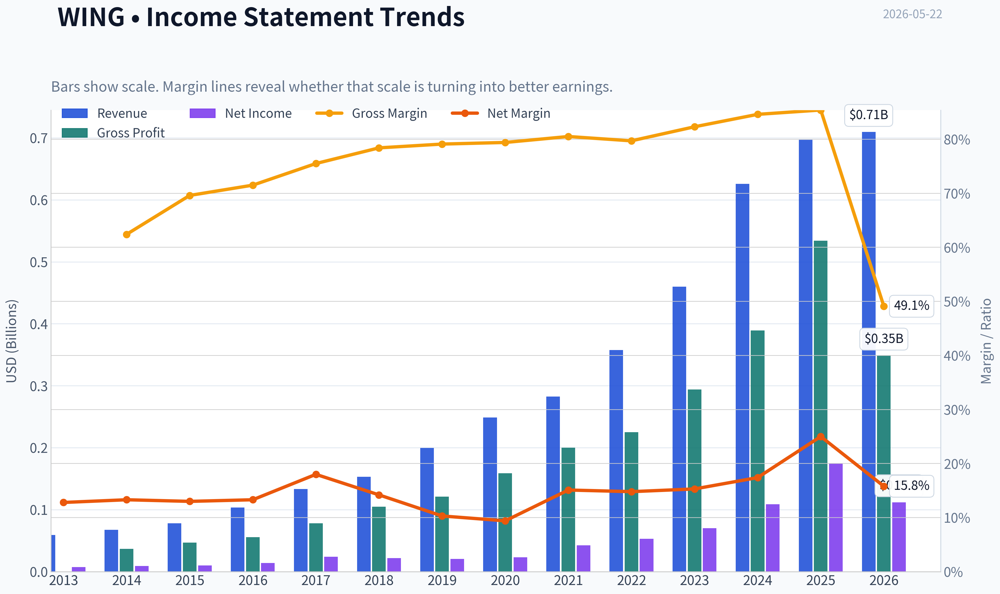

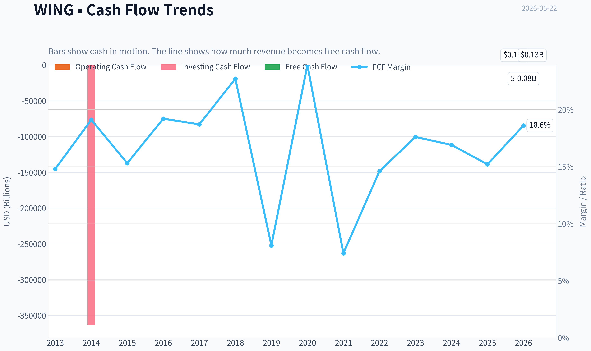

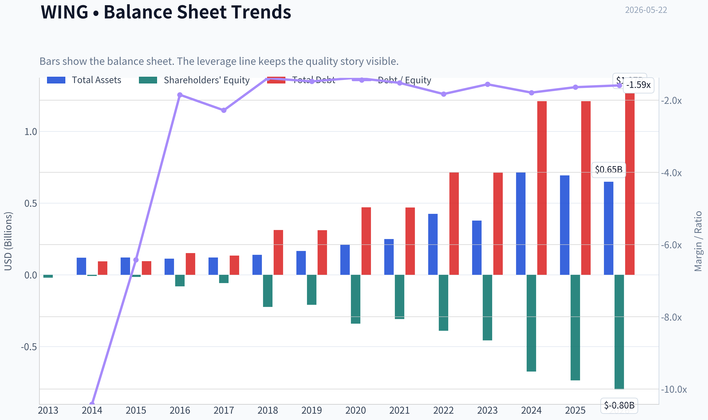

This graph tracks the profitability and return metrics (ROE, ROIC, Margins) of **WING** over the past decade, highlighting capital efficiency trends.

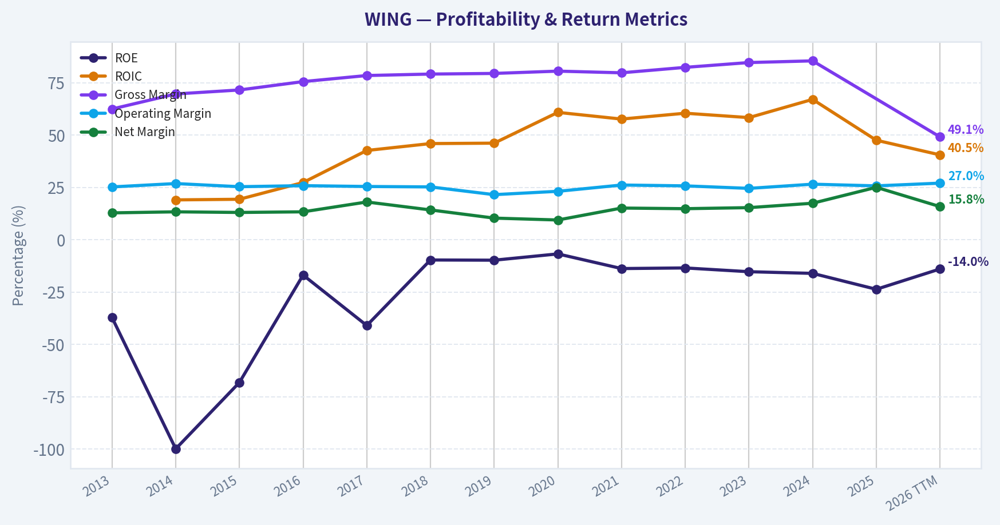

This chart illustrates the financial health of **WING** over the last 10 years, mapping cash equivalents and free cash flow against total obligations (Debt).

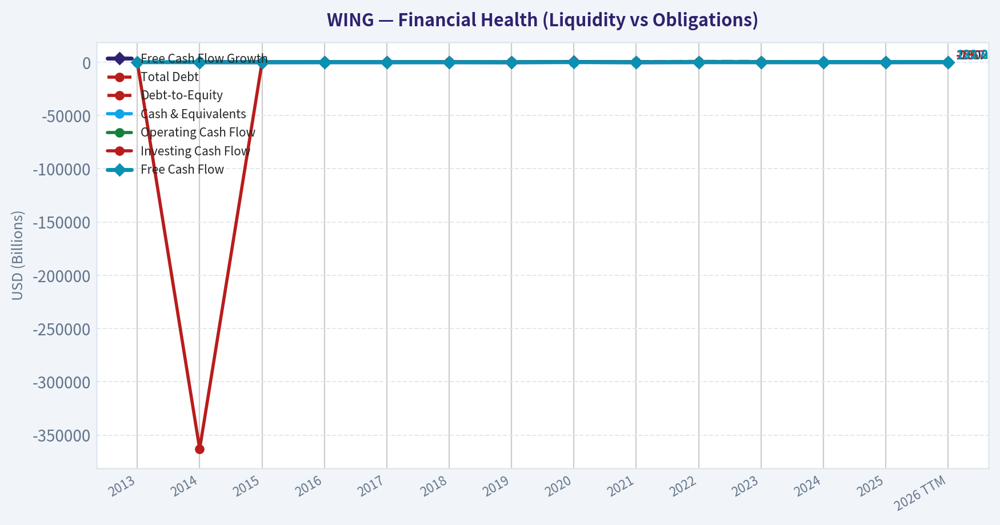

This comparison chart from *Profitability Analysis* stacks current figures against historical benchmarks for **WING**, making it easy to see where the company trades relative to its own averages.

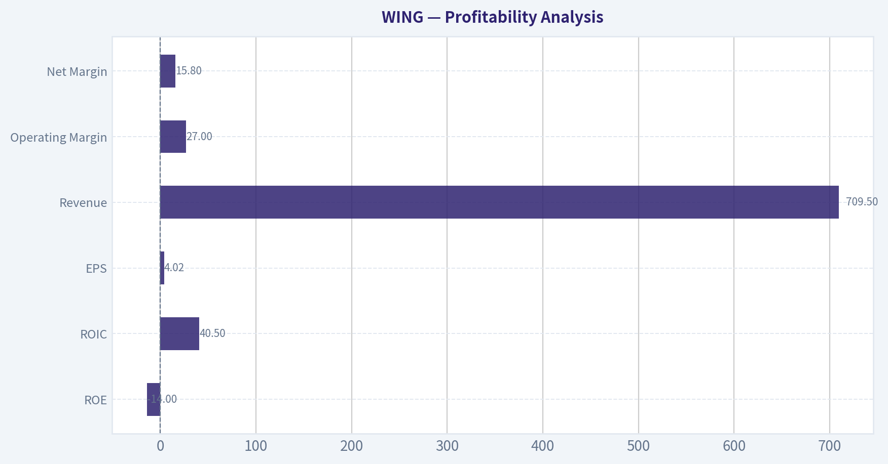

---

### Intrinsic Value Analysis (Buffett)

> *Following Warren Buffett's value investing philosophy: Circle of Competence, Economic Moat, Management Quality, and Margin of Safety.*

#### Intrinsic Value Snapshot

Price is what you pay. Intrinsic value is what the business may be worth based on the cash it can create for owners over time. We show a range, not one magic number.

- Current Price: $139.22
- Value Range (conservative to optimistic across both DCF methods): $83.28 to $568.10

##### Owner Earnings (Buffett Method)
- Net Income: $174,267,000.00
- Depreciation & Amortization: $25,068,000.00
- Capital Expenditures: $-47,441,000.00
- Working Capital Changes: $-15,423,000.00
- Owner Earnings: $167,317,000.00

##### Intrinsic Value
###### Buffett Method
Uses owner earnings. Stricter, and usually more conservative.
- Conservative: $218.14
- Average: $218.14
- Optimistic: $568.10
- Discount Rate: 10.0%

###### Cash Flow Method
Uses free cash flow. Better for companies spending heavily today to grow tomorrow.
- Conservative: $83.28
- Average: $121.95
- Optimistic: $208.64
- Discount Rate: 10.0%

#### Wingstop (WING)

ANALYST STANCE: **WATCH**

#### 1) Go/No-Go Gate Assessment

| Gate | Verdict | Evidence |
|---|---|---|
| Gate 1: Circle of Competence & Simplicity | Pass | Wingstop is easy to understand: it franchises and operates chicken wing restaurants, earns royalties/fees from franchisees, and benefits from brand-driven unit growth. The model is simple and understandable. |
| Gate 1: Long-Term Predictability | Pass with caution | Ten years from now, people will still eat chicken wings and use delivery/takeout. The broad shape of the business is predictable, but same-store sales can be volatile and consumer taste/value perception matters. |
| Gate 1: Technology Risk | Pass | Technology is an enabler, not the core business. Ordering, delivery, loyalty, and digital marketing help the business, but the concept is not likely to be destroyed by software. |
| Gate 2: Moat Test | Pass, but not elite | Gross margin around 48.7% supports some brand strength and pricing power. However, restaurant moats are rarely as durable as software or payment networks, and competition in quick service remains intense. |
| Gate 3: Management & Capital Allocation | Mixed | The brand has compounded through franchising, a favorable capital-light model. But negative ROE and negative equity distort headline returns and suggest balance-sheet optics require caution. |
| Gate 4: Industry Structure | Mixed/Fail for ideal Buffett setup | Restaurants are competitive and consumer-facing. This is not a rational oligopoly. The capital-light franchise structure helps, but the industry itself is not especially protected. |

**Key Takeaways:** Wingstop passes the simplicity test and benefits from a business model that is easy to explain and reasonably predictable. The biggest concern is not whether the company can survive, but whether its moat and industry structure are strong enough to justify a premium multiple.

---

#### 2) Elementary School Test

Wingstop makes money by selling chicken wings under one brand name. Many stores are run by franchise owners, and Wingstop collects fees and royalties from those stores. If more stores open and customers keep ordering wings, Wingstop earns more money.

#### 3) Moat Analysis

| Moat Source | Assessment | Evidence |
|---|---|---|
| Intangible Assets / Brand | Moderate | Wingstop has a recognizable brand in chicken wings and a focused menu. Gross margin of 48.7% is solid and suggests some pricing power. |
| Switching Costs | Low | Customers can switch easily to other fast-food, fast-casual, pizza, or local wing options. There is little hard customer captivity. |
| Cost Advantage | Moderate | The franchise-heavy model is more efficient than owning many stores directly, which supports margins and returns on capital at the corporate level. |
| Network Effects | Weak | More stores improve brand awareness and ad efficiency, but this is not a true network effect in the Buffett sense. |

| Moat Rating | Conclusion |
|---|---|
| Narrow to Moderate | Good brand within a niche, but not a wide moat business |

**Key Takeaways:** Wingstop's moat comes mainly from brand and its franchise structure, not from deep switching costs or true network effects. That can be enough for a good business, but it does not clearly qualify as a rare, wide-moat compounder.

---

#### 4) Management Quality & Capital Allocation

| Area | Assessment | Commentary |
|---|---|---|
| Owner Orientation | Mixed | The franchise model itself reflects capital discipline, since it reduces corporate capital needs and shifts store-level investment to franchisees. |
| Candor & Conservatism | Neutral | No strong evidence here from the provided pack alone of unusually candid shareholder communication or serious accounting concerns. |
| Capital Allocation | Generally good, but watch leverage/equity optics | Franchising is often a strong allocator's model because it can scale with less capital. However, negative ROE of -23.7% is a warning sign on reported equity economics. |

**Key Takeaways:** Management appears to have chosen the right economic model by leaning into franchising. Even so, the balance-sheet and reported equity profile keep this from looking like a clean Buffett-style management win.

---

#### 5) Financial Summary

| Metric | Current / Latest |
|---|---:|
| Share Price | $139 |
| Market Cap | $3.79B |
| P/E | 34.4x |
| ROE | -23.7% |
| Gross Margin | 48.7% |
| Revenue Growth YoY | 11.4% |
| FCF Yield | 2.8% |
| Current Ratio | 3.26 |

**Key Takeaways:** Wingstop shows attractive gross margin and still respectable top-line growth. But the stock is not cheap, free-cash-flow yield is modest, and negative ROE makes the quality story less clean than the brand narrative suggests.

---

#### 6) Owner Earnings View

Using the Buffett lens, owner earnings should reflect true distributable cash after maintenance needs.

| Item | Assessment |
|---|---|
| Net income quality | Needs scrutiny due to negative ROE and equity distortion |
| Capital intensity | Favorable because of franchising |
| Maintenance CapEx burden | Likely relatively low at the corporate level |
| Working capital strain | Likely manageable given franchise economics |
| Owner earnings conclusion | Better than a traditional restaurant operator, but current valuation already capitalizes much of that quality |

**Key Takeaways:** Wingstop benefits from a capital-light franchise model, which usually supports strong owner earnings. The issue is less business quality than price paid for that quality, especially when headline profitability metrics are not pristine.

---

#### 7) Three-Scenario DCF Valuation

Using the available data and anchoring on FCF yield:

First estimate current free cash flow:
- Market cap = **$3.79B**
- FCF yield = **2.8%**
- Implied FCF ~ **$106M**

##### Scenario A: No Growth
Intrinsic value = Owner Earnings / 10%
~ $106M / 0.10 = **$1.06B**

##### Scenario B: GDP Growth (3%)
Intrinsic value = Owner Earnings x 1.03 / (0.10 - 0.03)
~ $106M x 1.03 / 0.07 = **$1.56B**

##### Scenario C: Historical Growth Haircut
Revenue growth is 11.4%; applying a conservative 6% growth assumption:
- Year-1 owner earnings base: $106M
- 10-year growth at 6%
- Terminal growth restrained through 10% discount framework

This setup gives a value range roughly around **$1.9B to $2.3B**, depending on conversion and terminal assumptions.

| Scenario | Estimated Equity Value | Vs Current Market Cap ($3.79B) |
|---|---:|---:|
| A: No Growth | $1.06B | Far below current price |
| B: 3% Growth | $1.56B | Below current price |
| C: 6% Growth | $1.9B-$2.3B | Still below current price |

**Key Takeaways:** Across conservative Buffett-style valuation cases, Wingstop appears priced above intrinsic value. To justify today's market cap, investors must assume stronger and longer-lasting growth than a conservative value investor usually underwrites.

---

#### 8) Margin of Safety Analysis

| Item | Value |
|---|---:|
| Current Market Cap | $3.79B |
| Conservative IV Range | $1.06B-$2.3B |
| Margin of Safety at Current Price | Negative |
| Buffett Requirement | At least 25%, preferably more for average-industry businesses |

**Key Takeaways:** There is no margin of safety at the current price. Even if Wingstop remains a good company, the stock already reflects a very optimistic future.

---

#### 9) Final Buffett Scorecard

| Criterion | Score (1-5) | Weight | Weighted Score |
|---|---:|---:|---:|
| Business Understanding | 5.0 | 20% | 1.00 |
| Moat Width & Durability | 3.0 | 25% | 0.75 |
| Management Quality | 3.0 | 15% | 0.45 |
| Return on Equity | 1.5 | 15% | 0.23 |
| Reinvestment Runway | 4.0 | 10% | 0.40 |
| Balance Sheet Strength | 2.5 | 5% | 0.13 |
| Industry Structure | 2.0 | 5% | 0.10 |
| Valuation / Margin of Safety | 1.5 | 5% | 0.08 |
| **Total** |  |  | **3.14 / 5.0** |

**Key Takeaways:** Wingstop scores well on simplicity and runway, which is why the business remains interesting. But returns metrics, industry quality, and valuation keep it squarely in watch-list territory rather than buy-now territory.

---

#### 10) Final Investment View

**Stance: WATCH**

Wingstop is a good, understandable, brand-led franchise business with capital-light economics and room to expand. That said, Buffett-style investing demands both business quality and price discipline. At roughly 34x earnings and only a 2.8% free-cash-flow yield, the stock does not offer the margin of safety required for a restaurant business with only a moderate moat and a competitive industry backdrop.

If the stock fell materially, or if owner earnings scaled much faster than the current valuation implies, the case could improve. Today, this looks like a good business at too demanding a price rather than a wonderful bargain.
#### Valuation Bridge

This bridge places the current market price beside each intrinsic value lens so readers can see whether upside depends on one method or shows up across several methods.

| Scenario | Intrinsic Value / Share |
| --- | ---: |
| Buffett Method | $218.14 |
| Cash Flow Method | $121.95 |
| Damodaran Method | $156.23 |
| Current Price | $139.22 |

#### Key Takeaways

If one method is far above the others, the upside case depends on a specific modelling assumption. When several methods cluster together, the valuation story is more robust.

#### Valuation Visuals

This comparison chart from *Latest Earnings Snapshot* stacks current figures against historical benchmarks for **WING**, making it easy to see where the company trades relative to its own averages.

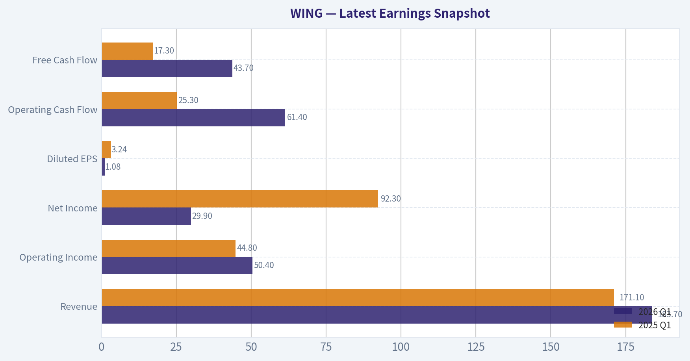

This comparison chart from *Current vs Historical Average Comparison* stacks current figures against historical benchmarks for **WING**, making it easy to see where the company trades relative to its own averages.

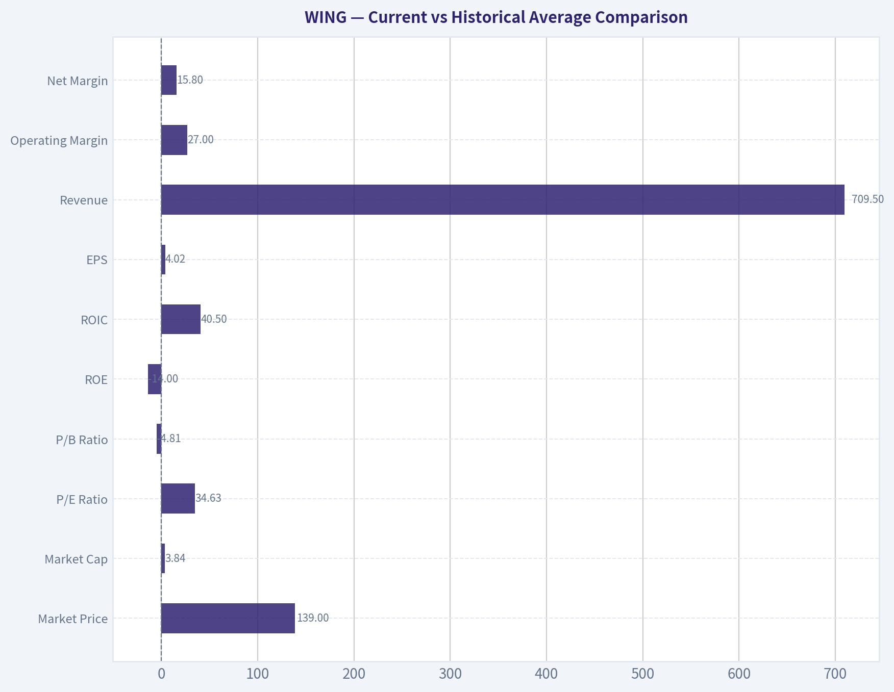

This comparison chart from *Balance Sheet Analysis* stacks current figures against historical benchmarks for **WING**, making it easy to see where the company trades relative to its own averages.

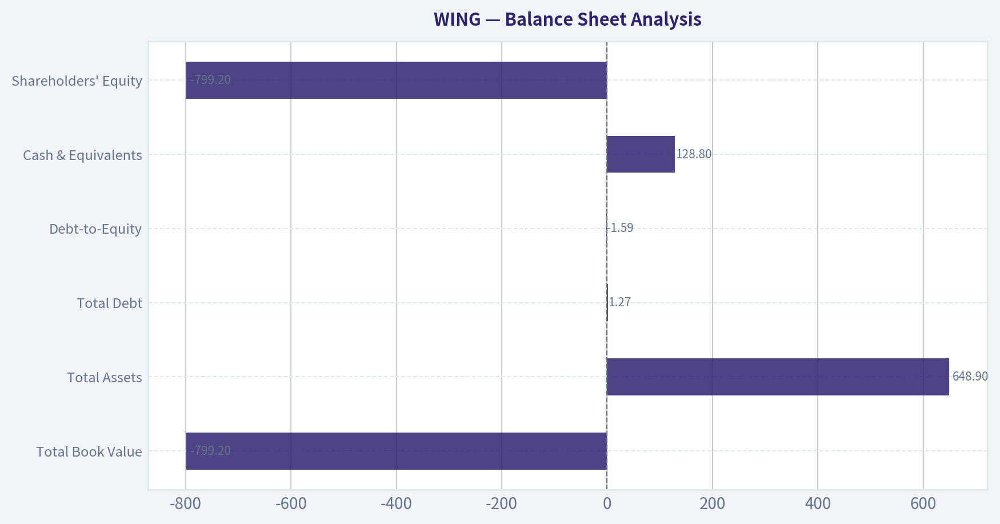

This comparison chart from *Cash Flow Analysis* stacks current figures against historical benchmarks for **WING**, making it easy to see where the company trades relative to its own averages.

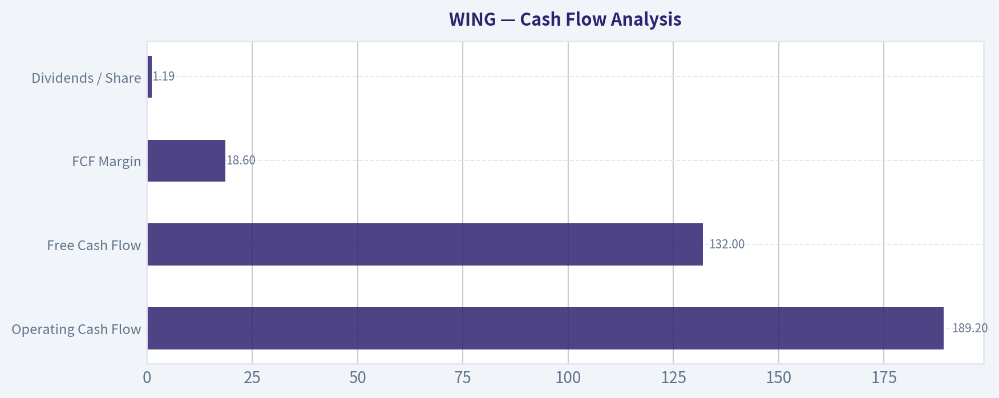

---

### Trend & Growth Analysis (Lynch/Druckenmiller/Fisher)

> *Following Peter Lynch's GARP, Stanley Druckenmiller's macro-aware approach, and Philip Fisher's scuttlebutt methodology.*

ANALYST STANCE: **WATCH**

#### WING Growth Analysis

#### 1. Lynch Classification
| Metric | WING |
|---|---:|
| Revenue growth YoY | 11.4% |
| P/E | 34.4x |
| Business type | Franchised fast-casual restaurant |
| Lynch category | **Stalwart / borderline faster grower in concept expansion, but not in current reported growth** |

**Key Takeaways:** Wingstop is not screening as a classic Lynch fast grower today because reported revenue growth is only about 11%. The concept may still have long runway through unit expansion, but current fundamentals place it closer to a stalwart than a true 20% plus compounder.

#### 2. The Story in 3 Bulsts
| Simple Story | Why It Matters |
|---|---|
| Wingstop is a focused chicken-wing chain with a highly franchised model. | Franchising can scale with lower capital intensity than company-owned restaurants. |
| The brand has historically won through simple operations, strong unit economics, and flavor-led marketing. | Simplicity supports franchise expansion and attractive margins. |
| The key debate now is whether international/store growth can offset softer U.S. same-store sales. | If comps stay weak, the market may reduce the premium multiple. |

**Key Takeaways:** The bull case is straightforward: a narrow-menu, asset-light brand keeps adding units globally. The bear case is equally clear: if same-store sales cool meaningfully, the premium valuation becomes harder to justify.

#### 3. TAM Analysis and 10x Test
| Item | Assessment |
|---|---|
| Current scale | ~$3.79B market cap; concept still relatively small vs global QSR leaders |
| TAM type | Global chicken/QSR occasion market, large and durable |
| 10x revenue test | **Conceptually possible**, but difficult without major international penetration and sustained unit growth |
| Constraint | U.S. category maturity risk, dependence on franchisee economics, commodity chicken wing volatility |

**Key Takeaways:** Wingstop likely still has a meaningful runway because the global quick-service chicken market is very large. However, a true 10x outcome from here probably requires strong international expansion and a reacceleration in same-store sales, not just steady domestic unit openings.

#### 4. Revenue Growth Trend
| Metric | Reading | Interpretation |
|---|---:|---|
| Revenue growth YoY | 11.4% | Moderate, not high-growth |
| Recent sales commentary | Softer U.S. same-store sales | Near-term deceleration risk |
| Trend label | **Decelerating / softening** | Not an inflection in the right direction today |

**Key Takeaways:** The current growth pattern is not showing the kind of acceleration Druckenmiller-style investors usually want. Instead, the evidence points to softer comparable sales, which raises the bar for future reacceleration.

#### 5. Unit Economics
| Metric | WING | Assessment |
|---|---:|---|
| Gross margin | 48.7% | Solid |
| FCF yield | 2.8% | Low, implies premium valuation |
| Current ratio | 3.26x | Strong liquidity |
| ROE | -23.7% | Distorted/poor, likely impacted by capital structure and negative equity dynamics |
| LTV/CAC | N/A | Not disclosed in restaurant format |
| NRR | N/A | Not relevant |
| Rule of 40 | N/A | Not relevant |

**Key Takeaways:** Wingstop has some attractive operating traits, especially solid gross margin and strong liquidity. But the low free cash flow yield and negative reported ROE suggest investors are still paying up for quality and growth despite signs of slowing momentum.

#### 6. Inflection Point Assessment
| Potential Inflection | Status | View |
|---|---|---|
| Product cycle inflection | Limited evidence | Flavor marketing helps brand engagement, but not enough alone |
| Market share inflection | Unclear | No hard evidence of accelerating share gains |
| Margin inflection | Possible but unproven | Franchised model helps, but comps matter |
| TAM inflection | Moderate | International white space remains |
| Competitive inflection | Negative | Peers like CAVA recently showing stronger momentum |

**Key Takeaways:** I do not see a strong positive inflection point today. The best argument is international expansion, but recent commentary on soft same-store sales means the stock currently lacks a clear catalyst showing growth is accelerating.

#### 7. Macro Setup Evaluation
| Factor | Impact on WING |
|---|---|
| Consumer spending | Mixed; traffic-sensitive restaurant names can wobble if the consumer softens |
| Rates | Moderately relevant; lower rates help premium multiples |
| Commodity costs | Important risk, especially chicken wing input volatility |
| Secular trend | QSR convenience and brand-led dining, but not a major 2024-2034 mega-theme like AI/cyber/cloud |

**Key Takeaways:** The macro backdrop is only average for Wingstop. This is not a business with a major secular tailwind on the level of top-tier growth sectors, and it remains exposed to consumer traffic and food-cost swings.

#### 8. Fisher 15 Points Score
| Fisher Dimension | Score (1-5) | Comment |
|---|---:|---|
| Market potential | 4 | Global whitespace exists |
| New product development | 3 | Flavor innovation helps, but platform breadth is limited |
| R&D effectiveness | 2 | Not a major differentiator in restaurant category |
| Sales organization | 4 | Strong franchise development/history |
| Profit margin | 4 | Franchised model attractive |
| Improving margins | 3 | Needs confirmation amid softer sales |
| Labor relations | 3 | Neutral / insufficient data |
| Executive relations | 3 | Neutral / insufficient data |
| Management depth | 3 | Adequate but not clearly exceptional from data provided |
| Cost/accounting controls | 3 | Neutral |
| Outstanding moat features | 3 | Brand and scale, but limited moat versus best-in-class platforms |
| Long-range profit outlook | 4 | Good if unit growth persists |
| Dilution risk | 4 | Lower than many growth names due to franchise model |
| Candor | 3 | Neutral |
| Integrity | 3 | Neutral |
| **Total** | **49/75** | **Average** |

**Key Takeaways:** Wingstop scores as an above-average but not exceptional Fisher company. The main strengths are brand, franchise scalability, and long-term market potential, while the biggest limitation is that its moat and innovation engine are not overwhelmingly strong.

#### 9. Valuation Analysis
| Valuation Metric | WING | Read |
|---|---:|---|
| P/E | 34.4x | Rich for ~11% growth |
| PEG | ~3.0x | Expensive |
| FCF yield | 2.8% | Expensive |
| P/S | Not provided | Likely still premium vs restaurant peers |

**Key Takeaways:** On the numbers available, valuation looks full. A PEG around 3 is far above Lynch's comfort zone, meaning the stock currently appears expensive relative to its present growth rate.

#### 10. Growth Investor Scorecard
| Criterion | Weight | Score (1-5) | Weighted |
|---|---:|---:|---:|
| The Story | 10% | 4.0 | 0.40 |
| TAM & Runway | 20% | 3.5 | 0.70 |
| Revenue Growth | 20% | 2.5 | 0.50 |
| Unit Economics | 15% | 3.5 | 0.53 |
| Competitive Position | 10% | 3.0 | 0.30 |
| Management Quality | 10% | 3.0 | 0.30 |
| Macro Setup | 5% | 3.0 | 0.15 |
| Profitability Path | 5% | 3.5 | 0.18 |
| Valuation | 5% | 2.0 | 0.10 |
| **Total** | 100% |  | **3.16 / 5.0** |

**Key Takeaways:** Wingstop lands in the middle of the pack with a score consistent with a watchlist name, not a high-conviction buy. The long runway is still interesting, but slowing growth and a premium valuation keep it from reaching advocate status.

#### 11. Position Size Stance
| Stance | View |
|---|---|
| Current action | **WATCH** |
| If owned | Hold only if you believe comps reaccelerate and international expansion remains intact |
| If not owned | Wait for either better entry price or visible growth reacceleration |
| Suggested sizing | Small tracking position at most, not concentrated |

**Key Takeaways:** This is not the type of setup that merits aggressive buying today. Investors should either wait for fundamentals to improve or for valuation to reset before taking a meaningful position.

#### 12. Key Risks and Catalysts
| Risks | Catalysts |
|---|---|
| U.S. same-store sales softness | Reacceleration in traffic/comps |
| Premium valuation compression | Faster unit growth, especially internationally |
| Commodity cost volatility | Margin resilience despite sales pressure |
| Narrow menu/category concentration | Strong franchisee openings and development pipeline |
| Competitive pressure from stronger-growth chains | Brand campaigns that convert to measurable sales lift |

**Key Takeaways:** The most important near-term risk is that soft comps persist and the market stops paying a premium multiple. The most important upside catalyst is clear evidence that traffic and same-store sales are turning back up while unit growth remains healthy.

#### Bottom Line
Wingstop is a high-quality branded franchise concept, but based on the data provided it does **not** currently meet the bar for a Lynch-style fast grower or a Druckenmiller-style positive inflection idea. The runway is real, yet the present setup looks like **good business, not great stock right now**.

If you want, I can next turn this into a **bull/base/bear valuation scenario model for WING** using explicit assumptions.

#### Growth & Scorecard Visuals

This comparison chart from *Growth Metrics* stacks current figures against historical benchmarks for **WING**, making it easy to see where the company trades relative to its own averages.

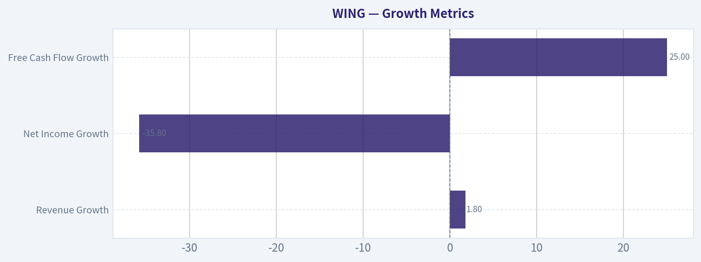

---

### Market Technical Analysis

#### WING Technical Report

WING is in a clearly damaged downtrend across long-, medium-, and short-term timeframes, but the very latest price action suggests a **tentative relief rebound** is trying to form after an extended washout. The most relevant indicator set for this market condition is:

- `close_200_sma`
- `close_50_sma`
- `close_10_ema`
- `macd`
- `rsi`
- `boll_ub`
- `boll_lb`
- `atr`

These 8 are well suited because they cover **trend hierarchy, short-term momentum, mean-reversion/stretch, and risk/volatility** without unnecessary overlap.

---

#### Why these indicators matter now

| Indicator | Why it is suitable for WING now |
|---|---|
| close_200_sma | Confirms the primary trend, which is decisively bearish. |
| close_50_sma | Shows the medium-term trend deterioration and acts as likely resistance on rebounds. |
| close_10_ema | Tracks whether the current bounce has enough short-term momentum to persist. |
| macd | Measures whether downside momentum is still dominant or beginning to improve. |
| rsi | Helps judge whether the recent rebound is just an oversold snapback or the start of a more durable recovery. |
| boll_ub | Defines the upper boundary of the current volatility envelope and likely rebound ceiling. |
| boll_lb | Highlights how stretched the prior decline became and whether price is recovering from capitulation. |
| atr | Essential for position sizing and stop placement because WING remains highly volatile. |

**Key Takeaways:** WING needs a multi-layered read because it is not simply weak; it is weak across nearly every trend timeframe while also showing the early signs of a rebound from oversold conditions. The selected indicators work together to separate a tradable bounce from a true trend repair, which is the key decision traders face right now.

---

#### Trend structure: long-term damage remains severe

The biggest technical fact is that WING closed at **132.65 on 2026-05-21**, while the:

- **50 SMA = 164.82**
- **200 SMA = 238.83**
- **10 EMA = 131.58**

That places price:

- about **19.5% below the 50-day average**
- about **44.5% below the 200-day average**
- only **slightly above the 10-day EMA**

This is an important configuration. It says the stock is **not in recovery in a strategic sense**; it is only trying to stabilize in a tactical sense.

The 200-day SMA has been falling steadily from roughly **285.7 in October 2025** to **238.8 now**, which confirms a broad, persistent destruction of long-term trend quality. Meanwhile, the 50-day SMA has fallen from about **260 in early March** to **164.8 now**, showing that the medium-term trend has not just weakened but accelerated lower over recent months.

In plain terms: WING is not merely below trend; the trend itself is falling aggressively.

---

#### Fine-grained price behavior over the past year

The past year shows several distinct phases:

1. **Late spring to early summer 2025:** strong advance into the high 370s to low 380s.
2. **Mid-2025 to fall 2025:** progressive breakdown, with lower highs and lower lows.
3. **Late October 2025:** sharp air-pocket decline into the low 210s.
4. **November 2025 to February 2026:** unstable rebound attempts, but no durable re-acceleration.
5. **March to early May 2026:** waterfall decline from the low 240s into the high teens/low 120s.
6. **Mid-May 2026:** first meaningful rebound attempt after capitulation.

The March-April decline was especially important because it reset the stock from a "broken but rangeable" structure into a **full liquidation trend**. The recent push from **118.66 on May 14** to **132.65 on May 21** is notable, but in context it remains small relative to the preceding collapse from around **198-200 in mid-April** and **170+ at the end of April**.

That means the bounce is real, but still countertrend.

---

#### Short-term momentum: a bounce is forming, but conviction is incomplete

The **10 EMA at 131.58** sits just under price at **132.65**, which is one of the first constructive short-term signals WING has shown in weeks. This suggests sellers have, at minimum, lost some immediate control.

However, the slope of the 10 EMA is still broadly depressed after falling sharply from about **198.2 on March 23** to the low **130s now**. The recent flattening is encouraging, but one or two strong up days do not reverse months of momentum damage.

The near-term pattern since May 14 is mildly constructive:

- **May 14:** 118.66
- **May 15:** 129.21
- **May 18:** 129.00
- **May 19:** 126.80
- **May 20:** 128.13
- **May 21:** 132.65

This sequence suggests:
- the panic low may be in the process of being tested and accepted,
- buyers are willing to defend above the low 120s,
- but the rebound is still shallow and fragile.

For short-term traders, the key issue is whether price can **hold above the 10 EMA** and start converting the **mid-130s to low-140s** into a base rather than rolling over again.

---

#### Momentum diagnostics: MACD says downside pressure is easing, not gone

The **MACD is -14.01**, still deeply negative. That confirms the larger momentum regime remains bearish.

But the more nuanced point is that MACD has improved from roughly **-24 in early April** to **-14 now**. In other words, downside momentum has **decelerated materially**. That usually happens in one of two scenarios:

- the stock is preparing for a stronger reflex rally, or
- the trend is entering a pause before another leg lower.

At this stage, MACD improvement alone is **not enough** to declare a bottom. It does, however, argue against chasing fresh bearish entries after such a prolonged decline unless price fails quickly. The most bearish phase of momentum appears to have passed for now, even if the broader downtrend remains intact.

This is the kind of setup where trend traders often wait for failed rebounds rather than initiate shorts into exhaustion.

---

#### RSI: oversold washout likely reached climax, but not yet true strength

The **RSI is 36.84**, up from deeply oversold levels near **20-22** last week.

That is a meaningful shift. It indicates the stock is rebounding from an extreme oversold condition rather than remaining in outright capitulation. But 36.84 is still **not strong**; it is simply **less weak**.

This matters because RSI recoveries from sub-30 levels often produce one of two paths:

- **bullish repair path:** RSI pushes through 40-50 and price starts building higher lows;
- **bearish reflex path:** RSI rebounds into the 35-45 zone and then turns back down as sellers reassert control.

Right now WING is in the decision zone between those two outcomes. The rebound has relieved oversold pressure, but momentum has not yet crossed into healthy bullish territory. For that reason, traders should treat current strength as a **test of rebound quality**, not confirmation of trend reversal.

---

#### Bollinger Bands: price is rebounding off compression after extreme downside stretch

On May 21:

- **Upper Band = 186.48**
- **Lower Band = 100.93**
- Price = **132.65**

A few observations stand out:

1. Price is no longer scraping the lower band the way it often does in a panic trend.
2. Price remains in the **lower half** of the Bollinger range, which shows the rebound is still modest.
3. The band spread remains wide, confirming WING is still trading in a **high-volatility regime**.

The lower band had risen from around **100.1 to 100.9**, while the upper band fell dramatically from over **274 in late March** to **186.5 now**. That collapse in the upper band reflects how severely the stock's average trading zone has reset lower. In effect, the entire volatility envelope has shifted down.

Practically, this tells traders that:
- the stock is no longer at maximum downside extension,
- but it is still nowhere near reclaiming even the middle-to-upper portion of its recent volatility channel,
- and rallies into higher band areas may encounter heavy supply.

A move toward the mid-band or upper half of the envelope would be a more convincing sign that the rebound is maturing.

---

#### Volatility and risk: ATR remains elevated, so position sizing matters

The **ATR is 10.42**, down modestly from peaks above **14** in late March, but still very high relative to the stock's current price around **132.65**.

That implies daily movement remains large in percentage terms. Roughly speaking, ATR is about **7.9% of price**, which is elevated and means:

- tight stops are vulnerable to random noise,
- oversized positions can become unmanageable quickly,
- breakout and reversal setups both need wider risk allowances than normal.

The good news is ATR has been gradually declining from the March capitulation phase, which suggests the market is becoming slightly less chaotic. The bad news is that "less chaotic" still does not mean calm. WING remains a high-beta tactical vehicle rather than a stable trend instrument.

---

#### Trading interpretation by style

| Trading style | Read on WING |
|---|---|
| Long-term investor | Avoid treating this as repaired; price remains far below the 200 SMA and the long-term trend is still decisively down. |
| Swing trader | A tradable oversold bounce may be underway, but it remains countertrend until the stock starts reclaiming medium-term resistance zones. |
| Mean-reversion trader | The extreme oversold RSI readings did justify watching for a rebound, and that rebound is now developing. |
| Trend follower | The primary and intermediate trends remain bearish; rallies are still more likely resistance tests than confirmed trend changes. |
| Risk-focused trader | ATR is still high enough to demand smaller sizing and disciplined stop placement. |

**Key Takeaways:** WING may offer tactical long setups for rebound traders, but it still does not meet the standards of a repaired uptrend for longer-horizon participants. The distinction is crucial: this is currently a bounce candidate, not yet a trend recovery candidate.

---

#### What would strengthen the bull case

The bullish argument would improve if WING can:

- remain above the **10 EMA**
- push RSI sustainably above **40-50**
- continue lifting MACD toward zero
- reclaim and hold prior breakdown zones in the **mid-130s to 150 area**
- begin flattening the 50 SMA decline over time

That would suggest the rebound is expanding from a mere oversold snapback into a base-building process.

---

#### What would strengthen the bear case

The bearish argument would regain force if WING:

- loses the **10 EMA** quickly,
- drops back below the **mid-120s**,
- sees RSI roll back toward **30 or lower**,
- and MACD starts widening negatively again after this recent improvement.

That would imply the rebound failed and the stock is resuming its dominant downtrend, with the May lows vulnerable to retest.

---

#### Bottom line

WING is in a **long-term and medium-term bearish trend**, but it is currently attempting a **short-term recovery from deeply oversold conditions**. The tactical picture has improved modestly: price is slightly above the 10 EMA, RSI has bounced from capitulation levels, and MACD is becoming less negative. Still, the strategic picture remains poor because price is dramatically below both the 50-day and 200-day moving averages, and both of those averages are falling.

The most useful conclusion is this: **WING looks more like a countertrend rebound in a damaged chart than a confirmed bottom in a repaired chart.** Traders can respect the bounce without confusing it for a full trend reversal.

---

#### Summary Table

| Area | Current Signal | Interpretation | Trader Implication |
|---|---|---|---|
| Long-term trend | Price far below 200 SMA (132.65 vs 238.83) | Structural bear trend intact | Long-term buyers should stay cautious |
| Medium-term trend | Price below 50 SMA (132.65 vs 164.82) | Intermediate downtrend still strong | Rebounds likely face overhead resistance |
| Short-term trend | Price slightly above 10 EMA (132.65 vs 131.58) | Early stabilization/bounce attempt | Short-term traders can monitor follow-through |
| MACD | -14.01 but improving | Downside momentum easing, not reversed | Better for rebound trading than fresh short chasing |
| RSI | 36.84 after sub-30 readings | Oversold condition has partly normalized | Bounce has room, but strength is not confirmed |
| Bollinger Bands | Price in lower half of band range | Recovery from stretch, still not strong | Mean reversion underway but incomplete |
| ATR | 10.42 | Volatility remains high | Use smaller size and wider stops |
| Overall view | Countertrend bounce within major downtrend | Tactical improvement, strategic weakness | Trade selectively; do not overstate reversal odds |

**Key Takeaways:** The table shows a stock that is stabilizing tactically while remaining weak structurally. In simple terms, WING has improved enough to support a short-term bounce narrative, but not enough to justify calling the larger downtrend over.

---

### Options Market Analysis

> *Reading options flow - put/call ratios, IV skew, and unusual activity - to gauge institutional positioning and event-driven risk.*

#### WING Options Positioning Report
*Date: 2026-05-22*

WING's options market is sending a **cautiously bullish near-term trading signal, with a defensive undertone**. The biggest split in the data is this: **open interest is put-heavy**, which suggests standing hedges or residual downside protection, but **current trading flow is call-led**, driven by a standout unusual trade in the June $180 calls. That usually means institutions or active traders are pressing a short-term upside view even while the broader book remains guarded.

#### 1. Put/Call Ratio Analysis

| Expiration | Call OI | Put OI | Put/Call OI Ratio | Call Volume | Put Volume | Put/Call Volume Ratio |
|---|---:|---:|---:|---:|---:|---:|
| 2026-06-18 | 4,422 | 8,605 | 1.95 | 1,246 | 277 | 0.22 |
| 2026-07-17 | 1,828 | 2,326 | 1.27 | 128 | 660 | 5.16 |
| 2026-09-18 | 1,477 | 1,198 | 0.81 | 185 | 250 | 1.35 |
| **Near-term total** | **7,727** | **12,129** | **1.57** | **1,559** | **1,187** | **0.76** |

**Key Takeaways:** WING's aggregate **put/call OI ratio of 1.57** sits well above the neutral baseline of roughly 0.7, showing the existing options book is defensively positioned. But the **put/call volume ratio of 0.76** is much closer to neutral and even call-favoring, largely because June flow was heavily skewed to calls. In plain English: the older positioning looks cautious, while the newest activity suggests traders are leaning for upside in the very near term.

**Interpretation**
- **OI ratio 1.57**: materially above neutral, implying meaningful put ownership and/or portfolio hedging.
- **Volume ratio 0.76**: near neutral but modestly call-favoring overall.
- **Major split by expiry**:
  - **June 2026**: extremely call-driven flow despite heavy put OI already sitting in the chain.
  - **July 2026**: put volume dominates, suggesting some traders are still paying for downside protection beyond the front month.
  - **September 2026**: more balanced, slightly defensive on volume, but not extreme.

This kind of setup often reflects **existing institutional hedges plus new tactical upside speculation** rather than outright broad-based bullish conviction.

---

#### 2. Implied Volatility Assessment

| Expiration | ATM Call IV | ATM Put IV | IV Read |
|---|---:|---:|---|
| 2026-06-18 | 67.9% | 66.8% | Elevated |
| 2026-07-17 | 69.4% | 67.1% | Elevated |
| 2026-09-18 | 76.7% | 73.1% | Very elevated |

**Key Takeaways:** Implied volatility is **high across the curve**, especially in September. Calls are trading at slightly higher ATM IV than puts in every listed expiry shown, which is not the classic panic pattern you see when traders are bracing for a sharp downside break. Instead, this looks more like **event-risk pricing with some upside participation demand**.

**IV / Skew interpretation**
- Near-term ATM IV in the **high-60s to mid-70s** is elevated for most single-name equities and signals the market expects meaningful movement.
- Calls show slightly **higher ATM IV than puts** in all listed expirations:
  - June: 67.9% call vs 66.8% put
  - July: 69.4% call vs 67.1% put
  - September: 76.7% call vs 73.1% put

That is **not a steep put-skew profile**. Based on the provided chain summary, WING appears to have a **mild call-skew / upside-chase skew**, or at minimum a notably flat downside skew relative to what a fearful market would normally show.

**Catalyst read**
- Elevated IV likely means traders are pricing in a **known or anticipated catalyst**, such as earnings, guidance updates, or a sector/macro-sensitive event.
- Since the front expiries are already rich and September gets richer still, the market is pricing **continued uncertainty rather than a one-day event only**.

Bottom line on IV: **elevated, but not fear-driven**.

---

#### 3. Unusual Options Activity

| Expiry | Type | Strike | Volume | Open Interest | Vol/OI | IV | Positioning Read |
|---|---|---:|---:|---:|---:|---:|---|
| 2026-06-18 | CALL | $180 | 839 | 134 | 6.3x | 66.5% | Fresh upside bet / speculative bullish positioning |

**Key Takeaways:** The only flagged unusual contract is a **June $180 call**, where volume was more than **6x open interest**. That is a classic sign of **new positioning rather than old exposure getting unwound**. Since it is a call and concentrated in the front month, it points to traders targeting a **near-term upside move**.

**What it implies**
- **Call, not put**: bullish by default unless part of a covered-call overwrite, but the high volume vs low OI strongly suggests fresh opening activity.
- **Front-month expiry**: short time horizon points to a catalyst-driven or tactical trade.
- **Likely OTM or near-OTM** depending on spot level at the time of trade; that usually indicates traders are seeking convex upside rather than simply hedging stock.
- **IV at 66.5%**: buyers were willing to pay elevated premium, which supports the idea of a conviction trade.

**Institutional vs retail**
- The size and volume/OI relationship suggest this is **more likely informed active money than random retail noise**, especially in a name like WING where options activity is not ultra-deep.
- That said, because the chain is not massively liquid, confidence should be **moderate rather than high**.

---

#### 4. Open Interest Concentration

| Expiration | Highest OI Bias | Read |
|---|---|---|
| 2026-06-18 | Put-heavy | Strong downside hedge concentration / possible pin influence below spot |
| 2026-07-17 | Put-heavy | Defensive positioning remains present into mid-summer |
| 2026-09-18 | More balanced | Less skewed, suggests uncertainty broadens out over time |

**Key Takeaways:** The strongest concentration signal in WING is not a single dominant strike from the provided dataset, but rather a **clear put-heavy OI structure in June and July**. That kind of concentration can create **gravitational pressure** around heavily traded downside levels while also forcing dealers to react more aggressively if price moves through them. In practical terms, there is still enough hedge inventory in the chain to keep the market sensitive to sharp directional moves.

**Pinning / gamma interpretation**
- Since June carries the largest total OI and is heavily put-loaded, that expiry matters most for near-term price behavior.
- A put-heavy front month can create:
  - **support if dealers are long puts and hedge dynamically**
  - or **accelerated downside if key downside strikes are breached**
- The unusual call buying in the June $180 line may also create a **local upside gamma pocket** if the stock pushes toward that strike.

Because the tool output does not provide full strike-by-strike OI ladders, we should avoid over-claiming exact gamma walls. But the broad takeaway is clear:
- **June is the main battleground**
- **Puts dominate the standing book**
- **$180 calls are a visible upside speculative node**

---

#### 5. Overall Options Sentiment Signal

| Signal | Conviction | Primary Driver |
|---|---|---|
| **BULLISH** | Moderate | Fresh front-month call buying outweighs the bearish look of legacy put OI |

**Key Takeaways:** I would classify WING's options signal as **Bullish, with hedging still present in the background**. The reason is simple: when current flow and unusual activity matter most, the cleanest fresh bet in the data is on the **upside**, not the downside. Still, the elevated put OI means this is not an all-clear high-conviction bullish setup; it is better described as **tactical bullishness in a still-risk-aware market**.

**Why bullish instead of neutral or bearish**
- **Bullish case**
  - Net fresh activity favors calls in the front month.
  - The only clear unusual trade is a **large June $180 call**.
  - IV shape is **not showing classic downside panic**.
- **Why not bearish**
  - Yes, OI is put-heavy, but OI can reflect older hedges and not today's directional intent.
  - Current trading interest is not dominated by panic put chasing across all expiries.
- **Why not neutral**
  - The unusual call concentration is too strong to ignore.
  - Front-month call volume materially exceeded put volume.

#### Final Read
WING's options market currently suggests **near-term upside appetite**, likely tied to a catalyst or a tactical momentum view, while the broader options book remains **defensively hedged**. That means traders are willing to bet on a move higher, but they have not abandoned concern about downside risk. So the best single-word signal is:

#### **BULLISH**

with the caveat that confidence is **moderate**, not high, because legacy put positioning remains elevated and the name is not among the deepest options markets.

---

#### Summary Table

| Category | Observation | Signal |
|---|---|---|
| Put/Call Ratio | Total OI ratio **1.57**; total volume ratio **0.76** | Legacy defensive OI, fresher call-biased flow |
| IV Level | ATM IV roughly **67%-77%** across near-term expiries | Elevated, catalyst-sensitive |
| Skew Direction | Slight **call-skew / upside-chase** rather than steep put skew | Not showing classic downside fear |
| Unusual Activity | **2026-06-18 $180 call**, volume **839** vs OI **134** | Fresh bullish speculation / tactical upside bet |
| Overall Signal | **BULLISH** | Near-term upside flow outweighs defensive background hedging |

**Key Takeaways:** WING's options tape is best described as a **bullish tactical setup layered on top of an already hedged base**. Elevated IV says the market expects movement, but the skew and unusual activity say traders are more interested in catching upside than paying aggressively for crash protection.

---

## Research Team Commentary

> *The Research Manager synthesizes the Bull vs Bear debate into action-free commentary. This is a pre-risk view, not the final stance.*

The debate really comes down to a classic Buffett tension: Wingstop looks like a high-quality business model, but the stock does not obviously offer a high-quality entry point.

The strongest bull argument is that this is exactly the kind of business Buffett tends to admire at the business level: focused brand, simple operating model, asset-light franchising, high returns on capital, and the ability to grow without needing huge incremental capital. The reported ROIC near 48% and ROA above 25% are hard to dismiss. That suggests the underlying economic engine is strong, even if ROE looks ugly because of capital structure distortions. The bull is also right that reported revenue growth of 11.4% may understate the attractiveness of a franchisor, where royalty streams, unit growth, and systemwide sales matter more than pure top-line optics. If Wingstop can keep expanding units domestically and internationally while preserving franchisee economics, intrinsic value can compound over a long period.

The strongest bear argument is that none of that automatically makes the stock cheap. At roughly 34x earnings and a 2.8% FCF yield, there is no real margin of safety by traditional value standards. That matters more because growth has already slowed into the low double digits, so investors are still paying a premium multiple without hyper-growth support. The bear also raises a legitimate concern around negative equity and the possibility that some of the impressive return metrics are flattered by an asset-light, leveraged structure rather than pure economic invincibility. And importantly, current market behavior is not confirming confidence: the stock is deeply below both the 50-day and especially the 200-day average. From prior mistakes, I should not let admiration for business quality soften the practical conclusion when valuation is rich and the setup is damaged.

My takeaway is this: Wingstop appears to be a very good business, but not a clear value investment at this price and setup. The market may be reassessing how much growth duration and pricing power this model really deserves, and at 34x earnings there is little room for disappointment. On the other hand, this is not the kind of weak, low-return business I would reflexively avoid forever. It is better understood as a quality compounder candidate waiting for either a cheaper price or renewed proof that growth durability remains intact.

So my stance is WATCH.

Core takeaway: Wingstop likely has real franchise quality and durable brand economics, but today's valuation still asks investors to pay up for continued execution despite slower growth and a weak stock trend. That combination does not satisfy Buffett's requirement for a comfortable margin of safety.

Rationale: From a value investing perspective, business quality comes first, and Wingstop clears that hurdle better than most restaurant concepts. The franchise model is capital-light, returns on invested capital are excellent, and the brand has a distinct niche. But Buffett's discipline is not just about buying good businesses; it is about buying them at sensible prices when future cash flows are predictable enough and downside is protected. Here, predictability is only moderate. The concept is still tied to consumer demand, franchise health, and commodity exposure. Meanwhile, the stock trades at a premium multiple and low FCF yield, so the margin of safety is weak. I also want to avoid a past mistake in the opposite direction: not every stock far below its moving averages is a bargain. In Roper, the lesson was to separate good business from bad stock setup. That applies here. Unlike the Duolingo case, where compressed valuation created asymmetry, Wingstop still looks expensive relative to present growth.

What I think the market may be missing on the bullish side is that high-quality franchisors can stay expensive for a reason and can create value through long-duration unit growth. What the bulls may be missing is that "quality" is already widely understood, and when a quality narrative breaks, premium multiples can compress much further than expected. The key question is not whether Wingstop is a good business. It is whether today's price already discounts most of the long-term upside.

Monitoring plan over the next 1 to 4 quarters: First, I would watch same-store sales and unit growth together, not separately. If comps hold up and unit openings remain healthy, the long runway story stays alive. Second, I would watch franchisee economics carefully. A franchisor only compounds if franchisees continue earning strong returns and want to build more stores. Third, I would watch operating cash flow and free cash flow conversion to see whether the low FCF yield today is being offset by strong future compounding. Fourth, I would watch any signs that wing cost volatility is impairing margins or pricing power. Fifth, I would watch leverage, capital allocation, and whether the balance sheet remains a support or becomes a hidden risk. Finally, I would watch whether the stock begins to repair technically through sustained improvement rather than just short-term bounces; after the ROP mistake, I do not want to ignore a damaged longer-term trend when valuation is not cheap enough to compensate.

What would strengthen the thesis? Reacceleration in system sales growth, sustained unit expansion, resilient franchise margins, improving free cash flow, and evidence that current multiple risk is being earned back through execution. What would weaken it? Further growth deceleration into single digits, weakening franchisee demand, rising cost pressure, or any hint that the premium brand narrative is outrunning the economic reality.

Bottom line: good business, questionable entry price, insufficient margin of safety right now. WATCH.

---

## Value Investing Team Commentary

> *The Investor translates the research view into an investment thesis before risk review. This is still not the final stance.*

Wingstop is the sort of business that can tempt a value investor into paying too much for quality. The business model is attractive: asset-light franchising, strong unit economics when the concept is working, high incremental returns, and a brand with a focused identity. Those are real strengths, and they matter. A franchisor with durable consumer relevance can compound intrinsic value for a long time without requiring heavy capital reinvestment.

But Buffett's discipline starts after admiring the business, not before. At roughly 34x earnings and about a 2.8% FCF yield, the market is still asking you to pay a premium price for continued execution. That would be easier to justify if growth were clearly in the fast-grower category, but current revenue growth around 11% does not give much room for error. In other words, this looks more like a good business priced as though it must remain a great stock.

The return profile needs careful interpretation. ROIC near 48% and ROA above 25% suggest a powerful economic model, but the negative ROE tells you the capital structure is distorting surface-level metrics. That does not automatically disqualify the business, yet it does mean investors should be cautious about taking headline return figures at face value. With franchisors, the real question is whether franchisees are earning strong enough returns to keep opening stores and whether the parent can continue collecting high-quality royalty streams without stressing the system. If franchisee economics soften, the moat can look narrower than the headline brand strength suggests.

The selective contrarian angle is important here. The stock being far below the 50-day and 200-day averages does not, by itself, create value. One lesson from prior mistakes is that a broken chart in a still-expensive stock is often a warning, not an invitation. The crowd may be cooling on Wingstop not because the business is bad, but because the market is reassessing how much duration and certainty it deserves. That is a rational concern. Premium multiple consumer compounders often suffer their biggest drawdowns not when the business collapses, but when investors realize growth is merely good rather than exceptional.

At the same time, the market may also be missing something on the positive side. Great franchisors often look "too expensive" for years because the model scales so well. If Wingstop continues to expand units globally, maintain healthy comps, and preserve franchisee returns, today's valuation could eventually prove less demanding than it appears. But that is not a margin-of-safety argument; it is an execution bet. Buffett would prefer the same business at a price that allows for being approximately right, rather than needing to be precisely right.

So what matters over the next few quarters? Same-store sales, net unit growth, and franchisee health are the key variables. I would also watch cash conversion closely. A low current FCF yield can be tolerated if future cash flows are compounding at a high rate, but that must be demonstrated, not assumed. If growth slips toward single digits while the multiple remains elevated, the stock could still derate further even if the business remains fundamentally sound.

My contrarian read is this: the bearish sentiment is not obviously irrational, because valuation still offers limited protection. This is not the kind of setup where fear has clearly produced a bargain. It is a quality business in a phase where the market is demanding proof. If sentiment worsens and the multiple compresses into a more forgiving range without damage to the franchise, that could become interesting. Today, the risk is paying for an excellent story after the easiest money has already been made.

**ANALYST STANCE: WATCH**
Wingstop appears to be a high-quality franchised business with real long-term compounding potential, but the current valuation and damaged stock trend do not provide an adequate margin of safety. I would not avoid the company permanently, but I would avoid forcing a purchase until either the price becomes more attractive or business performance clearly reaccelerates enough to justify the premium.

---

## Deep Values Commentary

> *The Risk Management Team debates and the Risk Judge provides the final action-free verdict. This section determines the final ADVOCATE / WATCH / AVOID stance.*

#### Final Stance Scorecard

This scorecard converts the final research view into a weighted decision frame. It does not replace the narrative judgement, but it makes the main drivers of the verdict easier to scan.

| Criterion | Score | Weight | Commentary |
| --- | ---: | ---: | --- |
| Business Quality | 3.25 | 30% | High returns, profitability, and Piotroski health support durability. |
| Valuation Support | 2.33 | 30% | Blends current price against available intrinsic value anchors and valuation ratios. |
| Financial Strength | 5.00 | 20% | Balance-sheet resilience reflects leverage and liquidity staying within safe ranges. |
| Growth Durability | 3.33 | 20% | Recent revenue, earnings, and free cash flow growth indicate how durable expansion looks. |
| TOTAL / FINAL STANCE | 3.34 | 100% | WATCH |

#### Key Takeaways

The weighted score lands at **3.34 / 5.0**, while the final stance remains **WATCH**. This is useful as a quick calibration aid rather than a mechanical signal.

#### Risk Summary

Higher scores indicate more risk pressure. The watch threshold is a simple guardrail: above it, the position needs tighter monitoring or a wider margin of safety.

| Dimension | Current Score | Watch Threshold | Commentary |
| --- | ---: | ---: | --- |
| Business Quality | 2.75 | 3.00 | High returns, profitability, and Piotroski health support durability. |
| Valuation Support | 3.67 | 3.00 | Blends current price against available intrinsic value anchors and valuation ratios. |
| Financial Strength | 1.00 | 3.00 | Balance-sheet resilience reflects leverage and liquidity staying within safe ranges. |
| Growth Durability | 2.67 | 3.00 | Recent revenue, earnings, and free cash flow growth indicate how durable expansion looks. |

#### Key Takeaways

This view helps readers separate *where* the risk sits: valuation, business quality, balance sheet, or growth durability. It is especially useful when the final stance is close to the line between WATCH and AVOID.
