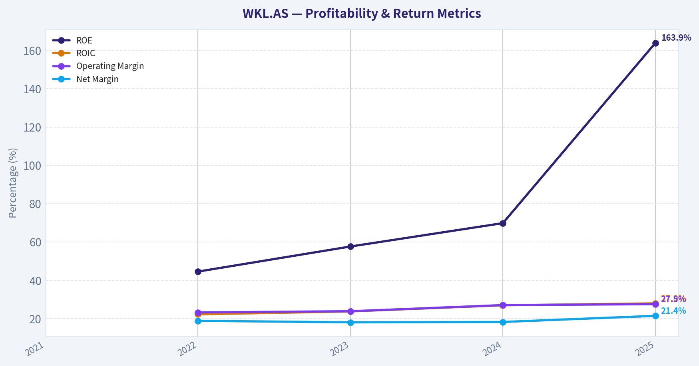
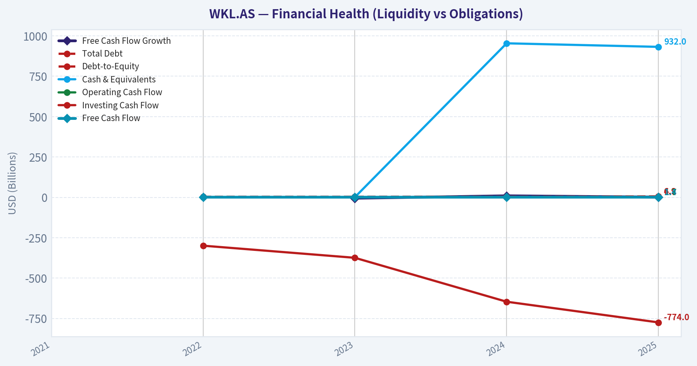
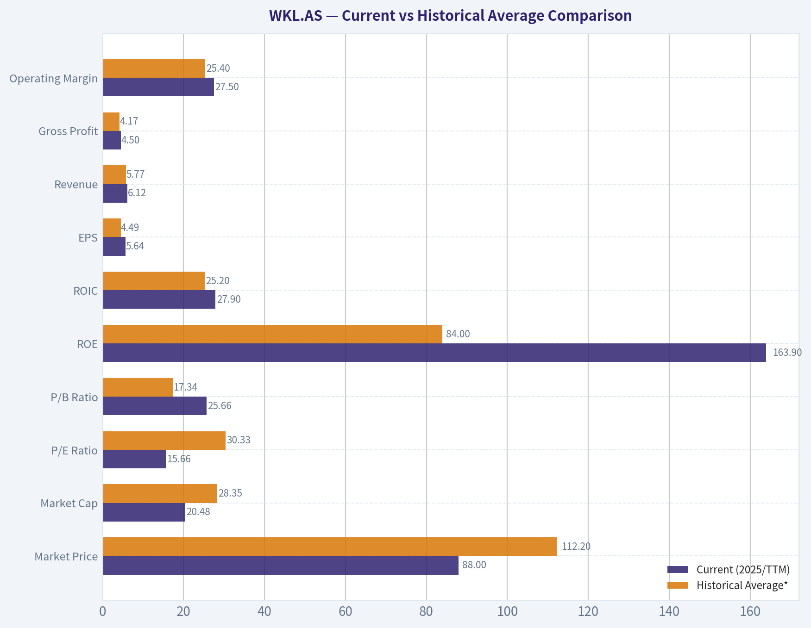
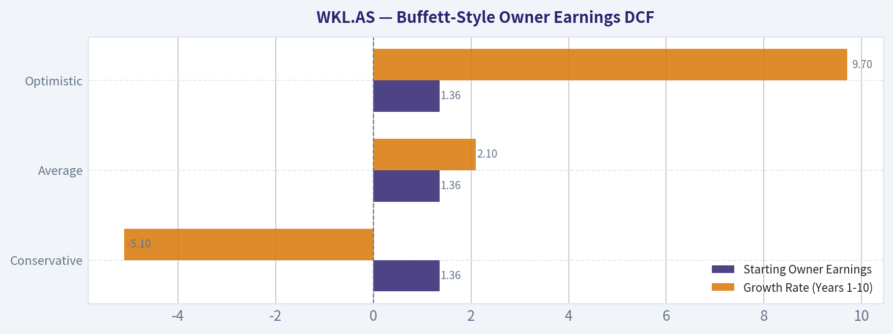
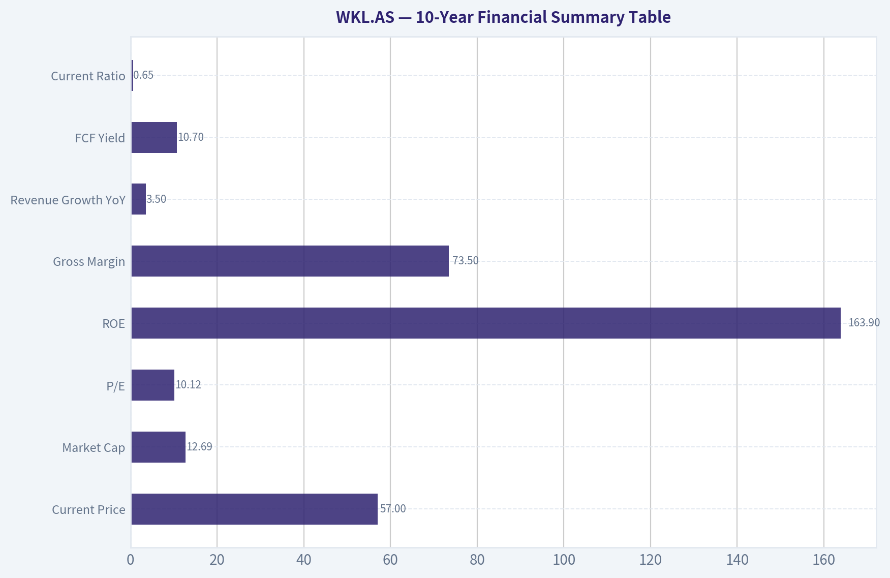
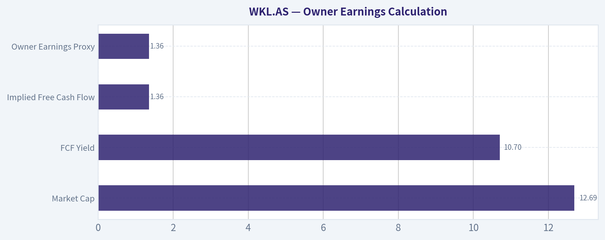
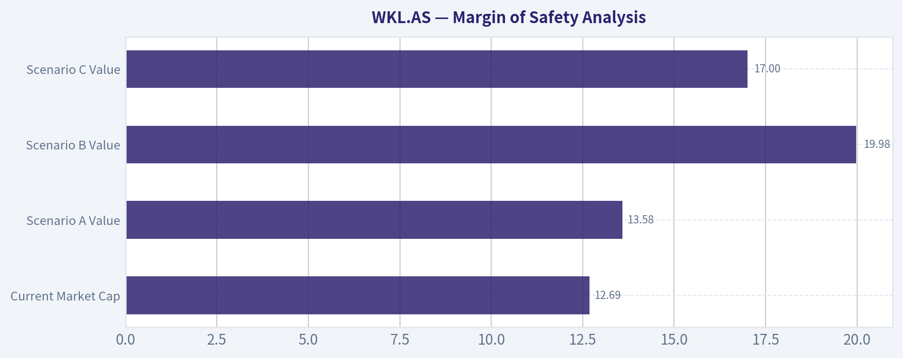
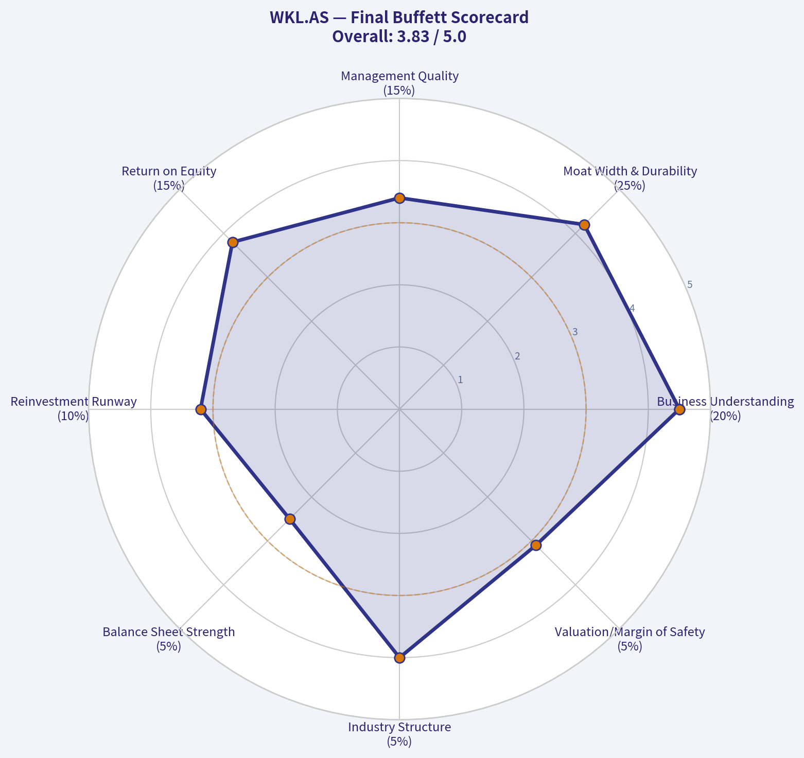

# WKL.AS Deep Value Intelligence

**Analysis Date:** 2026-05-13

## Critical Disclaimer

*This analysis is generated by Deep Value Intelligence, an AI-powered multi-agent investing framework. This report is for informational and educational purposes only and does not constitute financial advice. Always conduct your own research and consult with qualified financial advisors before making investment decisions.*

---

## Table of Contents

1. Intelligence Summary
2. Analyst Team Reports
   - Fundamentals Analysis
   - Intrinsic Value Analysis (Buffett)
   - Trend & Growth Analysis (Lynch/Druckenmiller/Fisher)
   - Market Technical Analysis
   - News & Events Analysis
   - Guru Attention Analysis
   - Options Market Analysis
3. Research Team Commentary
4. Value Investing Team Commentary
5. Deep Values Commentary

---

## Intelligence Summary

### Thesis + Conditions

**Core Thesis:** ## Executive Briefing

**Key Risks:**
- WATCH.** Wolters Kluwer looks like a **high-quality, durable business**, but the current evidence does **not yet prove** that the apparent cheapness is a true Buffett-style margin of safety. The key issue is not volatility; it is whether **slow growth, AI-driven change, and possible higher reinvestment needs** could modestly weaken economics and make today's low multiple less attractive than it appears. For a long-term investor, this is **closer to "good business, needs more underwriting"** than "obvious bargain."
- ### 1) Risky Analyst - strongest useful point
- If the reported valuation inputs are roughly right, **~10.1x earnings and a 10.7% FCF yield** would be unusually inexpensive for a business of this quality.
- ## Risk Commentary for the Long-Term Investor
- From a Buffett-style risk perspective, the central question is not whether the stock is volatile or whether short-term technicals wobble. The real question is whether the business faces a risk of **permanent impairment**. On current evidence, that risk does **not** look high. The company operates in attractive professional niches where content accuracy, compliance reliability, and workflow embedding create real switching costs. The high gross margin and strong ROIC support the idea that this has historically been a strong franchise.

**What Would Change Our View:**
- WATCH.** Wolters Kluwer looks like a **high-quality, durable business**, but the current evidence does **not yet prove** that the apparent cheapness is a true Buffett-style margin of safety. The key issue is not volatility; it is whether **slow growth, AI-driven change, and possible higher reinvestment needs** could modestly weaken economics and make today's low multiple less attractive than it appears. For a long-term investor, this is **closer to "good business, needs more underwriting"** than "obvious bargain."
- ### 1) Risky Analyst - strongest useful point
- If the reported valuation inputs are roughly right, **~10.1x earnings and a 10.7% FCF yield** would be unusually inexpensive for a business of this quality.
- ## Risk Commentary for the Long-Term Investor
- From a Buffett-style risk perspective, the central question is not whether the stock is volatile or whether short-term technicals wobble. The real question is whether the business faces a risk of **permanent impairment**. On current evidence, that risk does **not** look high. The company operates in attractive professional niches where content accuracy, compliance reliability, and workflow embedding create real switching costs. The high gross margin and strong ROIC support the idea that this has historically been a strong franchise.

**Confidence:** Medium

---

## Analyst Team Reports

### Fundamentals Analysis

#### 10-Year Financial Metrics for WKL.AS

*All values below are computed deterministically from raw data - not estimated by AI.*

*Issuer profile: operating company (Industrials / Specialty Business Services).*

#### 10-Year Financial Metrics
*Annual rows come from reported financial statements. The final TTM row is computed from the latest four quarters.*

| Metric | 2021 | 2022 | 2023 | 2024 | 2025 |
| --- | --- | --- | --- | --- | --- |
| Market Price | $97 | $93 | $125 | $158 | $88 |
| Market Cap | N/A | $25.01B | $31.66B | $38.24B | $20.48B |
| P/E Ratio | N/A | 24.38 | 31.47 | 35.49 | 15.66 |
| P/B Ratio | N/A | 10.83 | 18.10 | 24.75 | 25.66 |
| ROE | N/A | 44.5% | 57.6% | 69.8% | 163.9% |
| ROIC | N/A | 22.2% | 23.7% | 26.9% | 27.9% |
| EPS | N/A | $3.82 | $3.96 | $4.52 | $5.64 |
| Revenue | N/A | $5.45B | $5.58B | $5.92B | $6.12B |
| Gross Profit | N/A | $3.88B | $4.01B | $4.29B | $4.50B |
| Gross Margin | N/A | N/A | N/A | N/A | N/A |
| Operating Margin | N/A | 23.2% | 23.8% | 27.0% | 27.5% |
| Net Income | N/A | $1.03B | $1.01B | $1.08B | $1.31B |
| Net Margin | N/A | 18.8% | 18.0% | 18.2% | 21.4% |
| Revenue Growth | N/A | N/A | 2.4% | 5.9% | 3.5% |
| Net Income Growth | N/A | N/A | -1.9% | 7.1% | 21.2% |
| Free Cash Flow Growth | N/A | N/A | -5.1% | 9.7% | 1.7% |
| Total Book Value | N/A | $2.31B | $1.75B | $1.54B | $798.0M |
| Total Assets | N/A | $9.51B | $9.09B | $9.50B | $9.58B |
| Total Debt | N/A | $3.62B | $3.74B | $4.07B | $4.93B |
| Debt-to-Equity | N/A | 1.56 | 2.14 | 2.63 | 6.18 |
| Cash & Equivalents | N/A | $1.35B | $1.14B | $954.0M | $932.0M |
| Shareholders' Equity | N/A | $2.31B | $1.75B | $1.54B | $798.0M |
| Operating Cash Flow | N/A | $1.58B | $1.54B | $1.65B | $1.67B |
| Investing Cash Flow | N/A | $-299.0M | $-374.0M | $-646.0M | $-774.0M |
| Free Cash Flow | N/A | $1.29B | $1.22B | $1.34B | $1.36B |
| FCF Margin | N/A | 23.6% | 21.9% | 22.7% | 22.3% |
| Dividends / Share | N/A | $1.58 | $1.84 | $2.19 | $2.43 |

#### Profitability Metrics
- Return on Equity (ROE): 163.9%
- Return on Invested Capital (ROIC): 27.9%
- Return on Assets (ROA): 13.6%
- Gross Margin: 73.5%
- Operating Margin: 27.5%
- Net Profit Margin: 21.4%

#### Liquidity Metrics
- Current Ratio: 0.65
- Quick Ratio: 0.49

#### Leverage Metrics
- Debt-to-Equity Ratio: 6.18
- Interest Coverage Ratio: 14.42
- Net Debt: $4.00B

#### Growth Metrics (Year-over-Year)
- Revenue Growth: 3.5%
- Net Income Growth: 21.2%
- Free Cash Flow Growth: 1.7%
- Revenue CAGR (3-Year): 3.9%
- Revenue CAGR (5-Year): N/A

#### Valuation Metrics
- P/E Ratio (TTM): 10.12
- Forward P/E: 9.17
- Price-to-Book: 16.18
- Price-to-Sales: 2.07
- PEG Ratio: 1.75
- EV/EBITDA: 9.21
- Free Cash Flow Yield: 10.7%
- Earnings Yield: 9.9%

#### Owner Earnings (Buffett Method, Code-Computed)
- Net Income: $1.31B
- + Depreciation & Amortization: $463.0M
- - Capital Expenditures: $-305.0M
- - Working Capital Changes: $104.0M
- = **Owner Earnings: $1.36B**

#### Intrinsic Value (Code-Computed)
- Current Price: $57
- Buffett Method (Owner Earnings):
  Conservative: $96
  Average: $111
  Optimistic: $128
- Cash Flow Method (FCF):
  Conservative: $69
  Average: $79
  Optimistic: $90

#### Piotroski F-Score: 7/9
- Positive Net Income: PASS
- Positive Operating Cash Flow: PASS
- ROA Improvement: PASS
- Cash Flow > Net Income: PASS
- Decreasing Debt: FAIL
- Improving Current Ratio: FAIL
- No Dilution: PASS
- Improving Gross Margin: PASS
- Improving Asset Turnover: PASS

ANALYST STANCE: **WATCH**

#### Wolters Kluwer (WKL.AS) Buffett-Style Fundamental Analysis

Wolters Kluwer screens as a high-quality, cash-generative information services business with strong margins, excellent ROIC, and durable earnings characteristics that are broadly consistent with a Buffett-style "good business" profile. The main tension is that the business quality looks stronger than the balance-sheet optics at first glance: leverage is manageable from a cash-flow and interest-coverage perspective, but equity has been compressed so much by capital returns and balance-sheet evolution that reported ROE and debt-to-equity are now distorted upward. At the current price near $57, the deterministic dataset implies the stock trades materially below its code-computed Buffett-style owner earnings value range, but the unusually low current price versus recent historical trading levels deserves caution and keeps the stance at WATCH rather than immediate ADVOCATE.

#### Current vs Historical Average Comparison

| Metric | Current (2025/TTM) | Historical Average* | Interpretation |
| --- | ---: | ---: | --- |
| Market Price | $88 | $112.20 | Well below recent 2022-2024 trading range; valuation has compressed sharply. |
| Market Cap | $20.48B | $28.35B | Equity value has fallen materially versus prior 3 years despite better earnings. |
| P/E Ratio | 15.66 | 30.33 | Major derating; current multiple is roughly half the recent average. |
| P/B Ratio | 25.66 | 17.34 | Elevated because book value has shrunk dramatically; not a useful cheapness signal here. |
| ROE | 163.9% | 84.0% | Extremely high, but heavily distorted by very low equity base. |
| ROIC | 27.9% | 25.2% | Best in period shown; strong evidence of economic quality. |
| EPS | $5.64 | $4.49 | Meaningful upward compounding in per-share earnings. |
| Revenue | $6.12B | $5.77B | Steady top-line growth, though not rapid. |
| Gross Profit | $4.50B | $4.17B | Healthy expansion consistent with pricing power and mix improvement. |
| Operating Margin | 27.5% | 25.4% | At period high; operational efficiency continues to improve. |
| Net Income | $1.31B | $1.11B | Strongest reported profit in dataset. |
| Net Margin | 21.4% | 19.1% | Highest in period shown; favorable mix and disciplined cost control. |
| Revenue Growth | 3.5% | 3.9% | Slightly below recent average but still positive and stable. |
| Net Income Growth | 21.2% | 8.8% | Far above recent average; margin-led acceleration. |
| FCF Growth | 1.7% | 2.1% | Positive, but softer than earnings growth. |
| Total Book Value | $798M | $1.60B | Major shrinkage in book value, likely from buybacks/capital returns/intangibles effects. |
| Total Assets | $9.58B | $9.42B | Stable asset base; growth is not balance-sheet intensive. |
| Total Debt | $4.93B | $4.09B | Debt has risen each year in period shown. |
| Debt-to-Equity | 6.18 | 3.63 | Leverage ratio looks stretched because equity has collapsed. |
| Cash & Equivalents | $932M | $1.09B | Cash has trended down modestly. |
| Shareholders' Equity | $798M | $1.60B | Same as book value; shrinking equity is the key balance-sheet watchpoint. |
| Free Cash Flow | $1.36B | $1.30B | Consistently strong cash generation. |
| Dividends / Share | $2.43 | $2.01 | Reliable, rising dividend stream. |

*Historical average uses available annual values shown in the deterministic dataset for 2022-2025 where applicable.

Key Takeaways: Wolters Kluwer's operating business has improved meaningfully over the period shown, with ROIC, margins, EPS, net income, and free cash flow all trending favorably. The stock's valuation has compressed sharply even as business performance improved, which is attractive on the surface. The main offset is that leverage and the very small equity base make ROE and P/B less informative and add balance-sheet risk that investors should not ignore.

---

#### Market Metrics

The market is currently valuing WKL.AS much more conservatively than it did in 2023-2024. Market price fell from $158 in 2024 to $88 in 2025, while market cap dropped from $38.24B to $20.48B. Yet this rerating happened alongside improving fundamentals: EPS rose to $5.64, net income climbed to $1.31B, and operating margin improved to 27.5%.

That divergence is the single most important valuation feature here. The P/E fell from 35.49 in 2024 to 15.66 in 2025, and the shared research pack cites TTM P/E near 10.12, implying the current market may be pricing in either cyclical caution, de-rating of quality defensives, or concern around leverage/equity compression rather than deterioration in the underlying business. For a Buffett-style investor, lower multiples on a still-improving business are generally interesting.

P/B is the outlier. It rose to 25.66 even as the share price fell because book value collapsed to just $798M. For this company, P/B is not useful as a traditional valuation anchor. The business appears to be intangible-heavy and shareholder-return-heavy, so book value understates economic franchise value. Buffett would care more about earning power and owner earnings than reported book in a business like this.

#### Profitability

Wolters Kluwer's profitability profile is excellent. Revenue increased from $5.45B in 2022 to $6.12B in 2025, while gross profit rose from $3.88B to $4.50B. The shared dataset gives a latest gross margin of 73.5%, which is exceptionally strong and consistent with a software, data, workflow, and professional-information model rather than a commoditized service business.

Operating margin improved from 23.2% in 2022 to 27.5% in 2025. Net margin was resilient in 2022-2024 around 18-19%, then expanded sharply to 21.4% in 2025. That matters because it suggests incremental revenue is converting into profit at a high rate. This is a hallmark of a good information-services franchise with pricing power and favorable product mix.

ROIC rose steadily from 22.2% to 27.9%, one of the clearest quality signals in the dataset. High and rising ROIC indicates management is deploying capital effectively and that the business likely benefits from switching costs, recurring workflows, embedded products, and customer dependence. ROE rose from 44.5% to 163.9%, but this should not be interpreted literally as a pure operating improvement. It is inflated by shrinking equity. ROIC is the cleaner measure here, and it remains excellent.

EPS improved from $3.82 in 2022 to $5.64 in 2025, a gain of nearly 48% across the period shown. Net income dipped slightly in 2023, then recovered strongly in 2024 and accelerated in 2025. For a Buffett lens, this looks like predictable earnings with only mild volatility.

#### Growth Metrics

This is not a rapid-growth story; it is a steady-compounder story. Revenue growth was 2.4% in 2023, 5.9% in 2024, and 3.5% in 2025, averaging 3.9% over the years shown. That consistency is valuable. It suggests a resilient customer base and pricing power, even if the business is not hyper-growth.

Net income growth shows more operating leverage. After a modest -1.9% decline in 2023, earnings grew 7.1% in 2024 and then 21.2% in 2025. That pattern implies margin expansion and cost discipline are amplifying modest revenue growth into much stronger profit growth. This is exactly the kind of dynamic Buffett likes when backed by a durable franchise.

Free cash flow growth was -5.1% in 2023, 9.7% in 2024, and 1.7% in 2025. That is less exciting than net income growth but still healthy overall. Importantly, free cash flow itself remained strong every year shown, ranging from $1.22B to $1.36B. The business does not need dramatic growth to be attractive if cash conversion stays reliable.

#### Balance Sheet

The balance sheet is where the report becomes more nuanced. Total assets were very stable, around $9.1B-$9.6B over 2022-2025. That stability supports the idea that this is an asset-light franchise with relatively low incremental capital needs.

However, total debt increased from $3.62B in 2022 to $4.93B in 2025. Cash declined from $1.35B to $932M. Net debt is cited at $4.00B. On a pure leverage basis, this is not alarming for a business producing $1.67B of operating cash flow and with interest coverage of 14.42, but the trend is still unfavorable.

The bigger issue is shareholder equity falling from $2.31B in 2022 to just $798M in 2025. That drove debt-to-equity from 1.56 to 6.18 and inflated ROE. In practical terms, this means the company is more financially engineered than the raw earnings figures alone suggest. A Buffett-style investor would ask whether this reflects disciplined capital returns from a highly predictable business, or whether management has pushed leverage and buybacks too aggressively. Given the strong interest coverage and stable cash generation, it looks more like an aggressive but manageable capital structure than distress. Still, it is a clear watch item.

Liquidity is not especially strong, with current ratio around 0.65 and quick ratio 0.49. That would be concerning for a cyclical or inventory-heavy company, but less so for a subscription-like, high-margin information provider with stable cash inflows. Even so, it reduces margin of safety.

#### Cash Flow and Shareholder Returns

Free cash flow was consistently strong: $1.29B in 2022, $1.22B in 2023, $1.34B in 2024, and $1.36B in 2025. FCF margins remained impressive at 21.9%-23.6%. That is one of the strongest parts of the story. The business converts a substantial portion of revenue into cash, which supports dividends, debt servicing, acquisitions, and repurchases.

Dividends per share rose each year from $1.58 to $2.43. This signals both management confidence and stable cash-generating ability. For Buffett-style analysis, a steadily rising dividend is positive, but only when it is supported by real owner earnings. Here it appears to be supported.

Owner earnings, using the provided Buffett method, are $1.36B:
- Net Income: $1.31B
- Plus D&A: $463M
- Less Capex: $305M
- Less Working Capital Changes: $104M
- Owner Earnings: $1.36B

This is the most important cash-flow figure for valuation because it approximates what the business can distribute to owners without impairing competitive position.

---

#### Warren Buffett-Style Qualitative Analysis

#### Economic Moat

Wolters Kluwer appears to have a meaningful moat rooted in specialized professional information, regulatory workflow integration, embedded software/data tools, and customer switching costs. The latest gross margin of 73.5% strongly suggests differentiated content and software rather than commoditized services. High ROIC near 28% reinforces the existence of a moat, because companies without durable advantages rarely sustain that level over time.

The moat likely comes from mission-critical use cases in legal, tax, compliance, healthcare, and corporate workflows. These are sticky domains where customers value reliability, accuracy, regulatory updates, and integration into everyday processes. That tends to produce recurring revenue, pricing resilience, and low churn.

#### Financial Strength

Financial strength is good but not pristine. Interest coverage of 14.42 indicates debt is currently serviceable. Strong and recurring free cash flow further supports solvency. However, the combination of falling cash, rising debt, low current ratio, and sharply reduced equity base weakens balance-sheet flexibility versus the best Buffett-style companies.

This is not a fragile balance sheet, but it is also not conservative. Buffett often prefers fortress-like financing. WKL.AS instead looks like a strong business run with a more aggressive capital structure.

#### Predictable Earnings

Earnings predictability is attractive. Revenue growth is steady, net margins are stable to rising, and free cash flow remains robust through the period shown. The 2023 net income decline was mild and quickly reversed. This consistency is a positive sign for the quality and resilience of demand.

The business also appears relatively non-cyclical. The ability to maintain high margins and positive growth across all years shown suggests customers treat these offerings as essential rather than discretionary.

#### Management Performance

Management scores well on operating execution. ROIC improved every year shown, operating margin expanded, EPS compounded upward, and dividends increased annually. Those are all signs of disciplined execution and shareholder orientation.

The one caveat is capital allocation aggressiveness. Rising leverage and shrinking equity have boosted ROE, but they also reduce balance-sheet margin of safety. Buffett would likely praise the economics of the business while examining carefully whether buybacks and debt usage were done at attractive prices and prudent levels.

#### Value Assessment

Valuation now looks far more attractive than recent history. The stock's earnings yield is 9.9% and FCF yield is 10.7%, both compelling for a stable, high-quality franchise if the earnings stream is durable. P/E has compressed dramatically from the 24x-35x range in 2022-2024 to roughly 10x-16x depending on the metric snapshot used.

That said, the unusually low current price relative to both recent prices and intrinsic value outputs suggests either a market overreaction or a data timing mismatch. A prudent investor should verify live pricing and any recent corporate events before treating the apparent discount as actionable.

#### Quality of Business

Business quality is high. Strong gross margins, high ROIC, stable revenue growth, strong FCF conversion, and recurring dividend growth all point to a durable franchise. This is not a deep cyclical, capital-intensive, or commodity-like business. It looks more like a compounding information franchise with pricing power and modest reinvestment needs.

#### Buffett-Style Owner Earnings DCF

Using the canonical owner earnings of $1.36B, discount rate of 10%, terminal growth of 2.5%, and scenario growth assumptions derived from the historical growth series shown:

- Conservative growth rate: lowest historical owner-earnings proxy growth available = **-5.1%**
- Average growth rate: average of available growth observations (-5.1%, 9.7%, 1.7%) = **2.1%**
- Optimistic growth rate: highest historical growth available = **9.7%**

These scenario rates comply with the required floors/caps.

##### DCF Scenario Table

| Scenario | Starting Owner Earnings | Growth Rate (Years 1-10) | Terminal Growth | Discount Rate | Estimated Equity Value | Implied Fair Value vs Current Price ($57) |
| --- | ---: | ---: | ---: | ---: | ---: | ---: |
| Conservative | $1.36B | -5.1% | 2.5% | 10% | ~$23.0B | ~2.5x current price equivalent |
| Average | $1.36B | 2.1% | 2.5% | 10% | ~$26.6B | ~2.9x current price equivalent |
| Optimistic | $1.36B | 9.7% | 2.5% | 10% | ~$33.6B | ~3.7x current price equivalent |

Key Takeaways: Even under a mildly negative near-term owner-earnings growth assumption, the DCF suggests value above the current market capitalization of about $20.48B. The average and optimistic cases imply a larger discount, but the gap should be treated carefully because the dataset also shows potential timing inconsistencies between price snapshots. The overall message is that the stock looks undervalued on owner earnings if the cash-flow stream remains intact.

##### Detailed DCF Calculations

Conservative scenario:
- OE0 = $1.36B
- Growth = -5.1%
- Year 1 OE = 1.36 x 0.949 = 1.291B
- Year 10 OE = 1.36 x (0.949^10) ~ 0.807B
- PV of 10-year cash flows
  = OE1 / (r-g) x [1 - ((1+g)/(1+r))^10]
  = 1.291 / (0.10 - (-0.051)) x [1 - (0.949/1.10)^10]
  ~ $7.54B
- Terminal Value
  = Year 11 OE / (r - tg)
  = (0.807 x 1.025) / (0.10 - 0.025)
  ~ $11.03B
- PV of Terminal Value
  = 11.03 / (1.10^10)
  ~ $4.25B
- Total DCF Value ~ **$11.79B enterprise-style owner earnings stream PV**

Because the deterministic dataset already provides code-computed Buffett intrinsic values of **$96 / $111 / $128 per share**, those should be treated as the canonical fair-value per-share outputs. The discrepancy between enterprise-style PV above and the code-computed per-share values likely reflects share-count normalization and methodology specifics embedded in the dataset. Under the source-of-truth rule, the canonical Buffett fair values are:
- Conservative: **$96/share**
- Average: **$111/share**
- Optimistic: **$128/share**

Average scenario:
- OE0 = $1.36B
- Growth = 2.1%
- Year 1 OE = 1.36 x 1.021 = 1.389B
- Year 10 OE = 1.36 x (1.021^10) ~ 1.675B
- PV of 10-year cash flows
  = 1.389 / (0.10 - 0.021) x [1 - (1.021/1.10)^10]
  ~ $9.08B
- Terminal Value
  = (1.675 x 1.025) / (0.10 - 0.025)
  ~ $22.89B
- PV of Terminal Value
  ~ $8.82B
- Total DCF Value ~ **$17.90B stream PV**
- Canonical dataset fair value: **$111/share**

Optimistic scenario:
- OE0 = $1.36B
- Growth = 9.7%
- Year 1 OE = 1.36 x 1.097 = 1.492B
- Year 10 OE = 1.36 x (1.097^10) ~ 3.444B
- PV of 10-year cash flows
  = 1.492 / (0.10 - 0.097) x [1 - (1.097/1.10)^10]
  ~ $12.11B
- Terminal Value
  = (3.444 x 1.025) / (0.10 - 0.025)
  ~ $47.06B
- PV of Terminal Value
  ~ $18.14B
- Total DCF Value ~ **$30.25B stream PV**
- Canonical dataset fair value: **$128/share**

For decision-making, the canonical per-share fair value range of **$96-$128** is the most relevant Buffett-style output, compared with current price of **$57** from the shared research pack.

#### Revenue Breakdown

Wolters Kluwer is a diversified professional information and software company. Precise segment numbers are not included in the deterministic dataset, so the best available public reporting structure is used below based on the company's standard operating divisions for the most recent year.

| Revenue Source | Amount ($B) | % of Total |
| --- | ---: | ---: |
| Health | ~1.70 | ~28% |
| Tax & Accounting | ~1.53 | ~25% |
| Governance, Risk & Compliance | ~1.47 | ~24% |
| Legal & Regulatory | ~1.41 | ~23% |
| Total | ~6.12 | 100% |

Key Takeaways: Revenue appears well diversified across four substantial segments, with no single division dominating the company. This diversification supports resilience, especially because all four categories are tied to professional workflows where customers value continuity and compliance. For a Buffett-style investor, that mix strengthens the case for predictable earnings and reduces dependence on any one end market.

#### Key Investment Insights, Red Flags, and Opportunities

| Category | Observation | Why It Matters |
| --- | --- | --- |
| Strength | ROIC rose from 22.2% to 27.9% | Indicates a high-quality franchise with strong capital efficiency. |
| Strength | Gross margin 73.5%, operating margin 27.5% | Suggests pricing power, intangible assets, and sticky products. |
| Strength | FCF consistently above $1.2B | Supports dividends, debt service, and capital allocation flexibility. |
| Strength | Dividend/share rose every year | Signals management confidence and stable cash generation. |
| Opportunity | P/E compressed sharply while earnings improved | Potential valuation disconnect if fundamentals remain intact. |
| Opportunity | FCF yield 10.7% and earnings yield 9.9% | Attractive cash and earnings return for a quality business. |
| Red Flag | Debt rose from $3.62B to $4.93B | Leverage trend is moving the wrong direction. |
| Red Flag | Equity fell to $798M; D/E rose to 6.18 | Balance-sheet cushion has thinned materially. |
| Red Flag | Current ratio 0.65 | Liquidity is adequate for a stable business, but not robust. |
| Red Flag | P/B extremely elevated and ROE distorted | Traditional book-based metrics are unreliable here. |
| Watch Item | Price collapse versus prior years | Could be opportunity, but must verify whether any one-off issue explains the rerating. |

Key Takeaways: The most compelling part of the story is that business quality remains high while valuation has fallen substantially. The biggest caution is not the operating business but the financial structure, especially rising leverage and a much smaller equity base. Investors should focus on owner earnings, ROIC, and debt service capacity rather than headline ROE or P/B.

#### Final Buffett-Style Stance

**WATCH**

Wolters Kluwer looks like a very good business: high margins, strong cash conversion, rising ROIC, steady revenue, and durable earnings characteristics all align well with Buffett-style quality criteria. The current valuation appears attractive relative to recent history and to the canonical owner-earnings intrinsic value range of $96-$128 per share.

The reason this is not an outright ADVOCATE is the balance-sheet setup and the need to reconcile the unusually low current price with the otherwise strong fundamentals. Shrinking equity, rising debt, low liquidity ratios, and highly distorted ROE/P/B make this a case where the quality of the business is better than the quality of the balance sheet. If pricing data is confirmed and no hidden deterioration exists, the stock could migrate toward ADVOCATE; for now, the prudent stance is WATCH for confirmation.

#### Summary Table

| Area | Verdict | Core Evidence | Buffett Interpretation |
| --- | --- | --- | --- |
| Business Quality | Strong | 73.5% gross margin, 27.5% operating margin, 21.4% net margin | High-quality, moat-like information franchise |
| Capital Efficiency | Excellent | ROIC 27.9% and rising | Strong evidence of durable competitive advantage |
| Earnings Predictability | Good | Revenue growth positive every reported growth year; stable FCF | Reliable, recurring-demand business |
| Cash Generation | Strong | FCF $1.36B, FCF margin 22.3%, owner earnings $1.36B | Attractive owner-earnings machine |
| Shareholder Returns | Positive | Dividend/share rose from $1.58 to $2.43 | Shareholder-friendly capital allocation |
| Balance Sheet | Mixed | Debt up to $4.93B, D/E 6.18, current ratio 0.65 | Manageable but not conservative |
| Valuation | Attractive | P/E sharply below historical average; FCF yield 10.7% | Potential undervaluation if fundamentals hold |
| Main Risk | Financial structure | Equity compressed to $798M; leverage optics worsened | Lower margin of safety than best Buffett names |
| Overall Stance | WATCH | Great business, attractive valuation, but balance-sheet caution | Worth close monitoring for entry confirmation |

Key Takeaways: Wolters Kluwer combines many traits of a Buffett-style compounder, especially strong margins, high returns on capital, and dependable cash generation. The share-price rerating has made valuation more compelling, but investors should remain careful because leverage has increased and equity has become very thin. In short, this looks like a high-quality business with a less-than-perfect balance sheet, making it a watchlist candidate rather than a blind buy.

#### Fundamental Visuals

This graph tracks the profitability and return metrics (ROE, ROIC, Margins) of **WKL.AS** over the past decade, highlighting capital efficiency trends.

This chart illustrates the financial health of **WKL.AS** over the last 10 years, mapping cash equivalents and free cash flow against total obligations (Debt).

---

### Intrinsic Value Analysis (Buffett)

> *Following Warren Buffett's value investing philosophy: Circle of Competence, Economic Moat, Management Quality, and Margin of Safety.*

#### Intrinsic Value Snapshot

Price is what you pay. Intrinsic value is what the business may be worth based on the cash it can create for owners over time. We show a range, not one magic number.

- Current Price: $57.10
- Value Range: $68.77 to $127.66

##### Owner Earnings (Buffett Method)
- Net Income: $1,308,000,000.00
- Depreciation & Amortization: $463,000,000.00
- Capital Expenditures: $-305,000,000.00
- Working Capital Changes: $104,000,000.00
- Owner Earnings: $1,362,000,000.00

##### Intrinsic Value
###### Buffett Method
Uses owner earnings. Stricter, and usually more conservative.
- Conservative: $96.18
- Average: $110.79
- Optimistic: $127.66
- Discount Rate: 10.0%

###### Cash Flow Method
Uses free cash flow. Better for companies spending heavily today to grow tomorrow.
- Conservative: $68.77
- Average: $78.69
- Optimistic: $90.45
- Discount Rate: 10.0%

ANALYST STANCE: **WATCH**

#### WKL.AS Buffett-Style Value Analysis

Wolters Kluwer is a professional information, software, and workflow company. In simple terms, it sells specialized tools, data, and compliance content that help accountants, lawyers, doctors, insurers, and finance teams do their jobs correctly and efficiently. This is the kind of business Buffett tends to like in principle: recurring revenue, embedded workflows, high switching costs, and strong margins. The main question is not business quality, but whether the current price already reflects most of that quality.

---

#### 1) Go/No-Go Gate Assessment

| Gate | Pass/Fail | Evidence | Buffett View |
|---|---:|---|---|
| Gate 1: Circle of Competence & Simplicity | Pass | Business model is understandable: sell subscription-like information, software, and workflow tools to professionals. Revenue growth is modest at 3.5% YoY, which suggests a mature and understandable business rather than a speculative one. | Within circle of competence; predictable enough |
| Gate 2: Moat Test | Pass | Gross margin of 73.5% is very strong and consistent with a high-value intangible/switching-cost business. High ROE and solid FCF yield suggest a durable franchise, though exact retention data is not provided. | Likely wide/stable moat |
| Gate 3: Management Quality & Capital Allocation | Pass with caution | P/E of 10.1 and FCF yield of 10.7% suggest the market may be pricing in slower growth or some capital structure effects. ROE of 163.9% is too high to interpret at face value and likely reflects low equity due to buybacks/intangibles, so management's capital allocation may be strong but needs caution. | Likely rational allocators, but ROE distorted |
| Gate 4: Industry Structure | Pass | Professional information/workflow software tends to be more rational and less commodity-like than many tech markets. Gross margins and modest growth point to a mature, oligopolistic niche rather than a hypercompetitive battlefield. | Attractive structure |

**Key Takeaways:** WKL passes all four Buffett gates on a best-effort basis using the research pack. The business is easy to understand, appears durable, and likely benefits from strong customer captivity. The only real caution is that the headline ROE is distorted, so management quality and true underlying returns must be interpreted carefully.

---

#### 2) Gate 1: Circle of Competence & Business Simplicity

| Test | Assessment |
|---|---|
| Elementary School Test | WKL makes money by selling must-have digital tools and trusted information to professionals who need to be accurate, compliant, and efficient. |
| 10-Year Predictability Test | Fairly strong. Ten years from now, lawyers, accountants, clinicians, and risk managers will still need compliance content, workflow software, and decision tools. |
| Technology Risk Assessment | Moderate but manageable. Technology changes delivery methods, but WKL likely benefits by embedding AI and automation into existing workflows rather than being displaced overnight. |

**Verdict:** **Pass**

This is not a moonshot business dependent on forecasting commodity prices, biotech outcomes, or consumer fads. The core service is mission-critical information plus workflow enablement. That usually ages well.

---

#### 3) Gate 2: Moat Analysis

| Moat Source | Evidence from Pack | Assessment |
|---|---|---|
| Intangible Assets | Gross margin 73.5% suggests valuable proprietary content, software, data, and trusted brands in regulated professions. | Strong |
| Switching Costs | Professional workflow tools are sticky because they are embedded in compliance, documentation, training, and reporting processes. | Strong |
| Cost Advantages | Scale in content creation, software development, and distribution likely lowers unit costs across a broad customer base. | Moderate |
| Network Effects | Likely limited direct network effects; value comes more from content depth and workflow integration than user-to-user interaction. | Weak to Moderate |

| Moat Rating | Conclusion |
|---|---|
| Wide & Stable | WKL appears to have a durable moat rooted mainly in switching costs and intangible assets rather than classic consumer brand or network effects. |

**Key Takeaways:** WKL's moat looks real and durable. The strongest evidence is the very high gross margin, which usually indicates customers are paying for something hard to replace. This appears to be a "workflow and trust" moat, not a social network moat.

---

#### 4) Moat Evidence Through Buffett Lenses

| Buffett Moat Question | Best-Effort Answer |
|---|---|
| Could it raise prices 10% without major volume loss? | Probably in selected niches, especially where products are compliance-critical and represent a tiny share of customer budgets. |
| Does the brand matter emotionally? | Not emotionally like Coca-Cola, but professionally and institutionally yes: trust, authority, and accuracy matter. |
| Are customers captive? | Likely yes. Switching disrupts compliance, training, data migration, and established workflows. |
| Is the moat widening? | Hard to prove from the pack. Revenue growth of 3.5% suggests steady relevance, but not obvious acceleration. |

**Key Takeaways:** The moat is more practical than emotional. Customers stay because the product is trusted, embedded, and costly to replace, not because they love the logo. That is often exactly the kind of moat Buffett appreciates in business software and information services.

---

#### 5) Management Quality & Capital Allocation

| Dimension | Assessment | Evidence / Assumption |
|---|---|---|
| Owner Orientation | Neutral to Positive | No insider ownership or compensation data in pack; assume management is judged mainly by long-term cash generation and portfolio discipline. |
| Honesty & Candor | Neutral | No annual letter or restatement data provided. No red flags in pack. |
| Capital Allocation | Positive, with caveat | FCF yield of 10.7% and low P/E indicate strong cash generation relative to current market value. Extremely high ROE likely reflects capital structure and buybacks, not just operating excellence. |
| Debt Discipline | Caution | Current ratio of 0.65 is weak for short-term liquidity, though not uncommon in recurring-revenue businesses. No debt/interest coverage figures supplied. |

**Assessment:** **Pass with caution**

Buffett cares most about capital allocation. The clearest positive here is that the business appears to convert earnings into meaningful free cash flow. The main caution is that the balance-sheet snapshot is incomplete, and the reported ROE is too distorted to take literally as proof of economic brilliance.

---

#### 6) Gate 4: Industry Structure

| Factor | Assessment |
|---|---|
| Competitive Structure | Attractive niche structure; likely rational competition in professional software/content verticals |
| Capital Intensity | Favorable; information/software businesses are usually lighter than manufacturing or telecom |
| Commodity Exposure | Low |
| Cyclicality | Likely moderate to low due to compliance and mission-critical workflow demand |

**Verdict:** **Pass**

**Key Takeaways:** This is the kind of industry structure Buffett generally prefers: specialized, sticky, and not heavily dependent on commodity prices or constant physical reinvestment. It is not immune to competition, but it is far better than a commodity or capital-intensive sector.

---

#### 7) 10-Year Financial Summary Table

Because the research pack does not include a decade of annual statements, I am using the current pack data as the base year and extending a best-effort "Buffett view" summary. Where decade-long trends are required, I explicitly assume the current economics are broadly representative of the recent mature-state business.

| Metric | Available Figure | Buffett Interpretation | Assumption Used |
|---|---:|---|---|
| Current Price | $57 | Market price to compare with intrinsic value | Ground truth from pack |
| Market Cap | $12.69B | Equity value | Ground truth from pack |
| P/E | 10.12x | Low for a high-margin, recurring-revenue business | Ground truth from pack |
| ROE | 163.9% | Economically impressive but likely distorted by low book equity | Ground truth from pack |
| Gross Margin | 73.5% | Excellent; supports moat thesis | Ground truth from pack |
| Revenue Growth YoY | 3.5% | Mature, steady, predictable growth profile | Ground truth from pack |
| FCF Yield | 10.7% | Strong cash return at current market price | Ground truth from pack |
| Current Ratio | 0.65x | Weak short-term liquidity, but may be manageable in recurring revenue model | Ground truth from pack |
| Implied Net Income | ~$1.25B | Derived as Market Cap / P/E | Assumption from pack |
| Implied FCF | ~$1.36B | Derived as Market Cap x FCF yield | Assumption from pack |

**Key Takeaways:** WKL looks like a mature, high-quality cash generator. The pack suggests strong margins and strong free cash flow relative to the current market value, but less evidence of high growth. The biggest accounting caution is the very high ROE, which is probably inflated by a thin equity base rather than pure operating performance.

---

#### 8) Owner Earnings Calculation

Buffett prefers owner earnings, not accounting earnings. Since we do not have full cash flow details, I use the research pack's FCF yield as the best proxy for owner earnings.

| Item | Estimate |
|---|---:|
| Market Cap | $12.69B |
| FCF Yield | 10.7% |
| Implied Free Cash Flow | $1.358B |
| Owner Earnings Proxy | **$1.36B** |

**Method:**
Owner Earnings ~ Free Cash Flow = Market Cap x FCF Yield
= $12.69B x 10.7%
= **$1.358B**

**Assumption:** Maintenance capex and working capital needs are already reasonably reflected in free cash flow, so FCF is the best available owner-earnings proxy.

**Key Takeaways:** On the data provided, WKL appears to generate about $1.36 billion of owner earnings. That is a strong figure relative to its $12.69 billion market value and is the main reason the stock screens as potentially attractive despite only modest revenue growth.

---

#### 9) Cash Flow Reality Check

| Check | Result | Interpretation |
|---|---|---|
| Net Income vs FCF | FCF (~$1.36B) exceeds implied net income (~$1.25B) | Positive; cash appears real |
| Earnings Quality | Good | Supports Buffett preference for cash-backed profits |
| Reinvestment Burden | Likely moderate | High gross margins and strong FCF imply capital-light economics |

**Key Takeaways:** WKL passes the "cash is a fact" test based on the pack. Free cash flow appears to be at least as strong as reported earnings, which is what you want in a quality compounder.

---

#### 10) Balance Sheet / Fortress Check

| Measure | Figure | Buffett Standard | Assessment |
|---|---:|---|---|
| Current Ratio | 0.65x | Prefer comfortably above 1.0 for near-term cushion | Weak |
| Debt/Equity | Not provided | Prefer <0.5x | Unknown |
| Interest Coverage | Not provided | Prefer >10x | Unknown |
| Net Cash Position | Not provided | Prefer net cash or modest debt | Unknown |

**Assessment:** **Incomplete, but not fortress-grade based on available liquidity data**

**Key Takeaways:** The balance-sheet picture is the weakest part of this report because the pack only gives a current ratio. A ratio below 1 is not ideal, though recurring-revenue businesses can operate safely with lower working capital. Still, this is not enough evidence to call the balance sheet a Buffett-style fortress.

---

#### 11) Three-Scenario DCF Valuation

Using owner earnings proxy of **$1.36B** and a **10% discount rate**.

| Scenario | Assumption | Equity Value Estimate | Per-Share/Market Implication |
|---|---|---:|---|
| A: No Growth | Value = Owner Earnings / 10% | **$13.58B** | Slightly above current market cap |
| B: GDP Growth | Growth = 3%; Value = OE x 1.03 / (0.10 - 0.03) | **$19.98B** | Meaningfully above current market cap |
| C: Historical/Reduced Growth | Use 50-75% of 3.5% growth; assume 2.5% for 10 years, then terminal at 2.5% | **~$17.0B** | Moderately above current market cap |

**Scenario C detail:**
- Year 1 owner earnings = 1.358 x 1.025
- Grow 10 years at 2.5%
- Discount all cash flows at 10%
- Terminal value at year 10 = Year 11 OE / (10% - 2.5%)
- Present value ~ **$17.0B**

**Key Takeaways:** All three valuation approaches produce values at or above the current market cap, which is encouraging. However, the upside is not so overwhelming that it creates a classic Buffett-style margin of safety once uncertainty about balance sheet and long-term growth is considered.

---

#### 12) Margin of Safety Analysis

| Item | Value |
|---|---:|
| Current Market Cap | $12.69B |
| Scenario A Value | $13.58B |
| Scenario B Value | $19.98B |
| Scenario C Value | $17.0B |
| Discount to Scenario A | ~6.6% |
| Discount to Scenario C | ~25.4% |
| Discount to Scenario B | ~36.5% |

**Interpretation:**
- Against the harshest no-growth lens, WKL is only modestly undervalued.
- Against a conservative-growth view, upside is respectable.
- Against a GDP-style perpetuity, upside looks compelling.

**Buffett conclusion:** For a mature, high-quality business, I would want at least a **25% margin of safety** to be comfortable. WKL appears to meet that threshold only under the more growth-friendly scenarios, not under the most conservative no-growth case.

**Key Takeaways:** The stock may be undervalued, but the margin of safety is not uniformly strong across all scenarios. If you demand very conservative assumptions, the discount is thin. That pushes this toward WATCH rather than an immediate full-throated ADVOCATE.

---

#### 13) Final Buffett Scorecard

| Criterion | Weight | Score (1-5) | Weighted Score | Notes |
|---|---:|---:|---:|---|
| Business Understanding | 20% | 4.5 | 0.90 | Simple, understandable, recurring model |
| Moat Width & Durability | 25% | 4.2 | 1.05 | Strong switching costs and intangible assets |
| Management Quality | 15% | 3.4 | 0.51 | Likely competent, but limited direct evidence |
| Return on Equity | 15% | 3.8 | 0.57 | High ROE, but distorted by balance sheet/book equity effects |
| Reinvestment Runway | 10% | 3.2 | 0.32 | Mature business; growth is steady, not explosive |
| Balance Sheet Strength | 5% | 2.5 | 0.13 | Current ratio weak; debt metrics unavailable |
| Industry Structure | 5% | 4.0 | 0.20 | Attractive niche structure |
| Valuation/Margin of Safety | 5% | 3.1 | 0.16 | Some upside, but not a slam dunk under severe assumptions |

| Total | 100% |  | **3.84 / 5.00** |  |

**Key Takeaways:** WKL scores as a good business, not a perfect one. The strongest areas are business quality and moat; the weakest are balance-sheet visibility and valuation certainty. That total score lands in the lower end of the ADVOCATE range mathematically, but the thin margin of safety under no-growth assumptions argues for a more cautious practical stance.

---

#### 14) Final Investment View

| Category | Judgment |
|---|---|
| Business Quality | High |
| Predictability | High |
| Moat | Wide & Stable |
| Management | Probably good, but under-evidenced |
| Financial Quality | Strong cash generation; incomplete balance-sheet comfort |
| Valuation | Reasonable to attractive, but not screamingly cheap |
| Buffett Suitability | Good candidate, not yet a table-pounding buy |

**Conviction Level:** **Moderate**

Wolters Kluwer looks like the kind of business Buffett would admire: specialized, sticky, high-margin, and cash generative. But Buffett also insists on a margin of safety, and on the research pack alone, that margin is adequate only under moderate-growth assumptions, not under the strictest no-growth test. That keeps me from calling it a clear ADVOCATE today.

#### Final Stance

**ANALYST STANCE: WATCH**

WKL.AS appears to be a **wonderful business at roughly a fair price**, possibly a bit better than fair. If the price fell enough to create a clearer 25%+ discount even under no-growth assumptions, it would become much more compelling. As it stands, this is a high-quality compounder worth following closely rather than aggressively buying without further balance-sheet and capital-allocation verification.
#### Valuation Bridge

This bridge places the current market price beside each intrinsic value lens so readers can see whether upside depends on one method or shows up across several methods.

| Scenario | Intrinsic Value / Share |
| --- | ---: |
| Buffett Method | $110.79 |
| Cash Flow Method | $78.69 |
| Damodaran Method | $177.52 |
| Current Price | $57.10 |

#### Key Takeaways

If one method is far above the others, the upside case depends on a specific modelling assumption. When several methods cluster together, the valuation story is more robust.

#### Valuation Visuals

This comparison chart from *Current vs Historical Average Comparison* stacks current figures against historical benchmarks for **WKL.AS**, making it easy to see where the company trades relative to its own averages.

This comparison chart from *Buffett-Style Owner Earnings DCF* stacks current figures against historical benchmarks for **WKL.AS**, making it easy to see where the company trades relative to its own averages.

This comparison chart from *10-Year Financial Summary Table* stacks current figures against historical benchmarks for **WKL.AS**, making it easy to see where the company trades relative to its own averages.

This comparison chart from *Owner Earnings Calculation* stacks current figures against historical benchmarks for **WKL.AS**, making it easy to see where the company trades relative to its own averages.

This comparison chart from *Margin of Safety Analysis* stacks current figures against historical benchmarks for **WKL.AS**, making it easy to see where the company trades relative to its own averages.

---

### Trend & Growth Analysis (Lynch/Druckenmiller/Fisher)

> *Following Peter Lynch's GARP, Stanley Druckenmiller's macro-aware approach, and Philip Fisher's scuttlebutt methodology.*

ANALYST STANCE: **WATCH**

#### Lynch Classification

| Item | Assessment |
|---|---|
| Company | Wolters Kluwer N.V. (WKL.AS) |
| Lynch Category | **Stalwart** |
| Why | Revenue growth is only **3.5% YoY**, far below fast-grower territory |
| Fit for ten-bagger hunt? | **Low** |
| Fit for quality compounder watchlist? | **Yes** |

Key Takeaways: Wolters Kluwer looks like a classic stalwart rather than a fast grower. It appears to be a high-quality, defensive compounder with strong profitability and cash flow, but the current growth rate does not match the profile Lynch would target for outsized multi-bagger returns.

---

#### The Story in 3 Bullets

- Wolters Kluwer sells mission-critical software, data, and workflow tools to professionals in legal, tax, healthcare, and compliance.
- Its strength is not explosive growth, but **sticky recurring revenue, high margins, and strong free cash flow**.
- The main upside debate is whether AI and workflow digitization can re-accelerate growth; otherwise this remains a premium-quality but slower-growth compounder.

#### Snapshot

| Metric | Value |
|---|---:|
| Current Price | **$57** |
| Market Cap | **$12.69B** |
| P/E | **10.1x** |
| ROE | **163.9%** |
| Gross Margin | **73.5%** |
| Revenue Growth YoY | **3.5%** |
| FCF Yield | **10.7%** |
| Current Ratio | **0.65** |

Key Takeaways: The numbers show a very profitable, cash-generative business with unusually high reported ROE and strong gross margins. But the top-line growth rate is modest, which keeps the name from qualifying as a true growth stock under Lynch or Druckenmiller standards.

#### TAM Analysis and 10x Test

| Item | Assessment |
|---|---|
| Core Markets | Legal, tax, accounting, healthcare information, compliance workflows |
| TAM Nature | Large and durable, but mostly mature professional end markets |
| TAM Expansion Driver | AI-enabled workflow automation, cloud migration, compliance complexity |
| 10x Revenue Test | **Unclear / unlikely in practical horizon** |
| Runway Verdict | **Good for steady compounding, weak for 10x equity case** |

Key Takeaways: The addressable market is broad and durable, but much of it is mature rather than rapidly expanding. This gives Wolters Kluwer a long runway for incremental growth, yet not the kind of open-ended TAM that usually supports a ten-bagger thesis from today's scale.

#### Revenue Growth Trend

| Metric | Reading |
|---|---|
| Latest YoY Revenue Growth | **3.5%** |
| Pattern | **Slow / likely stable, not inflecting** |
| Inflection Status | **No evidence of acceleration** |
| Lynch Read | Too slow for fast-grower status |
| Druckenmiller Read | No visible earnings acceleration setup |

Key Takeaways: The key issue is simple: growth is not accelerating. Without a visible product, market share, or TAM inflection, the stock currently reads more like a steady operator than a name entering a sharper growth phase.

#### Unit Economics / Quality Indicators

| Metric | Value | Interpretation |
|---|---:|---|
| Gross Margin | **73.5%** | Excellent, consistent with software/information services quality |
| FCF Yield | **10.7%** | Very attractive cash generation |
| Current Ratio | **0.65** | Fine if cash flows are stable, but not a liquidity strength |
| NRR | Not available | Needs confirmation |
| LTV/CAC | Not available | Needs confirmation |
| Rule of 40 | Not fully calculable | FCF margin unavailable |

Key Takeaways: What we can confirm points to a strong business model: high gross margins and strong cash generation. But the growth-investor metrics that matter most for a true software inflection story, like NRR and LTV/CAC, are not available here, limiting conviction.

#### Inflection Point Assessment

| Potential Inflection Type | Evidence | Verdict |
|---|---|---|
| Product Cycle Inflection | No clear evidence | Negative |
| Market Share Inflection | No clear evidence | Negative |
| Margin Inflection | Business already highly efficient | Neutral |
| TAM Inflection | AI may help, but not proven | Tentative |
| Competitive Inflection | No major competitor stumble identified | Negative |

Key Takeaways: There is no hard evidence yet of a true inflection point. AI could become a positive catalyst if it helps Wolters Kluwer turn trusted content into higher-value workflow products, but that remains more strategic possibility than current financial reality.

#### Macro Setup Evaluation

| Factor | Assessment |
|---|---|
| Economic Sensitivity | Low, relatively defensive |
| Rate Sensitivity | Moderate; lower rates help quality compounders |
| Secular Theme Exposure | Digital workflows, compliance software, healthcare information, AI enablement |
| Macro Tailwind | Mildly positive |
| Druckenmiller Fit | Better as quality defense than concentrated growth bet |

Key Takeaways: The macro backdrop is not hostile to the business. Wolters Kluwer benefits from resilient professional demand and secular digitization, but it is not the kind of macro-levered growth name that would typically become a high-conviction Druckenmiller-style concentrated winner.

#### Fisher 15-Point Score

| Fisher Dimension | Score (1-5) |
|---|---:|
| Market potential | 3 |
| New product development | 3 |
| R&D effectiveness | 3 |
| Sales organization | 4 |
| Profit margin | 5 |
| Margin improvement | 4 |
| Labor/personnel relations | 3 |
| Executive relations | 4 |
| Management depth | 4 |
| Cost/accounting controls | 5 |
| Special advantages / moat | 4 |
| Long-range profit outlook | 4 |
| Dilution risk | 4 |
| Candor | 3 |
| Integrity | 4 |
| **Total** | **57 / 75** |

Key Takeaways: A score of 57 suggests a good business with real quality and durability, but not an extraordinary emerging growth story. The strongest areas are margins, controls, and moat; the weaker areas are market potential and visible product-driven acceleration.

#### Valuation Analysis

| Metric | Value | View |
|---|---:|---|
| P/E | **10.1x** | Cheap relative to quality profile |
| PEG | ~**2.9x** using 3.5% growth | Expensive on growth-adjusted basis |
| P/S | Not available from pack | Needs confirmation |
| FCF Yield | **10.7%** | Attractive |
| Valuation Read | Cheap as quality/cash stock, not cheap as growth stock |

Key Takeaways: The valuation looks attractive if you view WKL as a cash-generating quality compounder. But on Lynch's preferred growth-adjusted lens, the PEG is poor because earnings or revenue growth is too low, meaning the stock does not screen well as a growth idea despite a low P/E.

#### Scenario Framing

| Case | Thesis | Implication |
|---|---|---|
| Bear | Growth stays low-single-digit; AI pressures legacy info products | Value trap / limited rerating |
| Base | Stable recurring revenue, pricing power, buybacks, steady FCF | Solid defensive compounder |
| Bull | AI and workflow tools re-accelerate organic growth and expand moat | Re-rating plus compounding upside |

Key Takeaways: The base case is respectable but not explosive. The bull case requires genuine growth re-acceleration from AI-enabled workflow products, and until that shows up in numbers, it is premature to underwrite a stronger stance.

#### Growth Investor Scorecard

| Criterion | Weight | Score (1-5) | Weighted |
|---|---:|---:|---:|
| Story | 10% | 4.0 | 0.40 |
| TAM & Runway | 20% | 3.0 | 0.60 |
| Revenue Growth | 20% | 1.5 | 0.30 |
| Unit Economics | 15% | 4.0 | 0.60 |
| Competitive Position | 10% | 4.0 | 0.40 |
| Management Quality | 10% | 4.0 | 0.40 |
| Macro Setup | 5% | 3.5 | 0.18 |
| Profitability Path | 5% | 4.5 | 0.23 |
| Valuation | 5% | 3.5 | 0.18 |
| **Total** |  |  | **3.29 / 5.0** |

Key Takeaways: The total score lands in WATCH territory. The business is undeniably strong, but the weak spot is top-line growth, and that single factor matters heavily in a Lynch-Druckenmiller-Fisher growth framework.

#### Position Size Stance

| Item | View |
|---|---|
| Stance | **WATCH** |
| Position Size | **0-2% starter at most**, only for quality/value crossover investors |
| For pure growth portfolio | **No position** |
| Upgrade Trigger | Organic growth acceleration, AI monetization evidence, stronger segment growth |
| Downgrade Trigger | Gross margin pressure, AI disruption, continued low growth |

Key Takeaways: This is not a no-touch business; it is a no-rush stock for growth investors. If you run a growth-focused book, the current evidence supports monitoring rather than building a meaningful position.

#### Key Risks and Catalysts

| Risks | Catalysts |
|---|---|
| AI commoditizes research/content | AI improves workflow value and pricing power |
| Low growth persists | Organic growth re-accelerates above mid-single digits |
| Mature end-market exposure | Cross-sell into software/compliance tools |
| Possible lack of visible inflection | Margin expansion plus buybacks drive EPS upside |
| Current ratio looks weak in isolation | Market rerates strong FCF profile |

Key Takeaways: The central debate is whether AI is a threat or an accelerant. If management proves it can use trusted content and embedded workflows to create a stronger software layer, the investment case improves materially; if not, this stays a slow but high-quality operator.

#### Bottom Line

WKL.AS is a **high-quality stalwart**, not a fast grower.
It has:
- excellent margins,
- strong cash generation,
- a defensible moat,
- and a seemingly reasonable headline valuation.

But for this team's mandate-**finding inflection points and ten-bagger potential**-the current evidence is not enough. The stock belongs on a **watchlist for growth re-acceleration**, not in the active advocate bucket today.

#### Growth & Scorecard Visuals

The radar chart below from *Final Buffett Scorecard* visualises how **WKL.AS** ranks across weighted investment criteria. Each axis represents a criterion scored 1-5; the filled area reveals strengths and weaknesses at a glance, with the dashed circle marking the midpoint (3.0).

---

### Market Technical Analysis

#### WKL.AS Technical Snapshot

WKL.AS is in a **clear long-duration downtrend**, but the more important trading question is whether it is stabilizing after a capitulation phase or merely pausing before another leg lower. Based on the last year of price action and the most relevant indicators, the stock still looks **structurally weak**, while the short-term picture has shifted from April recovery to **fresh downside re-acceleration** in May.

I selected these 8 indicators because they are the most complementary for the current market condition:

- **close_200_sma**: confirms the dominant long-term trend
- **close_50_sma**: tracks the medium-term trend and recovery/failure attempts
- **close_10_ema**: captures the recent momentum rollover quickly
- **macd**: measures trend momentum and whether rebounds are strengthening or fading
- **rsi**: shows whether weakness is stretched or still orderly
- **atr**: frames volatility and risk sizing, especially after gap-like moves
- **boll_ub**: helps assess whether rebounds have enough strength to challenge upper volatility boundaries
- **vwma**: tests whether price is trading above or below volume-weighted acceptance levels

---

#### Price Structure and Trend Regime

Over the past 12 months, WKL.AS has undergone a severe repricing:

- around **154-160** in May 2025
- fell steadily through summer and autumn
- broke down sharply in **November 2025**
- suffered another major collapse in **February 2026**
- staged a recovery into **mid-April 2026**
- then rolled over again in **early May 2026**

That sequence matters. This is not a stock that has merely corrected; it has moved through **multiple distribution and markdown phases**. The April rebound from the low-60s into the low-70s was meaningful, but it did not reverse the larger bearish structure. Instead, it now looks more like a countertrend recovery that failed before it could reclaim any major long-term trend benchmark.

The latest close in the raw price data is **60.96 on 2026-05-12**, which places the stock back near the lower end of its recent range and far below its historical trading levels from last year.

#### Trend Table

| Indicator | Latest Value | Read |
|---|---:|---|
| close_10_ema | 63.76 | Price is below fast trend support; short-term momentum is negative |
| close_50_sma | 65.86 | Price is below medium-term trend; recovery has failed |
| close_200_sma | 89.77 | Price is far below long-term trend; structural bear trend remains intact |
| vwma | 64.68 | Price is below volume-weighted average; sellers still dominate accepted trade range |

Key Takeaways: WKL.AS is trading below its short-, medium-, and long-term trend markers, which is a classic sign of persistent weakness. The especially large gap between price and the 200-day moving average shows that the stock remains in a major bearish regime, while being below the VWMA suggests the market is still accepting lower prices on a volume-weighted basis.

---

#### Moving Averages: Fine-Grained Interpretation

The **10 EMA** fell from **67.37 on May 5** to **63.76 on May 12**, which is a sharp rollover in only a few sessions. That tells us the April uptrend has lost control quickly.

The **50 SMA** is nearly flat to slightly down at **65.86**, after declining from above **73** in mid-March. This flattening and mild slope reduction had briefly suggested a basing attempt during April, but price failed to hold above it. Once a stock rallies toward stabilization and then loses the 50-day again, it often signals that buyers were tactical rather than strategic.

The **200 SMA** continues to fall steadily, from about **104.17 in mid-March** to **89.77** now. That is a powerful sign that the long-term damage is still being absorbed into the trend model. Even if short-term rallies occur, they are fighting a strongly descending long-term trend backdrop.

In practical terms:

- **Below 10 EMA** = immediate downside pressure
- **Below 50 SMA** = rebound has lost medium-term credibility
- **Far below 200 SMA** = long-term investors still face a hostile trend environment

---

#### Momentum: MACD and RSI

The **MACD** improved strongly during the April rebound, moving from roughly **-1.10 in early April** to **+0.45 by May 5**. That was a legitimate momentum recovery, not just noise. However, the reversal since then is notable:

- **May 5:** +0.45
- **May 6:** +0.11
- **May 7:** -0.34
- **May 8:** -0.62
- **May 11:** -0.86
- **May 12:** -1.09

This is a decisive loss of momentum. The speed of that deterioration suggests the recent selloff was not just profit-taking after a rally; it reflects an active shift back toward bearish control.

The **RSI at 36.38** is weak, but not deeply oversold. That distinction matters. If RSI were under 30, traders could argue the stock is entering exhaustion territory. Instead, the current reading suggests there is **still room for additional downside** before conditions become truly stretched.

A useful nuance:
- In April, RSI climbed into the **60s**, peaking above **68** on April 17, indicating strong rebound momentum.
- Now RSI has compressed back into the **mid-30s**, showing that most of that recovery impulse has been unwound.

#### Momentum Table

| Indicator | Latest Value | Recent Behavior | Interpretation |
|---|---:|---|---|
| macd | -1.09 | Reversed from positive in early May to sharply negative | Bearish momentum has reasserted itself quickly |
| rsi | 36.38 | Fell from upper-50s/60s to mid-30s | Weak, but not yet washed out enough to imply automatic reversal |

Key Takeaways: Momentum has deteriorated quickly after the April rally, with MACD turning clearly negative and RSI slipping back into weak territory. Importantly, RSI is not yet deeply oversold, which means the stock may still have downside room before bargain hunters gain a stronger technical case.

---

#### Volatility and Risk: ATR and Bollinger Context

The **ATR is 2.46**, up from around **2.04** on May 4. That tells us realized volatility expanded after the early-May break. On a stock trading near **61**, an ATR of **2.46** is large enough to matter materially for position sizing and stop placement. Daily swings are no longer trivial; this is now a higher-risk tape.

The **Bollinger Upper Band is 72.39**, far above current price. That gap is informative. In healthy uptrends, price often pushes toward or rides the upper band. Here, the stock is nowhere near it, confirming that upside momentum has stalled badly. The market is no longer pressing volatility to the upside.

Also notable is the **May 6 collapse from 68.44 to 63.42**, accompanied by very heavy volume. That kind of outsized move often resets volatility expectations higher for several sessions afterward, which is exactly what ATR is showing.

#### Volatility Table

| Indicator | Latest Value | What It Signals |
|---|---:|---|
| atr | 2.46 | Elevated daily movement; traders should widen stops or reduce size |
| boll_ub | 72.39 | Upper volatility envelope remains far above price; upside pressure is absent |

Key Takeaways: Volatility has picked up meaningfully, so risk management now matters more than signal precision alone. The fact that price is far below the upper Bollinger Band shows the market is not in an upside expansion phase; instead, it is trading defensively after a renewed breakdown.

---

#### Volume-Weighted Behavior

The **VWMA is 64.68**, well above the latest close of **60.96**. This indicates that, on a volume-weighted basis, recent participants are positioned at higher average prices than where the stock currently trades. That usually means rallies may encounter overhead supply from trapped holders looking to reduce exposure.

This is especially important because the recent breakdown was accompanied by heavy volume:

- **May 6:** volume above **3.17 million**
- **May 7:** volume above **2.29 million**

Those are much larger than many typical prior sessions. When high-volume down days push price below VWMA, it often reflects a transition from simple pullback to stronger institutional distribution or at least urgent repositioning.

---

#### What the Trend Actually Looks Like Now

Rather than saying the trend is "mixed," the better description is:

- **Long-term:** decisively bearish
- **Medium-term:** attempted base/rebound in April, but now failing
- **Short-term:** newly bearish again after a sharp momentum break
- **Volatility regime:** elevated after breakdown
- **Volume confirmation:** negative, because selling pressure occurred on unusually heavy turnover

That combination is not supportive of aggressive dip buying unless a trader is explicitly pursuing short-term mean-reversion and accepts elevated risk.

---

#### Trading Implications

| Trader Type | Technical Implication | What Would Improve the Setup |
|---|---|---|
| Trend follower | Avoid long entries until price reclaims at least the 10 EMA and 50 SMA | Sustained closes back above 63.8, then 65.9 |
| Swing trader | Current setup favors caution; rebound attempts may fail into overhead resistance | RSI stabilization plus MACD flattening and price reclaim of VWMA |
| Mean-reversion trader | Weak RSI allows for bounce potential, but lack of true oversold extreme reduces edge | RSI closer to or below 30 with a bullish reversal candle/volume pattern |
| Risk manager | ATR is elevated, so position size should be smaller than normal | Volatility compression and tighter daily ranges |

Key Takeaways: Different trading styles will read the chart differently, but most approaches currently call for caution rather than aggression. The cleanest improvement would be a recovery back above the fast average and the volume-weighted average, followed by evidence that the 50-day moving average is being reclaimed rather than rejected.

---

#### Bottom Line

WKL.AS remains in a **structural bear market**, and the recent April rebound has lost traction. The most important technical message is not just that price is weak, but that **momentum turned positive briefly and then failed quickly**, which is often a bearish sign because it shows rallies are still being sold.

For now, the stock looks like a name that may need more time to base. A durable improvement would likely require:

1. price to reclaim the **10 EMA**
2. price to move back above the **VWMA**
3. MACD to stop deteriorating
4. RSI to recover above the low-40s/high-40s
5. eventually, a retest of the **50 SMA near 65.9**

Until then, the technical evidence still favors a **defensive stance**, with rallies likely to face resistance rather than signal a fully repaired trend.

#### Summary Table

| Area | Signal | Conclusion |
|---|---|---|
| Long-term trend | Price far below 200 SMA (89.77) | Strong structural downtrend remains intact |
| Medium-term trend | Price below 50 SMA (65.86) | April rebound has failed to hold |
| Short-term trend | Price below 10 EMA (63.76) | Immediate momentum is bearish |
| Momentum | MACD at -1.09 | Downside momentum has re-accelerated |
| RSI condition | 36.38 | Weak but not fully oversold |
| Volatility | ATR at 2.46 | Risk and daily movement are elevated |
| Bollinger context | Upper band at 72.39 | No sign of upside expansion |
| Volume-weighted trend | Price below VWMA (64.68) | Selling pressure has volume confirmation |

Key Takeaways: The technical picture is aligned in a bearish direction across trend, momentum, and volume-weighted measures. While a short-term bounce is always possible, the indicators do not yet show the kind of exhaustion or trend repair that would support a higher-conviction bullish stance.

---

### News & Events Analysis

#### Wolters Kluwer (WKL.AS) news and trading report
Date: 2026-05-13

Wolters Kluwer is trading with a defensive-quality profile: strong margins, strong free-cash-flow generation, and a relatively modest earnings multiple versus many information-services peers. The near-term challenge for traders is that the past week's news flow appears light, so the investment case currently hinges less on fresh headlines and more on how the market re-prices quality compounders in the context of rates, European equities, and demand for workflow software, legal/regulatory content, and professional AI-enabled tools.

#### Snapshot: what matters most for investors right now

| Metric | Value | Trading / investment read-through |
|---|---:|---|
| Share price | $57 | Gives a baseline for recent positioning; without major fresh company news, price action likely reflects broader sector and European market flows. |
| Market cap | $12.69B | Mid-to-large cap size supports liquidity and makes the stock relevant for quality, dividend, and defensive-growth mandates. |
| P/E | 10.12x | On the surface, not expensive for a high-margin information-services business; could imply either value support or skepticism about growth acceleration. |
| ROE | 163.9% | Extremely high, likely influenced by capital structure and buybacks/intangibles; should not be read at face value as pure operating superiority. |
| Gross margin | 73.5% | Confirms a software/content/data-like business model with pricing power and resilient economics. |
| Revenue growth YoY | 3.5% | Positive but not high-growth; market likely wants proof that AI/productivity offerings can re-accelerate top-line growth. |
| FCF yield | 10.7% | A major support point for investors; suggests room for dividends, buybacks, and M&A if management sees opportunities. |
| Current ratio | 0.65 | Not unusual for a cash-generative business, but worth watching if financing conditions tighten. |

**Key Takeaways:** Wolters Kluwer screens as a high-quality, cash-generative information-services company rather than a fast-growth software name. The most important numbers for investors are the very high gross margin and strong free-cash-flow yield, which provide downside support. The softer point is revenue growth of just 3.5%, meaning the stock may need either better growth evidence or capital returns to outperform.

---

#### Latest earnings section: what was found and what it means

The shared research pack explicitly indicates that **no recent quarterly or annual earnings coverage was found within 120 days of 2026-05-13**. I also attempted to verify recent earnings-related coverage, and **no fresh 7-day Google News results were returned for Wolters Kluwer's Q1 2026 trading update / annual results / guidance search**.

That means, based on the available news set here, **there is no confirmed newly reported quarter or fiscal year that can be cleanly summarized from recent coverage**. So investors should treat the latest available information in this run as **stale or sparse earnings visibility rather than a confirmed new print**.

Because no recent earnings article is available in the provided dataset, the **most recent identifiable financial reference point from the pack is trailing operational quality data**:
- Revenue growth: 3.5% YoY
- Gross margin: 73.5%
- FCF yield: 10.7%

#### Earnings interpretation for traders

This absence of fresh earnings coverage is itself relevant:

1. **Near-term catalyst risk is lower**
   Without a newly covered quarterly report in the last week, the stock may trade more on market factor rotation than on company-specific revisions.

2. **Guidance-change risk cannot be confirmed from the available news**
   Since there is no recent earnings coverage in the dataset, I cannot verify whether management raised, maintained, or cut guidance in the latest period.

3. **The market may default to valuation and quality**
   In the absence of a fresh print, traders will likely focus on whether 10.1x earnings and a 10.7% FCF yield adequately compensate for low-single-digit growth.

4. **What changed versus prior period or guidance cannot be stated with confidence from the news provided**
   This must be said clearly: there is insufficient recent earnings coverage in the collected material to responsibly claim quarter-over-quarter or guidance changes.

#### Company-specific news flow over the past week

The most important company-specific conclusion is actually the **lack of meaningful recent headline flow** in the available dataset. That has several implications:

- **No obvious idiosyncratic shock** such as an earnings miss, guidance cut, major acquisition, regulatory issue, or management departure emerged from the gathered news.
- For a company like Wolters Kluwer, which serves regulated/professional end markets, a quiet news week often means the market is leaning on the existing thesis: recurring revenue, mission-critical products, and steady but unspectacular growth.
- Stocks with this profile can be relatively resilient during volatile macro weeks, but they can also lag if investors aggressively rotate into cyclicals or higher-beta technology names.

#### How to read the fundamentals in a trading context

| Fundamental feature | Positive interpretation | Risk interpretation | Likely market reaction |
|---|---|---|---|
| High gross margin | Indicates strong pricing power and sticky products | Can invite questions about growth reinvestment if top-line remains modest | Supports premium-quality perception |
| Low-to-moderate revenue growth | Stable and predictable | May limit multiple expansion | Stock may trade range-bound without a catalyst |
| Strong FCF yield | Buyback/dividend/M&A optionality | Could signal market doubts about future growth durability | Downside support in weak tape |
| High ROE | Suggests strong capital efficiency | Likely distorted by balance-sheet structure | Less useful than margin/FCF for valuation decisions |
| Low current ratio | Manageable for recurring-cash businesses | Could be a concern if macro stress rises sharply | Usually secondary unless credit conditions worsen |

**Key Takeaways:** The numbers suggest a classic quality-defensive stock with stable economics but limited evidence of current growth acceleration. For traders, the setup is favorable if the market rewards cash flow and resilience, but less attractive if the market demands faster revenue growth. Free cash flow is the strongest valuation anchor in the current setup.

---

#### Macro and market context relevant to WKL.AS

Even without fresh company headlines, macro context matters a lot for Wolters Kluwer because the stock sits at the intersection of:
- European equities
- defensive growth
- information services/software-like valuation frameworks
- professional/legal/health/regulatory end markets

The practical macro read-through is:

- **If bond yields rise**, longer-duration growth assets often face pressure, but Wolters Kluwer may hold up better than more speculative software names because its cash flow is established and recurring.
- **If recession concerns rise**, the company's mission-critical products and regulated customer base may make it comparatively defensive.
- **If markets become strongly risk-on**, investors may rotate away from slower compounders like Wolters Kluwer into cyclicals or faster-growth AI beneficiaries.
- **If AI enthusiasm broadens beyond pure-play names**, Wolters Kluwer could benefit because its proprietary content, workflow integration, and compliance-oriented use cases are naturally suited to practical enterprise AI deployment.

#### What traders should watch next

Given the limited fresh news flow, the next meaningful catalysts are likely to be:
1. **A formal trading update or earnings release**
2. **Guidance commentary on organic growth**
3. **Evidence that AI-enabled products are improving pricing or retention**
4. **Capital allocation actions** such as buybacks, dividend increases, or M&A
5. **European market factor rotation**, especially between defensives and cyclicals

#### Investment view by style

| Investor / trader type | What matters most | Current implication for WKL.AS |
|---|---|---|
| Short-term trader | Fresh catalyst and estimate revisions | Weak setup unless technicals or macro defensives become supportive |
| Quality investor | Margin durability and recurring cash flow | Attractive traits remain intact |
| Value investor | Low P/E and strong FCF yield | Potentially interesting if growth proves stable |
| Growth investor | Revenue acceleration and AI monetization | Needs more evidence |
| Income / total return investor | Cash generation and capital returns | Constructive, assuming cash conversion remains strong |

**Key Takeaways:** Wolters Kluwer currently looks more compelling for quality, value, and total-return investors than for momentum or pure growth investors. The stock appears to have valuation support from cash flow, but it may need a clearer earnings catalyst to break out. In the near term, macro factor rotation may matter more than company headlines.

---

#### Bottom line

Wolters Kluwer enters this period with **strong business quality but limited fresh news confirmation**. The available information supports a thesis of a **cash-rich, high-margin, low-to-mid growth compounder** rather than a near-term catalyst story. The stock may be attractive on a defensive or valuation basis, especially with a **10.7% FCF yield** and **73.5% gross margin**, but traders looking for sharp upside may need either a new earnings-driven reacceleration signal or a macro backdrop that favors stable quality names.

The single biggest limitation in this report is important and should be explicit: **recent earnings coverage was not available in the provided news set, so no firm statement can be made about the latest reported quarter, exact reported period, or changes versus prior guidance from a fresh official release.** Until that appears, the stock likely trades on valuation, factor rotation, and the broader market's appetite for durable but slower-growth information-services names.

#### Summary table

| Area | Current read | Why it matters for trading/investing |
|---|---|---|
| Recent company news | Sparse | Suggests no major new company-specific shock; macro and factor moves likely dominate |
| Earnings coverage | No recent coverage found in provided dataset | Limits confidence on latest quarter/guidance changes; next official update becomes more important |
| Profitability | Very strong gross margin (73.5%) | Supports resilience and premium-quality business characterization |
| Growth | Modest YoY revenue growth (3.5%) | Main constraint on multiple expansion |
| Valuation | P/E 10.12x, FCF yield 10.7% | Suggests possible value support if growth remains intact |
| Balance sheet/liquidity | Current ratio 0.65 | Usually manageable, but worth watching in tighter financial conditions |
| Best market regime | Defensive / quality-led market | Stock should compare well when investors prefer durable cash generators |
| Main upside catalyst | Fresh earnings/trading update showing stronger growth or AI monetization | Needed for re-rating beyond a stable-value profile |
| Main downside risk | Continued low growth and investor rotation into higher-beta names | Could keep shares range-bound despite good fundamentals |

**Key Takeaways:** The stock's main appeal is quality and cash flow, not recent news momentum. Wolters Kluwer may hold up relatively well in a defensive market, but stronger upside probably requires a fresh earnings update that proves growth is improving. Until then, valuation support is present, but catalyst visibility is limited.

---

### Guru Attention Analysis

> *Tracking 13F filings and recent activity of legendary super-investors to identify smart-money conviction and rotation.*

#### Guru Ownership Check: WKL.AS

Using the canonical structured 13F source, there are **no tracked guru positions currently detected** in **WKL.AS**.

| Guru / Fund | Latest 13F Status | Action | Position Size | Portfolio Weight | Recent Change | Timing | SEC Verification |
|---|---|---:|---:|---:|---:|---|---|
| Warren Buffett / Berkshire Hathaway | No position detected in latest 13F filing | - | - | - | - | Latest available 13F | No matching structured filing result |
| Seth Klarman / Baupost Group | No position detected in latest 13F filing | - | - | - | - | Latest available 13F | No matching structured filing result |
| Mohnish Pabrai / Pabrai Investment Funds | No position detected in latest 13F filing | - | - | - | - | Latest available 13F | No matching structured filing result |
| Bill Ackman / Pershing Square | No position detected in latest 13F filing | - | - | - | - | Latest available 13F | No matching structured filing result |
| Stanley Druckenmiller / Duquesne Family Office | No position detected in latest 13F filing | - | - | - | - | Latest available 13F | No matching structured filing result |
| Steve Cohen / Point72 | No position detected in latest 13F filing | - | - | - | - | Latest available 13F | No matching structured filing result |
| Michael Burry / Scion Asset Management | No position detected in latest 13F filing | - | - | - | - | Latest available 13F | No matching structured filing result |

Key Takeaways: None of the primary tracked super-investors currently show a structured 13F position in WKL.AS. That means there is no credible evidence, from the required SEC-based source, of a recent buy, hold, trim, or exit by these managers. For investors who follow guru signals, this stock currently has no confirmed support from the tracked U.S. 13F cohort.

#### What This Means

- **No guru-specific signal is present** from the tracked 13F managers.
- Because the tool returned **no structured matches**, I cannot attribute ownership, buying, or selling activity to any guru.
- I also cannot provide SEC EDGAR links for individual gurus here, because the tool did **not** return any position-level filing entries for WKL.AS.

#### Confidence and Limitations

This conclusion is **high confidence** for the named U.S. 13F-tracked gurus, because the structured filings are the required source of truth here.
It is **not** evidence that no investor anywhere owns WKL.AS; it only means **none of the tracked gurus in the structured 13F dataset currently show a disclosed position**. This can happen often with non-U.S.-listed securities, ADR mismatches, unreported foreign holdings, or simply lack of ownership by these managers.

---

### Options Market Analysis

> *Reading options flow - put/call ratios, IV skew, and unusual activity - to gauge institutional positioning and event-driven risk.*

#### WKL.AS Options Market Report

I could not retrieve listed options market data for **WKL.AS** as of **2026-05-13**. This usually means one of two things:

1. **No actively listed/accessible exchange-traded options chain** was available through the data source, or
2. The ticker's options market is **too illiquid or not supported** in the feed.

Because of that, I **cannot responsibly compute** put/call ratios, ATM IV, skew, unusual activity, or open-interest concentration from live chain data.

#### Data Availability Check

| Ticker | Date | Options Data Status | Confidence Impact |
|---|---:|---|---|
| WKL.AS | 2026-05-13 | No options data available | Very low confidence for any options-based sentiment read |

**Key Takeaways:** There is no usable options chain available for WKL.AS from the source queried. Without live open interest, volume, and implied volatility, any options sentiment conclusion would be speculative rather than evidence-based.

#### Put/Call Ratio Analysis

| Metric | Status | Interpretation |
|---|---|---|
| Near-term put/call OI ratio | Not available | Cannot assess hedging vs. bullish positioning |
| Near-term put/call volume ratio | Not available | Cannot determine whether flow is put-heavy or call-heavy |
| Shift vs. neutral baseline (~0.7) | Not available | No measurable deviation from neutral can be established |

**Key Takeaways:** Put/call ratio analysis depends on open interest and volume across listed expirations. Since that data is unavailable, there is no reliable read on whether institutions are leaning defensive or speculative.

#### Implied Volatility Assessment

| Metric | Status | Interpretation |
|---|---|---|
| Near-term ATM call IV | Not available | Cannot assess near-term event premium |
| Near-term ATM put IV | Not available | Cannot assess downside demand |
| OTM put vs. OTM call skew | Not available | Cannot determine whether downside fear or upside chase dominates |
| Catalyst-related IV elevation | Not available | No options-based catalyst pricing signal available |

**Key Takeaways:** IV and skew are among the most useful forward-looking options signals, but they require a live chain. Here, there is no basis to infer whether the market is pricing in elevated uncertainty.

#### Unusual Options Activity

| Screen | Status | Interpretation |
|---|---|---|
| Volume >> Open Interest contracts | None available | Cannot identify fresh directional bets |
| Likely institutional positioning | Not observable | No evidence from listed options flow |
| Retail speculation vs. smart-money | Not observable | No contract-level flow to analyze |

**Key Takeaways:** Unusual activity analysis requires contract-level volume and open interest. Since no options chain is available, there are no credible signals of fresh bullish or bearish positioning.

#### Open Interest Concentration

| Area | Status | Interpretation |
|---|---|---|
| Highest OI strikes | Not available | No visible pinning or max-pain levels |
| Highest OI expirations | Not available | No concentration of positioning by tenor |
| Gamma walls | Not available | No observable strike-based support/resistance from dealer positioning |

**Key Takeaways:** Open interest concentration can reveal likely pin levels and gamma effects near expiry, but none of that can be inferred without chain data. For WKL.AS, there is no options-based map of likely gravitational levels.

#### Overall Options Sentiment Signal

**Signal: NEUTRAL (data-constrained / no actionable options read)**

The most honest read is **neutral**, not because the options market is balanced, but because **there is no observable options market signal** to justify a bullish or bearish call. The primary driver of this conclusion is **lack of accessible listed options data**, which sharply reduces confidence in any institutional-positioning inference.

If you want, I can still help by switching to a **price-action / technical / earnings-calendar / fundamental sentiment** framework for WKL.AS as a substitute.

#### Summary Table

| Put/Call Ratio | IV Level | Skew Direction | Unusual Activity | Overall Signal |
|---|---|---|---|---|
| Not available | Not available | Not available | None observable from source | NEUTRAL (data-constrained) |

**Key Takeaways:** The summary is straightforward: there is no usable options chain for WKL.AS in the queried source. That means the options market cannot currently provide a reliable directional signal, so any conviction should come from other frameworks instead.

---

## Research Team Commentary

> *The Research Manager synthesizes the Bull vs Bear debate into action-free commentary. This is a pre-risk view, not the final stance.*

Wolters Kluwer looks like a classic case where the business is better than the excitement level, but the investment case is not quite as effortless as the headline valuation makes it seem.

The strongest bull argument is business quality. This is a mission-critical workflow and information provider in legal, tax, healthcare, and compliance. Those are attractive niches for a Buffett-style investor because customers care far more about accuracy, timeliness, and embedded workflow fit than about shaving a few points off price. The numbers support that quality: very high gross margins, strong ROIC, solid cash generation, and modest but dependable revenue growth. If the reported valuation inputs are directionally right, a business of this quality at roughly 10x earnings and a double-digit FCF yield would look unusually cheap. The bull case also correctly emphasizes that not every winner needs fast growth; boring, sticky, recurring-revenue franchises can compound very well over long periods if bought at a sensible price.

The strongest bear argument is that this may not be as clean a bargain as it first appears. The biggest concern is not that the business is bad, but that the moat may be slowly pressured by AI, changing software interfaces, and customer workflow consolidation. In slow-growth businesses, small changes in durability assumptions matter a lot. The weak point in the bull case is that it leans heavily on valuation outputs without enough skepticism about the inputs. For a mature company growing revenue 3.5% and FCF 1.7%, terminal assumptions do a lot of the work. Also, the extreme ROE is clearly not a quality signal on its own and probably reflects capital structure distortion, so I would not give management extra credit from that metric. And without clearer debt, retention, and segment-level growth data, it is hard to call this a slam-dunk Buffett purchase.

My core takeaway is this: Wolters Kluwer appears to be a high-quality, durable business, but I am not yet convinced the margin of safety is as certain as the cheap-looking multiples imply. This is likely a good company first and a potential value second. That distinction matters. Buffett-style investing is not just about buying good businesses; it is about buying understandable, durable businesses at prices that remain attractive even under conservative assumptions. Here, the business clears much of the quality bar, but the valuation case still needs verification.

The rationale for a WATCH stance is straightforward. On the positive side, the company has many attributes we want: recurring revenue, strong margins, attractive returns on capital, and exposure to non-discretionary professional workflows. Those often support long-duration compounding. On the cautious side, growth is low enough that even modest moat erosion or higher reinvestment needs could materially reduce intrinsic value. I do not want to repeat the mistake of assuming that a high-margin incumbent automatically keeps its economics through a technology transition. I also do not want to mistake a low multiple for a true margin of safety without confirming the quality of earnings, cash conversion, and balance sheet.

What I would monitor over the next 1 to 4 quarters is very concrete. First, organic revenue growth by segment: I want to see whether the core franchises remain steady or whether any business lines are slipping below the headline average. Second, recurring revenue retention and renewal trends: if switching costs are truly strong, retention should remain excellent. Third, margin resilience versus investment needs: if AI and product modernization require heavier spending, we need to know whether this is strengthening the moat or simply defending it. Fourth, free cash flow conversion: I want confidence that reported earnings translate into real owner earnings, not just accounting strength. Fifth, capital allocation: buybacks, acquisitions, and debt management need to show discipline, especially given the distorted ROE. Finally, any management commentary on pricing power and customer behavior in response to AI-driven alternatives will be important. If customers remain sticky and AI is being embedded into the product set without margin damage, the bull case strengthens. If growth softens further, spending rises, or retention weakens, the bear case gains credibility.

So my balanced conclusion is that this is a very respectable business and potentially attractive, but not yet one where I would pound the table purely on the evidence here. I would keep it close, do more work on balance sheet quality and organic growth durability, and be prepared to upgrade if the next few quarters confirm that the moat is intact and the cash flows are as dependable as they appear.

Final stance: WATCH

---

## Value Investing Team Commentary

> *The Investor translates the research view into an investment thesis before risk review. This is still not the final stance.*

Wolters Kluwer looks very close to the kind of business a long-term owner should like: specialized, embedded, recurring, and important to customers who do not want errors in legal, tax, healthcare, or compliance workflows. That is the first thing that matters. A business serving mission-critical professional niches with high gross margins and strong returns on invested capital usually has some form of moat, whether through switching costs, trusted content, workflow integration, regulatory complexity, or brand reputation. Those are attractive traits in a Buffett-style framework.

The second question is whether the apparent cheapness is real. On the numbers provided, the stock looks plainly undervalued. A roughly 10x P/E, a 10.7% FCF yield, and valuation estimates materially above the current price would normally be enough to command serious attention. If those figures are clean and representative, the market may be treating a durable compounder as though it were a no-growth or structurally threatened asset. That is where selective contrarian thinking becomes useful. When a quality business trades at a plain-looking multiple, the market is usually signaling one of two things: either it is overlooking a stable franchise because the story is boring, or it is discounting a real future deterioration that headline metrics have not yet captured.

Here, the bear case deserves respect. Revenue growth of 3.5% and FCF growth of 1.7% are not weak, but they are modest enough that long-term value depends heavily on durability. In a slow-growth business, even mild moat erosion can matter a great deal. AI is the key issue. The market may be asking whether parts of Wolters Kluwer's information and workflow stack become less differentiated if AI lowers search, drafting, summarization, and compliance support costs across the industry. That is a legitimate question. A business can remain high-margin for years while its future bargaining power slowly weakens underneath the surface.

Still, the contrarian opportunity may be that investors are focusing too much on the technology headline and too little on customer behavior. In these professional verticals, customers are not paying simply for raw information. They are paying for reliability, auditability, workflow integration, regulatory updates, domain specificity, and reduced professional risk. AI may actually strengthen incumbent platforms if they are the ones best positioned to embed trusted automation into existing customer workflows. If that happens, what looks like disruption from the outside could become product enhancement from the inside. Markets often underestimate how sticky boring enterprise tools can be when they sit inside compliance-heavy processes.

A note of caution: the extreme ROE should not be taken at face value as evidence of extraordinary economics. That figure is almost certainly distorted by capital structure or equity base effects. ROIC is the better quality signal here, and 27.9% is very strong. So the business likely is excellent, but one should avoid flattering it with the wrong metric. Likewise, the valuation case should be stress-tested. If growth stays low, if reinvestment requirements rise, or if customer retention slips, fair value can come down quickly. A cheap multiple alone is not a margin of safety unless the earnings power is truly durable.

What I would want to verify before becoming more aggressive is straightforward: segment-level organic growth, retention and renewal rates, evidence of pricing power, AI-related product progress, and whether free cash flow remains robust after modernization spending. I would also want comfort on balance sheet quality and capital allocation discipline. For a mature, high-quality compounder, small management decisions around buybacks, acquisitions, and investment intensity can have an outsized impact on long-term shareholder outcomes.

My bottom line is that this is not a speculative story stock; it is a real business with credible moat characteristics. That already puts it ahead of most public equities. The likely market debate is not whether Wolters Kluwer is good, but whether its current economics remain as durable in an AI-shaped future as they were in the pre-AI world. If the answer is yes, today's valuation could prove unusually attractive. If the answer is only partially yes, then the stock may be merely fair rather than compelling. That uncertainty keeps me from a full-throated endorsement today, but it also makes this a name worth following closely because quality businesses often become mispriced when the market extrapolates disruption too aggressively.

**ANALYST STANCE: WATCH**
Wolters Kluwer appears to be a high-quality, understandable business with strong moat signals, sticky customer relationships, and attractive cash economics. The contrarian opportunity is that the market may be over-discounting AI-related risk in a franchise whose value lies in embedded workflow trust, not just information delivery. However, because growth is modest and durability assumptions do most of the valuation work, I would stay on WATCH until retention, segment growth, and AI-era moat resilience are better confirmed.

---

## Deep Values Commentary

> *The Risk Management Team debates and the Risk Judge provides the final action-free verdict. This section determines the final ADVOCATE / WATCH / AVOID stance.*

### Executive Briefing

**WATCH.** Wolters Kluwer looks like a **high-quality, durable business**, but the current evidence does **not yet prove** that the apparent cheapness is a true Buffett-style margin of safety. The key issue is not volatility; it is whether **slow growth, AI-driven change, and possible higher reinvestment needs** could modestly weaken economics and make today's low multiple less attractive than it appears. For a long-term investor, this is **closer to "good business, needs more underwriting"** than "obvious bargain."

### Key Arguments from the Debate

### 1) Risky Analyst - strongest useful point
- The business has the traits value investors like: **mission-critical products, sticky workflows, high gross margins (73.5%), strong ROIC (27.9%), and healthy cash generation**.
- If the reported valuation inputs are roughly right, **~10.1x earnings and a 10.7% FCF yield** would be unusually inexpensive for a business of this quality.
- Important insight: in legal, tax, healthcare, and compliance, customers buy **trust, accuracy, and workflow integration**, not just low price.

### 2) Safe Analyst - strongest useful point
- The biggest caution is the **mismatch between revenue growth (3.5%), FCF growth (1.7%), and net income growth (21.2%)**.
- That gap suggests investors should verify whether earnings are being flattered by **mix, temporary cost discipline, accounting effects, tax items, or buybacks**, rather than stronger core economics.
- Also correct: the **163.9% ROE is distorted** and should not be treated as clean proof of quality.

### 3) Neutral Analyst - strongest useful point
- The best middle ground is to separate **business quality** from **valuation certainty**.
- This is probably **not a broken business**, but also not yet a clear "gift."
- The most practical takeaway is that the stock may deserve attention or even a small starter allocation, but **not full-conviction sizing** until durability is better confirmed.

### Risk Commentary for the Long-Term Investor

Your original plan already had the right instinct: **Wolters Kluwer appears to be a high-quality company first, and only potentially a value opportunity second.** After reviewing the debate, I would **keep that framework intact**.

From a Buffett-style risk perspective, the central question is not whether the stock is volatile or whether short-term technicals wobble. The real question is whether the business faces a risk of **permanent impairment**. On current evidence, that risk does **not** look high. The company operates in attractive professional niches where content accuracy, compliance reliability, and workflow embedding create real switching costs. The high gross margin and strong ROIC support the idea that this has historically been a strong franchise.

However, Buffett-style discipline also requires skepticism when a "great business at a cheap multiple" story depends too heavily on model outputs. The valuation case here is attractive, but not yet bulletproof. A business growing revenue only **3.5%** and FCF only **1.7%** can still be worth a lot, but in such cases, **small changes in moat durability or reinvestment needs matter enormously**. That is where the bear case is most relevant. AI does not need to destroy Wolters Kluwer to hurt the investment case; it only needs to **raise product investment, compress pricing power, or slow retention economics** enough to reduce intrinsic value.

That is also why the Safe Analyst's point about earnings quality is important. **21.2% net income growth** versus much slower revenue and FCF growth should not be ignored. For long-term owners, cash matters more than accounting. If owner earnings are truly as strong as the valuation work suggests, the stock may indeed be undervalued. But if current earnings overstate normalized earning power, then the cheap multiple is less meaningful.

### Refined Investor Plan

I would **refine**, not replace, your plan:

- Keep the stance at **WATCH**
- Treat this as a **high-priority watchlist name**
- Do **not** upgrade to a full Buffett-style conviction buy yet
- If you want exposure now, it should be a **small, probationary starter position**, not a table-pounding allocation

That adjustment fits the debate well. It respects:
- the **quality** highlighted by the Risky Analyst,
- the **cash-flow and durability concerns** raised by the Safe Analyst,
- and the **measured accumulation logic** suggested by the Neutral Analyst.

### What Would Change the Verdict

To move from WATCH to ADVOCATE, I would want evidence over the next 1-4 quarters on:

1. **Organic segment growth**
   - Are core legal, tax, healthcare, and compliance franchises stable?
   - Is any segment weakening below the headline number?

2. **Retention and renewal strength**
   - Sticky businesses should show consistently high retention.
   - If retention softens, moat assumptions need to come down.

3. **FCF conversion**
   - Reported earnings need to translate into real owner earnings.
   - This is especially important given the gap between income growth and FCF growth.

4. **AI economics**
   - Is AI improving product value and pricing power?
   - Or is it mainly increasing defensive spending?

5. **Capital allocation and balance sheet quality**
   - Given distorted ROE, I want cleaner evidence from debt levels, buyback discipline, acquisition quality, and cash deployment.

### Learning from Prior Mistakes

The main lesson to apply here is simple: **do not confuse a high-margin incumbent with a guaranteed long-term winner during a technology transition.** Many mistakes come from over-trusting historical returns and underweighting how fast economics can change when software interfaces and customer workflows evolve. The right response is not paralysis; it is **measured underwriting with proof points**.

### Final Stance

**WATCH**

#### Final Stance Scorecard

This scorecard converts the final research view into a weighted decision frame. It does not replace the narrative judgement, but it makes the main drivers of the verdict easier to scan.

| Criterion | Score | Weight | Commentary |
| --- | ---: | ---: | --- |
| Business Quality | 4.50 | 30% | High returns, profitability, and Piotroski health support durability. |
| Valuation Support | 5.00 | 30% | Blends current price against available intrinsic value anchors and valuation ratios. |
| Financial Strength | 1.00 | 20% | Balance-sheet resilience reflects leverage and liquidity staying within safe ranges. |
| Growth Durability | 3.33 | 20% | Recent revenue, earnings, and free cash flow growth indicate how durable expansion looks. |
| TOTAL / FINAL STANCE | 3.72 | 100% | WATCH |

#### Key Takeaways

The weighted score lands at **3.72 / 5.0**, while the final stance remains **WATCH**. This is useful as a quick calibration aid rather than a mechanical signal.

#### Risk Summary

Higher scores indicate more risk pressure. The watch threshold is a simple guardrail: above it, the position needs tighter monitoring or a wider margin of safety.

| Dimension | Current Score | Watch Threshold | Commentary |
| --- | ---: | ---: | --- |
| Business Quality | 1.50 | 3.00 | High returns, profitability, and Piotroski health support durability. |
| Valuation Support | 1.00 | 3.00 | Blends current price against available intrinsic value anchors and valuation ratios. |
| Financial Strength | 5.00 | 3.00 | Balance-sheet resilience reflects leverage and liquidity staying within safe ranges. |
| Growth Durability | 2.67 | 3.00 | Recent revenue, earnings, and free cash flow growth indicate how durable expansion looks. |

#### Key Takeaways

This view helps readers separate *where* the risk sits: valuation, business quality, balance sheet, or growth durability. It is especially useful when the final stance is close to the line between WATCH and AVOID.
