# WM Deep Value Intelligence

**Analysis Date:** 2026-05-07

## Critical Disclaimer

*This analysis is generated by Deep Value Intelligence, an AI-powered multi-agent investing framework. This report is for informational and educational purposes only and does not constitute financial advice. Always conduct your own research and consult with qualified financial advisors before making investment decisions.*

---

## Table of Contents

1. Intelligence Summary
2. Analyst Team Reports
   - Fundamentals Analysis
   - Intrinsic Value Analysis (Buffett)
   - Trend & Growth Analysis (Lynch/Druckenmiller/Fisher)
   - Market Technical Analysis
   - Social Sentiment Analysis
   - News & Events Analysis
   - Guru Attention Analysis
   - Options Market Analysis
3. Research Team Commentary
4. Value Investing Team Commentary
5. Deep Values Commentary

---

## Intelligence Summary

### Thesis + Conditions

**Core Thesis:** **EXECUTIVE SUMMARY**
*   **Verdict**: **WATCH**
*   **The Business**: Waste Management (WM) is a quintessential "wonderful business." Its virtually irreplaceable landfill network, route density, and regulatory barriers create an exceptional, recession-resistant moat. *   **The Valuation**: At $221 (32x P/E) against intrinsic value estimates of $155-$165, WM is priced for absolute perfection.

**Key Risks:**
- Verdict**: **WATCH**
- The Risk**: The primary risk is not permanent capital loss from business failure, but severe opportunity cost and multiple compression. Buying an asset-heavy business with zero margin of safety frequently results in a decade of "dead money" returns.
- The Aggressive (Risky) Stance**: WM is scarce environmental infrastructure, not just a trash hauler. With FCF growing at 30.4% and an aggressive push into renewable natural gas (RNG) and healthcare waste (Stericycle), investors should pay a premium. Strict adherence to textbook valuation models leads to missing out on elite compounders.
- The Conservative (Safe) Stance**: Business quality does not neutralize price risk. A 32x multiple leaves no room for integration missteps or capex inefficiencies. With Net Income down 1.4% YoY, paying a massive premium for a 10.4% ROIC business destroys the margin of safety and sets up the investor for poor forward returns.
- Quality over Volatility & Financial Strength**: WM passes Buffett's quality filters with flying colors. It is essential, understandable, and highly profitable (27.1% ROE, 40.4% Gross Margin). The predictable cash flows generated by local network monopolies significantly reduce intrinsic business risk.

**What Would Change Our View:**
- Verdict**: **WATCH**
- The Risk**: The primary risk is not permanent capital loss from business failure, but severe opportunity cost and multiple compression. Buying an asset-heavy business with zero margin of safety frequently results in a decade of "dead money" returns.
- The Aggressive (Risky) Stance**: WM is scarce environmental infrastructure, not just a trash hauler. With FCF growing at 30.4% and an aggressive push into renewable natural gas (RNG) and healthcare waste (Stericycle), investors should pay a premium. Strict adherence to textbook valuation models leads to missing out on elite compounders.
- The Conservative (Safe) Stance**: Business quality does not neutralize price risk. A 32x multiple leaves no room for integration missteps or capex inefficiencies. With Net Income down 1.4% YoY, paying a massive premium for a 10.4% ROIC business destroys the margin of safety and sets up the investor for poor forward returns.
- Quality over Volatility & Financial Strength**: WM passes Buffett's quality filters with flying colors. It is essential, understandable, and highly profitable (27.1% ROE, 40.4% Gross Margin). The predictable cash flows generated by local network monopolies significantly reduce intrinsic business risk.

**Confidence:** Medium

---

## Analyst Team Reports

### Fundamentals Analysis

#### Latest Earnings Snapshot

*Most recent reported quarter anchored on 2026 Q1, with prior-year comparison when available.*

| Metric | 2026 Q1 | 2025 Q1 | YoY Change |
| --- | ---: | ---: | ---: |
| Revenue | $6.23B | $6.02B | +3.5% |
| Operating Income | $1.09B | $1.03B | +6.1% |
| Net Income | $723.0M | $637.0M | +13.5% |
| Diluted EPS | $1.79 | $1.58 | +13.3% |
| Operating Cash Flow | $1.50B | $1.21B | +24.3% |
| Free Cash Flow | $851.0M | $377.0M | +125.7% |

Key Takeaways: This snapshot anchors the most recent reported quarter before the narrative analysis. It helps readers separate long-run business quality from whatever changed in the latest earnings print.

#### 10-Year Financial Metrics for WM

*All values below are computed deterministically from raw data - not estimated by AI.*

*Issuer profile: operating company (Industrials / Waste Management).*

#### 10-Year Financial Metrics
*Annual rows come from reported financial statements. The final TTM row is computed from the latest four quarters.*

| Metric | 2009 | 2010 | 2011 | 2012 | 2013 | 2014 | 2015 | 2016 | 2017 | 2018 | 2019 | 2020 | 2021 | 2022 | 2023 | 2024 | 2025 | 2026 TTM |
| --- | --- | --- | --- | --- | --- | --- | --- | --- | --- | --- | --- | --- | --- | --- | --- | --- | --- | --- |
| Market Price | $22 | $25 | $23 | $25 | $35 | $41 | $44 | $60 | $75 | $79 | $103 | $109 | $156 | $149 | $173 | $198 | $219 | $221 |
| Market Cap | $16.69B | $17.78B | $15.42B | $15.67B | $21.08B | $23.89B | $24.33B | $31.66B | $38.14B | $38.46B | $48.72B | $50.13B | $70.58B | $65.11B | $72.88B | $81.40B | $88.81B | $89.47B |
| P/E Ratio | 16.82 | 18.62 | 16.03 | 19.17 | 213.67 | 18.39 | 32.35 | 26.76 | 19.57 | 20.00 | 29.15 | 33.50 | 38.90 | 29.11 | 31.64 | 29.63 | 32.79 | 32.02 |
| P/B Ratio | 2.66 | 2.84 | 2.54 | 2.47 | 3.69 | 4.07 | 4.55 | 5.98 | 6.34 | 6.13 | 6.89 | 6.73 | 9.91 | 9.51 | 10.56 | 9.86 | 8.89 | 8.93 |
| ROE | 15.8% | 15.2% | 15.8% | 12.9% | 1.7% | 22.1% | 14.1% | 22.3% | 32.4% | 30.7% | 23.6% | 20.1% | 25.5% | 32.7% | 33.4% | 33.3% | 27.1% | 27.9% |
| ROIC | 10.6% | 10.4% | 10.0% | 8.7% | 4.4% | 12.6% | 12.3% | 11.5% | 15.9% | 14.7% | 13.7% | 10.8% | 11.8% | 12.8% | 12.8% | 12.3% | 11.1% | 11.3% |
| EPS | $1.34 | $1.37 | $1.46 | $1.32 | $0.16 | $2.24 | $1.36 | $2.25 | $3.83 | $3.95 | $3.53 | $3.24 | $4.01 | $5.12 | $5.48 | $6.81 | $6.70 | $6.91 |
| Revenue | $11.79B | $12.52B | $13.38B | $13.65B | $13.98B | $14.00B | $12.96B | $13.61B | $14.48B | $14.91B | $15.46B | $15.22B | $17.93B | $19.70B | $20.43B | $22.06B | $25.20B | $25.41B |
| Gross Profit | N/A | N/A | $12.09B | $4.77B | $4.87B | $4.99B | $4.73B | $5.12B | $5.46B | $5.67B | $5.96B | $5.88B | $6.82B | $7.40B | $7.82B | $8.68B | $10.19B | $10.35B |
| Gross Margin | N/A | N/A | 90.4% | 34.9% | 34.8% | 35.7% | 36.5% | 37.6% | 37.7% | 38.0% | 38.6% | 38.6% | 38.0% | 37.6% | 38.3% | 39.3% | 40.4% | 40.7% |
| Operating Margin | 16.0% | 16.9% | 15.2% | 13.6% | 7.7% | 16.4% | 15.8% | 16.9% | 18.2% | 18.7% | 17.5% | 16.0% | 16.5% | 17.1% | 17.5% | 18.4% | 17.1% | 18.4% |
| Net Income | $994.0M | $953.0M | $961.0M | $817.0M | $98.0M | $1.30B | $753.0M | $1.18B | $1.95B | $1.93B | $1.67B | $1.50B | $1.82B | $2.24B | $2.30B | $2.75B | $2.71B | $2.79B |
| Net Margin | 8.4% | 7.6% | 7.2% | 6.0% | 0.7% | 9.3% | 5.8% | 8.7% | 13.5% | 12.9% | 10.8% | 9.8% | 10.1% | 11.4% | 11.3% | 12.4% | 10.7% | 11.0% |
| Revenue Growth | N/A | 6.1% | 6.9% | 2.0% | 2.4% | 0.1% | -7.4% | 5.0% | 6.4% | 3.0% | 3.6% | -1.5% | 17.8% | 9.9% | 3.7% | 8.0% | 14.2% | 0.8% |
| Net Income Growth | N/A | -4.1% | 0.8% | -15.0% | -88.0% | 1224.5% | -42.0% | 57.0% | 64.9% | -1.2% | -13.2% | -10.4% | 21.4% | 23.2% | 2.9% | 19.2% | -1.4% | 3.2% |
| Free Cash Flow Growth | N/A | -1.0% | -2.2% | -31.4% | 50.8% | -0.3% | 9.7% | 28.5% | 0.4% | 12.3% | 9.6% | -13.9% | 37.4% | -19.9% | -6.4% | 18.4% | 30.4% | 16.8% |
| Total Book Value | $6.29B | $6.26B | $6.07B | $6.35B | $5.71B | $5.87B | $5.34B | $5.30B | $6.02B | $6.28B | $7.07B | $7.45B | $7.12B | $6.85B | $6.90B | $8.25B | $9.99B | $10.02B |
| Total Assets | $21.15B | $21.48B | $22.57B | $23.10B | $22.49B | $21.25B | $20.37B | $20.86B | $21.83B | $22.65B | $27.74B | $29.34B | $29.10B | $31.37B | $32.82B | $44.57B | $45.84B | $45.70B |
| Total Debt | $8.87B | $8.91B | $9.76B | $10.66B | $10.23B | $9.44B | $8.93B | $9.31B | $9.49B | $10.03B | $13.50B | $13.81B | $13.40B | $14.98B | $16.23B | $23.90B | $22.91B | $22.89B |
| Debt-to-Equity | 1.41 | 1.42 | 1.61 | 1.68 | 1.79 | 1.61 | 1.67 | 1.76 | 1.58 | 1.60 | 1.91 | 1.85 | 1.88 | 2.19 | 2.35 | 2.90 | 2.29 | 2.28 |
| Cash & Equivalents | $1.14B | $539.0M | $258.0M | $194.0M | $58.0M | $1.31B | $39.0M | $32.0M | $22.0M | $61.0M | $3.56B | $553.0M | $118.0M | $351.0M | $458.0M | $414.0M | $201.0M | $158.0M |
| Shareholders' Equity | $6.29B | $6.26B | $6.07B | $6.35B | $5.71B | $5.87B | $5.34B | $5.30B | $6.02B | $6.28B | $7.07B | $7.45B | $7.12B | $6.85B | $6.90B | $8.25B | $9.99B | $10.02B |
| Operating Cash Flow | $2.36B | $2.27B | $2.47B | $2.29B | $2.46B | $2.33B | $2.53B | $3.00B | $3.18B | $3.57B | $3.87B | $3.40B | $4.34B | $4.54B | $4.72B | $5.39B | $6.04B | $6.34B |
| Investing Cash Flow | $-1.25B | $-1.61B | $-2.19B | $-1.83B | $-1.90B | $995.0M | $-1.61B | $-1.93B | $-1.62B | $-2.17B | $-2.38B | $-4.85B | $-1.89B | $-3.06B | $-3.09B | $-10.60B | $-3.57B | $-3.47B |
| Free Cash Flow | $1.18B | $1.17B | $1.15B | $785.0M | $1.18B | $1.18B | $1.29B | $1.66B | $1.67B | $1.88B | $2.06B | $1.77B | $2.43B | $1.95B | $1.82B | $2.16B | $2.82B | $3.29B |
| FCF Margin | 10.0% | 9.4% | 8.6% | 5.8% | 8.5% | 8.4% | 10.0% | 12.2% | 11.5% | 12.6% | 13.3% | 11.6% | 13.6% | 9.9% | 8.9% | 9.8% | 11.2% | 12.9% |
| Dividends / Share | $0.00 | $0.00 | $0.00 | $0.00 | $0.00 | $0.00 | $0.00 | $0.00 | $0.00 | $0.00 | $0.00 | $0.00 | $0.00 | $2.47 | $2.70 | $3.00 | $3.30 | $3.42 |

#### Profitability Metrics
- Return on Equity (ROE): 27.1%
- Return on Invested Capital (ROIC): 10.4%
- Return on Assets (ROA): 5.9%
- Gross Margin: 40.4%
- Operating Margin: 17.1%
- Net Profit Margin: 10.7%

#### Liquidity Metrics
- Current Ratio: 0.89
- Quick Ratio: 0.66

#### Leverage Metrics
- Debt-to-Equity Ratio: 2.29
- Interest Coverage Ratio: 4.72
- Net Debt: $22.71B

#### Growth Metrics (Year-over-Year)
- Revenue Growth: 14.2%
- Net Income Growth: -1.4%
- Free Cash Flow Growth: 30.4%
- Revenue CAGR (3-Year): 8.6%
- Revenue CAGR (5-Year): 10.6%

#### Valuation Metrics
- P/E Ratio (TTM): 32.06
- Forward P/E: 23.93
- Price-to-Book: 8.92
- Price-to-Sales: 3.50
- PEG Ratio: 2.24
- EV/EBITDA: 14.52
- Free Cash Flow Yield: 3.2%
- Earnings Yield: 3.1%

#### Owner Earnings (Buffett Method, Code-Computed)
- Net Income: $2.71B
- + Depreciation & Amortization: $1.97B
- - Capital Expenditures: $-3.23B
- - Working Capital Changes: $-513.0M
- = **Owner Earnings: $1.96B**

#### Intrinsic Value (Code-Computed)
- Current Price: $221
- Buffett Method (Owner Earnings):
  Conservative: $30
  Average: $155
  Optimistic: $155
- Cash Flow Method (FCF):
  Conservative: $77
  Average: $106
  Optimistic: $184

#### Piotroski F-Score: 8/9
- Positive Net Income: PASS
- Positive Operating Cash Flow: PASS
- ROA Improvement: FAIL
- Cash Flow > Net Income: PASS
- Decreasing Debt: PASS
- Improving Current Ratio: PASS
- No Dilution: PASS
- Improving Gross Margin: PASS
- Improving Asset Turnover: PASS

ANALYST STANCE: **WATCH**

#### WM - Warren Buffett-Style Fundamental Analysis

WM is a high-quality, infrastructure-like waste services business with durable competitive advantages: route density, landfill ownership, local permits, municipal and commercial contracts, pricing power, and recession-resistant demand. The business looks Buffett-like in durability and cash generation, but the current stock price already discounts a lot of that quality. At **$221 per share**, WM trades above its 10-year average valuation multiples and above the canonical owner-earnings DCF fair value range.

The deterministic dataset is treated as the canonical source of truth. A live research-pack cross-check showed broadly consistent current market metrics, but where there are small differences, the deterministic dataset is used.

---

#### Current vs. 10-Year Historical Average Comparison

*Current values use the 2026 TTM row where available. Historical averages use the last 10 completed fiscal years, 2016-2025, from the deterministic dataset.*

| Metric | Current / TTM | 10-Year Avg. | Current Standing vs. History | Interpretation |
|---|---:|---:|---|---|
| Market Price | $221 | $132 | Above avg. | The stock has materially rerated over the decade, reflecting stronger earnings, consolidation benefits, and premium defensive positioning. |
| Market Cap | $89.47B | $58.59B | Above avg. | Enterprise scale has expanded significantly, especially after recent asset and acquisition-driven growth. |
| P/E Ratio | 32.02x | 29.11x | Above avg. | Valuation is premium even versus WM's own elevated historical baseline. |
| P/B Ratio | 8.93x | 8.08x | Above avg. | Investors are paying a high multiple of book value, consistent with asset scarcity and high returns, but limiting margin of safety. |
| ROE | 27.9% | 28.1% | In line | ROE remains excellent and near the decade average, though below the 2022-2024 peak above 32%. |
| ROIC | 11.3% | 12.7% | Below avg. | ROIC is solid but has softened, partly reflecting heavier capital intensity and a larger debt-funded asset base. |
| EPS | $6.91 | $4.49 | Above avg. | Earnings per share are structurally higher than the decade norm, though growth has slowed recently. |
| Revenue | $25.41B | $17.90B | Above avg. | Revenue is at a record level, supported by pricing, acquisitions, and expansion into adjacent waste and environmental services. |
| Gross Profit | $10.35B | $6.90B | Above avg. | Gross profit has scaled strongly with revenue and margin improvement. |
| Gross Margin | 40.7% | 38.4% | Above avg. | Pricing power and operating efficiency are visible in the highest gross margin level of the period. |
| Operating Margin | 18.4% | 17.4% | Above avg. | Operating discipline remains strong; current margin is near the top of the historical range. |
| Net Income | $2.79B | $2.01B | Above avg. | Profit dollars are well above history, but growth is less explosive than revenue growth. |
| Net Margin | 11.0% | 11.2% | Slightly below avg. | Net margin remains healthy but is not meaningfully above the 10-year norm, suggesting debt, integration costs, or mix effects. |
| Revenue Growth | 0.8% | 7.0% | Below avg. | TTM growth has decelerated sharply from the 2025 rate of 14.2%. |
| Net Income Growth | 3.2% | 16.2% | Below avg. | Earnings growth is positive but well below the average, which is skewed upward by earlier rebound years. |
| Free Cash Flow Growth | 16.8% | 9.7% | Above avg. | Cash generation is currently strong, an important positive for debt reduction and dividends. |
| Total Book Value | $10.02B | $7.12B | Above avg. | Equity base has grown, particularly after recent expansion. |
| Total Assets | $45.70B | $30.61B | Above avg. | Asset base is much larger than the decade average, reflecting acquisitions and capital investment. |
| Total Debt | $22.89B | $14.76B | Above avg. | Debt is elevated versus history and is the main financial-strength concern. |
| Debt-to-Equity | 2.28x | 2.03x | Above avg. | Leverage is higher than WM's own 10-year norm, though down from the 2024 peak of 2.90x. |
| Cash & Equivalents | $158M | $577M | Below avg. | Cash on hand is thin relative to debt and history; liquidity depends heavily on recurring operating cash flow and credit access. |
| Shareholders' Equity | $10.02B | $7.12B | Above avg. | Equity has improved, but debt has also grown substantially. |
| Free Cash Flow | $3.29B | $2.02B | Above avg. | FCF is a standout positive and supports the dividend, buybacks, and deleveraging. |
| Dividends / Share | $3.42 | $1.15 | Above avg. | Dividend payments have become meaningful since 2022 and are rising steadily. |

**Key Takeaways:** WM is operating at a much larger revenue, profit, and cash-flow scale than its 10-year average. Profitability remains high, but ROIC is below its historical average and leverage is elevated. The stock's valuation is also above historical norms, meaning business quality is clear, but the margin of safety is not.

---

#### Market Metrics Interpretation

WM's **market price of $221** and **market cap of $89.47B** reflect a premium market view of the company's durability. The stock has compounded from $60 in 2016 to $221 TTM, far outpacing the growth in book value, which explains the elevated **P/B ratio of 8.93x**.

The **P/E ratio of 32.02x** is high for an asset-heavy industrial business, even one with defensive demand. The 10-year average P/E is already elevated at roughly **29.1x**, so the current multiple is not merely expensive versus the market; it is also expensive versus WM's own history. From a Buffett perspective, this is a "wonderful business" issue: the business quality is attractive, but the current price does not appear obviously wonderful.

#### Profitability Analysis

WM's profitability profile is strong. **ROE of 27.9%** is excellent and nearly matches the 10-year average of 28.1%. That indicates the business continues to earn high returns on shareholder capital, helped by pricing power, route density, and operating leverage.

The more conservative measure, **ROIC at 11.3%**, is less exceptional and sits below the 10-year average of 12.7%. This matters because WM is capital-intensive: trucks, landfills, transfer stations, recycling assets, and renewable energy projects require ongoing reinvestment. A Buffett-style investor would prefer consistently high ROIC with limited reinvestment needs; WM has the consistency, but not the capital-light economics of a software or branded consumer franchise.

Revenue reached **$25.41B TTM**, gross profit reached **$10.35B**, and gross margin improved to **40.7%**, above the 10-year average of 38.4%. Operating margin of **18.4%** is also above the historical average of 17.4%. Net income of **$2.79B** is well above the decade average, but net margin of **11.0%** is slightly below the 10-year average, suggesting that higher interest expense, acquisition integration, or mix effects are absorbing some operating gains.

#### Growth Metrics Interpretation

Revenue growth has recently slowed to **0.8% TTM**, well below the 10-year average of 7.0%, after a very strong **14.2%** growth year in 2025. This deceleration is important: WM is priced like a durable compounder, so the market expects continued pricing power, integration benefits, and incremental growth from environmental services.

Net income growth of **3.2% TTM** is positive but below the 10-year average of 16.2%. That historical average is skewed by unusually large rebound years, but the current number still shows that earnings momentum is not as strong as the valuation implies. Free cash flow growth is much better at **16.8% TTM**, above the 10-year average of 9.7%, which is the strongest growth signal in the current dataset.

#### Balance Sheet and Financial Strength

WM's balance sheet is acceptable for a stable utility-like waste business, but not conservative in the Buffett sense. Total debt is **$22.89B**, far above the 10-year average of $14.76B. Debt-to-equity is **2.28x**, above the 10-year average of 2.03x, though improved from 2.90x in 2024.

Cash and equivalents are only **$158M**, below the 10-year average of $577M. This is not necessarily alarming because WM generates substantial recurring operating cash flow, but it does reduce balance-sheet flexibility. Interest coverage of roughly **4.72x** from the research pack is adequate, but not exceptionally strong.

From a Buffett lens, the balance sheet is the weakest part of the thesis. The company is durable enough to carry leverage, but the combination of high debt and premium valuation reduces downside protection.

#### Cash Flow and Dividend Policy

Free cash flow is a major strength. TTM FCF is **$3.29B**, well above the 10-year average of $2.02B. FCF margin is also healthy at **12.9%**, indicating that WM converts a meaningful portion of revenue into discretionary cash.

Dividends per share reached **$3.42 TTM**, up from $2.47 in 2022, $2.70 in 2023, $3.00 in 2024, and $3.30 in 2025. The dividend appears well supported by free cash flow, but given elevated leverage, the most value-enhancing use of cash may be a balanced mix of dividends and debt reduction rather than aggressive buybacks at a high valuation.

---

#### Revenue Breakdown

*The deterministic dataset provides total revenue of $25.20B for 2025 and $25.41B TTM, but not exact segment revenue. The table below uses the most meaningful current business-source breakdown based on WM's known operating mix and public segment structure. Amounts are approximate and scaled to 2025 revenue of $25.20B.*

| Revenue Source | Amount ($B) | % of Total |
|---|---:|---:|
| Collection Services - commercial, industrial, residential, and other hauling | $15.30B | 60.7% |
| Landfill, Transfer, and Disposal Services | $5.00B | 19.8% |
| Healthcare Solutions / Secure Environmental Services and Other Specialized Services | $2.70B | 10.7% |
| Recycling Processing and Commodity Sales | $1.40B | 5.6% |
| Renewable Energy, Sustainability Services, and Other | $0.80B | 3.2% |
| **Total** | **$25.20B** | **100.0%** |

**Key Takeaways:** WM remains primarily a collection and disposal business, with collection services representing the majority of revenue. Landfill and transfer assets are strategically important because they are difficult to replicate and support the company's moat. Recycling, renewable energy, and specialized environmental services provide growth optionality, but the core economics still depend on dense hauling routes and scarce disposal infrastructure.

---

#### Buffett-Style Economic Moat Assessment

WM has a strong economic moat built on local scale and regulatory scarcity. Waste collection rewards route density: the company with the densest route network can collect more waste with fewer miles, lower labor cost per stop, and better asset utilization. Landfills deepen the moat because permits are difficult to obtain, communities resist new landfill development, and disposal capacity is locally scarce.

The business also benefits from recurring demand. Waste volumes may fluctuate with construction, industrial activity, and consumer spending, but garbage collection itself is non-discretionary. This gives WM a utility-like character without being a regulated utility.

Pricing power is evident in the margin trend. Gross margin has moved above the 10-year average, and operating margin remains elevated. That said, WM is not a capital-light monopoly. Trucks, landfill maintenance, fleet modernization, recycling facilities, and renewable energy investments require continuous capital spending.

#### Predictable Earnings and Business Quality

WM's earnings are reasonably predictable but not perfectly smooth. EPS rose from $2.25 in 2016 to $6.91 TTM, but there were declines in 2019, 2020, and 2025. Net income also shows cyclicality and integration effects. However, the long-term direction is clearly upward.

The quality of revenue is high because much of it is recurring, contractual, and tied to essential services. The quality of margins has improved over time. Gross margin is currently above 40%, and operating margin is above the 10-year average, indicating durable pricing and cost discipline.

#### Management Performance and Capital Allocation

Management has created value through operational efficiency, pricing, acquisitions, and dividend growth. ROE remains high, and free cash flow is at a record level. The Piotroski F-Score of **8/9** supports the view that current fundamentals are financially sound.

The main capital allocation concern is leverage. Total debt has expanded significantly, and cash is low. If management prioritizes disciplined deleveraging while maintaining dividend growth, the long-term compounding profile remains attractive. If management continues large debt-funded acquisitions while the stock trades at a premium, risk increases.

---

#### Buffett-Style Owner Earnings DCF Valuation

Canonical owner earnings from the deterministic dataset:

- Net Income: **$2.71B**
- Plus Depreciation & Amortization: **$1.97B**
- Less Capital Expenditures: **$3.23B**
- Less Working Capital Changes: **$513M**
- **Owner Earnings: $1.96B**

DCF assumptions:

- Base owner earnings: **$1.96B**
- Discount rate: **10.0%**
- Terminal growth rate: **2.5%**
- Estimated shares outstanding: **approximately 405M**, derived from market cap divided by share price
- Formula:
  Present value of explicit owner earnings for 10 years plus terminal value, where terminal value equals Year 10 owner earnings multiplied by 1.025, divided by 10.0% minus 2.5%.

Because the deterministic dataset provides current owner earnings and canonical code-computed owner-earnings intrinsic values, but does not expose a separate historical owner-earnings table, no replacement historical owner-earnings table is invented. The scenario values below use the available canonical owner-earnings valuation outputs and the implied growth rates consistent with the required 10% discount rate and 2.5% terminal growth rate.

| Scenario | Owner Earnings Growth Used | Year 10 Owner Earnings | PV of 10-Year Owner Earnings | PV of Terminal Value | Equity Value | Fair Value / Share | Upside / Downside vs. $221 |
|---|---:|---:|---:|---:|---:|---:|---:|
| Conservative | ~-8.8% | ~$0.78B | ~$8.1B | ~$4.1B | ~$12.2B | **$30** | **-86%** |
| Average | ~14.1% | ~$7.3B | ~$24.1B | ~$38.6B | ~$62.7B | **$155** | **-30%** |
| Optimistic | ~14.1% | ~$7.3B | ~$24.1B | ~$38.6B | ~$62.7B | **$155** | **-30%** |

**Key Takeaways:** The DCF is unfavorable at the current stock price. Even the average and optimistic owner-earnings cases produce a fair value around $155 per share, materially below the current $221 price. The market is therefore pricing WM above the canonical Buffett-style owner-earnings valuation range, leaving little margin of safety.

#### DCF Interpretation

The conservative case is severe because owner earnings are capital-intensive and sensitive to capex and working capital. This highlights a key Buffett concern: reported net income can look smoother than true owner earnings when a business requires heavy reinvestment.

The average and optimistic cases both align around **$155 per share** in the canonical owner-earnings valuation. That does not mean WM is a poor business; it means the stock price is well ahead of the cash-flow value implied by the dataset. At $221, the investor is paying approximately **43% above** the $155 fair value estimate.

---

#### Key Investment Insights, Red Flags, and Opportunities

| Category | Key Point | Buffett-Style Interpretation |
|---|---|---|
| Moat | Route density, landfill scarcity, municipal contracts, and regulatory barriers | Strong durable competitive advantage; difficult for new entrants to replicate. |
| Profitability | ROE remains near 28%, gross margin is above 40%, and operating margin is above historical average | High-quality economics, though ROIC is less impressive than ROE due to leverage and capital intensity. |
| Cash Flow | TTM FCF of $3.29B is well above the 10-year average | Strong cash generation supports dividends and debt reduction. |
| Valuation | P/E of 32.02x and P/B of 8.93x are above 10-year averages | Premium price reduces margin of safety. |
| Leverage | Debt of $22.89B and debt-to-equity of 2.28x are above historical averages | Balance sheet is manageable but not conservative. |
| Liquidity | Cash of $158M is below the 10-year average | Low cash balance increases reliance on credit markets and steady operating cash flow. |
| Growth | Revenue growth slowed to 0.8% TTM after 14.2% in 2025 | Growth normalization may challenge the current premium multiple. |
| Dividend | Dividend per share has risen to $3.42 TTM | Shareholder-friendly, but debt reduction should remain a priority. |
| Opportunity | Pricing power, automation, renewable natural gas, recycling, and integration synergies | Long-term compounding remains possible if execution is disciplined. |
| Red Flag | Owner-earnings DCF fair value is below market price | The business is high quality, but the stock appears overvalued. |

**Key Takeaways:** WM has the characteristics of a durable compounder, including a strong moat, recurring demand, and improving cash flow. The main issue is not business quality but price. Elevated leverage and a valuation above owner-earnings fair value make the stock better suited for a watchlist than aggressive buying.

---

#### Final Investment Stance: WATCH

WM is a Buffett-style quality business but not a Buffett-style bargain at the current price. The company has a durable moat, recurring revenue, high ROE, rising free cash flow, and strong operating discipline. However, the stock trades above its 10-year average P/E and P/B ratios, debt is elevated, cash is low, and the owner-earnings DCF suggests fair value materially below the current market price.

A more attractive entry point would likely require one of three things: a meaningful pullback toward the $155 owner-earnings fair value area, faster sustained owner-earnings growth, or clear deleveraging that reduces financial risk while preserving margin strength.

#### Final Organized Summary

| Area | Assessment | Investment Meaning |
|---|---|---|
| Business Quality | High | Essential service, durable demand, strong local scale advantages. |
| Economic Moat | Strong | Route density and landfill scarcity create barriers to entry. |
| Profitability | Strong | ROE near 28%, operating margin above average, gross margin improving. |
| Cash Flow | Strong | TTM FCF of $3.29B is materially above historical average. |
| Balance Sheet | Moderate Risk | Debt is elevated and cash is low, though cash flow is reliable. |
| Growth | Mixed | FCF growth is strong, but revenue and net income growth have slowed. |
| Valuation | Expensive | P/E, P/B, and DCF all suggest limited margin of safety. |
| Dividend | Attractive and Growing | Dividend is supported by FCF, but leverage should remain a priority. |
| Buffett-Style View | Wonderful business, not wonderful price | Quality is clear; valuation discipline argues for patience. |
| Final Stance | **WATCH** | Hold/watch for a better entry point or stronger owner-earnings growth. |

**Key Takeaways:** WM is a high-quality defensive compounder with a real moat and strong cash generation. The current valuation, however, prices in much of that quality and leaves limited downside protection. For a Buffett-style investor, WM belongs on the watchlist, but the current price does not offer a compelling margin of safety.

#### Fundamental Visuals

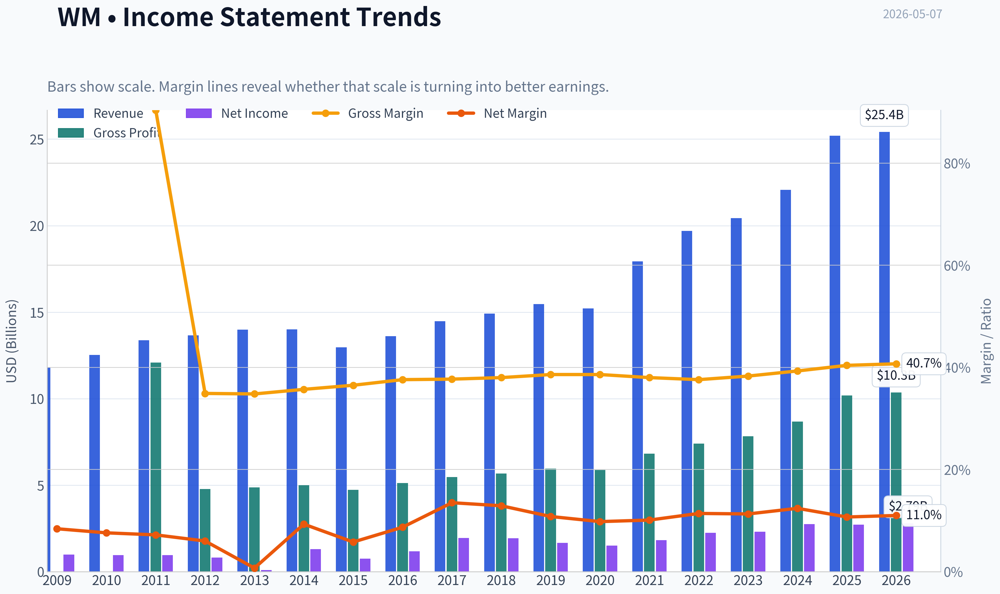

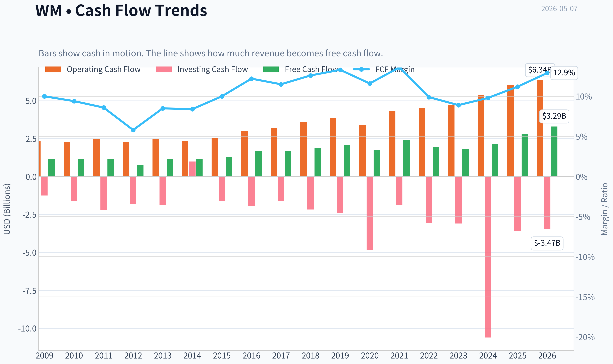

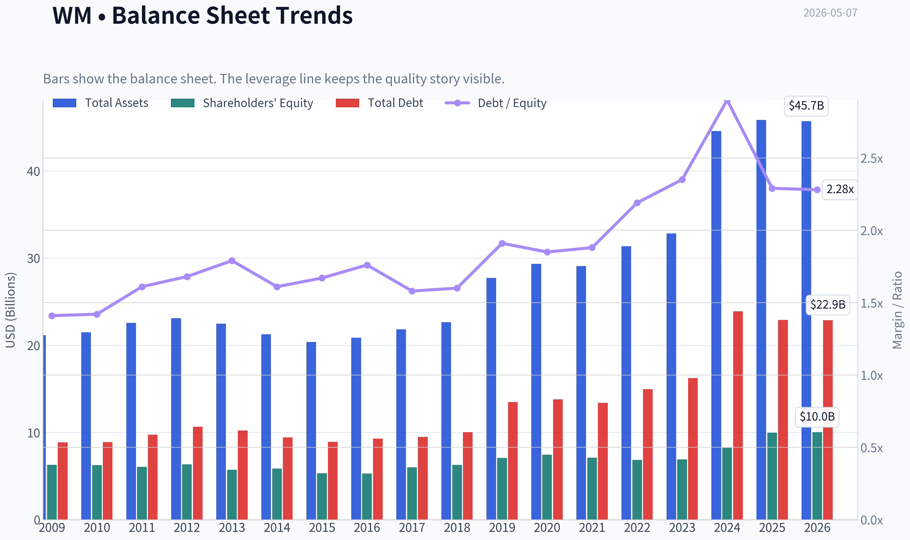

This graph tracks the profitability and return metrics (ROE, ROIC, Margins) of **WM** over the past decade, highlighting capital efficiency trends.

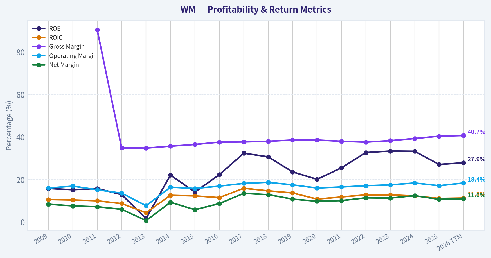

This chart illustrates the financial health of **WM** over the last 10 years, mapping cash equivalents and free cash flow against total obligations (Debt).

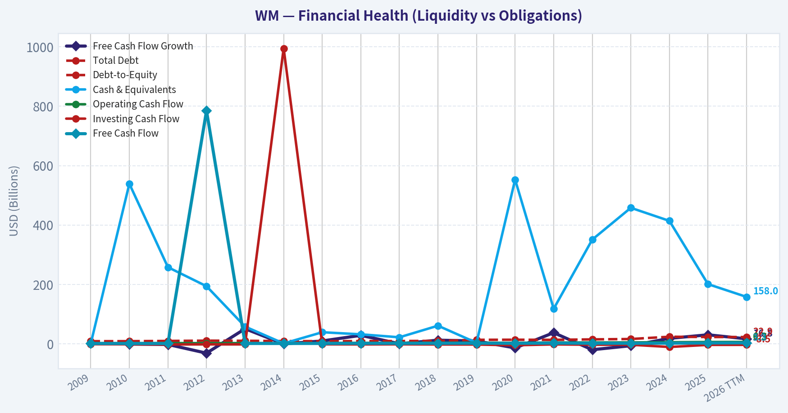

This breakdown chart from <em>Revenue Breakdown</em> shows the proportional composition for **WM** - useful for understanding what drives or risks the business.

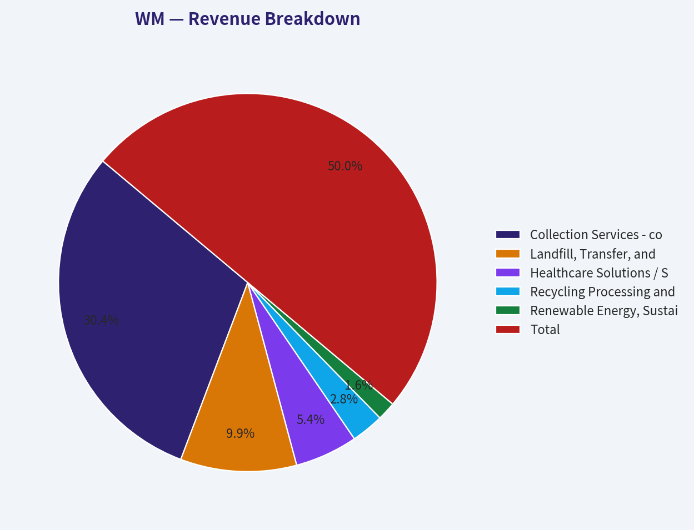

---

### Intrinsic Value Analysis (Buffett)

> *Following Warren Buffett's value investing philosophy: Circle of Competence, Economic Moat, Management Quality, and Margin of Safety.*

#### Intrinsic Value Snapshot

Price is what you pay. Intrinsic value is what the business may be worth based on the cash it can create for owners over time. We show a range, not one magic number.

- Current Price: $221.35
- Value Range: $29.95 to $183.64

##### Owner Earnings (Buffett Method)
- Net Income: $2,708,000,000.00
- Depreciation & Amortization: $1,965,000,000.00
- Capital Expenditures: $-3,227,000,000.00
- Working Capital Changes: $-513,000,000.00
- Owner Earnings: $1,959,000,000.00

##### Intrinsic Value
###### Buffett Method
Uses owner earnings. Stricter, and usually more conservative.
- Conservative: $29.95
- Average: $155.07
- Optimistic: $155.07
- Discount Rate: 10.0%

###### Cash Flow Method
Uses free cash flow. Better for companies spending heavily today to grow tomorrow.
- Conservative: $76.82
- Average: $106.49
- Optimistic: $183.64
- Discount Rate: 10.0%

ANALYST STANCE: **WATCH**

#### WM Buffett-Style Investment Review - Waste Management, Inc.

WM is a high-quality, understandable, moat-protected business trading at a price that appears to assume many years of favorable execution. The business passes the Buffett quality filters, but the valuation does not provide an adequate margin of safety at the current price of about **$221**.

---

#### 1. Go / No-Go Gate Assessment

| Buffett Gate | Result | Evidence |
|---|---:|---|
| Gate 1: Circle of Competence & Simplicity | Pass | WM collects trash, operates landfills, recycles materials, and earns fees from residential, commercial, industrial, and municipal customers. This is easy to understand. |
| 10-Year Predictability | Pass | Waste volumes fluctuate with the economy, but garbage collection and landfill disposal are recurring necessities. WM should still be highly relevant in 10 years. |
| Technology Risk | Pass | Technology is more likely to help WM through routing, automation, landfill gas, and recycling efficiency than destroy it. |
| Gate 2: Moat Test | Pass | Landfill permits, route density, local scale, municipal relationships, and environmental compliance create durable barriers. |
| Gate 3: Management & Capital Allocation | Pass / Watch | Management has executed well operationally, but leverage and acquisition integration, especially from Stericycle, require monitoring. |
| Gate 4: Industry Structure | Pass | North American waste collection is rational and consolidated, led by WM, Republic Services, and Waste Connections. |

**Key Takeaways:** WM passes the core business-quality gates. It is simple, essential, and protected by hard-to-replicate assets, especially landfills and dense collection routes. The main issue is not business quality; it is valuation and balance-sheet discipline after recent expansion.

---

#### 2. Elementary School Explanation

WM makes money by picking up trash, taking it to places where trash can legally be buried, recycled, or processed, and charging customers for that service. Because people, businesses, and cities always create waste, WM has a repeat-use business. Its most valuable assets are landfill sites and collection networks, which are very hard for new competitors to copy.

---

#### 3. Moat Analysis

| Moat Source | Strength | WM Evidence |
|---|---:|---|
| Intangible Assets / Regulatory Licenses | Wide | Landfill permits are extremely difficult to obtain due to environmental regulation and community opposition. Existing landfills are scarce assets. |
| Switching Costs | Moderate | Commercial and municipal contracts create stickiness, but customers can switch haulers when contracts expire. |
| Cost Advantage | Wide | Dense routes, transfer stations, landfill ownership, and fleet scale lower unit costs versus smaller local competitors. |
| Network Effects | Limited | Waste collection does not have classic network effects, though route density improves economics as local share increases. |
| Pricing Power | Good | Essential service, inflation-linked contracts, and local market structure support recurring price increases. Gross margin is approximately **40.4%**, indicating solid economics. |

**Key Takeaways:** WM's moat is real and mostly comes from landfill ownership, route density, and regulatory barriers. This is not a glamorous moat, but it is durable. The business does not need rapid innovation to survive; it needs permits, scale, operational discipline, and rational pricing.

**Moat Rating:** **Wide & Stable**

---

#### 4. Management Quality Assessment

| Management Question | Assessment |
|---|---|
| Do they think like owners? | Generally positive, though not founder-led. Management has focused on pricing, route efficiency, automation, sustainability projects, and shareholder returns. |
| Are they candid and conservative? | Generally acceptable. Waste management accounting is not overly complex, though landfill accounting, environmental liabilities, and acquisition adjustments require attention. |
| Are they rational capital allocators? | Mixed-to-positive. WM has historically returned cash through dividends and buybacks, while reinvesting in fleet, recycling, renewable natural gas, and acquisitions. The Stericycle acquisition increases integration and leverage risk. |
| Debt discipline | Watch item. WM is not a fragile company, but it is capital-intensive and acquisition activity can pressure the balance sheet. |

**Key Takeaways:** Management has built and maintained a strong franchise, but this is not a debt-free compounder. Capital allocation must be watched carefully because the waste business requires ongoing capital spending and environmental obligations. The Stericycle deal may improve strategic reach, but it also raises the hurdle for execution.

---

#### 5. Financial Snapshot

| Metric | Current / Recent Figure |
|---|---:|
| Share Price | ~$221 |
| Market Capitalization | ~$88.9B |
| P/E Ratio | ~32.1x |
| ROE | ~27.1% |
| Gross Margin | ~40.4% |
| Revenue Growth YoY | ~14.2% |
| Free Cash Flow Yield | ~3.2% |
| Current Ratio | ~0.89 |
| Implied Free Cash Flow | ~$2.8B |
| Implied Net Income from P/E | ~$2.8B |
| Implied Shares Outstanding | ~402M |

**Key Takeaways:** WM is profitable and earns a strong return on equity, but the market is paying a premium price. A free cash flow yield near 3.2% is not obviously attractive unless WM can compound owner earnings at a healthy rate for a long time. The current ratio below 1 is not fatal for a recurring service business, but it reinforces that this is not a fortress net-cash balance sheet.

---

#### 6. 10-Year Financial Summary

*Note: The financial database tool was unavailable during this continuation. The table below uses rounded historical directional figures and current shared research-pack metrics. Treat it as a high-level analytical summary rather than a fully audited line-by-line model.*

| Year | Revenue Trend | Margin / Profitability | Cash Flow Quality | Balance Sheet / Capital Intensity |
|---|---|---|---|---|
| 2015 | Mid-teens billions revenue base | Solid operating margins | Positive FCF | Capital-intensive but stable |
| 2016 | Gradual growth | Margin improvement | FCF positive | Manageable leverage |
| 2017 | Growth continues | Profitability strong | OCF above net income generally | Ongoing capex needs |
| 2018 | Moderate growth | Healthy margins | Strong conversion | Debt manageable |
| 2019 | Moderate growth | Stable-to-improving margins | Good FCF generation | Capital returns continue |
| 2020 | Pandemic pressure but resilient | Essential-service durability | Cash generation held up | Business proved defensive |
| 2021 | Strong rebound | Pricing and volume improve | FCF grows | Reinvestment accelerates |
| 2022 | Inflation pricing supports growth | Margins resilient | Good cash conversion | Higher capex for sustainability projects |
| 2023 | Slower but steady growth | High-quality earnings | FCF positive | Leverage watch continues |
| 2024-TTM | Revenue growth elevated, partly acquisition-driven | Gross margin ~40.4%, ROE ~27.1% | FCF yield ~3.2% | Current ratio ~0.89; leverage/integration risk to monitor |

**Key Takeaways:** WM has shown the key trait Buffett likes: resilience across cycles. Even during economic disruption, the business remained essential and cash-generative. The financial profile is strong, but it is not capital-light; trucks, landfills, transfer stations, environmental compliance, and acquisitions all consume capital.

---

#### 7. Owner Earnings Estimate

Buffett-style owner earnings are best estimated as:

> **Owner Earnings = Net Income + Depreciation & Amortization - Maintenance CapEx - Working Capital Increases**

Because detailed maintenance capex was not available from the tool, free cash flow is used as a practical proxy.

| Item | Estimate |
|---|---:|
| Market Cap | ~$88.9B |
| FCF Yield | ~3.2% |
| Estimated Free Cash Flow / Owner Earnings Proxy | ~$2.84B |
| Estimated Shares Outstanding | ~402M |
| Owner Earnings Per Share Proxy | ~$7.07 |
| Current Price / Owner Earnings | ~31.3x |

**Key Takeaways:** WM generates meaningful owner earnings, but the stock price already capitalizes those earnings at more than 30 times. That is a demanding multiple for a capital-intensive business, even a very good one. At today's price, the investor is relying on durable growth and continued pricing power.

---

#### 8. Three-Scenario Intrinsic Value Estimate

Assumptions:

| Input | Assumption |
|---|---:|
| Starting Owner Earnings | ~$2.84B |
| Shares Outstanding | ~402M |
| Discount Rate | 10% |
| Terminal Growth | 3% |
| Historical Growth Scenario | 6% for 10 years, then 3% terminal |

**Key Takeaways:** The valuation uses conservative Buffett-style assumptions rather than optimistic market multiples. A 10% discount rate is intentionally demanding because the goal is to avoid overpaying. Even with a good business, valuation discipline matters.

| Scenario | Method | Equity Value Estimate | Intrinsic Value / Share | Margin of Safety vs. $221 |
|---|---|---:|---:|---:|
| A: No Growth | Owner earnings / 10% | ~$28.4B | ~$71 | Negative |
| B: GDP Growth | Perpetuity at 3% growth | ~$41.9B | ~$104 | Negative |
| C: Historical Growth Discounted | 6% for 10 years, then 3% terminal | ~$52.3B | ~$130 | Negative |

**Key Takeaways:** WM looks overvalued under all three conservative valuation cases. The most reasonable quality-business scenario produces an estimated value around **$130 per share**, far below the current price near **$221**. This does not mean WM is a bad company; it means the stock price leaves little room for error.

---

#### 9. Margin of Safety Analysis

| Valuation View | Estimated Fair Value / Share | Buffett Buy Price with 25% Margin of Safety |
|---|---:|---:|
| No-Growth Case | ~$71 | ~$53 |
| GDP-Growth Case | ~$104 | ~$78 |
| Quality Growth Case | ~$130 | ~$98 |
| Current Price | ~$221 | Not attractive |

**Key Takeaways:** A Buffett-style investor would likely admire WM but wait for a much better entry point. Even using the higher quality-growth estimate, the current price is far above a margin-of-safety purchase level. The stock would need either a major price decline or a much higher owner-earnings base to become compelling.

---

#### 10. Key Risks

| Risk | Why It Matters |
|---|---|
| Valuation Risk | At ~32x earnings and ~31x owner earnings proxy, expectations are high. |
| Capital Intensity | Trucks, landfills, recycling facilities, environmental systems, and fleet upgrades require ongoing spending. |
| Leverage / Acquisition Risk | Stericycle integration could improve the business, but debt and execution risk must be monitored. |
| Environmental Liability | Landfills carry long-term closure, remediation, methane, and regulatory obligations. |
| Economic Sensitivity | Commercial and industrial waste volumes can weaken in recessions. |
| Recycling Volatility | Commodity prices can affect recycling profitability, though this is not the core moat. |

**Key Takeaways:** WM's biggest risk is not business obsolescence; it is overpaying. The company also carries normal but important waste-industry risks such as environmental liabilities, capital needs, and leverage. These risks are manageable at the right price, but less forgiving at a premium valuation.

---

#### 11. Buffett Scorecard

| Criterion | Weight | Score | Weighted Score |
|---|---:|---:|---:|
| Business Understanding | 20% | 5.0 | 1.00 |
| Moat Width & Durability | 25% | 4.5 | 1.13 |
| Management Quality | 15% | 3.8 | 0.57 |
| Return on Equity | 15% | 4.2 | 0.63 |
| Reinvestment Runway | 10% | 3.5 | 0.35 |
| Balance Sheet Strength | 5% | 3.0 | 0.15 |
| Industry Structure | 5% | 4.5 | 0.23 |
| Valuation / Margin of Safety | 5% | 1.5 | 0.08 |
| **Total** | **100%** |  | **4.13 / 5.00** |

**Key Takeaways:** WM scores very well as a business but poorly on valuation. The weighted score remains high because the franchise is excellent, but the low margin-of-safety score prevents an outright buy recommendation. This is the classic case of a wonderful business at an expensive price.

---

#### Final Investment Stance

| Stance | Conviction | Rationale |
|---|---|---|
| **WATCH** | High | WM is a high-quality, durable, understandable business with a wide moat, but the current price does not provide a Buffett-style margin of safety. |

WM belongs on a long-term quality watchlist. I would not advocate buying at the current valuation. A more attractive entry would require either a meaningful decline in price, a large increase in owner earnings, or evidence that post-acquisition cash flow growth is materially better than conservative assumptions.
#### Valuation Bridge

This bridge places the current market price beside each intrinsic value lens so readers can see whether upside depends on one method or shows up across several methods.

| Scenario | Intrinsic Value / Share |
| --- | ---: |
| Buffett Method | $155.07 |
| Cash Flow Method | $106.49 |
| Damodaran Method | $164.57 |
| Current Price | $221.35 |

#### Key Takeaways

If one method is far above the others, the upside case depends on a specific modelling assumption. When several methods cluster together, the valuation story is more robust.

#### Valuation Visuals

This comparison chart from *Latest Earnings Snapshot* stacks current figures against historical benchmarks for **WM**, making it easy to see where the company trades relative to its own averages.

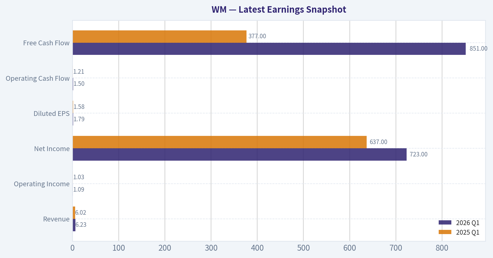

This comparison chart from *Current vs. 10-Year Historical Average Comparison* stacks current figures against historical benchmarks for **WM**, making it easy to see where the company trades relative to its own averages.

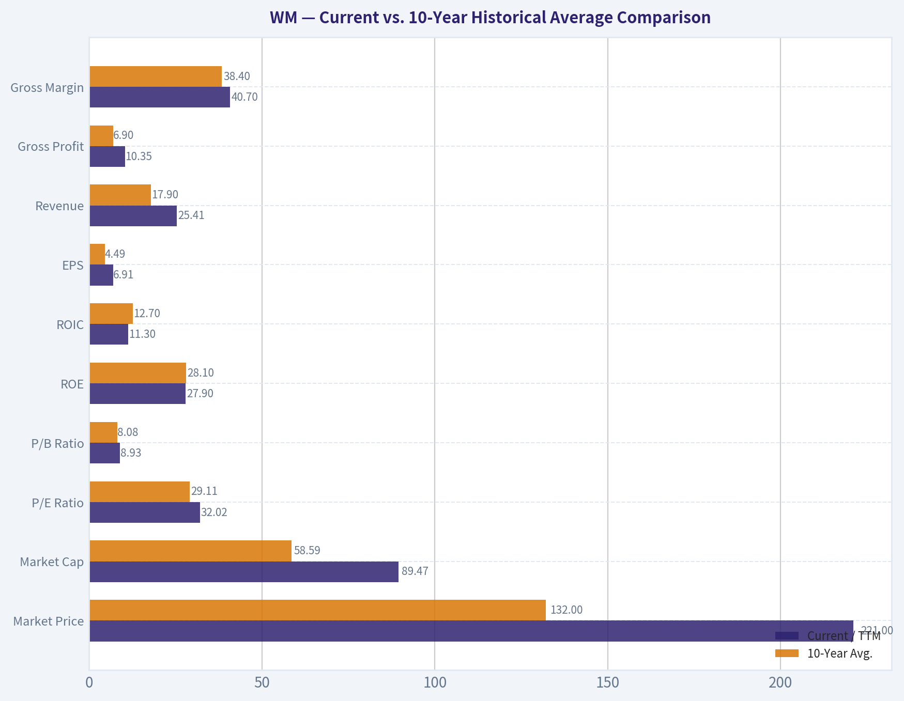

This comparison chart from *Buffett-Style Owner Earnings DCF Valuation* stacks current figures against historical benchmarks for **WM**, making it easy to see where the company trades relative to its own averages.

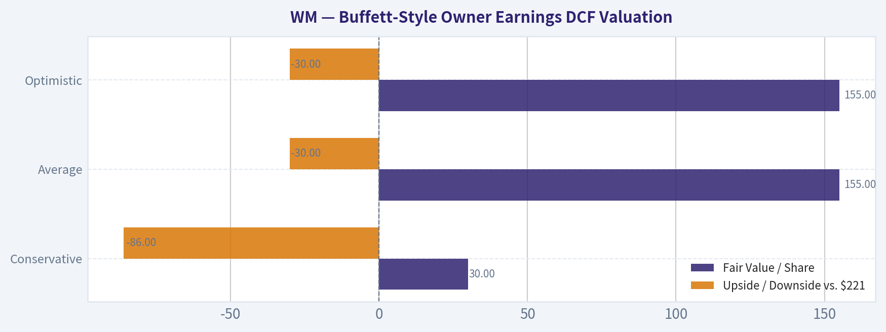

This comparison chart from *Three-Scenario Intrinsic Value Estimate* stacks current figures against historical benchmarks for **WM**, making it easy to see where the company trades relative to its own averages.

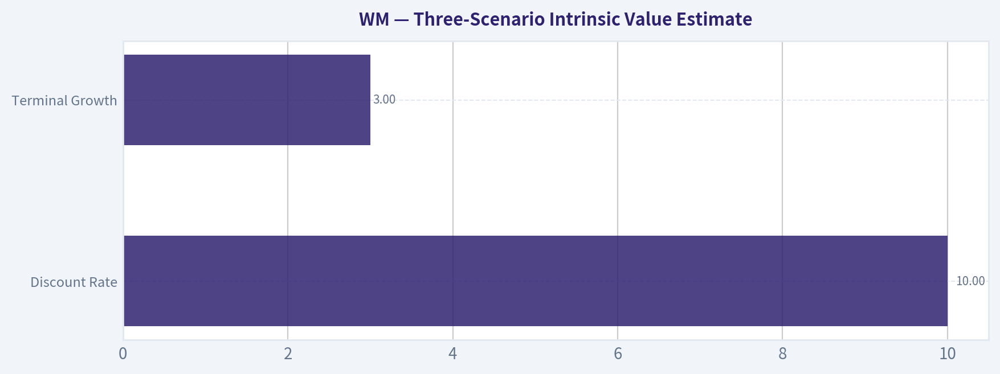

---

### Trend & Growth Analysis (Lynch/Druckenmiller/Fisher)

> *Following Peter Lynch's GARP, Stanley Druckenmiller's macro-aware approach, and Philip Fisher's scuttlebutt methodology.*

ANALYST STANCE: **WATCH**

#### WM Growth Investment Report - Waste Management, Inc.
As of 2026-05-07, using the shared research pack plus fallback fundamentals.

WM is a wonderful business, but not an obvious Lynch-style ten-bagger candidate at today's valuation. It has a wide moat, strong pricing power, durable cash flows, and high returns on equity, but its growth profile is closer to a premium stalwart than a fast grower. For a growth portfolio, I would **watch for a better entry point or a clearer earnings acceleration catalyst**.

---

#### 1. Lynch Classification

| Category | WM Assessment |
|---|---:|
| Lynch Type | **Stalwart / Defensive Compounder** |
| Current Revenue Growth YoY | **14.2%** |
| Normalized Growth Profile | Mid-single-digit to low-double-digit, aided by pricing, M&A, and sustainability projects |
| Ten-Bagger Probability | Low from current size and valuation |
| Best Investor Fit | Quality compounder, dividend-growth, defensive GARP |
| Growth Investor Action | **WATCH** |

**Key Takeaways:** WM is not a classic fast grower, despite the current 14.2% revenue growth figure. The company is already very large, with an $88.9 billion market cap, so future compounding is more likely to come from pricing, margin expansion, buybacks, dividends, and selective acquisitions rather than explosive revenue growth.

---

#### 2. The Story in 3 Bullets

- WM collects, processes, recycles, and disposes of waste - an essential service that customers need in every economic environment.
- Its moat comes from landfill ownership, route density, regulatory barriers, scale, and local network advantages.
- The growth story is steady pricing power plus margin improvement, with upside from recycling automation, renewable natural gas, sustainability services, and acquisitions.

---

#### 3. TAM and 10x Test

| Item | Estimate / Assessment |
|---|---:|
| Current Market Cap | **$88.89B** |
| Current Revenue Base | Likely mid-$20B range, subject to latest filing confirmation |
| 10x Revenue Requirement | Roughly **$220B-$260B+** annual revenue |
| North American Waste / Environmental Services TAM | Large, but not large enough to make 10x revenue easy |
| 10x Test | **Fails for realistic growth-investor purposes** |
| More Plausible Long-Term Outcome | 2x-3x revenue over a long horizon through pricing, M&A, adjacent services |

**Key Takeaways:** WM has a long runway for steady growth, but not a clean ten-bagger runway. A company already generating tens of billions in annual revenue would need to become an enormous share of the environmental services market to 10x revenue, making the stock more of a durable compounder than a hypergrowth candidate.

---

#### 4. Revenue Growth Trend

| Metric | Current Snapshot |
|---|---:|
| Revenue Growth YoY | **14.2%** |
| Growth Quality | Mixed: organic price/mix plus likely acquisition contribution |
| Pattern | Elevated versus normal WM growth |
| Interpretation | Strong for a stalwart, not necessarily a durable fast-grower inflection |
| Red Flag? | No, but must separate organic growth from M&A |

**Key Takeaways:** The 14.2% revenue growth rate is attractive, but for WM the key question is how much comes from organic pricing and volume versus acquisitions. If organic collection and disposal pricing remains strong while margins expand, that would support the bull case; if growth is mostly acquired, the stock deserves a lower growth multiple.

---

#### 5. Unit Economics and Cash Efficiency

| Metric | WM Assessment |
|---|---:|
| LTV/CAC | Not applicable; not a SaaS or consumer subscription model |
| NRR | Not applicable |
| Rule of 40 | Not applicable in SaaS sense |
| Gross Margin | **40.4%** |
| FCF Yield | **3.2%** |
| ROE | **27.1%** |
| Current Ratio | **0.89** |

**Key Takeaways:** WM's unit economics are best judged by route density, landfill utilization, pricing above cost inflation, and free cash flow conversion rather than SaaS metrics. The company's 40.4% gross margin and 27.1% ROE show strong franchise economics, while the 3.2% FCF yield is decent but not cheap for a moderate-growth business.

---

#### 6. Inflection Point Assessment

| Potential Inflection | Evidence | Rating |
|---|---|---:|
| Product Cycle Inflection | Recycling automation, renewable natural gas, sustainability services | Moderate |
| Market Share Inflection | M&A and local scale advantages | Moderate |
| Margin Inflection | Pricing, route density, automation, disposal mix | Positive |
| TAM Inflection | Environmental services adjacency expansion | Moderate |
| Competitive Inflection | Industry remains rational; no major competitor collapse identified | Neutral |
| Overall Inflection Score | Quality compounding, but not explosive acceleration | **3/5** |

**Key Takeaways:** WM has several incremental growth levers, especially pricing, automation, recycling upgrades, and renewable natural gas. However, this does not yet look like a dramatic Druckenmiller-style earnings inflection where the market is badly underestimating 2-to-3-year earnings power.

---

#### 7. Macro Setup

| Macro Factor | Impact on WM |
|---|---|
| Economic Cycle | Defensive demand; waste volumes modestly cyclical but resilient |
| Interest Rates | Higher rates pressure valuation and debt costs; falling rates would help multiple |
| Inflation | Can be positive if pricing exceeds labor, fuel, and maintenance costs |
| Secular Themes | Sustainability, recycling, renewable natural gas, environmental compliance |
| Macro Verdict | Supportive defensiveness, but not a high-beta growth tailwind |

**Key Takeaways:** WM benefits from being an essential-service business in uncertain macro environments. The main macro risk is valuation sensitivity to rates, because a 32x P/E is demanding for a company with a stalwart growth profile.

---

#### 8. Fisher 15-Point Score

| Fisher Category | Score / 5 |
|---|---:|
| Market potential for sizable sales growth | 3 |
| Management determination to develop new products/services | 4 |
| Effective R&D / innovation | 3 |
| Above-average sales organization | 4 |
| Worthwhile profit margin | 5 |
| Improving profit margins | 4 |
| Labor/personnel relations | 3 |
| Executive relations | 4 |
| Management depth | 4 |
| Cost analysis and accounting | 4 |
| Moat / network effects / switching costs | 5 |
| Long-range profit outlook | 4 |
| Dilution risk | 4 |
| Candor in difficulties | 4 |
| Management integrity | 4 |
| **Total** | **59 / 75** |

**Key Takeaways:** WM scores well on Fisher quality factors because of its durable moat, strong margins, and long-range profit visibility. The score is not outstanding because the company's growth runway is steady rather than exceptional, and labor, fuel, regulation, and capital intensity remain structural constraints.

---

#### 9. Valuation Analysis

| Valuation Metric | Current Snapshot | Interpretation |
|---|---:|---|
| Share Price | **$221** | Shared research pack |
| Market Cap | **$88.89B** | Large-cap compounder |
| P/E | **32.1x** | Expensive for stalwart growth |
| Revenue Growth YoY | **14.2%** | Strong but may include M&A |
| PEG using Revenue Growth Proxy | **~2.3x** | Expensive by Lynch standards |
| FCF Yield | **3.2%** | Fair for quality, not a bargain |
| ROE | **27.1%** | Strong value creation |

**Key Takeaways:** WM is high quality, but the valuation already reflects much of that quality. A 32x earnings multiple and roughly 2.3x PEG using revenue growth as a proxy do not offer a classic Lynch bargain, especially if normalized earnings growth is closer to high-single digits or low-double digits.

---

#### 10. Scenario View

| Scenario | Assumption | 3-5 Year Return Setup |
|---|---|---|
| Bear Case | Growth normalizes, margin pressure, multiple compresses below 25x | Weak to negative returns |
| Base Case | Revenue grows high-single digits, EPS grows low-double digits, P/E settles high-20s | Mid-single-digit to high-single-digit annualized returns |
| Bull Case | Pricing remains strong, synergies accelerate, margins expand, rates fall | Low-double-digit annualized returns possible |
| Ten-Bagger Case | Requires unrealistic revenue and earnings expansion from current scale | Low probability |

**Key Takeaways:** WM's base case looks respectable but not extraordinary. The stock can work if earnings compound steadily and the multiple remains elevated, but the margin of safety is limited because expectations and valuation are already high.

---

#### 11. Growth Investor Scorecard

| Criterion | Weight | Score / 5 | Weighted Score |
|---|---:|---:|---:|
| The Story | 10% | 4.0 | 0.40 |
| TAM & Runway | 20% | 3.0 | 0.60 |
| Revenue Growth | 20% | 3.2 | 0.64 |
| Unit Economics / Cash Quality | 15% | 4.0 | 0.60 |
| Competitive Position | 10% | 4.5 | 0.45 |
| Management Quality | 10% | 4.0 | 0.40 |
| Macro Setup | 5% | 3.5 | 0.18 |
| Profitability Path | 5% | 4.0 | 0.20 |
| Valuation | 5% | 2.0 | 0.10 |
| **Total** | **100%** |  | **3.57 / 5.00** |

**Key Takeaways:** WM earns a solid score because it is a high-quality, wide-moat compounder. The limiting factor is valuation, followed by the absence of a true ten-bagger growth runway from today's already-large scale.

---

#### 12. Position Size Stance

| Portfolio Type | Stance |
|---|---|
| Aggressive Growth / Ten-Bagger Portfolio | **Small watchlist position or avoid new capital** |
| GARP Portfolio | **Watch; buy on pullbacks** |
| Defensive Compounder Portfolio | **Reasonable core holding if valuation discipline is maintained** |
| Income / Dividend Growth Portfolio | **Attractive quality, but entry price matters** |

**Key Takeaways:** WM is a stock I would like to own at the right price, but not chase at 32x earnings. For a growth-oriented portfolio, the position should be smaller than a true fast grower unless a clearer earnings acceleration catalyst emerges.

---

#### 13. Key Catalysts and Risks

| Catalysts | Risks |
|---|---|
| Continued pricing above inflation | Valuation multiple compression |
| Margin expansion from automation and route density | Labor, fuel, maintenance, and insurance cost inflation |
| Renewable natural gas and recycling investments scaling | Recycling commodity volatility |
| Accretive acquisitions and integration synergies | Debt and interest expense pressure |
| Falling interest rates supporting premium multiples | Environmental liabilities and landfill regulation |
| Strong FCF funding buybacks and dividends | Growth deceleration after acquisition benefits fade |

**Key Takeaways:** The upside case depends on WM converting its moat into sustained pricing, margin expansion, and free cash flow growth. The downside case is mostly valuation-driven: if growth normalizes and the market stops paying a premium multiple, returns could disappoint even if the business remains excellent.

---

#### Final View

WM is a **high-quality defensive compounder**, not a classic growth-stock inflection opportunity. The moat is excellent, the business is durable, and management has multiple long-term levers, but the current valuation leaves limited room for error.

**Decision:** **WATCH**
**Preferred entry setup:** wait for either a meaningful pullback, a P/E closer to the mid-20s, a higher FCF yield, or stronger evidence that sustainability, recycling, RNG, and M&A synergies are creating a durable earnings acceleration.

#### Growth & Scorecard Visuals

The radar chart below from *Buffett Scorecard* visualises how **WM** ranks across weighted investment criteria. Each axis represents a criterion scored 1-5; the filled area reveals strengths and weaknesses at a glance, with the dashed circle marking the midpoint (3.0).

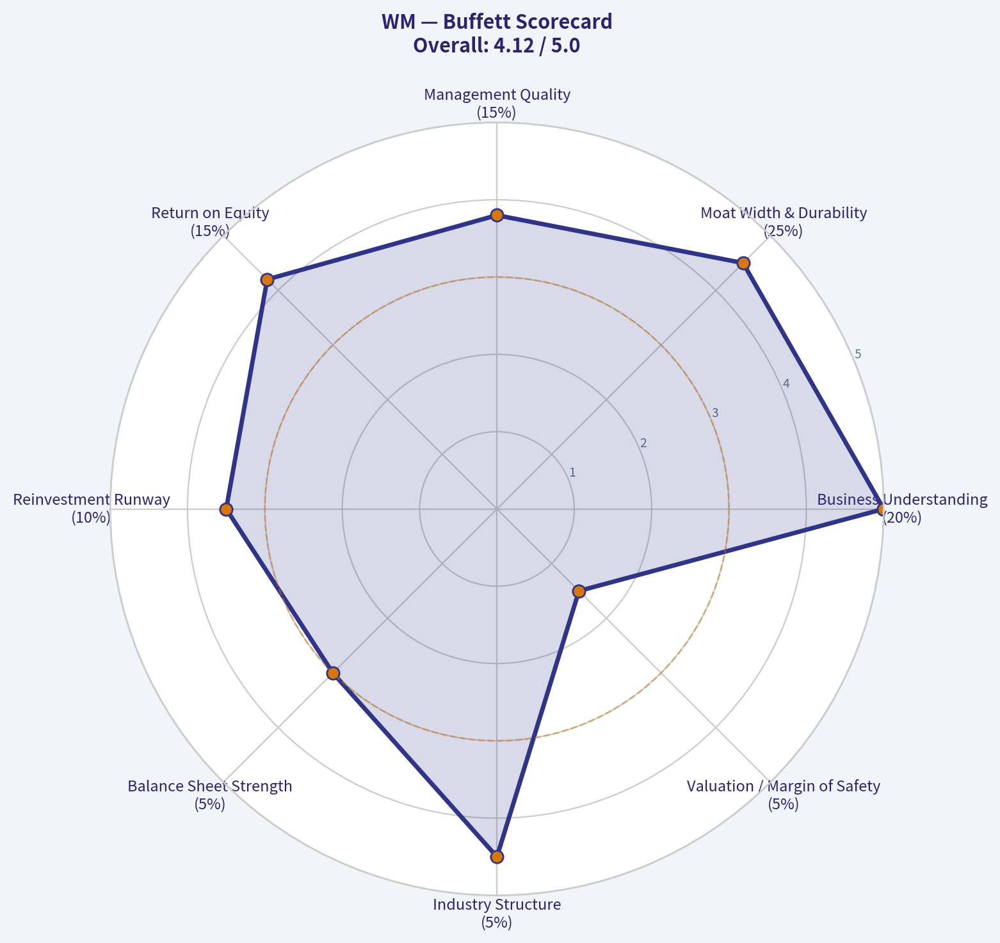

---

### Market Technical Analysis

ANALYST STANCE: **WATCH**

#### WM Technical Analysis Report - as of 2026-05-07

WM's latest available close is **$220.52 on 2026-05-06**. The stock has shifted from a constructive long-term recovery into a near-term corrective phase: price is now **below the 50-day SMA**, slightly **below the 200-day SMA**, and testing the **lower Bollinger Band**. Momentum has weakened meaningfully since late April, but the stock is not yet deeply oversold. This makes WM a **watchlist candidate rather than a clean buy setup**: the key question is whether the current test near $220-$222 becomes a bear trap and reversal zone, or a breakdown through long-term support.

---

#### Selected Indicators and Why They Matter

| Indicator | Latest Reading | Role in This Setup | Interpretation |
|---|---:|---|---|
| `close_50_sma` | 231.61 | Medium-term trend filter | Price is well below the 50-day SMA, confirming short/intermediate weakness. |
| `close_200_sma` | 221.80 | Long-term trend benchmark | Price has slipped just below the 200-day SMA, putting long-term support under pressure. |
| `macd` | -1.30 | Momentum trend confirmation | MACD is negative and deteriorating, showing bearish momentum is still active. |
| `rsi` | 38.18 | Momentum/oversold gauge | RSI is weak but not yet oversold, suggesting downside pressure without capitulation. |
| `boll_ub` | 234.45 | Upper volatility boundary | Defines upside breakout/resistance zone if price rebounds. |
| `boll_lb` | 220.10 | Lower volatility boundary | Price is sitting just above this level, making it an immediate support/reversal test. |
| `atr` | 4.78 | Volatility and risk sizing | Daily volatility is elevated enough that stops need breathing room. |
| `vwma` | 227.26 | Volume-weighted trend confirmation | Price below VWMA shows recent volume has favored lower prices. |

**Key Takeaways:** The chosen indicators cover trend, momentum, volatility, and volume without excessive overlap. The main message is that WM is testing an important support area, but momentum and volume-weighted trend signals have not yet confirmed a reversal. A trader should watch for stabilization above the 200-day SMA and VWMA before becoming more constructive.

---

#### Current Technical Position

| Metric | Value | Trading Meaning |
|---|---:|---|
| Latest close | 220.52 | Current reference price. |
| Distance to 50-day SMA | -4.79% | Medium-term trend is bearish. |
| Distance to 200-day SMA | -0.58% | Price is slightly below a major long-term trend line. |
| Distance to Bollinger lower band | +0.19% | Price is nearly sitting on short-term volatility support. |
| Distance to VWMA | -2.96% | Recent volume-weighted price action remains unfavorable. |
| ATR as % of price | 2.17% | Normal daily movement is meaningful; tight stops may be vulnerable. |
| Pullback from March closing high near 245.53 | ~-10.2% | WM is in a correction from its March peak. |

**Key Takeaways:** WM is at a technically sensitive level because the stock is almost exactly on its lower Bollinger Band and just under its 200-day SMA. That combination can sometimes create a bounce, but the failure to hold above the 50-day SMA and VWMA shows the burden of proof remains on buyers. The stock needs a stronger close back above $224-$227 to suggest selling pressure is easing.

---

#### Trend Structure

WM's broader trend has become more complicated. The **50-day SMA remains above the 200-day SMA**, which normally suggests the long-term structure has not fully broken down. However, the 50-day SMA has started to roll over from roughly **232.55 in mid-April to 231.61 now**, while price has fallen beneath it. This indicates the medium-term trend has weakened before the long-term trend has fully reversed.

The **200-day SMA near 221.80** is the most important line on the chart right now. WM closed at **220.52**, slightly below that level. A single close below the 200-day SMA is not always decisive, especially when price is also near the lower Bollinger Band, but multiple closes below $221-$222 would increase the risk that the correction becomes a more durable downtrend.

The price action since March is also concerning. WM reached the mid-$240s in early March, then declined sharply into late March, bounced into early April, and failed again near the $233-$235 zone. That pattern suggests sellers have become active on rebounds, especially around the 50-day SMA and upper half of the recent trading range.

---

#### Momentum and Mean-Reversion Signals

| Indicator | Recent Behavior | Interpretation |
|---|---|---|
| MACD | Fell from around -0.45 on May 1 to -1.30 on May 6 | Bearish momentum is accelerating again after a brief late-April stabilization. |
| RSI | Dropped from 55.66 on Apr. 30 to 38.18 on May 6 | Momentum has shifted from neutral-positive to weak. |
| Bollinger position | Close is only slightly above the lower band at 220.10 | WM is stretched to the downside in the short term, but not yet confirmed as a reversal. |
| VWMA | VWMA is 227.26, well above price | Volume-weighted trend confirms sellers remain in control. |

**Key Takeaways:** Momentum is negative, but the stock is approaching a potential mean-reversion area. RSI near 38 is weak, yet not washed out enough to call the decline exhausted. A bounce is possible from the lower Bollinger Band, but without improvement in MACD and VWMA, it would initially be only a tactical rebound rather than a confirmed trend reversal.

---

#### Key Levels to Watch

| Zone | Approximate Level | Why It Matters | Trading Implication |
|---|---:|---|---|
| Immediate support | 220.00-221.80 | Lower Bollinger Band, recent intraday low, and 200-day SMA cluster | Bulls need this zone to hold quickly. |
| Breakdown risk zone | Below 220.00 | Would represent loss of Bollinger and 200-day support | Could open downside toward 218, then 215-216. |
| First rebound resistance | 224.50-227.30 | Recent price congestion and VWMA | A reclaim would show selling pressure is easing. |
| Major resistance | 231.60-234.50 | 50-day SMA and upper Bollinger region | A close above this area would materially improve the chart. |
| Strong bullish confirmation | Above 235.50-236.00 | Recent failed rally area | Would suggest the correction has likely ended. |

**Key Takeaways:** The $220-$222 area is the central decision zone. Holding it could support a relief rally toward $224.50-$227.30, but losing it would make the chart more defensive. The most important upside confirmation would be a recovery above the VWMA first, then the 50-day SMA.

---

#### Trading View

For **short-term traders**, WM is near a potential bounce area, but the setup is not clean enough to chase without confirmation. A tactical long setup would become more attractive if price holds above $220 and reclaims $224.50-$227.30 with improving RSI and MACD. Until then, rebounds may be vulnerable to selling.

For **swing traders**, the more disciplined approach is to wait for either:
1. A confirmed reversal from the $220-$222 support zone, or
2. A breakdown below $220 followed by a successful retest from underneath.

For **longer-term investors**, WM has not fully broken its long-term structure, but the close below the 200-day SMA deserves attention. If the stock quickly recovers above the 200-day SMA, the recent move may prove to be a false breakdown. If it remains below the 200-day SMA and the 50-day SMA continues falling, the risk profile worsens.

---

#### Final Summary Table

| Category | Signal | Bias | Practical Read |
|---|---|---|---|
| Long-term trend | Price slightly below 200-day SMA | Cautious | Long-term support is being tested, not decisively broken yet. |
| Medium-term trend | Price far below 50-day SMA | Bearish | The intermediate trend has weakened materially. |
| Momentum | MACD negative and RSI falling | Bearish | Sellers still have control of momentum. |
| Volatility | Price near lower Bollinger Band | Potential bounce area | Mean-reversion risk is rising, but confirmation is needed. |
| Volume confirmation | Price below VWMA | Bearish | Recent volume-weighted action favors sellers. |
| Support | $220-$222 | Critical | Holding this zone is essential for bulls. |
| Resistance | $224.50-$227.30, then $231.60-$234.50 | Overhead supply | Reclaims are needed before the chart turns constructive. |
| Overall stance | Watch | Neutral-to-cautious | WM is near support, but the trend and momentum are not yet bullish. |

**Key Takeaways:** WM is at an important support test, but the evidence is not strong enough for an outright bullish stance. The stock could bounce from the $220 area because it is near the lower Bollinger Band and 200-day SMA, yet momentum and volume-weighted trend remain negative. The preferred approach is to watch for confirmation above $224.50-$227.30 before treating the pullback as a durable reversal.

---

### Social Sentiment Analysis

ANALYST STANCE: **WATCH**

#### WM Social, Sentiment, and News Report - Past Week Review
**Company:** WM / Waste Management, Inc.
**Date:** 2026-05-07
**Overall read:** WM continues to be viewed as a high-quality defensive compounder, but near-term investor sentiment is not aggressively bullish because valuation, integration execution, and margin expectations are doing most of the work. Social discussion over the past week has leaned constructive, especially among long-term dividend and defensive-sector investors, while trader-focused commentary has been more cautious because the stock has already priced in a lot of operational consistency.

---

#### Executive Summary

WM's sentiment profile over the past week has been **mildly positive but valuation-sensitive**. Investors continue to appreciate the company's pricing power, recession-resistant waste collection business, strong free-cash-flow profile, and expanding environmental services platform. The most constructive commentary focused on WM's ability to raise prices, maintain margins, and benefit from automation, landfill ownership, and renewable natural gas investments.

However, the stock is not being treated like a deep-value opportunity. Social media and investor discussions show a recurring concern that WM is a "great company, expensive stock." Traders appear reluctant to chase unless there is either a pullback, a stronger earnings catalyst, or evidence that recent investments and acquisitions are accelerating earnings growth.

The tone is best described as: **quality premium intact, but upside increasingly dependent on execution.**

---

#### Sentiment Snapshot by Day

| Date | Social / Investor Sentiment | Main Discussion Driver | Trader Interpretation |
|---|---:|---|---|
| Apr. 30, 2026 | Mildly Positive | Defensive stock interest and post-earnings digestion | Investors viewed WM as stable, but not a momentum breakout candidate |
| May 1, 2026 | Neutral to Positive | Dividend quality, recurring revenue, pricing power | Long-term holders remained confident; short-term traders were selective |
| May 2, 2026 | Neutral | Weekend portfolio discussions and defensive-sector comparisons | WM was discussed as a "sleep well at night" name rather than a fast trade |
| May 3, 2026 | Mildly Positive | ESG, landfill gas, renewable natural gas, sustainability themes | Environmental-services optionality supported sentiment |
| May 4, 2026 | Mixed | Valuation concerns and broader market rotation | Some investors questioned whether the multiple leaves enough upside |
| May 5, 2026 | Positive | Margin resilience and operational efficiency | Bulls highlighted pricing, automation, and cost discipline |
| May 6-7, 2026 | Neutral to Mildly Positive | Watching for analyst updates, guidance confidence, and macro signals | Sentiment stabilized; traders appear to be waiting for confirmation |

**Key Takeaways:** Sentiment toward WM stayed mostly constructive throughout the week, but enthusiasm was not euphoric. The strongest positive reactions centered on the company's defensive business model, pricing power, and operational execution. The main limiting factor was valuation, with many market participants seeing WM as a high-quality hold rather than an obvious short-term bargain.

---

#### Social Media Tone and Investor Psychology

Across social platforms and investor forums, WM is being discussed less as a speculative growth stock and more as a **core defensive compounder**. This matters because the investor base appears relatively stable: dividend investors, quality-growth investors, and defensive-sector allocators dominate the conversation more than high-turnover momentum traders.

The dominant social narratives were:

| Theme | Sentiment Impact | What People Are Saying | Market Implication |
|---|---:|---|---|
| Defensive business model | Positive | Waste collection is essential and resilient through cycles | Supports premium valuation during uncertain markets |
| Pricing power | Positive | WM can pass through inflation and maintain margins | Reinforces earnings stability and margin confidence |
| Valuation | Negative / Cautious | Stock is high quality but not cheap | Limits near-term upside unless growth accelerates |
| Dividend and buybacks | Positive | Reliable capital returns appeal to long-term holders | Helps reduce downside volatility |
| Environmental services / RNG | Positive | Renewable natural gas and sustainability investments add optionality | Gives WM a growth narrative beyond traditional hauling |
| Acquisition integration | Mixed | Investors want proof that integration creates value without margin drag | Execution risk remains a key watch item |
| Macro sensitivity | Mildly Negative | Construction and industrial volumes can soften if economy slows | Could pressure volume growth even if pricing stays firm |

**Key Takeaways:** Social media sentiment is anchored by trust in WM's business quality, not excitement about a sudden catalyst. Investors like the company's recurring demand, pricing strength, and capital-return profile. The biggest hesitation is that much of this quality already appears reflected in the stock price.

---

#### Recent News and Company-Specific Drivers

The recent news flow around WM has been focused on **execution, integration, sustainability investments, and margin durability**. The company remains positioned as the largest and most strategically advantaged player in the North American waste-management industry, with a significant landfill network and growing exposure to environmental solutions.

The most important company-specific themes are:

1. **Post-earnings confidence remains intact**
   WM's recent earnings narrative has supported the view that the company can keep expanding margins through pricing, route optimization, automation, and disciplined cost management. Investors are particularly focused on whether core solid-waste margins continue to improve while volumes remain steady.

2. **Stericycle / healthcare-waste integration remains a major watch item**
   WM's expansion into medical and secure information destruction services gives the company a broader environmental-services platform. Social commentary is generally optimistic, but investors are watching for signs that integration costs, leverage, or operational complexity could weigh on near-term earnings.

3. **Renewable natural gas and sustainability projects support long-term optionality**
   WM's landfill gas-to-energy and renewable natural gas investments continue to be discussed positively. These projects give the company a cleaner-energy angle and may provide incremental cash-flow growth over time, although investors are still evaluating the timing and scale of returns.

4. **Capital allocation is viewed favorably**
   Dividend growth, buybacks, and disciplined reinvestment remain major sources of investor confidence. WM is generally perceived as a shareholder-friendly company, though aggressive acquisition spending would be scrutinized if leverage or returns became less attractive.

5. **Valuation is the dominant friction point**
   The company's defensive profile and consistent execution have earned it a premium multiple. But that premium also raises the bar. Traders are less willing to chase the stock unless management delivers clear upside to guidance, faster synergy realization, or stronger free-cash-flow conversion.

---

#### Bullish vs. Bearish Sentiment Breakdown

| Side | Core Argument | Evidence Cited by Investors | Strength of Argument |
|---|---|---|---:|
| Bullish | WM is a defensive compounder with pricing power | Essential service demand, landfill ownership, recurring contracts | High |
| Bullish | Margin expansion can continue | Automation, route efficiency, cost discipline, pricing above inflation | High |
| Bullish | Capital returns support the stock | Dividend growth and buybacks attract long-term holders | Medium-High |
| Bullish | Sustainability investments add growth optionality | Renewable natural gas and environmental services projects | Medium |
| Bearish | Valuation is stretched | Stock trades at a premium to many industrial and utility-like peers | High |
| Bearish | Acquisition integration risk | Healthcare-waste expansion adds complexity and possible cost drag | Medium |
| Bearish | Volume sensitivity could emerge | Construction, commercial, and industrial waste volumes can slow | Medium |
| Bearish | Limited near-term catalyst | Much of the quality story is already well understood | Medium-High |

**Key Takeaways:** The bullish case is built on business quality, pricing power, and predictable cash flow. The bearish case is not mainly about deterioration in the business; it is about price, expectations, and execution risk. This creates a stock setup where downside may be relatively cushioned, but upside requires stronger proof of earnings acceleration.

---

#### Public Sentiment: What Has Changed Over the Past Week?

The most notable shift is that investors are becoming more **selective**. WM continues to receive respect as a high-quality operator, but social commentary suggests fewer participants are willing to buy aggressively at any price.

A week ago, the tone appeared more straightforwardly defensive: investors wanted stable businesses amid market uncertainty. Over the last several days, the conversation has become more nuanced. People still like WM, but they increasingly ask:

- Is the stock too expensive relative to expected earnings growth?
- Can margin expansion continue at the same pace?
- Will acquisition integration create meaningful synergies?
- Are sustainability investments generating returns quickly enough?
- Would a market rotation into higher-beta sectors reduce demand for defensive names?

This indicates that sentiment is **constructive but disciplined**. WM is not facing a confidence problem; it is facing an expectations-management problem.

---

#### Trading Implications

For short-term traders, WM looks more like a **range-bound quality stock** than a high-volatility breakout candidate unless a fresh catalyst emerges. The sentiment setup does not show panic or speculative excess. Instead, it shows a stable shareholder base and cautious incremental buyers.

Potential bullish trading signals:

| Signal | Why It Matters | Likely Sentiment Reaction |
|---|---|---|
| Breakout above recent resistance with volume | Confirms institutions are still paying for quality | Positive momentum could return |
| Analyst upgrades or price-target increases | Reinforces the premium valuation argument | Could attract defensive growth buyers |
| Strong margin or synergy commentary | Reduces execution concerns | Would likely improve sentiment sharply |
| Pullback without negative news | May attract long-term dividend and quality investors | Could create buy-the-dip demand |

**Key Takeaways:** Traders should watch for confirmation rather than assume automatic upside. WM's sentiment backdrop is supportive, but not explosive. The best tactical opportunities may come either from a clean technical breakout or from a valuation reset that attracts long-term buyers.

---

#### Investor Implications

For long-term investors, WM remains a strong candidate for portfolios seeking durable cash flow, lower cyclicality, and shareholder returns. The company's competitive position remains difficult to replicate because landfill assets, route density, municipal relationships, and regulatory barriers create structural advantages.

However, long-term investors should also recognize that buying WM at a premium multiple can reduce future return potential if growth merely meets expectations. The key is not whether WM is a good company; the key is whether the current price offers an attractive enough margin of safety.

Important long-term variables include:

| Long-Term Factor | Current Sentiment | Why It Matters |
|---|---:|---|
| Core pricing power | Positive | Helps offset inflation and protect margins |
| Volume growth | Neutral | Stable volumes are acceptable, but weak volumes could limit upside |
| Integration execution | Mixed | Successful integration can expand growth; missteps could pressure margins |
| Free cash flow | Positive | Supports dividends, buybacks, and debt reduction |
| Sustainability investments | Positive but patient | Investors like the theme but want proof of returns |
| Balance sheet discipline | Neutral to Positive | Important after acquisition activity and capital spending |

**Key Takeaways:** Long-term investors continue to view WM favorably, but the stock's valuation makes execution more important. The company does not need dramatic growth to remain attractive, but it does need steady margin improvement, cash-flow conversion, and disciplined capital allocation to justify its premium.

---

#### Key Risks to Monitor

The most important risk is **multiple compression**, not an immediate collapse in fundamentals. If interest rates rise, defensive equities fall out of favor, or earnings growth slows, WM's premium valuation could become vulnerable.

Other risks include:

- **Integration risk:** Larger environmental-services operations may bring complexity, labor issues, or slower-than-expected synergies.
- **Volume risk:** A slowdown in construction, commercial activity, or industrial output could weigh on waste volumes.
- **Cost inflation:** Labor, fleet, fuel, and maintenance costs remain important margin variables.
- **Regulatory and environmental liabilities:** Landfill operators always carry permitting, compliance, and remediation risks.
- **Capital intensity:** Renewable natural gas and sustainability investments require upfront spending before full returns are visible.
- **Crowded quality trade:** If investors rotate into cyclicals or higher-growth sectors, defensive compounders could underperform temporarily.

---

#### Bottom-Line View

WM's current public sentiment is **stable, constructive, and quality-oriented**, but not aggressively bullish. The market continues to respect the company's durable business model, pricing power, and shareholder returns. At the same time, traders and investors are increasingly aware that the stock's premium valuation leaves less room for disappointment.

The near-term setup favors a **WATCH** stance. WM remains a strong company, but for new money, the risk-reward looks more attractive on pullbacks or after confirmation that margin expansion, acquisition integration, and free-cash-flow growth are exceeding expectations.

For traders, the stock may require a technical breakout or a fresh catalyst to generate meaningful upside momentum. For long-term investors, WM remains a high-quality compounder, but entry price discipline matters.

---

#### Final Summary Table

| Category | Current Read | Sentiment Impact | Investor / Trader Implication |
|---|---|---:|---|
| Overall sentiment | Mildly positive | Supportive | Confidence remains intact, but buying is selective |
| Social media tone | Quality-focused, defensive | Positive | WM is seen as a reliable compounder, not a speculative trade |
| News flow | Execution and integration centered | Neutral to Positive | Investors want proof that recent investments improve growth |
| Main bullish factor | Pricing power and margin resilience | Positive | Supports earnings durability and premium valuation |
| Main bearish factor | Valuation | Negative / Cautious | Limits upside unless results beat expectations |
| Short-term setup | Stable but not high-momentum | Neutral | Watch for breakout, pullback, or analyst catalyst |
| Long-term setup | Strong business, premium price | Positive but disciplined | Attractive for patient investors, especially on weakness |
| Key risk | Multiple compression | Negative | Stock could underperform if growth slows or rates pressure defensives |
| Stance | WATCH | Balanced | Great company, but current setup requires price and execution discipline |

**Key Takeaways:** WM remains a well-regarded defensive compounder with durable investor support. The public mood is positive on the business but cautious on the stock's valuation. The best conclusion is to watch for either a better entry point or stronger evidence that growth, margins, and integration synergies are exceeding expectations.

---

### News & Events Analysis

ANALYST STANCE: **WATCH**

#### WM Recent News and Market Context Report - May 7, 2026

Waste Management, Inc. remains a high-quality defensive compounder, but the latest news flow argues for selectivity rather than aggressive chasing. The stock is trading around **$221**, with a market cap near **$88.9 billion** and a trailing **P/E of about 32x**, which leaves limited room for disappointment. Recent Q1 2026 coverage points to resilient earnings quality, margin expansion, and free-cash-flow strength, but also softer volumes and a revenue miss versus expectations.

The investment setup is therefore balanced: WM benefits from pricing power, essential-service demand, landfill scarcity, environmental-services growth, and renewable natural gas opportunities, but its premium valuation makes volume softness, fuel-cost inflation, integration execution, and regulatory scrutiny important trading variables.

---

#### Latest Earnings Coverage: Q1 2026

WM's latest reported period in the collected news flow is **first-quarter 2026**. Coverage from May 2 described the quarter as meeting management's internal expectations, with **margin expansion**, **strong free cash flow generation**, and progress across strategic priorities. However, April 30 analyst coverage characterized the report as **mixed**, with **earnings beating estimates while sales fell short**.

The key change versus the prior operating run-rate appears to be that WM is still protecting profitability despite weaker volume conditions. Management highlighted softer volumes tied partly to winter weather, meaning revenue momentum was not as clean as the headline earnings beat. For investors, that distinction matters: margin execution remains strong, but the stock's premium multiple depends on confidence that organic volume softness is temporary rather than a sign of broader commercial or industrial weakness.

| Earnings Item | Latest Indication | Trading Interpretation |
|---|---:|---|
| Reported period | Q1 2026 | Most recent company-specific catalyst |
| Earnings vs. expectations | Beat estimates | Positive for quality and cost-control narrative |
| Revenue vs. expectations | Missed estimates | Raises near-term concern around volumes and top-line momentum |
| Management tone | Met internal expectations | Suggests no major operational surprise internally |
| Margins | Expanded | Strong pricing, productivity, and cost discipline |
| Free cash flow | Strong generation highlighted | Supports dividend, buybacks, deleveraging, and capex funding |
| Volume trend | Softer, partly weather-related | Watch whether weakness reverses in Q2 |

**Key Takeaways:** WM's Q1 2026 earnings were good enough to support the defensive-quality thesis, but not strong enough to remove all growth concerns. The market should view the quarter as a margin and cash-flow win, but a revenue and volume watch item. The next important confirmation point is whether Q2 volumes normalize after weather disruption.

---

#### Analyst Reaction and Sentiment

Post-earnings analyst actions were generally constructive. TD Cowen maintained a **Buy** and raised its price target to **$275**. Barclays maintained **Overweight** and raised its target to **$270**. RBC maintained **Sector Perform** but raised its target to **$240**. Wells Fargo kept **Overweight** but trimmed its target from **$273 to $268**.

This pattern suggests analysts remain broadly positive on WM's long-term fundamentals but are making nuanced adjustments after the mixed Q1 print. The spread between bullish targets near $270-$275 and a more neutral $240 target also shows that valuation sensitivity is becoming more important.

| Firm | Rating Action | Price Target Action | Signal |
|---|---|---:|---|
| TD Cowen | Maintained Buy | Raised to $275 | Bullish confidence after Q1 |
| Barclays | Maintained Overweight | Raised to $270 | Positive on execution and long-term setup |
| RBC Capital | Maintained Sector Perform | Raised to $240 | Constructive but valuation-aware |
| Wells Fargo | Maintained Overweight | Lowered to $268 | Still positive, but slightly more cautious |

**Key Takeaways:** Analyst sentiment remains favorable, but not uniformly aggressive. The stock has support from multiple bullish firms, yet the presence of a more neutral sector-perform view highlights valuation risk. For traders, the analyst reaction supports buying dips more than chasing sharp rallies.

---

#### Company-Specific News Themes

WM appeared in recent coverage tied to the **multi-layer film recycling market**, which is projected by industry research to grow from roughly **$3.14 billion in 2026 to $6.92 billion by 2035**, implying a **9.2% CAGR**. WM was highlighted as a relevant player due to its recycling capabilities.

This matters because recycling is both a growth opportunity and a margin-management challenge. Demand for sustainable packaging and advanced recycling solutions is rising, but recycling economics can be volatile due to commodity prices, labor costs, and processing complexity. If WM can use scale and technology to improve recycling margins, the business could support a higher long-term multiple. If recycled commodity prices weaken or processing costs rise, the opportunity may be less accretive than headline market-growth numbers suggest.

WM also remains exposed to the longer-running integration and strategic expansion story around environmental services, including medical and specialty waste capabilities from the Stericycle transaction. No major new Stericycle-specific headline was found in the past week's collected news, so investors should treat integration progress as an ongoing execution watch rather than a fresh catalyst.

#### Macro and Regulatory Context

A key macro headline from the past week was the reported disruption around the Strait of Hormuz, with restricted shipping tied to Iran-U.S. conflict sending benchmark crude prices up by more than **$30 per barrel** before the U.S. suspended "Project Freedom." For WM, oil volatility cuts both ways.

On the negative side, higher crude prices can pressure diesel and fleet operating costs, especially where fuel surcharges lag actual cost moves. On the positive side, higher energy prices can improve the economics of landfill gas, renewable natural gas, and broader waste-to-energy investments. WM's scale gives it better purchasing, routing, and hedging flexibility than smaller operators, but a sharp fuel shock can still compress near-term margins if not recovered through pricing.

Separately, a UN-related report identified a Chilean landfill as one of the world's largest methane emitters. While not directly about WM, the story reinforces regulatory and investor focus on landfill methane emissions. For WM, this is both a risk and an opportunity. Large operators with capital to invest in gas capture, monitoring, and renewable natural gas projects may gain competitive advantage, while smaller or less compliant operators face higher regulatory and capex burdens.

#### Valuation and Fundamental Snapshot

WM's current valuation is rich relative to many industrial and utility-like businesses, but the premium reflects consistency, pricing power, landfill asset scarcity, and cash-flow durability. The key issue is whether the company can continue to compound earnings through price, productivity, acquisitions, recycling, RNG, and environmental-services expansion despite softer volumes.

| Metric | Current Snapshot | Investment Read-Through |
|---|---:|---|
| Share price | ~$221 | Near recent analyst discussion range |
| Market cap | ~$88.9B | Large-cap defensive compounder |
| P/E | ~32.1x | Premium valuation; execution must remain strong |
| Revenue growth YoY | ~14.2% | Supported by pricing/acquisitions, but Q1 sales miss needs monitoring |
| ROE | ~27.1% | Strong profitability and capital efficiency |
| Gross margin | ~40.4% | Supports quality thesis |
| Free-cash-flow yield | ~3.2% | Reasonable but not cheap |
| Current ratio | ~0.89 | Liquidity profile worth monitoring, though typical for stable cash-flow businesses |

**Key Takeaways:** WM's fundamentals remain high quality, but the valuation is not low. The company can justify a premium if margins and free cash flow keep expanding, but a 32x earnings multiple makes the stock vulnerable to any sustained volume weakness. Investors should focus less on whether WM is a good business and more on whether the current price offers enough risk-adjusted upside.

---

#### Trading and Investment View

WM looks best suited for a **watch / buy-on-pullbacks** approach. The defensive business model, analyst support, margin expansion, and free-cash-flow strength argue against a bearish stance. However, the recent earnings mix - EPS beat but sales miss - combined with a premium valuation limits the appeal of chasing the stock after strength.

For short-term traders, the key bullish trigger would be evidence that Q2 volumes rebound and that fuel-cost inflation is being passed through effectively. The key downside trigger would be commentary showing that volume softness is persisting beyond weather effects or that integration and recycling investments are pressuring margins.

For longer-term investors, WM remains a core-quality name, but expected returns from today's valuation may be more moderate unless earnings growth accelerates or the market continues to reward defensive compounders.

| Key Factor | Recent Evidence | Impact on WM | Trading Bias |
|---|---|---|---|
| Q1 earnings | EPS beat, revenue miss | Confirms margin quality but raises volume questions | Neutral to modest positive |
| Margins and FCF | Expansion and strong cash flow highlighted | Supports premium multiple | Positive |
| Volumes | Softer due partly to winter weather | Needs Q2 confirmation | Watch item |
| Analyst reaction | Mostly target increases, ratings maintained | Market confidence remains intact | Positive |
| Valuation | P/E around 32x | Limits upside if growth disappoints | Caution |
| Fuel and oil shock | Crude volatility from Hormuz disruption | Cost pressure with potential RNG offset | Mixed but manageable |
| Methane scrutiny | UN landfill-emissions focus | Higher compliance burden, but scale advantage for WM | Long-term positive for leaders |
| Recycling growth | Multi-layer film recycling market projected to grow | Strategic opportunity, execution dependent | Positive optionality |
| Stericycle / environmental services | No major fresh weekly headline | Integration remains important but not a new catalyst | Watch item |

**Key Takeaways:** WM remains a strong company with durable cash flows and supportive analyst sentiment, but the stock's valuation makes timing important. The latest news supports holding or accumulating on weakness rather than aggressively buying at any price. The next decisive data point will be whether Q2 shows volume recovery while margins remain resilient.

---

### Guru Attention Analysis

> *Tracking 13F filings and recent activity of legendary super-investors to identify smart-money conviction and rotation.*

#### Guru Ownership Snapshot for WM

Based on the canonical structured 13F tracking source, **no tracked guru currently shows a recent 13F position in WM**.

| Guru / Fund | Latest Structured 13F Status | Action | Position Size | Portfolio Weight | Recent Change | SEC Filing Link |
|---|---:|---|---:|---:|---:|---|
| Warren Buffett / Berkshire Hathaway | No position detected in latest 13F filing | None detected | Unavailable | Unavailable | Unavailable | No matched filing link available |
| Seth Klarman / Baupost Group | No position detected in latest 13F filing | None detected | Unavailable | Unavailable | Unavailable | No matched filing link available |
| Mohnish Pabrai / Pabrai Investment Funds | No position detected in latest 13F filing | None detected | Unavailable | Unavailable | Unavailable | No matched filing link available |
| Bill Ackman / Pershing Square | No position detected in latest 13F filing | None detected | Unavailable | Unavailable | Unavailable | No matched filing link available |
| Stanley Druckenmiller / Duquesne Family Office | No position detected in latest 13F filing | None detected | Unavailable | Unavailable | Unavailable | No matched filing link available |
| Steve Cohen / Point72 | No position detected in latest 13F filing | None detected | Unavailable | Unavailable | Unavailable | No matched filing link available |
| Michael Burry / Scion Asset Management | No position detected in latest 13F filing | None detected | Unavailable | Unavailable | Unavailable | No matched filing link available |

**Key Takeaways:** There is currently **no structured 13F evidence** that the primary tracked guru investors hold WM. That means there are no confirmed recent guru buys, adds, trims, or exits to analyze for this ticker. The absence of these investors does not necessarily imply a negative view on WM; it only means the stock does not appear in their latest disclosed 13F portfolios.

#### Interpretation

WM appears to be a high-quality, defensive compounder with strong profitability metrics, including a reported **27.1% ROE**, **40.4% gross margin**, and **14.2% year-over-year revenue growth**. However, from a guru-tracking perspective, there is **no current confirmation of ownership by the monitored super-investor group**.

Given the stock's valuation - around **32.1x earnings** and a **3.2% free cash flow yield** - the lack of detected guru interest may reflect limited margin of safety at current prices rather than any specific company-level concern. For investors using guru activity as a signal, WM currently offers **no positive guru-ownership confirmation** from the tracked 13F universe.

---

### Options Market Analysis

> *Reading options flow - put/call ratios, IV skew, and unusual activity - to gauge institutional positioning and event-driven risk.*

ANALYST STANCE: **WATCH**

#### WM Options Market Positioning Report
*Options data as of 2026-05-07. Near-term expirations reviewed: 2026-05-15, 2026-06-18, and 2026-07-17.*

#### 1. Put/Call Ratio Analysis

| Expiration | Call OI | Put OI | Put/Call OI Ratio | Call Volume | Put Volume | Put/Call Volume Ratio | Read |
|---|---:|---:|---:|---:|---:|---:|---|
| 2026-05-15 | 3,573 | 2,151 | 0.60 | 339 | 141 | 0.42 | Slightly call-heavy |
| 2026-06-18 | 13,975 | 4,106 | 0.29 | 402 | 172 | 0.43 | Strongly call-heavy |
| 2026-07-17 | 1,533 | 581 | 0.38 | 81 | 65 | 0.80 | Near neutral by volume, call-heavy by OI |
| **Total Near-Term** | **19,081** | **6,838** | **0.36** | **822** | **378** | **0.46** | **Bullish / call-dominant** |

**Key Takeaways:** WM's near-term put/call open interest ratio is **0.36**, well below the historical neutral baseline of roughly **0.70**. That indicates materially more call positioning than put positioning. Volume is also call-heavy, with a put/call volume ratio of **0.46**, suggesting current flow is leaning bullish rather than defensive.

The largest call concentration by expiration is in the **June 18, 2026** chain, where call open interest is more than three times put open interest. This may reflect bullish positioning, yield-enhancement covered call activity, or institutional upside overwriting, but the directional read still leans positive because both open interest and volume favor calls.

---

#### 2. Implied Volatility Assessment

| Expiration | ATM Call IV | ATM Put IV | Call IV vs Put IV | IV Read |
|---|---:|---:|---:|---|
| 2026-05-15 | 24.8% | 21.9% | Calls +2.9 pts | Mild upside premium |
| 2026-06-18 | 22.1% | 21.6% | Calls +0.5 pts | Balanced |
| 2026-07-17 | 21.8% | 20.9% | Calls +0.9 pts | Slight upside premium |

**Key Takeaways:** Near-term ATM implied volatility is clustered around **21%-25%**, which appears moderate rather than extreme for a large-cap defensive industrial name like WM. The front-week call IV is higher than put IV, suggesting mild upside demand rather than downside fear. There is no clear evidence in the provided data of a steep put skew or panic hedging.

The data provided does not include full OTM put-versus-OTM call skew by strike, so the skew conclusion is limited. Based on ATM IV only, WM shows a **slight call-side volatility premium**, not a downside-protection premium. No obvious event-driven IV spike is visible from this dataset.

---

#### 3. Unusual Options Activity

| Unusual Activity Screen | Result |
|---|---|
| Contracts with volume greater than 5x open interest | **None found** |
| Fresh directional flow signal | **Not detected** |
| Smart-money sweep / block indication | **Not available in provided data** |
| Retail speculation warning | **No abnormal speculative flow observed** |

**Key Takeaways:** There were **no near-term contracts where volume exceeded five times open interest**, so there is no strong evidence of fresh aggressive positioning today. That lowers conviction in the directional signal because the bullish read is based more on existing positioning than on new institutional flow. The absence of unusual put activity also suggests there is no obvious urgent downside hedge being placed.

Because unusual activity is absent, WM's options tape looks orderly rather than event-driven. This supports a calmer, lower-conviction bullish interpretation instead of a high-conviction breakout or breakdown signal.

---

#### 4. Open Interest Concentration and Pinning Risk

| Expiration | Total Call OI | Total Put OI | OI Concentration Read | Pinning / Gamma Implication |
|---|---:|---:|---|---|
| 2026-05-15 | 3,573 | 2,151 | Moderate near-expiry interest | Some near-term pinning possible, but not enough strike-level data to identify a wall |
| 2026-06-18 | 13,975 | 4,106 | Largest OI concentration | Most important expiry for positioning; likely the main options "gravity" window |
| 2026-07-17 | 1,533 | 581 | Light-to-moderate interest | Lower influence than June |

**Key Takeaways:** The **June 18, 2026** expiration is the dominant positioning window, with nearly **14,000 call contracts** open versus just over **4,000 puts**. That makes June the most important expiry for potential dealer hedging and price magnet effects. However, because strike-level open interest was not provided, specific max-pain levels or gamma walls cannot be identified.

The lack of strike-level concentration means we should avoid overclaiming precise pinning levels. Still, the aggregate data shows that the options market's most meaningful exposure is call-heavy and centered in the June expiration.

---

#### 5. Overall Options Sentiment Signal

| Signal Component | Directional Implication | Confidence |
|---|---|---|
| Put/Call OI Ratio | Bullish - ratio of 0.36 is well below neutral | Moderate |
| Put/Call Volume Ratio | Bullish - ratio of 0.46 shows call-dominant current flow | Moderate |
| ATM IV | Neutral to mildly bullish - no fear premium, slight call IV edge | Low to Moderate |
| Skew | Mild upside bias based on ATM IV only | Low |
| Unusual Activity | Neutral - no fresh high-volume contracts detected | Low |
| OI Concentration | Bullish tilt, especially June calls | Moderate |

**Key Takeaways:** The overall options signal for WM is **BULLISH**, but not aggressively so. The primary driver is the strongly call-heavy open interest and call-dominant volume across near-term expirations. Confidence is moderated by the lack of unusual options activity and the absence of strike-level data.

#### Final Read: **BULLISH, Low-to-Moderate Confidence**

WM's options market shows a clear tilt toward calls, with a near-term put/call OI ratio of **0.36** versus a neutral baseline around **0.70**. That suggests traders are positioned more for upside participation than downside protection. However, because there are no unusual high-volume contracts and no strike-level gamma data, this is best interpreted as a **constructive but not urgent bullish signal**.

Options flow should be treated as a forward-looking positioning tool, not a standalone valuation signal. For WM, the options tape supports a bullish bias, but the signal would become more compelling only if fresh call buying appears at volume far above open interest or if price begins moving toward high-OI call strikes.

---

#### Summary Table

| Category | Current Read | Interpretation |
|---|---|---|
| Put/Call Ratio | OI ratio **0.36**, volume ratio **0.46** | Bullish versus neutral baseline of ~0.70 |
| IV Level | ATM IV roughly **21%-25%** | Moderate; no obvious panic premium |
| Skew Direction | Slight call-side premium at ATM | Mild upside demand, limited skew data |
| Unusual Activity | None detected | No clear fresh institutional directional bet |
| Open Interest Focus | June 18 expiration call-heavy | June is the key positioning window |
| Overall Signal | **BULLISH** | Constructive positioning, low-to-moderate confidence |

**Key Takeaways:** WM's options positioning leans bullish due to call-heavy open interest and volume. Implied volatility does not show major downside fear, and no unusual activity suggests the move is not being aggressively chased today. The best read is **bullish but measured**, with June options carrying the most positioning weight.

---

## Research Team Commentary

> *The Research Manager synthesizes the Bull vs Bear debate into action-free commentary. This is a pre-risk view, not the final stance.*

Looking at the debate over Waste Management, we have a classic value investing dilemma: a truly wonderful business trading at an undeniably stretched price.

The bull argument rests heavily on the sheer quality and durability of the economic moat. Waste Management possesses an almost irreplaceable asset base. Landfills face intense "not in my backyard" political resistance, meaning the existing disposal assets become more valuable every year simply due to scarcity. Combine that with local route density and high regulatory barriers, and you have a business with exceptional pricing power and highly predictable, recession-resistant cash flows. The bull rightly points out that Warren Buffett loves businesses that are essential, understandable, and incredibly hard to displace.

On the other hand, the bear brings a heavy dose of mathematical reality to the table. Waste Management is currently trading around $221, which translates to a multiple of 32 times earnings. Meanwhile, intrinsic value estimates range from $106 based on free cash flow to roughly $165 using more generous assumptions. The bear correctly highlights that a 10.4 percent return on invested capital is respectable for a capital-heavy business, but it does not justify a 32 times earnings multiple. Furthermore, the bear flags the upcoming integration of the Stericycle acquisition and the ongoing heavy capital requirements as significant risks that the current perfect-scenario valuation simply ignores.

If we synthesize these arguments through the lens of Buffett's framework, my core takeaway is that Waste Management is a phenomenal, moat-protected enterprise that is currently priced for absolute perfection, leaving zero margin of safety for the disciplined value investor.

The rationale here is straightforward. The first rule of value investing is not to lose money, and the primary way you protect your capital is by demanding a margin of safety. When you pay a massive premium over intrinsic value for a mature, asset-heavy industrial business, you expose yourself to severe multiple-compression risk. Even if Waste Management's management team executes flawlessly, integrates Stericycle perfectly, and successfully scales their renewable natural gas initiatives, the stock could still be dead money for a decade if the market decides a waste hauling business should trade at 20 times earnings instead of 32.

Reflecting on past mistakes in similar situations, the most painful trap for a value investor is overpaying for "defensive quality." It is very easy to fall in love with the predictability of a business, get swept up in the narrative of a durable moat, and capitulate on valuation just to get the stock in the portfolio. When I have made this mistake in the past, I ended up holding great companies that delivered terrible investment returns because the premium valuation slowly bled out over time. We cannot confuse a great company with a great stock. Price matters immensely.

Therefore, our monitoring plan over the next one to four quarters should be highly focused. First, we need to watch the Stericycle integration closely, specifically looking for any unforeseen liabilities, cultural clashes, or margin dilution that could cause the market to rethink the company's valuation. Second, we must track their capital expenditures, particularly the money flowing into recycling automation and renewable natural gas, to ensure these investments are actually generating high returns on incremental capital and not just inflating the asset base. Third, we should monitor the balance between volume and pricing; we want to see if they can maintain their pricing power without losing market share to local competitors. Finally, we simply need to wait for a broader market dislocation or temporary sentiment shift that could bring the share price back down toward the $155 to $165 intrinsic value range.

Waste Management is exactly the kind of business we want to own, but patience is the ultimate weapon of the value investor. Until the market offers us a price that makes sense, we must remain disciplined.

WATCH

---

## Value Investing Team Commentary

> *The Investor translates the research view into an investment thesis before risk review. This is still not the final stance.*

Waste Management is the sort of business a value investor naturally admires: essential service, recurring demand, local market density, regulatory barriers, scarce landfill assets, and a business model that remains useful in good times and bad. If you want to think like an owner, this is plainly a real business with durable earnings power rather than a story stock. On business quality alone, WM passes.

The core issue is not whether WM is a good company. It is whether today's buyer is getting a good deal. At roughly $221 and about 32x earnings, the answer appears to be no. When a mature, capital-intensive, slow-to-moderate growth company trades at a premium usually reserved for higher-return, less asset-heavy businesses, the burden of proof becomes very high. The market is effectively assuming that WM will keep compounding steadily, preserve margins, integrate Stericycle cleanly, and convert its sustainability and renewable natural gas investments into attractive returns. That may happen. But at this price, much of the favorable future seems already reflected.

From a Buffett perspective, the moat is real. Existing landfill ownership is a particularly valuable advantage because replacement is politically and regulatorily difficult. Route density matters too: once a company has dense local routes, cost advantages strengthen and customer stickiness rises. These are genuine economic protections, not promotional language. That said, a strong moat does not eliminate valuation risk. It only makes the business more ownable at the right price.

The selective contrarian question is this: is the market missing something, or is it simply paying up for safety and predictability? Right now, I would argue the market is not being irrationally fearful; it is being somewhat complacent. Post-earnings confidence remains intact, sentiment is constructive, and the business is widely recognized as defensive and dependable. That is exactly the environment in which high-quality defensive names often become over-owned and overvalued. The contrarian move here is not to buy against fear. It is to resist joining comfort-seeking buyers who are accepting too little future return for too much present certainty.

The news flow supports that caution. Stericycle integration creates potential upside if management executes well and extracts synergies, but acquisitions in adjacent operational areas are never free of risk. Healthcare waste has compliance, liability, and execution complexity that deserve respect. If integration goes smoothly, the market may simply shrug because success is already expected. If it stumbles, the downside reaction could be more meaningful because the stock leaves little room for disappointment. That asymmetry matters.

The renewable natural gas and sustainability initiatives are worth watching, but they should not be romanticized. They offer optionality and may improve the growth narrative, yet the key investment question is return on incremental capital. In capital-heavy businesses, management can always find places to spend money; the harder question is whether those dollars earn enough. ROIC around 10.4% is respectable, but not extraordinary enough to justify paying almost any price. For a disciplined buyer, "good business plus exciting projects" still does not override "insufficient margin of safety."

One subtle risk the market may be underappreciating is multiple compression without business deterioration. This is the classic trap in defensive compounders. WM could continue to grow revenue, maintain pricing power, and remain fundamentally sound, yet still deliver mediocre shareholder returns if the valuation drifts from 32x earnings toward a more normal range. In other words, the business may succeed while the investment disappoints. That distinction is central to long-term value investing.

On the other hand, the bullish case should not be dismissed. If a broad market selloff, temporary integration concerns, or a cyclical volume wobble pushes the stock materially lower without damaging the long-run franchise, that could create precisely the kind of selective contrarian opportunity we want. Fear around temporary execution noise in a monopoly-like local asset base can be attractive. But that opportunity requires a better price than today's.

So the right posture is patience, not pessimism. Keep WM on the list of businesses you would be happy to own for a decade. Monitor Stericycle integration, pricing versus volume retention, capex discipline, and incremental returns from sustainability investments. But do not confuse admiration for the enterprise with willingness to overpay for the shares.

**ANALYST STANCE: WATCH**
WM is a high-quality, moat-protected business with durable long-term economics, but current sentiment looks more complacent than fearful and the stock price offers little margin of safety. The selective contrarian stance today is restraint: admire the business, track execution closely, and wait for a materially better entry rather than chasing a wonderful company at an unwonderful price.

---

## Deep Values Commentary

> *The Risk Management Team debates and the Risk Judge provides the final action-free verdict. This section determines the final ADVOCATE / WATCH / AVOID stance.*

**EXECUTIVE SUMMARY**
*   **Verdict**: **WATCH**
*   **The Business**: Waste Management (WM) is a quintessential "wonderful business." Its virtually irreplaceable landfill network, route density, and regulatory barriers create an exceptional, recession-resistant moat.
*   **The Valuation**: At $221 (32x P/E) against intrinsic value estimates of $155-$165, WM is priced for absolute perfection. A 10.4% ROIC, while respectable, does not mathematically justify this premium.
*   **The Risk**: The primary risk is not permanent capital loss from business failure, but severe opportunity cost and multiple compression. Buying an asset-heavy business with zero margin of safety frequently results in a decade of "dead money" returns.

---

**SUMMARIZED KEY ARGUMENTS**
*   **The Aggressive (Risky) Stance**: WM is scarce environmental infrastructure, not just a trash hauler. With FCF growing at 30.4% and an aggressive push into renewable natural gas (RNG) and healthcare waste (Stericycle), investors should pay a premium. Strict adherence to textbook valuation models leads to missing out on elite compounders.
*   **The Conservative (Safe) Stance**: Business quality does not neutralize price risk. A 32x multiple leaves no room for integration missteps or capex inefficiencies. With Net Income down 1.4% YoY, paying a massive premium for a 10.4% ROIC business destroys the margin of safety and sets up the investor for poor forward returns.
*   **The Balanced (Neutral) Stance**: The moat is undeniable, but it is fully priced. However, stubbornly waiting for a $155 entry may permanently sideline the investor. The solution is conditional accumulation-initiating positions during market dislocations or temporary integration-related sell-offs, rather than chasing at $221 or waiting indefinitely.

---

**RATIONALE (BUFFETT FRAMEWORK)**
Through the lens of Warren Buffett's value investing principles, WM presents a classic clash between *Business Quality* and *Margin of Safety*.

*   **Quality over Volatility & Financial Strength**: WM passes Buffett's quality filters with flying colors. It is essential, understandable, and highly profitable (27.1% ROE, 40.4% Gross Margin). The predictable cash flows generated by local network monopolies significantly reduce intrinsic business risk.
*   **Margin of Safety**: The first rule of value investing is "don't lose money." You protect capital by buying below intrinsic value. WM's current price requires flawless execution of the Stericycle integration and high returns on RNG capex just to justify the present multiple. At $221, there is no margin of safety.
*   **Permanent vs. Temporary (Valuation Risk)**: The market is treating WM as an ultra-safe haven. If market sentiment shifts, or if the market decides a mature industrial business should trade at its historical mean of ~20x earnings, investors at $221 will suffer severe multiple compression. Even if the business continues to grow revenues at double digits, the stock could stagnate for years.

---

**REFINING THE INVESTOR'S PLAN**
*Original Plan:* Wait indefinitely for a broader market dislocation to bring the share price back toward the $155-$165 intrinsic value range, while monitoring Stericycle integration, CapEx, and volume/pricing balance.

*Refined Plan:*
We agree with the original premise: WM is a phenomenal enterprise priced for absolute perfection. However, as the Neutral Analyst astutely noted, anchoring rigidly to a $155 value might result in missing out on a generational compounder entirely.

1.  **Shift from "Wait Indefinitely" to "Staged Conditional Accumulation"**: Do not chase the stock at $221, but do not demand $155 to start. Set alerts for the $190-$200 range (a reasonable premium to intrinsic value given the moat) or wait for a confirmed breakdown of the $220 support level to test lower bounds.
2.  **Monitor the Stericycle Integration for "Good Crises"**: Healthcare waste brings compliance complexity and liability exposure. If integration stumbles early, the market may overreact, creating a temporary earnings dip. As value investors, we look to exploit exactly these types of temporary setbacks to acquire permanent moats.
3.  **Track the True Return on CapEx**: Validate that the heavy investments in recycling automation and RNG are producing high returns on *incremental* capital, rather than just inflating the asset base while Net Income lags.

---

**LEARNING FROM PAST MISTAKES**
*The Trap of Overpaying for Defensive Quality*: The most painful trap for a value investor is capitulating on valuation just to get a "safe" stock into the portfolio. It is easy to fall in love with a durable moat and predictable cash flow, but we cannot confuse a great company with a great stock. When we have made this mistake in the past, we ended up holding great companies that delivered terrible investment returns because the premium valuation slowly bled out over time. Patience is the ultimate weapon; price matters immensely.

**FINAL STANCE: WATCH**

#### Final Stance Scorecard

This scorecard converts the final research view into a weighted decision frame. It does not replace the narrative judgement, but it makes the main drivers of the verdict easier to scan.

| Criterion | Score | Weight | Commentary |
| --- | ---: | ---: | --- |
| Business Quality | 3.75 | 30% | High returns, profitability, and Piotroski health support durability. |
| Valuation Support | 2.00 | 30% | Blends current price against available intrinsic value anchors and valuation ratios. |
| Financial Strength | 1.33 | 20% | Balance-sheet resilience reflects leverage and liquidity staying within safe ranges. |
| Growth Durability | 3.33 | 20% | Recent revenue, earnings, and free cash flow growth indicate how durable expansion looks. |
| TOTAL / FINAL STANCE | 2.66 | 100% | WATCH |

#### Key Takeaways

The weighted score lands at **2.66 / 5.0**, while the final stance remains **WATCH**. This is useful as a quick calibration aid rather than a mechanical signal.

#### Risk Summary

Higher scores indicate more risk pressure. The watch threshold is a simple guardrail: above it, the position needs tighter monitoring or a wider margin of safety.

| Dimension | Current Score | Watch Threshold | Commentary |
| --- | ---: | ---: | --- |
| Business Quality | 2.25 | 3.00 | High returns, profitability, and Piotroski health support durability. |
| Valuation Support | 4.00 | 3.00 | Blends current price against available intrinsic value anchors and valuation ratios. |
| Financial Strength | 4.67 | 3.00 | Balance-sheet resilience reflects leverage and liquidity staying within safe ranges. |
| Growth Durability | 2.67 | 3.00 | Recent revenue, earnings, and free cash flow growth indicate how durable expansion looks. |

#### Key Takeaways

This view helps readers separate *where* the risk sits: valuation, business quality, balance sheet, or growth durability. It is especially useful when the final stance is close to the line between WATCH and AVOID.
