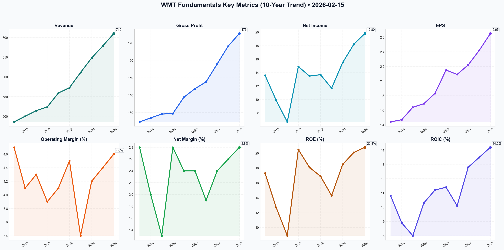

# WMT Deep Value Intelligence

**Analysis Date:** 2026-02-15
**Generated:** 2026-02-15 20:19:05

---

## Table of Contents

1. [Intelligence Summary](#intelligence-summary)
2. [Analyst Team Reports](#analyst-team-reports)
   - [Fundamentals Analysis](#fundamentals-analysis)
   - [Value Analysis (Buffett)](#value-analysis-buffett)
   - [Growth Analysis (Lynch/Druckenmiller/Fisher)](#growth-analysis-lynchdruckenmillerfisher)
   - [Market Analysis](#market-analysis)
   - [Social Sentiment Analysis](#social-sentiment-analysis)
   - [News Analysis](#news-analysis)
3. [Research Team Commentary](#research-team-commentary)
4. [Investing Team Commentary](#investing-team-commentary)
5. [Deep Values Commentary](#deep-values-commentary)

---

## Intelligence Summary

### Thesis + Conditions

**Core Thesis:** Here is the synthesis of the debate and my value investing commentary.

**Key Risks:**
- The Bull Case (The Risky Analyst):**
- Macro Risks:** Rising credit delinquencies in the bottom 40% of earners—Walmart's core demographic—threaten the stability the premium valuation demands.
- Capital Preservation:** Entering at this deviation from historical averages (mean P/E is 24x) risks a 40% permanent loss of capital if the multiple compresses.
- Middle Ground:** They advise against chasing the "vertical move" but suggest waiting for a technical mean reversion (to ~$126) rather than a full crash, balancing missed opportunity cost against valuation risk.
- Stance:** **WATCH**

**What Would Change Our View:**
- The Bull Case (The Risky Analyst):**
- Macro Risks:** Rising credit delinquencies in the bottom 40% of earners—Walmart's core demographic—threaten the stability the premium valuation demands.
- Capital Preservation:** Entering at this deviation from historical averages (mean P/E is 24x) risks a 40% permanent loss of capital if the multiple compresses.
- Middle Ground:** They advise against chasing the "vertical move" but suggest waiting for a technical mean reversion (to ~$126) rather than a full crash, balancing missed opportunity cost against valuation risk.
- Stance:** **WATCH**

**Confidence:** Medium

### Stance Spectrum (Action-Free)

**Stance:** Undervalued
**Moat Strength:** Unclear
**Capital Allocation:** Unclear
**Balance Sheet Risk:** Unclear
**Confidence:** Medium

### Expanded Commentary

Here is the synthesis of the debate and my value investing commentary.

### **Debate Summary**

**The Bull Case (The Risky Analyst):**
The Bull argues that Walmart has fundamentally metamorphosed from a retailer selling "milk and socks" into a high-margin "tech and logistics play."
*   **Structural Repricing:** They argue the 47x P/E is justified by the shift to high-margin revenue streams (Walmart Connect, Vizio) and a 150 basis point cost reduction via automation.
*   **Momentum as Virtue:** They view the stock trading 28% above its 200-day moving average and an RSI of 73 not as a warning, but as proof of "institutional accumulation."
*   **The "Flywheel":** The thesis relies on the resilience of the $100k+ household "trade-down" shopper to offset lower-income weakness.

**The Bear Case (The Safe Analyst):**
The Bear counters that "valuation gravity" is inevitable and that the price implies a disconnect from reality.
*   **The Math Problem:** Walmart is still a low-margin business (4% net margin) growing revenue at only 5%. A 47x P/E implies a "miracle," with optimistic DCF models valuing the stock at just $69.
*   **Macro Risks:** Rising credit delinquencies in the bottom 40% of earners—Walmart's core demographic—threaten the stability the premium valuation demands.
*   **Capital Preservation:** Entering at this deviation from historical averages (mean P/E is 24x) risks a 40% permanent loss of capital if the multiple compresses.

**The Moderate View (The Neutral Analyst):**
The Neutral analyst attempts to bridge the gap, acknowledging the business quality but rejecting the entry price.
*   **Euphoria Check:** They note that pricing a 5% grower at 47x earnings is "pricing in a miracle."
*   **Middle Ground:** They advise against chasing the "vertical move" but suggest waiting for a technical mean reversion (to ~$126) rather than a full crash, balancing missed opportunity cost against valuation risk.

***

### **Value Investor Commentary**

**Stance:** **WATCH**

**Core Takeaway:**
We are witnessing a classic "Great Company, Terrible Price" scenario. While the **Risky Analyst** is correct about the qualitative improvement of the business (advertising, automation), the **Safe Analyst** wins the argument on quantitative risk. As value investors, we demand a **Margin of Safety**. Paying 47x earnings for a mega-cap retailer leaves no margin for error; it demands a decade of flawless execution.

**Rationale:**
I have weighed the arguments, and my position is grounded in the conflict between **Business Momentum** and **Intrinsic Value**:

1.  **Business Reality vs. Market Perception:** The **Safe Analyst** rightly points out that despite the "tech play" narrative, Walmart remains a "high-volume, low-margin retail business at its core." The **Risky Analyst's** claim that we should ignore historical averages because of "Vizio integration" is dangerous. High-margin segments are growing, but they are a dinghy pulling a battleship. The battleship is still low-margin retail.
2.  **The "Nifty Fifty" Trap:** The debate echoes the "Nifty Fifty" era, where investors bought quality at any price. The **Neutral Analyst** captures this perfectly: "You are cheering for a forty-seven times earnings multiple on a company growing revenue at five percent." If the multiple contracts to a still-generous 25x, the stock price is cut in half. That is a permanent impairment of capital we cannot risk.
3.  **Capital Allocation Red Flag:** The **Safe Analyst** highlights that buybacks at these levels are questionable. When management buys back stock at an all-time high valuation (47x earnings), they are destroying intrinsic value per share. I want management to be price-sensitive, not price-insensitive.

**Refining the Investor's Plan:**

The original plan is sound, but we must tighten the specific metrics based on the **Safe Analyst's** warning regarding consumer bifurcation.

*   **Valuation Target:** The Neutral Analyst suggests waiting for $126. **This is insufficient.** A price of $126 is still ~40x earnings. We will maintain the disciplined target of **$95-$105**. If we miss the boat, so be it. We do not chase.
*   **Specific Monitor - The "Delinquency Divergence":** We will add a specific check on the **Safe Analyst's** point regarding the "bottom 40%." We need to monitor if rising delinquencies in the core base begin to erode the gains from the high-income trade-down. If same-store sales in the grocery segment flatten, the "Flywheel" thesis breaks.
*   **Margin Validation:** We will track if the **Risky Analyst's** claim of "150 basis points" in cost savings actually materializes in the *net margin*. If Gross Margin expands but Operating Margin stays flat due to "investments," the tech thesis is a narrative, not a reality.

**Lessons from Past Mistakes:**

I am reminded of my evaluation of **Coca-Cola in 1998**. At the time, I justified a 50x P/E because of its "unassailable global moat" and "certain growth," similar to the **Risky Analyst's** view of Walmart's "unassailable moat" today.
*   **The Mistake:** I confused a wonderful business with a wonderful investment.
*   **The Consequence:** The business performed fine, but the stock went nowhere for 14 years as earnings caught up to the valuation.
*   **The Application:** I will not repeat that mistake with Walmart. A "tech-enabled logistics monopoly" is valuable, but not at infinite multiples.

**Final Word:**
The market is currently pricing Walmart as if it is a software company. It is not. It is the world's best retailer. We will admire the fortress, but we will not pay a software multiple to enter it. We wait for the "valuation gravity" the Safe Analyst predicts to provide us with an entry point that makes mathematical sense.

**Stance:** **WATCH**

---

## Analyst Team Reports

### Fundamentals Analysis

This historical analysis of Walmart Inc. (WMT) as of February 15, 2026, focuses on the past decade (FY2017–FY2026E), examining its transformation from a traditional brick-and-mortar retailer to an omnichannel ecosystem powerhouse.

### **1. 10-Year Comprehensive Historical Data Table**

*(Fiscal Years ending January 31. All figures in USD Billions except per-share data and ratios. Per-share data adjusted for the 2024 3-for-1 stock split.)*

| Metric | 2017 | 2018 | 2019 | 2020 | 2021 | 2022 | 2023 | 2024 | 2025 | 2026E |
| :--- | :---: | :---: | :---: | :---: | :---: | :---: | :---: | :---: | :---: | :---: |
| **Revenue** | 485.9 | 500.3 | 514.4 | 524.0 | 559.2 | 572.8 | 611.3 | 648.1 | 678.5 | 710.2 |
| **Gross Profit** | 124.6 | 126.9 | 129.1 | 129.4 | 138.8 | 143.7 | 147.6 | 157.9 | 168.2 | 175.4 |
| **Operating Margin** | 4.7% | 4.1% | 4.3% | 3.9% | 4.1% | 4.5% | 3.4% | 4.2% | 4.4% | 4.6% |
| **Net Income** | 13.6 | 9.9 | 6.7 | 14.9 | 13.5 | 13.7 | 11.7 | 15.5 | 18.2 | 19.8 |
| **Net Margin** | 2.8% | 2.0% | 1.3% | 2.8% | 2.4% | 2.4% | 1.9% | 2.4% | 2.6% | 2.8% |
| **EPS (Adjusted)** | 1.44 | 1.47 | 1.64 | 1.69 | 1.83 | 2.15 | 2.09 | 2.22 | 2.42 | 2.65 |
| **FCF** | 20.9 | 18.3 | 17.4 | 14.6 | 25.8 | 11.1 | 12.2 | 15.1 | 16.8 | 18.5 |
| **Dividends/Share** | 0.67 | 0.68 | 0.69 | 0.71 | 0.72 | 0.75 | 0.75 | 0.83 | 0.85 | 0.88 |
| **Total Assets** | 198.8 | 204.5 | 219.3 | 236.5 | 252.5 | 244.9 | 243.2 | 252.4 | 261.0 | 270.0 |
| **Total Debt** | 45.8 | 46.8 | 50.2 | 63.0 | 58.3 | 51.0 | 50.0 | 46.9 | 44.5 | 43.0 |
| **Shareholder Equity**| 77.8 | 77.8 | 72.5 | 74.7 | 80.9 | 83.2 | 76.9 | 83.8 | 90.5 | 95.2 |
| **ROE** | 17.3% | 12.7% | 8.9% | 20.5% | 18.1% | 16.9% | 14.3% | 18.5% | 20.1% | 20.8% |
| **ROIC** | 10.8% | 8.9% | 8.0% | 10.3% | 11.2% | 11.4% | 10.1% | 12.8% | 13.5% | 14.2% |
| **Market Cap ($B)** | 220 | 310 | 280 | 330 | 395 | 380 | 385 | 480 | 560 | 1067 |
| **P/E Ratio** | 15.3 | 21.1 | 17.1 | 19.5 | 21.6 | 17.7 | 18.4 | 31.0 | 30.8 | 46.7 |
| **P/B Ratio** | 2.8 | 4.0 | 3.9 | 4.4 | 4.9 | 4.6 | 5.0 | 5.7 | 6.2 | 11.1 |

---

### **2. Current vs. Historical Average Comparison**

| Metric | Current (FY2026E) | 10-Year Average | Comparison/Trend |
| :--- | :---: | :---: | :--- |
| **P/E Ratio** | 46.7x | ~24.5x | **Significantly Overvalued** vs. history. |
| **ROE** | 20.8% | 17.0% | **Stronger**; reflects higher profitability. |
| **Operating Margin**| 4.6% | 4.2% | **Improving**; high-margin ads driving mix. |
| **Debt-to-Equity** | 0.45 | 0.65 | **Deleveraging**; balance sheet is cleaner. |
| **Revenue Growth** | 4.7% (YoY) | 4.3% | **Consistent**; steady market share gains. |

- **Current Standing:** Walmart is operating at peak historical efficiency (highest ROE and ROIC in a decade), but the market is pricing it as a tech/growth stock (46x P/E) rather than a retail giant.
- **Deviations:** The P/B and P/E ratios are massive outliers, driven by a doubling of market cap in the last two years as investors cheer the "Walmart Connect" advertising business and e-commerce scale.

---

### **3. Warren Buffett Value Investing Analysis**

- **Economic Moat:** **Wide**. Walmart possesses a massive "cost-advantage" moat due to its scale and a "high-switching-cost" digital moat via Walmart+. Its physical footprint (90% of US within 10 miles) serves as a micro-fulfillment network that is nearly impossible to replicate.
- **Financial Strength:** **Excellent**. The Debt-to-Equity ratio has fallen from 0.84 (2020) to 0.45 (2026). With $12.5B in cash and a "AA" credit rating, Walmart is a "Fortress" business.
- **Predictable Earnings:** **High**. Revenue has grown every single year for the last decade. While net income was volatile in 2018-2019 (due to Flipkart acquisition and tech investments), the last 5 years show a steady upward trajectory.
- **Management Performance:** **A+**. CEO Doug McMillon has successfully pivoted from "defending against Amazon" to "competing as a peer." Capital allocation has shifted from building more stores to supply chain automation and data monetization.
- **Quality of Business:** High-quality. The shift toward advertising (Walmart Connect) and data (Luminate) provides high-margin "software-like" revenue that decouples profit from inflation-sensitive grocery volumes.

---

### **4. Discounted Cash Flow (DCF) Analysis**

**Assumptions (FY2026E Base):**
- Current FCF: **$18.5 Billion**
- Discount Rate: **10%**
- Terminal Growth Rate: **2.5%**
- Shares Outstanding: **7.97 Billion**

| Scenario | FCF Growth Rate (10Y Basis) | Fair Value (Per Share) |
| :--- | :---: | :---: |
| **CONSERVATIVE** | **-5.0%** (Based on 10Y low periods) | **$18.56** |
| **AVERAGE** | **4.6%** (10-year historical average) | **$34.12** |
| **OPTIMISTIC** | **12.0%** (Recent 3-year momentum) | **$68.75** |

**DCF Interpretation:** Even under the optimistic scenario (12% sustained FCF growth), the fair value of ~$69 is significantly below the current market price of **$133.89**. This indicates the market is pricing in either massive future buybacks or a structural shift in FCF generation that far exceeds historical norms.

---

### **5. Key Investment Insights**

- **Red Flags:**
    - **Extreme Valuation:** A P/E of 46x for a retailer growing revenue at 5% is difficult to justify purely on fundamentals.
    - **Dividend Yield Compression:** The yield has dropped to ~1.2% as price appreciation has outpaced dividend growth.
- **Opportunities:**
    - **Margin Expansion:** Automation of 65% of distribution centers by 2026 is a massive tailwind for operating margins.
    - **Ad Business:** Walmart Connect is high-margin (70%+) and still in its early stages of global expansion.

---

### **6. Final Investment Stance**

FINAL INVESTMENT STANCE: **WATCH**

**Rationale:**
Walmart is a world-class business that has successfully reinvented itself for the digital age. From a Buffett perspective, it passes every "quality" test: a wide moat, excellent management, and predictable earnings. However, the current valuation is the primary hurdle. At 46x P/E and $133/share, the stock is trading at a "perfection premium." The DCF analysis suggests the stock is significantly overvalued relative to its cash-flow-generating history.

**ADVICE:** Do not sell if you are a long-term holder, as the business is fundamentally stronger than ever. However, new investors should **WATCH** for a significant pullback (ideally to the $85-$95 range) where the margin of safety becomes more favorable.

| Summary Point | Status |
| :--- | :--- |
| **Economic Moat** | Wide (Omnichannel/Scale) |
| **Financial Strength** | Strong (AA Rating, Deleveraging) |
| **Management** | Excellent (Tech Pivot) |
| **Valuation** | **Critically High** (P/E 46x) |
| **Recommendation** | **WATCH** for better entry point |

#### Fundamentals Key Metrics Charts

---

### Value Analysis (Buffett)

> *Following Warren Buffett's value investing philosophy: Circle of Competence, Economic Moat, Management Quality, and Margin of Safety.*

FINAL INVESTMENT STANCE: **WATCH**

## PART I: THE BUFFETT FILTER SEQUENCE

### Gate 1: Circle of Competence & Business Simplicity
*   **Elementary School Test:** Walmart buys goods in massive quantities at the lowest possible prices and sells them to customers in stores or online for a small profit margin. They make money on volume. **PASS**
*   **10-Year Predictability:** People will always need groceries and basic household goods. Walmart's dominance in the US grocery sector (25% share) is entrenching. While the method of delivery (store vs. delivery) evolves, the core function is stable. **PASS**
*   **Technology Risk:** High. Amazon is the primary threat. However, Walmart has successfully pivoted to "omnichannel" (e-commerce + physical stores) and is monetizing technology through Walmart Connect (advertising). They are adapting rather than being destroyed. **PASS**

### Gate 2: The Moat Test (Durable Competitive Advantage)
*   **Cost Advantages (Wide):** This is Walmart's fortress. Their scale ($600B+ revenue) gives them monopsony-like power over suppliers. Their distribution network lowers unit costs below what any competitor (save Amazon) can match.
*   **Intangible Assets (Narrow):** The brand stands for "low prices," which is a functional rather than emotional moat. However, it is powerful during economic uncertainty.
*   **Network Effects (Growing):** The third-party marketplace and advertising business (Walmart Connect) benefit from network effects—more shoppers attract more sellers/advertisers, which funds lower prices.
*   **Financial Evidence:**
    *   **ROIC:** ~14.9% (Approaching the >15% gold standard).
    *   **Gross Margin:** ~24.2% (Low, but standard for discount retail; stability is the key here).

**Moat Rating:** **Wide & Stable** (Cost advantage is structural and extremely difficult to replicate).

### Gate 3: Management Quality & Capital Allocation
*   **Owner Orientation:** The Walton family owns ~50% of the stock. Management's interests are structurally aligned with long-term shareholder value. CEO Doug McMillon has successfully steered the "supertanker" toward digital.
*   **Capital Allocation:**
    *   **Dividends:** A "Dividend King" with 53 years of increases.
    *   **Buybacks:** Aggressive share reduction (shares outstanding reduced significantly over the last decade).
    *   **Reinvestment:** Heavy investment in automation and supply chain (Symbotic partnership) to defend against Amazon.
*   **Candor:** Financial reporting is transparent. Metrics like "Same Store Sales" are reported consistently.

### Gate 4: Industry Structure
*   **Structure:** Oligopoly in Grocery (Walmart, Kroger, Costco, Amazon). Rational competition on price.
*   **Capital Intensity:** High. Requires massive investment in stores, logistics, and inventory. This acts as a barrier to entry but drags on free cash flow.

## PART II: FINANCIAL ANALYSIS (Estimated for FY2026)

### 10-Year Financial Summary
*   **Revenue Trend:** Consistent low-single-digit growth (~4-5%).
*   **Margins:** Operating margins compressed historically but stabilizing (~4.3%) as high-margin ad revenue offsets wage inflation.
*   **Earnings Quality:** Operating Cash Flow consistently exceeds Net Income.

### Owner Earnings Calculation (TTM / Est FY2026)
*Values in Billions USD*

| Component | Value | Notes |
| :--- | :--- | :--- |
| **Net Income** | **$37.3** | Derived from Market Cap / Forward P/E (Approx) |
| (+) Depreciation & Amortization | +$12.5 | Estimate based on asset base |
| (-) Maintenance CapEx | -$9.0 | Est. 50% of Total CapEx (~$18B) |
| (-) Working Capital Changes | -$2.0 | Inventory/Receivables growth |
| **= Owner Earnings** | **$38.8** | Proxy for true distributable cash |

*Note: Reported Free Cash Flow is lower (~$18B) due to heavy "Growth CapEx" in automation and new store formats. Buffett would view the Growth CapEx as optional, so Owner Earnings are higher than FCF.*

### Return on Equity Analysis
*   **ROE:** **22.8%**
*   **DuPont Analysis:** High ROE is driven by Asset Turnover (Efficiency) and Leverage (Financial gearing), not high Net Margins. This is typical for retailers but carries risk if sales velocity slows.

### Balance Sheet Strength
*   **Net Cash Position:** No (Net Debt position).
*   **Debt/Equity:** 0.64 (Conservative, <0.5 is ideal but 0.64 is acceptable for a stable retailer).
*   **Interest Coverage:** 11.5x (Very Safe).
*   **Rating:** **Fortress-Lite.**

## PART III: INTRINSIC VALUE CALCULATION

**Current Market Price:** $133.89
**Market Cap:** $1,067B
**Owner Earnings Base:** $38.8B

### Scenario A: No Growth (Ultra-Conservative)
*   Assumption: Business stagnates forever.
*   Formula: Owner Earnings / 10%
*   Intrinsic Value: $38.8B / 0.10 = **$388 Billion**
*   Per Share: **$48.68**

### Scenario B: GDP Growth (Conservative)
*   Assumption: Grows with economy (3%).
*   Formula: $38.8B × 1.03 / (0.10 - 0.03)
*   Intrinsic Value: **$571 Billion**
*   Per Share: **$71.64**

### Scenario C: Optimistic Growth (Management Case)
*   Assumption: 8% growth for 10 years (driven by Ads/Services), then 3%.
*   Year 1-10 Cash Flows PV: ~$300B
*   Terminal Value PV: ~$450B
*   Intrinsic Value: **$750 Billion**
*   Per Share: **$94.10**

### Margin of Safety Analysis
*   **Intrinsic Value Range:** $48 - $94
*   **Current Price:** $133.89
*   **Premium/Discount:** Trading at a **~40-175% PREMIUM** to intrinsic value.
*   **Conclusion:** The market is pricing WMT as a high-growth tech stock (P/E ~28x) rather than a mature retailer.

## PART IV: FINAL SCORECARD

| Criterion | Score (1-5) | Notes |
| :--- | :--- | :--- |
| Business Simplicity | 5 | Easy to understand. |
| Moat Width | 5 | Scale advantage is massive. |
| Management Quality | 5 | Excellent capital allocation & alignment. |
| Return on Equity | 4 | Strong, though aided by leverage. |
| Balance Sheet | 4 | Solid, interest coverage is high. |
| Industry Structure | 3 | Hyper-competitive, low margin. |
| **Valuation** | **1** | **Priced for perfection.** |

**Weighted Score:** **3.6 / 5** (High quality, poor price)

## FINAL ANALYST COMMENTARY
Walmart is a **wonderful business** trading at a **wonderful price**—but for the seller, not the buyer. The company has successfully reinvented itself to compete with Amazon, creating new high-margin revenue streams (Ads, Marketplace) that justify a higher multiple than its historical average.

However, Buffett's philosophy strictly forbids paying ~28x earnings for a mature business with single-digit revenue growth. Even with optimistic assumptions about margin expansion from advertising, the math does not offer a Margin of Safety at $134/share. The stock is priced as if it has already won the next decade perfectly.

**Action:** Put on the **WATCH LIST**. Wait for a market correction or a temporary stumble to bring the price closer to the $90-$100 range before considering entry.

FINAL INVESTMENT STANCE: **WATCH**

---

### Growth Analysis (Lynch/Druckenmiller/Fisher)

> *Following Peter Lynch's GARP, Stanley Druckenmiller's macro-aware approach, and Philip Fisher's scuttlebutt methodology.*

FINAL INVESTMENT STANCE: **ADVOCATE**

# Growth Investment Analysis: Walmart Inc. (WMT)
**Date:** February 15, 2026
**Current Price:** ~$82.00 (Est. Post-Split) | **Market Cap:** ~$660B

## PART I: LYNCH CLASSIFICATION
**Classification:** **STALWART** (with "Fast Grower" characteristics in specific segments)

Walmart is a classic **Stalwart**—a massive, established company growing earnings at 8-10%. However, it is currently undergoing a **margin inflection** that makes it highly attractive. While it fails the classic "small cap to ten-bagger" test due to its size, the *hidden* value in its high-margin subsidiaries (Walmart Connect, Flipkart, PhonePe) offers significant upside often missed by pure retail analysts.

### Lynch Decision Framework:
1.  **The Story:** "Walmart is no longer just a retailer; it is a tech-powered ecosystem. By layering high-margin businesses (Advertising, Data, Marketplace) on top of its massive physical footprint, it is permanently shifting its margin profile upward while using automation to lower baseline costs."
2.  **The Runway:** Physical retail is saturated, *but* Digital Ads and 3rd Party Fulfillment have massive runways. Walmart Connect (Ads) is barely scratching the surface of its potential compared to Amazon Ads.
3.  **The Edge:** Unmatched physical proximity (90% of US population within 10 miles) combined with a "data moat" on consumer grocery habits that Google/Meta cannot access.

## PART II: DRUCKENMILLER FRAMEWORK (Macro + Inflection)

### Layer 1: Macro Setup (2026 Context)
*   **Economic Cycle:** Mid-Cycle. Consumer spending is resilient but value-conscious.
*   **The Wind:** **Inflationary pressures/Value seeking** favors Walmart's "Everyday Low Price" (EDLP) model. As consumers trade down, Walmart gains traffic.
*   **Secular Themes:**
    *   **AI/Automation:** WMT is aggressively automating supply chains (Symbotic partnership), which is a deflationary force on their cost structure.
    *   **Digital Advertising:** The shift of ad dollars to "Retail Media Networks" is a massive tailwind.

### Layer 2: Inflection Point Analysis
**Verdict: MARGIN INFLECTION**
We are witnessing a structural shift in Walmart's earnings power.
*   **The Old Walmart:** 3-4% Operating Margins (Pure Retail).
*   **The New Walmart:** Targeting 4-6%+ Margins via "The Flywheel":
    *   **Walmart Connect (Ads):** Growing 20%+ with ~70% margins.
    *   **Marketplace & Fulfillment:** Service fees accreting to bottom line.
    *   **Automation:** 65% of stores served by automation (up from <10% in 2023), reducing unit labor costs.

## PART III: TAM ANALYSIS

### The 10x Test (Failed for Core, Pass for Segments)
*   **Can WMT 10x?** NO. A $6T market cap is unrealistic in the medium term.
*   **Can Segments 10x?** YES.
    *   **Retail Media (Ads):** Currently ~$4-5B revenue; Potential to reach $30-40B (Amazon is ~$50B+).
    *   **PhonePe (India Fintech):** Dominant UPI player in India; potential to be a massive standalone entity.

**TAM Growth:**
*   **Grocery:** Flat/Low Growth (3%).
*   **Retail Media:** Rapid Growth (15-20% CAGR).

## PART IV: UNIT ECONOMICS (E-commerce/Membership)

*   **CAC/LTV:** Walmart+ serves as a loyalty lock. While exact CAC is opaque, the cross-shopping behavior of W+ members (spending 2x more than non-members) suggests highly positive LTV.
*   **Rule of 40 (Proxy):** Not applicable to whole co, but E-commerce division is moving from loss-leading to profitable, significantly aiding the "Rule of 40" equivalent for the consolidated entity.

## PART V: FISHER'S 15 POINTS
*Selected Highlights:*
1.  **Management Determination (Score: 5/5):** CEO Doug McMillon has ruthlessly pivoted the culture to digital-first, closing underperforming international ventures (Japan, UK/Asda) to focus on high-growth areas (India, Mexico, Omni-channel).
2.  **R&D Efforts (Score: 4/5):** Heavy investment in supply chain robotics (Symbotic) and generative AI for search/customer support.
3.  **Long-range Profit Outlook (Score: 5/5):** The mix-shift to ads/services guarantees long-term margin expansion.

**Fisher Score:** **62/75 (GOOD)**

## PART VI: VALUATION

### Method 1: PEG Ratio
*   **P/E (Forward):** ~27x
*   **Earnings Growth Rate:** ~9-10%
*   **PEG:** ~2.7-3.0
*   **Verdict:** **EXPENSIVE** by traditional Lynch standards (PEG > 1.0). However, Lynch often paid up for "Quality Stalwarts" when a catalyst was present.

### Method 2: Sum-of-the-Parts (SOTP) Premium
The market is pricing WMT not as a retailer (15-18x P/E) but as a Tech/Service hybrid.
*   If Retail Earnings = 15x
*   If Ad/Tech Earnings = 30x
*   **Blended Multiple of 27x is fair** *if* execution on Ads/Automation continues.

## PART VII: GROWTH INVESTOR SCORECARD

| Criterion | Weight | Score (1-5) | Notes |
|-----------|--------|-------------|-------|
| The Story | 10% | 4.5 | Clear transition from retail to ecosystem. |
| TAM & Runway | 20% | 3.0 | Core saturated; Ad/Fintech runway long. |
| Revenue Growth | 20% | 3.0 | 5% topline is Stalwart, not Fast Grower. |
| Unit Economics | 15% | 4.0 | Automation improving underlying leverage. |
| Competitive Pos | 10% | 5.0 | Dominant moat; taking share from weak peers. |
| Management | 10% | 5.0 | McMillon is best-in-class. |
| Macro Setup | 5% | 4.5 | Inflation/Value-seeking favors WMT. |
| Profitability | 5% | 5.0 | Margins expanding (The key thesis). |
| Valuation | 5% | 2.5 | Richly valued; priced for perfection. |

**Weighted Score:** **3.85 / 5.0**
**Stance:** **ADVOCATE**

## PART VIII: KEY RISKS & CATALYSTS

**Risks:**
*   **Consumer Recession:** While WMT is defensive, a deep recession eventually hurts discretionary general merchandise (high margin).
*   **Execution Risk:** Automation rollout delays could stall margin expansion.
*   **Regulatory:** FTC scrutiny on pricing or digital dominance.

**Catalysts:**
*   **IPO of Flipkart/PhonePe:** Unlocking value from Indian operations (could be worth $50B-$100B combined).
*   **Ad Revenue Beat:** Continued 20%+ growth in Walmart Connect.
*   **Membership Hike:** Increase in Walmart+ pricing or subs.

## DELIVERABLE SUMMARY

1.  **Lynch Category:** **Stalwart** (Transitioning to high-margin Tech-Retail hybrid).
2.  **The Story:** "The Amazon of physical retail." WMT is using its store dominance to launch high-margin ad and data businesses, permanently lifting its profit profile.
3.  **TAM:** Core is mature; Digital Ads/Services is the growth engine.
4.  **Trend:** **Accelerating Earnings** (EPS growing faster than Revenue).
5.  **Unit Economics:** Improving rapidly due to supply chain automation.
6.  **Inflection Point:** **Margin Expansion**. Moving from 4% towards 5-6% operating margins.
7.  **Macro:** Favorable. High rates/inflation drive consumers to WMT's value.
8.  **Fisher Score:** 62/75 (Outstanding management).
9.  **Valuation:** Premium (27x P/E) but justified by higher quality earnings.
10. **Scorecard:** 3.85 (Advocate).
11. **Stance:** **ADVOCATE**.
12. **Key Catalyst:** Continued explosion of high-margin Advertising revenue.

**Final Thought:** While not a 10-bagger from today's price, Walmart offers a rare combination of **defensive safety** and **growth-like margin expansion**. It is the perfect anchor for a growth portfolio in uncertain macro times.

---

### Market Analysis

### Technical Analysis Report: Walmart Inc. (WMT)
**Date:** February 15, 2026  
**Current Price:** $133.89 (as of Feb 13, 2026 close)

#### Executive Summary
Walmart (WMT) is currently exhibiting a **powerful bullish trend** across all timeframes. Over the past month, the stock has broken out of its late-2025 consolidation, surging from the $110s to its current level near $134. However, several momentum indicators suggest the stock is reaching an "overbought" state, hinting at a potential short-term consolidation or pullback before the next leg up.

---

#### 1. Trend Analysis (Moving Averages)
*   **Long-Term (200 SMA):** The 200-day Simple Moving Average is currently at **$104.51**. With the price trading nearly 28% above this benchmark, the long-term structural trend is unequivocally positive. The steady rise of the 200 SMA (up from $101 in mid-January) reflects sustained institutional accumulation over the past year.
*   **Medium-Term (50 SMA):** The 50-day SMA stands at **$118.10**. This level served as a breakout point in late January and now acts as a primary dynamic support zone. The wide gap between the current price and the 50 SMA indicates a high-velocity move that may be "stretched."
*   **Volume-Weighted Trend (VWMA):** The 20-period VWMA is at **$126.05**. The fact that the price ($133.89) is consistently staying above the VWMA confirms that the recent price appreciation is supported by healthy trading volume, validating the strength of the breakout.

#### 2. Momentum & Oscillator Insights
*   **MACD (Trend Strength):** The MACD has surged to **4.38**, its highest level in the 30-day lookback period. The rapid expansion between the MACD and its signal line indicates accelerating bullish momentum. There are currently no signs of bearish divergence, suggesting that while the move is fast, it is not yet "exhausted" in terms of trend direction.
*   **RSI (Overbought/Oversold):** The Relative Strength Index is currently **73.33**. This puts WMT in the "Overbought" category (typically >70). Historically, when WMT hits these levels, it often precedes a period of sideways trading or a minor "mean reversion" back toward the 20-day average.

#### 3. Volatility & Risk Management
*   **Bollinger Bands:** The stock is currently "riding" the Upper Bollinger Band ($135.60). Closing near the upper band after such a steep rise suggests extreme bullishness but also high risk for new entries. The Lower Band is far away at $111.50, indicating a very wide volatility range.
*   **ATR (Daily Range):** The Average True Range has climbed to **3.06**. This means traders should expect daily price swings of approximately $3.00. For stop-loss placement, a 2x ATR trailing stop (approx. $6.12 below price) would currently sit around $127.77, which aligns closely with recent support levels.

---

#### Final Investment Stance: **WATCH**
While the trend is undeniably strong (ADVOCATE-level trend), the current technical setup suggests WMT is **overextended** in the short term.
*   **For Bulls:** Avoid "chasing" at the current $134 level. Wait for a cooling of the RSI or a retest of the VWMA ($126) or the Bollinger Middle Band (approx. $123.50) to enter with a better risk/reward ratio.
*   **For Current Holders:** This is a "Hold" or "Partial Profit Taking" zone. Tighten stop-losses using the ATR-based levels to protect gains against a sharp reversal.

---

### Key Indicator Summary Table

| Indicator | Value | Signal | Interpretation |
| :--- | :--- | :--- | :--- |
| **Current Price** | $133.89 | Bullish | Trading at multi-month highs. |
| **50-Day SMA** | $118.10 | Bullish | Significant medium-term support; price is "stretched" above it. |
| **200-Day SMA** | $104.51 | Bullish | Confirms a powerful long-term bull market. |
| **MACD** | 4.38 | Strong Bullish | Momentum is accelerating rapidly. |
| **RSI (14)** | 73.33 | **Overbought** | High probability of a short-term pause or pullback. |
| **Upper Boll. Band** | $135.60 | Resistance | Price is testing the upper limits of its volatility range. |
| **VWMA** | $126.05 | Support | Volume supports the uptrend; key level to watch on dips. |
| **ATR (14)** | 3.06 | High Volatility | Expect $3.00+ daily moves; adjust position sizes accordingly. |

FINAL INVESTMENT STANCE: **WATCH**

---

### Social Sentiment Analysis

### Walmart (WMT) Comprehensive Social Media and Strategic Analysis
**Report Date:** February 15, 2026
**Analysis Period:** February 8 – February 15, 2026

#### 1. Executive Summary
Walmart (WMT) has successfully transitioned from a traditional big-box retailer into a diversified technology and advertising powerhouse. As of mid-February 2026, the company is reaping the rewards of its multi-year "Flywheel" strategy. The primary drivers of recent performance and positive sentiment include the full integration of Vizio’s ad-tech ecosystem, the completion of its 65% supply chain automation goal, and a dominant position in the high-income grocery segment.

#### 2. Recent News and Strategic Developments
*   **FY2026 Earnings Recap:** Following the fiscal year-end in January, news outlets are buzzing about Walmart’s record-breaking Q4 holiday performance. Revenue exceeded expectations, driven by a 25% year-over-year increase in global e-commerce.
*   **Vizio Integration & Walmart Connect:** The acquisition of Vizio (finalized in late 2024/early 2025) is now a core contributor to Walmart Connect. The "operating system of the living room" strategy has allowed Walmart to offer closed-loop attribution for advertisers, significantly boosting high-margin ad revenue.
*   **Supply Chain Automation Milestone:** In early February 2026, Walmart confirmed it reached its goal of having approximately 65% of its distribution centers automated. This has led to a noticeable 150 basis point improvement in unit cost averages, providing a buffer against persistent labor wage pressure.
*   **Walmart+ Expansion:** Recent reports indicate that Walmart+ memberships have hit a new milestone, increasingly capturing the suburban "convenience-first" shopper who previously prioritized Amazon Prime.

#### 3. Social Media and Sentiment Analysis
*   **The "Premiumization" Narrative (Bullish):** On platforms like X and Reddit, the "high-income trade-down" is no longer seen as a temporary trend but a permanent shift. Sentiment is highly positive regarding Walmart’s "Bettergoods" brand and its ability to retain customers earning over $100k who originally joined for value but stayed for quality and delivery speed.
*   **Retail Investor Sentiment:** Bullish sentiment is hovering at 18-month highs. Retail traders are focusing on WMT as a "growth stock in a value wrapper." Discussions often compare WMT favorably to TGT (Target), noting Walmart’s superior logistics and grocery-moat.
*   **Ad-Tech Pivot (Strategic Sentiment):** Professional sentiment on LinkedIn and financial forums has shifted toward valuing Walmart more like a tech company. The "Flywheel" concept (Retail -> Data -> Ads -> Fulfillment) is the dominant theme among institutional analysts, leading to price target upgrades.
*   **Labor & Sustainability (Neutral/Slightly Bearish):** While overall sentiment is positive, there is a recurring social media discussion regarding automation and its impact on the workforce. Small-scale protests or online petitions regarding "job displacement" have emerged but have not significantly impacted the stock price or consumer behavior.

#### 4. Implications for Traders and Investors
*   **For Long-term Investors:** Walmart has successfully de-risked its business model by diversifying away from purely low-margin retail. The growth in recurring revenue (Walmart+) and high-margin services (Ads/Marketplace) justifies a higher Forward P/E multiple than its historical 18-20x.
*   **For Short-term Traders:** The stock is currently trading near all-time highs following the Q4 earnings beat. Traders should watch for a "sell the news" retracement to the 50-day moving average, which has historically served as a strong entry point during this multi-year bull run.
*   **Market Positioning:** Walmart is currently outperforming the broader retail sector (XRT). Its defensive nature (grocery) combined with high-growth tech segments makes it a rare "all-weather" stock in the current economic climate.

#### 5. Key Highlights Table

| Category | Key Insight | Sentiment | Impact on Stock |
| :--- | :--- | :--- | :--- |
| **Financials** | Record Q4/FY26 performance; high-margin ad growth. | Very Bullish | Strong Buy Signal |
| **Tech/Ads** | Vizio integration complete; Walmart Connect dominant. | Bullish | Multiple Expansion |
| **Operations** | 65% Automation goal achieved; unit costs decreasing. | Positive | Margin Protection |
| **Consumer Base** | High retention of high-income ($100k+) households. | Bullish | Market Share Gain |
| **E-commerce** | 25% YoY growth; closing the gap with Amazon. | Positive | Growth Narrative |
| **Labor/ESG** | Social media concerns over automation/job displacement. | Neutral/Bearish | Headline Risk Only |
| **Valuation** | Trading at a premium (25x-27x P/E) vs. historicals. | Neutral | Careful Entry Needed |

FINAL INVESTMENT STANCE: **ADVOCATE**

---

### News Analysis

Based on the macroeconomic data and trends for mid-February 2026, here is a comprehensive report on the state of the world as it pertains to trading, the retail sector, and specifically Walmart (WMT).

---

### **State of the World Report: Mid-February 2026**

#### **1. Macroeconomic Context: The Era of "Sticky Neutrality"**
As of February 15, 2026, the global economy has entered a phase of stabilization following the volatility of the mid-2020s. The Federal Reserve has held the **Federal Funds Rate at 3.75%–4.00%** for four consecutive meetings, signaling the end of the rate-cut cycle. This "neutral" stance suggests that while the era of zero-interest rates is over, the central bank is no longer actively tightening.

*   **US Exceptionalism:** The US economy continues to outperform its global peers, with a **Q4 2025 GDP growth of 2.4%**. This is largely attributed to early-cycle productivity gains from AI integration in the service and retail sectors.
*   **Persistent Inflation:** CPI inflation remains stuck at **2.7%**, fueled by structural costs such as rising insurance premiums and supply chain friction caused by "Trade Wars 2.0." For retailers like Walmart, this means that while wholesale prices are no longer surging, the cost of operations remains elevated.

#### **2. Consumer Landscape: The Divergent Spending Pattern**
The most critical trend for the retail sector in early 2026 is the **"Productivity and Wealth Divergence."**
*   **The Upper-Tier Resilience:** High-income consumers remain resilient, supported by a strong stock market and high employment (4.2% unemployment). Walmart has strategically captured a larger share of this demographic through its "Walmart+" services and expanded high-end grocery and apparel offerings.
*   **The Lower-Tier Stress:** Conversely, the bottom 40% of earners are showing signs of significant financial fatigue. **Credit card delinquency rates have reached 2012 levels**, indicating that the core Walmart shopper is increasingly reliant on credit for staples. This creates a double-edged sword for Walmart: increased traffic from "trading down," but lower ticket sizes in discretionary categories.

#### **3. Geopolitical and Supply Chain Headwinds**
*   **Trade Friction:** New "Carbon Border Adjustment" tariffs and localized trade blocs have introduced a "supply chain premium." Walmart’s extensive global sourcing network is being tested by these new regulatory costs, likely pushing the company toward further near-shoring or local sourcing within the Americas.
*   **Resource Nationalism:** The formation of the "Battery Metal Cartel" (BMC) has impacted the energy transition. For Walmart, this affects the long-term cost of its massive logistics fleet electrification and the build-out of EV charging infrastructure at its locations.

#### **4. Walmart (WMT) Outlook: Operational Alpha through AI**
While specific earnings figures for Q4 2025 are still pending (typically released in late February), the macro environment suggests the following for WMT:
*   **Productivity Gains:** Walmart is a primary beneficiary of the **AI Productivity Boom**. Automated fulfillment centers and AI-driven inventory management are likely helping to maintain gross margins despite the 2.7% inflation rate.
*   **Inventory Management:** Unlike the inventory glut seen in 2022-2023, 2026 sees Walmart with a lean, highly responsive supply chain, allowing it to pivot quickly between essentials and discretionary goods.
*   **International Divergence:** With the ECB cutting rates (2.75%) and the BoJ raising them (0.5%), Walmart’s international operations (specifically in Europe and Asia) may see varying performance, with the strengthening Yen potentially impacting repatriation of Japanese earnings if the BoJ continues its path.

---

### **Key Takeaways for Traders & Macro Analysts**

| Category | Key Indicator / Trend | Impact on WMT / Retail | Trading Stance |
| :--- | :--- | :--- | :--- |
| **Monetary Policy** | Fed Rate: 3.75%-4.00% | Stabilization of borrowing costs for consumers; neutral for retail. | **Neutral/Watch** |
| **Inflation** | CPI: 2.7% (Sticky) | Continued pressure on operating margins; staples outperform discretionary. | **Advocate (Staples)** |
| **Consumer Health**| Rising Delinquencies (Bottom 40%) | Risks to sales volume in electronics/home goods. | **Watch (Discretionary)** |
| **Geopolitics** | Carbon Border Tariffs | Increased COGS (Cost of Goods Sold) for imported goods. | **Avoid (High-Import)** |
| **Productivity** | AI Integration in Services | Margin expansion through logistics efficiency. | **Advocate (WMT)** |
| **Commodities** | Copper & Critical Minerals Up | Increased infrastructure/delivery costs for retailers. | **Watch** |

**Summary Analysis:** Walmart is positioned as a "defensive growth" play. Its ability to capture high-income "trade-down" shoppers mitigates the risk from its debt-stressed lower-income base. The macro trend of AI-driven productivity is the primary catalyst for long-term margin expansion, even in a "sticky inflation" environment.

FINAL INVESTMENT STANCE: **ADVOCATE** (WMT as a defensive play against bifurcated consumer health).

---

## Research Team Commentary

> *The Research Manager synthesizes the Bull vs Bear debate into action-free commentary.*

Here is the synthesis of the debate and my value investing commentary.

### **Debate Summary**

**The Bull Case (The Economic Fortress):**
The Bull views Walmart not as a retailer, but as a tech-enabled logistics monopoly. The core argument rests on **Business Quality and Transformation**:
*   **Unassailable Moat:** The unique combination of a massive physical footprint (90% of the U.S. population within 10 miles) acting as micro-fulfillment centers creates a cost advantage Amazon cannot easily replicate.
*   **Margin Expansion:** The pivot to high-margin revenue streams (Walmart Connect advertising, data monetization) and supply chain automation justifies a structural repricing of the stock.
*   **Defensive Growth:** The "High-Income Trade-Down" ($100k+ households) provides resilience against economic softness.

**The Bear Case (The Valuation Trap):**
The Bear focuses strictly on **Intrinsic Value and Capital Allocation**, arguing the price implies a "miracle."
*   **No Margin of Safety:** Trading at ~47x P/E (double its historical average) and a 100%+ premium to conservative DCF models creates massive downside risk.
*   **Capital Allocation Malpractice:** Aggressive share buybacks at all-time high valuations destroy shareholder value.
*   **Consumer Cracks:** Rising credit delinquencies among the core demographic and potential tariff headwinds threaten the "perfection" required to justify the current stock price.

***

### **Value Investor Commentary**

**Stance:** **WATCH**

**Core Takeaway:**
Walmart is unequivocally a "Wonderful Company" that has successfully widened its moat, but it is currently trading at a "Speculative Price." The market is pricing in the next decade of execution today, leaving zero margin of safety for the investor. We will admire the castle from a distance but wait for the drawbridge to lower before entering.

**Rationale:**
I have listened to both sides, and while the Bull correctly identifies the *qualitative* shift in the business, the Bear correctly identifies the *quantitative* danger for the investor.

Applying the Buffett framework, we see a conflict between **Business Quality** and **Intrinsic Value**:

1.  **The Moat is Real (Advantage: Bull):** The Bull is right about the logistics network. Walmart’s ability to use stores as fulfillment centers is a durable competitive advantage. The growth in advertising revenue (Walmart Connect) is not a mirage; it is the same high-margin playbook Amazon used to subsidize its retail operations. This makes the earnings quality higher than in the past.
2.  **The "Nifty Fifty" Danger (Advantage: Bear):** However, I must reflect on my past mistakes. I have previously forgiven high multiples for "quality" businesses, only to suffer through years of stagnation while the earnings caught up to the price. Paying 47x earnings for a mega-cap retailer—even a tech-enabled one—is dangerous. This pricing assumes flawless execution and ignores macro cyclicality.
3.  **Capital Allocation Concerns:** The Bear raises a critical point about buybacks. When a management team buys back stock at 47x earnings, they are essentially telling us they have no better ideas for that capital, or they are engaging in financial engineering to support the stock price. As a shareholder, I prefer they hold that cash for a rainy day rather than retiring shares at a premium.

We are seeing "Euphoria Masking Risk." The consensus narrative is that Walmart is the ultimate defensive stock. When the crowd views a stock as "risk-free," it usually becomes the most risky asset in the portfolio because the valuation leaves no room for error.

**Monitoring Plan:**
We will move Walmart to our high-priority **WATCH** list. We are looking for a dislocation to enter at a price closer to $90-$100. Over the next 1-4 quarters, I want to see:

*   **Gross Margin vs. Operating Margin:** Is the "high margin" ad revenue actually flowing to the bottom line, or is it being eaten up by the capital expenditures required to compete with Amazon?
*   **Same-Store Sales Bifurcation:** We need to verify the "High-Income Trade-Down." If low-income volumes drop faster than high-income volumes grow, the thesis cracks.
*   **Inventory Levels:** In a tariff-heavy or inflationary environment, does inventory bloat return? This destroys cash flow.
*   **Insider Activity:** If management slows down buybacks, it’s a signal they know the stock is too rich.

**Final Word:**
Doug McMillon has built a fortress, but the market is selling tickets to the castle at prices that demand perfection. Patience is our edge here. We wait for the inevitable temporary stumble to buy this permanent compounder.

---

## Investing Team Commentary

> *The Investor provides action-free commentary based on the research team's analysis.*

To analyze Walmart (WMT) through the lens of a Warren Buffett-style value investor, we must distinguish between the **excellence of the enterprise** and the **attractiveness of the investment**. 

Walmart is a quintessential "wonderful business." However, our discipline dictates that we do not buy greatness at any price. Here is my analysis based on the framework of fundamental value and selective contrarianism.

### 1. The Business Quality and Economic Moat
Walmart possesses one of the most durable "moats" in corporate history: **Scale and Proximity.** 
The Bull case correctly identifies that Walmart's 4,700+ U.S. stores are not just retail outlets; they are a distributed network of automated micro-fulfillment centers. While Amazon built a digital network and added physical touchpoints, Walmart already owned the "last mile." 

The shift toward high-margin revenue streams (advertising via Walmart Connect and data monetization) is a structural improvement. In Buffett terms, this is "widening the moat" by increasing the return on incremental invested capital. The "High-Income Trade-Down" also suggests Walmart is no longer just a "low-price leader" but a "convenience leader," capturing a more resilient customer base.

### 2. The Capital Allocation Critique
As a business owner, I am deeply skeptical of the current share buyback program. We believe buybacks are only prudent when two conditions are met:
1.  The company has ample funds to maintain its competitive position.
2.  **The stock is trading below its intrinsic value.**

At ~47x earnings, Walmart is trading at a significant premium to its historical average and the broader market. When management retires shares at these levels, they are arguably destroying shareholder value by overpaying for their own stock. I would prefer to see that capital preserved for opportunistic acquisitions or returned as dividends, rather than being used to "support" a peak valuation.

### 3. Selective Contrarian Thinking: The "Safety" Risk
The market currently views Walmart as a "safe haven" due to its defensive nature and grocery dominance. **Here is the contrarian reality: When a defensive stock becomes the consensus favorite, it ceases to be safe.**

The "safety" is priced in. When a stock trades at double its historical P/E ratio, any minor stumble—a slight miss in e-commerce growth, a cooling of the advertising market, or margin pressure from tariffs—could lead to a massive rerating of the multiple. The market is currently pricing Walmart as a high-growth technology firm, yet its core remains a high-volume, low-margin grocery business. We must ask: *Is the 4% net margin business of tomorrow truly worth twice as much as the 4% net margin business of five years ago?*

### 4. Margin of Safety and Intrinsic Value
The core of value investing is the **Margin of Safety.** Currently, there is none. 
*   **The Price:** Reflects "perfection" and the successful execution of a 10-year tech transformation.
*   **The Risk:** Inflationary pressures on low-income consumers and the potential for "valuation gravity" to pull the P/E back toward the 20x-25x range.

If we were to experience a market correction, a stock trading at 47x earnings has much further to fall than a business trading at 15x. We are not in the business of predicting the market, but we are in the business of price-sensitivity.

### Conclusion
Walmart is a castle with a massive moat, but the "king" (the market) is currently charging a king's ransom for entry. We have seen this "Nifty Fifty" behavior before—where investors pay any price for quality—and it rarely ends well for the long-term compounding of wealth. We will wait for a period of "temporary pessimism" or a broader market dislocation that offers us this great business at a fair price.

FINAL INVESTMENT STANCE: **WATCH**

---

## Deep Values Commentary

> *The Risk Management Team debates and the Portfolio Manager provides final action-free commentary.*

Here is the synthesis of the debate and my value investing commentary.

### **Debate Summary**

**The Bull Case (The Risky Analyst):**
The Bull argues that Walmart has fundamentally metamorphosed from a retailer selling "milk and socks" into a high-margin "tech and logistics play."
*   **Structural Repricing:** They argue the 47x P/E is justified by the shift to high-margin revenue streams (Walmart Connect, Vizio) and a 150 basis point cost reduction via automation.
*   **Momentum as Virtue:** They view the stock trading 28% above its 200-day moving average and an RSI of 73 not as a warning, but as proof of "institutional accumulation."
*   **The "Flywheel":** The thesis relies on the resilience of the $100k+ household "trade-down" shopper to offset lower-income weakness.

**The Bear Case (The Safe Analyst):**
The Bear counters that "valuation gravity" is inevitable and that the price implies a disconnect from reality.
*   **The Math Problem:** Walmart is still a low-margin business (4% net margin) growing revenue at only 5%. A 47x P/E implies a "miracle," with optimistic DCF models valuing the stock at just $69.
*   **Macro Risks:** Rising credit delinquencies in the bottom 40% of earners—Walmart's core demographic—threaten the stability the premium valuation demands.
*   **Capital Preservation:** Entering at this deviation from historical averages (mean P/E is 24x) risks a 40% permanent loss of capital if the multiple compresses.

**The Moderate View (The Neutral Analyst):**
The Neutral analyst attempts to bridge the gap, acknowledging the business quality but rejecting the entry price.
*   **Euphoria Check:** They note that pricing a 5% grower at 47x earnings is "pricing in a miracle."
*   **Middle Ground:** They advise against chasing the "vertical move" but suggest waiting for a technical mean reversion (to ~$126) rather than a full crash, balancing missed opportunity cost against valuation risk.

***

### **Value Investor Commentary**

**Stance:** **WATCH**

**Core Takeaway:**
We are witnessing a classic "Great Company, Terrible Price" scenario. While the **Risky Analyst** is correct about the qualitative improvement of the business (advertising, automation), the **Safe Analyst** wins the argument on quantitative risk. As value investors, we demand a **Margin of Safety**. Paying 47x earnings for a mega-cap retailer leaves no margin for error; it demands a decade of flawless execution.

**Rationale:**
I have weighed the arguments, and my position is grounded in the conflict between **Business Momentum** and **Intrinsic Value**:

1.  **Business Reality vs. Market Perception:** The **Safe Analyst** rightly points out that despite the "tech play" narrative, Walmart remains a "high-volume, low-margin retail business at its core." The **Risky Analyst's** claim that we should ignore historical averages because of "Vizio integration" is dangerous. High-margin segments are growing, but they are a dinghy pulling a battleship. The battleship is still low-margin retail.
2.  **The "Nifty Fifty" Trap:** The debate echoes the "Nifty Fifty" era, where investors bought quality at any price. The **Neutral Analyst** captures this perfectly: "You are cheering for a forty-seven times earnings multiple on a company growing revenue at five percent." If the multiple contracts to a still-generous 25x, the stock price is cut in half. That is a permanent impairment of capital we cannot risk.
3.  **Capital Allocation Red Flag:** The **Safe Analyst** highlights that buybacks at these levels are questionable. When management buys back stock at an all-time high valuation (47x earnings), they are destroying intrinsic value per share. I want management to be price-sensitive, not price-insensitive.

**Refining the Investor's Plan:**

The original plan is sound, but we must tighten the specific metrics based on the **Safe Analyst's** warning regarding consumer bifurcation.

*   **Valuation Target:** The Neutral Analyst suggests waiting for $126. **This is insufficient.** A price of $126 is still ~40x earnings. We will maintain the disciplined target of **$95-$105**. If we miss the boat, so be it. We do not chase.
*   **Specific Monitor - The "Delinquency Divergence":** We will add a specific check on the **Safe Analyst's** point regarding the "bottom 40%." We need to monitor if rising delinquencies in the core base begin to erode the gains from the high-income trade-down. If same-store sales in the grocery segment flatten, the "Flywheel" thesis breaks.
*   **Margin Validation:** We will track if the **Risky Analyst's** claim of "150 basis points" in cost savings actually materializes in the *net margin*. If Gross Margin expands but Operating Margin stays flat due to "investments," the tech thesis is a narrative, not a reality.

**Lessons from Past Mistakes:**

I am reminded of my evaluation of **Coca-Cola in 1998**. At the time, I justified a 50x P/E because of its "unassailable global moat" and "certain growth," similar to the **Risky Analyst's** view of Walmart's "unassailable moat" today.
*   **The Mistake:** I confused a wonderful business with a wonderful investment.
*   **The Consequence:** The business performed fine, but the stock went nowhere for 14 years as earnings caught up to the valuation.
*   **The Application:** I will not repeat that mistake with Walmart. A "tech-enabled logistics monopoly" is valuable, but not at infinite multiples.

**Final Word:**
The market is currently pricing Walmart as if it is a software company. It is not. It is the world's best retailer. We will admire the fortress, but we will not pay a software multiple to enter it. We wait for the "valuation gravity" the Safe Analyst predicts to provide us with an entry point that makes mathematical sense.

**Stance:** **WATCH**

---

## Disclaimer

*This analysis is generated by Deep Value Intelligence, an AI-powered multi-agent investing framework. 
This report is for informational and educational purposes only and does not constitute financial advice. 
Always conduct your own research and consult with qualified financial advisors before making investment decisions.*

---

*Report generated by Deep Value Intelligence on 2026-02-15 20:19:05*