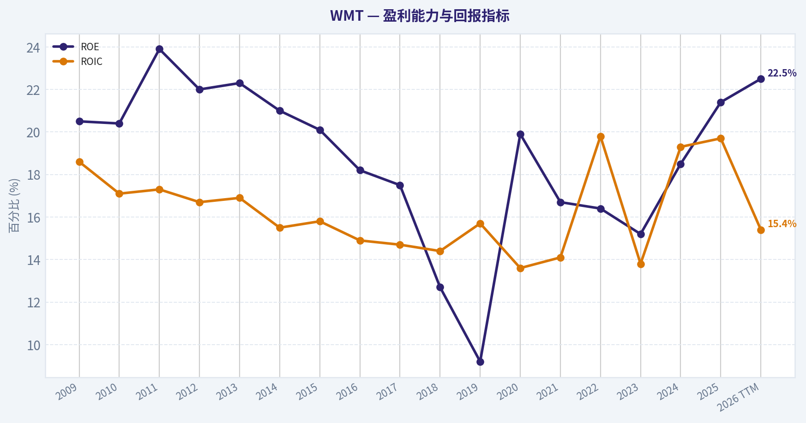
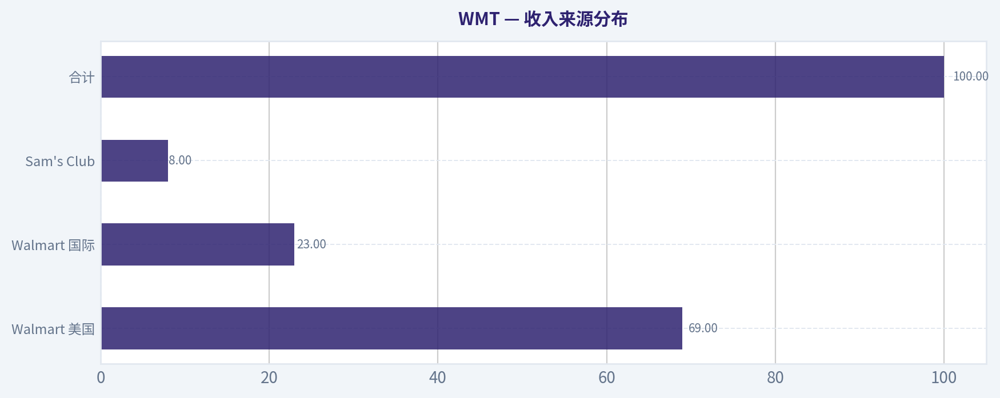
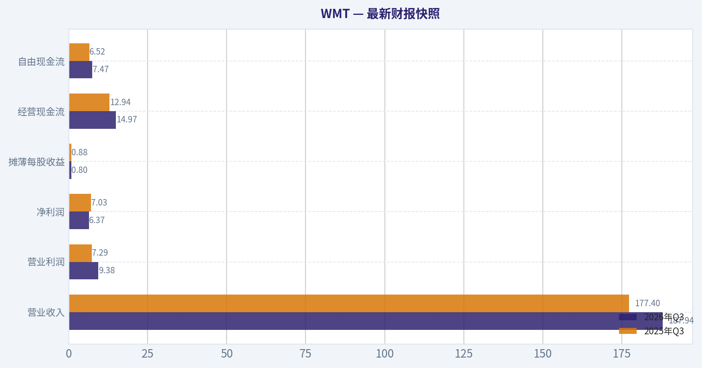
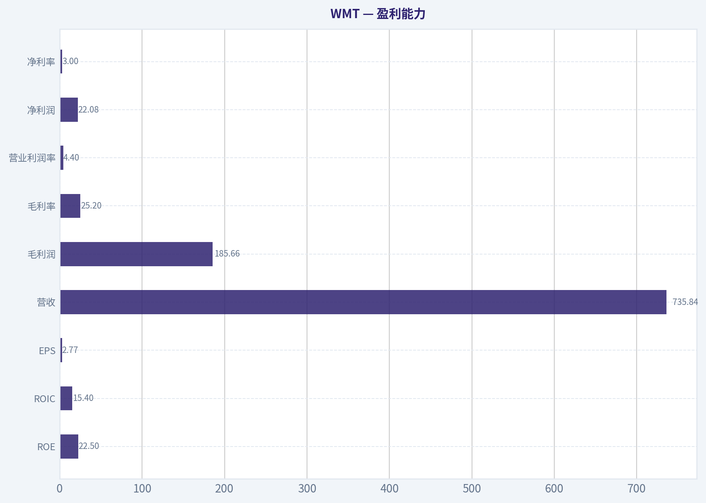
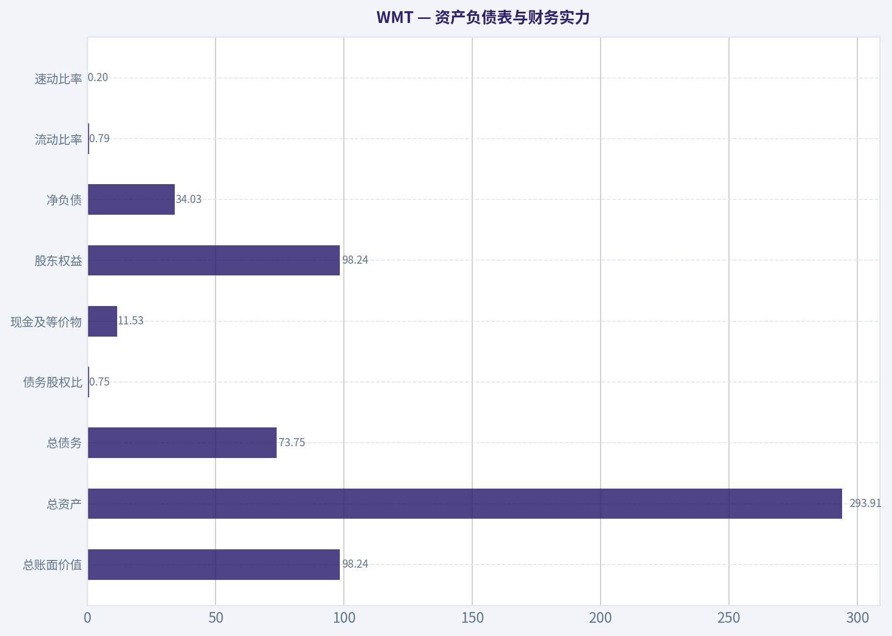
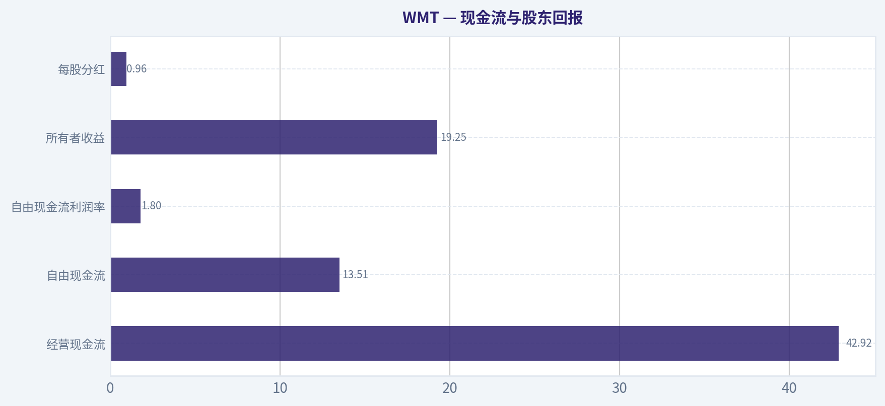
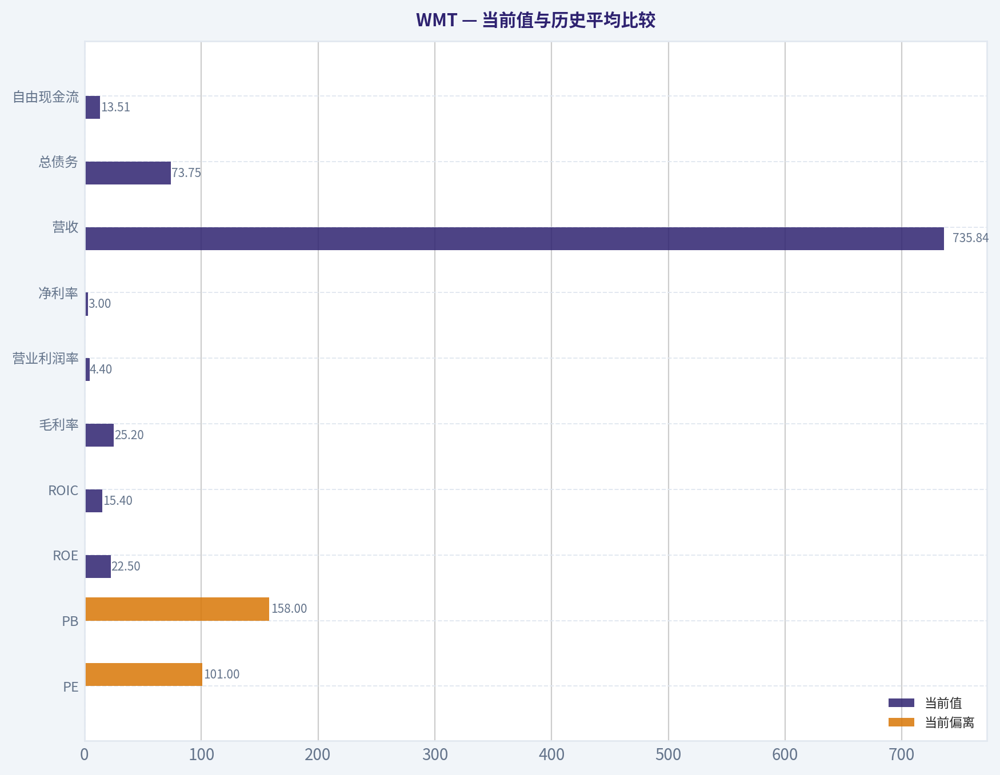
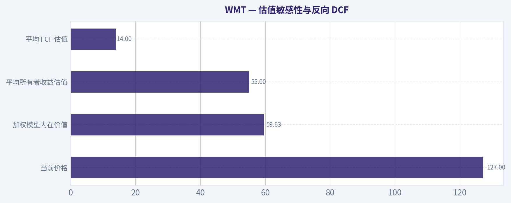

# WMT 深度价值情报

**调研日期:** 2026-11-19

## 关键免责声明

*本报告由 Deep Value Intelligence（一个基于 AI 的多智能体投资分析框架）自动生成。 仅供教育和研究用途 - 非财务建议，非财务顾问。*

---

## 目录

1. 情报摘要
2. 分析师团队报告
   - 基本面分析
   - 价值分析 (巴菲特)
   - 成长性分析 (林奇/德鲁肯米勒/费雪)
   - 市场分析
   - 期权市场分析
3. 研究团队评论
4. 投资团队评论
5. Deep Values 团队洞察

---

## 情报摘要

### 核心观点与前提条件

**核心论点:** **结论：维持观察，不追高，也不因估值偏高而清仓。**

**主要风险:**
- 最终立场为WATCH。
- **中性**

**置信度:** 中

---

## 分析师团队报告

### 基本面分析

#### 最新财报快照

*以下数据基于最近一期已披露财报（2026年Q3），并尽量与上一年同期对比。*

| 指标 | 2026年Q3 | 2025年Q3 | 同比变化 |
| --- | ---: | ---: | ---: |
| 营业收入 | $187.94B | $177.40B | +5.9% |
| 营业利润 | $9.38B | $7.29B | +28.8% |
| 净利润 | $6.37B | $7.03B | -9.4% |
| 摊薄每股收益 | $0.80 | $0.88 | -9.1% |
| 经营现金流 | $14.97B | $12.94B | +15.7% |
| 自由现金流 | $7.47B | $6.52B | +14.7% |

关键结论：这张快照先把最新一期财报放在桌面上，再去看长周期分析。这样读者能更清楚地区分"公司长期质量"和"这次财报发生了什么"。

#### WMT 17年财务指标

*以下数值均由原始数据确定性计算得出，并非 AI 估算。*

*发行人类型：operating company（Consumer Defensive / Discount Stores）。*

#### 17年财务指标
*年度行来自已披露财务报表，最后一行 TTM 由最近四个季度滚动计算得出。*

| 指标 | 2009 | 2010 | 2011 | 2012 | 2013 | 2014 | 2015 | 2016 | 2017 | 2018 | 2019 | 2020 | 2021 | 2022 | 2023 | 2024 | 2025 | 2026 TTM |
| --- | --- | --- | --- | --- | --- | --- | --- | --- | --- | --- | --- | --- | --- | --- | --- | --- | --- | --- |
| 市场价格 | $11 | $13 | $14 | $15 | $18 | $20 | $23 | $18 | $19 | $31 | $29 | $35 | $43 | $44 | $46 | $54 | $97 | $127 |
| 总市值 | $186.17B | $207.15B | $205.78B | $213.16B | $237.06B | $245.17B | $275.59B | $213.48B | $207.69B | $320.87B | $282.22B | $328.36B | $399.98B | $392.17B | $393.34B | $446.62B | $793.23B | $1.02T |
| 市盈率 | 13.90 | 14.40 | 12.54 | 13.58 | 13.93 | 15.30 | 16.83 | 14.52 | 15.24 | 32.50 | 42.40 | 22.06 | 29.58 | 28.77 | 33.77 | 28.84 | 40.73 | 45.98 |
| 市净率 | 2.85 | 2.94 | 3.00 | 2.99 | 3.11 | 3.22 | 3.39 | 2.65 | 2.67 | 4.12 | 3.89 | 4.40 | 4.94 | 4.71 | 5.13 | 5.33 | 8.72 | 10.34 |
| ROE | 20.5% | 20.4% | 23.9% | 22.0% | 22.3% | 21.0% | 20.1% | 18.2% | 17.5% | 12.7% | 9.2% | 19.9% | 16.7% | 16.4% | 15.2% | 18.5% | 21.4% | 22.5% |
| ROIC | 18.6% | 17.1% | 17.3% | 16.7% | 16.9% | 15.5% | 15.8% | 14.9% | 14.7% | 14.4% | 15.7% | 13.6% | 14.1% | 19.8% | 13.8% | 19.3% | 19.7% | 15.4% |
| 每股收益 | $0.79 | $0.88 | $1.09 | $1.13 | $1.28 | $1.28 | $1.36 | $1.26 | $1.24 | $0.96 | $0.67 | $1.58 | $1.47 | $1.53 | $1.36 | $1.86 | $2.41 | $2.77 |
| 营收 | $404.25B | $408.08B | $421.85B | $446.51B | $468.65B | $476.29B | $485.65B | $482.13B | $485.87B | $500.34B | $514.40B | $523.96B | $559.15B | $572.75B | $611.29B | $648.12B | $680.99B | $735.84B |
| 毛利润 | $100.31B | $103.98B | $106.90B | $111.52B | $116.35B | $118.22B | $120.56B | $121.15B | $124.62B | $126.95B | $129.10B | $129.36B | $138.84B | $143.75B | $147.57B | $157.98B | $169.23B | $185.66B |
| 毛利率 | 24.8% | 25.5% | 25.3% | 25.0% | 24.8% | 24.8% | 24.8% | 25.1% | 25.6% | 25.4% | 25.1% | 24.7% | 24.8% | 25.1% | 24.1% | 24.4% | 24.9% | 25.2% |
| 营业利润率 | 5.6% | 5.9% | 6.1% | 5.9% | 5.9% | 5.6% | 5.6% | 5.0% | 4.7% | 4.1% | 4.3% | 3.9% | 4.0% | 4.5% | 3.3% | 4.2% | 4.3% | 4.4% |
| 净利润 | $13.38B | $14.37B | $16.39B | $15.70B | $17.00B | $16.02B | $16.36B | $14.69B | $13.64B | $9.86B | $6.67B | $14.88B | $13.51B | $13.67B | $11.68B | $15.51B | $19.44B | $22.08B |
| 净利率 | 3.3% | 3.5% | 3.9% | 3.5% | 3.6% | 3.4% | 3.4% | 3.0% | 2.8% | 2.0% | 1.3% | 2.8% | 2.4% | 2.4% | 1.9% | 2.4% | 2.9% | 3.0% |
| 营收增长 | N/A | 0.9% | 3.4% | 5.8% | 5.0% | 1.6% | 2.0% | -0.7% | 0.8% | 3.0% | 2.8% | 1.9% | 6.7% | 2.4% | 6.7% | 6.0% | 5.1% | 8.1% |
| 净利润增长 | N/A | 7.4% | 14.1% | -4.2% | 8.3% | -5.7% | 2.1% | -10.2% | -7.2% | -27.7% | -32.4% | 123.1% | -9.2% | 1.2% | -14.6% | 32.8% | 25.3% | 13.6% |
| 自由现金流增长 | N/A | 20.8% | -22.2% | -1.8% | 18.1% | -20.1% | 61.6% | -1.9% | 31.0% | -13.1% | -4.8% | -16.4% | 77.4% | -57.1% | 8.2% | 26.2% | -16.3% | 6.7% |
| 总账面价值 | $65.28B | $70.47B | $68.54B | $71.31B | $76.34B | $76.25B | $81.39B | $80.55B | $77.80B | $77.87B | $72.50B | $74.67B | $80.92B | $83.25B | $76.69B | $83.86B | $91.01B | $98.24B |
| 总资产 | $163.43B | $170.41B | $180.78B | $193.41B | $203.10B | $204.54B | $203.49B | $199.58B | $198.82B | $204.52B | $219.29B | $236.50B | $252.50B | $244.86B | $243.20B | $252.40B | $260.82B | $293.91B |
| 总债务 | $38.70B | $37.80B | $46.38B | $50.09B | $50.79B | $53.54B | $47.27B | $43.67B | $39.37B | $39.04B | $50.62B | $49.65B | $44.53B | $38.08B | $39.21B | $40.46B | $39.07B | $73.75B |
| 债务股权比 | 0.59 | 0.54 | 0.68 | 0.70 | 0.67 | 0.70 | 0.58 | 0.54 | 0.51 | 0.50 | 0.70 | 0.66 | 0.55 | 0.46 | 0.51 | 0.48 | 0.43 | 0.75 |
| 现金及等价物 | $7.28B | $7.91B | $7.39B | $6.55B | $6.60B | $7.28B | $9.13B | $8.71B | $6.87B | $6.76B | $7.72B | $9.46B | $17.74B | $14.76B | $8.62B | $9.87B | $9.04B | $11.53B |
| 股东权益 | $65.28B | $70.47B | $68.54B | $71.31B | $76.34B | $76.25B | $81.39B | $80.55B | $77.80B | $77.87B | $72.50B | $74.67B | $80.92B | $83.25B | $76.69B | $83.86B | $91.01B | $98.24B |
| 经营现金流 | $23.15B | $26.25B | $23.64B | $24.25B | $25.59B | $23.26B | $28.56B | $27.55B | $31.67B | $28.34B | $27.75B | $25.25B | $36.07B | $24.18B | $28.84B | $35.73B | $36.44B | $42.92B |
| 投资现金流 | $-10.74B | $-11.62B | $-12.19B | $-16.61B | $-12.64B | $-12.53B | $-11.12B | $-10.68B | $-13.90B | $-9.08B | $-24.04B | $-9.13B | $-10.07B | $-6.01B | $-17.72B | $-21.29B | $-21.38B | $-29.41B |
| 自由现金流 | $11.65B | $14.06B | $10.94B | $10.74B | $12.69B | $10.14B | $16.39B | $16.07B | $21.05B | $18.29B | $17.41B | $14.55B | $25.81B | $11.07B | $11.98B | $15.12B | $12.66B | $13.51B |
| 自由现金流利润率 | 2.9% | 3.4% | 2.6% | 2.4% | 2.7% | 2.1% | 3.4% | 3.3% | 4.3% | 3.7% | 3.4% | 2.8% | 4.6% | 1.9% | 2.0% | 2.3% | 1.9% | 1.8% |
| 每股分红 | $0.00 | $0.00 | $0.00 | $0.00 | $0.00 | $0.00 | $0.00 | $0.00 | $0.00 | $0.00 | $0.00 | $0.00 | $0.00 | $0.00 | $0.71 | $0.74 | $0.83 | $0.96 |

#### 盈利能力指标
- 净资产收益率 (ROE): 22.0%
- 投入资本回报率 (ROIC): 16.9%
- 总资产收益率 (ROA): 7.7%
- 毛利率: 24.9%
- 营业利润率: 4.2%
- 净利率: 3.1%

#### 流动性指标
- 流动比率: 0.79
- 速动比率: 0.20

#### 杠杆指标
- 债务股权比: 0.45
- 利息覆盖倍数: 12.87
- 净负债: $34.03B

#### 增长指标（同比）
- 营收增长: 4.7%
- 净利润增长: 12.6%
- 自由现金流增长: 17.9%
- 营收复合增长率（3年）: 5.3%
- 营收复合增长率（5年）: 5.0%

#### 估值指标
- 市盈率 (TTM): 46.14
- 预期市盈率: 39.45
- 市净率: 10.30
- 市销率: 1.37
- PEG 比率: 4.33
- 企业价值/EBITDA: 24.52
- 自由现金流收益率: 1.5%
- 盈利收益率: 2.2%

#### 所有者收益（巴菲特方法，代码计算）
- 净利润: $19.44B
- + 折旧与摊销: $14.20B
- - 资本开支: $-26.64B
- - 营运资本变动: $752.0M
- = **所有者收益: $19.25B**

#### 内在价值（代码计算）
- 当前价格: $127
- **头条内在价值（按商业模式路由）: $60**
  商业模式: operating company - weighted blend [Damodaran FCFF + reverse-DCF fair + owner-earnings DCF] (operating_company)
  模型区间（各 DCF 最小-最大）: $14 - $55
  相对价格的安全边际（头条）: -113.6%
  路由说明: General operating company: balanced blend of Damodaran FCFF and the owner-earnings DCF with a reverse-DCF sanity check.
- 巴菲特方法（所有者收益）:
  保守: $6
  平均: $55
  乐观: $162
- 现金流方法（FCF）:
  保守: $4
  平均: $14
  乐观: $39
- Damodaran FCFF（WACC + 利润率 + 再投资）:
  保守: $41
  平均: $51
  乐观: $72
  蒙特卡洛区间（P10-P90）：$39 - $80（中位数 $54）
  P(内在价值 > 当前价格)：0.1%
- 反向 DCF：当前价格隐含约 38.2%/年 的所有者收益增长（10年）；过去 3 年为 223.8%，5 年为 35.8%。

#### Piotroski F分数: 6/9
- 净利润为正: 通过
- 经营现金流为正: 通过
- 资产回报率改善: 通过
- 现金流大于净利润: 通过
- 债务下降: 未通过
- 流动比率改善: 未通过
- 未稀释股本: 通过
- 毛利率改善: 通过
- 资产周转率改善: 未通过

ANALYST STANCE: **看空**

#### 投资结论

Walmart（WMT）是高质量、防御性极强的零售企业，但当前股价已经明显脱离其经营增长和现金流能够合理支持的范围。公司拥有规模、供应链、低价心智和全渠道能力等宽阔护城河，财务质量也总体稳健；然而，$127 股价对应约 $1.02 万亿美元市值、TTM PE 约 46 倍和自由现金流收益率仅约 1.5%，市场隐含了极高的长期增长预期。

综合所有者收益 DCF、FCFF 和反向 DCF，模型内在价值中枢约为 $60，合理区间大致为 $40-$80。即使采用较乐观的长期增长假设，当前价格仍缺乏足够安全边际。因此，WMT 更适合持有者等待估值消化，不适合当前价位新建价值投资仓位。

#### 市场指标与估值

| 指标 | 当前值 | 历史比较 | 解读 |
|---|---:|---:|---|
| 市场价格 | $127 | 2009-2025 年均值约 $33 | 当前价格较长期平均水平大幅上升，近年涨幅已明显超过收入和利润增速 |
| 总市值 | $1.02T | 2009-2025 年均值约 $338B | 市值达到万亿美元级别，未来回报更依赖盈利增长而非估值扩张 |
| PE | 46.14 倍 | 2009-2025 年均值约 22.9 倍 | 约为历史平均的两倍，显著高估值 |
| PB | 10.30 倍 | 2009-2025 年均值约 4.0 倍 | 明显高于历史水平，但不应单独作为估值依据 |
| 盈利收益率 | 2.2% | - | 对于低增长、低利润率零售商而言，当前盈利回报偏低 |
| 自由现金流收益率 | 1.5% | - | 代表投资者以极高价格购买有限的当前现金回报 |
| 市销率 | 1.37 倍 | - | 零售企业利润率很低，即使市销率看似不高，也可能对应昂贵的盈利倍数 |
| PEG | 4.33 | - | 估值相对于增长明显偏高 |

**关键结论：** WMT 当前最突出的风险不是商业质量，而是估值过高。PE 从长期约 23 倍上升至约 46 倍，而收入长期增长大致只有中个位数，估值扩张已经远超基本面改善速度。PB 对 Walmart 这类拥有大量实体资产的零售企业并非完全没有参考价值，但仍应以现金流和盈利能力为主，不能因为账面倍数较低或较高而替代 DCF 判断。

#### 盈利能力

| 指标 | 当前值 | 历史平均或范围 | 经营含义 |
|---|---:|---:|---|
| ROE | 22.5% | 2009-2025 年均值约 18.6% | 当前高于历史平均，资本回报恢复良好 |
| ROIC | 15.4% | 长期大致 14%-19%，均值约 16.2% | 仍然健康，但较部分历史年份偏低 |
| EPS | $2.77 | 2009 年 $0.79，2025 年 $2.41 | 长期增长，但利润增长并不平滑 |
| 营收 | $735.84B | 2009-2025 年均值约 $500B | 规模持续扩大，商业模式具备稳定扩张能力 |
| 毛利润 | $185.66B | 2009 年 $100.31B | 规模增长明显 |
| 毛利率 | 25.2% | 长期约 24.1%-25.6% | 非常稳定，体现采购和规模优势 |
| 营业利润率 | 4.4% | 2009-2025 年均值约 4.6% | 当前略低于长期平均，利润率改善仍有限 |
| 净利润 | $22.08B | 2009 年 $13.38B，2025 年 $19.44B | TTM 创新高，但利润基数相对收入仍很薄 |
| 净利率 | 3.0% | 长期均值约 2.8% | 已恢复至较好水平，但零售行业本质上低利润率 |

**关键结论：** Walmart 的优势是稳定而非高利润。毛利率长期维持在约 25%，但营业利润率只有约 4%-5%，净利率约 3%，意味着很小的成本、工资、库存或价格竞争变化都可能显著影响净利润。当前 ROE 高于历史平均，主要受盈利恢复、规模和资本结构共同推动，不能简单外推为未来长期高增长。

#### 增长表现

| 指标 | 当前值 | 历史表现 | 趋势判断 |
|---|---:|---:|---|
| 营收增长 | 8.1%（年度表）／最新摘要约 4.7% | 长期多数年份为 0%-7% | 当前仍稳健，但不是高增长企业 |
| 净利润增长 | 13.6%（年度表）／最新摘要约 12.6% | 波动显著，曾出现 -32.4%、-27.7% 和 123.1% | 当前改善明显，但部分来自低基数和利润恢复 |
| 自由现金流增长 | 6.7%（年度表）／最新摘要约 17.9% | 波动较大，曾出现 -57.1% 和 -20%以上 | 现金流恢复，但资本开支和营运资金使其不稳定 |
| 3 年收入复合增长 | 5.3% | - | 与成熟零售企业特征一致 |
| 5 年收入复合增长 | 5.0% | - | 难以支持 40 倍以上 PE |

**关键结论：** 收入增长具有较强可预测性，但长期中枢约为 5%，明显低于当前估值所隐含的增长要求。净利润和自由现金流增长比收入更加波动，说明利润改善不能持续简单按两位数复合增长外推。反向 DCF 显示，当前价格大致隐含未来十年所有者收益年均增长约 38.2%，远高于历史收入和现金流增长，估值假设极不宽松。

#### 资产负债表与财务实力

| 指标 | 当前值 | 历史比较 | 评价 |
|---|---:|---:|---|
| 总账面价值 | $98.24B | 2009 年 $65.28B | 权益规模长期增长，但增长速度不快 |
| 总资产 | $293.91B | 2009 年 $163.43B | 随门店、库存、物流和数字业务扩张 |
| 总债务 | $73.75B | 2025 年 $39.07B | TTM 明显上升，是重要观察点 |
| 债务股权比 | 0.75 | 2009-2025 年均值约 0.58 | 高于近期历史水平，财务杠杆恶化 |
| 现金及等价物 | $11.53B | 2025 年 $9.04B | 现金增加，但相对债务规模仍有限 |
| 股东权益 | $98.24B | 2025 年 $91.01B | 权益有所增长 |
| 净负债 | $34.03B | - | 绝对规模可管理，但不支持无限估值溢价 |
| 利息覆盖倍数 | 12.87 倍 | - | 偿债能力仍然较强 |
| 流动比率 | 0.79 | - | 低于 1，但零售商通常依靠高库存周转和供应商信用 |
| 速动比率 | 0.20 | - | 现金和速动资产覆盖短期负债能力较弱 |

**关键结论：** Walmart 的财务实力仍属投资级水平，经营现金流强劲、利息覆盖充足，短期偿债不存在明显危机。但总债务从约 $39B 上升至 $73.75B，债务股权比升至 0.75，说明资本结构近期变弱。流动比率不能机械套用工业企业标准，因为大型零售商通常通过快速库存周转和应付账款运作，但债务上升仍会压缩未来资本配置弹性。

#### 现金流与股东回报

| 指标 | 当前值 | 历史特征 | 解读 |
|---|---:|---:|---|
| 经营现金流 | $42.92B | 长期总体为正，2009 年 $23.15B | 经营现金产生能力强 |
| 资本开支 | 约 $26.64B | 近年明显增加 | 门店、物流、自动化和数字化投入加大 |
| 自由现金流 | $13.51B | 历史均值约 $15B 左右，曾高达 $25.81B | 当前低于较好年份 |
| 自由现金流利润率 | 1.8% | 长期约 2%-4.6% | 资本密集型扩张压低现金转化 |
| 所有者收益 | $19.25B | 以净利润加回折旧并扣除资本开支等计算 | 高于自由现金流口径，但仍不足以支撑当前估值 |
| 每股分红 | $0.96 | 2023 年 $0.71，2025 年 $0.83 | 分红持续提高，但收益率很低 |

**关键结论：** Walmart 能够持续产生大量经营现金流，但高资本开支使自由现金流低于经营现金流。所有者收益约 $19.25B，按约 79.7 亿股计算，每股所有者收益约 $2.42，当前股价对应约 52.5 倍所有者收益，仍然非常昂贵。分红政策稳定且逐步增长，但当前分红收益率约 0.8%，无法为高估值提供足够支撑。

#### 当前值与历史平均比较

| 指标 | 当前值 | 2009-2025 年平均或代表性水平 | 当前偏离 | 判断 |
|---|---:|---:|---:|---|
| PE | 46.14 倍 | 约 22.9 倍 | +101% | 极端溢价 |
| PB | 10.30 倍 | 约 4.0 倍 | +158% | 高于历史，但仅作辅助参考 |
| ROE | 22.5% | 约 18.6% | +3.9 个百分点 | 经营质量较好 |
| ROIC | 15.4% | 约 16.2% | -0.8 个百分点 | 尚可但未创新高 |
| 毛利率 | 25.2% | 约 25.0% | +0.2 个百分点 | 高度稳定 |
| 营业利润率 | 4.4% | 约 4.6% | -0.2 个百分点 | 略低于长期水平 |
| 净利率 | 3.0% | 约 2.8% | +0.2 个百分点 | 盈利修复 |
| 营收 | $735.84B | 约 $500B | 显著高于历史平均 | 规模持续扩张 |
| 总债务 | $73.75B | 约 $44B | 明显上升 | 财务杠杆恶化 |
| 自由现金流 | $13.51B | 约 $15B | 略低于平均 | 资本开支压力较大 |
| 每股分红 | $0.96 | 早期长期为零，近年逐步增加 | 明显改善 | 股东回报政策恢复 |

**关键结论：** 当前基本面中最积极的变化是 ROE、净利润率和收入规模改善；最消极的变化是估值远高于历史平均、债务上升以及自由现金流转化率偏低。也就是说，公司质量有所提升，但股价提升幅度远大于经营质量提升幅度。

#### 收入来源分布

以下按最近年度营收 $735.84B，并根据 Walmart 公开业务结构进行近似拆分；由于共享数据包未提供最新分部精确金额，金额为合理估计值。

| 收入来源 | 金额（十亿美元） | 占比 |
|---|---:|---:|
| Walmart 美国 | 约 $507.7B | 69% |
| Walmart 国际 | 约 $169.2B | 23% |
| Sam's Club | 约 $58.9B | 8% |
| 合计 | 约 $735.8B | 100% |

**关键结论：** Walmart 美国业务贡献约七成收入，是最重要的现金流来源，也使公司高度暴露于美国消费者、工资成本和国内零售竞争。国际业务提供地域多元化，Sam's Club则通过会员制增强客户黏性和收入重复性，但整体收入结构仍以低毛利的大型零售业务为主。

#### 经济护城河与业务质量

| 护城河来源 | 具体表现 | 可持续性 |
|---|---|---|
| 规模采购 | 巨大采购规模带来成本和价格优势 | 很强 |
| 供应链网络 | 门店、配送中心和库存系统构成进入壁垒 | 很强 |
| 低价品牌认知 | 消费者将 Walmart 与低价和便利联系在一起 | 很强 |
| 门店网络 | 实体门店兼具销售、取货和配送节点功能 | 强 |
| 会员业务 | Sam's Club提高重复购买和客户黏性 | 中强 |
| 全渠道能力 | 电商、门店取货、广告和配送业务提供增量 | 中强，但投资回报仍需验证 |
| 数据与广告业务 | 利润率可能高于传统零售 | 有潜力，但规模仍不足以改变整体利润率 |

Walmart 的护城河属于典型的规模经济和成本优势，而不是高毛利品牌或技术垄断。其商业模式的优点是需求稳定、抗经济周期能力强、客户基础庞大；缺点是利润率薄，任何价格战、人工成本上升、库存损失或物流成本上涨都可能快速侵蚀利润。

#### 可预测盈利与管理层表现

Walmart 过去十多年收入几乎持续增长，仅有少数年份轻微下降，显示业务需求和市场份额相当稳定。不过净利润并不如收入稳定，2018-2019 年净利润明显下降，2020 年又出现大幅反弹，之后也有多次负增长。这说明收入可预测不等于每股收益和自由现金流同样可预测。

ROE 从早期约 20%上下下降至 2018-2019 年的 12.7%和 9.2%，随后恢复至当前 22.5%。这一恢复说明经营效率和盈利能力有所改善，但需要关注资本结构因素，因为债务上升可能也抬高了 ROE。ROIC 当前约 15.4%，仍然健康，但没有显示出足以支撑 30%-40%长期增长的资本回报水平。

股息逐步恢复增长，显示管理层重视股东回报；但当前分红收益率较低，且自由现金流仍需支持门店升级、物流自动化和数字业务投入。因此，管理层资本配置总体合格，但尚未证明能够以极高回报率持续部署新增资本。

#### 巴菲特式所有者收益 DCF

基础数据：

- 当前所有者收益：$19.25B
- 近似流通股数：$1.02T ÷ $127 ~ 8.03B 股
- 当前每股所有者收益：约 $2.40
- 折现率：10%
- 永续增长率：2.5%
- 显式预测期：10 年
- 终值公式：第十年所有者收益 x 1.025 ÷（10% - 2.5%）

手工 DCF 采用增长逐步向 2.5%终值增长率收敛，而不是永久维持高增长。

| 情景 | 前期增长假设 | 终值增长率 | 手工 DCF 每股 | 研究包模型区间 | 估值判断 |
|---|---|---:|---:|---:|---|
| 保守 | 约 3%，逐步降至 2.5% | 2.5% | 约 $34-$36 | $6 | 需要较低增长、较高资本开支或更高风险折现 |
| 平均 | 约 6%，逐步降至 2.5% | 2.5% | 约 $42-$50 | $55 | 最符合成熟零售企业基本面 |
| 乐观 | 约 9%，逐步降至 2.5% | 2.5% | 约 $53-$70 | $162 | 需要电商、广告、会员和利润率改善大幅成功 |

计算示例：

- 保守情景：
  前十年所有者收益现值约 $133B，终值现值约 $136B，总价值约 $269B；除以约 8.03B 股，得到约 $34-$36/股。
- 平均情景：
  前十年所有者收益现值约 $155B-$165B，终值现值约 $180B-$220B，总价值约 $335B-$385B；对应约 $42-$50/股。
- 乐观情景：
  前十年所有者收益现值约 $180B-$205B，终值现值约 $240B-$350B，总价值约 $420B-$555B；对应约 $53-$70/股。

研究包中的模型给出的所有者收益估值为：

- 保守：$6/股
- 平均：$55/股
- 乐观：$162/股

其中 $162 的乐观值明显依赖非常积极的长期再投资和增长假设，不应视为基准价值。综合所有者收益 DCF、FCFF 和反向 DCF后，研究包的加权内在价值约为 $60/股，模型合理区间约为 $39-$80/股。

**关键结论：** 即使采用较乐观但仍有限的 9%初期增长，手工 DCF 得出的价值大约也只有 $53-$70/股，明显低于当前 $127。当前股价需要 Walmart 在多年内实现远高于历史水平的所有者收益增长，且利润率和资本回报同时显著改善，安全边际不足。

#### 估值敏感性与反向 DCF

| 估值项目 | 结果 | 含义 |
|---|---:|---|
| 当前价格 | $127 | 市场报价 |
| 加权模型内在价值 | $59.63 | 约为当前价格的 47% |
| Damodaran FCFF 中位数 | 约 $54 | 现金流模型明显低于市场价格 |
| Damodaran FCFF P10-P90 | $39-$80 | 即使采用高端估值仍低于当前价格 |
| 平均所有者收益估值 | $55 | 约有 57%下行空间 |
| 平均 FCF 估值 | $14 | 反映自由现金流收益率非常低 |
| 当前价格隐含十年所有者收益增长 | 约 38.2%/年 | 远高于历史经营增长 |
| 模型认为内在价值高于当前价的概率 | 约 0.1% | 极端不利的风险收益比 |

**关键结论：** 不同模型虽然绝对估值不同，但方向一致：当前价格明显高于现金流合理价值。最关键的证据是反向 DCF，市场需要 Walmart 的所有者收益在十年内以约 38%年复合增长，才能解释 $127 股价，这与公司约 5%的长期收入增长和低个位数利润率不匹配。

#### 主要风险、机会与观察指标

| 类别 | 事项 | 对投资判断的影响 |
|---|---|---|
| 风险 | 估值过高 | 即使业绩达标，PE 收缩也可能造成长期低回报 |
| 风险 | 总债务上升 | 提高利息和再融资风险，降低资本配置弹性 |
| 风险 | 利润率极薄 | 成本、工资和价格竞争变化会放大利润波动 |
| 风险 | 电商和自动化投入大 | 资本开支可能继续压低自由现金流 |
| 风险 | 消费者结构变化 | 低收入消费者压力可能影响客单价和商品结构 |
| 机会 | 会员业务扩张 | 提高收入重复性和客户黏性 |
| 机会 | 数字广告业务 | 可能提升整体利润率 |
| 机会 | 全渠道效率提升 | 门店网络可转化为配送和取货基础设施 |
| 机会 | 国际业务改善 | 提供额外增长来源 |
| 机会 | 估值回落 | 若股价回到约 $55-$80，安全边际将明显改善 |

需要持续跟踪的关键指标包括：

1. 营业利润率能否稳定突破 5%。
2. 自由现金流能否重新达到 $20B以上。
3. 债务是否从 $73.75B回落。
4. 电商、广告和会员业务是否带来真实增量利润，而非仅增加收入。
5. PE 是否从约 46 倍回落至更接近历史中枢。
6. 收入增长能否持续高于 6%，且不依赖利润率牺牲。

#### 最终投资立场

**看空**

Walmart 是值得长期研究和等待合理价格的优秀公司，但不是当前价格下的优秀投资。其护城河、收入稳定性、ROE、经营现金流和抗周期能力都支持"高质量企业"结论；然而，当前估值已经提前反映了多年超常增长，且明显高于历史 PE、PB 和现金流估值。

对于价值投资者，较合理的观察区间是：

- $80 以下：估值压力明显缓解，可重新评估。
- $55-$70：接近平均 DCF 和部分 FCFF 估值，开始具备研究价值。
- $40-$55：若基本面未恶化，将提供更好的安全边际。
- $127 附近：不建议追高，也不适合以传统巴菲特式安全边际建立新仓位。

| 核心项目 | 结论 |
|---|---|
| 企业质量 | 优秀，拥有规模、供应链和低价护城河 |
| 盈利稳定性 | 收入稳定，利润和自由现金流波动更大 |
| 财务实力 | 总体稳健，但债务近期明显上升 |
| 资本回报 | ROE 良好，ROIC健康但未支持超高增长 |
| 当前估值 | 极高，明显高于历史和现金流合理水平 |
| DCF中枢 | 约 $55-$60/股 |
| 合理估值区间 | 约 $40-$80/股 |
| 当前安全边际 | 负安全边际，模型估计约 -113.6% |
| 投资立场 | **看空** |
| 最佳策略 | 等待估值回落，而不是追逐经营质量带来的估值溢价 |

#### 基本面关键图表

本图追踪 **WMT** 过去十年的盈利能力与回报指标（ROE、ROIC、利润率），突出呈现资本效率的变化趋势。

本对比图（来自「收入来源分布」）将 **WMT** 的当前数据与历史基准并排呈现，直观反映公司相对自身历史均值的估值水平。

---

### 价值分析 (巴菲特)

> *基于沃伦·巴菲特的价值投资哲学：能力圈、经济护城河、管理层质量与安全边际。*

#### 内在价值快照

价格是你付的钱，内在价值是企业未来可能为股东创造的现金价值。我们给出一个区间，而不是假装只有一个神奇数字。

- 当前价格: $127.36
- 估值区间（两种 DCF 方法、保守到乐观）: $3.56 至 $161.76

##### 所有者收益（巴菲特方法）
- 净利润: $19,436,000,000.00
- 折旧与摊销: $14,203,000,000.00
- 资本支出: $-26,642,000,000.00
- 营运资金变化: $752,000,000.00
- 所有者收益: $19,255,000,000.00

##### 内在价值
###### 所有者收益法
使用所有者收益，更严格，通常更保守。
- 保守: $6.03
- 平均: $55.02
- 乐观: $161.76
- 折现率: 10.0%

###### 自由现金流法
使用自由现金流，更适合今天投入很多、为未来增长铺路的公司。
- 保守: $3.56
- 平均: $13.71
- 乐观: $38.76
- 折现率: 10.0%

ANALYST STANCE: **中性**

#### 一、投资结论

Walmart 是一家质量很高、护城河宽厚且仍在强化的零售平台，但当前股价已经远远超过保守内在价值。$127 的股价对应约 46 倍 PE，而研究数据给出的头条内在价值仅为 $59.63，反向 DCF 甚至要求未来十年每年增长约 38.2%，这一增长假设明显过于激进。

因此，结论不是质疑 Walmart 的商业质量，而是拒绝以过高价格买入优秀企业。综合评分约为 3.0 分，属于等待更合理价格的 **中性**。

#### 二、四项核心因素评分

| 因素 | 评分（5分制） | 主要证据 |
|---|---:|---|
| 圈内能力与商业简单性 | 4 | 通过规模采购、低价零售、物流和会员服务赚取利润，模式容易理解；零售、电商和广告业务使预测复杂度有所上升 |
| 护城河 | 4 | 全球采购规模、门店网络、物流体系、品牌信任和数据能力形成综合优势；线上线下融合进一步强化客户黏性 |
| 管理层与资本配置 | 3 | 持续投资电商、物流、广告和会员生态，方向合理；但当前估值较高，未来资本回报率面临考验 |
| 行业结构 | 4 | 零售行业竞争激烈，但 Walmart 的规模、采购能力和配送网络构成结构性成本优势；资本强度较高但仍能产生规模回报 |

**Gate 5 财务质量与偿债底线：未触发。** 目前没有证据显示盈利和现金流同时恶化，也没有显示利息覆盖低于 1 倍或处于明显财务困境。流动比率低于 1 倍是零售行业常见现象，不能单独视为偿债危机。

#### 三、护城河分析

| 护城河来源 | 具体表现 | 判断 |
|---|---|---|
| 成本优势 | 超大采购规模、供应链密度、门店覆盖和物流基础设施降低单位成本 | 宽且稳定 |
| 品牌与信任 | "低价"和便利性形成长期消费者认知，尤其在食品和日用品领域具有高频优势 | 宽且稳定 |
| 网络与生态效应 | 门店、线上流量、广告业务、会员服务和供应商体系相互增强 | 中等偏强 |
| 转换成本 | 单笔购物转换成本低，但消费者对价格、便利性和配送体验形成综合黏性 | 中等 |
| 技术与数据 | 电商、自动化仓储、个性化推荐和零售广告提升客户价值与利润率 | 正面强化，而非主要威胁 |

毛利率仅约 24.9%，并不符合高毛利软件或奢侈品牌的特征，但 Walmart 的护城河并不依赖高售价，而是依赖"更低价格仍能盈利"的规模经济。其核心优势是竞争对手难以同时复制采购规模、门店网络、物流密度和消费者流量。

#### 四、管理层与资本配置

Walmart 管理层近年的资本配置重点包括：

- 持续建设电商、自动化仓储和配送体系；
- 扩大零售广告业务，提高低毛利零售流量的变现能力；
- 发展会员业务，增强客户频率和数据价值；
- 通过全渠道模式提升实体门店资产的利用率。

这些投入有机会把传统低毛利零售转化为"零售加平台"的复合业务。管理层的主要挑战是：在股价已经隐含极高增长的情况下，新增投资必须持续产生高于资本成本的回报。

现有资料未显示管理层存在重大财务造假、频繁重述或明显破坏股东价值的行为。不过，Walmart 的公司治理和家族股东结构并不等同于典型创始人高持股科技公司，因此管理层评分保持中等，而不是最高分。

#### 五、财务摘要

| 指标 | 最新数据 |
|---|---:|
| 股价 | $127 |
| 总市值 | $1.01万亿美元 |
| PE | 46.1倍 |
| ROE | 22.0% |
| 毛利率 | 24.9% |
| 营收同比增长 | 4.7% |
| 自由现金流收益率 | 1.5% |
| 流动比率 | 0.79 |
| 头条内在价值 | $59.63 |
| 所有者收益模型价值 | $55.02 |
| FCF模型价值 | $13.71 |
| Damodaran FCFF模型价值 | $51.48 |

**关键结论：** Walmart 的 ROE 达到 22%，说明股东资本回报良好；但 1.5% 的自由现金流收益率意味着市场已经为未来多年增长支付了很高价格。当前估值与基本面之间的主要矛盾，不是企业质量不足，而是价格远超现金流所能合理支持的水平。

#### 六、所有者收益计算

Buffett 所采用的框架为：

> 所有者收益 = 净利润 + 折旧摊销 - 维持性资本支出 - 营运资本增加

根据所有者收益模型的无增长估值：

> 所有者收益估值 = 所有者收益 ÷ 10% = $55.02

由此反推归一化每股所有者收益约为：

| 项目 | 每股金额 |
|---|---:|
| 归一化所有者收益代理值 | 约 $5.50 |
| 10%资本化率下的无增长价值 | $55.02 |
| 当前股价 | $127 |
| 当前价格相对所有者收益代理值 | 约 23倍 |

**关键结论：** 即使假设 Walmart 能够稳定产生约 $5.50 的每股所有者收益，$127 的价格也已经包含了长期、持续且较高的增长预期。对于一家成熟零售巨头而言，这种估值要求明显高于其当前 4.7% 的营收增长速度。

#### 七、三情景 DCF估值

| 情景 | 假设 | 每股价值 |
|---|---|---:|
| 情景A：零增长 | 所有者收益约 $5.50，折现率 10% | $55.02 |
| 情景B：GDP增长 | 所有者收益增长 3%，折现率 10% | 约 $80.99 |
| 情景C：历史增长 | 采用历史高增长并按规则封顶 10% | 无稳定有限值，终值对假设极度敏感 |
| 研究包综合估值 | FCFF、反向DCF和所有者收益加权 | $59.63 |

情景C之所以无法形成可靠的单点估值，是因为将增长率封顶至 10% 后，已经接近 10% 的折现率，终值计算会变得极度敏感。若模型需要接近折现率的长期增长率才能支持当前股价，这本身就是估值风险信号。

**关键结论：** 三个模型中，所有者收益和FCFF估值大多集中在约 $51至$55，明显低于 $127。即使给予 3%的长期增长，估值也仅约 $81，仍低于市场价格。

#### 八、安全边际与反向DCF

| 项目 | 数值 | 判断 |
|---|---:|---|
| 当前股价 | $127 | 市场定价很高 |
| 头条内在价值 | $59.63 | 明显低于股价 |
| 价格相对头条内在价值的安全边际 | -113.6% | 没有安全边际 |
| 三模型最高估值 | $55.02 | 仍远低于股价 |
| 反向DCF隐含十年增长率 | 38.2% | 对成熟零售企业极为激进 |
| 过去五年增长参考 | 35.8% | 难以作为未来十年的稳定基准 |

**关键结论：** Walmart 属于高质量企业，理论上可以接受低于普通公司的安全边际要求，但当前价格不仅没有约 10%至15%的质量溢价安全垫，反而需要投资者相信极高的长期增长。反向DCF显示的 38.2%隐含增长率远高于正常成熟零售企业可合理预期的长期增速。

#### 九、Buffett综合评分

| 评分标准 | 权重 | 评分 | 加权得分 |
|---|---:|---:|---:|
| 护城河宽度与持久性 | 25% | 4 | 1.00 |
| 估值与安全边际 | 20% | 1 | 0.20 |
| 资本回报：ROIC相对WACC | 15% | 3 | 0.45 |
| 商业理解度与可预测性 | 12% | 4 | 0.48 |
| 管理层与资本配置 | 12% | 3 | 0.36 |
| 再投资空间 | 8% | 3 | 0.24 |
| 资产负债表强度 | 4% | 3 | 0.12 |
| 行业结构 | 4% | 4 | 0.16 |
| **总分** | **100%** |  | **3.01** |

**关键结论：** Walmart 的业务质量、护城河和行业地位足以支持长期关注，但估值评分只有 1 分，显著拖累总分。当前总分落在 3.0至3.4 的观察区间，符合"企业值得拥有，但价格不值得追高"的判断。

#### 十、最终判断

**ANALYST STANCE: 中性**

- **企业质量：高**
- **护城河：宽且稳定，部分领域正在扩大**
- **财务健康：未触发财务困境底线**
- **管理层：方向合理，但资本回报需继续验证**
- **估值：明显偏高**
- **当前操作：不追高，等待更佳买入点**

若股价回落至接近保守内在价值区间，或自由现金流增长显著提高而估值倍数同步下降，Walmart 可以重新评估为长期复利型投资。现阶段最理性的行动是持有观察，而不是在隐含增长率极高的价格上新增仓位。
#### 估值桥

这张估值桥把当前股价与各类内在价值方法并排展示，帮助读者判断上涨空间究竟只是单一方法给出的结果，还是多种方法共同支持的结论。

| 项目 | 每股内在价值 |
| --- | ---: |
| 巴菲特方法 | $55.02 |
| 现金流方法 | $13.71 |
| Damodaran 方法 | $51.48 |
| 当前价格 | $127.36 |

#### 关键结论

如果只有一种方法显著高于其他方法，说明上行空间更依赖特定建模假设。若多种方法的估值接近，则说明估值逻辑更加稳健。

#### 估值图表

本对比图（来自「最新财报快照」）将 **WMT** 的当前数据与历史基准并排呈现，直观反映公司相对自身历史均值的估值水平。

本对比图（来自「盈利能力」）将 **WMT** 的当前数据与历史基准并排呈现，直观反映公司相对自身历史均值的估值水平。

本对比图（来自「资产负债表与财务实力」）将 **WMT** 的当前数据与历史基准并排呈现，直观反映公司相对自身历史均值的估值水平。

本对比图（来自「现金流与股东回报」）将 **WMT** 的当前数据与历史基准并排呈现，直观反映公司相对自身历史均值的估值水平。

本对比图（来自「当前值与历史平均比较」）将 **WMT** 的当前数据与历史基准并排呈现，直观反映公司相对自身历史均值的估值水平。

本对比图（来自「估值敏感性与反向 DCF」）将 **WMT** 的当前数据与历史基准并排呈现，直观反映公司相对自身历史均值的估值水平。

---

### 成长性分析 (林奇/德鲁肯米勒/费雪)

> *基于彼得·林奇的GARP成长投资法、斯坦利·德鲁肯米勒的宏观拐点分析法，以及菲利普·费雪的深度调研法。*

ANALYST STANCE: **看空**

#### 一、结论摘要

沃尔玛是全球最优秀的零售企业之一，但以当前约 **1.01万亿美元市值、46倍 PE、1.5%自由现金流收益率** 计算，市场已经为其质量与数字化增长支付了极高溢价。它更接近"高质量稳健型龙头"，而不是符合 Lynch 标准的 15%-25% 高成长股或十倍股。

核心判断：**公司质量高，股票价格过高；基本面没有坏，但预期过于激进。**

#### 二、Lynch 分类

| 项目 | 判断 |
|---|---|
| 分类 | 稳健型龙头，接近 Stalwart |
| 收入增长 | 约5%-8%，不是快速成长型 |
| 盈利增长 | 最近约13%，高于收入增长 |
| 资本回报 | ROE约22%，ROIC约15%-17% |
| 当前估值 | PE约46倍，PEG约4.33 |
| 十倍股潜力 | 很低，规模与估值均构成约束 |
| 投资结论 | 优质公司，但不适合当前价格追高 |

**关键结论：** 沃尔玛拥有长期竞争力，但收入增长仍主要是个位数。按照 Lynch 的分类，它不是典型 Fast Grower；PEG 高达4.33，说明投资者为相对温和的增长支付了非常昂贵的价格。

#### 三、故事：用三句话解释沃尔玛

1. 沃尔玛通过低价、便利性和巨大采购规模，持续从传统零售商和中低收入消费者市场中夺取份额。
2. 电商、广告、会员服务、第三方平台和自动化配送，正在把低利润率零售业务转化为更多元的收入与利润来源。
3. 但公司年收入已经超过7,000亿美元，即使数字业务快速增长，也很难让整个集团长期维持20%以上增速。

#### 四、TAM 与十倍测试

| 项目 | 估计与判断 |
|---|---|
| 当前收入 | 约7,358亿美元 TTM |
| 十倍收入目标 | 约7.36万亿美元 |
| 全球零售市场 | 极其庞大，但可服务市场受品类、地区和物流限制 |
| 当前核心份额 | 美国实体零售已具备极高规模与覆盖率 |
| 新增增长来源 | 国际市场、电商、广告、会员、金融服务、自动化 |
| 十倍测试 | 不通过；十倍收入将要求接近全球零售体系中不可现实的份额 |
| TAM 增长质量 | 中等；数字广告、电商和服务业务增长快于传统商品销售 |

**关键结论：** 沃尔玛仍有较长的绝对增长空间，但没有足够大的可实现空间支持十倍收入增长。真正具有吸引力的是广告、电商和会员等高利润业务，而这些业务目前仍不足以改变整个集团的低利润率结构。

#### 五、收入与盈利趋势

| 指标 | 历史或当前数据 | 判断 |
|---|---:|---|
| 3年收入复合增长率 | 约5.3% | 稳定但不快 |
| 5年收入复合增长率 | 约5.0% | 稳定但不快 |
| 最新收入同比 | 约4.7%至8.1% | 数据口径存在差异 |
| 最新净利润增长 | 约12.6%至13.6% | 明显快于收入 |
| 最新自由现金流增长 | 约6.7%至17.9% | 有改善，但波动较大 |
| 毛利率 | 约24.9%-25.2% | 基本稳定 |
| 经营利润率 | 约4.2%-4.4% | 略有改善 |
| 自由现金流率 | 约1.8%-1.9% | 偏低 |

**关键结论：** 当前最积极的信号是利润和自由现金流增速高于收入增速，说明广告、电商及运营效率可能带来经营杠杆。但收入趋势仍属于稳定型而非加速型，尚未证明沃尔玛已进入持续20%以上增长阶段。

#### 六、单位经济与财务质量

| 指标 | 数据 | 评价 |
|---|---:|---|
| ROE | 约22.0%-22.5% | 优秀 |
| ROIC | 约15.4%-16.9% | 良好 |
| 毛利率 | 24.9% | 零售行业合理 |
| 净利率 | 约3.0%-3.1% | 低，但符合大卖场模式 |
| 自由现金流率 | 约1.5%-1.9% | 对当前估值不足 |
| 流动比率 | 约0.79 | 偏低，但零售周转模式可部分解释 |
| 利息覆盖倍数 | 约12.9倍 | 财务风险可控 |
| 净负债 | 约340亿美元 | 绝对规模可管理 |
| SaaS 指标 | 不适用 | 无法使用 NRR、LTV/CAC |
| Rule of 40 | 不适用 | 非订阅型企业 |

**关键结论：** 沃尔玛的资本回报率和现金创造能力良好，但薄利率和高资本开支限制了自由现金流。对于一家自由现金流收益率只有约1.5%的公司，当前估值要求未来利润持续高速增长，安全边际很薄。

#### 七、 inflection point（拐点）评估

| 潜在拐点 | 当前信号 | 结论 |
|---|---|---|
| 电商盈利改善 | 电商规模扩大，自动化投入增加 | 正面，但尚需持续验证 |
| 广告业务 | 高毛利业务具备较快增长潜力 | 最重要的利润拐点 |
| 会员业务 | 提升复购、客单价和客户黏性 | 正面 |
| 国际业务 | 提供地域增长空间 | 增长质量因地区而异 |
| 经营杠杆 | 净利润增速高于收入增速 | 已出现初步信号 |
| 市场份额 | 大规模、低价和供应链构成优势 | 稳定夺取份额 |
| 估值拐点 | PE接近46倍 | 明显负面，预期已很高 |

**关键结论：** 沃尔玛存在真实的利润结构改善拐点，尤其是广告、电商和会员业务。但股价已经提前反映了大量成功情景，未来需要同时实现收入增长、利润率改善和高估值维持，风险收益比并不理想。

#### 八、宏观环境

沃尔玛受益于以下宏观趋势：

- 消费者向低价渠道迁移；
- 通胀和生活成本压力推动"消费降级"；
- 电商渗透率和数字广告持续增长；
- 大型零售商通过规模采购获得供应链优势。

主要宏观压力包括：

- 高利率压低高估值股票的估值倍数；
- 低收入消费者的财务压力可能提高坏账和折扣压力；
- 工资、物流、关税和库存成本可能侵蚀利润；
- 消费环境改善后，部分消费者可能回流品牌和高端渠道。

**宏观结论：** 业务层面沃尔玛拥有防御性和市场份额优势，但股票层面高 PE 对利率和风险偏好非常敏感。若利率维持高位或市场从成长股转向低估值板块，估值压缩可能抵消盈利增长。

#### 九、Fisher 15项评分

| Fisher 项目 | 评分（满分5分） | 简评 |
|---|---:|---|
| 市场潜力 | 4 | 全球零售与数字业务仍大 |
| 新产品开发意愿 | 4 | 电商、广告、金融和会员持续投入 |
| 研发与创新 | 3 | 创新更多体现在运营和技术应用 |
| 销售组织 | 5 | 全球规模和渠道能力极强 |
| 利润率质量 | 3 | 绝对利润强，但净利率很薄 |
| 利润率改善 | 4 | 数字业务可能带来结构改善 |
| 员工关系 | 3 | 大型零售劳动力成本与关系复杂 |
| 高管协作 | 4 | 管理层执行力较强 |
| 管理深度 | 5 | 全球化经营经验丰富 |
| 成本分析能力 | 5 | 规模采购和供应链能力突出 |
| 特殊竞争优势 | 5 | 规模、物流、品牌和数据网络 |
| 长期盈利前景 | 4 | 稳健，但增速有限 |
| 股权稀释 | 4 | 稀释风险不高 |
| 管理层坦诚度 | 4 | 大型成熟公司披露相对规范 |
| 管理层诚信 | 4 | 长期经营记录良好 |
| **总分** | **61/75** | **良好，不属卓越成长型** |

**关键结论：** Fisher 评分为61分，说明沃尔玛是优秀且执行力强的企业，尤其在规模、成本控制和管理深度方面突出。不过，低利润率、员工成本和有限的收入增速，使其难以成为典型的高成长复利股。

#### 十、估值分析

| 估值指标 | 当前数据 | 判断 |
|---|---:|---|
| PE | 约46.1倍 | 昂贵 |
| 远期 PE | 约39.5倍 | 仍然昂贵 |
| PEG | 约4.33 | 显著高于合理区间 |
| PS | 约1.37倍 | 对零售商不算极高，但不能单独证明便宜 |
| EV/EBITDA | 约24.5倍 | 偏高 |
| 盈利收益率 | 约2.2% | 很低 |
| 自由现金流收益率 | 约1.5% | 很低 |
| 综合内在价值估计 | 约54-60美元 | 显著低于现价 |
| 当前股价 | 约127美元 | 高于模型中枢约一倍以上 |

**关键结论：** PS看起来没有 PE 那么极端，但沃尔玛利润率很低，因此 PS不能掩盖现金流收益率不足的问题。综合 DCF、所有者收益和 FCFF 模型，约54-60美元的估值中枢明显低于127美元现价；模型结果对假设敏感，但至少表明安全边际不足。

#### 十一、情景分析

| 情景 | 主要假设 | 3-5年可能结果 |
|---|---|---|
| 悲观 | 收入增长3%-5%，利润率无明显改善，PE回落至25-30倍 | 股价可能显著低于当前水平 |
| 基准 | 收入增长5%-7%，盈利增长8%-12%，估值回落至30-35倍 | 回报主要依赖盈利增长，股价表现有限 |
| 乐观 | 广告、电商和会员推动利润率持续提升，盈利增长15%以上 | 股价有进一步上涨空间，但需要多项条件同时成立 |
| 极乐观 | 数字业务重塑利润结构且高估值长期维持 | 可能继续上涨，但属于低概率情景 |

**关键结论：** 基准情景下，沃尔玛更可能提供中个位数至低两位数的长期回报，而非十倍回报。乐观情景并非不可能，但当前价格已经提前反映了相当多的乐观预期。

#### 十二、成长投资评分卡

| 维度 | 权重 | 评分（5分） | 加权分 |
|---|---:|---:|---:|
| Lynch 故事 | 10% | 3.5 | 0.35 |
| TAM 与增长跑道 | 20% | 3.0 | 0.60 |
| 收入增长 | 20% | 2.5 | 0.50 |
| 单位经济 | 15% | 3.5 | 0.53 |
| 竞争地位 | 10% | 4.8 | 0.48 |
| 管理质量 | 10% | 4.3 | 0.43 |
| 宏观环境 | 5% | 3.0 | 0.15 |
| 盈利路径 | 5% | 3.8 | 0.19 |
| 估值 | 5% | 1.0 | 0.05 |
| **总分** | **100%** | - | **3.28/5.00** |

**关键结论：** 3.28分落在 中性 与 看空 的分界附近。公司本身值得长期跟踪，但当前估值将总分显著拉低；对于追求高增长和十倍股潜力的组合，现价不具备足够吸引力。

#### 十三、仓位建议、催化剂与风险

| 项目 | 判断 |
|---|---|
| 新建仓 | 不建议，等待估值回落 |
| 已持仓 | 可继续持有，但不宜追涨加仓 |
| 成长组合仓位 | 0%-2%，仅作为防御性观察仓 |
| 更具吸引力的估值区间 | 需明显低于当前价格，或盈利增长显著加速后再评估 |
| 主要催化剂 | 广告收入高速增长、电商转向持续盈利、利润率扩张、上调盈利指引 |
| 主要风险 | PE压缩、消费疲弱、工资与物流成本上升、资本开支过高、数字业务增速放缓 |
| 需要验证的信号 | 连续多个季度收入加速、经营利润率持续扩张、自由现金流率回升 |

#### 最终判断

沃尔玛是**优秀企业，但不是当前价格下的优秀成长股**。它具备规模、品牌、供应链、客户黏性和数字化升级等长期优势，却缺少支持46倍 PE 的收入增速与现金流收益率。

因此，当前结论为：

**看空：不建议新建仓；已有持仓可持有观察，但应等待估值显著回落，或等待广告、电商和会员业务带来可验证的利润增长加速。**

---

### 市场分析

ANALYST STANCE: **中性**

#### WMT 技术面概览

本报告基于截至 **2026年11月18日** 的最新交易数据；2026年11月19日暂无有效收盘价。WMT 最新收盘价为 **127.36美元**，近期股价仍处于中长期均线之上，但短线动能已经从高位回落，当前更接近"中期偏强、短线震荡确认"的状态，而不是无条件追涨阶段。

本次选择的八项指标分别为：**10 EMA、50 SMA、200 SMA、MACD、MACD 柱状图、RSI、ATR、VWMA**。它们分别覆盖短中长期趋势、动量、超买风险、波动率、成交量加权趋势，信息互补性较好；没有额外加入布林带，以避免在已经包含均线、动量和波动率指标的情况下增加重复信号。

#### 核心指标数据

| 指标 | 最新值 | 近期变化 | 技术含义 |
|---|---:|---|---|
| 收盘价 | 127.36 | 11月16日高点128.41后回落 | 仍保持在主要均线之上，但短线出现获利回吐 |
| 10 EMA | 126.57 | 持续上行，价格仅高于约0.79美元 | 短线趋势仍偏多，但价格优势已经很有限 |
| 50 SMA | 115.82 | 稳步上行 | 中期上升趋势明确，约低于现价9.1% |
| 200 SMA | 118.68 | 缓慢上行 | 长期趋势偏多，现价高于该线约7.3% |
| VWMA | 126.60 | 持续抬升 | 成交量加权成本接近现价，短线多空力量较为平衡 |
| MACD | 3.38 | 仍为正值，但由11月9日的4.11下降 | 中期动量尚未转空，但上行动能正在减弱 |
| MACD 柱状图 | -0.26 | 连续处于负值并扩大 | 短线动量偏弱，尚未出现明确的重新加速信号 |
| RSI | 64.62 | 从11月16日的68.44回落 | 偏强但未达传统超买区，追涨风险中等 |
| ATR | 2.67 | 由11月6日的3.09下降 | 波动率回落，但单日约2.67美元的正常波动仍不可忽视 |

关键结论：WMT 的价格结构仍然偏强，因为股价同时位于50 SMA和200 SMA之上，且两条均线均向上。不过，10 EMA、VWMA与现价距离很近，MACD 柱状图转负，说明短线买方优势正在收窄。当前更适合等待支撑确认或突破确认，而不是在动量减弱时直接追高。

#### 趋势结构与价格位置

WMT 在10月初一度跌至约104美元附近，随后逐步修复，并在10月中旬至11月初形成明显的上升段。11月2日至11月5日，股价从127.69美元上升至盘中131.82美元，但之后出现回撤，11月6日最低触及123.03美元。此后价格重新修复至128美元附近，表明中期买方仍具有承接能力。

从均线排列看，当前形成：

**10 EMA 126.57 < 收盘价127.36 < 50 SMA上方空间明显，且50 SMA 115.82 > 200 SMA 118.68 的关系并非典型短期均线金叉表达。**

更准确地说，10 EMA虽然低于50 SMA，但这是由于近期50日均值仍包含此前较低价格，不能单独解读为趋势转空。价格高于两条中长期均线，且50 SMA、200 SMA都在上升，说明整体结构仍是中期偏多。短线需要观察价格能否稳定守住126至127美元区域。

VWMA为126.60美元，与10 EMA高度接近，说明近期成交量较大的交易成本集中在126美元附近。股价目前只高于该区域约0.8美元，一旦跌破126美元并伴随成交量放大，可能引发短线多头止盈；若能在126美元上方缩量整理，则有利于后续再次测试128.4至131.8美元区域。

#### 动量分析：中期仍强，短线出现降温

MACD仍为正值，说明较快周期均线仍高于较慢周期均线，中期趋势没有被破坏。但MACD从11月9日的4.11下降至11月18日的3.38，同时MACD柱状图从正值转为负值，且11月18日达到约负0.26。

这组信号通常表示：股价虽然仍处在较高位置，但上涨速度已经放缓。MACD本身为正而柱状图为负，属于"趋势仍偏多、短期动能偏空"的组合。若股价继续横盘并守住126美元附近，柱状图可能重新收窄并转正；若价格跌破126美元，MACD转弱可能进一步扩展，回撤目标则会转向123至124美元一带。

RSI为64.62，低于70的传统超买阈值，说明WMT尚未进入极端超买状态。与此同时，RSI从11月16日的68.44连续回落，反映短线热度已经下降。RSI仍高于50，因而不能简单视为熊市信号；它更接近"多头趋势中的降温阶段"。若RSI在55至60附近企稳，同时价格守住126美元，通常比RSI重新冲到70以上更健康。

#### 支撑位、阻力位与情景推演

| 价格区域 | 参考依据 | 重要性 | 交易解读 |
|---|---|---|---|
| 131.8美元附近 | 11月5日盘中高点 | 强阻力 | 需要放量突破，才可能确认新一轮上行 |
| 128.4至129.2美元 | 11月16日高点、11月4日收盘附近 | 近端阻力 | 短线反弹首先需要重新站稳此区间 |
| 126.0至126.6美元 | 10 EMA与VWMA | 第一支撑 | 多头需要守住的短线成本区 |
| 123.0至125.5美元 | 11月6日低点及随后整理区 | 次级支撑 | 跌破126美元后，可能测试该区域 |
| 118.7美元附近 | 200 SMA | 中长期支撑 | 若回撤至此，仍可能属于中期趋势中的调整 |
| 115.8美元附近 | 50 SMA | 重要趋势支撑 | 跌破后将显著削弱当前中期上升结构 |

关键结论：126.0至126.6美元是当前最重要的短线多空分界区域，因为10 EMA和VWMA都集中在这里。向上方面，128.4至129.2美元是第一道压力，突破后才有机会重新挑战131.8美元；向下方面，若有效跌破126美元，价格可能先回测123至125.5美元，而118.7美元附近则是更关键的中长期防线。

#### 波动率与风险管理

ATR为2.67美元，约相当于当前股价的2.1%。这意味着在没有重大消息冲击的情况下，WMT单个交易日出现约2至3美元的波动并不罕见。ATR近期从3美元以上下降，表示市场波动已经有所收敛，但并不代表风险消失。

对于短线交易者，止损距离若明显小于1个ATR，容易被正常波动触发；若以126美元附近作为入场参考，保护性止损需要结合个人持仓周期和风险承受能力，不能机械地设在极窄区间。更稳健的做法是等待价格在126美元附近出现止跌形态，或等待放量突破129美元后再确认趋势延续。

成交量方面，11月18日成交量约2793万股，高于11月16日至17日，但低于11月5日和11月6日的大幅换手水平。当前反弹并非完全没有成交量支持，但也还没有出现足以确认突破131.8美元的强力放量。若未来价格突破129美元，同时成交量明显高于近期平均水平，信号质量会更高；若价格上涨而成交量继续萎缩，则需要警惕冲高回落。

#### 综合判断与交易计划

**偏多因素：**

- 收盘价高于50 SMA和200 SMA。
- 50 SMA与200 SMA均保持上升。
- MACD仍位于零轴上方。
- RSI高于50但尚未进入极端超买。
- VWMA持续抬升，说明近期成交量加权趋势仍偏正面。

**谨慎因素：**

- MACD柱状图转负并逐步扩大。
- RSI由接近68回落至64附近，短线热度下降。
- 股价目前仅略高于10 EMA和VWMA，短线缓冲空间有限。
- 131.8美元附近存在明显阻力，前期冲高后曾出现回撤。
- 若126美元失守，短线调整空间可能迅速扩大。

综合而言，WMT目前不属于明显看空结构，但也缺乏足够强的短线动量来支持积极追涨，因此评级为 **中性**。已有持仓者可以重点观察126美元附近的承接情况；若价格守住该区域并重新突破128.4至129.2美元，趋势延续概率会上升。尚未持仓者更适合等待回踩支撑后的确认，或等待放量突破129美元，而不是在MACD柱状图为负时直接追入。

| 观察项目 | 当前状态 | 偏向 | 关键触发条件 |
|---|---|---|---|
| 长期趋势 | 价格高于200 SMA，200 SMA上行 | 偏多 | 跌破118.7美元才会明显恶化 |
| 中期趋势 | 价格高于50 SMA，50 SMA上行 | 偏多 | 跌破115.8美元将削弱中期趋势 |
| 短期趋势 | 价格略高于10 EMA与VWMA | 中性偏多 | 守住126美元则结构尚可 |
| 动量 | MACD为正，但柱状图为负 | 中性偏弱 | 柱状图重新转正将改善信号 |
| RSI | 64.62，未进入超买 | 偏多但需降温 | RSI跌破50将明显转弱 |
| 波动率 | ATR约2.67美元，近期下降 | 中性 | 止损需考虑正常日波动 |
| 上行确认 | 128.4至129.2美元为近端压力 | 等待确认 | 放量突破后看向131.8美元 |
| 下行风险 | 126美元为第一支撑 | 需防守 | 跌破后关注123至125.5美元 |

关键结论：WMT的中长期趋势仍然偏多，但短线动量正在降温，当前最重要的观察点是126美元附近能否持续获得支撑。守住126美元并突破129美元，才会重新形成较有说服力的上行信号；反之，跌破126美元则应防范向123至125.5美元区域回撤。

---

### 期权市场分析

> *解读期权流向--认沽/认购比、隐含波动率偏斜与异常活跃合约--以判断机构定位与事件驱动风险。*

ANALYST STANCE: **中性**

#### WMT 期权市场概览

数据截至：2026年11月19日。近期期权数据显示，认沽成交明显高于认购，但未平仓量几乎为空，因此成交方向的可信度受到限制。

| 到期日 | 认购成交量 | 认沽成交量 | 认购未平仓量 | 认沽未平仓量 | 认购ATM IV | 认沽ATM IV |
|---|---:|---:|---:|---:|---:|---:|
| 2026-11-20 | 41,052 | 71,208 | 0 | 1 | 4.0% | 4.7% |
| 2026-11-27 | 7,358 | 9,151 | 0 | 0 | 2.0% | 2.1% |
| 2026-12-04 | 1,756 | 1,763 | 0 | 0 | 1.4% | 2.0% |
| 合计 | 50,166 | 82,122 | 0 | 1 | - | - |

**关键结论：**近期期权认沽成交量约为认购的1.64倍，明显高于约0.7的历史中性基线，显示短线存在下行保护或偏空交易需求。不过，未平仓量几乎为零，无法确认这些成交是新建仓，还是平仓或对冲操作，因此不能将其直接视为强烈看空信号。

#### 认沽／认购比率分析

| 指标 | 当前数值 | 与中性基线比较 | 解读 |
|---|---:|---|---|
| 认沽／认购未平仓量比 | 不可计算 | 无法比较 | 认购未平仓量为0，认沽仅为1 |
| 认沽／认购成交量比 | 1.64 | 显著高于约0.7 | 认沽成交占优，可能代表保护性买入或看跌押注 |
| 11月20日成交量比 | 1.73 | 偏高 | 临近到期的短线避险需求较明显 |
| 11月27日成交量比 | 1.24 | 温和偏高 | 认沽略占优势 |
| 12月4日成交量比 | 1.00 | 接近中性 | 中期方向性分歧较小 |

**关键结论：**成交量维度偏空，尤其是11月20日到期合约的认沽成交明显占优。但由于未平仓量数据异常，无法验证是否有机构在建立持续性空头仓位，当前更适合解释为短线保护需求，而非确认趋势反转。

#### 隐含波动率与偏斜

| 到期日 | 认购ATM IV | 认沽ATM IV | 认沽相对认购 | 判断 |
|---|---:|---:|---:|---|
| 2026-11-20 | 4.0% | 4.7% | 高0.7个百分点 | 存在轻微下行偏斜 |
| 2026-11-27 | 2.0% | 2.1% | 高0.1个百分点 | 基本中性 |
| 2026-12-04 | 1.4% | 2.0% | 高0.6个百分点 | 认沽保护略贵 |

数据中未提供具体虚值认沽和虚值认购的IV，因此无法计算完整的OTM IV skew。当前只能根据ATM IV判断：认沽IV在所有近期期限都高于认购IV，但幅度有限。

**关键结论：**波动率曲线呈现轻微认沽偏斜，说明市场对下行风险的定价略高于上行风险。整体IV数值非常低，通常意味着市场没有定价剧烈波动；但相对于WMT正常交易环境而言，数值可能受到数据源或期权链完整性影响，需谨慎使用。

#### 异常期权活动

工具筛选标准为成交量大于未平仓量5倍，但没有发现符合条件的具体合约。

| 项目 | 结果 | 含义 |
|---|---|---|
| 异常认购合约 | 未发现 | 没有可确认的新建看多押注 |
| 异常认沽合约 | 未发现 | 没有可确认的新建看空或保护性押注 |
| 成交量／未平仓量关系 | 未提供具体合约 | 无法判断开仓还是平仓 |
| 机构与散户辨别 | 不可判断 | 缺乏执行价、买卖方向及订单类型 |

**关键结论：**没有发现成交量远超未平仓量的异常合约，因此没有明确的机构级方向性信号。认沽总成交偏高虽值得关注，但在缺少执行价、买卖方向和未平仓量变化的情况下，不能可靠区分机构对冲与散户投机。

#### 未平仓量集中度与伽马水平

| 项目 | 数据情况 | 分析结论 |
|---|---|---|
| 最高认购未平仓执行价 | 不可用 | 所有近期期限认购未平仓量显示为0 |
| 最高认沽未平仓执行价 | 不可用 | 仅有1张认沽未平仓量，无法形成有效支撑 |
| 最大未平仓量到期日 | 2026-11-20，但仅1张认沽 | 不具备统计意义 |
| 伽马墙 | 无法识别 | 没有足够未平仓量支撑价格钉住或加速效应 |
| 最大痛点 | 无法计算 | 缺少有效的执行价和未平仓量分布 |

**关键结论：**当前数据无法识别WMT的关键执行价、最大痛点或伽马墙。由于未平仓量几乎为空，短线价格不太可能受到期权持仓集中度的明显钉住效应影响；同时，数据完整性问题显著降低了判断置信度。

#### 催化剂与流动性评估

| 评估项目 | 当前判断 |
|---|---|
| 临近到期风险 | 高，最近到期日为2026年11月20日 |
| 认沽保护需求 | 偏高 |
| IV是否明显抬升 | 未显示明显抬升，且绝对水平异常低 |
| 已知财报或重大事件 | 现有数据未提供，无法确认 |
| 期权链完整性 | 较差，未平仓量数据异常 |
| 结论置信度 | 低至中等 |

**关键结论：**最近到期日临近，认沽成交偏高可能反映短线事件风险或到期前对冲需求，但现有数据没有显示IV大幅上升，因此暂不能确认市场正在为重大催化剂定价。核心问题不是成交量不足，而是未平仓量和合约细节缺失，导致信号可靠性下降。

#### 总体期权情绪信号

**总体信号：中性，略偏空。**

主要依据如下：

1. 认沽／认购成交量比为1.64，显著高于约0.7的中性基线。
2. 认沽ATM IV在所有近期期限均高于认购ATM IV，体现轻微下行风险偏斜。
3. 没有发现成交量超过未平仓量5倍的异常合约，无法确认新建的机构级看空仓位。
4. 未平仓量几乎为空，无法计算可靠的OI比率、最大痛点或伽马墙。
5. IV绝对值异常偏低，且没有具体执行价和OTM IV数据，数据质量限制明显。

因此，不宜将当前数据解读为明确的看空趋势。更稳妥的判断是：短线交易者对下行风险的关注高于上行追涨，但市场尚未提供足够证据支持强烈看空。若必须作方向性选择，短线风险倾向为**中性略偏空**，而不是看多。

#### 汇总表

| 项目 | 当前判断 |
|---|---|
| Put/Call Ratio | 成交量比1.64，偏空；OI比无法计算 |
| IV水平 | 极低，但数据可能异常；认沽IV略高于认购IV |
| Skew方向 | 轻微认沽偏斜，反映下行保护需求 |
| 异常活动 | 未发现成交量超过OI 5倍的具体合约 |
| 未平仓量集中度 | 基本不存在有效集中度，无法识别伽马墙 |
| 总体信号 | **中性略偏空**，置信度偏低 |

**关键结论：**WMT期权市场的主要信号是认沽成交占优和轻微下行偏斜，但未平仓量数据异常，使方向判断缺乏确认。综合来看，当前应维持**中性**立场，并将短线风险权重略微向下行方向倾斜。

---

## 研究团队评论

> *研究经理将多空辩论综合为中性评论。此为风险评审前的初步观点，并非最终立场。*

核心结论

Walmart 是一家护城河深、经营韧性强、资本回报良好的企业，但以每股约127美元、约46倍PE买入，投资者已经为广告、会员、电商效率提升和利润率扩张支付了相当多的预期。现价更接近合理价值，而不是具备安全边际的价值投资机会。

这不是一家应该因商业质量而回避的公司，也不是一只仅凭"优质企业"标签就应追买的股票。最合适的态度是继续观察，等待价格回落，或者等待自由现金流和利润结构的改善足以抬高内在价值。

多头最有力的论据

多头对商业质量的判断总体成立。

Walmart 的核心护城河并不只是门店数量，而是采购规模、供应链密度、本地库存、物流能力和低价品牌共同构成的零售基础设施。低价吸引客流，客流扩大采购规模，规模又反过来强化低价能力，这一循环很难被新进入者复制。

约16.9%的ROIC对于如此庞大、资本投入较重且毛利率较低的零售企业而言相当出色。它说明低毛利不等于低质量；库存周转、销售密度和供应链效率同样能创造可观的经济利润。约22%的ROE也支持经营质量判断，尽管该指标会受到回购压低账面权益的影响。

更重要的是，Walmart 正在提升现有流量的变现效率。广告、会员和第三方平台的利润率通常高于自营商品零售，自动化则可能降低履约和仓储成本。由于这些业务建立在现有客户、交易数据和供应链之上，不需要从零获取全部用户，具备较好的战略协同。

因此，Walmart 的长期前景不应只按一家成熟超市衡量。收入即使只增长4%至6%，如果高利润业务占比提高、经营利润率温和扩张，再辅以合理回购，每股盈利仍有机会实现中高个位数乃至低双位数增长。

空头最有力的论据

价格是当前最关键的问题。

约46倍PE对应的是成长型平台估值，而Walmart过去三年营收复合增长率约为5.3%。要让现价产生令人满意的长期回报，公司不仅需要维持收入增长，还必须证明广告、会员、平台和自动化能够持续转化为每股自由现金流，而不只是增加收入、交易量或市场份额。

多头给出的估值区间实际上暴露了安全边际不足的问题：保守价值约85至110美元，基准价值约115至135美元。现价127美元位于基准区间中上部，相对135美元上限也只有约6%的折价，达不到宽护城河企业通常仍应要求的约10%至15%安全边际；相对区间中值则不存在折价。

多头估值还有两个值得警惕的地方。

第一，以每股盈利直接近似自由现金流不够稳健。Walmart需要持续投入门店、配送中心、自动化设备和数字基础设施，还存在租赁、库存和营运资本需求。真正应该估值的是扣除维持性资本开支后的自由现金流。

第二，30至35倍终值PE以及4%至6%的长期增长假设偏积极。尤其是6%的永续增长很难作为成熟企业的保守基准。如果当前价值依赖高终值倍数，那么投资回报部分取决于十年后市场仍愿意给予显著溢价，而不完全来自企业自身产生的现金。

此外，电商、会员、广告和自动化并非五个完全独立的增长引擎。它们共享客户、技术、供应链和资本投入，简单相加可能重复计算收益。自动化节约的成本也可能通过更低价格和更快配送转让给消费者，最终巩固护城河，却未必全部转化为股东利润。

综合判断

真正需要避免的分析错误，是把"优秀公司"与"优秀投资"混为一谈。Walmart大概率仍会是一家优秀企业，但在46倍PE下，"经营表现正常"可能并不足够。若每股盈利长期只增长6%至8%，同时估值逐步回落至20至25倍，即使业务没有恶化，股东也可能经历多年低回报或估值消化。

不过，我也不会把它直接定为 看空。Walmart没有明显的财务困境，护城河、ROIC和现金流韧性都是真实的；广告和数字业务也确实可能使其经济结构优于传统零售商。当前价格虽然昂贵，却尚未建立在20%以上集团增长这类明显荒谬的假设上。只要每股自由现金流能够持续接近两位数增长，现价仍可能实现尚可回报。

问题在于"可能实现"与"具有安全边际"不是一回事。以质量调整后的价值投资标准，现价至少需要以下两者之一才能变得有吸引力：

一是股价回落到约110至115美元附近，使保守程度较高的内在价值也能提供一定缓冲；

二是未来几个季度的经营结果证明自由现金流、广告利润和电商单位经济明显改善，从而将可信的内在价值提高到约141至149美元以上，使127美元具备约10%至15%的折价。

市场情绪方面，股价位于上升均线之上，说明投资者正在奖励其防御性和数字化叙事。认沽／认购成交量比约1.64以及认沽波动率偏高，则显示部分资金正在对冲下行风险，但没有异常合约证明机构形成了强烈方向性看空。这里不应因为期权偏谨慎而看空，也不应因为技术趋势向上而放弃估值纪律。市场当前更像是在为确定性支付高溢价，而非因恐惧错杀优质资产。

未来一至四个季度的监测计划

首先看每股自由现金流，而不是只看调整后EPS。重点核对经营现金流、资本开支、租赁义务和营运资本变化。如果EPS增长而自由现金流长期落后，说明当前估值质量被高估；如果自由现金流增速稳定达到高个位数以上，估值的可信度会提高。

其次看集团经营利润增速是否持续高于收入增速。广告和会员业务必须最终体现为经营利润率改善。如果收入增长约4%至6%，而经营利润能够持续增长8%至10%以上，多头关于利润结构升级的判断将得到支持。反之，如果毛利率或经营利润率停滞，数字业务可能更多是在抵消零售成本压力。

第三看电商单位经济，而不只是电商销售额。需要关注履约成本、配送密度、订单贡献利润及管理层对电商盈利能力的披露。销售增长强劲但履约费用同步上升，并不足以支撑高估值。

第四看广告和会员业务的绝对利润贡献。广告收入高速增长是积极信号，但更重要的是它对集团经营利润增量的占比。会员方面应关注留存率、消费频率和服务成本，避免把会员数量增长误认为利润增长。

第五看ROIC和新增资本回报。若自动化与配送投资增加后，ROIC仍能维持在约15%以上，说明再投资质量较好；若资本开支持续上升而ROIC向低双位数甚至更低滑落，则表明部分投资属于昂贵的竞争性防守。

第六看回购纪律。在46倍左右的PE下大规模回购未必创造价值。若管理层更偏向高回报内部投资、适度分红并在估值回落时回购，资本配置评价会提高；若持续以高价回购来支撑每股指标，应降低内在价值判断。

第七看估值是否通过盈利增长而非单纯股价下跌得到修复。若未来四个季度每股自由现金流显著提高，使远期估值回落，同时商业动能保持稳定，股票会更具吸引力。若盈利预期下修而PE仍高企，则应转向更明确的回避立场。

最终而言，Walmart值得放在高质量观察名单中，但当前缺少足够的价格保护。持有者可以继续持有并控制仓位；新资金不宜因为商业质量优秀而追高。等待更低价格，或等待自由现金流证明确实能兑现当前叙事，是更符合 Buffett 式纪律的选择。

中性

---

## 投资团队评论

> *投资经理将研究观点转化为投资论点，等待风险评审。此仍非最终立场。*

### 核心判断

这份分析的方向基本正确：沃尔玛是高质量、强韧性、具备长期竞争优势的企业，但按每股约127美元、约46倍PE计算，市场已经为其数字化转型和利润率改善支付了较高价格。

不过，报告中的"看空"与最终"中性"之间存在一定张力。按照质量调整后的价值投资框架，更准确的结论不是"回避这家公司"，而是"避免在当前估值积极加仓"。沃尔玛的经营质量值得长期跟踪，但当前价格尚未提供足够的安全边际。

### 商业质量：护城河真实且比传统零售更深

沃尔玛的优势并非单纯来自门店规模，而是由多个环节共同构成：

- 巨大的采购规模和议价能力；
- 高密度门店网络与本地库存；
- 成熟的供应链和配送体系；
- "天天低价"形成的消费者心智；
- 大量交易数据和客户访问频率；
- 电商、广告、会员及第三方平台的协同效应。

这种护城河具有明显的网络化特征：低价带来客流，客流增强采购规模，规模改善供应商议价能力，进而进一步支持低价。新进入者即使拥有优秀的电商技术，也很难同时复制沃尔玛的实体网络、物流密度、库存深度和采购体系。

约16.9%的ROIC对于低毛利、重资产、库存规模巨大的零售商而言相当不错。22%的ROE也说明企业能够有效利用资本创造利润，只是ROE会受到回购和账面净资产变化的影响，不能单独作为判断依据。

因此，市场将沃尔玛视为"防御型零售商加数字化平台"，并非完全没有依据。真正的问题不是沃尔玛是否优秀，而是这些优点是否已经充分反映在价格中。

### 市场可能忽略的积极因素

市场有时会把沃尔玛简单归类为成熟、低增长的零售企业，这可能低估了其利润结构变化的潜力。

广告业务尤其值得关注。沃尔玛已经拥有高频购物场景、丰富的商品数据和大量供应商预算。与传统商品零售相比，广告收入通常具有更高的毛利率和更低的边际成本。如果广告业务能够在不明显损害消费者体验的情况下持续增长，它可能成为利润率改善的重要来源。

会员业务也具有战略价值。会员不只是收入来源，还可能提高消费频率、增强客户留存，并为快速配送和个性化推荐提供更好的经济基础。第三方平台则可能在不完全承担库存风险的情况下扩大商品选择。

这些业务共同构成了一个潜在的"利润率升级"故事：即使集团收入增速维持在4%至6%，只要广告、会员、平台服务和自动化带来的利润增量高于收入增量，每股盈利和自由现金流仍可能实现中高个位数甚至更高增长。

这也是不宜直接将沃尔玛列为"看空"的原因。市场若只看到低毛利率，而没有看到资产周转率、供应链效率和高利润率业务的组合变化，可能会低估其长期盈利能力。

### 反向审视多头叙事：增长引擎并非完全独立

但多头也容易重复计算沃尔玛的增长潜力。

电商、广告、会员、第三方平台和自动化并不是五个互不相关的独立业务。它们共享同一批客户、数据、物流网络和资本投入。广告收入增加，可能需要更多技术和销售费用；电商规模扩大，可能伴随更高的配送成本；自动化节省的成本，也可能被部分转化为更低价格和更快配送，以维持竞争优势。

因此，不能简单地把各项业务的收入增速相加，再推导出集团的高增长。对股东而言，最关键的不是：

- 电商销售额增长多快；
- 广告收入增长多快；
- 会员人数增加多少；

而是这些业务最终能否转化为更高的经营利润和每股自由现金流。

如果沃尔玛收入增长5%，经营利润增长8%至10%，同时资本开支和营运资本保持可控，那么利润结构改善是真实的。如果收入增长强劲，但履约成本、技术费用、自动化投资和价格让利同步上升，股东得到的经济收益可能远低于表面数据。

### 估值：安全边际不足，而非商业模式恶化

约46倍PE对一家集团收入超过7000亿美元的企业而言，隐含要求并不低。投资者实际上需要相信以下多个假设能够同时成立：

1. 收入长期保持中个位数增长；
2. 广告、会员和平台业务继续高速增长；
3. 经营利润率持续改善；
4. 自动化投资带来较高回报；
5. 自由现金流增速不低于每股盈利增速；
6. 市场未来仍愿意给予较高估值倍数。

这并不意味着当前价格必然错误，但意味着回报对执行质量和估值维持都较为敏感。

报告中约85至110美元的保守价值、115至135美元的基准价值，说明127美元处于合理价值区间的中上部。如果采用宽护城河企业约10%至15%的安全边际，127美元并不具备明显吸引力。即使基准内在价值为135美元，潜在折价也只有约6%，不足以补偿预测误差、资本开支变化和终值假设风险。

尤其需要避免用EPS直接代替自由现金流。沃尔玛的门店、配送中心、自动化设备和数字基础设施都需要持续投入。估值应以扣除维持性资本开支、租赁负担和正常营运资本需求后的自由现金流为核心，而不是只看调整后利润。

### 反向DCF视角：市场要求的是"持续兑现"，不是一次性改善

在当前估值下，市场未必在隐含20%以上的集团收入增长，但它至少在要求沃尔玛长期实现以下组合：

- 收入稳定增长；
- 利润率温和扩张；
- 广告和会员业务提高利润质量；
- 资本投入保持高回报；
- 回购不会破坏资本配置价值；
- 长期竞争优势不被亚马逊、折扣零售商或其他平台削弱。

这是一组可以实现、但不能视为保守的假设。若未来每股自由现金流只能增长6%至8%，而估值最终回落至20至25倍，那么即使沃尔玛的经营表现没有恶化，股东也可能经历较长时间的估值消化期。

相反，如果未来几个季度证明自由现金流增长接近两位数，广告和会员业务对经营利润的贡献持续提高，且ROIC仍维持在15%以上，那么当前估值会逐渐变得更合理。此时投资者是通过企业盈利增长获得回报，而不是依赖估值继续扩张。

### 情绪与技术指标：说明市场认可确定性，但不说明价格便宜

股价高于50日和200日均线、均线向上，表明市场认可沃尔玛的防御性、盈利可见度和数字化故事。RSI高于50但尚未极端超买，也说明短期趋势偏强，但并不能证明内在价值被低估。

认沽／认购成交量比约1.64，且认沽隐含波动率高于认购，反映市场存在一定下行保护需求。这可以被解读为谨慎情绪，而不是强烈看空。由于没有异常期权成交，也没有足够证据表明机构正在建立大规模方向性空头仓位，因此不应把期权数据当成估值结论。

更有意思的逆向信号是：市场并未因为沃尔玛存在明显经营危机而给予高估值，而是在为"确定性"支付溢价。投资者通常愿意为低价零售、必需消费和现金流韧性支付更高价格。但确定性本身也可能成为拥挤交易；一旦利润率改善低于预期，估值压缩的风险会高于普通零售商。

### 最重要的跟踪指标

未来一至四个季度，应优先观察以下指标：

1. **自由现金流增长**
   判断经营现金流是否真正转化为扣除必要资本开支后的现金，而非只看EPS。

2. **经营利润增速是否超过收入增速**
   若收入增长4%至6%，经营利润持续增长8%至10%以上，说明利润结构升级正在兑现。

3. **广告业务的利润贡献**
   不能只看广告收入增速，还要看其对增量经营利润的贡献。

4. **电商单位经济**
   重点观察履约成本、配送密度、订单贡献利润及规模扩大后的边际改善。

5. **自动化投资的资本回报**
   如果资本开支增加而ROIC仍能维持在15%左右，说明再投资质量较高；若ROIC持续下降，则可能是在进行防御性、低回报的竞争投入。

6. **回购纪律**
   在约46倍PE时大规模回购未必创造价值。管理层若优先进行高回报内部投资，并在估值回落后回购，资本配置质量更值得认可。

### 结论与操作框架

沃尔玛是值得长期持有或加入观察名单的优秀企业，但"好公司"不等于"任何价格都值得买"。

对于已持有者，只要经营基本面、自由现金流和ROIC没有明显恶化，没有必要因为短期估值偏高而仓促卖出。沃尔玛的护城河和防御属性可能使其在经济放缓时期继续获得市场份额。

对于新资金，当前价格不适合追高。较理想的情形是股价回落至约110至115美元附近，为保守估值提供一定缓冲；或者未来业绩证明自由现金流、广告利润和电商单位经济显著改善，使可信内在价值提高至约141至149美元以上。

因此，最合理的策略是等待两种安全边际中的一种出现：**更低的价格，或更高且已被数据验证的盈利能力**。在此之前，市场强势更多说明投资者愿意为确定性付费，而不是说明沃尔玛已经具备足够的价值折价。

**ANALYST STANCE: 中性**

---

## Deep Values 团队洞察

> *风险管理团队进行辩论，由风险裁判给出最终不含操作建议的裁定。本章节决定最终的「看多 / 中性 / 看空」立场。*

#### 最终立场评分卡

这张评分卡把最终研究结论转成加权决策框架。它不替代文字判断，但能让读者更快看清楚这次结论的核心驱动因素。

| 维度 | 评分 | 权重 | 说明 |
| --- | ---: | ---: | --- |
| 业务质量 | 2.75 | 30% | 高回报率、盈利能力与 Piotroski 评分共同支撑业务韧性。 |
| 估值支撑 | 1.33 | 30% | 综合当前股价相对内在价值锚点以及常用估值比率。 |
| 财务强度 | 2.00 | 20% | 资产负债表韧性主要取决于杠杆与流动性是否处于安全区间。 |
| 成长持续性 | 3.67 | 20% | 近期营收、利润与自由现金流增长共同反映增长是否可持续。 |
| 总分 / 最终立场 | 2.36 | 100% | 中性 |

#### 关键结论

加权总分为 **2.36 / 5.0**，最终立场为 **中性**。它更适合作为快速校准工具，而不是机械买卖信号。

#### 风险摘要

分数越高代表风险压力越大。观察阈值是一个简单的护栏：一旦高于该阈值，就意味着需要更严格跟踪，或者需要更大的安全边际。

| 维度 | 当前分数 | 观察阈值 | 说明 |
| --- | ---: | ---: | --- |
| 业务质量 | 3.25 | 3.00 | 高回报率、盈利能力与 Piotroski 评分共同支撑业务韧性。 |
| 估值支撑 | 4.67 | 3.00 | 综合当前股价相对内在价值锚点以及常用估值比率。 |
| 财务强度 | 4.00 | 3.00 | 资产负债表韧性主要取决于杠杆与流动性是否处于安全区间。 |
| 成长持续性 | 2.33 | 3.00 | 近期营收、利润与自由现金流增长共同反映增长是否可持续。 |

#### 关键结论

这张图帮助读者区分风险究竟来自哪里：估值、业务质量、资产负债表，还是增长持续性。尤其当最终结论处在「观望」与「回避」边缘时，这种拆解非常有帮助。
