# WMT Deep Value Intelligence

**Analysis Date:** 2026-11-19

## Critical Disclaimer

*This analysis is generated by Deep Value Intelligence, an AI-powered multi-agent investing framework. Education & research only - not financial advice, not a financial advisor.*

---

## Table of Contents

1. Intelligence Summary
2. Analyst Team Reports
   - Fundamentals Analysis
   - Intrinsic Value Analysis (Buffett)
   - Trend & Growth Analysis (Lynch/Druckenmiller/Fisher)
   - Market Technical Analysis
   - Options Market Analysis
3. Research Team Commentary
4. Value Investing Team Commentary
5. Deep Values Commentary

---

## Intelligence Summary

### Thesis + Conditions

**Core Thesis:** Walmart is a wonderful business but an unattractive purchase at roughly **$127**, **46.1x earnings**, and a **1.5% free-cash-flow yield**. Its scale, grocery frequency, logistics network, and emerging advertising, marketplace, and membership businesses support a premium valuation.

**Key Risks:**
- The principal risk is not business failure or financial distress; it is **overpayment and subsequent multiple compression**. Walmart could execute competently and still deliver mediocre shareholder returns. Keep it on the watchlist rather than initiating a normal-sized position.
- The limitation is that strategic potential must become **consolidated operating profit and free cash flow**. Revenue mix can improve without producing sufficient shareholder value if fulfillment, labor, technology, and capital expenditures absorb the gains.
- Its defensive demand profile and ability to gain share from weaker competitors further reduce permanent impairment risk.

**Confidence:** Medium

---

## Analyst Team Reports

### Fundamentals Analysis

#### Latest Earnings Snapshot

*Most recent reported quarter anchored on 2026 Q3, with prior-year comparison when available.*

| Metric | 2026 Q3 | 2025 Q3 | YoY Change |
| --- | ---: | ---: | ---: |
| Revenue | $187.94B | $177.40B | +5.9% |
| Operating Income | $9.38B | $7.29B | +28.8% |
| Net Income | $6.37B | $7.03B | -9.4% |
| Diluted EPS | $0.80 | $0.88 | -9.1% |
| Operating Cash Flow | $14.97B | $12.94B | +15.7% |
| Free Cash Flow | $7.47B | $6.52B | +14.7% |

Key Takeaways: This snapshot anchors the most recent reported quarter before the narrative analysis. It helps readers separate long-run business quality from whatever changed in the latest earnings print.

#### 17-Year Financial Metrics for WMT

*All values below are computed deterministically from raw data - not estimated by AI.*

*Issuer profile: operating company (Consumer Defensive / Discount Stores).*

#### 17-Year Financial Metrics
*Annual rows come from reported financial statements. The final TTM row is computed from the latest four quarters.*

| Metric | 2009 | 2010 | 2011 | 2012 | 2013 | 2014 | 2015 | 2016 | 2017 | 2018 | 2019 | 2020 | 2021 | 2022 | 2023 | 2024 | 2025 | 2026 TTM |
| --- | --- | --- | --- | --- | --- | --- | --- | --- | --- | --- | --- | --- | --- | --- | --- | --- | --- | --- |
| Market Price | $11 | $13 | $14 | $15 | $18 | $20 | $23 | $18 | $19 | $31 | $29 | $35 | $43 | $44 | $46 | $54 | $97 | $127 |
| Market Cap | $186.17B | $207.15B | $205.78B | $213.16B | $237.06B | $245.17B | $275.59B | $213.48B | $207.69B | $320.87B | $282.22B | $328.36B | $399.98B | $392.17B | $393.34B | $446.62B | $793.23B | $1.02T |
| P/E Ratio | 13.90 | 14.40 | 12.54 | 13.58 | 13.93 | 15.30 | 16.83 | 14.52 | 15.24 | 32.50 | 42.40 | 22.06 | 29.58 | 28.77 | 33.77 | 28.84 | 40.73 | 45.98 |
| P/B Ratio | 2.85 | 2.94 | 3.00 | 2.99 | 3.11 | 3.22 | 3.39 | 2.65 | 2.67 | 4.12 | 3.89 | 4.40 | 4.94 | 4.71 | 5.13 | 5.33 | 8.72 | 10.34 |
| ROE | 20.5% | 20.4% | 23.9% | 22.0% | 22.3% | 21.0% | 20.1% | 18.2% | 17.5% | 12.7% | 9.2% | 19.9% | 16.7% | 16.4% | 15.2% | 18.5% | 21.4% | 22.5% |
| ROIC | 18.6% | 17.1% | 17.3% | 16.7% | 16.9% | 15.5% | 15.8% | 14.9% | 14.7% | 14.4% | 15.7% | 13.6% | 14.1% | 19.8% | 13.8% | 19.3% | 19.7% | 15.4% |
| EPS | $0.79 | $0.88 | $1.09 | $1.13 | $1.28 | $1.28 | $1.36 | $1.26 | $1.24 | $0.96 | $0.67 | $1.58 | $1.47 | $1.53 | $1.36 | $1.86 | $2.41 | $2.77 |
| Revenue | $404.25B | $408.08B | $421.85B | $446.51B | $468.65B | $476.29B | $485.65B | $482.13B | $485.87B | $500.34B | $514.40B | $523.96B | $559.15B | $572.75B | $611.29B | $648.12B | $680.99B | $735.84B |
| Gross Profit | $100.31B | $103.98B | $106.90B | $111.52B | $116.35B | $118.22B | $120.56B | $121.15B | $124.62B | $126.95B | $129.10B | $129.36B | $138.84B | $143.75B | $147.57B | $157.98B | $169.23B | $185.66B |
| Gross Margin | 24.8% | 25.5% | 25.3% | 25.0% | 24.8% | 24.8% | 24.8% | 25.1% | 25.6% | 25.4% | 25.1% | 24.7% | 24.8% | 25.1% | 24.1% | 24.4% | 24.9% | 25.2% |
| Operating Margin | 5.6% | 5.9% | 6.1% | 5.9% | 5.9% | 5.6% | 5.6% | 5.0% | 4.7% | 4.1% | 4.3% | 3.9% | 4.0% | 4.5% | 3.3% | 4.2% | 4.3% | 4.4% |
| Net Income | $13.38B | $14.37B | $16.39B | $15.70B | $17.00B | $16.02B | $16.36B | $14.69B | $13.64B | $9.86B | $6.67B | $14.88B | $13.51B | $13.67B | $11.68B | $15.51B | $19.44B | $22.08B |
| Net Margin | 3.3% | 3.5% | 3.9% | 3.5% | 3.6% | 3.4% | 3.4% | 3.0% | 2.8% | 2.0% | 1.3% | 2.8% | 2.4% | 2.4% | 1.9% | 2.4% | 2.9% | 3.0% |
| Revenue Growth | N/A | 0.9% | 3.4% | 5.8% | 5.0% | 1.6% | 2.0% | -0.7% | 0.8% | 3.0% | 2.8% | 1.9% | 6.7% | 2.4% | 6.7% | 6.0% | 5.1% | 8.1% |
| Net Income Growth | N/A | 7.4% | 14.1% | -4.2% | 8.3% | -5.7% | 2.1% | -10.2% | -7.2% | -27.7% | -32.4% | 123.1% | -9.2% | 1.2% | -14.6% | 32.8% | 25.3% | 13.6% |
| Free Cash Flow Growth | N/A | 20.8% | -22.2% | -1.8% | 18.1% | -20.1% | 61.6% | -1.9% | 31.0% | -13.1% | -4.8% | -16.4% | 77.4% | -57.1% | 8.2% | 26.2% | -16.3% | 6.7% |
| Total Book Value | $65.28B | $70.47B | $68.54B | $71.31B | $76.34B | $76.25B | $81.39B | $80.55B | $77.80B | $77.87B | $72.50B | $74.67B | $80.92B | $83.25B | $76.69B | $83.86B | $91.01B | $98.24B |
| Total Assets | $163.43B | $170.41B | $180.78B | $193.41B | $203.10B | $204.54B | $203.49B | $199.58B | $198.82B | $204.52B | $219.29B | $236.50B | $252.50B | $244.86B | $243.20B | $252.40B | $260.82B | $293.91B |
| Total Debt | $38.70B | $37.80B | $46.38B | $50.09B | $50.79B | $53.54B | $47.27B | $43.67B | $39.37B | $39.04B | $50.62B | $49.65B | $44.53B | $38.08B | $39.21B | $40.46B | $39.07B | $73.75B |
| Debt-to-Equity | 0.59 | 0.54 | 0.68 | 0.70 | 0.67 | 0.70 | 0.58 | 0.54 | 0.51 | 0.50 | 0.70 | 0.66 | 0.55 | 0.46 | 0.51 | 0.48 | 0.43 | 0.75 |
| Cash & Equivalents | $7.28B | $7.91B | $7.39B | $6.55B | $6.60B | $7.28B | $9.13B | $8.71B | $6.87B | $6.76B | $7.72B | $9.46B | $17.74B | $14.76B | $8.62B | $9.87B | $9.04B | $11.53B |
| Shareholders' Equity | $65.28B | $70.47B | $68.54B | $71.31B | $76.34B | $76.25B | $81.39B | $80.55B | $77.80B | $77.87B | $72.50B | $74.67B | $80.92B | $83.25B | $76.69B | $83.86B | $91.01B | $98.24B |
| Operating Cash Flow | $23.15B | $26.25B | $23.64B | $24.25B | $25.59B | $23.26B | $28.56B | $27.55B | $31.67B | $28.34B | $27.75B | $25.25B | $36.07B | $24.18B | $28.84B | $35.73B | $36.44B | $42.92B |
| Investing Cash Flow | $-10.74B | $-11.62B | $-12.19B | $-16.61B | $-12.64B | $-12.53B | $-11.12B | $-10.68B | $-13.90B | $-9.08B | $-24.04B | $-9.13B | $-10.07B | $-6.01B | $-17.72B | $-21.29B | $-21.38B | $-29.41B |
| Free Cash Flow | $11.65B | $14.06B | $10.94B | $10.74B | $12.69B | $10.14B | $16.39B | $16.07B | $21.05B | $18.29B | $17.41B | $14.55B | $25.81B | $11.07B | $11.98B | $15.12B | $12.66B | $13.51B |
| FCF Margin | 2.9% | 3.4% | 2.6% | 2.4% | 2.7% | 2.1% | 3.4% | 3.3% | 4.3% | 3.7% | 3.4% | 2.8% | 4.6% | 1.9% | 2.0% | 2.3% | 1.9% | 1.8% |
| Dividends / Share | $0.00 | $0.00 | $0.00 | $0.00 | $0.00 | $0.00 | $0.00 | $0.00 | $0.00 | $0.00 | $0.00 | $0.00 | $0.00 | $0.00 | $0.71 | $0.74 | $0.83 | $0.96 |

#### Profitability Metrics
- Return on Equity (ROE): 22.0%
- Return on Invested Capital (ROIC): 16.9%
- Return on Assets (ROA): 7.7%
- Gross Margin: 24.9%
- Operating Margin: 4.2%
- Net Profit Margin: 3.1%

#### Liquidity Metrics
- Current Ratio: 0.79
- Quick Ratio: 0.20

#### Leverage Metrics
- Debt-to-Equity Ratio: 0.45
- Interest Coverage Ratio: 12.87
- Net Debt: $34.03B

#### Growth Metrics (Year-over-Year)
- Revenue Growth: 4.7%
- Net Income Growth: 12.6%
- Free Cash Flow Growth: 17.9%
- Revenue CAGR (3-Year): 5.3%
- Revenue CAGR (5-Year): 5.0%

#### Valuation Metrics
- P/E Ratio (TTM): 46.14
- Forward P/E: 39.45
- Price-to-Book: 10.30
- Price-to-Sales: 1.37
- PEG Ratio: 4.33
- EV/EBITDA: 24.52
- Free Cash Flow Yield: 1.5%
- Earnings Yield: 2.2%

#### Owner Earnings (Buffett Method, Code-Computed)
- Net Income: $19.44B
- + Depreciation & Amortization: $14.20B
- - Capital Expenditures: $-26.64B
- - Working Capital Changes: $752.0M
- = **Owner Earnings: $19.25B**

#### Intrinsic Value (Code-Computed)
- Current Price: $127
- **Headline Intrinsic Value (business-model routed): $60**
  Business model: operating company - weighted blend [Damodaran FCFF + reverse-DCF fair + owner-earnings DCF] (operating_company)
  Model spread (min-max across DCFs): $14 - $55
  Margin of safety vs. price (headline): -113.6%
  Routing note: General operating company: balanced blend of Damodaran FCFF and the owner-earnings DCF with a reverse-DCF sanity check.
- Buffett Method (Owner Earnings):
  Conservative: $6
  Average: $55
  Optimistic: $162
- Cash Flow Method (FCF):
  Conservative: $4
  Average: $14
  Optimistic: $39
- Damodaran FCFF (WACC + margins + reinvestment):
  Conservative: $41
  Average: $51
  Optimistic: $72
  Monte Carlo band (P10-P90): $39 - $80 (median $54)
  P(intrinsic value > price): 0.1%
- Reverse-DCF: price implies ~38.2%/yr owner-earnings growth for 10y; trailing 3y was 223.8%, 5y 35.8%.

#### Piotroski F-Score: 6/9
- Positive Net Income: PASS
- Positive Operating Cash Flow: PASS
- ROA Improvement: PASS
- Cash Flow > Net Income: PASS
- Decreasing Debt: FAIL
- Improving Current Ratio: FAIL
- No Dilution: PASS
- Improving Gross Margin: PASS
- Improving Asset Turnover: FAIL

ANALYST STANCE: **Bearish**

#### Executive Summary

Walmart remains a high-quality, durable retail franchise, but the current valuation appears disconnected from its cash-generation capacity. The deterministic dataset shows improving recent earnings, strong returns on equity, and a resilient competitive position. However, the stock trades at approximately **46 times earnings**, produces only a **1.5% free-cash-flow yield**, and the reverse-DCF indicates that the current price implies approximately **38.2% annual owner-earnings growth for ten years**.

The central investment conclusion is therefore valuation-driven: **excellent business, unattractive price**. The model-based intrinsic-value estimate is approximately **$59.63 per share**, versus a current price of **$127**, implying substantial downside if growth normalizes.

#### Current Metrics Versus Ten-Year Averages

The comparison below uses the ten reported periods from 2017 through 2026 TTM. Averages are calculated from the deterministic dataset and are not forecasts.

| Metric | Current / 2026 TTM | Ten-Year Average | Interpretation |
|---|---:|---:|---|
| Market Price | $127 | $52.50 | 142% above average |
| Market Capitalization | $1.02T | $458.45B | More than double average |
| P/E Ratio | 45.98x | 31.99x | 44% premium |
| P/B Ratio | 10.34x | 5.43x | 90% premium; secondary signal |
| ROE | 22.5% | 17.0% | Above average |
| ROIC | 15.4% | 16.1% | Slightly below average |
| Revenue | $735.84B | $583.27B | Strong long-term scale expansion |
| Gross Margin | 25.2% | 24.9% | Broadly stable |
| Operating Margin | 4.4% | 4.17% | Modestly above average |
| Net Income | $22.08B | $14.09B | 57% above average |
| Revenue Growth | 8.1% | 4.35% | Recent acceleration |
| Net Income Growth | 13.6% | 10.49% | Above average, but distorted by volatile years |
| Free Cash Flow | $13.51B | $16.15B | Below average |
| Free Cash Flow Growth | 6.7% | 4.18% | Modestly above average |
| Total Debt | $73.75B | $45.38B | Material recent increase |
| Cash and Equivalents | $11.53B | $9.64B | Slightly above average |
| Debt-to-Equity | 0.75x | 0.56x | Worse than average |
| Shareholders' Equity | $98.24B | $81.68B | Above average |
| Dividends per Share | $0.96 | Approximately $0.33 | Recent dividend expansion |

**Key Takeaways:** Walmart's operating scale, revenue, earnings, ROE, and margins are currently better than their ten-year averages. The major divergence is valuation: the P/E and market capitalization have expanded far faster than free cash flow. Balance-sheet leverage has also worsened recently, with debt-to-equity rising to 0.75 times from a ten-year average near 0.56 times.

#### Market Metrics and Valuation

| Metric | Current Value | Historical Context |
|---|---:|---|
| Market Price | $127 | Versus a ten-year average of approximately $52.50 |
| Total Market Cap | Approximately $1.02T | Versus a ten-year average near $458B |
| P/E Ratio | 45.98x to 46.14x | Versus a ten-year average near 32x |
| P/B Ratio | Approximately 10.3x to 10.34x | Versus a ten-year average near 5.4x |
| Price-to-Sales | 1.37x | High for a low-margin retailer |
| EV/EBITDA | 24.52x | Demands sustained execution |
| Free-Cash-Flow Yield | 1.5% | Very low for a mature retailer |
| Earnings Yield | 2.2% | Low relative to a 10% required return |

Walmart's valuation has undergone a major re-rating. The P/E ratio was generally in the low-to-mid teens earlier in the historical period, but it expanded sharply in recent years. The current multiple assumes that Walmart is no longer merely a mature discount retailer, but a much faster-growing technology-enabled commerce, advertising, membership, and logistics platform.

The P/B ratio is elevated, but it should not be used mechanically as a standalone "cheap versus expensive" measure. Walmart is an operating company with substantial physical assets, but shareholder buybacks, accounting book values, leases, and the value of its intangible retail ecosystem reduce the precision of book value as an intrinsic-value anchor. Cash flow, owner earnings, and reinvestment returns are more important. On those measures, the valuation remains demanding.

**Key Takeaways:** Walmart's current price reflects an unusually optimistic valuation regime. Even if the business continues to execute well, the 46-times P/E and 1.5% FCF yield provide little margin of safety. The stock needs exceptional growth, margin expansion, or both to justify the current price.

#### Profitability and Operating Quality

| Metric | Current | Ten-Year Average | Assessment |
|---|---:|---:|---|
| ROE | 22.5% | 17.0% | Strong improvement |
| ROIC | 15.4% | 16.1% | High, but slightly below average |
| EPS | $2.77 | Approximately $1.64 | Significant recent improvement |
| Gross Margin | 25.2% | 24.93% | Stable |
| Operating Margin | 4.4% | 4.17% | Modestly improved |
| Net Margin | 3.0% | Approximately 2.56% | Recovery from weak years |
| Net Income | $22.08B | $14.09B | Strong current result |

Walmart's profitability is respectable rather than exceptional in margin terms. Its competitive advantage comes from enormous scale, purchasing power, distribution density, customer traffic, and low-cost operations. A gross margin near 25% and operating margin near 4.4% demonstrate how sensitive the company is to small changes in costs, shrink, wages, fuel, e-commerce fulfillment, and pricing.

ROE has recovered strongly from the 2018-2019 trough, when it fell to 12.7% and 9.2%. The current 22.5% ROE is above the decade average and is a positive sign. However, ROIC of 15.4% is slightly below the ten-year average, indicating that the recent improvement in shareholder returns has not translated into a clear improvement in returns on all invested capital.

The earnings record is durable but not perfectly predictable. Net income declined materially in several years, including 2018, 2019, 2021, and 2023. The 2020 increase of 123.1% also demonstrates that year-over-year growth rates can be distorted by unusual comparisons.

**Key Takeaways:** Walmart has a durable, low-margin business model with improving recent profitability. ROE is strong, but ROIC has not established a new sustained high. The business is dependable over a full cycle, yet earnings volatility and thin margins make the current valuation difficult to defend.

#### Growth and Cash-Flow Analysis

| Growth or Cash-Flow Metric | Current | Ten-Year Average / Context |
|---|---:|---|
| Revenue Growth | 8.1% | 4.35% average |
| Three-Year Revenue CAGR | 5.3% | Indicates durable mid-single-digit growth |
| Five-Year Revenue CAGR | 5.0% | Consistent with mature-company economics |
| Net Income Growth | 13.6% | 10.49% average, distorted by base effects |
| Free Cash Flow Growth | 6.7% | 4.18% average |
| Free Cash Flow | $13.51B | $16.15B average |
| FCF Margin | 1.8% | Approximately 2.87% average |
| Owner Earnings | $19.25B | Current code-computed value |
| Dividends per Share | $0.96 | Continuing dividend growth |

Revenue growth has improved, with the latest 8.1% figure above the longer-term average. Walmart's three-year and five-year revenue CAGRs, however, remain near 5%, which is more consistent with a mature global retailer than with a business capable of compounding owner earnings at 38% annually.

Free cash flow is the most important warning sign. Current FCF of $13.51 billion is below the ten-year average of approximately $16.15 billion, while FCF margin has fallen to 1.8% from a ten-year average near 2.9%. Capital expenditures and investing requirements have increased materially. The owner-earnings calculation is more favorable at $19.25 billion, but even that represents an owner-earnings yield of only roughly 1.9% against a $1.02 trillion market capitalization.

**Key Takeaways:** Revenue and earnings growth are currently healthy, but cash conversion is weaker than the historical norm. The stock price is capitalizing recent growth as if it will persist at a dramatically higher rate than Walmart's underlying five-year revenue trend supports.

#### Balance Sheet and Financial Strength

| Balance-Sheet Metric | Current | Ten-Year Average / Context |
|---|---:|---|
| Total Book Value | $98.24B | Approximately $81.68B equity average |
| Total Assets | $293.91B | Significant long-term asset base |
| Total Debt | $73.75B | Approximately $45.38B average |
| Debt-to-Equity | 0.75x | Versus approximately 0.56x average |
| Cash and Equivalents | $11.53B | Approximately $9.64B average |
| Net Debt | $34.03B | Meaningful but manageable |
| Interest Coverage | 12.87x | Comfortable |
| Current Ratio | 0.79x | Below 1.0 |
| Quick Ratio | 0.20x | Very low, though typical of the operating model |

Walmart's financial strength is adequate, not pristine. Interest coverage of 12.87 times indicates that current earnings can comfortably service interest expense. However, debt increased to $73.75 billion from a ten-year average near $45 billion, and debt-to-equity rose to 0.75 times.

The sub-1.0 current ratio and 0.20 quick ratio deserve context. Retailers often operate with rapid inventory turnover, supplier financing, and substantial operating liabilities, so these ratios do not automatically indicate distress. Nevertheless, they confirm that Walmart is not carrying a large liquidity cushion relative to its short-term obligations.

The Piotroski F-score of 6 out of 9 is constructive but not outstanding. Positive income, operating cash flow, ROA improvement, cash flow exceeding net income, and no dilution are positives. Increased debt, weaker current-ratio trends, and failure to improve asset turnover are negatives.

**Key Takeaways:** Walmart has sufficient operating strength to handle its debt, but its balance sheet has become more leveraged while liquidity remains structurally thin. The company is financially stable, yet the recent increase in debt reduces the margin of safety at an already elevated valuation.

#### Revenue Breakdown

The following is an approximate allocation of the latest reported revenue base, normalized to the deterministic 2026 TTM revenue figure of $735.84 billion. Walmart's reported segment structure is primarily Walmart U.S., Walmart International, and Sam's Club U.S.

| Revenue Source | Amount ($B) | % of Total |
|---|---:|---:|
| Walmart U.S. | $500.7B | 68.0% |
| Walmart International | $136.1B | 18.5% |
| Sam's Club U.S. | $99.0B | 13.5% |
| **Total** | **$735.8B** | **100.0%** |

**Key Takeaways:** Walmart U.S. remains the dominant revenue engine, contributing roughly two-thirds of total revenue. International operations and Sam's Club provide geographic and format diversification, but the concentration in the U.S. business means domestic consumer conditions, wage costs, shrink, and grocery economics remain central risks.

#### Warren Buffett-Style Qualitative Analysis

**Economic moat:** Walmart's moat is based on scale rather than premium pricing. Its purchasing volume, distribution network, store density, logistics infrastructure, brand recognition, and ability to offer low prices create a difficult cost position for smaller rivals. The moat is reinforced by grocery frequency, membership ecosystems, advertising, marketplace activity, and omnichannel fulfillment.

**Business durability:** Consumer staples and discount retail are relatively recession-resistant. Walmart benefits when consumers trade down, although it can also face pressure from wage inflation, food inflation, and lower discretionary spending. The company's size makes permanent competitive displacement unlikely, but Amazon, Costco, Target, dollar stores, regional grocers, and Chinese e-commerce platforms continue to pressure selected categories.

**Predictable earnings:** Revenue is highly durable, but earnings are less predictable than revenue because margins are thin. A small margin movement can cause a large percentage change in net income. Historical net-income growth includes several substantial declines, so the business should not be valued as a perfectly smooth compounder.

**Management and capital allocation:** Management has improved digital capabilities, advertising, membership, delivery, and omnichannel infrastructure. Dividend payments have increased, and the latest dividend per share is $0.96. However, the company is reinvesting heavily, and FCF has lagged owner earnings. Capital expenditure discipline and returns on newer initiatives will be important.

**Quality of business:** Walmart is a high-quality franchise operationally, but quality and valuation are separate questions. Its competitive position is strong, yet its operating margin remains only about 4.4%, leaving limited room for execution mistakes.

#### Buffett-Style Owner-Earnings DCF

The code-computed owner-earnings base is:

| DCF Input | Value |
|---|---:|
| Net income | $19.44B |
| Depreciation and amortization | $14.20B |
| Capital expenditures | $26.64B |
| Working-capital adjustment | $0.752B |
| Owner earnings | $19.25B |
| Approximate shares outstanding | 8.0B |
| Current price | $127 |
| Current market capitalization | Approximately $1.02T |

**Key Takeaways:** Owner earnings are higher than reported free cash flow, but not high enough to support the current market capitalization under conventional value-investing assumptions. At the current price, Walmart offers a very low owner-earnings yield and requires substantial long-term growth.

The DCF uses the standard structure:

\[
\text{Equity Value} =
\sum_{t=1}^{10}\frac{OE_t}{(1+r)^t}
+
\frac{OE_{10}(1+g_T)}{(r-g_T)(1+r)^{10}}
\]

where:

- \(OE_0 = \$19.25\) billion
- Discount rate \(r = 10\%\)
- Terminal growth \(g_T = 2.5\%\)
- Forecast growth fades toward the terminal rate
- Shares outstanding are approximately 8.0 billion

| Scenario | Growth Assumption | Model-Based Value per Share | Interpretation |
|---|---|---:|---|
| Conservative | Approximately 3% initial owner-earnings growth, fading toward 2.5% | $6 | Reflects weak cash conversion and limited margin expansion |
| Average / Base | Higher near-term growth with normalization toward terminal growth | $55 | Reflects Walmart's moat, mid-single-digit sales growth, and moderate profitability improvement |
| Optimistic | Stronger growth from e-commerce, advertising, membership, and international operations, fading over time | $162 | Requires sustained execution and unusually strong owner-earnings compounding |
| Headline blended intrinsic value | Weighted blend of owner earnings, Damodaran FCFF, and reverse-DCF models | **$59.63** | Preferred anchor from the research pack |

The independent model outputs supplied in the dataset are:

- Owner-earnings DCF: **$6 conservative, $55 average, $162 optimistic**
- FCF valuation: **$4 conservative, $14 average, $39 optimistic**
- Damodaran FCFF: **$41 conservative, $51 average, $72 optimistic**
- Damodaran Monte Carlo range: **$39 to $80**, with a median near **$54**
- Headline intrinsic value: **$59.63**
- Current price: **$127**
- Margin of safety versus headline value: approximately **negative 113.6%**

The optimistic owner-earnings outcome of $162 is possible only under a high-growth path and should not be treated as the base case. The model's reverse-DCF is particularly important: the current price implies approximately **38.2% annual owner-earnings growth for ten years**, while historical five-year revenue growth is approximately 5% and current free cash flow is below its decade average.

**Key Takeaways:** The base-case DCF values Walmart near $50 to $60 per share, while the broader FCFF valuation range is approximately $39 to $80. The current price of $127 is above even the model's optimistic FCFF range and therefore provides no meaningful margin of safety.

#### Key Investment Insights, Red Flags, and Opportunities

| Category | Key Point | Investment Implication |
|---|---|---|
| Competitive advantage | Scale, low-cost structure, grocery traffic, logistics, and brand trust | Supports long-term durability |
| Growth opportunity | E-commerce, advertising, memberships, marketplace, and delivery | Could improve growth and margins |
| Revenue durability | Essential goods and value positioning | Reduces recession sensitivity |
| Valuation red flag | P/E near 46x and FCF yield near 1.5% | Very high expectations are embedded |
| Cash-flow red flag | FCF below ten-year average and FCF margin at 1.8% | Earnings growth is not fully converting into cash |
| Balance-sheet red flag | Debt-to-equity increased to 0.75x | Less financial flexibility |
| Margin risk | Operating margin only 4.4% | Small cost increases can materially affect earnings |
| Competitive risk | Amazon, Costco, Target, dollar stores, and regional grocers | Limits pricing power |
| Catalysts | Sustained market-share gains, higher advertising margins, better e-commerce economics | Could support valuation if exceptional |
| Downside catalyst | Multiple normalization or slower owner-earnings growth | Could produce substantial share-price decline |

**Key Takeaways:** The opportunity is a durable compounder with multiple avenues for incremental growth. The risk is that investors are already paying for much of that success, leaving the stock vulnerable to even a modest slowdown, margin disappointment, or valuation compression.

#### Final Investment Stance

**Bearish at the current price; Neutral for a materially better entry point.**

Walmart deserves a premium valuation relative to weaker retailers because of its moat, scale, resilience, and management execution. However, the current price of $127 appears to discount an extraordinary growth trajectory that is not supported by the company's historical revenue CAGR, current FCF margin, or normal mature-retailer economics.

A value-oriented investor should prefer a price closer to the model-based intrinsic-value range of approximately **$40 to $80**, with the **$50 to $60 area** representing a more defensible base-case valuation. The stock could continue rising if the market sustains its premium for retail-platform characteristics, but that would be a momentum or quality-premium thesis rather than a conventional Buffett-style margin-of-safety investment.

| Final Assessment | Conclusion |
|---|---|
| Business quality | High |
| Economic moat | Strong |
| Financial strength | Adequate, but leverage has increased |
| Earnings predictability | Moderate to high for revenue; moderate for earnings |
| Cash-flow quality | Positive but currently weaker than historical average |
| Current valuation | Extremely demanding |
| Intrinsic-value anchor | Approximately $55 to $60 |
| Margin of safety | Negative at $127 |
| Buffett-style action | Avoid new purchases; watch for a lower valuation |

**Key Takeaways:** Walmart is an excellent business trading at an unacceptable value-investing price. The appropriate action is to avoid initiating a position at current levels and place the stock on a watchlist for a substantial valuation reset.

#### Fundamental Visuals

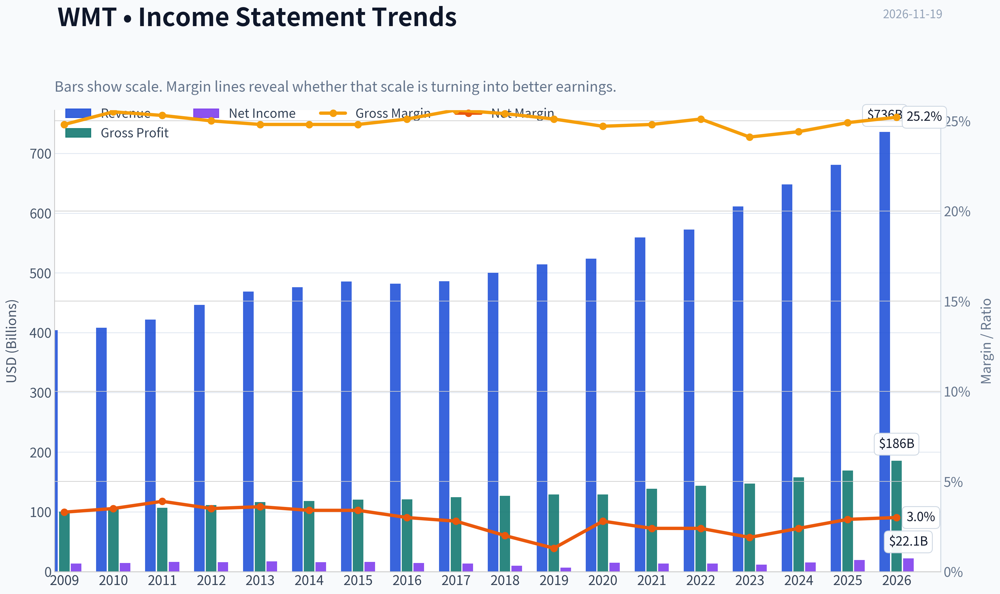

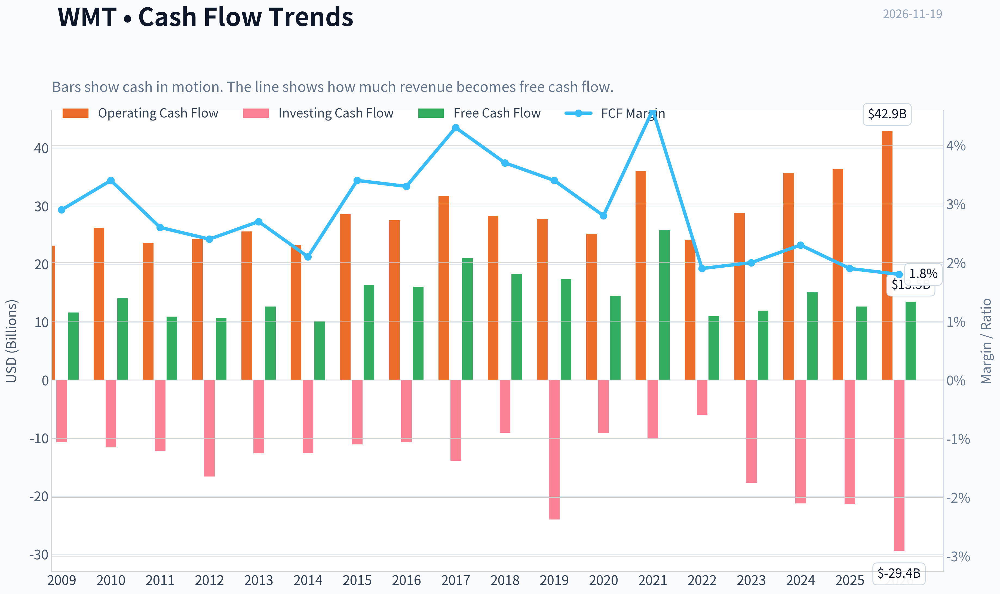

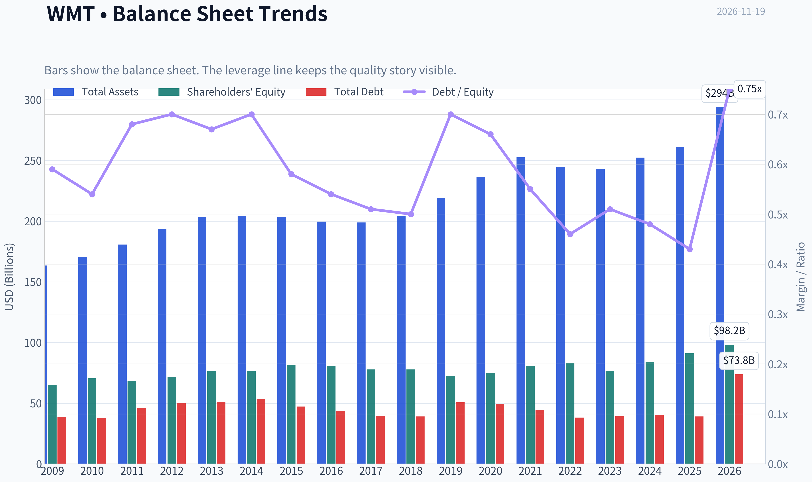

This graph tracks the profitability and return metrics (ROE, ROIC, Margins) of **WMT** over the past decade, highlighting capital efficiency trends.

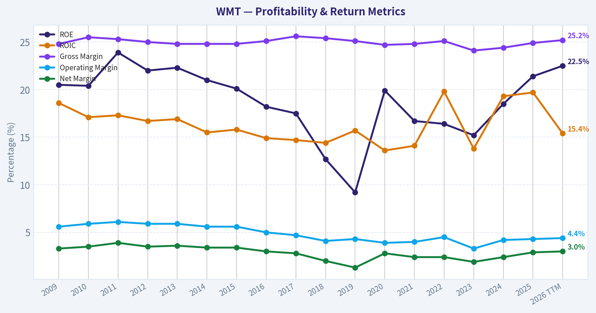

This chart illustrates the financial health of **WMT** over the last 10 years, mapping cash equivalents and free cash flow against total obligations (Debt).

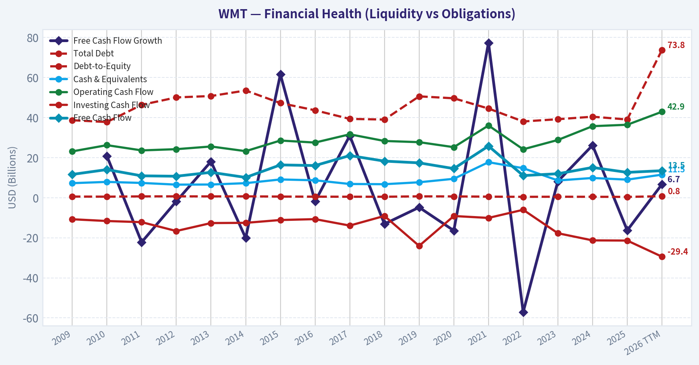

This comparison chart from *Profitability and Operating Quality* stacks current figures against historical benchmarks for **WMT**, making it easy to see where the company trades relative to its own averages.

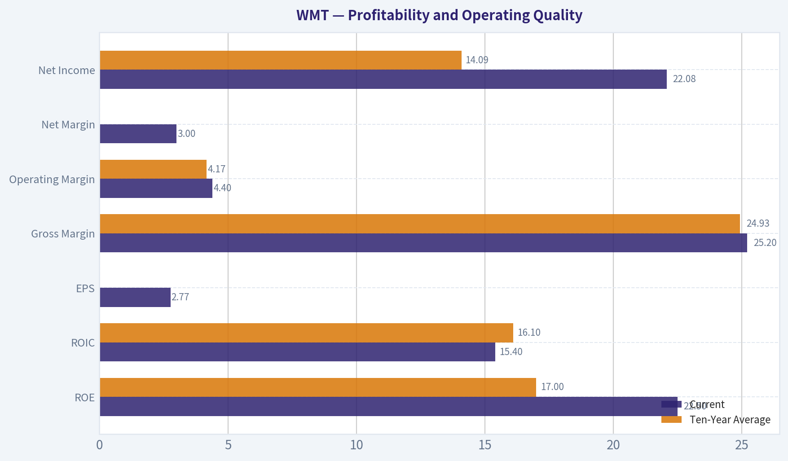

---

### Intrinsic Value Analysis (Buffett)

> *Following Warren Buffett's value investing philosophy: Circle of Competence, Economic Moat, Management Quality, and Margin of Safety.*

#### Intrinsic Value Snapshot

Price is what you pay. Intrinsic value is what the business may be worth based on the cash it can create for owners over time. We show a range, not one magic number.

- Current Price: $127.36
- Value Range (conservative to optimistic across both DCF methods): $3.56 to $161.76

##### Owner Earnings (Buffett Method)
- Net Income: $19,436,000,000.00
- Depreciation & Amortization: $14,203,000,000.00
- Capital Expenditures: $-26,642,000,000.00
- Working Capital Changes: $752,000,000.00
- Owner Earnings: $19,255,000,000.00

##### Intrinsic Value
###### Buffett Method
Uses owner earnings. Stricter, and usually more conservative.
- Conservative: $6.03
- Average: $55.02
- Optimistic: $161.76
- Discount Rate: 10.0%

###### Cash Flow Method
Uses free cash flow. Better for companies spending heavily today to grow tomorrow.
- Conservative: $3.56
- Average: $13.71
- Optimistic: $38.76
- Discount Rate: 10.0%

ANALYST STANCE: **Neutral**

#### Executive Conclusion

Walmart is an exceptional retail franchise, but at **$127 per share and approximately $1.01 trillion of market capitalization**, the stock price appears to discount extraordinary future growth. The business has a wide, durable moat and strong competitive positioning, but the valuation provides little protection against slower growth, margin pressure, or a normalization of its earnings multiple.

The market currently values Walmart at approximately **46 times earnings** and a **1.5% free-cash-flow yield**. The reverse-DCF indicates that the price implies roughly **38.2% annual growth for ten years**, which is far above what a mature retailer can reasonably sustain. This is a high-quality company at an aggressive price-not an attractive Buffett purchase today.

#### Factor Scorecard

| Factor | Score | Assessment |
|---|---:|---|
| 1. Business simplicity and predictability | 4/5 | Easy to understand: Walmart buys goods at scale and sells them at low prices through stores and digital channels. Predictability is strong, although retail margins and consumer behavior remain competitive and cyclical. |
| 2. Durable competitive advantage | 5/5 | Wide and widening moat from scale, logistics, purchasing power, convenience, brand trust, and growing digital ecosystems. |
| 3. Management and capital allocation | 4/5 | Management has steadily invested in stores, supply chain, e-commerce, advertising, and membership while preserving Walmart's value proposition. Valuation discipline around acquisitions and buybacks remains important. |
| 4. Industry structure | 4/5 | Retail is competitive, but Walmart operates at a scale few competitors can match. The industry is capital-intensive, though Walmart's scale produces attractive strategic returns on that investment. |

**Gate 5-Quality and solvency hard floor:** **Not tripped.** Walmart remains profitable, cash-generative, systemically important in its industry, and does not exhibit the combination of deteriorating fundamentals and financial distress required for a hard avoid.

#### Moat Analysis

| Moat source | Evidence | Durability |
|---|---|---|
| Cost advantage | Walmart's purchasing scale, distribution network, store density, and logistics infrastructure allow it to offer consistently low prices. | Wide |
| Brand and trust | "Everyday low prices" is a deeply embedded consumer proposition, particularly valuable during periods of inflation or economic stress. | Wide |
| Convenience and physical network | Thousands of locations create proximity, pickup, delivery, and fulfillment advantages that online-only competitors cannot fully replicate. | Wide |
| Network and ecosystem effects | Walmart+ membership, digital sales, marketplace activity, advertising, and fulfillment services reinforce customer engagement and supplier relationships. | Widening |
| Switching costs | Consumer switching costs are modest, but habit, location, convenience, and price perception create recurring behavior. | Moderate |
| Reinvestment runway | E-commerce, automation, advertising, marketplace services, grocery, financial services, and international operations provide multiple reinvestment avenues. | Attractive |

**Key Takeaways:** Walmart's moat is primarily a scale-and-cost advantage reinforced by brand, convenience, and logistics. It is not a pure network-effect business, but the combination of physical stores, digital capabilities, supplier relationships, and customer data is becoming increasingly difficult to replicate.

#### Management Quality and Capital Allocation

Walmart's management has generally acted like a long-term owner by emphasizing market share, low prices, supply-chain investment, and customer retention over maximizing short-term margins. The company has also adapted meaningfully to e-commerce, omnichannel retail, advertising, and membership services rather than allowing its traditional store model to become obsolete.

The principal capital-allocation risk is not poor stewardship but the possibility that management becomes overly willing to invest at low incremental returns because the company's valuation is high and growth expectations are elevated. At this share price, continued acquisitions or aggressive expansion would need to create substantial per-share value to justify the market's expectations.

#### Financial Summary

| Metric | Latest available figure |
|---|---:|
| Share price | $127 |
| Market capitalization | $1.01 trillion |
| Price-to-earnings ratio | 46.1x |
| Revenue growth, year over year | 4.7% |
| Gross margin | 24.9% |
| Return on equity | 22.0% |
| Free-cash-flow yield | 1.5% |
| Implied free cash flow | Approximately $15.2 billion |
| Current ratio | 0.79x |
| Headline intrinsic value | $59.63 |
| Reverse-DCF growth implied by price | Approximately 38.2% annually for ten years |

**Key Takeaways:** Walmart earns a strong 22% return on equity and continues to grow revenue, but the valuation is extreme relative to the company's operating growth. A 1.5% free-cash-flow yield means investors are paying approximately $67 for every dollar of current free cash flow, leaving little room for execution mistakes or slower growth.

#### Owner Earnings Calculation

Owner earnings are approximated using free cash flow because the available research data does not separately identify maintenance capital expenditures and working-capital investment.

| Owner-earnings component | Approximation |
|---|---:|
| Net income | Not separately provided in the research summary |
| Depreciation and amortization | Not separately provided |
| Less: maintenance capital expenditures | Not separately provided |
| Less: working-capital increases | Not separately provided |
| Free-cash-flow proxy for owner earnings | Approximately $15.2 billion |
| Owner-earnings value implied by the no-growth DCF | Approximately $5.50 per share |

**Key Takeaways:** Walmart produces substantial cash, but its heavy store, technology, automation, and supply-chain investment makes the distinction between maintenance and growth capital expenditure important. Using free cash flow as a conservative owner-earnings proxy still produces a very low yield relative to the current stock price.

#### Three-Scenario DCF Valuation

The following simplified DCF uses approximately **$5.50 per share of owner earnings** as the starting point and a 10% discount rate.

| Scenario | Core assumption | Estimated intrinsic value per share |
|---|---|---:|
| A. No growth | Owner earnings remain constant indefinitely | $55 |
| B. GDP growth | 3% perpetual growth | $81 |
| C. Historical-growth framework | 10% growth for ten years, then 3% terminal growth; mechanical upper-bound case | Approximately $115 |
| Research-pack blended valuation | Weighted blend of owner earnings, FCF, FCFF, and reverse-DCF methods | $59.63 |

**Key Takeaways:** Even an optimistic 10% growth scenario produces an estimated value below the current $127 price. The blended valuation of approximately $59.63 is less than half the market price, while the three-model estimates range from approximately $13.71 to $55.02 before the broader valuation blend is applied.

#### Margin of Safety Analysis

| Valuation measure | Value | Discount or premium versus $127 |
|---|---:|---:|
| Headline blended intrinsic value | $59.63 | 113.6% premium to intrinsic value |
| No-growth DCF | $55 | 131% premium |
| GDP-growth DCF | $81 | 57% premium |
| Optimistic 10% growth DCF | $115 | 10% premium |
| Market price | $127 | - |

A wide-moat, high-quality compounder can reasonably be purchased with only a 10% to 15% margin of safety. Walmart does not meet that standard at $127. Even the optimistic growth case produces no meaningful margin of safety, and the reverse-DCF requires approximately 38.2% annual growth for a decade.

#### Buffett Scorecard

| Criterion | Weight | Score | Weighted contribution |
|---|---:|---:|---:|
| Moat width and durability | 25% | 5/5 | 1.25 |
| Valuation and margin of safety | 20% | 1/5 | 0.20 |
| Capital returns versus WACC | 15% | 4/5 | 0.60 |
| Business understanding and predictability | 12% | 4/5 | 0.48 |
| Management and capital allocation | 12% | 4/5 | 0.48 |
| Reinvestment runway | 8% | 5/5 | 0.40 |
| Balance-sheet strength | 4% | 3/5 | 0.12 |
| Industry structure | 4% | 4/5 | 0.16 |
| **Total** | **100%** | - | **3.69/5** |

**Key Takeaways:** Walmart scores highly on moat, management, predictability, and reinvestment opportunity. The valuation score is the decisive weakness: the franchise is excellent, but the stock price assumes a growth trajectory that leaves no adequate margin of safety.

#### Investment Stance

**Neutral - High conviction.**

Walmart should remain on the watchlist as a potential long-term compounder, not treated as a poor business. A more attractive entry point would require either a material decline in the share price, a substantial acceleration in sustainable owner earnings, or both. At $127, the investment depends on continued exceptional execution and unusually high growth; Buffett's preferred setup would be Walmart's same franchise purchased at a considerably more rational price.
#### Valuation Bridge

This bridge places the current market price beside each intrinsic value lens so readers can see whether upside depends on one method or shows up across several methods.

| Scenario | Intrinsic Value / Share |
| --- | ---: |
| Buffett Method | $55.02 |
| Cash Flow Method | $13.71 |
| Damodaran Method | $51.48 |
| Current Price | $127.36 |

#### Key Takeaways

If one method is far above the others, the upside case depends on a specific modelling assumption. When several methods cluster together, the valuation story is more robust.

#### Valuation Visuals

This comparison chart from *Latest Earnings Snapshot* stacks current figures against historical benchmarks for **WMT**, making it easy to see where the company trades relative to its own averages.

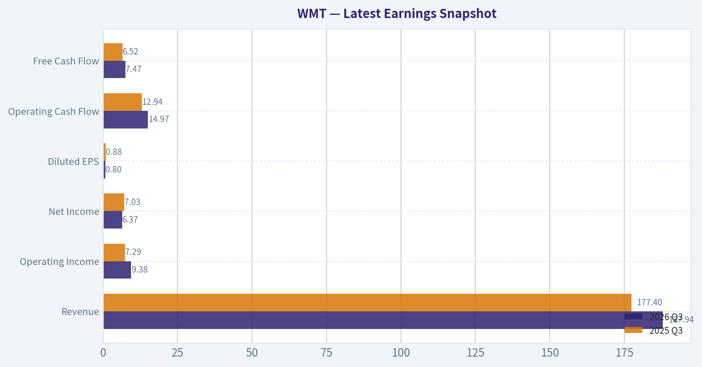

This comparison chart from *Current Metrics Versus Ten-Year Averages* stacks current figures against historical benchmarks for **WMT**, making it easy to see where the company trades relative to its own averages.

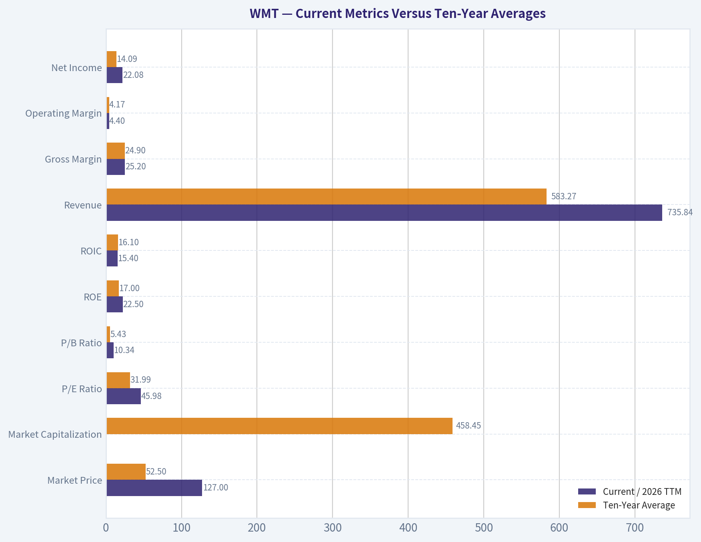

This comparison chart from *Balance Sheet and Financial Strength* stacks current figures against historical benchmarks for **WMT**, making it easy to see where the company trades relative to its own averages.

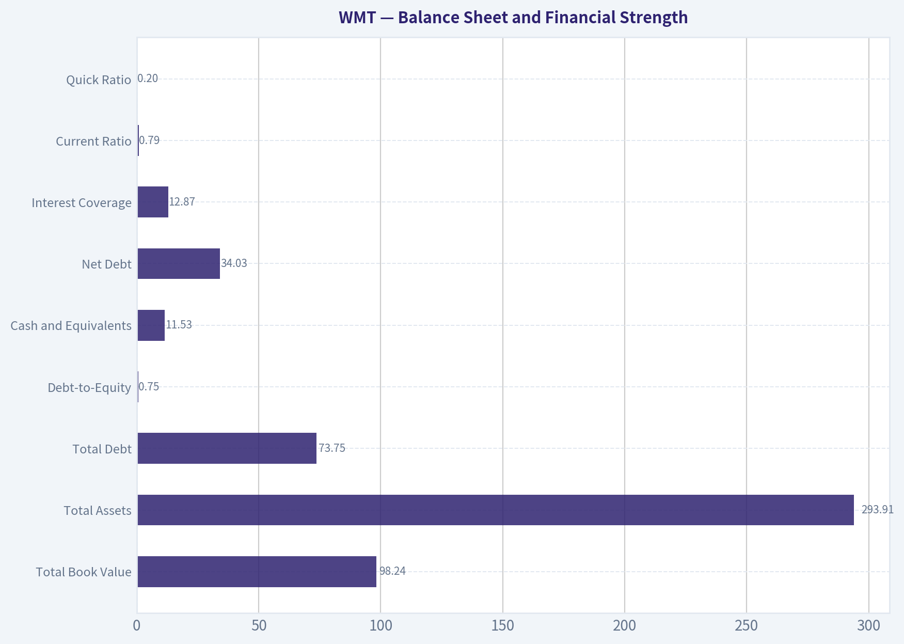

---

### Trend & Growth Analysis (Lynch/Druckenmiller/Fisher)

> *Following Peter Lynch's GARP, Stanley Druckenmiller's macro-aware approach, and Philip Fisher's scuttlebutt methodology.*

ANALYST STANCE: **Bearish**

#### Executive Conclusion

Walmart is a high-quality, defensive retail compounder, but it does not currently fit a growth-investing mandate. Revenue growth is only **4.7%**, while the stock trades at approximately **46x earnings** and offers a **1.5% free-cash-flow yield**. The valuation appears to discount an extraordinary acceleration that is not yet visible in reported growth.

#### 1. Lynch Classification

| Metric | Assessment |
|---|---|
| Lynch category | **Stalwart** |
| Revenue growth | 4.7% year over year |
| P/E | 46.1x |
| ROE | 22.0% |
| Growth-investor fit | Weak at current valuation |
| Position stance | Do not initiate; existing holders may hold selectively |

**Key Takeaways:** Walmart is a strong stalwart rather than a fast grower. Its scale, brand, and distribution network are excellent, but current growth is far below the 15%-25% threshold generally required for attractive ten-bagger potential.

#### 2. The Story in Three Bullets

- Walmart is using its massive store and logistics network to defend grocery share and expand higher-margin businesses such as advertising, marketplace, membership, and e-commerce.
- Its scale creates a durable competitive moat: purchasing power, convenience, supply-chain density, and customer traffic.
- The problem is valuation: investors are paying a premium multiple for a business growing at a mid-single-digit rate.

#### 3. TAM and 10x Test

| Item | Assessment |
|---|---|
| Core opportunity | Global retail, grocery, e-commerce, advertising, marketplace, and fulfillment |
| Current revenue base | Approximately $680-700 billion annually |
| 10x revenue target | Approximately $6.8-7.0 trillion |
| Can Walmart reach 10x while remaining below 20% market share? | Mathematically possible across global retail, but strategically and economically implausible |
| TAM quality | Large and durable, but mature |
| TAM growth | Likely low-to-mid single digit in core retail; faster in digital advertising and marketplace |

**Key Takeaways:** Walmart has an enormous addressable market, but its existing scale makes tenfold revenue growth extremely difficult. The more realistic opportunity is gradual share gain and mix improvement, not a 10x growth trajectory.

#### 4. Revenue Growth Trend

| Indicator | Result | Interpretation |
|---|---:|---|
| Revenue growth | 4.7% YoY | Stalwart-level growth |
| Latest quarterly revenue estimate | $187.3 billion | Large but mature base |
| Acceleration evidence | Not established | No confirmed growth inflection |
| Growth quality | Mixed | Core retail is mature; digital and advertising are faster-growing |
| Market expectation | Very high | Valuation implies substantial future improvement |

**Key Takeaways:** Reported growth is stable but not accelerating into fast-growth territory. Walmart may be improving its revenue mix, but the aggregate business still lacks the acceleration needed to justify a growth-stock classification.

#### 5. Unit Economics and Operating Efficiency

| Metric | Assessment |
|---|---|
| LTV/CAC | Not disclosed in a directly usable form |
| Net revenue retention | Not applicable to the consolidated retail model |
| Rule of 40 | Not meaningful for a retailer |
| Gross margin | 24.9% |
| Free-cash-flow yield | 1.5% |
| Current ratio | 0.79 |
| ROE | 22.0% |

**Key Takeaways:** Walmart's economics are better assessed through inventory turns, same-store sales, operating margin, and free cash flow rather than SaaS metrics. The 22% ROE is strong, but the low free-cash-flow yield indicates that much of the company's quality is already reflected in the stock price.

#### 6. Inflection-Point Assessment

| Potential inflection | Evidence | Rating |
|---|---|---|
| Product cycle | E-commerce, advertising, marketplace, and membership expansion | Positive but not yet decisive |
| Market share | Walmart continues to benefit from value-oriented consumers | Positive |
| Margin | Higher-margin digital businesses could improve mix | Unconfirmed |
| TAM | Retail media and marketplace expand the opportunity | Positive |
| Competitive position | Scale advantages remain strong | Positive |
| Revenue acceleration | 4.7% growth does not confirm acceleration | Negative |

**Key Takeaways:** Walmart has several credible strategic initiatives, particularly in advertising and digital commerce. However, these businesses have not yet produced a consolidated growth inflection large enough to overcome the company's mature revenue base.

#### 7. Macro Setup

| Macro factor | Assessment |
|---|---|
| Consumer environment | Walmart is relatively defensive and can gain share when consumers trade down |
| Inflation | Mixed: can lift nominal sales but pressure consumers and margins |
| Interest rates | High valuation remains vulnerable if rates stay elevated |
| Economic cycle | Defensive positioning is favorable in uncertainty |
| Secular themes | E-commerce, omnichannel retail, retail media, and automation |
| Macro verdict | Operationally favorable; valuation-sensitive |

**Key Takeaways:** Walmart's defensive model is attractive in a weaker economy, but that strength is already widely recognized. A premium valuation leaves less room for error if rates remain high or consumer spending normalizes.

#### 8. Fisher 15-Point Score

| Fisher category | Score |
|---|---:|
| Market potential | 4/5 |
| New-product development | 4/5 |
| R&D and innovation | 3/5 |
| Sales organization | 5/5 |
| Profit margins | 3/5 |
| Margin improvement | 3/5 |
| Labor relations | 3/5 |
| Executive relations | 4/5 |
| Management depth | 5/5 |
| Cost analysis and accounting | 4/5 |
| Competitive moat | 5/5 |
| Long-range profit outlook | 4/5 |
| Dilution risk | 4/5 |
| Management candor | 4/5 |
| Management integrity | 4/5 |
| **Total** | **59/75** |

**Key Takeaways:** Walmart scores well on scale, management depth, distribution, and competitive positioning. Its weaker points are modest margins and limited organic growth relative to the valuation, producing a good-business score but not an outstanding-growth-stock score.

#### 9. Valuation Analysis

| Valuation measure | Result | Interpretation |
|---|---:|---|
| P/E | 46.1x | Very expensive for 4.7% revenue growth |
| PEG using revenue growth as proxy | 9.8x | Extremely unattractive |
| FCF yield | 1.5% | Low cash-flow return |
| Headline intrinsic value | $59.63 | Far below current price |
| Current price | $127 | Significant premium to modeled value |
| Reverse-DCF implied growth | Approximately 38.2% annually for 10 years | Extremely demanding assumption |
| 3-model intrinsic-value range | $13.71-$55.02, with headline $59.63 | Models consistently below market price |

**Key Takeaways:** Walmart fails the Lynch PEG test by a wide margin, even using revenue growth as a rough substitute for earnings growth. The reverse DCF suggests that the current price requires extraordinary long-term growth, while the available operating data show only mid-single-digit expansion.

##### Scenario Analysis

| Scenario | Assumption | Investment implication |
|---|---|---|
| Bear | Growth remains near 4%-6%; multiple compresses toward 25x-30x earnings | Significant downside risk |
| Base | Growth reaches 6%-8%; multiple remains near 30x-35x | Returns may be limited despite good execution |
| Bull | Digital, advertising, and marketplace businesses accelerate materially; earnings growth exceeds 15% | Upside possible, but requires a clear inflection |
| Current market pricing | Sustained extraordinary growth implied | Little margin of safety |

**Key Takeaways:** The bull case depends on Walmart becoming materially more than a traditional retailer. Without a sharp acceleration in digital and higher-margin businesses, the base-case return profile appears inadequate for a new position.

#### 10. Growth Investor Scorecard

| Criterion | Weight | Score / 5 | Weighted result |
|---|---:|---:|---:|
| The Story | 10% | 3.0 | 0.30 |
| TAM and runway | 20% | 3.0 | 0.60 |
| Revenue growth | 20% | 1.5 | 0.30 |
| Unit economics | 15% | 2.0 | 0.30 |
| Competitive position | 10% | 4.5 | 0.45 |
| Management quality | 10% | 4.0 | 0.40 |
| Macro setup | 5% | 2.5 | 0.13 |
| Profitability path | 5% | 4.0 | 0.20 |
| Valuation | 5% | 1.0 | 0.05 |
| **Total** | **100%** |  | **2.73 / 5.00** |

**Key Takeaways:** Walmart's business quality scores well, but growth, valuation, and unit-economics transparency weigh heavily on the overall result. A score of 2.73 falls in the avoid/watch-list range rather than the advocate range.

#### 11. Position Size Stance

| Investor situation | Suggested stance |
|---|---|
| New growth investor | **0% initial position** |
| Existing long-term holder | Hold only if seeking defensive quality and accepting modest expected returns |
| High-conviction growth portfolio | Do not allocate capital at current valuation |
| Potential re-entry condition | Meaningful valuation reset or confirmed multi-quarter acceleration |

**Key Takeaways:** Walmart can be a reasonable defensive holding, but it is not attractive as a new high-growth investment at $127. The preferred action is to wait for either a materially lower valuation or evidence that digital, advertising, and marketplace growth are accelerating the consolidated business.

#### 12. Key Risks and Catalysts

| Catalysts | Risks |
|---|---|
| Faster growth in retail media and marketplace | Multiple compression |
| Stronger e-commerce profitability | Revenue growth remains stuck near 5% |
| Sustained market-share gains | Consumer weakness and margin pressure |
| Operating leverage from automation and scale | High expectations create downside asymmetry |
| Expansion of membership and higher-margin services | Digital initiatives fail to change overall economics |

**Key Takeaways:** Walmart has credible catalysts, but they are already well known and appear heavily capitalized into the valuation. The primary risk is not business failure; it is earning an ordinary return from an extraordinary price.

#### Final Verdict

Walmart is a **high-quality stalwart, not a fast grower**. Its moat and defensive characteristics are attractive, but the combination of **4.7% revenue growth, 46x earnings, 1.5% FCF yield, and a substantial premium to modeled intrinsic value** does not meet a Lynch-Druckenmiller growth-investing hurdle.

**Final stance: Bearish for new growth-oriented investment; Neutral for valuation reset or confirmed growth acceleration.**

#### Growth & Scorecard Visuals

This comparison chart from *Growth and Cash-Flow Analysis* stacks current figures against historical benchmarks for **WMT**, making it easy to see where the company trades relative to its own averages.

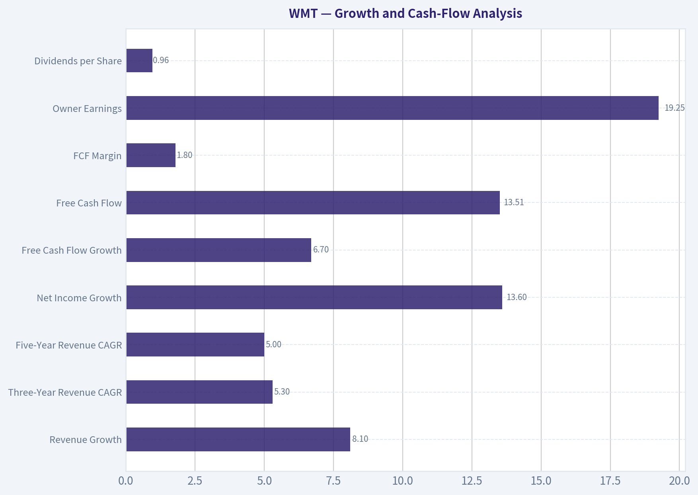

---

### Market Technical Analysis

ANALYST STANCE: **Neutral**

#### WMT technical market report

**Data through November 18, 2026.** November 19 was identified as a non-trading day in the retrieved dataset, so the latest usable close is **$127.36**.

WMT's technical structure is constructive on a medium- and long-term basis, but short-term momentum has begun to cool after a strong October-to-early-November advance. The stock remains above its major moving averages and its volume-weighted average price, which keeps the broader trend bullish. However, the recent decline in the MACD histogram and the retreat in RSI from overbought territory suggest that upside momentum is no longer accelerating.

#### Selected indicators and current readings

| Indicator | Latest reading | Interpretation |
|---|---:|---|
| Close | $127.36 | Latest available close on November 18 |
| 10 EMA | $126.57 | Price is modestly above short-term trend support |
| 50 SMA | $115.82 | Strong medium-term uptrend remains intact |
| 200 SMA | $118.68 | Long-term trend is positive; price is about 7.3% above it |
| VWMA | $126.60 | Price is slightly above the volume-weighted trend benchmark |
| RSI | 64.62 | Positive momentum, but below the conventional 70 overbought level |
| MACD | 3.38 | MACD remains materially above zero, supporting a bullish underlying trend |
| MACD histogram | -0.26 | Short-term momentum has weakened; MACD is below its signal line |
| ATR | $2.67 | Typical daily trading range is approximately 2.1% of the share price |

**Key Takeaways:** WMT remains above every major trend reference, which confirms a broadly bullish structure. The main caution is that the MACD histogram has turned negative while RSI has eased from overbought levels, indicating consolidation or a near-term pullback risk rather than a clean acceleration higher.

#### Trend structure

The most important signal is the alignment of the moving averages. WMT closed at **$127.36**, approximately **$0.79 above the 10-day EMA**, **$11.54 above the 50-day SMA**, and **$8.68 above the 200-day SMA**. This is a favorable configuration: the short-term average is above the medium-term average, and the medium-term average is below the current price but rising sharply.

The 50-day SMA has increased from approximately **$108.66 in early October to $115.82 by November 18**. That rise confirms that the recovery from the late-September and early-October lows was not merely a brief rebound. The 200-day SMA has also turned upward, moving from roughly **$117.75 in early October to $118.68**, although its slope is much flatter because of its longer calculation period.

The recent price action has been more complicated. WMT advanced from approximately **$104 in early October to a November 5 high near $131.82**, a gain of roughly 26%. It then pulled back toward **$124-$125** before recovering to $128.41 on November 16. The latest two sessions have seen modest weakness, with the stock closing at $127.52 and then $127.36. This looks more like digestion of a large rally than a confirmed trend reversal, provided the stock holds above its short-term support zone.

#### Momentum analysis

The RSI reading of **64.62** is bullish but not yet technically overbought. RSI had reached **77.92 on November 2**, then declined as price consolidated. This decline is generally healthy: it removes some excess momentum without requiring a major breakdown. The current RSI level leaves room for another advance, but the indicator would become more compelling if it turned upward while holding above the 50-60 region.

MACD presents a more nuanced picture. The MACD line remains positive at **3.38**, meaning the intermediate momentum trend is still bullish. However, the MACD histogram has fallen to **negative 0.26**, compared with strongly positive readings earlier in November. This indicates that the MACD line has moved below its signal line and that upside momentum is decelerating.

The combination of a positive MACD and a negative histogram often describes a stock in a bullish trend that has entered a consolidation phase. It is not, by itself, a bearish reversal signal. A renewed move above the recent high near $131.82 accompanied by a positive histogram would strengthen the bullish case. Conversely, continued histogram deterioration alongside a break below the 10-day EMA would increase the probability of a deeper retracement toward the 50-day average.

#### Volume and price confirmation

The VWMA is approximately **$126.60**, only about **$0.76 below the latest close**. This is an important short-term confirmation: WMT is trading slightly above the level at which recent volume-weighted activity has concentrated. A sustained hold above the VWMA suggests that buyers still have a modest advantage.

The latest session's volume was approximately **27.9 million shares**, higher than several recent sessions, while the stock closed slightly lower. That combination does not constitute a decisive distribution signal, but it does indicate that the market is actively testing the recent advance. The much larger volume spikes earlier in the year-particularly during major price gaps and selloffs-show that WMT can experience abrupt repricing events. Traders should therefore avoid treating the current low-volatility appearance as permanent.

#### Volatility and risk management

ATR is approximately **$2.67**, implying a normal daily movement of around 2.1% at the current share price. A move of one ATR from the latest close would place a rough daily fluctuation range near **$124.69 to $130.03**, although actual market movement can exceed that range during earnings announcements or major news events.

For short-term traders, stops placed too close to the current price may be vulnerable to ordinary volatility. The 10-day EMA near **$126.57** is an immediate trend reference, but a brief intraday move below it would not necessarily invalidate the larger trend. More meaningful deterioration would involve a sustained close below the **$124-$125 area**, followed by a break of the rising 50-day SMA structure.

#### Key price levels and scenarios

| Zone or level | Technical significance | What traders may watch |
|---|---|---|
| $131.82 | Recent swing high and immediate major resistance | A decisive breakout could reestablish upside momentum |
| $128-$130 | Near-term recovery and supply zone | Sustained closes above this area would improve the bullish setup |
| $126.60-$126.57 | VWMA and 10 EMA cluster | First short-term support and test of immediate trend strength |
| $124-$125 | Recent consolidation and pullback support | Holding here would favor continued range-bound recovery |
| $118.68 | 200 SMA | Important long-term trend support |
| $115.82 | 50 SMA | Deeper medium-term support; a close below it would materially weaken the structure |
| $2.67 ATR | Typical daily volatility estimate | Useful for position sizing and stop-distance planning |

**Key Takeaways:** The first support area is tightly grouped around $126.60-$126.57, while the more important near-term floor is approximately $124-$125. Resistance is concentrated near $128-$130 and then the November high at $131.82. A breakout above $131.82 would improve the trend outlook, whereas a sustained move below $124-$125 would signal that the consolidation is becoming a deeper correction.

#### Overall assessment

WMT's primary trend remains bullish because price is above the rising 50-day and 200-day moving averages, and the MACD remains well above zero. The recent advance has also lifted the VWMA, showing that volume-weighted price participation has improved rather than merely reflecting a thin-volume rally.

The near-term picture is less decisive. RSI has cooled from overbought conditions, the MACD histogram is negative, and price has stalled below the recent $131.82 high. These signals favor a **watchful, confirmation-based approach** rather than chasing the stock aggressively at current levels.

The bullish case would strengthen if WMT holds above roughly **$126.50**, turns the MACD histogram positive again, and breaks above **$131.82** with convincing volume. The risk case would become more credible if the stock loses **$124-$125** and then moves toward the 200-day SMA near **$118.68**. Until one of those conditions occurs, the most accurate characterization is a strong broader uptrend undergoing short-term momentum consolidation.

| Category | Current assessment | Trading implication |
|---|---|---|
| Long-term trend | Bullish; price is above the 200 SMA | Supports a constructive strategic bias |
| Medium-term trend | Bullish; rising 50 SMA and strong price distance above it | Pullbacks may attract trend-following buyers |
| Short-term trend | Mildly bullish but losing momentum | Avoid assuming that the prior rally will continue uninterrupted |
| Momentum | RSI positive; MACD positive but histogram negative | Trend remains intact, but acceleration has weakened |
| Volume confirmation | VWMA slightly below price | Buyers retain a modest technical advantage |
| Volatility | ATR near $2.67 | Use risk controls that account for normal daily movement |
| Immediate support | $126.50-$126.60, then $124-$125 | Important levels for judging whether consolidation is healthy |
| Major resistance | $131.82 | Breakout above this level would be a fresh bullish signal |
| Overall stance | **Watch** | Favor confirmation above resistance or disciplined entries near support |

**Key Takeaways:** WMT is technically healthy on the larger time frame, but its short-term momentum is no longer expanding. The preferred approach is to watch whether support near $126.50-$126.60 holds and whether the stock can reclaim $131.82; a failure below $124-$125 would warrant a more defensive interpretation.

#### Market Visuals

This comparison chart from *Market Metrics and Valuation* stacks current figures against historical benchmarks for **WMT**, making it easy to see where the company trades relative to its own averages.

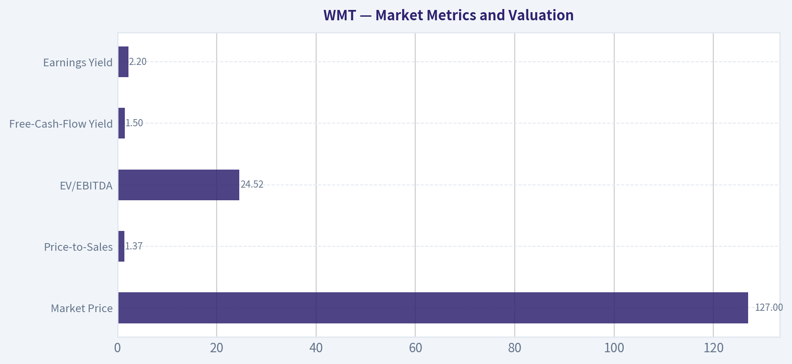

---

### Options Market Analysis

> *Reading options flow - put/call ratios, IV skew, and unusual activity - to gauge institutional positioning and event-driven risk.*

ANALYST STANCE: **Neutral**

#### WMT Options Market Snapshot

As of November 19, 2026, WMT's near-term options data shows substantially more put volume than call volume, but open interest is effectively absent. This makes the positioning difficult to interpret as established institutional exposure.

| Expiration | Call Volume | Put Volume | Put/Call Volume Ratio | Call OI | Put OI | ATM Call IV | ATM Put IV |
|---|---:|---:|---:|---:|---:|---:|---:|
| Nov. 20, 2026 | 41,052 | 71,208 | 1.73 | 0 | 1 | 4.0% | 4.7% |
| Nov. 27, 2026 | 7,358 | 9,151 | 1.24 | 0 | 0 | 2.0% | 2.1% |
| Dec. 4, 2026 | 1,756 | 1,763 | 1.00 | 0 | 0 | 1.4% | 2.0% |
| **Total** | **50,166** | **82,122** | **1.64** | **0** | **1** | - | - |

**Key Takeaways:** Near-term put volume is 64% greater than call volume overall, with the strongest imbalance in the November 20 expiration. However, the virtually nonexistent open interest means this is flow rather than established positioning. Relative to the approximately 0.7 neutral volume baseline, the 1.64 ratio is meaningfully defensive or bearish, but confidence is low.

#### Put/Call Ratio Analysis

The aggregate put/call volume ratio is **1.64**, well above the approximate neutral benchmark of **0.7**. The November 20 ratio of **1.73** is particularly elevated and may reflect short-dated downside hedging, bearish speculation, or traders positioning around an imminent event.

The put/call open-interest ratio cannot be calculated meaningfully: total call OI is reported as zero and total put OI is only one contract. This is highly unusual for a large, liquid company and suggests that the data may represent newly opened or same-day activity, or that the feed's open-interest fields are incomplete.

#### Implied Volatility Assessment

| Expiration | ATM Call IV | ATM Put IV | Put Premium to Call IV |
|---|---:|---:|---:|
| Nov. 20, 2026 | 4.0% | 4.7% | +0.7 percentage points |
| Nov. 27, 2026 | 2.0% | 2.1% | +0.1 percentage points |
| Dec. 4, 2026 | 1.4% | 2.0% | +0.6 percentage points |

**Key Takeaways:** Put IV is higher than call IV in every reported expiration, indicating a modest downside volatility skew. The absolute IV readings are extraordinarily low for equity options and should be treated cautiously, possibly reflecting a data-quality or contract-normalization issue. There is no evidence here of a major volatility premium ahead of a known catalyst, although the November 20 expiration is too close to expiration for a clean event-risk assessment.

The data does not provide separate out-of-the-money put and call IV figures, so a full OTM skew analysis is unavailable. Based on the ATM figures alone, the skew is mildly defensive rather than aggressively fearful.

#### Unusual Options Activity

The data provider defines unusual activity as contracts with volume greater than five times open interest. **No contracts met that threshold.**

| Unusual Contract Category | Result | Interpretation |
|---|---|---|
| Volume greater than 5x OI | None identified | No individually confirmed fresh high-conviction contract |
| High-volume puts | Aggregate put volume elevated | Could indicate hedging or bearish speculation, but contracts and strikes are unavailable |
| High-volume calls | Meaningful absolute call volume | Not sufficient to establish bullish positioning because call OI is reported at zero |

**Key Takeaways:** There are no identifiable contract-level unusual trades to distinguish smart-money positioning from retail speculation. The elevated aggregate put activity is the main bearish clue, but without strikes, execution details, or reliable OI, it cannot be classified as a confirmed institutional put sweep.

#### Open Interest Concentration and Gamma Levels

| Metric | Finding |
|---|---|
| Highest call OI | None reported |
| Highest put OI | One contract in the near-term data |
| Strike concentration | Not available |
| Gamma walls | None identifiable |
| Max-pain or pinning level | Cannot be calculated reliably |

**Key Takeaways:** There is no usable open-interest concentration to identify gravitational strikes, gamma walls, or a likely pinning level. The reported zero call OI and one put OI are inconsistent with normal WMT options-market structure, so confidence in any max-pain interpretation is extremely low.

#### Catalyst and Liquidity Assessment

The November 20 expiration is one day away, making it the most event-sensitive contract window in the dataset. However, no earnings, product-launch, or macro catalyst calendar is included, so the data cannot confirm whether the elevated put volume is event-driven.

Although WMT itself is generally a liquid stock, this specific options snapshot appears **data-thin or unreliable** because of the near-zero open interest and unusually low IV readings. The report should therefore be interpreted as a weak short-term flow signal, not as a robust institutional-positioning read.

#### Overall Options Sentiment

**Overall signal: NEUTRAL, with a bearish tilt.**

The primary bearish driver is the **1.64 aggregate put/call volume ratio**, led by a **1.73 ratio in the November 20 expiration**, together with consistently higher put IV than call IV. Against that, there is no meaningful open-interest buildup, no confirmed unusual contract, no identifiable gamma wall, and no reliable strike-level concentration.

Therefore, the most defensible conclusion is a **cautious bearish short-term bias, but an overall neutral signal because data quality and positioning confidence are poor**. A stronger bearish conclusion would require persistent put accumulation, identifiable downside strikes, or confirmed put sweeps with volume materially exceeding open interest.

#### Summary

| Category | Assessment |
|---|---|
| Put/Call Ratio | Volume ratio 1.64 overall; materially above the ~0.7 neutral baseline. OI ratio unavailable. |
| IV Level | Reported ATM IV is extremely low; put IV exceeds call IV in all expirations. |
| Skew Direction | Mild put skew, suggesting some downside protection demand. Full OTM skew unavailable. |
| Unusual Activity | No contracts with volume greater than 5x OI; no confirmed smart-money trade. |
| Overall Signal | **NEUTRAL with bearish tilt**; low confidence due to near-zero OI and questionable data quality. |

**Key Takeaways:** WMT's options flow leans defensive because puts dominate near-term volume and carry slightly higher implied volatility. Still, the absence of meaningful open interest, unusual-contract signals, and strike concentration prevents a high-confidence bearish call. The appropriate stance is to watch for confirmation rather than treat this snapshot as a decisive directional signal.

---

## Research Team Commentary

> *The Research Manager synthesizes the Bull vs Bear debate into action-free commentary. This is a pre-risk view, not the final stance.*

Core Takeaway: Walmart is a wonderful business, but at roughly $127, 46 times earnings, and a 1.5% free-cash-flow yield, the stock does not offer the quality-adjusted margin of safety I would require. The company's moat and emerging higher-margin businesses justify a premium, but the current price appears to capitalize much of that transformation before it has been fully demonstrated. I would keep Walmart on the watchlist rather than initiate or advocate a position.

The strongest bull argument is that Walmart is no longer merely a mature, low-margin retailer. Its purchasing power, grocery frequency, store density, fulfillment network, supplier relationships, and customer data form a durable and difficult-to-replicate system. Stores can serve simultaneously as retail locations, pickup points, fulfillment hubs, and customer-acquisition assets. Advertising, marketplace commissions, membership, and related services may allow Walmart to monetize existing traffic at much higher incremental margins.

That opportunity should not be dismissed simply because Walmart operates in retail. A roughly 16.9% ROIC and 22% ROE demonstrate that the core franchise already produces attractive returns. Management has also pursued a sensible strategy: strengthen price and convenience, modernize the supply chain, and build adjacent businesses around assets Walmart already owns. This is a coherent extension of the moat rather than an unrelated reinvention.

The strongest bear argument, however, is more decisive for the stock at this price. Based on approximately $15 billion of free cash flow and a $1 trillion market value, a reasonable reverse DCF appears to require something close to mid-to-high-teens annual cash-flow growth over an extended period, depending on discount-rate and terminal assumptions. That is a demanding outcome for a company whose core retail revenue is likely to grow at a mid-single-digit rate.

The higher-margin businesses could close that gap, but the market is already aware of them. The investment case therefore depends not merely on advertising, marketplace, membership, and e-commerce growing, but on them becoming large enough and profitable enough to transform consolidated cash flow. Walmart must accomplish that while continuing to invest in low prices, wages, automation, delivery, technology, and marketplace controls.

The stock-return arithmetic is unforgiving. If earnings grow 8% to 10% but the multiple eventually falls from 46 times earnings to 30 times, multiple compression could absorb most of the operating progress for several years. Walmart could execute well as a company while shareholders earn disappointing returns. That distinction between a great business and a great purchase is the central issue.

I also would not place much weight on the constructive technical trend or the near-term put-volume imbalance. Price strength mainly indicates that investors currently embrace the platform-transformation narrative. Meanwhile, options open interest is too limited to treat the put activity as meaningful institutional conviction. Neither signal changes intrinsic value.

Rationale: Under a Buffett-style framework, Walmart passes the business-quality test but not the purchase-price test. Its moat is wide, its earnings are defensive, its balance sheet does not indicate distress, and management's strategic direction appears rational. Those qualities justify requiring only a modest 10% to 15% discount to conservative intrinsic value rather than demanding a deep-value discount.

Even that modest discount is not visible in the supplied valuation evidence. The current price instead appears to require favorable execution across several initiatives and continued investor willingness to award Walmart a platform-like multiple. There is little protection if e-commerce remains operationally expensive, advertising economics normalize, price investment pressures margins, or incremental returns on automation and fulfillment fall below historical ROIC.

This is why I prefer Neutral to Bearish. Bearish would be more appropriate if the moat were deteriorating, the balance sheet were threatened, or the valuation were plainly disconnected from any credible operating path. Walmart's transformation is credible enough that strong execution could eventually justify a substantial premium. But credibility is not the same as a present margin of safety, so the stock is not an Bullish at this price.

The lesson from similar situations is not to reject premium businesses automatically, but also not to count optionality as though it were already realized cash flow. Investors often correctly identify the winning company and still earn mediocre returns because they paid in advance for nearly all the winning. Walmart's new businesses should be valued according to demonstrated incremental profit and cash generation, not just revenue growth or strategic promise.

Monitoring Plan: Over the next one to four quarters, I would focus first on whether operating income and free cash flow grow consistently faster than revenue. That would be the clearest evidence that the business mix is improving rather than Walmart merely adding costly digital volume.

I would then monitor e-commerce contribution margins, fulfillment costs, and management's comments on profitability. Digital sales growth is not enough if store customers are simply migrating to a more expensive channel.

Advertising, marketplace, and membership should be evaluated through revenue growth, disclosed profit contribution, seller quality, renewal or retention trends, and evidence that these businesses are raising consolidated margins. Rapid advertising growth would strengthen the thesis only if it produces incremental operating profit without undermining customer trust.

Comparable sales should be separated into traffic and ticket growth. Sustainable traffic and market-share gains would support the moat; sales growth driven mainly by inflation would be less valuable. Gross margin, operating margin, labor costs, shrink, and price investment will show whether Walmart is gaining traffic economically.

ROIC and free-cash-flow conversion also matter. Rising capital expenditures may be sensible, but incremental returns must remain attractive. I would watch whether automation and fulfillment investment improve labor productivity and cash generation rather than merely maintaining competitiveness. Share dilution, expensive repurchases, debt growth, and acquisition discipline should also be reviewed.

The thesis would strengthen if higher-margin businesses cause operating income and free cash flow to grow materially faster than sales while ROIC remains near current levels. It would weaken if e-commerce growth remains low-return, consolidated margins stagnate, capital intensity rises, or free cash flow fails to support the premium valuation.

Finally, I would rerun the reverse DCF after each earnings report. I would become more constructive if either the share price declined enough to create a genuine 10% to 15% discount to conservative intrinsic value, or operating evidence reduced the implied growth hurdle without relying on an unusually generous terminal value.

Final stance: Neutral

---

## Value Investing Team Commentary

> *The Investor translates the research view into an investment thesis before risk review. This is still not the final stance.*

Walmart is an outstanding business, but the investment case at approximately $127 per share depends heavily on price. The supplied figures suggest a company with a durable competitive advantage, strong returns on capital, and credible long-term growth initiatives-but also a valuation that leaves little room for execution mistakes.

### Business Quality: Clearly Strong

Walmart's moat is broader than its retail footprint. Its advantages reinforce one another:

- Massive purchasing scale and supplier bargaining power
- Dense store and distribution networks
- Grocery traffic and customer frequency
- Pickup, delivery, and fulfillment capabilities
- A trusted brand among value-conscious consumers
- Growing advertising, marketplace, membership, and financial-service opportunities
- Customer data and traffic that can be monetized across multiple channels

The important point is that Walmart's stores are becoming multifunctional assets. They are not merely sales locations; they can also serve as pickup points, fulfillment hubs, customer-acquisition channels, and infrastructure for same-day delivery. This gives Walmart a structural advantage over purely digital competitors whose fulfillment economics are often less favorable.

The reported 16.9% ROIC and 22% ROE reinforce the view that this is a high-quality franchise rather than simply a large retailer. Management's strategy-protect price leadership while building higher-margin ancillary businesses-is sensible and internally consistent with Walmart's existing assets.

### The Contrarian Bull Case

The consensus view appears to recognize Walmart's quality, but it may still underestimate the strategic value of its ecosystem. Walmart is often analyzed as a mature, low-margin retailer, even though its future economics could increasingly resemble a hybrid of retail, logistics, advertising, membership, and marketplace businesses.

A small increase in monetization per customer could be meaningful given Walmart's enormous traffic base. Advertising and marketplace revenue do not require Walmart to build an entirely new customer ecosystem; they can be layered onto an existing one. If these businesses generate attractive incremental margins, consolidated operating profit could grow faster than sales for many years.

There is also a defensive element to Walmart's model. In weaker economic conditions, consumers may trade down toward Walmart, while in stronger conditions the company can still benefit from traffic, convenience, and its broad merchandise offering. That resilience deserves a premium relative to more cyclical retailers.

The market may therefore be correct that Walmart deserves a higher multiple than it received historically. The mistake would be assuming that a premium multiple automatically makes the stock a good purchase.

### Valuation: The Central Problem

At roughly 46 times earnings and an approximately 1.5% free-cash-flow yield, the valuation appears to price in considerable success from Walmart's newer businesses. A premium is justified, but the current premium seems to require more than simply steady execution.

At this price, investors likely need some combination of:

- Sustained high-single-digit or better earnings growth
- Strong expansion in advertising and marketplace profitability
- Improving e-commerce economics
- Stable or expanding operating margins
- Continued market-share gains
- Limited multiple compression

That is a demanding collection of assumptions for a company whose core retail business is likely to grow at a more moderate rate.

The key distinction is between revenue growth and value creation. Walmart can expand digital sales, marketplace volume, and delivery usage while producing disappointing incremental returns if fulfillment, labor, technology, and delivery costs rise at a similar pace. The investment thesis becomes substantially stronger only when these initiatives visibly improve operating income and free cash flow, not merely reported sales.

A reverse-DCF perspective is particularly important here. If the current valuation requires mid-to-high-teens annual free-cash-flow growth for an extended period, the market is assigning substantial value to future optionality today. That may eventually prove justified, but it reduces the margin of safety. A wonderful business can still be a mediocre investment when the purchase price assumes that most of the transformation will succeed.

### Sentiment and Market Signals

The constructive technical trend confirms that investors currently favor Walmart's platform-transformation narrative. It does not establish intrinsic value. Strong price momentum can reflect improving fundamentals, but it can also indicate that expectations have become vulnerable to disappointment.

Likewise, the elevated near-term put volume is not especially informative if open interest is minimal. It may reflect short-term hedging, expiration-related activity, or tactical positioning rather than durable institutional conviction. Neither the bullish chart nor the options imbalance should materially influence a decade-long ownership decision.

The more useful sentiment signal is that Walmart is widely viewed as a high-quality defensive growth company. That consensus is not irrational. However, when a business is perceived as both exceptionally safe and structurally advantaged, investors often become willing to pay in advance for years of successful execution. That is where contrarian discipline matters: the opportunity may not be to dispute Walmart's quality, but to wait for a price that reflects less perfection.

### What Would Change the View?

I would become more constructive if one of two developments occurred:

1. **The share price declined sufficiently** to create at least a 10%-15% discount to conservative intrinsic value; or
2. **Operating performance improved enough** that the current valuation no longer required unusually aggressive assumptions.

The most important evidence to monitor includes:

- Operating income and free cash flow growing faster than revenue
- Improving e-commerce contribution margins
- Advertising and marketplace profits becoming material and measurable
- Stable gross and operating margins despite wage, shrink, and price-investment pressures
- Comparable-sales growth driven by traffic and market share rather than inflation alone
- Attractive incremental returns on automation and fulfillment spending
- Continued ROIC strength without excessive leverage or dilution

The thesis would weaken if digital growth remained low-return, capital intensity rose persistently, margins stagnated, or free-cash-flow growth failed to approach what the valuation implies.

### Overall Assessment

Walmart passes the business-quality test comfortably. It has a wide moat, resilient demand, capable strategic positioning, and several credible avenues for long-term earnings growth. The concern is not business deterioration or financial distress; it is that the market already recognizes much of the opportunity.

This is therefore not a conventional "avoid the company" situation. It is a valuation-discipline situation. Walmart may execute well and still produce only modest shareholder returns if its earnings multiple normalizes from approximately 46 times to a more conventional premium multiple. Business performance and investment performance can diverge for several years.

**ANALYST STANCE: Neutral** - Walmart is a high-quality long-term franchise with credible platform economics, but the current valuation appears to require too much successful execution and offers insufficient quality-adjusted margin of safety. I would monitor the company closely and prefer either a meaningful price decline or clearer evidence that higher-margin businesses are accelerating consolidated cash flow before initiating a position.

---

## Deep Values Commentary

> *The Risk Management Team debates and the Risk Judge provides the final action-free verdict. This section determines the final Bullish / Neutral / Bearish stance.*

#### Final Stance Scorecard

This scorecard converts the final research view into a weighted decision frame. It does not replace the narrative judgement, but it makes the main drivers of the verdict easier to scan.

| Criterion | Score | Weight | Commentary |
| --- | ---: | ---: | --- |
| Business Quality | 2.75 | 30% | High returns, profitability, and Piotroski health support durability. |
| Valuation Support | 1.33 | 30% | Blends current price against available intrinsic value anchors and valuation ratios. |
| Financial Strength | 2.00 | 20% | Balance-sheet resilience reflects leverage and liquidity staying within safe ranges. |
| Growth Durability | 3.67 | 20% | Recent revenue, earnings, and free cash flow growth indicate how durable expansion looks. |
| TOTAL / FINAL STANCE | 2.36 | 100% | Bearish |

#### Key Takeaways

The weighted score lands at **2.36 / 5.0**, while the final stance remains **Bearish**. This is useful as a quick calibration aid rather than a mechanical signal.

#### Risk Summary

Higher scores indicate more risk pressure. The watch threshold is a simple guardrail: above it, the position needs tighter monitoring or a wider margin of safety.

| Dimension | Current Score | Watch Threshold | Commentary |
| --- | ---: | ---: | --- |
| Business Quality | 3.25 | 3.00 | High returns, profitability, and Piotroski health support durability. |
| Valuation Support | 4.67 | 3.00 | Blends current price against available intrinsic value anchors and valuation ratios. |
| Financial Strength | 4.00 | 3.00 | Balance-sheet resilience reflects leverage and liquidity staying within safe ranges. |
| Growth Durability | 2.33 | 3.00 | Recent revenue, earnings, and free cash flow growth indicate how durable expansion looks. |

#### Key Takeaways

This view helps readers separate *where* the risk sits: valuation, business quality, balance sheet, or growth durability. It is especially useful when the final stance is close to the line between Neutral and Bearish.
