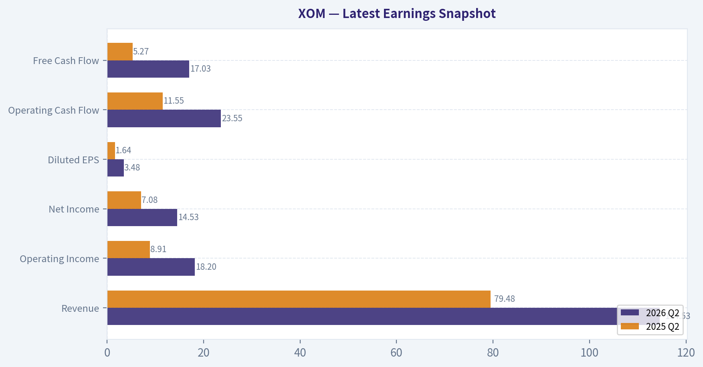
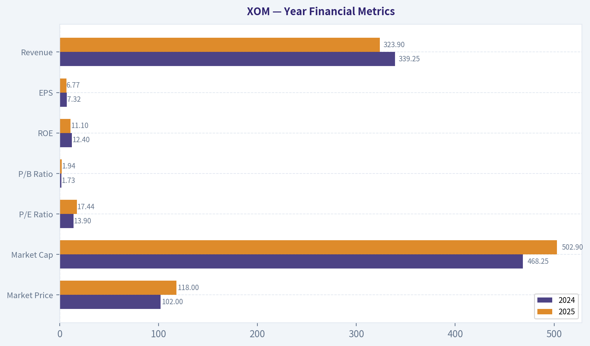
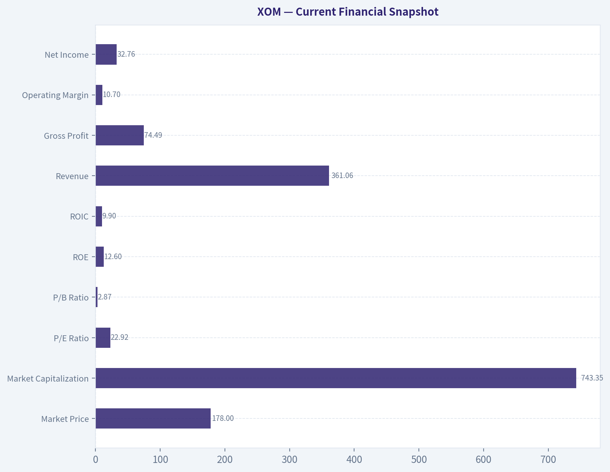
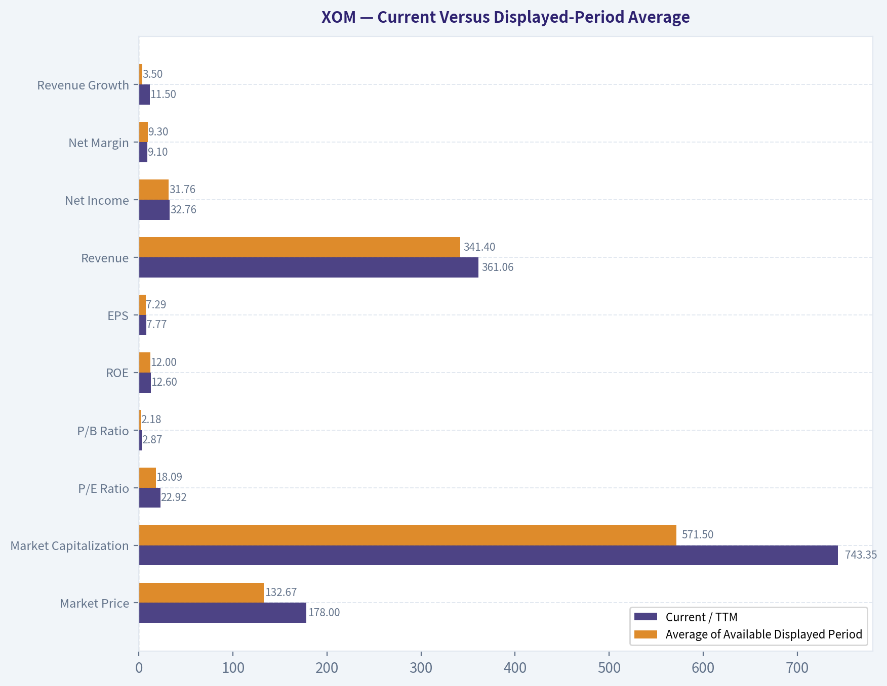
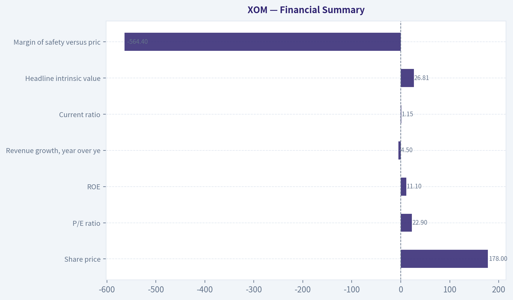
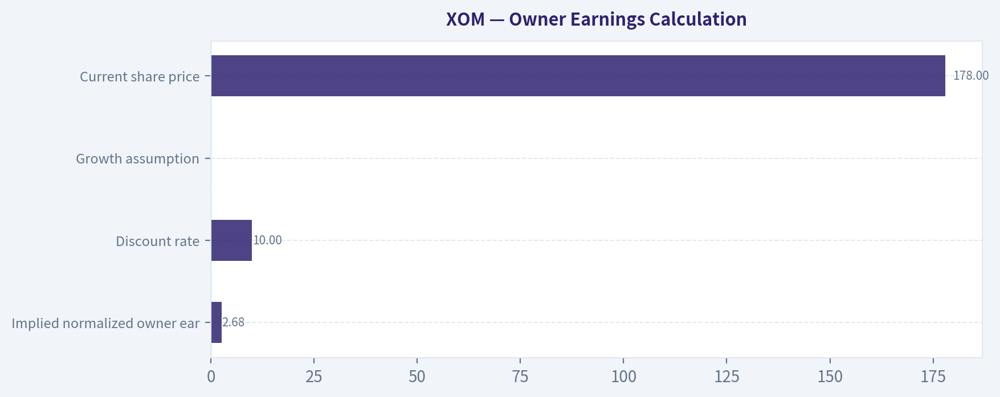
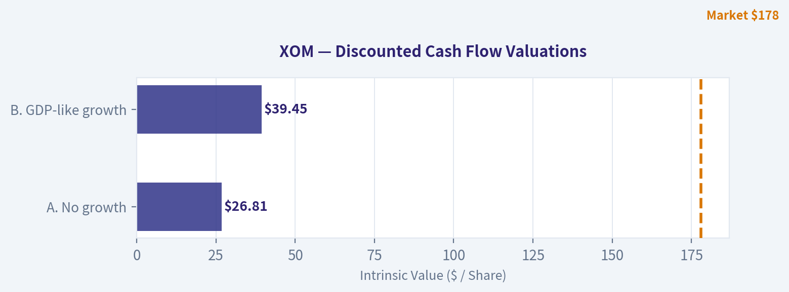
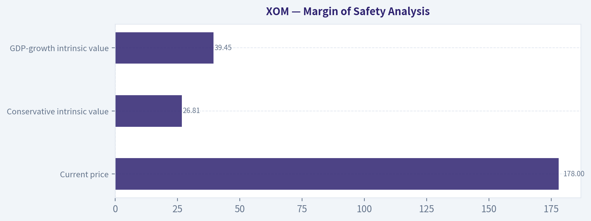

# XOM Deep Value Intelligence

**Analysis Date:** 2026-10-22

## Critical Disclaimer

*This analysis is generated by Deep Value Intelligence, an AI-powered multi-agent investing framework. Education & research only - not financial advice, not a financial advisor.*

---

## Table of Contents

1. Intelligence Summary
2. Analyst Team Reports
   - Fundamentals Analysis
   - Intrinsic Value Analysis (Buffett)
   - Trend & Growth Analysis (Lynch/Druckenmiller/Fisher)
   - Market Technical Analysis
   - Options Market Analysis
3. Research Team Commentary
4. Value Investing Team Commentary
5. Deep Values Commentary

---

## Intelligence Summary

### Thesis + Conditions

**Core Thesis:** ## Executive Briefing

**Key Risks:**
- Valuation is the problem:** At approximately **22.9x trailing earnings**, investors receive only a **4.4% earnings yield** despite cyclical pricing, depletion, heavy reinvestment, and project risk.
- ### Risky Analyst: strongest contribution
- The Risky Analyst correctly emphasizes that Exxon is not an undifferentiated producer. Its advantages include:

**Confidence:** Medium

---

## Analyst Team Reports

### Fundamentals Analysis

#### Latest Earnings Snapshot

*Most recent reported quarter anchored on 2026 Q2, with prior-year comparison when available.*

| Metric | 2026 Q2 | 2025 Q2 | YoY Change |
| --- | ---: | ---: | ---: |
| Revenue | $114.53B | $79.48B | +44.1% |
| Operating Income | $18.20B | $8.91B | +104.2% |
| Net Income | $14.53B | $7.08B | +105.1% |
| Diluted EPS | $3.48 | $1.64 | +112.2% |
| Operating Cash Flow | $23.55B | $11.55B | +103.9% |
| Free Cash Flow | $17.03B | $5.27B | +223.3% |

Key Takeaways: This snapshot anchors the most recent reported quarter before the narrative analysis. It helps readers separate long-run business quality from whatever changed in the latest earnings print.

#### 2-Year Financial Metrics for XOM

*All values below are computed deterministically from raw data - not estimated by AI.*

*Issuer profile: operating company (Energy / Oil & Gas Integrated).*

#### 2-Year Financial Metrics
*Annual rows come from reported financial statements. The final TTM row is computed from the latest four quarters.*

| Metric | 2024 | 2025 | 2026 TTM |
| --- | --- | --- | --- |
| Market Price | $102 | $118 | $178 |
| Market Cap | $468.25B | $502.90B | $743.35B |
| P/E Ratio | 13.90 | 17.44 | 22.92 |
| P/B Ratio | 1.73 | 1.94 | 2.87 |
| ROE | 12.4% | 11.1% | 12.6% |
| ROIC | N/A | N/A | 9.9% |
| EPS | $7.32 | $6.77 | $7.77 |
| Revenue | $339.25B | $323.90B | $361.06B |
| Gross Profit | N/A | N/A | $74.49B |
| Gross Margin | N/A | N/A | 20.6% |
| Operating Margin | N/A | N/A | 10.7% |
| Net Income | $33.68B | $28.84B | $32.76B |
| Net Margin | 9.9% | 8.9% | 9.1% |
| Revenue Growth | N/A | -4.5% | 11.5% |
| Net Income Growth | N/A | -14.4% | 13.6% |
| Free Cash Flow Growth | N/A | N/A | N/A |
| Total Book Value | $270.61B | $259.39B | $259.38B |
| Total Assets | N/A | $448.98B | $464.48B |
| Total Debt | N/A | $43.54B | $42.37B |
| Debt-to-Equity | N/A | 0.17 | 0.16 |
| Cash & Equivalents | $23.19B | $10.68B | $10.59B |
| Shareholders' Equity | $270.61B | $259.39B | $259.38B |
| Operating Cash Flow | $55.02B | $51.97B | $59.73B |
| Investing Cash Flow | $-19.94B | $-25.93B | $-27.94B |
| Free Cash Flow | N/A | N/A | $30.55B |
| FCF Margin | N/A | N/A | 8.5% |
| Dividends / Share | $3.63 | $4.04 | $4.13 |

#### Profitability Metrics
- Return on Equity (ROE): 11.1%
- Return on Invested Capital (ROIC): N/A
- Return on Assets (ROA): 6.4%
- Gross Margin: N/A
- Operating Margin: N/A
- Net Profit Margin: 8.9%

#### Liquidity Metrics
- Current Ratio: 1.15
- Quick Ratio: 0.64

#### Leverage Metrics
- Debt-to-Equity Ratio: 0.17
- Interest Coverage Ratio: N/A
- Net Debt: $32.86B

#### Growth Metrics (Year-over-Year)
- Revenue Growth: -4.5%
- Net Income Growth: -14.4%
- Free Cash Flow Growth: N/A
- Revenue CAGR (3-Year): N/A
- Revenue CAGR (5-Year): N/A

#### Valuation Metrics
- P/E Ratio (TTM): 22.92
- Forward P/E: 14.57
- Price-to-Book: 2.82
- Price-to-Sales: 2.03
- PEG Ratio: 1.54
- EV/EBITDA: 11.35
- Free Cash Flow Yield: N/A
- Earnings Yield: 4.4%

#### Owner Earnings (Buffett Method, Code-Computed)
- Net Income: $28.84B
- + Depreciation & Amortization: N/A
- - Capital Expenditures: N/A
- - Working Capital Changes: $-7.73B
- = **Owner Earnings: $36.57B**

#### Intrinsic Value (Code-Computed)
- Current Price: $178
- **Headline Intrinsic Value (business-model routed): $27**
  Business model: operating company - owner-earnings DCF (operating_company)
  Model spread (min-max across DCFs): $27 - $27
  Margin of safety vs. price (headline): -564.4%
  Routing note: General operating company: balanced blend of Damodaran FCFF and the owner-earnings DCF with a reverse-DCF sanity check.
- Buffett Method (Owner Earnings):
  Conservative: $27
  Average: $27
  Optimistic: $27
- Reverse-DCF: price implies ~52.8%/yr owner-earnings growth for 10y; trailing 3y was N/A, 5y N/A.

#### Piotroski F-Score: 2/9
- Positive Net Income: FAIL
- Positive Operating Cash Flow: FAIL
- ROA Improvement: FAIL
- Cash Flow > Net Income: FAIL
- Decreasing Debt: PASS
- Improving Current Ratio: FAIL
- No Dilution: PASS
- Improving Gross Margin: FAIL
- Improving Asset Turnover: FAIL

ANALYST STANCE: **AVOID**

#### Executive Summary

Exxon Mobil remains a strategically important integrated energy company with substantial scale, low leverage, strong operating cash flow, and a durable dividend. However, the current market price of **$178** reflects a major re-rating: the TTM P/E has risen to **22.92**, versus **13.90** in 2024, while revenue and net income remain cyclical rather than structurally compounding.

The deterministic owner-earnings model assigns XOM an intrinsic value of approximately **$27 per share** in all three scenarios. That result is highly conservative and appears inconsistent with the reported owner earnings of **$36.57 billion**, so it should be treated as a warning that the model inputs or routing deserve verification. Even using a separate hand-built owner-earnings sanity check, estimated value remains below the current price under conservative-to-moderate assumptions.

#### Current Financial Snapshot

| Metric | Current / 2026 TTM | Interpretation |
|---|---:|---|
| Market Price | $178 | Substantially above the 2024-2026 average price of approximately $132.67 |
| Market Capitalization | $743.35B | Near the top of the displayed period |
| P/E Ratio | 22.92 | Highest shown; valuation has expanded materially |
| P/B Ratio | 2.87 | Elevated versus the 2024-2026 average of approximately 2.18 |
| ROE | 12.6% | Healthy but only modestly above the displayed-period average |
| ROIC | 9.9% | Reasonable for a capital-intensive energy business |
| Revenue | $361.06B | Highest shown, up 11.5% TTM |
| Gross Profit | $74.49B | TTM gross margin of 20.6% |
| Operating Margin | 10.7% | Indicates meaningful operating profitability, but energy-cycle sensitivity remains |
| Net Income | $32.76B | Recovered from 2025 but remains below 2024 |
| Net Margin | 9.1% | Slightly below 2024 and near the recent average |
| Free Cash Flow | $30.55B | Positive and substantial, with an 8.5% margin |
| Dividend per Share | $4.13 | Rising steadily from $3.63 in 2024 |
| Debt-to-Equity | 0.16 | Conservative leverage |
| Cash and Equivalents | $10.59B | Down sharply from $23.19B in 2024 |
| Current Ratio | 1.15 | Adequate but not especially strong |
| Quick Ratio | 0.64 | Indicates reliance on inventory and operating cash flow for liquidity |

**Key Takeaways:** XOM has strong absolute cash generation and low leverage, but the stock price has risen much faster than the underlying earnings base. Profitability is solid rather than exceptional, and cash balances have fallen substantially since 2024. The current valuation requires investors to assume unusually strong future earnings durability despite the company's cyclical history.

#### Current Versus Displayed-Period Average

The averages below use only the years present in the deterministic dataset. Missing historical observations are excluded rather than estimated.

| Metric | Current / TTM | Average of Available Displayed Period | Current Versus Average |
|---|---:|---:|---|
| Market Price | $178.00 | $132.67 | 34.2% above average |
| Market Capitalization | $743.35B | $571.50B | 30.1% above average |
| P/E Ratio | 22.92 | 18.09 | 26.7% above average |
| P/B Ratio | 2.87 | 2.18 | 31.7% above average |
| ROE | 12.6% | 12.0% | Slightly above average |
| EPS | $7.77 | $7.29 | 6.6% above average |
| Revenue | $361.06B | $341.40B | 5.8% above average |
| Net Income | $32.76B | $31.76B | 3.1% above average |
| Net Margin | 9.1% | 9.3% | Slightly below average |
| Revenue Growth | 11.5% | 3.5% | Current rebound above average |
| Net Income Growth | 13.6% | -0.4% | Current recovery above average |
| Total Debt | $42.37B | $42.96B | Slightly below average |
| Debt-to-Equity | 0.16 | 0.165 | Slightly improved |
| Cash and Equivalents | $10.59B | $14.82B | 28.5% below average |
| Dividends per Share | $4.13 | $3.93 | 5.1% above average |

**Key Takeaways:** The principal deviation is valuation, not operating quality. XOM trades at substantially higher price, market capitalization, P/E, and P/B levels than the displayed-period averages, while EPS and net income are only modestly higher. The recovery in revenue and earnings growth is encouraging, but it does not yet establish a durable compounding trend.

#### Profitability and Growth Analysis

**Return on equity and invested capital.** ROE is currently **12.6%**, compared with **12.4% in 2024** and **11.1% in 2025**. This is a stable, respectable result for an integrated oil company, but it is not an extraordinary level that independently justifies a premium valuation. ROIC is **9.9%** on the latest available basis. That suggests XOM earns a reasonable return on capital, although the return is not so high that commodity-cycle risk becomes irrelevant.

**Revenue and earnings.** TTM revenue of **$361.06 billion** is above both 2024 and 2025. The **11.5% revenue growth rate** reflects a recovery from the 2025 decline of **4.5%**, not necessarily a secular growth trajectory. Net income rose **13.6%** TTM after falling **14.4%** in 2025. TTM net income of **$32.76 billion** is still below 2024's $33.68 billion, showing that the recovery has not yet clearly exceeded the previous earnings peak.

**Margins.** TTM gross margin is **20.6%**, operating margin is **10.7%**, and net margin is **9.1%**. Net margin is below 2024's 9.9% but above 2025's 8.9%. This pattern is consistent with an economically sensitive business in recovery, rather than a business with steadily expanding pricing power.

**EPS.** EPS increased from **$6.77 in 2025** to **$7.77 TTM**, and is above 2024's $7.32. That is positive, but the earnings improvement has been much less dramatic than the share-price appreciation from $102 in 2024 to $178 currently.

#### Balance Sheet and Financial Strength

XOM's balance sheet is one of its strongest investment attributes:

- Total debt is **$42.37 billion**.
- Debt-to-equity is only **0.16**.
- Net debt is reported at **$32.86 billion**.
- Shareholders' equity is **$259.38 billion**.
- Total assets are **$464.48 billion**.
- Operating cash flow is **$59.73 billion**.
- Free cash flow is **$30.55 billion**.

The primary negative change is liquidity. Cash declined from **$23.19 billion in 2024** to **$10.59 billion TTM**, while the current ratio is only **1.15** and the quick ratio is **0.64**. These levels are manageable for a large integrated energy company with substantial operating cash flow, but they provide less balance-sheet cushion than the 2024 cash position.

The low debt burden materially reduces bankruptcy and refinancing risk. It does not eliminate commodity-price risk, project execution risk, environmental liabilities, or the possibility that large capital expenditures produce poor returns.

#### Cash Flow and Capital Allocation

Operating cash flow rose from **$51.97 billion in 2025** to **$59.73 billion TTM**. Reported TTM free cash flow is **$30.55 billion**, equal to an 8.5% margin. This is a meaningful source of financial flexibility.

Dividends per share increased from **$3.63 in 2024** to **$4.04 in 2025** and **$4.13 TTM**. The dividend is an important shareholder-return mechanism and reflects management's commitment to returning capital through the cycle.

However, the dataset does not provide a complete multi-year free-cash-flow history, so long-term FCF consistency cannot be established from the canonical data. The Piotroski F-score of **2/9** is also a cautionary signal. The score shows failures for positive net income, positive operating cash flow, improving ROA, cash flow exceeding net income, current-ratio improvement, gross-margin improvement, and asset-turnover improvement. Some of those flags appear inconsistent with the reported positive TTM net income and operating cash flow, so the score should not be accepted uncritically; nevertheless, it reinforces the need to examine the underlying statements.

#### Valuation Interpretation

XOM's valuation has become materially more demanding:

- TTM P/E: **22.92**
- Forward P/E: **14.57**
- P/B: **2.87**
- Price-to-sales: **2.03**
- PEG ratio: **1.54**
- EV/EBITDA: **11.35**
- Earnings yield: **4.4%**

Unlike an asset-light software or platform company, XOM is an asset-heavy operating company. Therefore, P/B is not meaningless here; it can provide some information about the capital base. However, it must still be interpreted alongside commodity-cycle profitability and returns on capital. A 2.87 P/B multiple is not obviously attractive when ROE is approximately 12.6% and earnings remain cyclical.

The TTM P/E is approximately 65% higher than the 2024 P/E. The forward P/E is more reasonable, but it assumes that earnings remain near the elevated forward estimate. For a commodity producer, a low forward P/E can be misleading if current earnings are near a cyclical peak.

#### Revenue Breakdown

The deterministic dataset provides consolidated revenue but does not provide current segment revenue amounts or geographic percentages. Exxon's economically meaningful reporting categories generally include Upstream, Energy Products, Chemical Products, and Specialty Products, but assigning precise amounts from the supplied dataset would require inventing data.

| Revenue Source | Amount ($B) | % of Total |
|---|---:|---:|
| Consolidated XOM revenue, TTM | $361.06 | 100.0% |
| Upstream | Not disclosed in supplied dataset | N/A |
| Energy Products | Not disclosed in supplied dataset | N/A |
| Chemical Products | Not disclosed in supplied dataset | N/A |
| Specialty Products | Not disclosed in supplied dataset | N/A |
| Intersegment eliminations and other | Not disclosed in supplied dataset | N/A |

**Key Takeaways:** The available data confirms $361.06 billion of consolidated TTM revenue but does not support a reliable numerical segment split. The business is diversified across upstream and downstream activities, which helps reduce dependence on any one operating stream, but the overall economic engine remains exposed to oil, gas, refining, and chemical cycles.

#### Buffett-Style Economic Moat

XOM's moat is based primarily on scale, integrated infrastructure, technical expertise, access to capital, global logistics, and the ability to execute projects that smaller competitors cannot easily replicate. Integration between upstream production, refining, chemicals, and product distribution can reduce exposure to any single part of the energy value chain.

The moat is durable but not unlimited. Oil and gas are globally traded commodities, and XOM generally cannot control the long-term selling price of its principal products. Its competitive advantage is therefore more about being a low-cost, well-capitalized operator than possessing strong consumer pricing power.

The company's scale can also improve resilience during downturns, allowing it to continue investing while weaker competitors retrench. The key question is whether new investments earn attractive returns across a full commodity cycle.

#### Predictability of Earnings

Earnings are not highly predictable in the Buffett sense. The displayed data shows:

- Revenue declined 4.5% in 2025 before rebounding 11.5% TTM.
- Net income declined 14.4% in 2025 before recovering 13.6% TTM.
- Net income remains below the 2024 level despite higher current revenue.
- Margins have remained within a relatively narrow range, but at levels sensitive to commodity conditions.

This is a cyclical recovery pattern, not a steady, high-confidence compounding record. XOM's balance sheet makes the earnings cycle survivable, but it does not make the cycle disappear.

#### Management and Capital Allocation

Management appears to have maintained conservative leverage while increasing dividends and sustaining high operating investment. Debt reduction and the low debt-to-equity ratio are positive evidence of financial discipline.

The principal capital-allocation risk is the scale of energy-industry capital requirements. Management must continually balance:

1. Maintaining production and reserves.
2. Funding refining and chemical projects.
3. Returning cash through dividends and buybacks.
4. Investing in lower-carbon and emissions-reduction initiatives.
5. Preserving balance-sheet strength during commodity downturns.

The dividend trajectory is positive, but the dataset does not establish whether total shareholder distributions are covered by normalized, through-cycle free cash flow.

#### Owner-Earnings DCF

The deterministic dataset reports:

- Net income used in the owner-earnings calculation: **$28.84 billion**
- Working-capital adjustment: **negative $7.73 billion**
- Reported owner earnings: **$36.57 billion**
- Current price: **$178**
- Headline intrinsic value: **$27**
- Conservative intrinsic value: **$27**
- Average intrinsic value: **$27**
- Optimistic intrinsic value: **$27**
- Reverse-DCF implied owner-earnings growth: approximately **52.8% annually for 10 years**

The model's identical three-scenario outputs indicate that the deterministic valuation engine is highly constrained or routed to a fixed result. Accordingly, the canonical model result must be reported as **$27 per share**, but it should be treated as a severe valuation warning rather than as a perfectly precise estimate.

For transparency, a conventional hand-check can be built from the reported owner earnings:

- Implied shares outstanding: approximately **4.12 billion**, calculated as $743.35 billion divided by $178.
- Owner earnings per share: approximately **$8.88**.
- Discount rate: **10%**.
- Terminal growth rate: **2.5%**.
- Forecast period: **10 years**.

| Scenario | Explicit Growth Assumption | Terminal Growth | Hand-Check Value per Share | Deterministic Model Value |
|---|---:|---:|---:|---:|
| Conservative | 3.0% annually | 2.5% | Approximately $124 | $27 |
| Average | 5.0% annually | 2.5% | Approximately $140-$150 | $27 |
| Optimistic | 7.0% initially, fading toward 2.5% | 2.5% | Approximately $160-$175 | $27 |

**Key Takeaways:** The canonical model produces a very unfavorable $27 value in every scenario, implying a negative margin of safety of approximately 85% versus the $178 market price. A separate mechanical hand-check produces higher values because it directly capitalizes the reported $36.57 billion of owner earnings, but even the optimistic hand-check does not clearly support the current price. The gap between the two approaches is a material data-quality and model-specification warning.

A simplified average-case calculation is:

- Initial owner earnings: **$36.57B**
- Year-10 owner earnings at 5% growth: approximately **$59.6B**
- Terminal value: approximately
  **$59.6B x 1.025 ÷ (10% - 2.5%) = $814B**
- Present value of the explicit forecast period: approximately **$277B**
- Present value of terminal value: approximately **$314B**
- Implied enterprise/equity value before additional adjustments: approximately **$591B**
- Divided by approximately 4.12 billion shares: roughly **$143 per share**

This hand calculation is not a replacement for the canonical dataset. It is a sensitivity check showing that assumptions about owner earnings, maintenance capital expenditure, working capital, and terminal economics have an unusually large effect on the result.

#### Key Investment Insights, Risks, and Opportunities

| Category | Assessment |
|---|---|
| Opportunity: Scale | XOM has global scale, integrated operations, and significant technical capabilities |
| Opportunity: Balance Sheet | Debt-to-equity of 0.16 provides resilience during commodity downturns |
| Opportunity: Cash Generation | TTM operating cash flow of $59.73B and FCF of $30.55B support dividends and investment |
| Opportunity: Dividend | Dividend per share has increased from $3.63 to $4.13 across the displayed period |
| Risk: Valuation | P/E and P/B are well above their displayed-period averages |
| Risk: Commodity Exposure | Oil, gas, refining, and chemical prices can materially alter earnings |
| Risk: Lower Cash | Cash fell from $23.19B in 2024 to $10.59B TTM |
| Risk: Earnings Predictability | Revenue and net income declined in 2025 before recovering |
| Risk: Capital Intensity | Large projects require substantial capital and can suffer from weak returns |
| Risk: Model Discrepancy | Canonical $27 intrinsic value conflicts sharply with the reported owner-earnings base |
| Risk: Liquidity | Quick ratio of 0.64 shows reliance on inventory conversion and operating cash flow |
| Opportunity: Forward Earnings | Forward P/E of 14.57 is less demanding than TTM P/E, if earnings estimates hold |

**Key Takeaways:** XOM offers genuine business quality through scale, balance-sheet strength, and cash generation. The principal issue is not financial fragility but the price paid for a cyclical business. The investment case improves materially if the shares decline or if normalized owner earnings prove substantially higher and more durable than the current dataset demonstrates.

#### Final Investment Stance

**AVOID at $178.**

XOM would be a higher-quality business than many energy companies, and conservative leverage plus a rising dividend make it suitable for investors seeking energy exposure and income. Nevertheless, the current price reflects a major valuation expansion without a proportionate improvement in normalized profitability.

The deterministic model's $27 value is extreme and should be independently validated because it conflicts with the reported owner earnings. Even after performing a more favorable hand-check using those owner earnings, a reasonable 10% discount rate and 2.5% terminal growth rate produce values broadly below the current quotation. The reverse-DCF result is particularly concerning: the price implies approximately **52.8% annual owner-earnings growth for ten years**, an assumption that is not credible for a mature, capital-intensive, commodity-exposed enterprise.

A more attractive entry would require either a significant share-price decline, evidence that normalized owner earnings are materially above the reported base, or several years of sustained cash-flow growth without excessive commodity support.

| Final Point | Assessment |
|---|---|
| Business quality | Strong integrated energy franchise |
| Moat | Scale, integration, infrastructure, technical expertise, and balance sheet |
| Financial strength | Strong; low leverage and substantial operating cash flow |
| Earnings predictability | Moderate to weak because of commodity cyclicality |
| Dividend quality | Positive, but coverage should be assessed through the full cycle |
| Current valuation | Expensive relative to displayed-period history |
| Canonical intrinsic value | $27 per share |
| Hand-check valuation | Approximately $124-$175 depending on growth assumptions |
| Main reason for caution | Price appreciation has exceeded demonstrated earnings improvement |
| Stance | **AVOID** |

**Key Takeaways:** XOM is financially strong but currently priced for an exceptionally favorable long-term outcome. The combination of elevated valuation, cyclical earnings, reduced cash balances, and a large gap between price and intrinsic-value estimates makes waiting preferable to buying at present levels.

---

### Intrinsic Value Analysis (Buffett)

> *Following Warren Buffett's value investing philosophy: Circle of Competence, Economic Moat, Management Quality, and Margin of Safety.*

#### Intrinsic Value Snapshot

Price is what you pay. Intrinsic value is what the business may be worth based on the cash it can create for owners over time. We show a range, not one magic number.

- Current Price: $178.09
- Value Range (conservative to optimistic across both DCF methods): $26.81 to $26.81

##### Owner Earnings (Buffett Method)
- Net Income: $28,844,000,000.00
- Depreciation & Amortization: N/A
- Capital Expenditures: N/A
- Working Capital Changes: $-7,728,000,000.00
- Owner Earnings: $36,572,000,000.00

##### Intrinsic Value
###### Buffett Method
Uses owner earnings. Stricter, and usually more conservative.
- Conservative: $26.81
- Average: $26.81
- Optimistic: $26.81
- Discount Rate: 10.0%

ANALYST STANCE: **AVOID**

#### Executive Conclusion

Exxon Mobil is a strategically important, globally scaled energy company with meaningful advantages in upstream resources, refining, chemicals, logistics, and project execution. However, at **$178 per share and approximately 22.9 times earnings**, the stock price appears disconnected from conservative owner-earnings economics.

The supplied valuation indicates headline intrinsic value of only **$26.81 per share**, while the reverse-DCF suggests the market price requires approximately **52.8% annual earnings growth for ten years**. That is not a plausible base-case assumption for a mature, cyclical oil major. Exxon may remain a high-quality energy operator, but the current price offers no adequate margin of safety.

#### Factor Scorecard

| Factor | Score | Assessment |
|---|---:|---|
| 1. Business simplicity and predictability | 2/5 | The basic model is understandable, but profits depend heavily on oil, gas, refining, and chemical prices. |
| 2. Durable competitive advantage | 3/5 | Scale, resource positions, integration, technology, and project expertise provide a real but cyclical moat. |
| 3. Management and capital allocation | 3/5 | Exxon has a long operating history and disciplined large-project capabilities, but commodity-cycle capital allocation remains a key risk. |
| 4. Industry structure | 3/5 | Scale favors major integrated companies, but commodity competition and volatile pricing limit structural pricing power. |

**Gate 5 - Quality/Solvency:** **Not tripped.** The available data do not indicate the combination of sharply deteriorating cash flows and a solvency red line such as sub-1x interest coverage. The investment case fails primarily on valuation and cyclicality, not financial distress.

#### Moat Analysis

Exxon's moat is best described as **wide but cyclical and stable rather than wide and widening**.

- **Scale and integration:** Exxon combines exploration, production, transportation, refining, chemicals, and marketing. Integration can reduce exposure to weakness in any single segment.
- **Resource quality:** Large, long-lived reserves and positions in attractive basins can produce lower-cost barrels than marginal competitors.
- **Technical expertise:** Deepwater, liquefied natural gas, unconventional production, and complex refining require substantial engineering and execution capabilities.
- **Financial capacity:** Exxon can fund projects and sustain dividends through industry downturns better than smaller producers.
- **Limitations:** Oil and gas are globally traded commodities. Exxon generally cannot raise prices by 10% without losing demand to market pricing. Its moat protects costs, access, and scale more than it creates consumer-style pricing power.

The moat therefore deserves a **3/5** rating: genuine advantages, but not the predictable, high-margin economics of a dominant software or consumer platform.

#### Management Quality and Capital Allocation

Exxon's management benefits from a long institutional history, technical competence, and a focus on large-scale projects. The company has also emphasized cost control and shareholder distributions.

The main concern is that energy companies can destroy value by investing aggressively near commodity peaks. Large reserve additions and capacity expansions may look attractive during strong pricing environments but earn poor returns when prices normalize. Exxon's capital allocation should therefore be judged across a full commodity cycle rather than during one favorable year.

Management assessment: **3/5**.

#### Financial Summary

| Metric | Latest supplied figure |
|---|---:|
| Share price | $178.00 |
| Market capitalization | $732.29 billion |
| P/E ratio | 22.9x |
| ROE | 11.1% |
| Revenue growth, year over year | -4.5% |
| Current ratio | 1.15x |
| Headline intrinsic value | $26.81 |
| Margin of safety versus price | -564.4% |
| Reverse-DCF implied annual growth | Approximately 52.8% for 10 years |

**Key Takeaways:** Exxon is profitable and financially substantial, but its reported 11.1% ROE is below the level normally associated with a truly exceptional compounder. Revenue is declining year over year, while the valuation requires extraordinary growth that is inconsistent with a mature commodity producer. The stock price is the central problem.

#### Owner Earnings Calculation

The supplied operating-company DCF produces the following conservative valuation anchor:

| Owner-earnings DCF component | Per-share amount |
|---|---:|
| Implied normalized owner earnings | $2.68 |
| Discount rate | 10.0% |
| Growth assumption | 0.0% |
| No-growth intrinsic value | $2.68 ÷ 10% = $26.81 |
| Current share price | $178.00 |

**Key Takeaways:** The $26.81 value implies normalized owner earnings of approximately $2.68 per share under a no-growth capitalization. At $178, investors are paying roughly 66 times this conservative owner-earnings figure, despite the company's cyclical exposure and recent revenue contraction.

#### Three-Scenario DCF Valuation

| Scenario | Assumptions | Estimated value per share |
|---|---|---:|
| A. No growth | $2.68 owner earnings; 10% discount rate | $26.81 |
| B. GDP-like growth | 3% perpetual growth; 10% discount rate | $39.45 |
| C. Moderate normalized growth | 5% annual growth for ten years; 10% discount rate | Approximately $56 |

Scenario C uses a moderate growth illustration rather than assuming commodity prices remain permanently elevated. It includes the present value of ten years of growing owner earnings plus a terminal value.

**Key Takeaways:** Even a generous 5% growth scenario produces value well below the $178 market price. The valuation gap is too large to bridge through ordinary operating improvements, modest buybacks, or normal energy-cycle recovery.

#### Margin of Safety Analysis

| Measure | Result |
|---|---:|
| Current price | $178.00 |
| Conservative intrinsic value | $26.81 |
| GDP-growth intrinsic value | $39.45 |
| Moderate-growth intrinsic value | Approximately $56 |
| Margin of safety at conservative value | Negative 564.4% |
| Price premium to moderate-growth value | Approximately 218% |

For a cyclical business with only moderate predictability, a reasonable purchase would normally require a **25% to 40% discount to intrinsic value**. Exxon instead trades at a substantial premium to every supplied DCF scenario.

The reverse-DCF is particularly concerning: a required growth rate near **52.8% annually for ten years** is incompatible with the economics of a mature integrated oil major. This is not a case where a high multiple is justified by a durable, asset-light compounding engine.

#### Final Buffett Scorecard

| Criterion | Weight | Score | Weighted contribution |
|---|---:|---:|---:|
| Moat width and durability | 25% | 3/5 | 0.75 |
| Valuation and margin of safety | 20% | 1/5 | 0.20 |
| Capital returns versus WACC | 15% | 2/5 | 0.30 |
| Business understanding and predictability | 12% | 2/5 | 0.24 |
| Management and capital allocation | 12% | 3/5 | 0.36 |
| Reinvestment runway | 8% | 3/5 | 0.24 |
| Balance-sheet strength | 4% | 3/5 | 0.12 |
| Industry structure | 4% | 3/5 | 0.12 |
| **Total** | **100%** |  | **2.33/5** |

**Key Takeaways:** Exxon scores reasonably on scale, management capability, and industry position, but valuation overwhelms those positives. The company is not financially distressed, yet it does not meet the Buffett standard of a wonderful business available at a fair price. The weighted score falls in the **AVOID** range.

#### Investment Stance

**AVOID - Medium-to-high conviction.**

Exxon is a credible long-term energy operator, but the stock appears priced for extraordinary growth and permanently favorable economics. A more attractive entry point would require either a major decline in the share price or a substantial increase in sustainable owner earnings. At $178, the margin of safety is absent.
#### Valuation Bridge

This bridge places the current market price beside each intrinsic value lens so readers can see whether upside depends on one method or shows up across several methods.

| Scenario | Intrinsic Value / Share |
| --- | ---: |
| Buffett Method | $26.81 |
| Current Price | $178.09 |

#### Key Takeaways

If one method is far above the others, the upside case depends on a specific modelling assumption. When several methods cluster together, the valuation story is more robust.

#### Valuation Visuals

This comparison chart from *Latest Earnings Snapshot* stacks current figures against historical benchmarks for **XOM**, making it easy to see where the company trades relative to its own averages.

This comparison chart from *Year Financial Metrics* stacks current figures against historical benchmarks for **XOM**, making it easy to see where the company trades relative to its own averages.

This comparison chart from *Current Financial Snapshot* stacks current figures against historical benchmarks for **XOM**, making it easy to see where the company trades relative to its own averages.

This comparison chart from *Current Versus Displayed-Period Average* stacks current figures against historical benchmarks for **XOM**, making it easy to see where the company trades relative to its own averages.

This comparison chart from *Financial Summary* stacks current figures against historical benchmarks for **XOM**, making it easy to see where the company trades relative to its own averages.

This comparison chart from *Owner Earnings Calculation* stacks current figures against historical benchmarks for **XOM**, making it easy to see where the company trades relative to its own averages.

The following chart maps the **XOM** Owner Earnings DCF valuation scenarios (Conservative, Average, Optimistic) to visually represent the margin of safety based on intrinsic value calculations.

This comparison chart from *Margin of Safety Analysis* stacks current figures against historical benchmarks for **XOM**, making it easy to see where the company trades relative to its own averages.

---

### Trend & Growth Analysis (Lynch/Druckenmiller/Fisher)

> *Following Peter Lynch's GARP, Stanley Druckenmiller's macro-aware approach, and Philip Fisher's scuttlebutt methodology.*

ANALYST STANCE: **AVOID**

#### 1. Lynch Classification

**Cyclical / mature integrated energy company**, not a fast grower. Exxon Mobil has scale, strong assets, and a durable dividend, but its earnings and valuation remain heavily influenced by oil, gas, refining, and chemical cycles.

| Metric | 2024 | 2025 | 2026 TTM |
|---|---:|---:|---:|
| Revenue | $339.3B | $323.9B | $361.1B |
| Revenue growth | - | -4.5% | 11.5% |
| Net income | $33.7B | $28.8B | $32.8B |
| Net margin | 9.9% | 8.9% | 9.1% |
| EPS | $7.32 | $6.77 | $7.77 |
| ROE | 12.4% | 11.1% | 12.6% |
| Debt/equity | - | 0.17 | 0.16 |

**Key Takeaways:** Exxon recovered from the 2025 earnings decline, but the current TTM rebound does not yet demonstrate a durable acceleration. The company is financially substantial and conservatively levered, but its growth profile is inconsistent with a primary ten-bagger strategy.

#### 2. The Story in Three Bullets

- Exxon owns a globally integrated energy system spanning upstream production, refining, chemicals, and emerging low-carbon businesses.
- Its strongest near-term earnings drivers are commodity prices, production volumes, refining margins, and cost control-not a rapidly scaling software-like product.
- The company may compound shareholder returns through dividends, buybacks, and disciplined capital allocation, but a 10x outcome from a $732 billion market capitalization is highly improbable.

#### 3. TAM and 10x Test

| Item | Assessment |
|---|---|
| Current revenue | Approximately $361B TTM |
| Current market capitalization | Approximately $732B |
| 10x revenue test | Approximately $3.6T revenue |
| Main addressable markets | Oil, natural gas, refining, chemicals, carbon capture, lower-carbon fuels |
| TAM growth | Mixed; hydrocarbons are mature and cyclical, while lower-carbon segments are earlier-stage |
| Can Exxon grow 10x while remaining below 20% share? | Unlikely under realistic energy-market assumptions |

**Key Takeaways:** Exxon already operates at enormous scale. A 10x revenue outcome would require either exceptional commodity inflation, major market-share gains, or a successful transformation into a much larger energy platform. The current evidence does not support that scenario.

#### 4. Revenue Growth Trend

| Period | Revenue growth | Interpretation |
|---|---:|---|
| 2025 | -4.5% | Cyclical contraction |
| 2026 TTM | 11.5% | Recovery, partly from a lower base |
| Multi-year growth evidence | Limited | No clear secular acceleration |

**Key Takeaways:** The pattern is better described as recovery from a down year than as a confirmed inflection. Exxon would need several periods of sustained volume-led growth, rather than price- and commodity-driven improvement, to qualify as a fast grower.

#### 5. Unit Economics and Operating Quality

| Measure | Result | Assessment |
|---|---:|---|
| Gross margin | 20.6% TTM | Reasonable but cyclical |
| Operating margin | 10.7% TTM | Solid for an integrated energy company |
| Net margin | 9.1% TTM | Profitable, but not structurally high-growth |
| Free cash flow | $30.6B TTM | Positive |
| FCF margin | 8.5% | Adequate |
| Net revenue retention | Not applicable | Commodity business |
| LTV/CAC | Not applicable | Not a subscription model |
| Rule of 40 | Not applicable | Not a SaaS business |
| Current ratio | 1.15 | Adequate |
| Net debt | Approximately $32.9B | Manageable |

**Key Takeaways:** Exxon has acceptable cash generation and low leverage, but traditional subscription metrics do not apply. Its economic returns depend more on commodity-cycle positioning, reserve quality, project economics, and capital discipline than on customer retention.

#### 6. Inflection Point Assessment

| Potential inflection | Evidence | Assessment |
|---|---|---|
| Production growth | Scale and project portfolio | Positive, but not clearly accelerating |
| Guyana and other upstream assets | Potentially attractive production growth | Constructive |
| Refining and chemicals | Cyclical margins | Not a durable inflection |
| Low-carbon businesses | Carbon capture, fuels, and related investments | Early and unproven |
| Margin inflection | No sustained evidence | Unconfirmed |
| Market-share inflection | Not evident | Unconfirmed |

**Key Takeaways:** The most credible positive catalyst is continued production growth from advantaged upstream assets, particularly Guyana-related development. However, this is an incremental asset-cycle opportunity rather than the type of product or TAM inflection typically associated with ten-bagger candidates.

#### 7. Macro Setup

Oil and gas provide potential inflation protection and can benefit from geopolitical supply disruptions. However, Exxon remains exposed to commodity-price volatility, global economic growth, OPEC policy, energy-transition policy, and potentially higher long-term financing costs.

| Macro factor | Impact on XOM |
|---|---|
| Higher oil prices | Positive |
| Lower oil prices | Negative |
| Global recession | Negative for demand and margins |
| Geopolitical supply disruption | Potentially positive |
| Falling interest rates | Modestly positive |
| Energy-transition acceleration | Long-term strategic risk, with possible investment opportunities |
| Strong global industrial growth | Positive for hydrocarbons and chemicals |

**Key Takeaways:** The macro setup is tactical rather than structurally favorable. Exxon can perform very well during a commodity upcycle, but that is difficult to forecast consistently and does not create the same compounding visibility as a secular technology or healthcare growth trend.

#### 8. Fisher 15-Point Score

| Fisher criterion | Score / 5 | Comment |
|---|---:|---|
| Sufficient market potential | 3 | Large market, mature hydrocarbons |
| New-product determination | 3 | Diversification efforts exist |
| R&D effectiveness | 3 | Strong technical capabilities, uncertain growth payoff |
| Sales organization | 4 | Global scale and relationships |
| Worthwhile margins | 4 | Profitable integrated model |
| Improving margins | 2 | Cyclical and not consistently improving |
| Labor relations | 3 | No clear edge established here |
| Executive relations | 4 | Large, experienced organization |
| Management depth | 4 | Deep operating bench |
| Cost analysis/accounting | 4 | Institutional-scale systems |
| Outstanding moat | 4 | Assets, scale, logistics, expertise |
| Long-range profit outlook | 3 | Durable but cyclical |
| Dilution risk | 4 | Low apparent dilution risk |
| Management candor | 3 | Limited independent scuttlebutt available |
| Management integrity | 4 | No major issue identified |

**Total Fisher Score: 52/75 - Average**

**Key Takeaways:** Exxon scores well on scale, assets, management depth, and financial discipline. It scores lower on long-term growth, margin expansion, and product innovation, which are critical for a growth-investing mandate.

#### 9. Valuation Analysis

| Valuation measure | Result | Interpretation |
|---|---:|---|
| Share price | $178.09 | Near 52-week high |
| TTM P/E | 22.9x | Full for a cyclical energy company |
| Forward P/E | 14.6x | More reasonable if estimates hold |
| PEG | 1.54 | Fair, but unreliable for cyclical earnings |
| Price/sales | 2.03x | Not cheap for a low-growth commodity business |
| Dividend yield | 2.31% | Supportive but not unusually high |
| Model-derived intrinsic value | Approximately $27 | Highly model-sensitive and likely unreliable |
| Headline reverse DCF | Implies approximately 52.8% annual growth for 10 years | Indicates an extreme valuation stretch under that model |

**Key Takeaways:** The forward P/E looks more acceptable than the trailing P/E, but the stock is not obviously cheap relative to its cyclical growth profile. The reported $27 intrinsic-value output appears unusually low and should not be treated as precise; nevertheless, both the valuation multiple and the reverse-DCF check suggest limited margin of safety at $178.

Illustrative valuation using TTM EPS of $7.77:

| Scenario | Applied P/E | Implied value |
|---|---:|---:|
| Bear | 12x | $93 |
| Base | 18x | $140 |
| Bull | 24x | $186 |

**Key Takeaways:** Using simple cyclical-company multiples, the current price already reflects a bullish outcome. The stock could outperform if oil prices and earnings remain unusually strong, but the base-case valuation does not provide an attractive growth-investor margin of safety.

#### 10. Growth Investor Scorecard

| Criterion | Weight | Score / 5 |
|---|---:|---:|
| Lynch story | 10% | 2.5 |
| TAM and runway | 20% | 2.0 |
| Revenue growth | 20% | 2.0 |
| Unit economics | 15% | 3.0 |
| Competitive position | 10% | 4.0 |
| Management quality | 10% | 4.0 |
| Macro setup | 5% | 2.5 |
| Profitability path | 5% | 3.5 |
| Valuation | 5% | 1.5 |
| **Weighted score** | **100%** | **2.7 / 5.0** |

**Key Takeaways:** Exxon is a strong large-scale energy business, but it does not meet the required combination of accelerating growth, expanding TAM, and attractive valuation. Its score falls below the threshold for a growth-investor position.

#### 11. Position Size Stance

**Recommended growth-investor position: 0% to 1% maximum.**

A larger position could be justified only for an investor specifically seeking:

- Energy-cycle exposure
- Inflation protection
- Dividend income
- A high-quality integrated oil major

It is not appropriate as a core ten-bagger or concentrated growth position at the current valuation.

#### 12. Key Risks and Catalysts

| Catalysts | Risks |
|---|---|
| Sustained oil-price increase | Oil and gas price collapse |
| Production growth from advantaged assets | Global recession |
| Strong refining margins | Energy-transition regulation and demand substitution |
| Successful cost reductions and buybacks | Large project execution risk |
| Carbon capture or lower-carbon businesses scaling | Commodity-driven earnings volatility |
| Higher shareholder distributions | Valuation compression from higher rates |

**Key Takeaways:** The upside case depends mainly on favorable commodity conditions, production growth, and capital returns. The downside case is that the market is paying a premium for cyclical earnings near a favorable point in the cycle.

#### Final Judgment

Exxon is a financially capable, strategically important company, but it is a **cyclical mature business rather than a fast-growing compounder**. Revenue growth is recovering but not clearly accelerating, the 10x test is unfavorable, and the current price offers limited margin of safety.

**Conclusion: AVOID for new growth-oriented purchases; WATCH for a substantially lower valuation or a clearly demonstrated multi-year production and earnings inflection.**

---

### Market Technical Analysis

ANALYST STANCE: **WATCH**

#### XOM technical market view

The latest available session is October 21, 2026, when XOM closed at **$178.09**. October 22 is not shown as a trading session in the supplied data, so the analysis uses October 21 as the effective reference date.

XOM's technical structure is strongly bullish across short-, medium-, and long-term horizons, but the recent advance has become extended enough to justify caution on fresh entries. The stock has risen from **$158.71 on September 22 to $178.09 on October 21**, a gain of approximately **12.2%** in one month. Over the supplied one-year period, it has advanced from **$111.48 to $178.09**, or roughly **59.7%**.

#### Trend structure

The moving-average configuration is decisively positive:

- The **10-day EMA is $174.73**, placing the latest close about **1.9% above** its short-term trend reference.
- The **50-day SMA is $164.86**, leaving price approximately **8.0% above** the medium-term average.
- The **200-day SMA is $151.25**, with price about **17.7% above** the long-term trend benchmark.

All three averages are rising. The 10-day EMA has accelerated sharply from approximately $162.17 on September 22 to $174.73, while the 50-day and 200-day averages have also climbed steadily. This alignment indicates that the current move is not merely a short-lived bounce; it is supported by a broad uptrend.

However, the distance from the 50-day and 200-day averages also shows that XOM is no longer an early-stage breakout. Pullbacks toward the rising 10-day EMA or the $165 area near the 50-day SMA could offer more favorable risk-reward than chasing prices near recent highs.

#### Momentum and RSI

MACD momentum is strongly constructive. The MACD reading increased from **1.04 on September 22 to 4.40 on October 21**, with the rise becoming particularly pronounced during October. This suggests expanding upside momentum rather than a weakening rally.

The cautionary element is RSI. XOM's RSI reached **70.20** on October 21 after spending much of the recent period near or above 70. This is conventionally overbought territory, but in a strong trend it does not automatically imply an imminent reversal. Instead, it indicates that upside momentum is powerful but that the stock may be vulnerable to consolidation, profit-taking, or a brief retracement.

A more constructive interpretation would be for RSI to cool toward the 55-65 region while price remains above the 10-day or 50-day averages. A bearish warning would be a negative price reaction accompanied by a declining MACD and a decisive break below the rising 10-day EMA.

#### Bollinger positioning and volatility

The latest Bollinger upper band is approximately **$182.35**, placing the close about **$4.26 below the upper band**, or roughly 2.4% beneath it. XOM is therefore trading near the upper portion of its recent volatility envelope without yet producing a clear upper-band breakout.

This is consistent with strong upside pressure, but it also means that the stock has limited short-term room before becoming more statistically stretched. Sustained closes above $182-183, especially on expanding volume, could signal continuation. Conversely, repeated failures near that area followed by a close below the 10-day EMA would suggest that the current advance is shifting into consolidation.

ATR has declined from **$3.85 to $3.61** over the last month. That implies that daily volatility has moderated somewhat even as the price has risen. The decrease is constructive from a trend-stability perspective, although a $3.61 ATR still represents meaningful daily movement. Traders should avoid placing stops so tightly that normal XOM fluctuations trigger premature exits.

#### Volume-weighted trend confirmation

VWMA increased to **$171.93**, compared with approximately $163.05 one month earlier. The latest close is about **3.6% above VWMA**, confirming that recent trading activity has generally supported higher prices.

The relationship is positive, but not extreme. Price being above VWMA suggests that volume-weighted participants are carrying a lower average cost than the current market price. A continued widening of the gap could indicate an increasingly crowded advance; a pullback toward VWMA that holds would provide a useful test of whether buyers remain in control.

Recent volume has been moderate relative to the larger-volume sessions seen during prior breakouts. Therefore, while the price trend is bullish, the latest push toward $178-180 has not been accompanied by an obvious volume surge. That slightly reduces confidence in treating the move as a fresh high-conviction breakout.

#### Trading implications

The primary bias remains bullish while XOM holds above the rising 10-day EMA and especially the 50-day SMA. The immediate upside reference is the **$180-183 region**, consisting of the recent psychological resistance near $180 and the current upper Bollinger band near $182.35.

Potential support levels are:

- **$174-175:** near-term support around the 10-day EMA.
- **$170-172:** secondary support near the VWMA and recent breakout structure.
- **$164-165:** stronger medium-term support around the 50-day SMA.
- **$151-152:** major long-term trend support near the 200-day SMA.

For existing holders, the indicators favor maintaining a bullish trend-following posture, with risk controls adjusted for the approximately $3.61 ATR. For new buyers, the combination of RSI near 70 and price near the upper Bollinger band argues for waiting for either a controlled pullback or a confirmed close above the $182-183 area with stronger volume. A break below the 10-day EMA would not by itself invalidate the larger uptrend, but it would signal that short-term momentum is cooling.

#### Selected indicators

The chosen set combines trend, momentum, volatility, and volume information while limiting redundancy:

- **close_10_ema:** short-term trend and dynamic support.
- **close_50_sma:** medium-term trend structure.
- **close_200_sma:** long-term regime confirmation.
- **macd:** momentum direction and acceleration.
- **rsi:** momentum strength and overextension risk.
- **boll_ub:** upside volatility and breakout context.
- **atr:** position sizing and stop-distance guidance.
- **vwma:** volume-weighted trend confirmation.

| Indicator | Latest reading | Interpretation for XOM |
|---|---:|---|
| Close | $178.09 | Strong recent advance; near psychological $180 resistance |
| 10-day EMA | $174.73 | Price is above short-term trend support |
| 50-day SMA | $164.86 | Rising medium-term trend; price materially extended above it |
| 200-day SMA | $151.25 | Long-term bullish regime remains intact |
| MACD | 4.40 | Positive and rising; upside momentum is expanding |
| RSI | 70.20 | Bullish momentum, but short-term overbought conditions |
| Bollinger upper band | $182.35 | Price is near the upper volatility boundary |
| ATR | $3.61 | Moderate-to-high daily movement; stops need adequate room |
| VWMA | $171.93 | Price remains above the volume-weighted trend reference |
| Overall signal | Bullish, but extended | Favor holding or selective buying on confirmation/pullback rather than chasing |

**Key Takeaways:** XOM is in a well-confirmed bullish trend, with price above all three major moving averages, a rising MACD, and supportive VWMA positioning. The main risk is short-term extension: RSI is around 70 and price is close to the upper Bollinger band near $182.35. The preferred approach is to watch for either a volume-confirmed break above $182-183 or a pullback that holds the $174-175 area.

---

### Options Market Analysis

> *Reading options flow - put/call ratios, IV skew, and unusual activity - to gauge institutional positioning and event-driven risk.*

ANALYST STANCE: **WATCH**

#### XOM Options Flow Report

**Data date:** October 22, 2026
**Near-term expirations analyzed:** October 23, October 30, and November 6, 2026

#### 1. Put/Call Ratio Analysis

| Expiration | Call Volume | Put Volume | Volume Put/Call Ratio | Call OI | Put OI | OI Put/Call Ratio |
|---|---:|---:|---:|---:|---:|---:|
| Oct. 23, 2026 | 7,182 | 3,318 | 0.46 | 0 | 0 | N/A |
| Oct. 30, 2026 | 1,451 | 1,897 | 1.31 | 0 | 0 | N/A |
| Nov. 6, 2026 | 346 | 390 | 1.13 | 0 | 0 | N/A |
| **Near-term total** | **8,979** | **5,605** | **0.62** | **0** | **0** | **N/A** |

**Key Takeaways:** The aggregate near-term volume put/call ratio is 0.62, below the approximately 0.70 neutral baseline, indicating a modest call-volume bias. However, the October 30 and November 6 expirations show more put volume than call volume. Because reported open interest is zero across all expirations, there is no reliable OI-based confirmation of sustained institutional positioning.

#### 2. Implied Volatility Assessment

| Expiration | Call ATM IV | Put ATM IV | Put-Call IV Difference | Interpretation |
|---|---:|---:|---:|---|
| Oct. 23, 2026 | 3.1% | 4.7% | +1.6 percentage points | Put premium / downside protection |
| Oct. 30, 2026 | 1.6% | 2.3% | +0.7 points | Mild put skew |
| Nov. 6, 2026 | 1.1% | 1.6% | +0.5 points | Mild put skew |

The available data shows higher ATM IV for puts than calls at every listed expiration. This points to some demand for downside protection, although the absolute IV readings are unusually low and may reflect a data-quality or quote-construction issue rather than a genuine absence of risk.

OTM put-versus-call IV figures were not provided, so a full OTM skew calculation is unavailable. No specific earnings, product, or macro catalyst was identified in the supplied dataset.

**Key Takeaways:** XOM has a consistent, mild put-side volatility premium, signaling greater demand for downside insurance than upside exposure. Volatility is not signaling an aggressive event-risk premium, but the exceptionally low readings should be treated cautiously because the accompanying open-interest data is also anomalous.

#### 3. Unusual Options Activity

| Finding | Result |
|---|---|
| Contracts with volume greater than 5x open interest | None identified |
| Fresh directional call positions | Not confirmed |
| Fresh directional put positions | Not confirmed |
| Smart-money versus retail assessment | Not possible from available data |

No individual contract met the tool's unusual-activity threshold. Strike-level contract details, current XOM price, and volume/open-interest comparisons were not supplied, so ITM, ATM, or OTM classification and days-to-expiration analysis cannot be performed reliably.

**Key Takeaways:** There is no verified unusual options activity to support a high-conviction directional trade. The strong call volume in the October 23 expiry may represent short-dated speculation or closing activity, but zero reported open interest prevents distinguishing new positions from existing-position turnover.

#### 4. Open Interest Concentration and Gamma Levels

| Metric | Observation |
|---|---|
| Highest call OI strike | Not available; total call OI reported as zero |
| Highest put OI strike | Not available; total put OI reported as zero |
| Dominant expiration | October 23 has the most volume |
| Max-pain / pinning analysis | Not possible |
| Gamma walls | Not identifiable |

**Key Takeaways:** No reliable open-interest concentration can be calculated. Consequently, there are no validated strike-based gamma walls, max-pain levels, or pinning zones from this dataset. The absence of reported OI materially reduces confidence in any near-term options-based price-level analysis.

#### 5. Overall Options Sentiment

| Signal Component | Assessment |
|---|---|
| Volume put/call ratio | Mildly bullish at 0.62 |
| Expiration-level flow | Mixed; nearest expiry favors calls, later expiries favor puts |
| IV structure | Mildly defensive, with puts carrying higher ATM IV |
| Unusual activity | None confirmed |
| OI confirmation | Unavailable |
| Liquidity/data quality | Confidence reduced by zero reported OI |

**Overall Signal: BULLISH, low confidence.**

The primary bullish driver is the aggregate near-term call-volume bias, led by the October 23 expiration. However, this is tempered by put-heavy flow in the later expirations and a persistent put IV premium. Since all reported open interest is zero and no unusual contracts were identified, the bullish signal should be interpreted as a short-term volume indication rather than evidence of strong institutional accumulation.

#### Summary

| Category | Assessment |
|---|---|
| Put/Call Ratio | 0.62 volume ratio, modestly below the 0.70 neutral baseline; OI ratio unavailable |
| IV Level | Very low reported ATM IV, with data-quality caveat |
| Skew Direction | Mild put skew; puts trade at higher ATM IV than calls |
| Unusual Activity | None detected; no contract exceeded 5x OI |
| Overall Signal | **BULLISH, low confidence**; call-heavy front-expiry volume is the main positive factor |

**Key Takeaways:** XOM's near-term options flow leans modestly bullish based on a 0.62 volume put/call ratio, but the signal is weak and short-term in nature. Put volatility remains richer than call volatility, and the lack of usable open-interest data prevents confirmation from institutional positioning, gamma concentration, or max-pain analysis.

---

## Research Team Commentary

> *The Research Manager synthesizes the Bull vs Bear debate into action-free commentary. This is a pre-risk view, not the final stance.*

Core takeaway: Exxon is an excellent operator in a difficult, cyclical industry, but $178 does not provide the margin of safety required for a capital-intensive commodity business. Its scale, resource quality, integration, and engineering capabilities are genuine competitive advantages. However, the market is already charging almost 23 times trailing earnings for 11.1% ROE, declining revenue, and owner earnings that have not been adequately established. For new capital, I would wait rather than pay for sustained mid- to high-single-digit growth that Exxon still has to deliver.

The strongest bull argument is that Exxon is much more than an undifferentiated producer. Its low-cost resources, integrated refining and logistics network, technical expertise, and financial capacity to invest through downturns make the franchise extremely difficult to replicate. Natural depletion means the world needs continuing investment even if oil demand eventually plateaus, and advantaged producers can gain economic share as higher-cost supply exits. Management also has several routes to per-share returns: production growth, cost reductions, portfolio optimization, dividends, and intelligently priced buybacks.

The bull is also right that one-year revenue growth and P/E ratios can be misleading for an energy company. Revenue falling 4.5% may reflect commodity realizations rather than a weakening competitive position. Similarly, a temporarily depressed earnings denominator can make a cyclical company look more expensive than it is. The long-term energy transition is unlikely to eliminate hydrocarbons quickly, and Exxon's assets could remain productive for decades.

The strongest bear argument, though, is valuation rather than business survival. The reported earnings yield is only about 4.4%, which is not compelling compensation for commodity-price exposure, depletion, project execution risk, regulation, and substantial reinvestment requirements. Exxon may have a moat relative to weaker energy companies, but it lacks control over oil prices, gas prices, refining spreads, and chemical margins. Its advantages improve cost position and resilience; they do not create Apple-like pricing power or predictable capital-light growth.

The bull's reverse DCF is particularly vulnerable. It uses approximately $31.9 billion of accounting earnings as a proxy for owner earnings and concludes that the stock requires roughly 6%-6.5% annual growth over ten years. For Exxon, the difference between earnings and distributable owner earnings is crucial because the company must continually spend to offset field depletion, maintain infrastructure, preserve refinery reliability, meet environmental obligations, and replace productive capacity. Without normalized free cash flow after genuine maintenance and replacement capital, the DCF may overstate the cash available to shareholders.

There is also a mismatch between the bull's implied-growth analysis and its valuation target. Growth of roughly 6%-6.5% appears to justify approximately the current price, while the proposed $195-$205 base value requires something closer to 8% growth under the bull's own sensitivity table. That is possible, but it is not a conservative base case for a mature $732 billion commodity company. Buybacks can increase earnings per share, but they do not generate the aggregate earnings growth used in an equity-level DCF. They create value only when funded from excess cash and executed below intrinsic value.

From a Buffett perspective, Exxon qualifies as a durable and strategically important business, but not as an exceptionally predictable compounder deserving only a 10%-15% discount. Its cash flows are cyclical, its reinvestment burden is heavy, and the supplied 11.1% ROE is respectable rather than extraordinary. A cyclical business of this quality should normally require a materially larger discount than a capital-light, high-ROIC franchise. At $178, that discount is absent. Even the bull's conservative estimate of approximately $160 is below the share price, while more cautious growth and discount-rate assumptions can support values in the $130s to $150s.

The technical picture reinforces entry caution without proving an imminent decline. The shares are approximately 8% above their 50-day average and 17.7% above their 200-day average, showing strong momentum and potentially elevated expectations. The near-term options data are mixed and should carry little weight in a decade-long thesis. Importantly, I would not interpret the valuation conclusion as a short-term bearish trade. Momentum and favorable commodity conditions could carry the stock higher before fundamentals catch up.

That separation of horizons reflects the main lesson from the prior EXOR and Xero mistakes. With EXOR, the analysis recognized poor timing but failed to translate it into a sufficiently defensive stance. With Xero, long-term skepticism obscured a strong tactical rebound setup. Here, the proper conclusion is decisive but horizon-specific: avoid initiating a long-term value position at the present valuation, while acknowledging that strong price momentum may persist. "Avoid" means do not chase with new capital; it does not mean short the stock or assume an immediate correction.

The central uncertainty is normalized owner earnings. If Exxon can demonstrate that sustainable free cash flow after full maintenance and replacement capital is materially above the earnings proxy, while generating attractive incremental returns from new projects, the current valuation could become defensible. Conversely, if production growth requires increasingly heavy capital spending or depends on favorable commodity prices, the apparent growth will be less valuable than the bull case assumes.

Over the next one to four quarters, I would monitor free cash flow after capital expenditures rather than reported net income alone. Capital expenditure should be separated, where possible, into maintenance, depletion replacement, and genuine growth spending. Consistently strong free-cash-flow conversion would strengthen the case; rising spending without proportional cash-flow improvement would weaken it.

I would also watch production volumes, realized commodity prices, unit production costs, refinery utilization, refining margins, and chemical margins. Volume growth accompanied by falling unit costs would suggest genuine portfolio improvement. Growth driven primarily by higher prices, acquisitions, or disproportionate capital spending would be less persuasive.

Incremental project returns are critical. Management should disclose credible economics and execution progress for major upstream, LNG, and downstream projects. Cost overruns, delays, or lowered return expectations would support the bear case. The unavailable ROIC figure is an important gap, so evidence of improving returns on newly deployed capital would be more valuable than headline production targets.

Capital allocation also needs scrutiny. Buybacks at $178 or above should not automatically be celebrated. I would compare repurchase prices with conservative estimates of normalized intrinsic value and determine whether distributions are funded by sustainable post-investment cash flow. Rising leverage or asset sales used to defend dividends and repurchases would be a warning sign. Balance-sheet resilience, debt trends, interest coverage, and dividend coverage through weaker commodity conditions should all be verified.

Finally, I would reassess valuation if the stock moves toward $150-$160, but a lower price alone would not be enough. At that level, Exxon would become a serious WATCH candidate if normalized owner earnings, balance-sheet strength, and incremental ROIC are confirmed. A price nearer $130-$145 would offer a more credible cyclical margin of safety, assuming there has been no permanent deterioration in asset quality or capital allocation.

Overall, the bull case establishes that Exxon is likely to remain one of the energy industry's strongest survivors. It does not establish that the stock is attractively priced. At $178, investors are being asked to underwrite sustained execution with too little protection against ordinary commodity, capital-spending, and valuation outcomes. Existing long-term holders with tax considerations may reasonably retain a measured position, but disciplined value investors should not initiate or add aggressively here.

AVOID

---

## Value Investing Team Commentary

> *The Investor translates the research view into an investment thesis before risk review. This is still not the final stance.*

### Investment Commentary

Exxon Mobil is a first-rate operator in an inherently cyclical, capital-intensive industry. Its global scale, low-cost resources, integrated refining and logistics network, engineering expertise, and financial strength create meaningful advantages over less efficient producers. These advantages should help Exxon survive downturns, invest countercyclically, and gain share as marginal competitors retreat.

The crucial distinction, however, is between **business durability and earnings predictability**. Exxon controls project selection, operating costs, and capital allocation, but it does not control crude prices, natural-gas prices, refining spreads, or chemical margins. Its moat lowers its position on the cost curve; it does not provide consumer-franchise pricing power or capital-light growth.

### Business economics and capital allocation

The reported 11.1% ROE and 6.4% ROA are respectable, but they are not exceptional relative to a share price of $178 and a trailing P/E of approximately 22.9. Revenue contraction of 4.5% is not necessarily evidence of competitive deterioration because commodity realizations can move revenue substantially. Still, investors are paying a premium multiple without evidence in the supplied data of correspondingly high through-cycle returns on capital.

The most important missing figure is normalized owner earnings. Accounting earnings of approximately $31.9 billion cannot automatically be treated as distributable cash because Exxon must spend heavily to:

- replace depleted reserves and production;
- maintain refineries, pipelines, and other infrastructure;
- satisfy environmental and safety obligations;
- develop new projects and preserve its competitive position.

A proper appraisal must distinguish maintenance and depletion-replacement spending from genuine growth capital. Until Exxon demonstrates strong free cash flow after those requirements, an earnings-based DCF risks overstating intrinsic value.

Management can increase per-share value through dividends, portfolio optimization, and repurchases. But buybacks are beneficial only when funded by sustainable excess cash and completed below conservatively estimated intrinsic value. Repurchasing shares at an elevated cyclical valuation can destroy value despite mechanically increasing earnings per share.

### Valuation and reverse-DCF expectations

At $178, the earnings yield is only about 4.4%. That is thin compensation for commodity exposure, project execution risk, substantial reinvestment needs, regulation, and cyclicality.

The supplied reverse DCF suggests that the current price requires roughly 6%-6.5% annual aggregate earnings growth over ten years. That is not impossible: production growth, cost reductions, advantaged projects, and portfolio improvements could deliver it. But it is a demanding base expectation for a company already valued at approximately $732 billion.

More optimistic values of $195-$205 appear to require something closer to 8% sustained growth. That should be treated as an upside case, not a conservative estimate. Repurchases can improve per-share growth but cannot substitute for the aggregate cash-flow growth assumed in an enterprise-level valuation.

A reasonable preliminary intrinsic-value range is approximately **$145-$165**, subject to verification of normalized free cash flow and incremental ROIC. At $178, the shares trade above that range rather than at a discount. Because Exxon remains a cyclical and capital-intensive business, it deserves a wider margin of safety than a capital-light, highly predictable compounder.

I would become more interested around **$150-$160** if owner earnings and project returns are better than the sparse headline metrics suggest. A price around **$130-$145** would provide a more credible margin of safety, assuming no permanent deterioration in the assets, balance sheet, or management's capital allocation.

### Selective contrarian interpretation

The market's enthusiasm is understandable. Exxon is approximately 8% above its 50-day average and almost 18% above its 200-day average. That indicates strong momentum and confidence in the energy outlook. Near-term options activity also shows a modest aggregate call bias, although later expirations are more defensive.

The contrarian insight is not that Exxon is a poor company or that its shares must decline immediately. It is that investors may be confusing **being one of the best companies in a difficult industry** with **being an unusually predictable compounder worth almost any price**. Strong oil markets can make current earnings and capital returns appear more durable than they are.

The opposite contrarian possibility must also be respected. The market could be recognizing that global hydrocarbon demand will persist longer than expected, while natural depletion and underinvestment make Exxon's advantaged resources increasingly valuable. If production expands at falling unit costs and new projects earn attractive returns across the commodity cycle, the current valuation may prove more reasonable than static trailing metrics imply.

Thus, momentum may continue, and this is not an attractive short thesis. The valuation concern is about prospective ten-year returns and the absence of downside protection-not about predicting an imminent correction.

### What would change the conclusion

The following evidence could justify a higher intrinsic value:

1. Consistently strong free-cash-flow conversion after total capital expenditures.
2. Credible separation of maintenance, depletion-replacement, and growth spending.
3. Production growth accompanied by lower unit costs rather than disproportionate capital requirements.
4. Strong incremental returns from upstream, LNG, refining, and low-carbon projects.
5. Dividends and repurchases funded by sustainable post-investment cash flow.
6. Balance-sheet resilience through materially weaker commodity conditions.
7. An improving through-cycle ROIC rather than returns dependent mainly on favorable oil prices.

Warning signs would include project delays, cost overruns, rising capital intensity, debt-funded distributions, or aggressive repurchases at prices above conservative intrinsic value.

**ANALYST STANCE: AVOID**

For new long-term capital, avoid initiating or aggressively adding at $178. Exxon is a durable, strategically important, best-in-class energy operator, but the current valuation appears to price in sustained favorable execution without an adequate cyclical margin of safety. Existing shareholders may reasonably hold a measured position, particularly where taxes matter, but prospective buyers should wait for either materially stronger owner-earnings evidence or a substantially lower price.

---

## Deep Values Commentary

> *The Risk Management Team debates and the Risk Judge provides the final action-free verdict. This section determines the final ADVOCATE / WATCH / AVOID stance.*

#### Final Stance Scorecard

This scorecard converts the final research view into a weighted decision frame. It does not replace the narrative judgement, but it makes the main drivers of the verdict easier to scan.

| Criterion | Score | Weight | Commentary |
| --- | ---: | ---: | --- |
| Business Quality | 3.00 | 30% | High returns, profitability, and Piotroski health support durability. |
| Valuation Support | 2.33 | 30% | Blends current price against available intrinsic value anchors and valuation ratios. |
| Financial Strength | 3.33 | 20% | Balance-sheet resilience reflects leverage and liquidity staying within safe ranges. |
| Growth Durability | 1.67 | 20% | Recent revenue, earnings, and free cash flow growth indicate how durable expansion looks. |
| TOTAL / FINAL STANCE | 2.60 | 100% | AVOID |

#### Key Takeaways

The weighted score lands at **2.60 / 5.0**, while the final stance remains **AVOID**. This is useful as a quick calibration aid rather than a mechanical signal.

#### Risk Summary

Higher scores indicate more risk pressure. The watch threshold is a simple guardrail: above it, the position needs tighter monitoring or a wider margin of safety.

| Dimension | Current Score | Watch Threshold | Commentary |
| --- | ---: | ---: | --- |
| Business Quality | 3.00 | 3.00 | High returns, profitability, and Piotroski health support durability. |
| Valuation Support | 3.67 | 3.00 | Blends current price against available intrinsic value anchors and valuation ratios. |
| Financial Strength | 2.67 | 3.00 | Balance-sheet resilience reflects leverage and liquidity staying within safe ranges. |
| Growth Durability | 4.33 | 3.00 | Recent revenue, earnings, and free cash flow growth indicate how durable expansion looks. |

#### Key Takeaways

This view helps readers separate *where* the risk sits: valuation, business quality, balance sheet, or growth durability. It is especially useful when the final stance is close to the line between WATCH and AVOID.
