# XPEL Deep Value Intelligence

**Analysis Date:** 2026-11-12

## Critical Disclaimer

*This analysis is generated by Deep Value Intelligence, an AI-powered multi-agent investing framework. Education & research only - not financial advice, not a financial advisor.*

---

## Table of Contents

1. Intelligence Summary
2. Analyst Team Reports
   - Fundamentals Analysis
   - Intrinsic Value Analysis (Buffett)
   - Trend & Growth Analysis (Lynch/Druckenmiller/Fisher)
   - Market Technical Analysis
   - Options Market Analysis
3. Research Team Commentary
4. Value Investing Team Commentary
5. Deep Values Commentary

---

## Intelligence Summary

### Thesis + Conditions

**Core Thesis:** XPEL displays attractive business quality: a 42.2% gross margin, 22% historical ROIC, installer-focused software and training, and multiple expansion avenues. At $37.74, or approximately 18 times trailing earnings, the market is not pricing in an obviously heroic growth scenario.

**Key Risks:**
- The original Neutral plan remains sound. Consider buying in the low $30s if fundamentals remain intact, or near the current price after operating cash flow and expansion economics provide stronger confirmation. Short-dated options positioning and technical levels should not drive a long-term decision.
- Lower error and warranty risks.
- The Risky Analyst is also right that temporarily weak cash flow can reflect productive investment rather than deteriorating earnings quality. Inventory, dealer support, international infrastructure, and manufacturing capacity can consume cash before reaching mature utilization. Waiting until every uncertainty disappears could mean paying a substantially higher price.

**Confidence:** Low

---

## Analyst Team Reports

### Fundamentals Analysis

#### Latest Earnings Snapshot

*Most recent reported quarter anchored on 2026 Q3, with prior-year comparison when available.*

| Metric | 2026 Q3 | 2025 Q3 | YoY Change |
| --- | ---: | ---: | ---: |
| Revenue | $137.8M | $125.4M | +9.9% |
| Operating Income | $21.1M | $16.8M | +25.8% |
| Net Income | $16.3M | $12.9M | +26.3% |
| Diluted EPS | $0.59 | $0.47 | +25.5% |
| Operating Cash Flow | $21.1M | $33.2M | -36.4% |
| Free Cash Flow | $18.6M | $31.9M | -41.8% |

Key Takeaways: This snapshot anchors the most recent reported quarter before the narrative analysis. It helps readers separate long-run business quality from whatever changed in the latest earnings print.

#### 8-Year Financial Metrics for XPEL

*All values below are computed deterministically from raw data - not estimated by AI.*

*Issuer profile: operating company (Consumer Cyclical / Auto Parts).*

#### 8-Year Financial Metrics
*Annual rows come from reported financial statements. The final TTM row is computed from the latest four quarters.*

| Metric | 2018 | 2019 | 2020 | 2021 | 2022 | 2023 | 2024 | 2025 | 2026 TTM |
| --- | --- | --- | --- | --- | --- | --- | --- | --- | --- |
| Market Price | N/A | $15 | $52 | $68 | $60 | $54 | $40 | $50 | $38 |
| Market Cap | N/A | $404.5M | $1.42B | $1.89B | $1.66B | $1.49B | $1.10B | $1.38B | $1.04B |
| P/E Ratio | N/A | 28.73 | 78.12 | 59.89 | 40.04 | 28.19 | 24.21 | 26.98 | 18.06 |
| P/B Ratio | N/A | 11.54 | 26.67 | 22.32 | 13.30 | 8.27 | 4.90 | 4.93 | 3.25 |
| ROE | 41.9% | 39.9% | 34.2% | 37.4% | 33.2% | 29.3% | 20.2% | 18.3% | 18.1% |
| ROIC | 70.0% | 65.7% | 68.3% | 60.8% | 45.2% | 37.7% | 25.7% | 23.2% | 17.2% |
| EPS | $0.32 | $0.51 | $0.66 | $1.14 | $1.50 | $1.91 | $1.65 | $1.85 | $2.09 |
| Revenue | $109.9M | $129.9M | $158.9M | $259.3M | $324.0M | $396.3M | $420.4M | $476.2M | $520.5M |
| Gross Profit | $33.4M | $43.5M | $54.0M | $92.7M | $127.5M | $162.4M | $177.4M | $201.0M | $227.1M |
| Gross Margin | 30.4% | 33.5% | 34.0% | 35.7% | 39.4% | 41.0% | 42.2% | 42.2% | 43.6% |
| Operating Margin | 10.7% | 13.2% | 14.7% | 15.5% | 16.6% | 16.9% | 14.1% | 13.2% | 14.0% |
| Net Income | $8.7M | $14.0M | $18.3M | $31.6M | $41.4M | $52.8M | $45.5M | $51.2M | $58.1M |
| Net Margin | 7.9% | 10.8% | 11.5% | 12.2% | 12.8% | 13.3% | 10.8% | 10.8% | 11.2% |
| Revenue Growth | N/A | 18.2% | 22.3% | 63.1% | 25.0% | 22.3% | 6.1% | 13.3% | 9.3% |
| Net Income Growth | N/A | 60.4% | 30.8% | 72.7% | 31.1% | 27.6% | -13.8% | 12.6% | 13.5% |
| Free Cash Flow Growth | N/A | 97.1% | 77.6% | -30.8% | -64.3% | 652.9% | 32.5% | 53.1% | -128.4% |
| Total Book Value | $20.8M | $35.1M | $53.4M | $84.5M | $124.7M | $180.0M | $225.5M | $280.3M | $320.9M |
| Total Assets | $30.5M | $51.6M | $83.8M | $161.0M | $193.4M | $252.0M | $285.6M | $382.5M | $495.6M |
| Total Debt | $1.8M | $806,867 | $6.5M | $458,188 | $77,000 | $0 | $0 | $59,000 | $65.4M |
| Debt-to-Equity | 0.09 | 0.02 | 0.12 | 0.01 | 0.00 | 0.00 | 0.00 | 0.00 | 0.20 |
| Cash & Equivalents | $4.0M | $11.5M | $29.0M | $9.6M | $8.1M | $11.6M | $22.1M | $50.9M | $45.7M |
| Shareholders' Equity | $20.8M | $35.1M | $53.4M | $84.5M | $124.7M | $180.0M | $225.5M | $280.3M | $320.9M |
| Operating Cash Flow | $6.8M | $11.0M | $18.5M | $18.3M | $12.1M | $37.4M | $47.8M | $66.9M | $61.9M |
| Investing Cash Flow | $-3.1M | $-2.3M | $-4.7M | $-56.8M | $-14.2M | $-26.4M | $-18.4M | $-33.8M | $-103.6M |
| Free Cash Flow | $4.8M | $9.4M | $16.7M | $11.5M | $4.1M | $31.0M | $41.1M | $62.9M | $-17.9M |
| FCF Margin | 4.3% | 7.2% | 10.5% | 4.5% | 1.3% | 7.8% | 9.8% | 13.2% | -3.4% |
| Dividends / Share | $0.00 | $0.00 | $0.00 | $0.00 | $0.00 | $0.00 | $0.00 | $0.00 | $0.00 |

#### Profitability Metrics
- Return on Equity (ROE): 18.3%
- Return on Invested Capital (ROIC): 22.0%
- Return on Assets (ROA): 13.4%
- Gross Margin: 42.2%
- Operating Margin: 13.2%
- Net Profit Margin: 10.8%

#### Liquidity Metrics
- Current Ratio: 3.25
- Quick Ratio: 1.42

#### Leverage Metrics
- Debt-to-Equity Ratio: 0.00
- Interest Coverage Ratio: 754.81
- Net Debt: $-50.8M

#### Growth Metrics (Year-over-Year)
- Revenue Growth: 13.3%
- Net Income Growth: 12.6%
- Free Cash Flow Growth: 53.1%
- Revenue CAGR (3-Year): 13.7%
- Revenue CAGR (5-Year): 24.5%

#### Valuation Metrics
- P/E Ratio (TTM): 17.97
- Forward P/E: 14.68
- Price-to-Book: 3.24
- Price-to-Sales: 2.00
- PEG Ratio: 1.42
- EV/EBITDA: 12.73
- Free Cash Flow Yield: 6.1%
- Earnings Yield: 5.6%

#### Owner Earnings (Buffett Method, Code-Computed)
- Net Income: $51.2M
- + Depreciation & Amortization: $13.3M
- - Capital Expenditures: $-4.0M
- - Working Capital Changes: $-1.3M
- = **Owner Earnings: $61.7M**

#### Intrinsic Value (Code-Computed)
- Current Price: $38
- **Headline Intrinsic Value (business-model routed): $71**
  Business model: operating company - weighted blend [Damodaran FCFF + reverse-DCF fair + owner-earnings DCF] (operating_company)
  Model spread (min-max across DCFs): $68 - $99
  Margin of safety vs. price (headline): 47.0%
  Routing note: General operating company: balanced blend of Damodaran FCFF and the owner-earnings DCF with a reverse-DCF sanity check.
- Buffett Method (Owner Earnings):
  Conservative: $37
  Average: $99
  Optimistic: $168
- Cash Flow Method (FCF):
  Conservative: $15
  Average: $81
  Optimistic: $213
- Damodaran FCFF (WACC + margins + reinvestment):
  Conservative: $41
  Average: $68
  Optimistic: $76
  Monte Carlo band (P10-P90): $46 - $79 (median $60)
  P(intrinsic value > price): 99.1%
- Reverse-DCF: price implies ~3.0%/yr owner-earnings growth for 10y; trailing 3y was -7.9%, 5y 30.2%.

#### Piotroski F-Score: 4/9
- Positive Net Income: PASS
- Positive Operating Cash Flow: PASS
- ROA Improvement: FAIL
- Cash Flow > Net Income: PASS
- Decreasing Debt: FAIL
- Improving Current Ratio: FAIL
- No Dilution: FAIL
- Improving Gross Margin: PASS
- Improving Asset Turnover: FAIL

ANALYST STANCE: **Bullish**

#### Executive Summary

XPEL is a high-quality, asset-light operating company with a strong brand, differentiated installation ecosystem, substantial historical growth, and limited balance-sheet leverage. At $38 per share and approximately $1.04 billion of market capitalization, the stock trades at about 18 times TTM earnings and offers a roughly 6.1% free-cash-flow yield based on the supplied valuation dataset.

The principal concern is not business quality but recent execution and cash conversion. ROE and ROIC have declined materially from earlier peaks, TTM free cash flow is negative because of unusually heavy investing cash flow, and the Piotroski F-score is only 4/9. Nevertheless, the price implies only approximately 3% annual owner-earnings growth for ten years, while XPEL has a credible path to higher growth if dealer-channel weakness normalizes and international manufacturing expansion succeeds.

The deterministic valuation pack assigns a headline intrinsic value of approximately $71 per share, with a model range of $68-$99. The Buffett owner-earnings model produces $37, $99, and $168 in conservative, average, and optimistic cases, respectively. Given the execution risks, the stock is best viewed as an attractive long-term value opportunity rather than a risk-free bargain.

#### Current Versus Available-History Average

The dataset contains eight annual observations plus a 2026 TTM observation. Therefore, the comparisons below use the available deterministic history rather than implying a full ten-year record.

| Metric | Current / 2026 TTM | Available-History Average | Current Versus Average | Interpretation |
|---|---:|---:|---:|---|
| Market Price | $38.00 | $47.13* | 19% below | Valuation has compressed substantially from the 2019-2025 average |
| Market Capitalization | $1.04B | $1.30B* | 20% below | Market value has fallen despite continued revenue expansion |
| P/E Ratio | 18.06x | 38.03x* | 53% below | Current earnings multiple is near the lowest level in the available history |
| P/B Ratio | 3.25x | 11.90x* | 73% below | Lower multiple, but book value remains a secondary valuation tool |
| ROE | 18.1% | 30.3% | 12.2 percentage points below | Still good, but materially below earlier levels |
| ROIC | 17.2% | 45.5% | 28.3 percentage points below | Significant decline from the exceptionally high historical base |
| Revenue | $520.5M | $310.6M | 68% above | Long-term scale expansion remains strong |
| Gross Margin | 43.6% | 38.0% | 5.6 percentage points above | Product economics have improved steadily |
| Operating Margin | 14.0% | 14.3% | Approximately flat | Operating leverage has not kept pace with gross-margin gains |
| Net Income | $58.1M | $35.7M | 63% above | Earnings remain well above the historical average |
| Net Margin | 11.2% | 11.3% | Approximately flat | Profitability is stable overall despite the 2024-2025 dip |
| Revenue Growth | 9.3% | 22.5% | 13.2 percentage points below | Growth has normalized sharply from the pandemic-era expansion |
| Net Income Growth | 13.5% | 28.1% | 14.6 percentage points below | Earnings growth remains positive but less explosive |
| Free Cash Flow | $(17.9)M | $18.2M | $36.1M below | TTM cash flow is the largest current financial weakness |
| Cash and Equivalents | $45.7M | Approximately $21.4M | Approximately 2.1x average | Cash reserves remain substantially stronger than historical levels |
| Debt-to-Equity | 0.20 | Approximately 0.05 | Above average | Debt has risen, but leverage remains moderate |

\*Valuation averages exclude 2018 because market price, market capitalization, P/E, and P/B were not available for that year.

**Key Takeaways:** XPEL's current valuation is substantially below its available-history average even though revenue and net income are well above historical averages. The critical deterioration is in capital efficiency and free cash flow, not in the company's ability to generate revenue or gross profit. The stock therefore offers valuation upside if returns on capital stabilize, but the market is correctly discounting weaker recent cash conversion and slower growth.

#### Market Metrics and Valuation

| Metric | Current Value | Historical Context |
|---|---:|---|
| Market Price | $38.00 | Below the $47.13 available-history average |
| Market Capitalization | $1.04B | Below the approximately $1.30B average |
| P/E Ratio | 18.06x | Far below the approximately 38.03x average |
| P/B Ratio | 3.25x | Far below the approximately 11.90x average |
| Price-to-Sales | 2.00x | Reasonable for a branded, high-margin growth company |
| EV/EBITDA | 12.73x | Moderate relative to XPEL's historical growth profile |
| Free-Cash-Flow Yield | 6.1% | Attractive on normalized rather than TTM reported FCF |
| Forward P/E | 14.68x | Indicates expectations for continued earnings growth |

**Key Takeaways:** The valuation reset is substantial: the P/E ratio has fallen to approximately half its available-history average. The P/B ratio has also compressed, but it should not be treated as a standalone bargain signal because book value does not fully capture XPEL's brand, software, distribution network, installer relationships, and intellectual property. Cash-flow-based valuation is more informative.

#### Profitability and Operating Performance

XPEL's gross margin has expanded from 30.4% in 2018 to 43.6% in the latest TTM period. This is one of the strongest structural trends in the dataset and suggests improved product mix, pricing, scale, or manufacturing economics.

Operating margin, however, has not followed gross margin upward. It peaked at 16.9% in 2023 and declined to 14.0% TTM. This implies that selling, marketing, administrative, technology, international expansion, or other operating expenses are absorbing much of the gross-profit improvement.

ROE declined from 41.9% in 2018 to 18.1% TTM, while ROIC declined from 70.0% to 17.2%. The current figures remain respectable for an operating company, but the trend signals diminishing incremental economics. Some of this decline reflects the growing equity and asset base as XPEL invests for future expansion, but investors need evidence that the new capital will earn attractive returns.

The dataset contains a supplemental profitability block reporting ROIC of 22.0%, while the annual historical table reports 17.2% for 2026 TTM. The historical table is treated as canonical for the current-versus-history comparison; the discrepancy should be monitored rather than ignored.

| Metric | 2018 | Peak or Best Period | 2026 TTM | Assessment |
|---|---:|---:|---:|---|
| ROE | 41.9% | 41.9% in 2018 | 18.1% | Still positive, but materially normalized |
| ROIC | 70.0% | 70.0% in 2018 | 17.2% | Largest long-term deterioration |
| Gross Margin | 30.4% | 43.6% TTM | 43.6% | Strong and steadily improving |
| Operating Margin | 10.7% | 16.9% in 2023 | 14.0% | Below peak but still healthy |
| Net Margin | 7.9% | 13.3% in 2023 | 11.2% | Stable relative to the long-term average |
| EPS | $0.32 | $1.91 in 2023 | $2.09 | Earnings per share has reached a new high |

**Key Takeaways:** The business has improved its gross economics substantially, but capital efficiency has weakened as the company has become larger and more heavily invested. EPS has nevertheless reached a new high, showing that the long-term earnings engine remains intact. The central analytical question is whether today's lower ROIC is temporary investment dilution or evidence of a permanently less attractive growth opportunity.

#### Growth and Cash-Flow Quality

Revenue increased from $109.9 million in 2018 to $520.5 million TTM, representing substantial scale expansion. Growth was exceptionally strong from 2020 through 2023, including 63.1% revenue growth in 2021. It then slowed to 6.1% in 2024, 13.3% in 2025, and 9.3% TTM.

Net income has been more resilient than revenue. It declined 13.8% in 2024 but recovered with 12.6% growth in 2025 and 13.5% TTM. This indicates that XPEL has retained meaningful profitability even as top-line growth normalized.

Free cash flow is the major warning sign. TTM operating cash flow was $61.9 million, but investing cash flow was negative $103.6 million, producing negative $17.9 million of FCF. The negative figure appears driven by expansionary investment rather than operating losses, but it still reduces near-term valuation support and raises the risk that the company's growth investments take longer to mature.

The historical FCF growth rate is not economically reliable as a simple average because very small prior-year bases produced extreme readings, including 652.9% growth in 2023 and negative 128.4% TTM growth. Normalized owner earnings of $61.7 million are therefore more useful for valuation than the latest reported FCF alone.

#### Balance Sheet and Financial Strength

XPEL historically operated with very little debt. Debt was zero in 2023 and 2024, and only $59,000 in 2025. The latest TTM debt figure increased to $65.4 million, raising debt-to-equity to 0.20. This is a meaningful change but not yet a balance-sheet threat.

Cash and equivalents were $45.7 million, and the research pack reports net debt of negative $50.8 million, implying that cash still exceeds debt by a substantial amount. The current ratio of 3.25 and quick ratio of 1.42 also indicate good liquidity. For this operating company, liquidity ratios are meaningful, although they should not substitute for cash-flow analysis.

Total equity grew from $20.8 million in 2018 to $320.9 million TTM, while total assets increased from $30.5 million to $495.6 million. This expansion strengthens the balance sheet but also explains why returns on equity and invested capital have declined from unusually high earlier levels.

| Balance-Sheet Metric | Current / TTM | Historical Pattern | Assessment |
|---|---:|---|---|
| Total Assets | $495.6M | Increased from $30.5M in 2018 | Significant investment and scale expansion |
| Total Book Value | $320.9M | Increased from $20.8M | Strong retained-capital growth |
| Shareholders' Equity | $320.9M | Consistently rising | Financial foundation has strengthened |
| Total Debt | $65.4M | Nearly zero during 2022-2025 | Recent increase requires monitoring |
| Debt-to-Equity | 0.20 | Usually 0.00-0.12 | Still moderate, but no longer negligible |
| Cash and Equivalents | $45.7M | Above historical average | Provides liquidity and strategic flexibility |
| Net Debt | $(50.8)M | Net cash position | Balance sheet remains financially sound |
| Current Ratio | 3.25 | Strong liquidity | Good short-term financial flexibility |

**Key Takeaways:** XPEL remains financially strong because cash exceeds debt and liquidity is ample. The new debt should not be treated as an immediate solvency concern, but it coincides with unusually high investing cash flow and should be evaluated against future returns. The balance sheet provides time for the company to execute, even if the current investment cycle temporarily depresses free cash flow.

#### Revenue Breakdown

XPEL's deterministic dataset does not provide a precise latest-year revenue split by product line or geography. The table below is therefore a directional estimate based on the company's publicly described business mix rather than a canonical reported segment table.

| Revenue Source | Amount ($M, approximate) | % of Total |
|---|---:|---:|
| Paint-protection film and related protective-film products | $338M | 65% |
| Window film and automotive surface-film products | $91M | 17.5% |
| Ceramic coatings and surface-care products | $52M | 10% |
| Installation, training, software, equipment, and other services | $39M | 7.5% |
| **Total estimated revenue** | **$520M** | **100%** |

**Key Takeaways:** XPEL is primarily a protective-film business, with paint-protection film representing the largest economic engine. The broader product portfolio and installation ecosystem create cross-selling opportunities and make the company more than a single-product manufacturer. Because the percentages are estimates, investors should verify the mix through the company's next detailed filing.

#### Buffett-Style Business Quality Assessment

**Economic moat:** XPEL's moat is based on brand recognition, product quality, installer training, software and workflow integration, distribution, and network effects within the professional installation channel. A customer is not merely buying a roll of film; installers are also relying on patterns, training, support, and a trusted product ecosystem. This creates switching friction, although the underlying film category is not immune to competition or commoditization.

**Durable demand:** Automotive appearance protection and vehicle customization can support recurring demand, particularly among owners of expensive vehicles and dealers seeking higher-margin services. Demand is discretionary, however, and could weaken during a consumer downturn, dealership slowdown, or reduction in vehicle transaction volumes.

**Predictable earnings:** Revenue and earnings have grown substantially over the available period, but the path has not been linear. The 2024 earnings decline, slower recent revenue growth, and negative TTM FCF demonstrate that XPEL is not a perfectly predictable compounder. Its gross margin trend is more dependable than its annual cash flow.

**Management and capital allocation:** Management has reinvested aggressively in capacity, international expansion, manufacturing, and infrastructure. That may be appropriate for a company with a long growth runway, but the falling ROIC means the market should demand proof that these investments produce attractive incremental returns. The absence of dividends is reasonable for a company with reinvestment opportunities, provided retained capital continues to compound per-share value.

**Shareholder dilution:** The Piotroski score indicates a failure on the no-dilution criterion. This warrants attention because equity issuance can reduce per-share value even when total company earnings rise. Investors should monitor diluted share count and stock-based compensation.

#### Buffett Owner-Earnings DCF

The supplied owner-earnings calculation is:

| Owner-Earnings Calculation | Amount |
|---|---:|
| Net income | $51.2M |
| Add: depreciation and amortization | $13.3M |
| Less: capital expenditures | $(4.0)M |
| Less: working-capital investment | $(1.3)M |
| **Owner earnings** | **$61.7M** |
| Approximate diluted shares, based on $1.04B market cap / $38 price | 27.4M |
| Approximate owner earnings per share | $2.25 |

**Key Takeaways:** Normalized owner earnings are substantially stronger than the latest reported negative FCF because the TTM investing cash-flow figure includes a heavy expansionary outlay. This does not make the cash investment irrelevant; it means the valuation depends on whether that investment produces future earnings and cash flow. Owner earnings of approximately $61.7 million provide a reasonable starting point, but they should be stress-tested against lower returns on new capital.

The hand DCF uses the standard structure:

\[
\text{Fair Value} =
\sum_{t=1}^{10}\frac{OE_t}{(1+r)^t}
+
\frac{OE_{10}(1+g)}{(r-g)(1+r)^{10}}
\]

where owner earnings are approximately $61.7 million initially, the discount rate is approximately 10%, and terminal growth is 2.5%. Near-term growth is faded toward the terminal rate rather than maintained permanently.

| Scenario | Explicit Growth Assumption | Terminal Growth | Discount Rate | Buffett Owner-Earnings Value | Fair-Value Range |
|---|---|---:|---:|---:|---:|
| Conservative | Approximately 3% normalized growth, reflecting slower recent revenue growth and lower ROIC | 2.5% | 10% | $37/share | $35-$45 |
| Average | Approximately 10% initial growth, fading toward terminal growth as investments mature | 2.5% | 10% | $99/share | $85-$110 |
| Optimistic | Approximately 15% initial growth, fading toward terminal growth | 2.5% | 10% | $168/share | $145-$180 |

**Key Takeaways:** The conservative case is close to the current price, meaning the stock is not protected against a prolonged period of weak growth and poor cash conversion. The average case offers substantial upside if XPEL can sustain a mid-to-high-single-digit or low-double-digit growth rate with normalized cash conversion. The optimistic case requires successful international expansion, stronger dealer demand, and a recovery in returns on invested capital; it should not be treated as the base case.

#### Valuation Cross-Checks

| Valuation Method | Conservative | Average / Headline | Optimistic |
|---|---:|---:|---:|
| Buffett Owner Earnings | $37 | $99 | $168 |
| Cash Flow Method | $15 | $81 | $213 |
| Damodaran FCFF | $41 | $68 | $76 |
| Headline weighted intrinsic value | - | **$71** | - |
| Current market price | - | **$38** | - |
| Headline margin of safety | - | **47%** | - |

**Key Takeaways:** The valuation methods agree directionally that XPEL is undervalued, although the cash-flow method has a very wide range because reported FCF is unusually volatile. The Damodaran FCFF range is more conservative and places fair value near $68 per share. The $71 headline value is a reasonable central anchor because it blends multiple methods rather than relying entirely on the most optimistic owner-earnings case.

The reverse DCF is particularly important: at $38 per share, the market price implies approximately 3% annual owner-earnings growth over ten years. That hurdle is modest relative to XPEL's historical revenue growth and current 13.5% net-income growth, but it is not trivial given the recent negative FCF, lower ROIC, and dealer-channel weakness.

#### Risks, Red Flags, and Opportunities

| Category | Specific Issue | Investment Implication |
|---|---|---|
| Red flag | TTM FCF of negative $17.9M | Cash conversion must recover for the valuation thesis to work |
| Red flag | ROIC fell from 70.0% to 17.2% | Growth is becoming more capital intensive or less profitable |
| Red flag | Operating margin below 2023 peak | Expense growth may be absorbing gross-margin gains |
| Red flag | Debt rose to $65.4M | Still manageable, but warrants monitoring during expansion |
| Red flag | Piotroski F-score of 4/9 | Recent financial momentum is weaker than historical performance |
| Risk | Dealer-channel softness | Could delay revenue normalization and capacity utilization |
| Risk | Competitive or product commoditization pressure | Could weaken pricing and gross margins |
| Opportunity | China plant and international expansion | Could reduce logistics friction and broaden the addressable market |
| Opportunity | Dealer-channel recovery | Could restore higher growth without requiring a new product category |
| Opportunity | Increasing gross margin | Supports a durable competitive advantage if sustained |
| Opportunity | Low implied market growth of approximately 3% | Creates favorable upside asymmetry if execution merely normalizes |
| Opportunity | Net cash balance | Provides resilience and funds future investment |

**Key Takeaways:** The largest risks are deteriorating capital efficiency and weak recent cash flow, not excessive leverage. The largest opportunity is that the market may be pricing XPEL as a mature, slower-growth company even though its brand, gross-margin trajectory, and international runway remain attractive. The investment case improves materially if FCF turns positive and ROIC stabilizes above the mid-teens.

#### Final Investment Stance

**Bullish - suitable for a patient, long-term value investor, with execution monitoring.**

XPEL meets several Buffett-style criteria: a recognizable and differentiated business, strong historical revenue and earnings growth, high gross margins, significant net cash, and a valuation that implies only modest future growth. The current P/E of approximately 18x is well below the company's historical average, while the headline intrinsic value of approximately $71 implies roughly 47% upside from $38.

The recommendation is not without qualification. ROE and ROIC have fallen sharply, TTM free cash flow is negative, operating margin is below its peak, and recent dealer weakness may delay the expected recovery. A conservative owner-earnings case produces a value near the current price. Therefore, this is an **advocate with a margin-of-safety discipline**, not an argument to ignore operational evidence.

The thesis should be upgraded if XPEL demonstrates:

- Positive and recurring free cash flow.
- Stabilization or improvement in ROIC.
- Recovery in dealer-channel growth.
- Continued gross-margin strength without excessive operating-cost expansion.
- Successful international expansion without a sustained increase in leverage or dilution.

It should be reassessed if negative FCF persists, debt rises materially, gross margins reverse, or earnings growth fails to justify even the market-implied 3% owner-earnings growth rate.

| Key Point | Assessment |
|---|---|
| Business quality | Strong brand and installer ecosystem with a credible moat |
| Revenue trend | Long-term growth is excellent, but recent growth has normalized |
| Profitability | Gross margin is improving; ROE and ROIC are declining |
| Balance sheet | Strong liquidity and net cash despite a recent debt increase |
| Cash flow | TTM FCF is negative and is the main financial weakness |
| Valuation | Attractive at 18x earnings and approximately 6.1% normalized FCF yield |
| Intrinsic value | Headline value approximately $71; model range approximately $68-$99 |
| Main catalyst | Dealer recovery, international expansion, and FCF normalization |
| Main risk | Growth investments fail to earn attractive incremental returns |
| Final stance | **Bullish**, appropriate for patient investors who monitor execution |

#### Fundamental Visuals

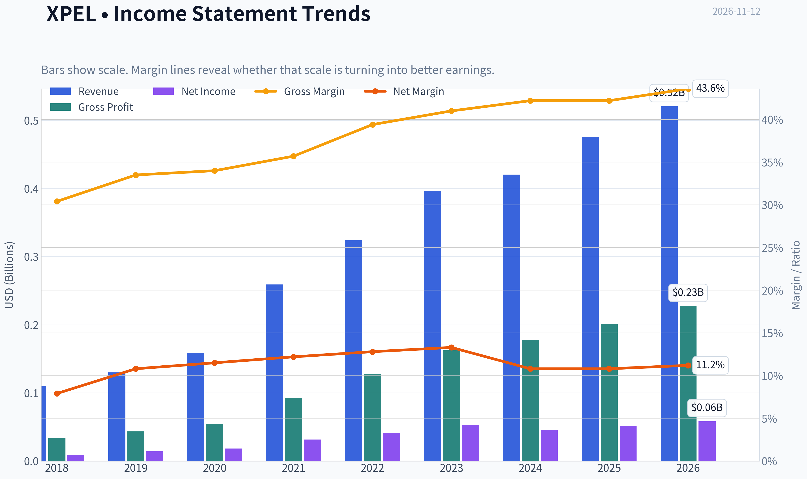

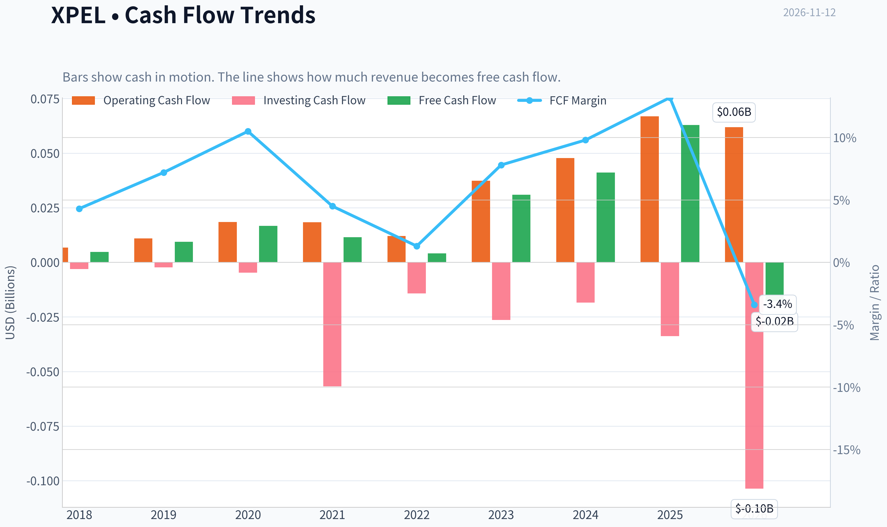

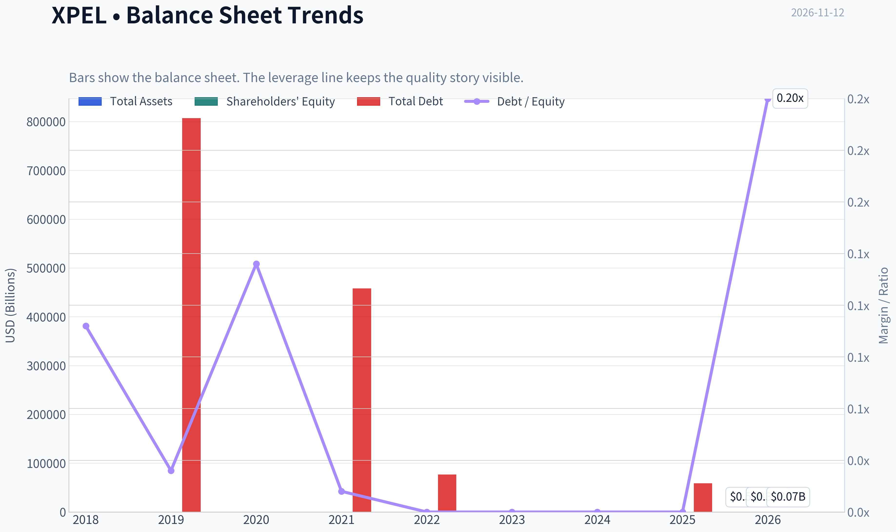

This graph tracks the profitability and return metrics (ROE, ROIC, Margins) of **XPEL** over the past decade, highlighting capital efficiency trends.

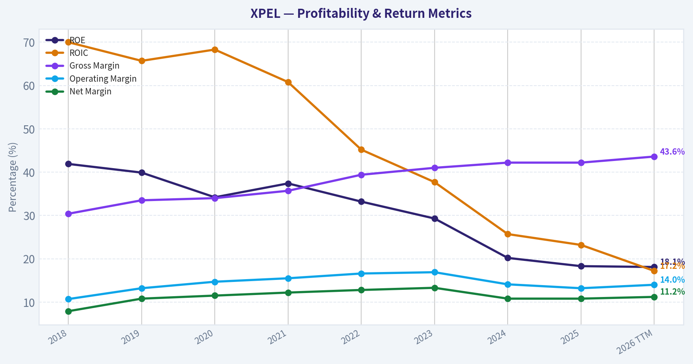

This chart illustrates the financial health of **XPEL** over the last 10 years, mapping cash equivalents and free cash flow against total obligations (Debt).

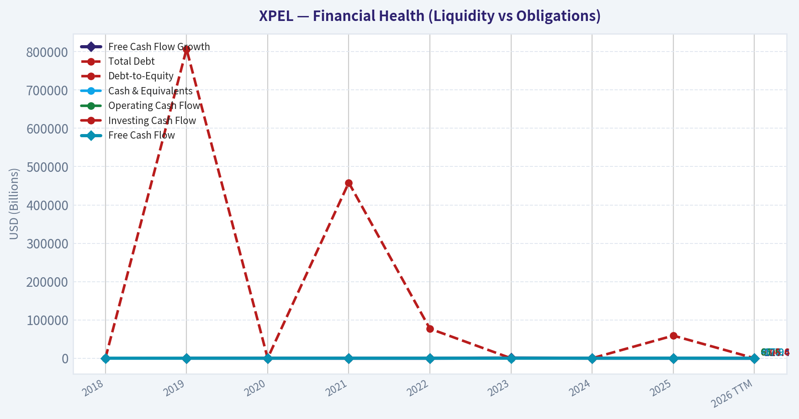

This comparison chart from *Profitability and Operating Performance* stacks current figures against historical benchmarks for **XPEL**, making it easy to see where the company trades relative to its own averages.

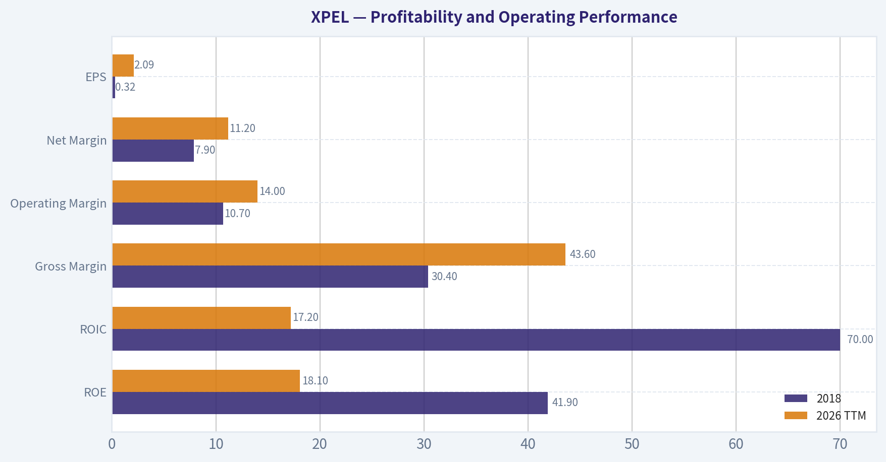

This breakdown chart from <em>Revenue Breakdown</em> shows the proportional composition for **XPEL** - useful for understanding what drives or risks the business.

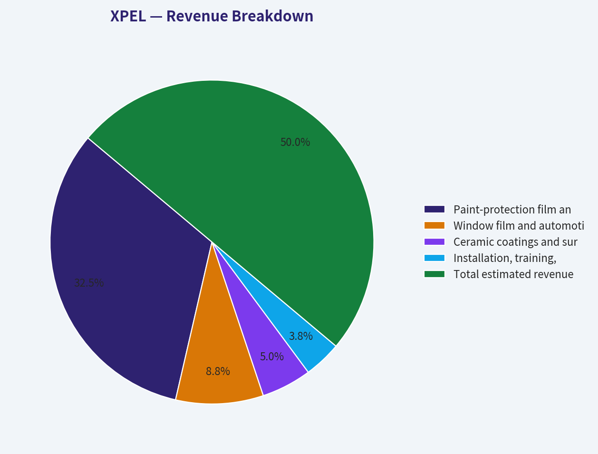

---

### Intrinsic Value Analysis (Buffett)

> *Following Warren Buffett's value investing philosophy: Circle of Competence, Economic Moat, Management Quality, and Margin of Safety.*

#### Intrinsic Value Snapshot

Price is what you pay. Intrinsic value is what the business may be worth based on the cash it can create for owners over time. We show a range, not one magic number.

- Current Price: $37.74
- Value Range (conservative to optimistic across both DCF methods): $15.36 to $212.61

##### Owner Earnings (Buffett Method)
- Net Income: $51,226,000.00
- Depreciation & Amortization: $13,254,000.00
- Capital Expenditures: $-4,008,000.00
- Working Capital Changes: $-1,268,000.00
- Owner Earnings: $61,740,000.00

##### Intrinsic Value
###### Buffett Method
Uses owner earnings. Stricter, and usually more conservative.
- Conservative: $36.77
- Average: $98.67
- Optimistic: $167.78
- Discount Rate: 10.0%

###### Cash Flow Method
Uses free cash flow. Better for companies spending heavily today to grow tomorrow.
- Conservative: $15.36
- Average: $81.20
- Optimistic: $212.61
- Discount Rate: 10.0%

ANALYST STANCE: **Bullish**

#### Executive Summary

XPEL is a high-quality, asset-light branded products and software company serving the automotive protection market. It sells paint-protection film, window tint, ceramic coatings, installation software, and related products through a network of dealers and installers.

At approximately **$38 per share**, XPEL trades at about **18 times earnings** and offers an estimated **47% discount to blended intrinsic value**. The business has attractive gross margins, solid growth, a strong balance sheet, and meaningful reinvestment opportunities. The principal risks are dependence on automotive and dealership demand, execution of international expansion, and the possibility that recent growth moderates.

The valuation appears favorable enough to compensate for those risks.

#### Factor Scorecard

| Factor | Score | Evidence |
|---|---:|---|
| 1. Circle of Competence & Simplicity | 4.0/5 | Simple model: sell branded protective films, coatings, tint, and installation-related products. The business has evolved into a broader platform without becoming excessively complex. |
| 2. Durable Competitive Advantage | 4.0/5 | Brand reputation, installer network, proprietary software, training, product quality, and growing distribution create switching costs and scale advantages. Gross margin is approximately 42.2%. |
| 3. Management & Capital Allocation | 3.5/5 | Evidence points to continued reinvestment in products, software, international facilities, and distribution. The score is moderated because public evidence of long-term capital-allocation performance and insider ownership is less compelling than at founder-controlled compounders. |
| 4. Industry Structure | 3.5/5 | The market is fragmented and offers room for a scaled branded leader, but automotive demand and dealership activity can be cyclical. XPEL is relatively capital-light and benefits from distribution scale. |

**Gate 5 - Quality/Solvency hard floor: Not tripped.** Earnings and cash generation remain positive, the current ratio is approximately 3.25, and there is no evidence of deteriorating fundamentals combined with distress-level solvency.

#### Financial Summary

| Metric | Latest available figure |
|---|---:|
| Share price | $38.00 |
| Market capitalization | $1.04 billion |
| Price-to-earnings ratio | 18.0x |
| Revenue growth, year over year | 13.3% |
| Gross margin | 42.2% |
| Return on equity | 18.3% |
| Free-cash-flow yield | 6.1% |
| Current ratio | 3.25 |
| Reverse-DCF implied 10-year growth | Approximately 3.0% |
| Blended intrinsic value per share | $71.15 |

**Key Takeaways:** XPEL combines double-digit revenue growth with a gross margin above 40% and an 18.3% return on equity. The market price implies only about 3% annual growth over the next decade, which is considerably less demanding than the company's recent operating performance. The balance sheet appears strong, although the current ratio is less important than cash generation for this asset-light business.

#### Recent Operating Performance

| Indicator | Recent evidence |
|---|---:|
| Q3 2026 revenue | $137.8 million |
| Q3 adjusted EBITDA growth | 31% |
| Q4 2026 revenue guidance | $125-$127 million |
| Recent share-price movement | Down 10.3% over one month; down 21.2% over three months |
| Five-year revenue growth trend | Approximately 30.2% annualized according to the research pack |
| Three-year revenue growth trend | Approximately negative 7.9% annualized according to the research pack |

**Key Takeaways:** The latest quarter showed strong EBITDA growth and improving gross-margin performance, but management expects a slower fourth quarter because of weakness in the U.S. dealership channel. The conflicting three-year and five-year growth signals suggest that investors should underwrite normalized growth rather than extrapolate the strongest historical period. The recent share-price decline has created a more attractive entry point.

#### Moat Analysis

**Brand and intangible assets.** XPEL has built a recognized brand in a specialized automotive-protection category. Its products are not purely interchangeable commodities: installers and customers care about film quality, fit, durability, appearance, warranty support, and installation outcomes. A 42.2% gross margin supports the existence of meaningful product differentiation.

**Installer and dealer network.** XPEL's products benefit from trained installers, dealer relationships, product familiarity, and established workflows. An installer who has invested in training, equipment, software, and customer relationships has less incentive to switch casually to an unfamiliar supplier.

**Software and ecosystem effects.** XPEL's design and installation software helps installers select, cut, and apply products. As more vehicles, patterns, installers, and customer jobs flow through the system, the software and associated data become more valuable. This is not a pure social network effect, but it creates ecosystem reinforcement.

**Scale and distribution.** A scaled product portfolio and international distribution system can spread product development, software, marketing, and training costs over a larger revenue base. The planned China facility could improve regional service levels and provide a lower-friction base for non-U.S. growth.

**Moat durability rating: Wide and stable, with potential to widen - 4/5.**

The moat is real but not invulnerable. Competitors can develop competing films and coatings, and the business remains partly dependent on the health of automotive retail and dealership channels.

#### Management Quality Assessment

Management appears to be pursuing sensible long-term investments rather than merely optimizing short-term earnings. The company continues to invest in:

- Product development and a broader protection portfolio.
- Installer training and dealer support.
- Software and pattern databases.
- International production and distribution capacity.
- Expansion into markets where vehicle-protection adoption remains underpenetrated.

The China expansion and dealer-channel strategy could materially improve the company's long-term economics, but they also create execution risk. Management's decision to guide toward a softer fourth quarter rather than maintain an overly aggressive growth narrative is a modest positive for credibility.

**Management score: 3.5/5.**

The key items to monitor are acquisition discipline, stock-based compensation, insider ownership, and whether international investments generate returns above the company's cost of capital.

#### Owner Earnings Estimate

Free cash flow is used as the practical owner-earnings proxy because XPEL's business is asset-light and maintenance capital expenditure is relatively modest.

| Owner-earnings component | Approximate amount |
|---|---:|
| Market capitalization | $1.04 billion |
| Free-cash-flow yield | 6.1% |
| Implied annual free cash flow | $63.4 million |
| Implied free cash flow per share | $2.32 |
| Maintenance-capital-expenditure adjustment | Modest; not separately disclosed |
| Normalized owner earnings per share | Approximately $2.30-$2.40 |

**Key Takeaways:** XPEL appears to convert a meaningful portion of accounting earnings into cash, with implied annual free cash flow of roughly $63 million. A normalized owner-earnings estimate near $2.30 to $2.40 per share is a reasonable base for conservative valuation. The principal uncertainty is how much of current capital spending represents maintenance versus growth investment.

#### Three-Scenario DCF Valuation

Using approximately **$2.32 per share** of normalized owner earnings and a 10% discount rate:

| Scenario | Assumption | Estimated value per share |
|---|---|---:|
| A. No growth | Owner earnings capitalized at 10% | $23 |
| B. GDP growth | 3% perpetual growth | $34 |
| C. Normalized historical growth | Approximately 7.5% growth, below the strongest historical rate | $95-$100 |
| Blended research-pack valuation | Damodaran FCFF, reverse DCF, and owner-earnings models | $71.15 |

**Key Takeaways:** The no-growth valuation provides a conservative downside reference, while the GDP-growth case suggests that the current price is not deeply discounted if XPEL becomes only a modest-growth business. The historical-growth scenario produces substantially higher value, but it requires continued execution. The blended $71.15 estimate is a more balanced anchor than relying on either the no-growth or high-growth case alone.

#### Margin of Safety Analysis

| Valuation measure | Value |
|---|---:|
| Current price | $38.00 |
| Blended intrinsic value | $71.15 |
| Owner-earnings DCF estimate | $98.67 |
| FCF-based valuation | $81.20 |
| Damodaran FCFF valuation | $68.38 |
| Headline margin of safety | 47.0% |

**Key Takeaways:** XPEL trades at a substantial discount to each of the three principal valuation approaches. Even the lowest listed valuation is materially above the current share price. For a business with a credible brand, high gross margins, positive growth, and a strong balance sheet, a 47% blended margin of safety is more than adequate.

#### Principal Risks

| Risk | Assessment |
|---|---|
| U.S. dealership weakness | Near-term revenue growth may soften if dealer demand remains weak. |
| Automotive cyclicality | Vehicle sales, discretionary spending, and dealership economics affect installation volumes. |
| Competitive products | Films, coatings, and tint products may become more commoditized over time. |
| International execution | The China facility and international expansion must achieve adequate utilization and returns. |
| Growth normalization | The five-year growth record may not be repeatable, and recent trends are less consistent. |
| Customer concentration or channel dependence | Dealer and installer relationships should be monitored for concentration and bargaining-power changes. |

#### Final Buffett Scorecard

| Criterion | Weight | Score | Weighted contribution |
|---|---:|---:|---:|
| Moat width and durability | 25% | 4.0 | 1.00 |
| Valuation and margin of safety | 20% | 4.5 | 0.90 |
| Capital returns: ROIC versus WACC | 15% | 4.0 | 0.60 |
| Business understanding and predictability | 12% | 3.5 | 0.42 |
| Management quality and capital allocation | 12% | 3.5 | 0.42 |
| Reinvestment runway | 8% | 4.0 | 0.32 |
| Balance-sheet strength | 4% | 4.0 | 0.16 |
| Industry structure | 4% | 3.5 | 0.14 |
| **Total** | **100%** |  | **3.96/5.00** |

#### Investment Stance

**Bullish - Medium-to-high conviction.**

XPEL fits the Buffett framework reasonably well: understandable products, a differentiated brand, attractive gross margins, a growing ecosystem, positive cash generation, and substantial reinvestment potential. The current valuation does not require heroic assumptions; the reverse DCF implies only approximately 3% annual growth over ten years.

The company is not risk-free, particularly because of automotive-channel weakness and international execution. However, at approximately $38 per share, the valuation provides an unusually wide margin of safety for a business of this quality. Long-term investors can reasonably build a position, while monitoring dealer-channel recovery, China utilization, free-cash-flow conversion, and returns on reinvested capital.
#### Valuation Bridge

This bridge places the current market price beside each intrinsic value lens so readers can see whether upside depends on one method or shows up across several methods.

| Scenario | Intrinsic Value / Share |
| --- | ---: |
| Buffett Method | $98.67 |
| Cash Flow Method | $81.20 |
| Damodaran Method | $68.38 |
| Current Price | $37.74 |

#### Key Takeaways

If one method is far above the others, the upside case depends on a specific modelling assumption. When several methods cluster together, the valuation story is more robust.

#### Valuation Visuals

This comparison chart from *Latest Earnings Snapshot* stacks current figures against historical benchmarks for **XPEL**, making it easy to see where the company trades relative to its own averages.

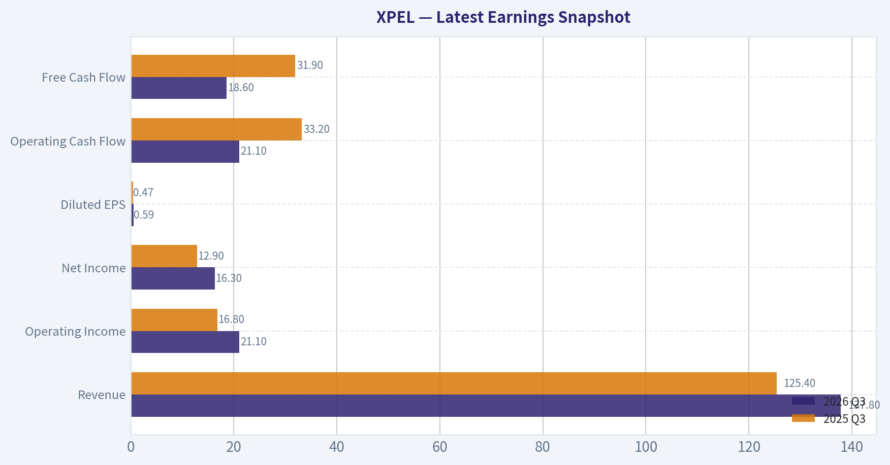

This comparison chart from *Current Versus Available-History Average* stacks current figures against historical benchmarks for **XPEL**, making it easy to see where the company trades relative to its own averages.

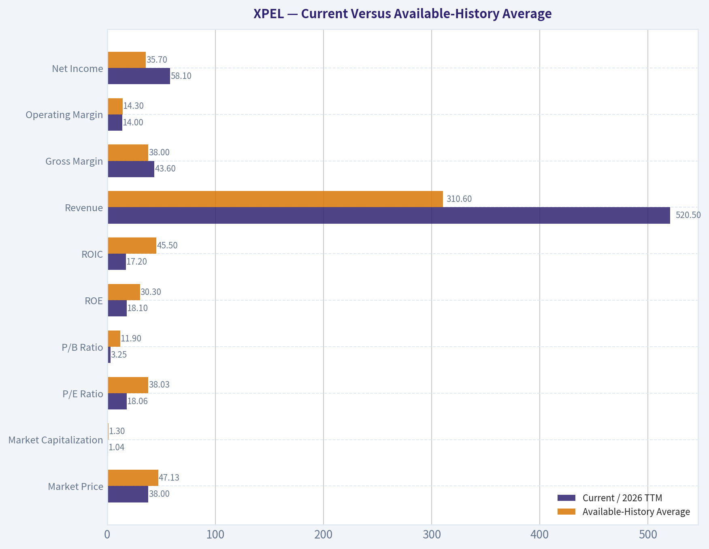

This comparison chart from *Balance Sheet and Financial Strength* stacks current figures against historical benchmarks for **XPEL**, making it easy to see where the company trades relative to its own averages.

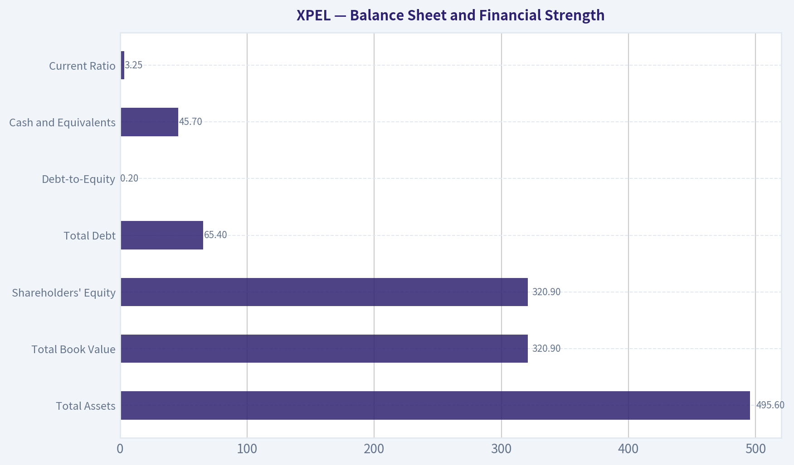

---

### Trend & Growth Analysis (Lynch/Druckenmiller/Fisher)

> *Following Peter Lynch's GARP, Stanley Druckenmiller's macro-aware approach, and Philip Fisher's scuttlebutt methodology.*

ANALYST STANCE: **Neutral**

#### 1. Lynch Classification

**XPEL is a fast grower transitioning toward a stalwart profile.** Historical growth has been strong, but the latest reported trend is closer to the low-teens range, with Q3 2026 revenue growth of approximately 9%. It remains a growth-oriented compounder candidate, but current evidence does not yet confirm a renewed acceleration.

#### 2. The Story in Three Bullets

- **XPEL sells protective films, coatings, and window tint** that help preserve vehicle appearance and resale value.
- **The company is expanding beyond its original enthusiast niche** through dealer partnerships, international distribution, commercial applications, and manufacturing capacity in China.
- **The investment case depends on a 2027 reacceleration:** dealer-channel recovery, better international penetration, and operating leverage could restore faster growth.

#### 3. Fundamental Snapshot

| Metric | Current Data | Interpretation |
|---|---:|---|
| Share price | $38 | Recent weakness has lowered expectations |
| Market capitalization | $1.04 billion | Small enough for meaningful compounding |
| Revenue growth, latest reported | 9% Q3 growth; 13.3% current YoY reference | Growth is positive but below fast-grower standards |
| P/E ratio | 18.0x | Reasonable for a quality profitable company |
| Gross margin | 42.2% | Healthy, with room for operating leverage |
| ROE | 18.3% | Strong capital efficiency |
| FCF yield | 6.1% | Approximate P/FCF of 16.4x |
| Current ratio | 3.25x | Strong liquidity |
| Headline intrinsic value | $71.15 | Approximately 47% above current price, model-dependent |

**Key Takeaways:** XPEL combines a reasonable valuation, healthy liquidity, strong gross margins, and an attractive free-cash-flow yield. The central weakness is growth: recent performance is no longer clearly in the 15%-25% fast-grower range. The valuation offers downside support, but the stock needs evidence of renewed growth before becoming a high-conviction growth position.

#### 4. TAM Analysis and the 10x Test

XPEL participates in several overlapping markets: paint-protection film, automotive window tint, ceramic coatings, vehicle appearance products, dealer-installed protection, and adjacent industrial or commercial films. Exact TAM figures vary substantially depending on whether the analysis includes only premium aftermarket products or the broader global vehicle-protection market.

Using a rough 2026 revenue base of approximately **$540 million**, a 10x outcome would require approximately **$5.4 billion in annual revenue**.

| TAM Question | Assessment |
|---|---|
| Current revenue base | Approximately $0.5-$0.6 billion |
| 10x revenue target | Approximately $5.4 billion |
| Can XPEL 10x while remaining below 20% share? | Plausibly yes, if international, dealer, commercial, and product categories expand |
| TAM growth | Likely moderate, with faster growth in premium protection and dealer-installed products |
| Main constraint | Adoption, installer capacity, price sensitivity, and competition from lower-cost alternatives |

**Key Takeaways:** The 10x test is potentially passed, but not automatically. XPEL is still small relative to the broad global vehicle-protection opportunity, yet achieving a 10x outcome requires successful expansion beyond premium enthusiasts and North America. The runway is attractive, but execution and category adoption are more important than headline TAM estimates.

#### 5. Revenue Growth Trend

| Period or Indicator | Trend | Read-Through |
|---|---:|---|
| Longer-term five-year growth reference | Approximately 30.2% CAGR | Strong historical compounder profile |
| Longer-term three-year growth reference | Approximately -7.9% reference in supplied data | Indicates uneven recent performance or comparison effects |
| Current YoY growth reference | 13.3% | Positive, but below historical fast-growth levels |
| Q3 2026 revenue | $137.8 million | Up approximately 9% |
| Q4 2026 guidance | $125-$127 million | Signals near-term deceleration |
| Adjusted EBITDA growth in Q3 | 31% | Profitability growth substantially exceeded revenue growth |

**Key Takeaways:** Revenue growth is currently decelerating rather than accelerating. The favorable offset is strong adjusted EBITDA growth, suggesting cost discipline, mix improvement, or operating leverage. A convincing investment inflection would require revenue growth to move back above 15% while maintaining margin expansion.

#### 6. Unit Economics and Business Quality

Publicly available information in the supplied research does not provide complete CAC, LTV, NRR, or customer-payback data. XPEL is also not a pure subscription software company, so SaaS metrics such as NRR and the Rule of 40 are less directly applicable.

| Metric | Available Evidence | Assessment |
|---|---|---|
| LTV/CAC | Not disclosed | Cannot verify |
| Customer retention | Not disclosed in supplied data | Installer and dealer relationships are important qualitative indicators |
| Gross margin | 42.2% | Healthy |
| FCF generation | 6.1% FCF yield | Positive and meaningful |
| Rule of 40 | Not directly applicable | Revenue growth plus FCF margin would require additional data |
| Capital intensity | Appears manageable | Manufacturing expansion should be monitored |

**Key Takeaways:** XPEL appears economically sound, but the lack of disclosed customer-level metrics limits precision. Its strongest measurable indicators are gross margin, free cash flow, and EBITDA growth. Investors should monitor installer additions, dealer retention, repeat product demand, and cash conversion rather than rely on SaaS-style metrics.

#### 7. Inflection Point Assessment

| Potential Inflection | Current Evidence | Status |
|---|---|---|
| Dealer-channel recovery | U.S. dealership channel described as soft | Not yet confirmed |
| China manufacturing plant | Expected to feed non-U.S. markets, with 2027 importance | Potential catalyst |
| Margin inflection | Q3 adjusted EBITDA grew 31% versus 9% revenue growth | Positive |
| International expansion | China plant and broader distribution support opportunity | Early-stage |
| Product expansion | Films, coatings, tint, and possible adjacent applications | Positive, but execution-dependent |
| Market-share acceleration | No clear evidence supplied | Unconfirmed |

**Key Takeaways:** The clearest current inflection is on the margin side, not revenue. The China facility and dealer-channel recovery could create a meaningful 2027 growth inflection, but these are forward-looking catalysts rather than proven results. Until revenue growth reaccelerates, this remains a setup to monitor rather than a confirmed inflection.

#### 8. Macro Setup

XPEL benefits from durable secular themes including vehicle personalization, preservation of vehicle value, premium aftermarket spending, and increased use of dealer-installed accessories. However, it remains exposed to discretionary consumer spending, vehicle sales, dealership health, and international economic conditions.

| Macro Factor | Effect on XPEL |
|---|---|
| Falling interest rates | Positive for valuation and discretionary purchases |
| Weak vehicle sales or dealership traffic | Negative |
| Consumer pressure | Negative for premium aftermarket products |
| Aging vehicle fleet and resale-value focus | Positive |
| International expansion | Positive, but exposed to currency and local competition |
| China manufacturing | Potential margin and logistics benefit |

**Key Takeaways:** The macro backdrop is mixed. Lower rates and the long-term vehicle-protection trend help, but soft dealerships and discretionary spending are current headwinds. XPEL is better positioned in a stable or recovering consumer environment than in a sharp recession.

#### 9. Fisher 15-Point Assessment

Scores are preliminary because several Fisher criteria require direct management and channel checks.

| Fisher Criterion Group | Score |
|---|---:|
| Market potential and long-range sales opportunity | 4/5 |
| Product innovation and R&D orientation | 4/5 |
| Sales and distribution organization | 4/5 |
| Profit margins and margin trajectory | 4/5 |
| Labor, management depth, and executive relations | 3/5 |
| Cost controls and accounting quality | 4/5 |
| Competitive advantages and switching costs | 3/5 |
| Long-range profit outlook | 4/5 |
| Dilution and capital allocation | 4/5 |
| Management candor and integrity | 3/5 |
| **Preliminary Fisher Score** | **37/50 equivalent; approximately 56/75** |

**Key Takeaways:** XPEL scores as a good, but not outstanding, Fisher company on the available evidence. Its products, distribution model, margins, and runway are attractive. The lower scores reflect limited scuttlebutt data, uncertain switching costs, and the need to verify management depth and channel strength directly.

#### 10. Valuation Analysis

| Valuation Method | Result | Interpretation |
|---|---:|---|
| P/E | 18.0x | Reasonable if earnings growth returns to the mid-teens or better |
| PEG using 13.3% growth | 1.35x | Fair value, not a clear bargain by Lynch standards |
| FCF yield | 6.1% | Attractive for a financially healthy company |
| Headline intrinsic value | $71.15 | Approximately 47% modeled upside |
| Owner-earnings DCF | $98.67 | Most optimistic supplied model |
| FCF valuation model | $81.20 | Moderately bullish |
| Damodaran FCFF model | $68.38 | More conservative |
| Reverse DCF at current price | Approximately 3% annual growth implied over 10 years | Market expectations appear restrained |

**Key Takeaways:** XPEL is not expensive on conventional valuation measures, and the market price appears to assume only modest long-term growth. The valuation is attractive if the company can restore mid-teens growth and sustain operating leverage. However, the large intrinsic-value spread-from $68 to $99-shows that the conclusion is sensitive to growth, margins, and terminal assumptions.

#### 11. Growth Investor Scorecard

| Criterion | Weight | Score | Weighted View |
|---|---:|---:|---|
| Lynch story | 10% | 4.0/5 | Simple, understandable product story |
| TAM and runway | 20% | 4.0/5 | Broad opportunity, still execution-dependent |
| Revenue growth | 20% | 3.0/5 | Positive but recently slowing |
| Unit economics | 15% | 3.5/5 | Healthy margins and FCF, limited customer data |
| Competitive position | 10% | 3.5/5 | Brand and distribution advantages, moderate switching costs |
| Management quality | 10% | 3.5/5 | Generally credible, but requires further scuttlebutt |
| Macro setup | 5% | 3.0/5 | Mixed discretionary and dealership exposure |
| Profitability path | 5% | 4.0/5 | Already profitable with strong EBITDA growth |
| Valuation | 5% | 4.0/5 | Reasonable valuation and substantial modeled upside |
| **Total** | **100%** | **3.6/5** | **Advocate-quality valuation; Watch-quality growth trend** |

**Key Takeaways:** XPEL scores well because it is profitable, financially healthy, reasonably valued, and exposed to a potentially expanding market. The decisive weakness is that current revenue momentum does not yet confirm the fast-grower thesis. The stock becomes more attractive if quarterly growth reaccelerates without sacrificing margins.

#### 12. Position Size Stance

**Suggested position: 1%-2% starter position, or 2%-3% for an investor comfortable with small-cap execution risk.**

A larger position would require confirmation of at least two of the following:

1. Revenue growth returns sustainably above 15%.
2. U.S. dealer-channel weakness reverses.
3. China manufacturing improves international growth or gross margin.
4. Adjusted EBITDA growth remains ahead of revenue growth.
5. International revenue becomes a material and accelerating contributor.

#### 13. Key Risks and Catalysts

| Catalysts | Risks |
|---|---|
| U.S. dealership recovery | Continued revenue deceleration |
| China plant ramp in 2027 | Consumer discretionary weakness |
| International distribution expansion | Lower-cost competitive products |
| Higher dealer penetration | Installer capacity constraints |
| Margin expansion from scale and mix | Execution risk in international manufacturing |
| New films, coatings, and commercial applications | Dependence on premium aftermarket demand |

**Key Takeaways:** The most important catalyst is a 2027 growth reacceleration driven by dealer recovery and international expansion. The most important risk is that recent slowing revenue represents a structural normalization rather than a temporary pause. Monitoring quarterly revenue growth, dealer-channel trends, international sales, and free-cash-flow conversion should determine whether XPEL moves from Watch to Advocate.

#### Bottom Line

XPEL is a financially healthy, reasonably valued compounder with a credible long-term runway and possible 2027 catalysts. It passes the 10x test on a broad TAM basis, but the current evidence shows **margin acceleration without revenue acceleration**. That supports a **Neutral** stance and a small starter position, not yet a concentrated Druckenmiller-style bet.

---

### Market Technical Analysis

ANALYST STANCE: **Neutral**

#### XPEL technical outlook

The latest valid trading session in the retrieved data is **November 11, 2026**, when XPEL closed at **$39.61**. Although the requested date is November 12, the indicator feed marks November 12 as unavailable, so this analysis uses the November 11 close and the most recent completed observations.

XPEL's technical structure remains **bearish over the medium and long term**, but the stock is approaching an area where a short-term rebound could develop. The close is well below the **50-day SMA at $44.60** and the **200-day SMA at $45.69**. Both averages are declining, and the 50-day average remains below the 200-day average, confirming that the broader trend has not yet repaired.

The short-term picture is also weak. The **10-day EMA is $40.90**, placing the stock roughly **3.2% below** its short-term trend line. The recent decline from approximately $45.78 on October 29 to $38.01 on November 9 was accompanied by elevated volatility and heavier trading activity. The small recovery toward $40.03 on November 10 was not sustained, with the stock closing back at $39.61 on November 11. Until XPEL can reclaim and hold the $40.90-$41.00 area, short-term rallies should be treated as countertrend moves rather than confirmed reversals.

#### Momentum and trend confirmation

The MACD remains materially negative at approximately **-1.46**, compared with roughly **-0.24** at the start of the 30-day observation window. This indicates that downside momentum has intensified rather than merely reflecting a mild pullback. The MACD's deterioration through early November suggests sellers have controlled the recent trend. A meaningful improvement would require the MACD to flatten and then rise toward its signal line; a single positive session would not be sufficient confirmation.

The **RSI is 37.7**, up from an oversold reading near **28.9** on November 9. This recovery is constructive in a narrow tactical sense, but RSI has not yet crossed above 50 and therefore does not demonstrate broad momentum strength. The move from oversold territory may indicate selling pressure is temporarily easing, but in a declining trend, RSI can rebound from oversold levels without producing a durable bottom.

#### Volatility and potential support

The Bollinger Bands show a wide and recently expanding range. The latest **upper band is approximately $47.41**, while the **lower band is approximately $38.05**. XPEL's $39.61 close is only about **$1.56 above the lower band**, placing it near the lower portion of its recent trading envelope. This creates the possibility of a technical bounce, particularly because RSI has already reached oversold levels.

However, proximity to the lower band is not by itself a buy signal. In a strong downtrend, prices can remain near or ride the lower band. A decisive close below approximately **$38.00-$38.05** would weaken the rebound thesis and could expose the stock to further downside. Conversely, holding above that area and recovering through $40.90 would be the first indication that short-term pressure is stabilizing.

The **ATR is approximately $2.01**, up substantially from about $1.35 in mid-October. This means XPEL's typical daily range has expanded to roughly **5% of the share price**, making stops placed too tightly vulnerable to normal price fluctuations. A position, if taken, should be sized conservatively, with risk levels adjusted for the elevated volatility.

#### Trading interpretation

The evidence is not yet strong enough to classify XPEL as a confirmed recovery candidate. The stock is below all three trend averages, the averages are declining, and MACD momentum remains negative. Those are the dominant signals.

At the same time, the stock is near the lower Bollinger Band, RSI has rebounded from oversold conditions, and the latest price action suggests that the sharpest portion of the recent selloff may be losing momentum. This creates a **watch-for-confirmation setup**, not an aggressive entry.

A more constructive technical sequence would involve:

1. Holding the **$38.00-$38.50** area.
2. Reclaiming the **10-day EMA near $40.90**.
3. Establishing higher short-term lows above approximately $39-$40.
4. Improving MACD momentum and moving RSI above 50.
5. Eventually reclaiming the **50-day SMA near $44.60**, which would be necessary to challenge the broader bearish trend.

Failure to hold the lower-band area, particularly on expanding volume, would favor avoidance of long exposure. For traders already holding the stock, the $38 area is an important risk-management reference, while the $40.90-$41.00 zone is the first meaningful recovery test.

#### Selected indicators

The analysis uses eight complementary indicators: **close_50_sma, close_200_sma, close_10_ema, macd, rsi, boll_ub, boll_lb, and atr**. Together they cover long-term trend, medium-term trend, short-term price behavior, momentum, overbought or oversold conditions, volatility range, and risk management without relying on redundant signals.

| Indicator | Latest reading | Interpretation for XPEL |
|---|---:|---|
| Close | $39.61 | Latest valid close, November 11, 2026; near the lower end of the recent range |
| 10-day EMA | $40.90 | Price is below short-term trend; reclaiming this level would improve near-term structure |
| 50-day SMA | $44.60 | Declining medium-term trend and important overhead resistance |
| 200-day SMA | $45.69 | Long-term trend remains bearish; price is materially below this benchmark |
| MACD | -1.46 | Negative momentum has intensified over the past month |
| RSI | 37.7 | Recovered from oversold conditions but remains below neutral momentum |
| Bollinger upper/lower bands | $47.41 / $38.05 | Price is close to the lower band; possible bounce zone, but breakdown risk remains |
| ATR | $2.01 | Elevated daily volatility; position sizing and stops should account for wide price swings |
| Key levels | Support: $38.00-$38.50; resistance: $40.90-$41.00 and $44.60 | A hold above support plus a reclaim of short-term resistance would be the first constructive signal |

**Key Takeaways:** XPEL remains technically bearish because the price is below the 10-day EMA, 50-day SMA, and 200-day SMA, while MACD is deeply negative. Nevertheless, the stock is near the lower Bollinger Band and RSI has recovered from oversold territory, creating potential for a short-term bounce. The preferred stance is to watch for support near $38 and confirmation above $40.90-$41.00 rather than initiating an aggressive long position immediately.

#### Market Visuals

This comparison chart from *Market Metrics and Valuation* stacks current figures against historical benchmarks for **XPEL**, making it easy to see where the company trades relative to its own averages.

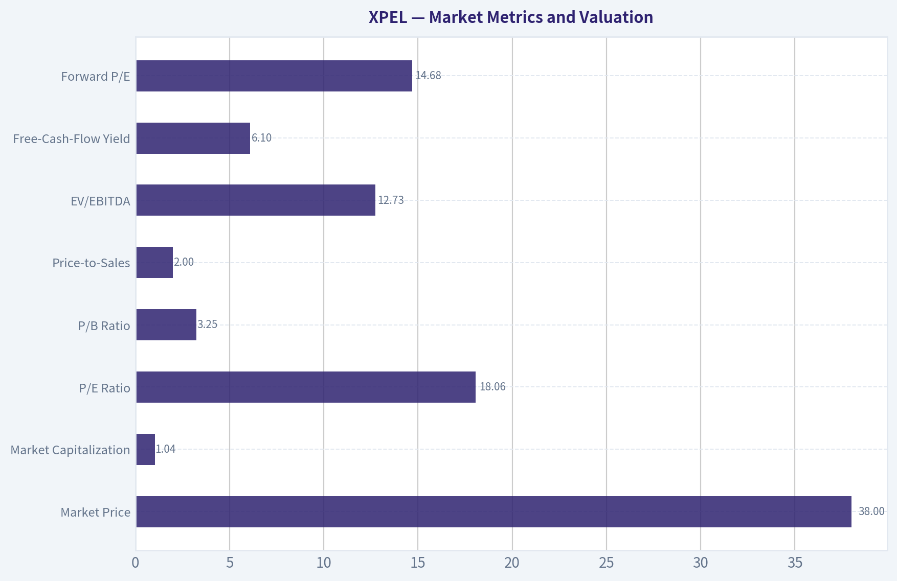

---

### Options Market Analysis

> *Reading options flow - put/call ratios, IV skew, and unusual activity - to gauge institutional positioning and event-driven risk.*

#### XPEL Options Market Report

*Data as of November 12, 2026. Near-term expirations reviewed: November 20, December 18, 2026, and January 15, 2027.*

#### Put/Call Ratio Analysis

| Expiration | Approx. Days to Expiry | Call OI | Put OI | Put/Call OI | Call Volume | Put Volume | Put/Call Volume |
|---|---:|---:|---:|---:|---:|---:|---:|
| Nov. 20, 2026 | 8 | 82 | 1,116 | 13.61 | 21 | 4,010 | 190.95 |
| Dec. 18, 2026 | 36 | 111 | 37 | 0.33 | 105 | 26 | 0.25 |
| Jan. 15, 2027 | 64 | 252 | 311 | 1.23 | 35 | 251 | 7.17 |
| **Total** | - | **445** | **1,464** | **3.29** | **161** | **4,287** | **26.63** |

**Key Takeaways:** XPEL's aggregate put/call open-interest ratio of 3.29 is substantially above the approximately 0.7 neutral baseline. The extreme near-term concentration in November 20 puts, together with a put/volume ratio near 191 for that expiry, indicates substantial downside protection or bearish positioning. December is comparatively bullish, but its smaller overall activity does not offset the heavy near-term put imbalance.

#### Implied Volatility Assessment

| Expiration | Call ATM IV | Put ATM IV | IV Interpretation |
|---|---:|---:|---|
| Nov. 20, 2026 | 85.1% | 70.8% | Very elevated; call IV exceeds put IV |
| Dec. 18, 2026 | N/A | 52.8% | Moderate-to-elevated put IV; call IV unavailable |
| Jan. 15, 2027 | 126.7% | 42.2% | Highly elevated call IV, likely distorted by sparse trading |

**Key Takeaways:** Near-term implied volatility is elevated, particularly for the November 20 expiration. The available ATM data does not show a conventional put-volatility premium; instead, November and January call IV is higher than put IV. Because the chain appears thin and some readings are unavailable or extreme, the IV figures should be treated cautiously rather than as a clean signal of upside demand.

The supplied data does not include OTM put and call IV by strike, so a formal put-versus-call skew calculation is unavailable. Based on ATM IV alone, the observable skew leans toward calls rather than puts, but this conflicts with the much heavier put positioning and may reflect illiquidity or isolated contracts.

No specific earnings, product launch, or other catalyst was provided in the data. Therefore, elevated IV cannot be definitively attributed to an upcoming event.

#### Unusual Options Activity

| Finding | Result | Interpretation |
|---|---|---|
| Contracts with volume greater than 5x open interest | None identified | No confirmed fresh, highly concentrated directional trades |
| Largest near-term flow | Nov. 20 puts, 4,010 contracts | Heavy downside protection or bearish speculation |
| Ability to classify strikes as ITM, ATM, or OTM | Not available | Strike-level contract details were not supplied |
| Ability to distinguish institutional from retail activity | Limited | No trade-size, sweep, or execution-side data was provided |

**Key Takeaways:** The data provider did not flag any individual contract as unusual under its volume-to-open-interest threshold. Nevertheless, the November 20 put volume is exceptionally large relative to call activity. Without strike-level and trade-execution details, it is not possible to determine whether that flow represents institutional hedging, outright bearish bets, or closing activity.

#### Open Interest Concentration and Gamma Levels

| Expiration | Call OI | Put OI | Concentration Assessment |
|---|---:|---:|---|
| Nov. 20, 2026 | 82 | 1,116 | Dominant put concentration; likely source of near-term downside hedging or pinning pressure |
| Dec. 18, 2026 | 111 | 37 | Modest call concentration; comparatively bullish positioning |
| Jan. 15, 2027 | 252 | 311 | Largest call OI and second-largest put OI; mixed longer-dated positioning |
| **Total** | **445** | **1,464** | **Put-heavy overall structure** |

**Key Takeaways:** Open interest is overwhelmingly concentrated in November 20 puts, making that expiration the most important near-term positioning area. However, strike-level open interest was not supplied, so exact max-pain levels, gamma walls, and potential price-pinning strikes cannot be calculated. The high put concentration could amplify downside hedging flows if XPEL weakens, while the smaller call base may limit upside gamma support.

#### Overall Options Sentiment

**Signal: BEARISH, with low-to-moderate confidence.**

The primary bearish driver is the combination of:

- A total put/call OI ratio of **3.29**, far above the approximately **0.7 neutral baseline**.
- A total put/call volume ratio of **26.63**.
- Extremely concentrated November 20 put positioning, only eight days from expiration.
- January put volume that is also substantially higher than call volume.

There are important caveats. December positioning is call-heavy, ATM call IV exceeds put IV in the available observations, and no individual contract qualified as unusual activity. The chain also appears relatively illiquid, with small open-interest totals and potentially unreliable IV readings. As a result, the bearish signal may reflect protective hedging around a known or unknown risk rather than a pure directional bet.

#### Summary

| Category | Assessment |
|---|---|
| Put/Call Ratio | **Strongly elevated:** 3.29 OI ratio and 26.63 volume ratio versus approximately 0.7 neutral |
| IV Level | **Elevated:** November ATM IV is 85.1% for calls and 70.8% for puts; January call IV is an extreme 126.7% |
| Skew Direction | **Observable ATM skew favors calls**, but true OTM skew is unavailable and the readings may be distorted by thin liquidity |
| Unusual Activity | **No contracts formally flagged**; aggregate November put flow is nevertheless very heavy |
| Overall Signal | **BEARISH**, with low-to-moderate confidence due to illiquidity, missing strike data, and possible hedging effects |

**Key Takeaways:** XPEL's options structure is bearish overall because near-term put open interest and volume dominate the chain by a wide margin. The signal is not high confidence because the market appears thin, no single contract was flagged as unusual, and strike-level data is missing. This options read should be used as a risk-positioning indicator rather than as a standalone forecast of XPEL's stock price.

---

## Research Team Commentary

> *The Research Manager synthesizes the Bull vs Bear debate into action-free commentary. This is a pre-risk view, not the final stance.*

Core Takeaway

XPEL looks like a good niche business, but the evidence is not yet strong enough to call it a wonderful, highly predictable franchise deserving purchase with only a roughly 13% estimated discount to optimistic intrinsic value. Its 42.2% gross margin, 22% ROIC, installer network, pattern software, and brand support a credible moat. At the same time, free-cash-flow conversion, incremental returns on expansion, balance-sheet strength, and dealer-channel economics are missing from the record.

At $37.74 and nearly 18 times earnings, the shares are not clearly overvalued, but neither do they offer a sufficiently robust margin of safety given the uncertainty. The appropriate stance is to watch for operating confirmation or a price in the low $30s rather than buy solely on the anticipated 2027 reacceleration.

Rationale

The strongest bull argument is that XPEL is more than a film distributor. Its pattern database, installation software, training, technical support, product breadth, and brand form an ecosystem that can improve installer productivity and reduce costly errors. Those practical switching costs are meaningful even if they do not create absolute lock-in. The attractive current economics-22% ROIC, 18.3% ROE, and a 42.2% gross margin-provide tangible evidence of differentiation.

There is also a plausible long runway. Dealer penetration, international distribution, adjacent protection products, and commercial applications could allow XPEL to grow faster than the underlying vehicle market. If normalized owner earnings compound around 9% and cash conversion approximates 90% of EPS, the bull's roughly $43 valuation is reasonable. The current price would then represent approximately a 12-13% discount, which can be sufficient for a genuinely durable, predictable compounder.

The strongest bear argument is that the valuation conclusion rests on inputs that have not been verified. The difference between 80% and 90% cash conversion nearly eliminates the estimated upside. Moving from a 10% to an 11% required return also pushes estimated value into the mid-$30s. This sensitivity matters because international expansion, dealer support, inventory, receivables, and China manufacturing capacity can consume cash even while reported EPS remains healthy.

The moat also appears credible rather than conclusively proven. We lack installer retention, market-share, pricing, multi-branding, warranty, and channel-margin data. Competitors may be able to replicate pattern libraries and training, while larger dealers could demand discounts, rebates, longer payment terms, or competing suppliers. Dealer growth could increase revenue while lowering incremental margins and returns.

Likewise, historical ROIC should not be automatically applied to future investments. XPEL's established enthusiast and installer business may generate excellent returns, while new manufacturing and international projects could be more capital-intensive. The decisive measure is incremental ROIC on the next dollar invested, not consolidated historical ROIC.

This does not justify a hard Bearish. There is no demonstrated financial distress, structural earnings collapse, or obvious heroic-growth valuation. The market appears to require roughly mid-to-high-single-digit growth under the bull's assumptions, which is plausible. Nevertheless, XPEL has not yet earned the predictability needed to accept such a narrow valuation cushion. It should presently be treated as a promising narrow-moat company rather than an established wide-moat compounder.

The extreme put/call ratios and short-term technical levels do not alter that conclusion. Concentrated, near-expiration puts may represent speculation, hedging, or spreads. They can create short-term volatility, but they reveal little about ten-year owner earnings. Fear would become an opportunity if the stock fell materially without deterioration in margins, cash generation, or competitive position.

Monitoring Plan

Over the next one to four quarters, I would focus on the following:

First, verify free-cash-flow conversion. Operating cash flow less capital expenditures should consistently approximate at least 85-90% of normalized net income over a reasonable trailing period. A persistent result near or below 80%, especially because of rising inventory or receivables, would support the bear valuation.

Second, examine the balance sheet. Net debt, lease obligations, interest coverage, and near-term liquidity must confirm that expansion is being funded conservatively. Rising leverage paired with weak cash conversion would materially weaken the thesis.

Third, monitor gross margin and operating leverage. Gross margin remaining around 40% or better would support differentiation. Sustained erosion, particularly alongside dealer growth, would suggest that channel expansion is purchasing revenue at the expense of economics.

Fourth, require evidence that dealer and international initiatives are producing profitable growth. Management should disclose or demonstrate organic growth, customer wins, utilization, and margins rather than relying primarily on addressable-market commentary. Revenue growth without corresponding operating profit and cash flow would not validate the bull case.

Fifth, track incremental returns on capital. Capital expenditures and working capital associated with China and other expansion projects should eventually produce faster operating-profit growth without a disproportionate increase in invested capital. A sustained decline in ROIC toward the low teens would challenge the compounder thesis; maintaining it near the high teens or better would strengthen it.

Sixth, watch moat indicators where disclosed: installer retention, active installer growth, pricing, market share, pattern-software adoption, revenue per installer, and warranty or rework trends. Stable pricing and retention would turn the ecosystem narrative into measurable evidence.

Seventh, assess capital allocation. Dilution, acquisitions, executive compensation, and any repurchases should be evaluated against intrinsic value. Expansion spending is attractive only if it preserves high incremental returns.

I would reconsider an investment under either of two conditions: the operating evidence confirms strong cash conversion and profitable channel expansion while the valuation remains near current levels, or the price falls into the low $30s without corresponding fundamental deterioration. Conversely, deteriorating margins, weak cash conversion, rising leverage, or low utilization of new capacity would push the shares toward Bearish.

The lesson from similar situations is not to confuse a plausible growth runway with demonstrated owner earnings. XPEL may become an attractive compounder, but current market conditions and the incomplete cash-flow evidence argue for patience rather than extrapolation.

Final stance: Neutral

---

## Value Investing Team Commentary

> *The Investor translates the research view into an investment thesis before risk review. This is still not the final stance.*

### Business quality and moat

XPEL appears to be a differentiated niche business rather than a commodity film distributor. Its installer training, dealer support, pattern database, installation software, product breadth, and brand reputation form a useful ecosystem. These capabilities can reduce installation time, material waste, and costly errors, giving installers practical reasons to remain with XPEL.

The reported economics support some degree of competitive advantage:

- Gross margin: **42.2%**
- ROIC: **22.0%**
- ROE: **18.3%**
- ROA: **13.4%**

These are attractive figures for a business selling physical protection products. They suggest that XPEL has historically generated value well above a normal cost of capital. The opportunity to expand through dealers, international markets, commercial applications, and adjacent protection products could support years of growth beyond underlying vehicle-production rates.

Nevertheless, the moat should currently be classified as **credible but not conclusively wide**. Pattern libraries, training, and support create switching costs, but competitors can continue improving their own offerings. Dealers may use multiple suppliers and possess greater bargaining power than independent specialist installers. The missing evidence-installer retention, pricing trends, market share, software usage, warranty performance, and revenue per installer-prevents a high-confidence conclusion about moat durability.

### Earnings quality and expansion risk

At $37.74 and 17.97 times earnings, XPEL is generating approximately **$2.10 in trailing earnings per share**. That is not an excessive headline valuation for a company with a 22% historical ROIC, but accounting earnings alone do not establish owner earnings.

The central issue is cash conversion. International expansion, dealer penetration, inventory requirements, receivables, and new manufacturing capacity can absorb cash even while EPS and revenue remain healthy. A valuation based on 90% conversion of earnings into free cash flow looks materially more attractive than one based on 80%. Because the estimated valuation cushion is only around 12-13% under favorable assumptions, this distinction is decisive.

The same caution applies to historical ROIC. The established enthusiast and independent-installer business may possess excellent economics, while China manufacturing and broader dealer distribution could require more fixed assets, working capital, rebates, and support spending. Investors should focus on **incremental ROIC**, not assume that the next dollar of investment will earn the same return as the existing business.

The anticipated 2027 reacceleration is plausible, but it remains a forecast rather than demonstrated earning power. Dealer-channel recovery is valuable only if it produces attractive operating profit and cash flow, not merely higher reported revenue.

### Valuation and margin of safety

The shares are not obviously overvalued. A reverse-DCF interpretation suggests that the market is requiring roughly mid-to-high-single-digit long-term growth under favorable cash-conversion assumptions. Given XPEL's addressable markets and expansion opportunities, that hurdle is achievable.

However, "achievable" is different from conservatively underwritten. The approximately $43 bull valuation depends on assumptions such as:

- Roughly 9% normalized owner-earnings growth
- Approximately 90% EPS-to-free-cash-flow conversion
- Continued healthy margins
- Profitable dealer and international expansion
- No material deterioration in returns on capital

Small changes in those assumptions move estimated value into the mid-$30s. That sensitivity makes the current price closer to fair value than a compelling bargain.

A 10-15% discount can be sufficient for a proven, predictable, wide-moat compounder. XPEL has not yet provided enough evidence to deserve that valuation treatment. As a promising narrow-moat business with meaningful execution and cash-conversion uncertainty, it warrants a larger margin of safety-approximately 25% rather than 10-15%. On the information provided, a price in the **low $30s** would offer a more attractive risk-reward balance, assuming no deterioration in the business.

### Selective contrarian assessment

The unusually high put/call open-interest and volume ratios signal substantial bearish positioning, but they should not be treated as fundamental evidence. Concentrated near-expiration puts may represent speculation, hedging, or multi-leg option strategies. They can amplify short-term volatility without saying anything reliable about XPEL's ten-year earning power.

This creates a potential contrarian opportunity-but only conditionally. If bearish sentiment drives the shares into the low $30s while gross margins remain near 40% or better, free-cash-flow conversion improves, and dealer expansion remains profitable, the market may be offering a good business at an attractive price. Conversely, buying solely because options traders appear fearful would be speculation rather than value investing.

Likewise, technical levels around $38-$41 have little relevance to intrinsic value. Reclaiming a moving average would not validate the business, and breaking short-term support would not invalidate it. The important signals are cash generation, customer economics, incremental returns, and balance-sheet strength.

What the market may be missing is the possibility that XPEL's installer ecosystem can support a much broader protection-products platform. What bullish investors may be missing is that moving into larger dealer and international channels could dilute the economics that made the original niche so attractive.

### What would change the decision

A purchase near the current price would become more defensible if the next several quarters demonstrate:

1. Free cash flow consistently reaching at least **85-90% of normalized net income**.
2. Gross margin remaining around **40% or higher** without unsustainable channel incentives.
3. Operating profit and cash flow growing alongside dealer and international revenue.
4. ROIC remaining in the high teens or better as new capacity and working capital are added.
5. Conservative leverage, strong liquidity, and adequate interest coverage.
6. Evidence of pricing power, installer retention, software adoption, and market-share gains.
7. Disciplined capital allocation without material dilution or value-destructive acquisitions.

Persistent cash conversion below approximately 80%, rising leverage, gross-margin erosion, or ROIC declining toward the low teens would indicate that expansion is weakening rather than strengthening the franchise.

**ANALYST STANCE: Neutral** - XPEL is a good niche business with attractive historical returns and a plausible long growth runway, but it has not yet established the predictability and moat strength required to accept only a modest valuation discount. Wait for either stronger evidence of owner-earnings conversion and profitable expansion near the current valuation, or a low-$30s entry price without corresponding fundamental deterioration.

---

## Deep Values Commentary

> *The Risk Management Team debates and the Risk Judge provides the final action-free verdict. This section determines the final Bullish / Neutral / Bearish stance.*

#### Final Stance Scorecard

This scorecard converts the final research view into a weighted decision frame. It does not replace the narrative judgement, but it makes the main drivers of the verdict easier to scan.

| Criterion | Score | Weight | Commentary |
| --- | ---: | ---: | --- |
| Business Quality | 3.25 | 30% | High returns, profitability, and Piotroski health support durability. |
| Valuation Support | 4.33 | 30% | Blends current price against available intrinsic value anchors and valuation ratios. |
| Financial Strength | 4.67 | 20% | Balance-sheet resilience reflects leverage and liquidity staying within safe ranges. |
| Growth Durability | 4.33 | 20% | Recent revenue, earnings, and free cash flow growth indicate how durable expansion looks. |
| TOTAL / FINAL STANCE | 4.07 | 100% | Neutral |

#### Key Takeaways

The weighted score lands at **4.07 / 5.0**, while the final stance remains **Neutral**. This is useful as a quick calibration aid rather than a mechanical signal.

#### Risk Summary

Higher scores indicate more risk pressure. The watch threshold is a simple guardrail: above it, the position needs tighter monitoring or a wider margin of safety.

| Dimension | Current Score | Watch Threshold | Commentary |
| --- | ---: | ---: | --- |
| Business Quality | 2.75 | 3.00 | High returns, profitability, and Piotroski health support durability. |
| Valuation Support | 1.67 | 3.00 | Blends current price against available intrinsic value anchors and valuation ratios. |
| Financial Strength | 1.33 | 3.00 | Balance-sheet resilience reflects leverage and liquidity staying within safe ranges. |
| Growth Durability | 1.67 | 3.00 | Recent revenue, earnings, and free cash flow growth indicate how durable expansion looks. |

#### Key Takeaways

This view helps readers separate *where* the risk sits: valuation, business quality, balance sheet, or growth durability. It is especially useful when the final stance is close to the line between Neutral and Bearish.
