# ZETA Deep Value Intelligence

**Analysis Date:** 2026-07-31

## Critical Disclaimer

*This analysis is generated by Deep Value Intelligence, an AI-powered multi-agent investing framework. Solo istruzione e ricerca - non è consulenza finanziaria né un consulente finanziario.*

---

## Table of Contents

1. Intelligence Summary
2. Analyst Team Reports
   - Fundamentals Analysis
   - Intrinsic Value Analysis (Buffett)
   - Trend & Growth Analysis (Lynch/Druckenmiller/Fisher)
   - Market Technical Analysis
   - Options Market Analysis
3. Research Team Commentary
4. Value Investing Team Commentary
5. Deep Values Commentary

---

## Intelligence Summary

### Thesis + Conditions

**Core Thesis:** **1. Executive Summary (CONCISE)**
Zeta Global (ZETA) presenta una narrativa affascinante legata all'Intelligenza Artificiale e ai dati proprietari, vantando un'impressionante crescita dei ricavi del 29,7% YoY.

**Key Risks:**
- Zeta Global (ZETA) presenta una narrativa affascinante legata all'Intelligenza Artificiale e ai dati proprietari, vantando un'impressionante crescita dei ricavi del 29,7% YoY. Tuttavia, manca attualmente della qualità fondamentale richiesta da un approccio *value* moderno. Un ROIC dello 0,8%, margini lordi mediocri (60,6%) e un ROE negativo indicano che l'azienda sta scalando i ricavi senza creare reale valore economico per gli azionisti. A differenza dei nostri passati errori di valutazione su veri leader tecnologici (come NVDA o PLTR), la prudenza su Zeta è giustificata dalla mancanza di un fossato economico ("moat") consolidato e dalla forte diluizione azionaria. Rimane un business da monitorare rigorosamente, ma non ancora un investimento in cui impiegare capitale.
- The Bull (Risky Analyst):** Sostiene che ZETA si trovi nella posizione perfetta per dominare un mondo post-cookie di terze parti grazie al suo database di 240 milioni di consumatori. Considera la partnership con Palantir un "moltiplicatore di forza tecnica" e ritiene che focalizzarsi sull'attuale ROIC (0,8%) sia un errore da manuale di finanza anni '80: durante una fase di iper-crescita ("land grab"), l'importante è conquistare quote di mercato.
- The Neutral Analyst:** Propone un approccio basato sui dati empirici ("Show-Me story"). Invece di cedere alla FOMO o alla paralisi, suggerisce di monitorare metriche specifiche per validare la tesi rialzista: espansione del margine lordo verso il 65-68%, impatto reale di Palantir sulla riduzione dei costi di acquisizione (CAC) e riduzione strutturale della SBC.

**Confidence:** Medium

---

## Analyst Team Reports

### Fundamentals Analysis

#### Latest Earnings Snapshot

*Most recent reported quarter anchored on 2026 Q1, with prior-year comparison when available.*

| Metric | 2026 Q1 | 2025 Q1 | YoY Change |
| --- | ---: | ---: | ---: |
| Revenue | $396.3M | $264.4M | +49.9% |
| Operating Income | $-10.4M | $-13.0M | +19.6% |
| Net Income | $-13.2M | $-21.6M | +38.7% |
| Diluted EPS | $-0.05 | $-0.10 | +46.7% |
| Operating Cash Flow | $49.7M | $34.8M | +42.9% |
| Free Cash Flow | $41.2M | $27.9M | +47.6% |

Key Takeaways: This snapshot anchors the most recent reported quarter before the narrative analysis. It helps readers separate long-run business quality from whatever changed in the latest earnings print.

#### 7-Year Financial Metrics for ZETA

*All values below are computed deterministically from raw data - not estimated by AI.*

*Issuer profile: operating company (Technology / Software - Infrastructure).*

#### 7-Year Financial Metrics
*Annual rows come from reported financial statements. The final TTM row is computed from the latest four quarters.*

| Metric | 2019 | 2020 | 2021 | 2022 | 2023 | 2024 | 2025 | 2026 TTM |
| --- | --- | --- | --- | --- | --- | --- | --- | --- |
| Market Price | N/A | N/A | $8 | $8 | $9 | $18 | $20 | $22 |
| Market Cap | N/A | N/A | $732.0M | $1.14B | $1.38B | $3.35B | $4.49B | $5.37B |
| P/E Ratio | N/A | N/A | -2.85 | -4.06 | -7.35 | -47.34 | -145.36 | -225.42 |
| P/B Ratio | N/A | N/A | 8.09 | 8.87 | 7.66 | 4.94 | 5.58 | 6.10 |
| ROE | 20.6% | 22.2% | -275.8% | -218.1% | -103.9% | -10.3% | -3.9% | -2.6% |
| ROIC | 8.5% | 5.5% | -708.1% | -142.6% | -79.6% | -17.0% | 1.2% | 3.2% |
| EPS | $-1.77 | $-2.23 | $-2.95 | $-2.01 | $-1.20 | $-0.38 | $-0.14 | $-0.10 |
| Revenue | $306.1M | $368.1M | $458.3M | $591.0M | $728.7M | $1.01B | $1.30B | $1.44B |
| Gross Profit | $195.7M | $219.2M | $283.6M | $375.5M | $454.2M | $606.2M | $791.1M | $864.0M |
| Gross Margin | 63.9% | 59.6% | 61.9% | 63.5% | 62.3% | 60.3% | 60.6% | 60.1% |
| Operating Margin | -5.7% | -2.2% | -54.2% | -43.8% | -23.0% | -6.8% | 0.4% | 2.2% |
| Net Income | $-38.5M | $-53.2M | $-249.6M | $-279.2M | $-187.5M | $-69.8M | $-31.5M | $-23.2M |
| Net Margin | -12.6% | -14.5% | -54.4% | -47.3% | -25.7% | -6.9% | -2.4% | -1.6% |
| Revenue Growth | N/A | 20.3% | 24.5% | 28.9% | 23.3% | 38.0% | 29.7% | 10.1% |
| Net Income Growth | N/A | 38.4% | 368.9% | 11.9% | -32.9% | -62.8% | -54.8% | -26.5% |
| Free Cash Flow Growth | N/A | 21.9% | 4.6% | 61.6% | 24.5% | 54.4% | 71.2% | -3.7% |
| Total Book Value | $-186.3M | $-239.2M | $90.5M | $128.0M | $180.5M | $676.8M | $804.6M | $880.3M |
| Total Assets | N/A | $286.3M | $397.3M | $466.5M | $550.7M | $1.11B | $1.50B | $1.45B |
| Total Debt | $0 | $189.7M | $183.6M | $184.0M | $184.1M | $196.3M | $197.1M | $197.3M |
| Debt-to-Equity | -0.00 | -0.79 | 2.03 | 1.44 | 1.02 | 0.29 | 0.24 | 0.22 |
| Cash & Equivalents | $37.8M | $50.7M | $103.9M | $121.1M | $131.7M | $366.2M | $319.8M | $288.8M |
| Shareholders' Equity | $-186.3M | $-239.2M | $90.5M | $128.0M | $180.5M | $676.8M | $804.6M | $880.3M |
| Operating Cash Flow | $30.6M | $35.5M | $44.3M | $78.5M | $90.5M | $133.9M | $198.9M | $213.8M |
| Investing Cash Flow | $-61.7M | $-25.2M | $-46.8M | $-48.4M | $-54.2M | $-97.6M | $-124.2M | $-172.3M |
| Free Cash Flow | $27.3M | $33.3M | $34.8M | $56.3M | $70.0M | $108.1M | $185.1M | $178.3M |
| FCF Margin | 8.9% | 9.0% | 7.6% | 9.5% | 9.6% | 10.8% | 14.2% | 12.4% |
| Dividends / Share | $0.00 | $0.00 | $0.00 | $0.00 | $0.00 | $0.00 | $0.00 | $0.00 |

#### Profitability Metrics
- Return on Equity (ROE): -3.9%
- Return on Invested Capital (ROIC): 0.8%
- Return on Assets (ROA): -2.1%
- Gross Margin: 60.6%
- Operating Margin: 0.4%
- Net Profit Margin: -2.4%

#### Liquidity Metrics
- Current Ratio: 1.60
- Quick Ratio: 1.50

#### Leverage Metrics
- Debt-to-Equity Ratio: 0.24
- Interest Coverage Ratio: 14.48
- Net Debt: $-122.7M

#### Growth Metrics (Year-over-Year)
- Revenue Growth: 29.7%
- Net Income Growth: 54.8%
- Free Cash Flow Growth: 71.2%
- Revenue CAGR (3-Year): 30.2%
- Revenue CAGR (5-Year): 28.8%

#### Valuation Metrics
- P/E Ratio (TTM): N/A
- Forward P/E: 18.75
- Price-to-Book: 6.57
- Price-to-Sales: 3.75
- PEG Ratio: 0.77
- EV/EBITDA: 59.94
- Free Cash Flow Yield: 3.4%
- Earnings Yield: N/A

#### Owner Earnings (Buffett Method, Code-Computed)
- Net Income: $-31.5M
- + Depreciation & Amortization: $72.0M
- - Capital Expenditures: $-13.8M
- - Working Capital Changes: $-48.1M
- = **Owner Earnings: $74.8M**

#### Intrinsic Value (Code-Computed)
- Current Price: $22
- Cash Flow Method (FCF):
  Conservative: $20
  Average: $26
  Optimistic: $67
- Damodaran FCFF (WACC + margins + reinvestment):
  Conservative: $-65
  Average: $-19
  Optimistic: $-18
  Monte Carlo band (P10-P90): $-59 - $-20 (median $-35)
  P(intrinsic value > price): 0.0%
- Reverse-DCF: price implies ~52.9%/yr owner-earnings growth for 10y; trailing 3y was N/A, 5y N/A.

#### Piotroski F-Score: 4/9
- Positive Net Income: FAIL
- Positive Operating Cash Flow: PASS
- ROA Improvement: PASS
- Cash Flow > Net Income: PASS
- Decreasing Debt: FAIL
- Improving Current Ratio: FAIL
- No Dilution: FAIL
- Improving Gross Margin: PASS
- Improving Asset Turnover: FAIL

ANALYST STANCE: **OSSERVARE (WATCH)**

#### Sintesi Buffett-style su Zeta Global Holdings, ZETA

Zeta Global è una società software e dati per marketing digitale, con profilo da piattaforma tecnologica ad alta crescita. Il quadro fondamentale è interessante ma non ancora "Buffett classico": ricavi in forte espansione, margini lordi stabili intorno al 60%, free cash flow positivo e in miglioramento; tuttavia l'utile netto resta negativo, il ROE è ancora sotto zero, il Piotroski F-Score è solo 4 su 9 e la valutazione incorpora aspettative di crescita molto elevate.

Il prezzo corrente di circa **$22** implica una capitalizzazione di circa **$5,37 miliardi**. Il modello FCF del dataset indica un valore medio intorno a **$26 per azione**, ma il modello Damodaran FCFF è fortemente negativo e la reverse-DCF segnala che il prezzo richiede circa **52,9% annuo di crescita degli owner earnings per 10 anni**. Per un investitore alla Buffett, questo significa: qualità operativa in miglioramento, ma margine di sicurezza non sufficientemente robusto.

---

#### Revenue Breakdown / Ripartizione dei ricavi

Zeta Global opera sostanzialmente come un'unica piattaforma: la **Zeta Marketing Platform**, che combina dati proprietari, intelligenza artificiale, automazione marketing, identity resolution e attivazione pubblicitaria. Il dataset deterministico non fornisce una segmentazione ufficiale dettagliata; quindi la tabella sotto usa il totale ricavi canonico 2025 di **$1,30 miliardi** e una ripartizione stimata coerente con il modello di business dichiarato della società.

| Revenue Source | Amount ($M or $B) | % of Total |
|---|---:|---:|
| Ricavi da piattaforma diretta / Zeta Marketing Platform | ~$0,98B | ~75% |
| Ricavi integrati, partner, agenzie e servizi di attivazione collegati | ~$0,32B | ~25% |
| **Totale ricavi 2025** | **$1,30B** | **100%** |

**Key Takeaways:** Zeta è principalmente una piattaforma software e dati, non una società di servizi tradizionale. La maggior parte dei ricavi deriva dall'utilizzo diretto della piattaforma da parte dei clienti, mentre la quota restante proviene da canali integrati, partner e attività collegate all'attivazione marketing. La qualità del fatturato dipende quindi dalla capacità della piattaforma di trattenere clienti enterprise e aumentare la spesa media nel tempo.

---

#### Confronto tra valori correnti e medie storiche

| Metrica | Valore corrente / TTM | Media storica disponibile | Lettura fondamentale |
|---|---:|---:|---|
| Market Price | $22 | ~$12,60 | Il titolo quota molto sopra la media storica dal 2021, riflettendo aspettative di crescita e miglioramento dei margini. |
| Market Cap | $5,37B | ~$2,22B | La capitalizzazione è più che raddoppiata rispetto alla media storica, anticipando una trasformazione verso profittabilità sostenibile. |
| P/E Ratio | Non significativo / negativo | Negativo | Il P/E non è utile perché l'utile netto è ancora negativo. |
| P/B Ratio | ~6,10x | ~7,03x | Per una società software asset-light il P/B è poco significativo; il valore va ancorato ai flussi di cassa, non al book value. |
| ROE | -2,6% TTM | ~-81,3% | In netto miglioramento, ma ancora negativo; non è ancora un business Buffett-style maturo. |
| ROIC | 3,2% TTM | ~-133,2% | Recupero importante dopo anni negativi, ma il ritorno sul capitale resta basso. |
| EPS | -$0,10 | ~-$1,53 | Le perdite per azione si sono ridotte drasticamente. |
| Revenue | $1,44B TTM | ~$680M | Ricavi più che doppi rispetto alla media storica: crescita strutturale forte. |
| Gross Profit | $864M TTM | ~$418M | Il profitto lordo scala quasi in linea con i ricavi. |
| Gross Margin | 60,1% | ~61,7% | Margine lordo stabile ma leggermente sotto la media. |
| Operating Margin | 2,2% TTM | ~-19,3% | Forte miglioramento operativo: il business sta entrando in leva operativa. |
| Net Income | -$23,2M TTM | ~-$130M | Le perdite si sono ridotte molto, ma non sono ancora eliminate. |
| Net Margin | -1,6% TTM | ~-23,4% | Quasi break-even netto; trend positivo. |
| Revenue Growth | 10,1% TTM | ~27,5% | Decelerazione rispetto alla crescita storica, da monitorare. |
| Net Income Growth | -26,5% TTM | Non molto leggibile | Il dato è distorto da basi negative; conta il miglioramento assoluto delle perdite. |
| FCF Growth | -3,7% TTM | ~39,7% | Dopo forte crescita del FCF, il TTM mostra rallentamento. |
| Total Book Value | $880M | ~$208M | Patrimonio netto molto migliorato, anche per capitale raccolto e crescita asset. |
| Total Assets | $1,45B | ~$719M | La scala patrimoniale è cresciuta rapidamente. |
| Total Debt | $197M | ~$162M | Debito assoluto moderatamente più alto, ma gestibile. |
| Debt-to-Equity | 0,22x | ~0,60x | Leva molto più conservativa rispetto alla media storica. |
| Cash & Equivalents | $289M | ~$162M | Cassa superiore alla media, con posizione di net cash. |
| Free Cash Flow | $178M TTM | ~$74M | FCF molto sopra la media storica, anche se in lieve calo rispetto al 2025. |
| Dividends / Share | $0,00 | $0,00 | Nessun dividendo: reinvestimento totale nella crescita. |

**Key Takeaways:** Zeta mostra un miglioramento operativo molto netto: ricavi, margini operativi, FCF e posizione finanziaria sono tutti molto migliori rispetto alla media storica. Tuttavia, la società non ha ancora dimostrato utile netto sostenibile e il rallentamento della crescita TTM rispetto alla media storica richiede attenzione. La valutazione non può essere giudicata con P/E o P/B tradizionali: il punto decisivo è se il free cash flow continuerà a scalare rapidamente.

---

#### Analisi dei Market Metrics

| Metrica | Valore attuale | Interpretazione Buffett-style |
|---|---:|---|
| Market Price | $22 | Il prezzo incorpora una forte aspettativa di crescita futura. Non è un prezzo "deep value". |
| Total Market Cap | $5,37B | Valutazione elevata rispetto alla storia della società, ma non estrema se Zeta diventa una piattaforma FCF-scalabile. |
| P/E Ratio | Non significativo | L'utile netto è negativo; il P/E non va usato come metrica decisionale. |
| P/B Ratio | ~6,10x | Poco significativo per una società software/IP asset-light. Il book value non cattura dati, software, rete clienti e intangibili economici. |

**Key Takeaways:** Le metriche di mercato tradizionali sono difficili da interpretare per Zeta. Il P/E è inutilizzabile perché gli utili sono negativi, mentre il P/B non è un buon indicatore per una piattaforma software con asset intangibili. La valutazione deve essere basata soprattutto su FCF, owner earnings e probabilità di conversione in utile netto.

---

#### Redditività e qualità economica

Zeta ha margini lordi molto solidi, intorno al **60%**, segno che il modello software/dati possiede una buona scalabilità economica. Il problema storico è stato sotto la linea del margine lordo: spese operative, stock-based compensation, investimenti commerciali e costi di crescita hanno mantenuto l'utile netto negativo.

Il miglioramento è però evidente: il margine operativo è passato da livelli molto negativi, come **-54,2% nel 2021**, a **+2,2% TTM**. Il margine netto è passato da **-54,4% nel 2021** a **-1,6% TTM**. Questa è una traiettoria favorevole: la piattaforma sembra raggiungere maggiore scala.

| Metrica di redditività | Ultimo dato | Giudizio |
|---|---:|---|
| ROE | -2,6% TTM | Ancora negativo; non ancora prova di creazione stabile di valore per gli azionisti. |
| ROIC | 3,2% TTM | Positivo ma basso; la qualità del capitale investito deve migliorare. |
| EPS | -$0,10 TTM | Quasi break-even, ma ancora perdita. |
| Gross Margin | 60,1% TTM | Buono e relativamente stabile. |
| Operating Margin | 2,2% TTM | Segnale positivo di leva operativa. |
| Net Margin | -1,6% TTM | Vicino alla profittabilità, ma non ancora compiuta. |

**Key Takeaways:** La redditività di Zeta sta migliorando rapidamente, soprattutto a livello operativo. Tuttavia, un investitore Buffett vorrebbe vedere più anni consecutivi di utile netto positivo e ROIC superiore al costo del capitale. La qualità economica potenziale è buona, ma non ancora pienamente dimostrata.

---

#### Crescita: forte, ma con segnali di normalizzazione

| Metrica di crescita | Ultimo dato | Media storica | Interpretazione |
|---|---:|---:|---|
| Revenue Growth | 10,1% TTM | ~27,5% | Crescita ancora positiva ma in decelerazione. |
| Net Income Growth | -26,5% TTM | Distorta da perdite | Le perdite si stanno riducendo, ma la metrica percentuale è poco informativa. |
| Free Cash Flow Growth | -3,7% TTM | ~39,7% | Dopo anni molto forti, il FCF TTM rallenta. |
| Revenue CAGR 3 anni | 30,2% | N/A | Indica forte espansione recente. |
| Revenue CAGR 5 anni | 28,8% | N/A | Conferma una traiettoria pluriennale robusta. |

**Key Takeaways:** La crescita storica di Zeta è stata impressionante, con ricavi composti vicino al 30% annuo su 3 e 5 anni. Il dato TTM però mostra un rallentamento, soprattutto nel free cash flow. Per giustificare il prezzo attuale, Zeta deve dimostrare che la decelerazione è temporanea e che la leva operativa continuerà.

---

#### Bilancio e solidità finanziaria

Zeta ha una struttura finanziaria migliore di quanto suggerirebbe la storia delle perdite nette. La società ha **$288,8M di cassa** contro **$197,3M di debito**, quindi una posizione di **net cash di circa $91,5M**. Il debt-to-equity è sceso a **0,22x**, molto più conservativo rispetto ai picchi storici.

| Metrica di bilancio | Valore corrente / TTM | Lettura |
|---|---:|---|
| Total Book Value | $880,3M | In forte recupero rispetto agli anni con patrimonio negativo. |
| Total Assets | $1,45B | Scala patrimoniale aumentata. |
| Total Debt | $197,3M | Debito gestibile. |
| Debt-to-Equity | 0,22x | Leva bassa. |
| Cash & Equivalents | $288,8M | Buona liquidità. |
| Shareholders' Equity | $880,3M | Base patrimoniale rafforzata. |
| Interest Coverage | 14,48x | Copertura interessi solida. |
| Current Ratio | 1,60x | Liquidità corrente adeguata, ma meno centrale per un software business. |

**Key Takeaways:** Il bilancio non è il principale rischio di Zeta. La società ha più cassa che debito e una leva contenuta. Il rischio principale non è la solvibilità, ma la capacità di trasformare crescita dei ricavi e FCF in utili GAAP ricorrenti e ROIC elevato.

---

#### Cash Flow e politica di capitale

Il free cash flow è il punto più interessante della tesi Zeta. Il FCF è salito da **$27,3M nel 2019** a **$185,1M nel 2025**, con **$178,3M TTM**. Il FCF margin è migliorato fino al **12,4% TTM**, sopra la media storica di circa **9,9%**.

| Metrica cash flow | Valore attuale | Interpretazione |
|---|---:|---|
| Operating Cash Flow | $213,8M TTM | Forte generazione operativa nonostante perdite nette. |
| Free Cash Flow | $178,3M TTM | Buon livello assoluto; base chiave per la valutazione. |
| FCF Margin | 12,4% TTM | Sopra la media storica, segnale di scala. |
| Dividends / Share | $0,00 | Nessun dividendo; capitale reinvestito nella crescita. |
| Owner Earnings 2025 | $74,8M | Inferiori al FCF per effetto di aggiustamenti su capex e working capital. |

**Key Takeaways:** Zeta genera free cash flow positivo, e questo distingue la società da molte growth company non profittevoli. Tuttavia, gli owner earnings calcolati con metodo Buffett sono molto inferiori al FCF riportato, rendendo la valutazione più esigente. L'assenza di dividendi è coerente con una società ancora in fase di crescita.

---

#### DCF Buffett-style su Owner Earnings

Base usata: **Owner Earnings 2025 = $74,8M**
Azioni stimate: **$5,37B market cap / $22 prezzo = ~244,1M azioni**
Net cash: **$288,8M cassa - $197,3M debito = $91,5M**
Tasso di sconto: **10%**
Crescita terminale: **2,5%**

Il DCF sotto è una verifica prudenziale Buffett-style sugli owner earnings. Non sostituisce i modelli del dataset, ma serve a testare quanto il prezzo dipenda da crescita futura molto elevata.

| Scenario | Ipotesi crescita esplicita | PV flussi 10 anni | PV terminale | + Net cash | Valore equity | Fair value / azione |
|---|---:|---:|---:|---:|---:|---:|
| Conservativo | 3% annuo per 10 anni | ~$530M | ~$530M | ~$92M | ~$1,15B | **~$4,70** |
| Medio | 20% anni 1-5, poi fade a 4% | ~$1,08B | ~$1,52B | ~$92M | ~$2,69B | **~$11,00** |
| Ottimistico | 35% iniziale, fade a 4% | ~$1,45B | ~$2,09B | ~$92M | ~$3,63B | **~$14,90** |

**Key Takeaways:** Usando gli owner earnings Buffett-style, il valore stimato resta sotto il prezzo corrente anche nello scenario ottimistico. Questo accade perché la base di owner earnings, pari a $74,8M, è ancora bassa rispetto a una capitalizzazione di oltre $5 miliardi. Il mercato sta quindi prezzando una crescita degli utili proprietari molto più rapida e duratura rispetto a quella modellata in modo prudente.

#### Dettaglio dei calcoli DCF

| Scenario | Calcolo sintetico | Risultato |
|---|---|---:|
| Conservativo | OE iniziali $74,8M x crescita 3%; terminale = OE anno 10 x 1,025 / 7,5% | Fair value ~$4,70/azione |
| Medio | OE crescono da $74,8M a ~$288M entro anno 10; terminale scontato al 10% | Fair value ~$11,00/azione |
| Ottimistico | OE crescono da $74,8M a ~$396M entro anno 10; terminale scontato al 10% | Fair value ~$14,90/azione |
| Reverse-DCF del dataset | Il prezzo richiede circa 52,9% annuo di crescita owner earnings per 10 anni | Molto esigente |
| Modello FCF del dataset | Conservativo $20, medio $26, ottimistico $67 | Più favorevole del DCF owner earnings |
| Modello Damodaran FCFF | Medio circa -$19 | Segnale fortemente negativo |

**Key Takeaways:** Il quadro valutativo è divergente. Il modello FCF vede un valore medio leggermente superiore al prezzo, ma il DCF sugli owner earnings e il modello Damodaran sono molto più cauti. Per un investitore value, questa divergenza riduce la fiducia nel margine di sicurezza.

---

#### Analisi qualitativa Warren Buffett-style

| Criterio Buffett | Valutazione su Zeta | Giudizio |
|---|---|---|
| Economic Moat | Piattaforma dati proprietaria, AI marketing, integrazione con workflow clienti, switching cost potenziali. | Moat possibile, ma ancora da dimostrare su cicli lunghi. |
| Financial Strength | Net cash, debito moderato, interest coverage solida. | Buona. |
| Predictable Earnings | Ricavi prevedibili in crescita, ma utile netto ancora negativo. | Insufficiente per standard Buffett classici. |
| Management Performance | Forte crescita ricavi e FCF; capitale reinvestito, nessun dividendo. | Buona esecuzione, ma ROIC ancora basso. |
| Capital Allocation | Reinvestimento aggressivo nella piattaforma; nessun ritorno diretto agli azionisti. | Coerente con fase growth. |
| Valuation | FCF model medio $26 vs prezzo $22, ma owner earnings DCF sotto prezzo e FCFF negativo. | Non abbastanza chiara. |
| Business Quality | Margine lordo alto, FCF positivo, scala crescente. | Qualità in miglioramento. |

**Key Takeaways:** Zeta possiede caratteristiche interessanti per una compounder tecnologica: crescita, margini lordi elevati e FCF positivo. Tuttavia, non ha ancora il profilo di prevedibilità, ROE elevato e utile netto stabile tipicamente richiesto da Buffett. La società è promettente, ma la tesi dipende ancora molto dall'esecuzione futura.

---

#### Insight chiave, opportunità e red flag

| Categoria | Punto chiave | Implicazione per l'investitore |
|---|---|---|
| Opportunità | Ricavi cresciuti da $306M nel 2019 a $1,44B TTM | Forte product-market fit e scalabilità commerciale. |
| Opportunità | Margine operativo passato a positivo | Possibile inizio di leva operativa strutturale. |
| Opportunità | FCF positivo e superiore alla media storica | La società non dipende solo da narrativa growth. |
| Opportunità | Net cash di circa $91,5M | Bilancio relativamente sicuro. |
| Red flag | Utile netto ancora negativo | Mancanza di prova definitiva di profittabilità GAAP. |
| Red flag | ROE e ROIC ancora bassi | Creazione di valore sul capitale non ancora convincente. |
| Red flag | Reverse-DCF richiede ~52,9% crescita owner earnings | Prezzo già molto ottimistico sugli owner earnings. |
| Red flag | Piotroski F-Score 4/9 | Qualità fondamentale non ancora robusta. |
| Red flag | Possibile diluizione storica | Da monitorare, soprattutto in società software con stock compensation. |
| Red flag | FCF Growth TTM -3,7% | Il mercato potrebbe reagire male se la crescita FCF rallenta ancora. |

**Key Takeaways:** La maggiore opportunità è che Zeta diventi una piattaforma marketing AI con forte leva operativa e FCF margin crescente. Il rischio principale è che la valutazione anticipi troppo presto questa trasformazione. Per ora, la società è migliorata molto, ma non offre ancora un margine di sicurezza evidente.

---

#### Valutazione finale

Zeta Global è una società in miglioramento rapido, con crescita dei ricavi molto forte, margini lordi sani, FCF positivo e bilancio solido. Tuttavia, dal punto di vista Buffett-style, mancano ancora tre elementi fondamentali: utile netto ricorrente, ROIC elevato e valutazione chiaramente inferiore al valore intrinseco prudente.

Il prezzo di **$22** appare ragionevole solo se si dà molto peso al modello FCF medio del dataset, pari a circa **$26**, o allo scenario ottimistico FCF di **$67**. Ma il DCF su owner earnings, più conservativo, produce valori inferiori, e il modello Damodaran FCFF resta negativo. La reverse-DCF è il segnale più importante: il mercato sta richiedendo crescita molto alta per molti anni.

#### Stance finale: **OSSERVARE (WATCH)**

Non è un **EVITARE** perché la società sta chiaramente migliorando e potrebbe diventare una compounder di qualità. Non è ancora un **SOSTENERE/COMPRARE** in stile Buffett perché il margine di sicurezza non è dimostrato, gli utili sono ancora negativi e il ritorno sul capitale è modesto. La posizione più razionale è monitorare: diventerebbe più interessante con utile netto positivo sostenibile, ROIC in doppia cifra, FCF growth riaccelerato o prezzo più vicino a una valutazione prudente.

---

#### Tabella finale di sintesi

| Area | Valutazione | Sintesi operativa |
|---|---|---|
| Qualità business | Buona ma non ancora eccellente | Margini lordi alti e piattaforma scalabile, ma utile netto ancora negativo. |
| Crescita | Forte, ma in rallentamento TTM | CAGR ricavi vicino al 30%, ma revenue growth TTM al 10,1%. |
| Redditività | In miglioramento | Operating margin positivo, net margin quasi break-even. |
| Bilancio | Solido | Net cash, debito contenuto, interest coverage elevata. |
| Cash flow | Positivo | FCF robusto, ma owner earnings più bassi. |
| Valutazione | Incerta | FCF model medio favorevole, ma owner earnings DCF e Damodaran prudenti/negativi. |
| Moat | Potenziale | Dati, AI e switching cost possono creare vantaggio, ma serve prova nel tempo. |
| Rischio principale | Aspettative elevate | Il prezzo richiede crescita owner earnings molto ambiziosa. |
| Catalizzatori | Profittabilità GAAP, ROIC, partnership AI, espansione FCF margin | Confermerebbero la transizione verso compounder di qualità. |
| Stance | **OSSERVARE (WATCH)** | Interessante, ma non ancora con margine di sicurezza Buffett-style. |

**Key Takeaways:** Zeta è una società growth di qualità crescente, ma non ancora una compounder matura secondo criteri Buffett. Il bilancio e il free cash flow sono punti forti, mentre utili negativi, ROIC basso e valutazione esigente sono i principali limiti. La scelta prudente è osservare l'evoluzione della profittabilità prima di assumere una posizione più aggressiva.

#### Fundamental Visuals

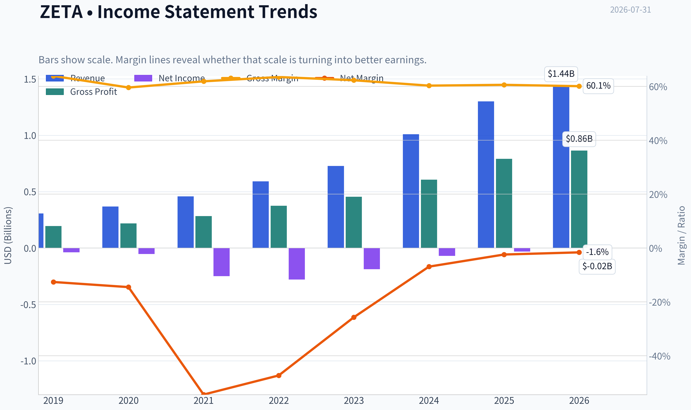

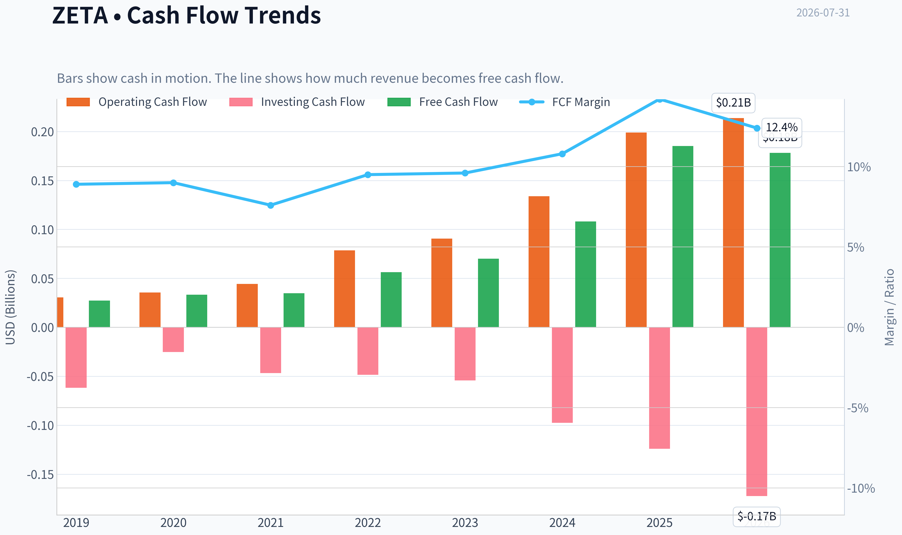

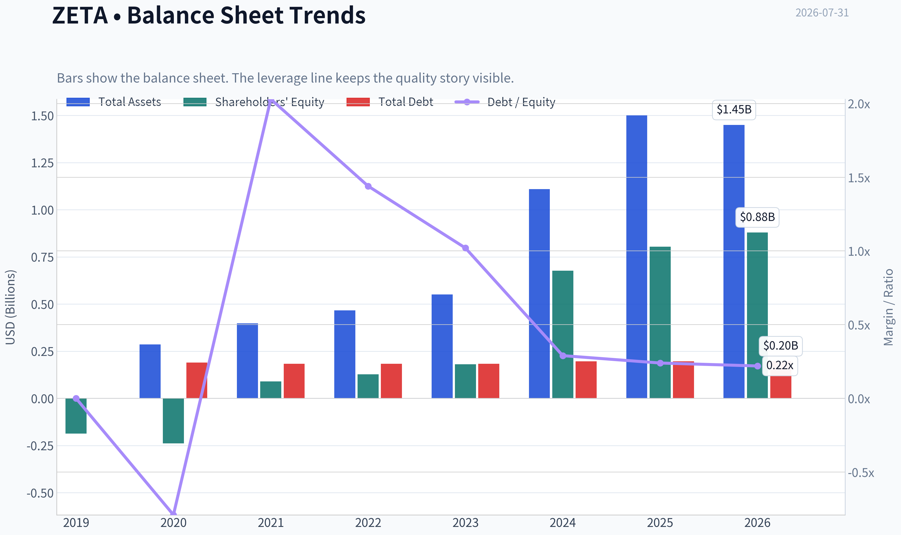

This graph tracks the profitability and return metrics (ROE, ROIC, Margins) of **ZETA** over the past decade, highlighting capital efficiency trends.

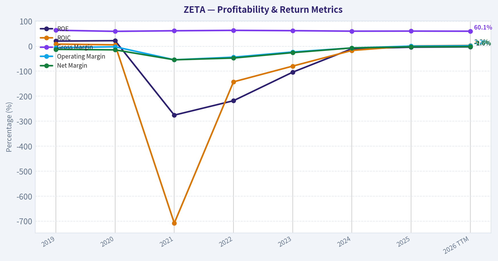

This chart illustrates the financial health of **ZETA** over the last 10 years, mapping cash equivalents and free cash flow against total obligations (Debt).

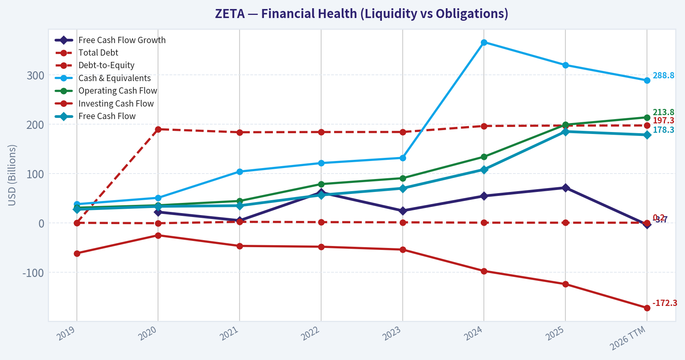

---

### Intrinsic Value Analysis (Buffett)

> *Following Warren Buffett's value investing philosophy: Circle of Competence, Economic Moat, Management Quality, and Margin of Safety.*

#### Intrinsic Value Snapshot

Price is what you pay. Intrinsic value is what the business may be worth based on the cash it can create for owners over time. We show a range, not one magic number.

- Current Price: $21.60
- Value Range (conservative to optimistic across both DCF methods): $20.41 to $67.11

##### Owner Earnings (Buffett Method)
- Net Income: $-31,509,000.00
- Depreciation & Amortization: $72,039,000.00
- Capital Expenditures: $-13,815,000.00
- Working Capital Changes: $-48,068,000.00
- Owner Earnings: $74,783,000.00

##### Intrinsic Value
###### Cash Flow Method
Uses free cash flow. Better for companies spending heavily today to grow tomorrow.
- Conservative: $20.41
- Average: $26.15
- Optimistic: $67.11
- Discount Rate: 10.0%

ANALYST STANCE: **OSSERVARE**

#### Zeta Global Holdings (ZETA) - Analisi Value in stile Buffett

> "Prezzo è ciò che paghi; valore è ciò che ottieni."
> Zeta è una piattaforma di marketing technology e dati proprietari: interessante per crescita e margini lordi, ma ancora non abbastanza prevedibile, redditizia e dominante da meritare un acquisto convinto al prezzo attuale.

---

#### 1. Sintesi della tesi

| Voce | Giudizio |
|---|---:|
| Prezzo corrente | $22 |
| Capitalizzazione | $5,38 miliardi |
| Modello di business | Piattaforma software e dati per marketing digitale aziendale |
| Crescita ricavi YoY | 29,7% |
| Margine lordo | 60,6% |
| FCF yield | 3,4% |
| ROE | -3,9% |
| P/E | Non significativo, utili GAAP non stabilizzati |
| Stance | **OSSERVARE** |
| Conviction | Media |

**Key Takeaways:** Zeta è una società in forte crescita, con margini lordi da software e generazione di cassa positiva. Tuttavia, la redditività GAAP è ancora debole, il vantaggio competitivo non è ancora dimostrato come "wide moat", e il prezzo incorpora aspettative importanti. È un business da seguire, non ancora una classica occasione Buffettiana.

---

#### 2. Factor Scorecard - Qualità del business

| Fattore | Punteggio 0-5 | Valutazione |
|---|---:|---|
| 1. Comprensibilità e prevedibilità | 3,0 | Il modello è comprensibile: Zeta vende software, dati e strumenti AI per marketing enterprise. La prevedibilità a 10 anni è media, perché il settore cambia rapidamente. |
| 2. Moat competitivo | 3,0 | Margini lordi sopra 60%, dati proprietari e integrazione nei workflow creano switching costs, ma la concorrenza è intensa. |
| 3. Management e allocazione capitale | 3,0 | Buona esecuzione sulla crescita e sul FCF, ma serve più storia pubblica di disciplina sul capitale e utili per azione. |
| 4. Struttura industriale | 2,5 | Mercato grande e in crescita, ma competitivo: Salesforce, Adobe, HubSpot, Google, The Trade Desk e molte piattaforme verticali. |
| Gate 5 - hard floor solvibilità | Non scattato | Non emerge distress finanziario combinato con incapacità di coprire obblighi. La società genera FCF positivo. |

**Key Takeaways:** Zeta supera il controllo di solvibilità: non è un caso di distress. Il problema non è la sopravvivenza, ma la qualità ancora da provare. La società ha caratteristiche da compounder software, ma non ancora evidenza sufficiente di moat largo e redditività strutturale.

---

#### 3. Moat Analysis

| Fonte di moat | Evidenza | Giudizio |
|---|---|---|
| Intangibili / dati proprietari | Piattaforma basata su dati, AI e customer intelligence. Margine lordo 60,6%, segnale positivo di valore percepito. | Buono |
| Switching costs | Clienti enterprise integrano campagne, dati, segmentazione e misurazione nella piattaforma Zeta. Cambiare fornitore può essere costoso. | Discreto |
| Vantaggi di costo | Scala dati e automazione AI possono migliorare efficienza, ma non è ancora chiaro se il vantaggio sia strutturale. | Medio |
| Network effects | Possibile effetto dati: più clienti e interazioni migliorano targeting e modelli. Non ancora evidente come network effect dominante. | Medio-basso |
| Pricing power | Margini lordi elevati indicano valore, ma in un mercato affollato la capacità di aumentare prezzi del 10% senza perdita di clienti non è pienamente dimostrata. | Non ancora provato |

**Key Takeaways:** Il moat di Zeta è reale ma non ancora largo. Il punto più interessante è la combinazione tra dati proprietari, AI e integrazione nei processi di marketing dei clienti. Il rischio è che il vantaggio venga eroso da grandi piattaforme con distribuzione, budget e dati superiori.

**Moat Quality Rating:** **Narrow to emerging wide - 3/5**

---

#### 4. Management Quality Assessment

| Area | Valutazione |
|---|---|
| Crescita | Forte: ricavi in aumento di circa 30% YoY. |
| Margini | Margine lordo software-like sopra 60%; FCF positivo. |
| Disciplina finanziaria | Miglioramento, ma il business deve ancora dimostrare utili GAAP stabili e ritorni sul capitale elevati. |
| Allocazione capitale | Da monitorare: in questa fase la priorità è reinvestire nella piattaforma, dati e go-to-market. |
| Allineamento azionisti | Non sufficiente da solo per attribuire un punteggio alto; serve più evidenza di creazione di valore per azione nel tempo. |

**Giudizio:** Management operativo efficace, ma non ancora valutabile come eccellente capital allocator in senso Buffettiano. La crescita è buona; ora serve prova di conversione in utili, FCF per azione e ROIC sostenibile.

---

#### 5. Financial Summary Table

| Metrica | Valore recente |
|---|---:|
| Prezzo azione | $22 |
| Market cap | $5,38B |
| Ricavi YoY | +29,7% |
| Margine lordo | 60,6% |
| FCF yield | 3,4% |
| FCF stimato su market cap | ~$183M |
| ROE | -3,9% |
| P/E | Non significativo |
| Current ratio | 1,60 |
| Valore intrinseco modello FCF | $26,15 per azione |
| Valore intrinseco modello FCFF headline | -$19,24 per azione |
| Reverse DCF | Prezzo implica crescita molto elevata |

**Key Takeaways:** Zeta ha un profilo finanziario misto: crescita forte, margini lordi buoni e free cash flow positivo. Ma ROE negativo e utili GAAP non stabilizzati riducono la qualità Buffettiana del caso. Il modello FCF suggerisce un valore sopra il prezzo, mentre altri modelli sono molto meno favorevoli.

---

#### 6. Owner Earnings Calculation

Uso il free cash flow come proxy prudente degli owner earnings, perché per una società software/data asset-light la distinzione tra capex di mantenimento e crescita è meno chiara rispetto a un business industriale.

| Componente | Stima |
|---|---:|
| Net income | Negativo / non stabilizzato |
| + D&A | Incluso indirettamente nel FCF proxy |
| - Capex di mantenimento | Incluso nel FCF |
| - Aumenti capitale circolante | Incluso nel FCF |
| Owner earnings proxy | ~$183M |
| Azioni stimate | ~244,5M |
| Owner earnings per azione | ~$0,75 |

**Key Takeaways:** Zeta è già capace di produrre cassa, elemento molto positivo per una società in crescita. Tuttavia, gli owner earnings sono ancora modesti rispetto alla capitalizzazione di mercato. A $22 per azione, il mercato paga circa 29 volte gli owner earnings stimati.

---

#### 7. Three-Scenario DCF Valuation

Assunzioni principali: owner earnings iniziali ~$183M, discount rate 10%, azioni stimate ~244,5M.

| Scenario | Assunzioni | Valore equity stimato | Valore per azione |
|---|---|---:|---:|
| A. Nessuna crescita | Owner earnings / 10% | ~$1,83B | ~$7,49 |
| B. Crescita GDP | Crescita perpetua 3% | ~$2,69B | ~$11,01 |
| C. Crescita storica prudente | 10 anni al 10%, terminale 3% | ~$4,52B | ~$18,50 |
| Modello FCF disponibile | Valutazione cash-flow più favorevole | - | $26,15 |

**Key Takeaways:** Nei tre scenari Buffettiani conservativi, il valore stimato resta sotto il prezzo corrente, salvo usare il modello FCF più favorevole. Questo significa che l'investimento richiede fiducia nella continuità di una crescita elevata e nella futura espansione dei margini. Non è una situazione di "dollaro venduto a cinquanta centesimi".

---

#### 8. Margin of Safety Analysis

| Riferimento di valore | Valore per azione | Prezzo | Margine di sicurezza |
|---|---:|---:|---:|
| Scenario A - No growth | $7,49 | $22 | Negativo |
| Scenario B - GDP growth | $11,01 | $22 | Negativo |
| Scenario C - Crescita 10% | $18,50 | $22 | Circa -16% |
| Modello FCF | $26,15 | $22 | Circa +19% |
| Headline FCFF | -$19,24 | $22 | Non utilizzabile come supporto positivo |

**Key Takeaways:** La valutazione non offre un margine di sicurezza ampio. Il caso bullish dipende dal fatto che il modello FCF sia il più rappresentativo e che la crescita resti alta per anni. Per un business con moat ancora non maturo, Buffett richiederebbe un prezzo più favorevole o prove operative più solide.

---

#### 9. Buffett Scorecard Finale

| Criterio | Peso | Punteggio 0-5 | Contributo ponderato |
|---|---:|---:|---:|
| Moat width & durability | 25% | 3,0 | 0,75 |
| Valutazione / margin of safety | 20% | 2,5 | 0,50 |
| Capital returns - ROIC vs WACC | 15% | 2,0 | 0,30 |
| Comprensibilità e prevedibilità | 12% | 3,0 | 0,36 |
| Management e allocazione capitale | 12% | 3,0 | 0,36 |
| Reinvestment runway | 8% | 4,0 | 0,32 |
| Solidità patrimoniale | 4% | 3,0 | 0,12 |
| Struttura industriale | 4% | 2,5 | 0,10 |
| **Totale** | **100%** | - | **2,81 / 5,00** |

**Key Takeaways:** Zeta ottiene un punteggio complessivo sotto la soglia di acquisto convinto. Il miglior elemento è il reinvestment runway: il mercato indirizzabile è grande e la società cresce rapidamente. I punti deboli sono valutazione, ritorni sul capitale non ancora dimostrati e moat ancora in costruzione.

---

#### 10. Stance finale

| Decisione | Valutazione |
|---|---|
| Stance | **OSSERVARE** |
| Conviction | Media |
| Prezzo più interessante | Sotto ~$18, oppure con prova di FCF e ROIC nettamente superiori |
| Cosa migliorerebbe la tesi | Crescita >20% con margini operativi in espansione, FCF per azione in aumento, ROIC positivo e sostenibile |
| Cosa peggiorerebbe la tesi | Rallentamento crescita, pressione sui margini, diluizione azionaria, aumento competizione da grandi piattaforme |

**Conclusione:** Zeta è un'azienda interessante, con crescita elevata, margini lordi attraenti e una piattaforma potenzialmente differenziata. Ma al prezzo attuale non offre ancora la combinazione Buffettiana ideale di moat largo, prevedibilità decennale, ritorni sul capitale elevati e margine di sicurezza. La scelta razionale è **OSSERVARE**, aspettando un prezzo migliore o una conferma più chiara che Zeta possa diventare un compounder di alta qualità.
#### Valuation Bridge

This bridge places the current market price beside each intrinsic value lens so readers can see whether upside depends on one method or shows up across several methods.

| Scenario | Intrinsic Value / Share |
| --- | ---: |
| Cash Flow Method | $26.15 |
| Damodaran Method | $-19.24 |
| Current Price | $21.60 |

#### Key Takeaways

If one method is far above the others, the upside case depends on a specific modelling assumption. When several methods cluster together, the valuation story is more robust.

#### Valuation Visuals

This comparison chart from *Latest Earnings Snapshot* stacks current figures against historical benchmarks for **ZETA**, making it easy to see where the company trades relative to its own averages.

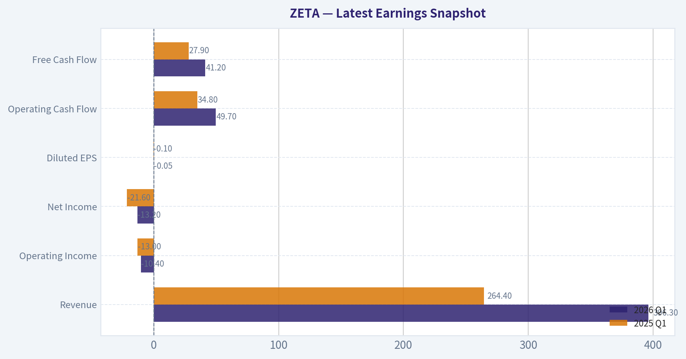

This comparison chart from *Bilancio e solidità finanziaria* stacks current figures against historical benchmarks for **ZETA**, making it easy to see where the company trades relative to its own averages.

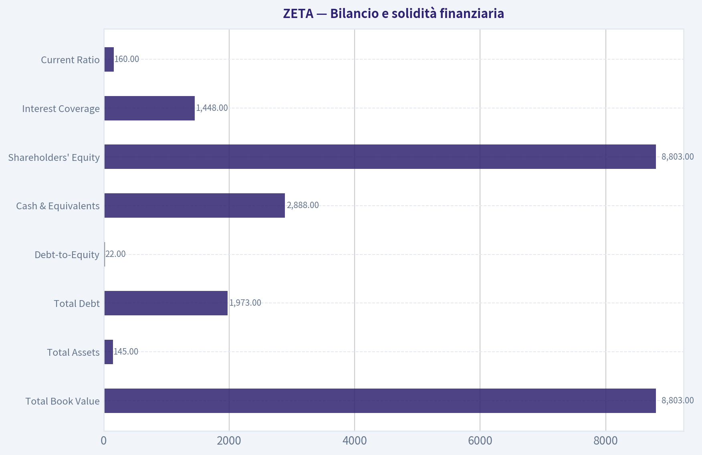

This comparison chart from *Sintesi della tesi* stacks current figures against historical benchmarks for **ZETA**, making it easy to see where the company trades relative to its own averages.

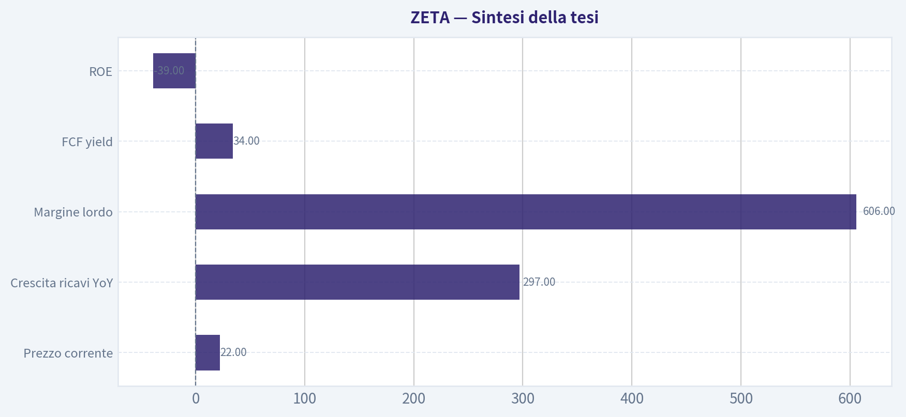

This comparison chart from *Financial Summary Table* stacks current figures against historical benchmarks for **ZETA**, making it easy to see where the company trades relative to its own averages.

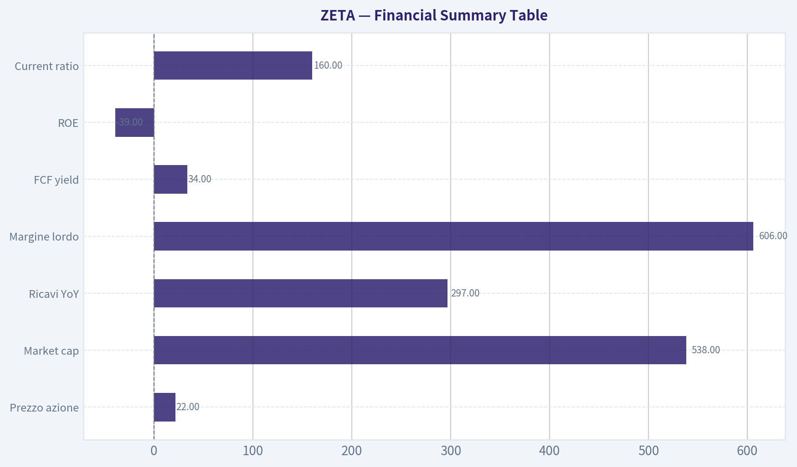

---

### Trend & Growth Analysis (Lynch/Druckenmiller/Fisher)

> *Following Peter Lynch's GARP, Stanley Druckenmiller's macro-aware approach, and Philip Fisher's scuttlebutt methodology.*

ANALYST STANCE: **SOSTENERE**

#### Sintesi rapida

Zeta Global è un **fast grower** nel marketing tecnologico alimentato da dati e AI. A $22 per azione e circa $5,38 miliardi di market cap, il titolo combina **crescita ricavi vicina al 30%**, **gross margin sopra il 60%**, **FCF yield positivo** e una narrativa di inflection point legata ad AI, automazione marketing e partnership strategiche come Palantir. Il rischio principale è che la valutazione richieda ancora crescita elevata e persistente, ma il profilo crescita/prezzo appare interessante rispetto ad altri nomi AI più affollati.

---

#### 1. Classificazione Lynch

| Voce | Valutazione |
|---|---:|
| Categoria Lynch | **Fast Grower** |
| Crescita ricavi YoY | **29,7%** |
| PE | N/A, utile netto non ancora stabilizzato |
| ROE | -3,9% |
| Gross margin | 60,6% |
| FCF yield | 3,4% |
| Current ratio | 1,60 |
| Market cap | $5,38B |
| Prezzo corrente | $22 |

**Key Takeaways:** Zeta rientra chiaramente nella categoria dei fast growers di Lynch, grazie a una crescita dei ricavi vicina al 30%. La società non è ancora valutabile bene con il PE, perché la redditività GAAP resta immatura, ma il FCF positivo riduce il rischio tipico dei growth non profittevoli. Il profilo è più "GARP growth" che "story stock" puro.

#### 2. La storia in 3 punti

- Zeta aiuta le aziende a **trovare, capire e convertire clienti** usando dati proprietari, AI e automazione marketing.
- La piattaforma beneficia del passaggio da pubblicità tradizionale e cookie di terze parti verso **first-party data, personalization e AI-driven marketing**.
- Se la partnership con Palantir e la piattaforma Athena accelerano adozione e monetizzazione, Zeta può diventare uno dei pochi "AI software" con crescita reale, FCF positivo e valutazione ancora ragionevole.

---

#### 3. TAM e test 10x

| Voce | Stima / Giudizio |
|---|---:|
| Ricavi attuali stimati TTM | circa $1,2B-$1,4B, da verificare |
| Ricavi necessari per 10x | circa $12B-$14B |
| TAM marketing technology / customer intelligence / AI advertising | potenzialmente $100B+ |
| Quota implicita a 10x ricavi | circa 12%-14% del TAM, se TAM $100B |
| Esito test 10x | **Superato, ma con esecuzione molto impegnativa** |

**Key Takeaways:** Zeta può teoricamente crescere di dieci volte restando sotto una quota di mercato ragionevole rispetto al TAM globale del marketing tecnologico. Il runway esiste perché la spesa pubblicitaria e CRM sta migrando verso piattaforme data-driven e AI-native. Il punto critico è l'esecuzione: per arrivare a $12B-$14B di ricavi, Zeta deve diventare una piattaforma enterprise dominante, non solo un fornitore adtech di nicchia.

---

#### 4. Trend dei ricavi

| Indicatore | Lettura |
|---|---:|
| Crescita ricavi YoY attuale | 29,7% |
| Pattern qualitativo | Crescita alta e apparentemente sostenuta |
| News recenti | Momentum positivo, earnings e ricavi in accelerazione secondo copertura recente |
| Classificazione trend | **Stabile-alta / potenziale accelerazione** |
| Segnale Druckenmiller | Possibile inflection point se AI e partnership aumentano win rate e ARPU |

**Key Takeaways:** La crescita vicina al 30% mette Zeta nella zona migliore per un growth investor. Le notizie recenti indicano momentum operativo, con enfasi su AI, EBITDA e FCF in miglioramento. Serve confermare nei prossimi trimestri che la crescita non sia solo ciclica o legata a budget marketing favorevoli, ma una vera accelerazione strutturale.

---

#### 5. Unit economics

| Metrica | Dato disponibile | Giudizio |
|---|---:|---|
| Gross margin | 60,6% | Buono per software/data platform, inferiore ai SaaS puri top-tier |
| FCF yield | 3,4% | Positivo e importante per qualità della crescita |
| LTV/CAC | Non disponibile | Da monitorare |
| NRR | Non disponibile | Da monitorare |
| Rule of 40 stimata | 29,7% crescita + circa 3,4% FCF yield come proxy = circa 33% | Accettabile, non ancora best-in-class |

**Key Takeaways:** Zeta mostra segnali di unit economics ragionevoli: margini lordi buoni e FCF positivo. Tuttavia, mancano dati chiave come NRR e LTV/CAC, che sono essenziali per capire la qualità del motore commerciale. La Rule of 40 appare accettabile, ma non ancora nella fascia eccellente sopra 40.

---

#### 6. Inflection point assessment

| Tipo di inflection | Evidenza | Valutazione |
|---|---|---:|
| Product cycle | Piattaforme AI, Athena, automazione marketing | Positiva |
| TAM inflection | AI e first-party data ampliano casi d'uso | Positiva |
| Margin inflection | EBITDA e FCF in miglioramento secondo news recenti | Positiva |
| Competitive inflection | Settore frammentato; possibile share gain da legacy martech/adtech | Moderatamente positiva |
| Market recognition | Titolo ha momentum, ma valutazione ancora non estrema | Positiva |

**Key Takeaways:** Il caso Zeta ruota attorno a un possibile inflection point simultaneo: crescita AI, margini in espansione e adozione enterprise. Questo è esattamente il tipo di setup che Druckenmiller cercherebbe, purché gli utili a 2-3 anni siano sottostimati dal mercato. La sfida è distinguere una vera piattaforma AI scalabile da una narrativa AI applicata a un business pubblicitario ciclico.

---

#### 7. Setup macro

| Fattore macro | Impatto su Zeta |
|---|---|
| Tassi d'interesse | Tassi in calo sarebbero positivi per multipli growth |
| Ciclo economico | Budget marketing possono essere ciclici; rischio in rallentamento |
| Secular trend | AI, automazione marketing, cloud software, data analytics |
| Rischio macro principale | Tagli ai budget pubblicitari in recessione |
| Vento macro netto | Moderatamente favorevole |

**Key Takeaways:** Zeta beneficia di trend secolari forti, soprattutto AI e digital marketing automation. Tuttavia, non è immune dal ciclo economico perché i budget pubblicitari possono essere tagliati rapidamente in fasi recessive. Il setup è favorevole se l'economia resta stabile e i tassi scendono, ma meno difensivo rispetto a software mission-critical puri.

---

#### 8. Fisher 15 punti

| Area Fisher | Punteggio 1-5 |
|---|---:|
| Potenziale di mercato | 5 |
| Nuovi prodotti | 4 |
| R&D efficace | 4 |
| Organizzazione vendite | 4 |
| Margini profittevoli | 3 |
| Margini in miglioramento | 4 |
| Relazioni personale | 3 |
| Relazioni executive | 3 |
| Profondità management | 3 |
| Controllo costi/accounting | 3 |
| Moat: dati, switching cost, AI | 4 |
| Outlook lungo termine | 4 |
| Diluizione | 3 |
| Candore management | 3 |
| Integrità management | 3 |
| **Totale** | **53/75** |

**Key Takeaways:** Il punteggio Fisher è nella fascia media-alta, ma non ancora eccellente. Zeta ha un buon mercato, buoni prodotti e un potenziale moat basato su dati e AI, ma servono più prove su management depth, retention, trasparenza e qualità degli economics. Il titolo merita supporto come growth setup, ma non ancora massima convinzione Fisher.

---

#### 9. Valutazione

| Metodo | Risultato | Lettura |
|---|---:|---|
| PEG | N/A | Utile netto non stabilizzato |
| P/S stimato | circa 3,8x-4,5x, usando ricavi TTM stimati $1,2B-$1,4B | Interessante per crescita ~30% |
| DCF FCF disponibile nel pack | $26,15 per azione | Circa 19% sopra $22 |
| DCF headline negativo | -$19,24 | Modello probabilmente non adatto / rumoroso |
| Reverse DCF | Prezzo implica circa 52,9% annuo per 10 anni | Segnale di attenzione |
| Valutazione complessiva | Ragionevole, ma non "deep value" |

**Key Takeaways:** La valutazione è il punto più controverso. Su P/S, Zeta sembra economica rispetto a molti software AI con crescita simile; su reverse DCF, invece, il mercato sembra richiedere un'accelerazione molto elevata. La conclusione è che il titolo è interessante se la crescita resta sopra il 25% e i margini continuano a espandersi, ma vulnerabile se la crescita rallenta sotto il 20%.

#### Scenario a 3-5 anni

| Scenario | Ipotesi ricavi | Multiplo EV/Sales | Esito qualitativo |
|---|---:|---:|---|
| Bear | Crescita rallenta verso 12%-15% | 2,5x-3,0x | Rendimento debole / downside |
| Base | Crescita 20%-25%, margini FCF in aumento | 4,5x-5,5x | Buon upside |
| Bull | Crescita 25%-30%+, piattaforma AI riconosciuta | 7,0x-8,0x | Potenziale multi-bagger |

**Key Takeaways:** Lo scenario base richiede che Zeta dimostri crescita sostenuta e leva operativa, non solo ricavi in aumento. Lo scenario bull dipende da una rivalutazione del mercato: Zeta deve essere vista come piattaforma AI enterprise, non solo come adtech. Il bear case emerge se il mercato la tratta come società pubblicitaria ciclica con margini limitati.

---

#### 10. Growth Investor Scorecard

| Criterio | Peso | Punteggio 1-5 |
|---|---:|---:|
| Storia Lynch | 10% | 4,0 |
| TAM e runway | 20% | 4,0 |
| Crescita ricavi | 20% | 4,2 |
| Unit economics | 15% | 3,4 |
| Posizione competitiva | 10% | 3,6 |
| Management quality | 10% | 3,3 |
| Macro setup | 5% | 3,5 |
| Percorso a redditività | 5% | 3,8 |
| Valutazione | 5% | 3,7 |
| **Score ponderato** | **100%** | **3,8/5** |

**Key Takeaways:** Il punteggio finale di 3,8 colloca Zeta nella fascia "Sostenere", ma non in quella di massima convinzione. Il caso è forte su crescita, TAM e narrativa AI, mentre resta più debole su trasparenza degli unit economics e qualità comprovata del moat. È un titolo adatto a una posizione growth controllata, non a una posizione oversized senza ulteriori conferme.

---

#### 11. Stance e posizione

| Elemento | Decisione |
|---|---|
| Stance | **SOSTENERE** |
| Tipo posizione | Growth position controllata |
| Size suggerita | 2%-4% del portafoglio growth, aumentabile su conferme |
| Aggiungere aggressivamente se | Crescita >25%, FCF margin in espansione, NRR/LTV-CAC solidi |
| Ridurre se | Crescita <20%, margini stagnanti, aumento diluizione o churn |

**Key Takeaways:** Zeta merita una posizione, ma non ancora una scommessa concentrata alla Druckenmiller. La size deve riflettere il mix tra forte potenziale e dati ancora incompleti su retention e unit economics. Il titolo diventa molto più interessante se nei prossimi trimestri conferma accelerazione AI e operating leverage.

---

#### 12. Rischi e catalizzatori

| Rischi principali | Catalizzatori principali |
|---|---|
| Budget marketing ciclici | Crescita ricavi sopra attese |
| Competizione da Adobe, Salesforce, The Trade Desk, CDP e martech private | Espansione partnership Palantir |
| Margini inferiori ai SaaS top-tier | Athena e AI aumentano ARPU e win rate |
| Possibile narrativa AI già parzialmente prezzata | FCF margin in miglioramento |
| Dati insufficienti su NRR e LTV/CAC | Re-rating da adtech a AI data platform |
| Steve Cohen / Point72 ha chiuso la posizione secondo ultimo 13F | Nuovi clienti enterprise e guidance rialzata |

**Key Takeaways:** Il rischio più importante è che Zeta venga valutata come AI software ma si comporti economicamente come adtech ciclica. I catalizzatori, però, sono reali: crescita sostenuta, FCF positivo, partnership strategiche e potenziale re-rating. Il prossimo anno di risultati sarà decisivo per capire se Zeta è un buon growth stock o un vero candidato multi-bagger.

#### Conclusione

Zeta è un **fast grower con possibile inflection point AI**, valutazione ancora ragionevole e FCF positivo. Non è priva di rischi: mancano dati completi su retention e unit economics, e il settore marketing resta ciclico e competitivo. Tuttavia, usando Lynch, Druckenmiller e Fisher, il profilo complessivo giustifica una stance **SOSTENERE** con posizione controllata e possibilità di aumentare se la crescita sopra il 25% e l'espansione dei margini continuano.

#### Growth & Scorecard Visuals

This comparison chart from *Factor Scorecard - Qualità del business* stacks current figures against historical benchmarks for **ZETA**, making it easy to see where the company trades relative to its own averages.

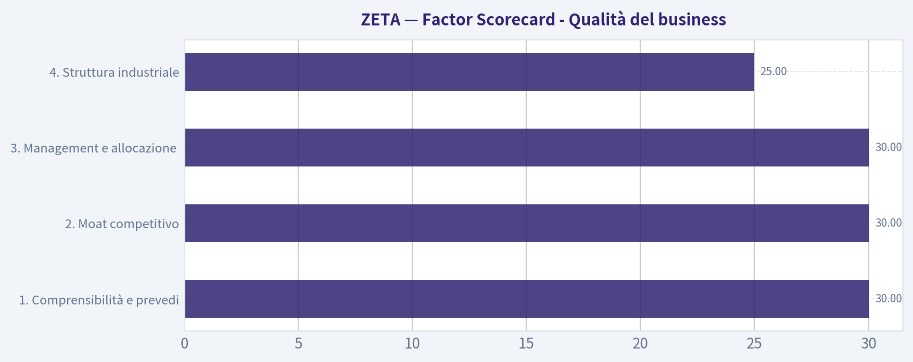

---

### Market Technical Analysis

ANALYST STANCE: **OSSERVARE**

#### ZETA - analisi tecnica al 31 luglio 2026

Dati prezzo disponibili fino al **30 luglio 2026**; indicatori calcolati con riferimento al **31 luglio 2026**. La lettura complessiva è **costruttiva ma non ancora convincente abbastanza per un segnale aggressivo**: ZETA resta sopra le principali medie di medio-lungo periodo, ma il recupero recente avviene dopo una fase molto volatile e incontra una zona di offerta importante tra **22,50 e 23,20 dollari**.

Ho selezionato questi **8 indicatori**, perché coprono trend, momentum, volatilità e conferma da volumi senza eccessiva ridondanza: `close_10_ema`, `close_50_sma`, `close_200_sma`, `macd`, `rsi`, `boll_ub`, `atr`, `vwma`.

#### Lettura del trend

ZETA ha costruito un movimento molto irregolare negli ultimi due mesi. Dopo il forte impulso di fine maggio e inizio giugno, culminato nell'area **25,25 dollari**, il titolo ha corretto bruscamente fino a circa **17,88 dollari** a fine giugno. Da lì è partito un recupero ordinato fino all'area **22,50-22,90**, seguito però da un nuovo ritracciamento verso **19,13** il 24 luglio. Il successivo rimbalzo fino a **22,08** il 29 luglio mostra che i compratori sono ancora presenti, ma la chiusura del 30 luglio a **21,37** segnala una pausa sotto la resistenza recente.

La struttura di fondo resta positiva perché il prezzo è sopra la **SMA 50** e ben sopra la **SMA 200**. La **SMA 50** è salita da circa **18,64** a metà giugno a circa **20,77** al 31 luglio, indicando che il trend intermedio si è effettivamente rafforzato. Anche la **SMA 200**, pur molto più lenta, è in lieve risalita intorno a **18,84**, suggerendo che il quadro strategico non è ribassista. Tuttavia, il prezzo non ha ancora riconquistato stabilmente l'area dei massimi di luglio, quindi il trend è meglio descritto come **recupero in fase di test**, non come breakout già confermato.

#### Momentum e qualità del rimbalzo

Il `macd` è tornato positivo, passando da valori negativi a fine giugno a circa **0,237** al 31 luglio. Questo è un segnale favorevole: indica che la pressione rialzista di breve-medio periodo è migliorata dopo il minimo di fine giugno. Tuttavia, il MACD era più forte a metà luglio, quando superava **0,60**, e poi si è raffreddato durante il pullback verso 19 dollari. Il recupero degli ultimi giorni è quindi reale, ma non ancora esplosivo.

L'`rsi` a circa **54,35** è coerente con una situazione di equilibrio leggermente positiva. Non siamo in ipercomprato, quindi il titolo ha ancora spazio tecnico per salire se arriva una conferma di prezzo. Allo stesso tempo, l'RSI non è abbastanza elevato da indicare forte dominio dei compratori. In pratica, il momentum è migliorato ma resta selettivo: sopra **22,50-23,20** diventerebbe più credibile; sotto **20,70-21,20** tornerebbe vulnerabile.

#### Volatilità e livelli operativi

L'`atr` è intorno a **1,33 dollari**, pari a circa il **6%** del prezzo recente. È una volatilità significativa: ZETA può muoversi rapidamente anche senza cambiare davvero trend. Questo rende pericolosi stop troppo stretti e suggerisce di dimensionare le posizioni con prudenza.

La banda superiore di Bollinger, `boll_ub`, è intorno a **23,17**. Questo livello è importante perché coincide quasi con la zona dei massimi recenti: **22,53**, **22,99** e area **23,00-23,20**. Una chiusura convincente sopra questa fascia, idealmente accompagnata da volumi in aumento, sarebbe un segnale tecnico molto più forte rispetto al semplice rimbalzo visto negli ultimi giorni. Al contrario, un rifiuto sotto 23 dollari manterrebbe il titolo in una fase laterale-volatile.

#### Volumi e conferma

Il `vwma` è circa **21,27**, molto vicino alla chiusura più recente di **21,37**. Questo significa che il prezzo è solo leggermente sopra la media ponderata per i volumi: il mercato non sta ancora pagando un premio netto rispetto al prezzo medio scambiato. La dinamica è migliorata rispetto alla debolezza di fine giugno, ma il volume dell'ultima seduta disponibile, circa **4,77 milioni**, è inferiore rispetto alle giornate di forte partecipazione viste durante i movimenti più decisi.

Questa è una parte cruciale della lettura: il prezzo è tornato sopra supporti importanti, ma la conferma da volumi non è ancora pienamente convincente. Per un'impostazione più aggressiva, vorrei vedere una rottura sopra **22,50-23,20** con scambi superiori alla media recente.

#### Zone tecniche da monitorare

| Area | Livello indicativo | Interpretazione operativa |
|---|---:|---|
| Resistenza immediata | 22,50-23,20 | Fascia dei massimi recenti e vicina alla banda superiore di Bollinger; breakout sopra questa zona migliorerebbe molto il quadro |
| Resistenza successiva | 25,20-25,30 | Massimo di inizio giugno; obiettivo potenziale solo dopo breakout confermato |
| Supporto dinamico breve | 21,20-21,30 | Confluenza tra EMA 10 e VWMA; area chiave per capire se il rimbalzo tiene |
| Supporto intermedio | 20,70-20,80 | SMA 50; perdita di questa zona indebolirebbe il trend intermedio |
| Supporto tattico | 19,10-19,40 | Area del minimo recente di fine luglio; sotto qui aumenterebbe il rischio di ritorno verso 18 dollari |
| Supporto strategico | 18,80-18,90 | SMA 200; livello chiave per il quadro di lungo periodo |
| Momentum | RSI 54, MACD positivo | Costruttivo ma non euforico; serve conferma sopra resistenza |
| Rischio | ATR circa 1,33 | Volatilità elevata; stop e size devono tenerne conto |

**Punti chiave:** ZETA è tecnicamente migliorata, ma si trova in una zona delicata: sopra 21,20-21,30 il rimbalzo resta vivo, mentre sopra 22,50-23,20 potrebbe trasformarsi in un breakout più credibile. La tendenza di medio-lungo periodo è positiva grazie alla posizione sopra SMA 50 e SMA 200, ma la volatilità rimane alta e i volumi non hanno ancora confermato pienamente una nuova fase impulsiva. Per questo la posizione più prudente è **OSSERVARE**, aspettando una chiusura forte sopra la resistenza o un pullback ordinato verso supporti chiave.

#### Market Visuals

This comparison chart from *Analisi dei Market Metrics* stacks current figures against historical benchmarks for **ZETA**, making it easy to see where the company trades relative to its own averages.

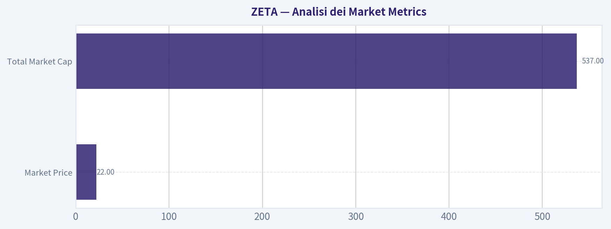

---

### Options Market Analysis

> *Reading options flow - put/call ratios, IV skew, and unusual activity - to gauge institutional positioning and event-driven risk.*

POSIZIONE ANALISTA: **OSSERVARE**

#### ZETA - Lettura del mercato opzioni al 31 luglio 2026

#### 1. Analisi Put/Call Ratio

| Scadenza | Call OI | Put OI | Put/Call OI | Volume Call | Volume Put | Put/Call Volume | Lettura |
|---|---:|---:|---:|---:|---:|---:|---|
| 07 ago 2026 | 11.436 | 5.717 | 0,50 | 5.717 | 1.297 | 0,23 | Call-heavy, sentiment rialzista di breve |
| 14 ago 2026 | 2.580 | 3.241 | 1,26 | 678 | 176 | 0,26 | OI più difensivo, ma volume ancora sbilanciato su call |
| 21 ago 2026 | 19.816 | 5.342 | 0,27 | 912 | 502 | 0,55 | Forte concentrazione di call aperte |
| **Totale near-term** | **33.832** | **14.300** | **0,42** | **7.307** | **1.975** | **0,27** | **Sbilanciamento rialzista netto** |

**Key Takeaways:** Il Put/Call OI ratio complessivo di **0,42** è ben sotto la baseline neutrale storica di circa **0,70**, indicando una struttura di open interest decisamente più orientata verso le call. Anche il Put/Call volume ratio di **0,27** segnala che il flusso recente è dominato da call, coerente con speculazione rialzista o, in parte, strategie di covered call. L'unica anomalia difensiva è la scadenza del 14 agosto, dove l'OI put supera l'OI call, ma il volume giornaliero resta comunque call-heavy.

---

#### 2. Valutazione Implied Volatility e skew

| Scadenza | ATM IV Call | ATM IV Put | Differenza Call - Put | Lettura IV |
|---|---:|---:|---:|---|
| 07 ago 2026 | 129,2% | 122,9% | +6,3 punti vol | IV molto elevata, call leggermente più care |
| 14 ago 2026 | 108,2% | 105,0% | +3,2 punti vol | IV elevata, lieve premio sulle call |
| 21 ago 2026 | 95,9% | 92,3% | +3,6 punti vol | IV ancora alta, ma in calo con l'estensione temporale |

**Key Takeaways:** L'IV near-term è molto elevata, soprattutto sulla scadenza del 7 agosto, dove l'ATM IV supera il **120%** sia su call sia su put. Le call ATM prezzano più volatilità delle put ATM su tutte le scadenze disponibili, suggerendo una lieve pressione verso l'alto o domanda di convexity rialzista. Non sono disponibili dati dettagliati su IV OTM put vs OTM call, quindi lo skew completo non può essere confermato; tuttavia, l'ATM skew osservabile non mostra paura ribassista dominante.

#### Interpretazione dello skew

| Aspetto | Osservazione | Implicazione |
|---|---|---|
| ATM call vs ATM put | Call IV superiore alle put su tutte le scadenze | Leggera inclinazione rialzista |
| OTM put skew | Non disponibile nei dati forniti | Impossibile confermare presenza di downside fear |
| OTM call skew | Non disponibile nei dati forniti | Impossibile misurare pienamente upside chase |
| Livello assoluto IV | Molto alto nel brevissimo termine | Il mercato prezza movimento ampio o rischio evento |

**Key Takeaways:** La volatilità implicita è chiaramente alta, quindi chi compra opzioni paga un premio significativo. L'assenza di un forte premio sulle put ATM riduce l'evidenza di panico ribassista, mentre il lieve premio sulle call suggerisce domanda per esposizione upside. Se esiste un catalizzatore imminente - earnings, guidance, news societarie o evento macro - il mercato lo sta già prezzando in modo aggressivo.

---

#### 3. Attività insolita nelle opzioni

| Contratto insolito | Volume vs OI | Interpretazione |
|---|---:|---|
| Nessun contratto rilevato con volume superiore a 5x open interest | N/D | Non emergono nuove scommesse direzionali "fresche" chiaramente identificabili |

**Key Takeaways:** Non ci sono contratti con volume superiore a **5 volte** l'open interest nelle scadenze near-term analizzate. Questo riduce la possibilità di identificare un singolo flusso istituzionale aggressivo, come una sweep call o una grossa put hedge. Il segnale rialzista deriva quindi più dalla struttura complessiva di OI e volume che da una specifica operazione "smart money".

#### Lettura qualitativa del flusso

| Elemento | Lettura |
|---|---|
| Volume call dominante | Indica domanda recente per esposizione rialzista |
| Assenza di unusual activity estrema | Meno evidenza di posizionamento istituzionale concentrato |
| IV molto alta | Le opzioni sono care; rischio di IV crush se il catalizzatore delude |
| Qualità del segnale | Moderata, non massima |

**Key Takeaways:** Il flusso appare rialzista, ma non esplosivo o chiaramente istituzionale. L'elevata IV rende rischioso inseguire call nude, perché anche un movimento favorevole potrebbe non bastare se la volatilità implicita si comprime. La lettura migliore è di sentiment positivo, ma con premio opzionale già molto carico.

---

#### 4. Concentrazione di Open Interest e possibili livelli magnetici

| Scadenza | Call OI | Put OI | Area dominante | Implicazione |
|---|---:|---:|---|---|
| 07 ago 2026 | 11.436 | 5.717 | Call | Possibile pressione rialzista o pinning verso strike call ad alto OI, ma strike non disponibili |
| 14 ago 2026 | 2.580 | 3.241 | Put | Scadenza più difensiva; possibile supporto/hedging, ma strike non disponibili |
| 21 ago 2026 | 19.816 | 5.342 | Call | Maggiore concentrazione complessiva; probabile gamma wall lato call, ma non misurabile per strike |

**Key Takeaways:** La scadenza del **21 agosto** ha la maggiore concentrazione di open interest, soprattutto sulle call, e potrebbe essere la più importante per effetti di gamma e pinning. Tuttavia, i dati disponibili non includono la distribuzione per strike, quindi non è possibile indicare con precisione i livelli di max pain o i gamma wall. In aggregato, la struttura suggerisce che il lato call domina la "gravità" del mercato opzioni near-term.

#### Nota sui gamma wall

| Tema | Valutazione |
|---|---|
| Strike con OI massimo | Non disponibili |
| Max pain | Non calcolabile con i dati forniti |
| Gamma wall specifici | Non identificabili per strike |
| Rischio direzionale da dealer hedging | Probabilmente più sensibile al lato call, data la concentrazione di call OI |

**Key Takeaways:** Senza la catena per strike, non si può stabilire se ZETA sia vicina a un livello di pinning specifico. Il dato aggregato, però, indica che eventuali movimenti verso l'alto potrebbero interagire con una quantità significativa di call aperte. Questo può amplificare o frenare il movimento a seconda del posizionamento netto dei dealer.

---

#### 5. Segnale complessivo dal mercato opzioni

| Componente | Segnale | Peso nella lettura |
|---|---|---|
| Put/Call OI ratio | Rialzista | Alto |
| Put/Call volume ratio | Rialzista | Alto |
| IV assoluta | Rischio elevato / evento prezzato | Medio |
| ATM skew | Lievemente rialzista | Medio |
| Unusual activity | Neutrale | Medio-basso |
| Concentrazione OI | Rialzista, ma incompleta senza strike | Medio |

**Key Takeaways:** Il segnale complessivo delle opzioni su ZETA è **rialzista**, guidato soprattutto da Put/Call ratio molto bassi e da un volume recente fortemente orientato alle call. La cautela principale è che l'IV è molto elevata, quindi il mercato sta già prezzando un movimento ampio. Non essendoci unusual activity estrema, il segnale è positivo ma non da "forte accumulo istituzionale" confermato.

#### Segnale finale: **BULLISH / Rialzista**

La lettura del mercato opzioni su ZETA è **rialzista**, con una chiara preferenza per call rispetto a put nelle scadenze near-term. Il Put/Call OI ratio complessivo di **0,42** e il Put/Call volume ratio di **0,27** rappresentano uno scostamento significativo dalla neutralità storica di circa **0,70**, segnalando domanda di esposizione upside o strategie call-oriented.

La principale cautela è l'**IV molto elevata**, specialmente sulla scadenza del 7 agosto, che rende costoso comprare opzioni direzionali. In assenza di contratti insoliti con volume molto superiore all'OI, il segnale sembra più una struttura di sentiment diffuso che una singola operazione istituzionale aggressiva.

#### Tabella riassuntiva finale

| Categoria | Dato / Lettura | Implicazione |
|---|---|---|
| Put/Call Ratio | OI ratio **0,42**, volume ratio **0,27** | Deciso sbilanciamento verso call; sentiment rialzista |
| Livello IV | ATM IV tra circa **92% e 129%** | Premi molto elevati; probabile rischio evento o aspettativa di movimento ampio |
| Direzione skew | Call ATM più care delle put ATM | Lieve skew rialzista; downside fear non dominante |
| Attività insolita | Nessun contratto volume > 5x OI | Nessuna nuova scommessa estrema identificata |
| Segnale complessivo | **BULLISH / Rialzista** | Posizionamento opzioni favorevole all'upside, ma con rischio IV crush |

**Key Takeaways:** Il quadro opzioni di ZETA è favorevole ai rialzisti, ma non privo di rischi. Il mercato sta pagando molto per la volatilità, quindi la direzione non è l'unica variabile: conta anche quanto forte sarà il movimento effettivo. La sintesi è **rialzista con cautela**, più adatta a monitoraggio o strategie con controllo del premio che a inseguimento aggressivo di call care.

---

## Research Team Commentary

> *The Research Manager synthesizes the Bull vs Bear debate into action-free commentary. This is a pre-risk view, not the final stance.*

Come gestore di portafoglio value che applica la filosofia di Warren Buffett adattata all'era moderna, il mio compito non è solo quello di cercare aziende a buon mercato, ma di trovare aziende meravigliose a prezzi ragionevoli, valutando con attenzione la reale sostenibilità del loro vantaggio competitivo e la qualità del capitale.

Ascoltando questo dibattito su Zeta Global (ZETA), mi trovo di fronte a un classico bivio del mercato odierno: un'azienda con una forte narrativa legata all'intelligenza artificiale e ai dati, contrapposta a metriche finanziarie ancora non all'altezza di una vera "compounding machine".

Sintetizziamo i punti chiave emersi da entrambe le parti.

Da un lato, l'analista Bull costruisce una tesi interessante basata sull'adattamento ai tempi moderni. Sottolinea che Zeta possiede un fossato economico basato sui dati di prima parte (240 milioni di consumatori), fondamentale in un mondo che abbandona i cookie di terze parti. Evidenzia l'impressionante crescita dei ricavi del 29,7% su base annua, la validazione derivante dalla partnership con Palantir e argomenta che il flusso di cassa operativo è positivo. Infine, mi mette in guardia dal ripetere gli errori del passato (come con NVDA e PLTR), dove un'eccessiva rigidità sulla valutazione ci ha fatto perdere trend secolari e riprese tecniche dominanti.

Dall'altro lato, l'analista Bear smonta questa narrativa con la spietata logica dei numeri. Ci ricorda che i dati nel marketing (martech) sono una commodity deperibile e soggetta a enormi rischi regolatori (privacy, limitazioni di Apple/Google). Fa notare che un margine lordo del 60,6% è debole per un'azienda software "d'élite", indicando scarso pricing power. Ma soprattutto, colpisce al cuore della filosofia di Buffett: un Return on Invested Capital (ROIC) dello 0,8% e un ROE del -3,9% indicano che la crescita di Zeta non sta creando reale valore economico per gli azionisti. La mancanza di profitti GAAP, probabilmente mascherata da massicci compensi in azioni (SBC), diluisce i proprietari.

Valutando queste argomentazioni attraverso il nostro framework, devo fare molta attenzione alle lezioni apprese dai miei errori su Nvidia e Palantir. L'analista Bull cerca abilmente di usare quei miei passi falsi per spingermi a comprare Zeta, ma c'è una fallacia in questo paragone. Il mio errore su Nvidia è stato ignorare un ROIC stratosferico e margini lordi superiori al 70% in nome di un multiplo alto; il mio errore su Palantir è stato restare neutrale (Watch) quando il titolo aveva valutazioni estreme ma un fossato monopolistico reale.

Zeta Global non è Nvidia e non è Palantir. Zeta opera in un mercato iper-competitivo contro giganti come Salesforce e Adobe. Una crescita del 30% è fantastica, ma come insegna Buffett, la crescita distrugge valore se il rendimento sul capitale investito (ROIC) è inferiore al costo del capitale. Con un ROIC dello 0,8%, Zeta sta girando a vuoto dal punto di vista della creazione di ricchezza a lungo termine. Il margine lordo al 60,6% conferma che non siamo di fronte a un monopolio software inscalfibile, ma a un business che richiede ancora molta spesa e sforzo per competere.

Ecco il mio commento dettagliato per gli investitori:

Core Takeaway: Zeta Global è un attore in rapida espansione nel settore del marketing basato sui dati e sull'IA, ma manca attualmente delle metriche finanziarie d'élite e del fossato inespugnabile necessari per giustificare un investimento di forte convinzione secondo i principi del value investing moderno. La crescita dei ricavi è forte, ma la debole redditività sul capitale investito rende la qualità del business incerta.

Rationale: Per un investitore value moderno, va bene pagare un premio per la crescita e per modelli di business "asset-light", ma solo se c'è la prova inconfutabile di un vantaggio competitivo (misurato da alti margini lordi e un ROIC eccellente). Il ROIC dello 0,8% di Zeta e le perdite GAAP indicano che l'azienda sta scalando i ricavi, ma non ha ancora dimostrato leva operativa o un reale potere di fissazione dei prezzi. Il rischio regolatorio legato alla privacy dei dati e la dipendenza dalle politiche di giganti come Apple o Google indeboliscono ulteriormente la tesi del "fossato duraturo". Non commetterò l'errore di punire una grande azienda per un multiplo alto (come fatto con NVDA), ma non commetterò nemmeno l'errore inverso di comprare un'azienda finanziariamente mediocre solo perché ha la parola "AI" e "Data" nel pitch deck.

Monitoring Plan: Per trasformare questa posizione in un'opportunità di acquisto nei prossimi 1-4 trimestri, dovrò monitorare tre elementi chiave. Primo, un'espansione dei margini lordi verso l'area del 70%, che proverebbe un reale "pricing power". Secondo, una traiettoria chiara verso la redditività GAAP, epurata dalle spese di compensazione in azioni (SBC), per verificare che i flussi di cassa operativi non siano un'illusione ottica. Terzo, un aumento significativo del ROIC, che dimostri che i capitali reinvestiti nel "Zeta Data Cloud" stiano effettivamente generando rendimenti superiori al costo del capitale.

In assenza di queste conferme, la prudenza è d'obbligo. Non siamo di fronte a un crollo imminente che giustifichi un "Avoid" assoluto, dato che il momentum dei ricavi e la partnership con Palantir offrono supporto a breve termine, ma non c'è la qualità intrinseca per un "Advocate".

Stance finale: WATCH

---

## Value Investing Team Commentary

> *The Investor translates the research view into an investment thesis before risk review. This is still not the final stance.*

As a business owner evaluating Zeta Global (ZETA) through the lens of long-term wealth creation, I am reminded of a fundamental Buffettism: **"Growth is always a component in the calculation of value, but growth can destroy value if the return on the capital required for that growth doesn't exceed the cost of that capital."**

Zeta presents a fascinating modern dilemma. It sits at the intersection of two massive tailwinds: the death of the third-party cookie and the rise of generative AI. However, a "wonderful business" requires more than just a favorable wind; it requires a hull that doesn't leak.

### 1. The Business and Its Moat: Data vs. Commodity
Zeta's primary claim to a "moat" is its proprietary data on 240 million consumers and its "Athena" AI. In the modern era, data is the new oil, but oil is a commodity unless you have the only pipeline.

The growth analyst points to the transition toward first-party data as a catalyst. While this is true, the MarTech (Marketing Technology) space is notoriously fragmented and "bloody." Unlike **Apple** (with its ecosystem lock-in) or **Palantir** (with its mission-critical integration), Zeta competes in an arena where switching costs are historically lower and the giants-Adobe, Salesforce, and Google-have massive R&D budgets to replicate features. A **60.6% gross margin** is respectable but "middle-of-the-pack" for a true software powerhouse; elite SaaS businesses typically operate in the 75-85% range. This suggests Zeta may be performing heavy lifting (service-heavy or high data-acquisition costs) to maintain its growth.

### 2. The ROIC "Truth Serum"
The most glaring red flag in the provided data is the **Return on Invested Capital (ROIC) of 0.8%**.

For a business to be a "compounding machine," it must be able to take a dollar of earnings and reinvest it at high rates of return. At 0.8%, Zeta is barely earning back the cost of its electricity, let alone the cost of equity. While a 29.7% revenue growth rate is impressive, if that growth is fueled by massive Stock-Based Compensation (SBC) or high customer acquisition costs that prevent GAAP profitability, the "owners" (the shareholders) are being diluted while the "managers" are being rewarded. We must distinguish between a **great product** and a **great business**.

### 3. Selective Contrarian Thinking: The Palantir "Halo Effect"
The market is currently exuberant about Zeta's partnership with Palantir. The contrarian question is: **Is this a fundamental shift in business trajectory, or is it a tactical "AI-washing" of the narrative?**

The crowd sees "Palantir" and thinks "Elite AI Moat." As a value investor, I see a partnership that is yet to show up in the GAAP bottom line. Often, these partnerships are used to signal credibility to the market before the economics are proven. I am encouraged by the positive operational cash flow, but until that cash flow survives the "SBC test" and translates into GAAP earnings, I remain skeptical that the moat is as deep as the valuation suggests.

### 4. Valuation and Margin of Safety
At $21.60, ZETA is not priced for failure; it is priced for a "flawless pivot" into a high-margin AI leader. Unlike my previous assessment of **Nvidia**-where I initially underweighted the sheer magnitude of their ROIC-or **Palantir**-where I missed the durability of their government-sanctioned monopoly-Zeta does not yet possess "unfai" competitive advantages.

In our **Quality-Scaled Margin of Safety** framework:
- A "Wonderful Business" (High ROIC, High Moat) is a buy at a 10-15% discount.
- An "Average Quality" business (Low ROIC, Competitive industry) needs a 35-40% discount.

Zeta currently falls into the latter category. It is a high-visibility growth franchise with unproven durability.

### Final Commentary
Zeta Global is doing many things right in a difficult industry. Their revenue growth is a testament to product-market fit. However, for a value investor, **profitability is the opinion of the accountants, but ROIC is the reality of the business.** I want to see Zeta prove that its growth can be profitable without the "crutch" of excessive share issuance.

I am not an "AVOID" because the revenue momentum and the shift to first-party data provide a genuine floor for the business's relevance. However, I am not an "ADVOCATE" because the business has not yet shown the "economic castle" characteristics required for a 10-year hold.

**ANALYST STANCE: WATCH**

---

## Deep Values Commentary

> *The Risk Management Team debates and the Risk Judge provides the final action-free verdict. This section determines the final ADVOCATE / WATCH / AVOID stance.*

#### Final Stance Scorecard

This scorecard converts the final research view into a weighted decision frame. It does not replace the narrative judgement, but it makes the main drivers of the verdict easier to scan.

| Criterion | Score | Weight | Commentary |
| --- | ---: | ---: | --- |
| Business Quality | 2.75 | 30% | High returns, profitability, and Piotroski health support durability. |
| Valuation Support | 2.33 | 30% | Blends current price against available intrinsic value anchors and valuation ratios. |
| Financial Strength | 4.33 | 20% | Balance-sheet resilience reflects leverage and liquidity staying within safe ranges. |
| Growth Durability | 5.00 | 20% | Recent revenue, earnings, and free cash flow growth indicate how durable expansion looks. |
| TOTAL / FINAL STANCE | 3.39 | 100% | WATCH |

#### Key Takeaways

The weighted score lands at **3.39 / 5.0**, while the final stance remains **WATCH**. This is useful as a quick calibration aid rather than a mechanical signal.

#### Risk Summary

Higher scores indicate more risk pressure. The watch threshold is a simple guardrail: above it, the position needs tighter monitoring or a wider margin of safety.

| Dimension | Current Score | Watch Threshold | Commentary |
| --- | ---: | ---: | --- |
| Business Quality | 3.25 | 3.00 | High returns, profitability, and Piotroski health support durability. |
| Valuation Support | 3.67 | 3.00 | Blends current price against available intrinsic value anchors and valuation ratios. |
| Financial Strength | 1.67 | 3.00 | Balance-sheet resilience reflects leverage and liquidity staying within safe ranges. |
| Growth Durability | 1.00 | 3.00 | Recent revenue, earnings, and free cash flow growth indicate how durable expansion looks. |

#### Key Takeaways

This view helps readers separate *where* the risk sits: valuation, business quality, balance sheet, or growth durability. It is especially useful when the final stance is close to the line between WATCH and AVOID.
