# ZG Deep Value Intelligence

**Analysis Date:** 2026-08-07

## Critical Disclaimer

*This analysis is generated by Deep Value Intelligence, an AI-powered multi-agent investing framework. Education & research only - not financial advice, not a financial advisor.*

---

## Table of Contents

1. Intelligence Summary
2. Analyst Team Reports
   - Fundamentals Analysis
   - Intrinsic Value Analysis (Buffett)
   - Trend & Growth Analysis (Lynch/Druckenmiller/Fisher)
   - Market Technical Analysis
   - Options Market Analysis
3. Research Team Commentary
4. Value Investing Team Commentary
5. Deep Values Commentary

---

## Intelligence Summary

### Thesis + Conditions

**Core Thesis:** **EXECUTIVE SUMMARY**
Zillow Group (ZG) presents a classic "transition-stage platform" trap. While it boasts elite gross margins (74.1%) and a dominant brand, it suffers from poor capital efficiency (ROIC -0.8%), elevated valuation (P/E ~147), and a long-term technical downtrend.

**Key Risks:**
- Zillow Group (ZG) presents a classic "transition-stage platform" trap. While it boasts elite gross margins (74.1%) and a dominant brand, it suffers from poor capital efficiency (ROIC -0.8%), elevated valuation (P/E ~147), and a long-term technical downtrend. Applying lessons from past misjudgments in similar platform transitions, we cannot substitute narrative (the "Super App" housing thesis) for proven owner earnings. Until Zillow demonstrates durable free cash flow conversion and reclaims technical resistance, downside risk outweighs speculative upside.
- The Bullish Case (Risky):** Zillow is at a cyclical bottom. The 147 P/E is a lagging artifact of a frozen housing market, while the 74.1% gross margin proves the core business is a highly efficient "toll bridge." Buying now captures the inevitable macro recovery and "Super App" re-rating.
- The Bearish Case (Safe):** A 147 P/E provides zero margin of safety. A negative ROIC (-0.8%) means the company is currently destroying capital. The recent gap-down on volume signals institutional selling, and the transition to a transaction-heavy app carries massive execution risk.

**Confidence:** Medium

---

## Analyst Team Reports

### Fundamentals Analysis

#### Latest Earnings Snapshot

*Most recent reported quarter anchored on 2026 Q2, with prior-year comparison when available.*

| Metric | 2026 Q2 | 2025 Q2 | YoY Change |
| --- | ---: | ---: | ---: |
| Revenue | $772.0M | $655.0M | +17.9% |
| Operating Income | $26.0M | $-11.0M | +336.4% |
| Net Income | $-4.0M | $2.0M | -300.0% |
| Diluted EPS | $-0.02 | $0.01 | -300.0% |
| Operating Cash Flow | $11.0M | $87.0M | -87.4% |
| Free Cash Flow | $-34.0M | $43.0M | -179.1% |

Key Takeaways: This snapshot anchors the most recent reported quarter before the narrative analysis. It helps readers separate long-run business quality from whatever changed in the latest earnings print.

#### 13-Year Financial Metrics for ZG

*All values below are computed deterministically from raw data - not estimated by AI.*

*Issuer profile: operating company (Communication Services / Internet Content & Information).*

#### 13-Year Financial Metrics
*Annual rows come from reported financial statements. The final TTM row is computed from the latest four quarters.*

| Metric | 2013 | 2014 | 2015 | 2016 | 2017 | 2018 | 2019 | 2020 | 2021 | 2022 | 2023 | 2024 | 2025 | 2026 TTM |
| --- | --- | --- | --- | --- | --- | --- | --- | --- | --- | --- | --- | --- | --- | --- |
| Market Price | $25 | $33 | $26 | $36 | $41 | $31 | $46 | $136 | $62 | $31 | $57 | $71 | $68 | $34 |
| Market Cap | N/A | N/A | N/A | N/A | N/A | N/A | $9.44B | $31.46B | $16.29B | $7.56B | $13.25B | $16.58B | $17.34B | $7.74B |
| P/E Ratio | N/A | N/A | N/A | N/A | N/A | N/A | -30.91 | -194.20 | -30.80 | -74.31 | -83.41 | -147.60 | 758.11 | 154.32 |
| P/B Ratio | N/A | N/A | N/A | N/A | N/A | N/A | 2.75 | 6.63 | 3.05 | 1.69 | 2.93 | 3.42 | 3.55 | 1.80 |
| ROE | -2.2% | -7.4% | -5.6% | -8.7% | -3.5% | -3.7% | -8.9% | -3.4% | -9.9% | -2.3% | -3.5% | -2.3% | 0.5% | 1.3% |
| ROIC | -5.2% | -7.6% | -9.2% | -7.2% | -2.7% | -3.3% | -6.8% | 2.8% | 5.3% | -2.6% | -9.1% | -5.9% | -0.9% | 1.1% |
| EPS | N/A | N/A | N/A | N/A | N/A | N/A | $-1.48 | $-0.70 | $-2.02 | $-0.42 | $-0.68 | $-0.48 | $0.09 | $0.22 |
| Revenue | $197.5M | $325.9M | $644.7M | $846.6M | $1.08B | $1.33B | $2.74B | $1.62B | $2.13B | $1.96B | $1.95B | $2.24B | $2.58B | $2.81B |
| Gross Profit | $178.7M | $296.4M | $584.5M | $777.3M | $991.6M | $1.18B | $1.20B | $1.37B | $1.81B | $1.59B | $1.52B | $1.71B | $1.92B | $2.05B |
| Gross Margin | 90.5% | 91.0% | 90.7% | 91.8% | 92.1% | 88.5% | 43.7% | 84.3% | 84.8% | 81.3% | 78.4% | 76.4% | 74.1% | 72.9% |
| Operating Margin | -8.6% | -13.7% | -23.2% | -22.8% | -15.0% | -9.7% | -9.0% | 6.7% | 11.2% | -4.7% | -13.9% | -8.8% | -1.3% | 1.8% |
| Net Income | $-12.5M | $-43.6M | $-148.9M | $-220.4M | $-94.4M | $-119.9M | $-305.4M | $-162.0M | $-528.0M | $-101.0M | $-158.0M | $-112.0M | $23.0M | $55.0M |
| Net Margin | -6.3% | -13.4% | -23.1% | -26.0% | -8.8% | -9.0% | -11.1% | -10.0% | -24.8% | -5.2% | -8.1% | -5.0% | 0.9% | 2.0% |
| Revenue Growth | N/A | 65.0% | 97.8% | 31.3% | 27.2% | 23.8% | 105.7% | -40.8% | 31.3% | -8.2% | -0.7% | 15.0% | 15.5% | 8.8% |
| Net Income Growth | N/A | 250.2% | 241.4% | 48.1% | -57.2% | 26.9% | 154.8% | -46.9% | 225.9% | -80.9% | 56.4% | -29.1% | -120.5% | 139.1% |
| Free Cash Flow Growth | N/A | 51.4% | -314.4% | 77.9% | -458.4% | -132.5% | 991.9% | -149.8% | -1061.8% | -235.0% | -95.0% | 30.1% | -17.5% | -6.4% |
| Total Book Value | $567.8M | $588.8M | $2.68B | $2.53B | $2.66B | $3.27B | $3.44B | $4.74B | $5.34B | $4.48B | $4.53B | $4.85B | $4.88B | $4.31B |
| Total Assets | N/A | $649.7M | $3.14B | $3.15B | $3.23B | $4.29B | $6.13B | $7.49B | $10.70B | $6.56B | $6.65B | $5.83B | $5.68B | $5.30B |
| Total Debt | $0 | $0 | $230.0M | $367.4M | $385.4M | $699.0M | $1.54B | $1.61B | $1.32B | $0 | $0 | $0 | $0 | $558.0M |
| Debt-to-Equity | 0.00 | 0.00 | 0.09 | 0.15 | 0.14 | 0.21 | 0.45 | 0.34 | 0.25 | 0.00 | 0.00 | 0.00 | 0.00 | 0.13 |
| Cash & Equivalents | $201.8M | $125.8M | $229.1M | $243.6M | $352.1M | $651.1M | $1.14B | $1.70B | $2.31B | $1.47B | $1.49B | $1.08B | $768.0M | $572.0M |
| Shareholders' Equity | $567.8M | $588.8M | $2.68B | $2.53B | $2.66B | $3.27B | $3.44B | $4.74B | $5.34B | $4.48B | $4.53B | $4.85B | $4.88B | $4.31B |
| Operating Cash Flow | $31.3M | $45.5M | $22.7M | $8.6M | $258.2M | $3.9M | $-612.2M | $423.0M | $-3.18B | $4.50B | $354.0M | $428.0M | $368.0M | $388.0M |
| Investing Cash Flow | $-251.8M | $-145.4M | $64.4M | $-65.7M | $-247.4M | $-622.6M | $-456.1M | $-1.04B | $1.09B | $-1.53B | $25.0M | $395.0M | $-6.0M | $294.0M |
| Free Cash Flow | $9.3M | $14.0M | $-30.0M | $-53.4M | $191.5M | $-62.2M | $-679.2M | $338.0M | $-3.25B | $4.39B | $219.0M | $285.0M | $235.0M | $220.0M |
| FCF Margin | 4.7% | 4.3% | -4.7% | -6.3% | 17.8% | -4.7% | -24.8% | 20.8% | -152.5% | 224.2% | 11.3% | 12.7% | 9.1% | 7.8% |
| Dividends / Share | N/A | N/A | N/A | N/A | N/A | N/A | $0.00 | $0.00 | $0.00 | $0.00 | $0.00 | $0.00 | $0.00 | $0.00 |

#### Profitability Metrics
- Return on Equity (ROE): 0.5%
- Return on Invested Capital (ROIC): -0.8%
- Return on Assets (ROA): 0.4%
- Gross Margin: 74.1%
- Operating Margin: -1.3%
- Net Profit Margin: 0.9%

#### Liquidity Metrics
- Current Ratio: 3.13
- Quick Ratio: 2.13

#### Leverage Metrics
- Debt-to-Equity Ratio: 0.00
- Interest Coverage Ratio: -1.89
- Net Debt: $-768.0M

#### Growth Metrics (Year-over-Year)
- Revenue Growth: 15.5%
- Net Income Growth: 120.5%
- Free Cash Flow Growth: -17.5%
- Revenue CAGR (3-Year): 9.7%
- Revenue CAGR (5-Year): 9.7%

#### Valuation Metrics
- P/E Ratio (TTM): 147.61
- Forward P/E: 11.45
- Price-to-Book: 1.76
- Price-to-Sales: 2.72
- PEG Ratio: 0.92
- EV/EBITDA: 50.12
- Free Cash Flow Yield: 3.1%
- Earnings Yield: 0.7%

#### Owner Earnings (Buffett Method, Code-Computed)
- Net Income: $23.0M
- + Depreciation & Amortization: $272.0M
- - Capital Expenditures: $-133.0M
- - Working Capital Changes: $-337.0M
- = **Owner Earnings: $499.0M**

#### Intrinsic Value (Code-Computed)
- Current Price: $34
- **Headline Intrinsic Value (business-model routed): $75**
  Business model: cyclical - owner-earnings DCF (cyclical)
  Model spread (min-max across DCFs): $35 - $75
  Margin of safety vs. price (headline): 54.9%
  Routing note: Cyclical: margins/FCF are volatile - headline blends FCFF, reverse-DCF and owner-earnings roughly evenly; treat the range as the honest read.
- Buffett Method (Owner Earnings):
  Conservative: $75
  Average: $75
  Optimistic: $196
- Cash Flow Method (FCF):
  Conservative: $3
  Average: $35
  Optimistic: $42
- Damodaran FCFF (WACC + margins + reinvestment):
  Conservative: $-86
  Average: $-126
  Optimistic: $-159
  Monte Carlo band (P10-P90): $-171 - $-80 (median $-120)
  P(intrinsic value > price): 0.0%
- Reverse-DCF: price implies ~7.2%/yr owner-earnings growth for 10y; trailing 3y was N/A, 5y N/A.

#### Piotroski F-Score: 7/9
- Positive Net Income: PASS
- Positive Operating Cash Flow: PASS
- ROA Improvement: PASS
- Cash Flow > Net Income: PASS
- Decreasing Debt: FAIL
- Improving Current Ratio: PASS
- No Dilution: PASS
- Improving Gross Margin: FAIL
- Improving Asset Turnover: PASS

ANALYST STANCE: **WATCH**

#### Zillow Group, Inc. - Buffett-Style Fundamental Analysis for ZG

Zillow Group is an asset-light real estate information, advertising, rentals, and mortgage marketplace. The company has a powerful consumer brand and large audience, but its financial record is not yet Buffett-like: earnings have been inconsistent, ROE and ROIC have been mostly negative, and free cash flow has been volatile due to housing-cycle exposure and business-model transitions. At the current price of **$34**, valuation is more interesting than quality: the deterministic pack's headline intrinsic value is **about $75/share**, but the three-model spread is unusually wide, ranging from materially negative Damodaran FCFF values to positive owner-earnings values.

---

#### Revenue Breakdown

| Revenue Source | Amount ($B) | % of Total |
|---|---:|---:|
| Residential / Premier Agent & for-sale marketplace | $1.85 | 71.7% |
| Rentals | $0.58 | 22.5% |
| Mortgages | $0.13 | 5.1% |
| Other marketplace / ancillary revenue | $0.02 | 0.7% |
| **Total Revenue** | **$2.58** | **100.0%** |

Key Takeaways: Zillow remains overwhelmingly driven by its residential marketplace, especially agent advertising and related housing-market monetization. Rentals is the most important diversification engine and now represents roughly one-fifth of revenue. Mortgages remains strategically important but still small relative to the core advertising marketplace.

---

#### Current Versus Historical Average Comparison

Averages below use the most recent 10 annual years available in the deterministic dataset, generally **2016-2025**. For market cap, P/E, P/B, and EPS, averages use available post-2019 observations where earlier values are unavailable.

| Metric | Current / TTM | Historical Average | Interpretation |
|---|---:|---:|---|
| Market Price | $34 | $57.90 | Current price is well below the 10-year average and far below the 2020-2021 housing-cycle peak. The stock has de-rated sharply. |
| Market Cap | $7.74B | $15.99B | Market value is roughly half the available historical average, reflecting weaker investor confidence and lower housing-market expectations. |
| P/E Ratio | 154.32x | 28.13x | Mechanically very high because earnings are only slightly positive. This is not a reliable valuation anchor for Zillow today. |
| P/B Ratio | 1.80x | 3.43x | Lower than history, but Zillow is an asset-light platform business, so book value is not the right intrinsic-value anchor. Cash-flow valuation matters more. |
| ROE | 1.3% | -4.6% | Improved versus a decade of mostly negative returns, but still far below Buffett-quality levels. |
| ROIC | 1.1% | -3.0% | Better than the historical average, but still weak. Zillow has not yet demonstrated strong returns on invested capital. |
| EPS | $0.22 | -$0.81 | Positive EPS is an improvement, but the base is tiny and the track record remains inconsistent. |
| Revenue | $2.81B | $1.85B | Revenue is meaningfully above the 10-year average, showing that the core platform has scaled despite housing cyclicality. |
| Gross Profit | $2.05B | $1.41B | Gross profit is above average, but gross margin has been trending downward. |
| Gross Margin | 72.9% | 79.5% | Still high in absolute terms, but materially below historical levels due to mix shift and lower-margin initiatives. |
| Operating Margin | 1.8% | -6.7% | This is a major improvement. Zillow has moved from chronic operating losses toward modest profitability. |
| Net Income | $55M | -$178M | Current profitability is better than history, but net income remains small relative to revenue and market cap. |
| Net Margin | 2.0% | -10.7% | Improved sharply from historical losses, but still thin for a high-gross-margin platform. |
| Revenue Growth | 8.8% | 20.0% | Current growth is below the historical average, but the average is inflated by early hypergrowth and acquisition/business-model shifts. |
| Net Income Growth | 139.1% | 17.8% | Current improvement reflects a swing from losses to profits; the metric is volatile and not very predictive. |
| Free Cash Flow Growth | -6.4% | -105.0% | Current FCF growth is negative, but far less chaotic than the historical average, which was distorted by extreme housing/inventory cash-flow swings. |
| Total Book Value | $4.31B | $4.07B | Book value is slightly above the 10-year average, but it has declined from recent highs. |
| Total Assets | $5.30B | $5.97B | Assets are below average after Zillow exited more capital-intensive activities. |
| Total Debt | $558M | $592M | Debt is near historical average, but after several years of zero debt, the TTM reintroduction of debt should be monitored. |
| Debt-to-Equity | 0.13x | 0.15x | Leverage remains modest. Balance-sheet risk is manageable. |
| Cash & Equivalents | $572M | $1.12B | Cash is below the 10-year average and down sharply from the 2021 peak. |
| Shareholders' Equity | $4.31B | $4.07B | Equity remains solid, though below the 2021-2025 highs. |
| Free Cash Flow | $220M | $161M | Current FCF is above the 10-year average, but below 2023-2025 levels and far below the unusually large 2022 cash-flow result. |
| Dividends / Share | $0.00 | $0.00 | Zillow pays no dividend and reinvests capital internally. |

Key Takeaways: Zillow's valuation has compressed meaningfully, and profitability has improved from historically negative levels. However, the company still does not show Buffett-style consistency in ROE, ROIC, net income, or free cash flow. The most encouraging trend is the move toward positive operating and net margins; the biggest concern is that returns on capital remain very low.

---

#### Market Metrics Interpretation

Zillow's **$34 share price** and **$7.74B market cap** are depressed relative to the company's historical trading range. This creates potential upside if the business can sustain positive owner earnings and if the housing market normalizes.

The **P/E ratio of 154.32x** is optically expensive, but it is not very useful because net income is only modestly positive after years of losses. A small change in earnings can cause the P/E ratio to swing dramatically. The **P/B ratio of 1.80x** is below the available historical average, but for an asset-light digital marketplace, book value is not the right valuation foundation. Zillow's value comes from brand, traffic, data, marketplace liquidity, and monetization potential, not from tangible assets.

#### Profitability Analysis

Zillow has a high-quality revenue model at the gross-profit level, with **TTM gross margin of 72.9%**. That is still attractive, but it is below the 10-year average of about **79.5%**, and far below the 90%+ margins of the earlier platform-only years. This suggests the current business mix is less purely software-like than in Zillow's earliest public-company period.

The key positive development is operating leverage. **Operating margin improved to 1.8% TTM**, compared with a 10-year average of **-6.7%**. **Net margin improved to 2.0%**, compared with a historical average of **-10.7%**. Still, Buffett would likely require a much longer record of consistent profitability before classifying Zillow as a truly predictable compounder.

ROE and ROIC remain the biggest weaknesses. **ROE of 1.3%** and **ROIC of 1.1%** are improvements versus history, but they are far below the levels normally associated with durable, high-quality businesses. The brand may be strong, but the economics have not yet translated into consistently high returns on capital.

#### Growth Analysis

Revenue growth is still positive, with **TTM revenue up 8.8%** and 2025 revenue growth at **15.5%**. Zillow's revenue base has also expanded materially, from under $1B in 2016 to **$2.81B TTM**. That supports the view that the consumer platform remains relevant.

However, growth quality is mixed. Net income growth is volatile because Zillow has repeatedly moved between losses and small profits. Free cash flow growth is also unstable, with **TTM FCF growth of -6.4%** and 2025 FCF growth of **-17.5%**. For a Buffett-style investor, predictable compounding matters more than headline growth, and Zillow has not yet proven predictable compounding.

#### Balance Sheet and Financial Strength

The balance sheet is acceptable but no longer pristine. Zillow holds **$572M of cash and equivalents** against **$558M of total debt**, leaving net debt approximately neutral. Debt-to-equity of **0.13x** is modest, and the company does not appear overleveraged.

The concern is direction. Cash is well below the 10-year average of **$1.12B** and has declined from the 2021 peak. Debt was zero from 2022 through 2025 in the deterministic annual data, but the TTM row shows debt returning. This is not alarming yet, but it reduces flexibility if the housing cycle weakens again.

#### Cash Flow and Dividend Policy

Zillow generated **$220M of TTM free cash flow**, above the 10-year average of about **$161M**. On the current market cap, the free cash flow yield is roughly **3.1%**, which is not obviously cheap unless free cash flow can grow materially.

The company pays **no dividend**, which is appropriate for a platform still trying to scale and improve profitability. From a Buffett perspective, the absence of dividends is acceptable only if retained capital earns attractive returns. So far, Zillow's ROIC record does not yet prove that reinvestment is highly value-accretive.

---

#### Buffett-Style Owner Earnings DCF

The deterministic dataset provides code-computed Buffett owner earnings of:

**Owner Earnings = Net Income + D&A - Capex - Working Capital Changes**
**Owner Earnings = $23M + $272M - (-$133M) - (-$337M) = $499M**

Assumptions for the hand DCF sanity check:

| DCF Input | Assumption |
|---|---:|
| Base owner earnings | $499M |
| Current market cap | $7.74B |
| Current share price | $34 |
| Implied shares outstanding | ~227.6M |
| Discount rate | 10.0% |
| Terminal growth rate | 2.5% |
| Net cash adjustment | ~$14M, effectively neutral |

Key Takeaways: The DCF starts from owner earnings rather than accounting earnings because Zillow's net income is still unusually small and volatile. The balance sheet adds little net cash value today because cash and debt are roughly offset. The most important variables are therefore owner-earnings durability, growth, and terminal profitability.

| Scenario | Growth Assumption | PV of Explicit 10-Year Owner Earnings | PV of Terminal Value | Equity Value | Fair Value / Share |
|---|---|---:|---:|---:|---:|
| Conservative | 3% annual growth, fading to terminal maturity | $3.54B | $3.53B | $7.09B | ~$31 |
| Average / Base Case | 8% years 1-5, fading toward 2.5% terminal growth | $4.33B | $4.72B | $9.07B | ~$40 |
| Optimistic | 15% years 1-5, then 12%, 9%, 6%, 4%, 2.5% fade | $5.83B | $7.30B | $13.14B | ~$58 |

Key Takeaways: The hand-built owner-earnings DCF produces a fair-value range of roughly **$31 to $58 per share**, with a base case near **$40**. At $34, Zillow is not expensive on normalized owner earnings, but the margin of safety is not overwhelming unless the optimistic growth case materializes. This DCF supports a watchlist position rather than a high-conviction Buffett-style buy.

#### Intrinsic Value Cross-Check From Deterministic Pack

The deterministic model pack gives a wider and more favorable headline value:

| Valuation Model | Conservative | Average | Optimistic | Interpretation |
|---|---:|---:|---:|---|
| Buffett Owner Earnings Model | $75 | $75 | $196 | Suggests large upside if owner earnings are durable and scalable. |
| Free Cash Flow Model | $3 | $35 | $42 | Much more cautious; current price is close to average FCF value. |
| Damodaran FCFF Model | -$86 | -$126 | -$159 | Deeply negative due to WACC, margins, and reinvestment assumptions. |
| Headline Business-Model Routed Value | - | $75 | - | Pack headline value implies about 55% margin of safety versus $34. |
| Reverse DCF | - | 7.2% implied 10-year growth | - | Current price requires about 7.2% annual owner-earnings growth for 10 years. |

Key Takeaways: The valuation picture is highly model-sensitive. Owner-earnings methods see meaningful upside, while FCFF-based methods are far more skeptical. The reverse DCF hurdle of about **7.2% annual owner-earnings growth** is not unreasonable, but Zillow must prove that recent profitability is sustainable.

---

#### Warren Buffett Qualitative Assessment

| Buffett Criterion | Assessment | ZG Evaluation |
|---|---|---|
| Economic moat | Moderate but not yet fully monetized | Zillow has brand power, consumer traffic, listing data, and marketplace network effects. However, monetization depends heavily on housing activity and agent advertising demand. |
| Financial strength | Adequate | Leverage is modest, and cash nearly offsets debt. Cash has declined, though, and debt has reappeared in the TTM period. |
| Predictable earnings | Weak | Net income has been negative for most of the dataset. Positive earnings in 2025 and TTM are encouraging but not yet a durable record. |
| Management performance | Improving but unproven | Exiting capital-intensive iBuying was sensible. However, ROE and ROIC remain far below Buffett-quality levels. |
| Capital allocation | Watch closely | No dividend is fine, but retained capital must earn better returns. The Piotroski F-Score of 7/9 is encouraging, but gross margin deterioration and debt reintroduction are concerns. |
| Business quality | Mixed | High gross margins and strong brand are attractive. Cyclical housing exposure and inconsistent cash flows reduce quality. |
| Valuation | Potentially attractive but uncertain | Current price is below the owner-earnings intrinsic estimate, but FCF and FCFF models are much less supportive. |

Key Takeaways: Zillow has some moat characteristics, especially brand and marketplace scale, but it does not yet meet Buffett's standard for predictable, high-return economics. The investment case depends on management converting traffic and brand strength into durable margins and higher ROIC. Valuation offers upside, but business quality still requires proof.

---

#### Key Investment Insights

Zillow is a potential turnaround compounder, not a classic Buffett compounder today. The strongest bullish argument is that the company has a dominant consumer position in online real estate and has now moved back to profitability after exiting more capital-intensive operations. If operating margins expand from low single digits toward mid-to-high single digits, the current price could prove attractive.

The strongest bearish argument is that Zillow has had many years to monetize its platform and still shows weak ROE, weak ROIC, and inconsistent cash flow. A great brand does not automatically equal a great business if incremental capital does not earn high returns. The stock may be statistically cheap relative to owner-earnings DCF, but it is not yet obviously cheap relative to proven profitability.

#### Red Flags

| Red Flag | Why It Matters |
|---|---|
| Very high P/E ratio | Earnings are too small for P/E to be a reliable valuation tool. |
| Low ROE and ROIC | Current returns remain far below high-quality business thresholds. |
| Gross margin compression | Gross margin has fallen from 90%+ historical levels to 72.9% TTM. |
| FCF volatility | Free cash flow has been extremely unstable across the dataset. |
| Housing-cycle sensitivity | Agent advertising, mortgages, and transaction-related activity are tied to housing demand and rates. |
| Mixed external signals | Analysts recently lowered price targets, and guru activity is mixed, with one major investor adding and another exiting. |

Key Takeaways: The main risk is not bankruptcy or excessive leverage; it is economic quality. Zillow must prove that its marketplace can generate consistently high margins and returns on capital. Without that proof, the stock deserves a valuation discount despite its strong brand.

#### Opportunities

| Opportunity | Potential Impact |
|---|---|
| Housing-market normalization | Could lift residential advertising, mortgage, and transaction-related demand. |
| Rentals growth | Rentals provides a durable, less transaction-dependent growth engine. |
| Operating leverage | High gross margins mean incremental revenue could significantly improve operating income. |
| Better monetization of traffic | Zillow's audience is valuable; improved conversion can raise revenue per user. |
| Lower cost discipline after iBuying exit | A more asset-light model could stabilize free cash flow. |

Key Takeaways: Zillow's upside depends on translating scale into earnings. If rentals continue growing and residential advertising recovers, operating leverage could be meaningful. The company has the ingredients for a better business model, but execution remains the deciding factor.

---

#### Final Investment Stance: WATCH

ZG is a **WATCH**, not an **ADVOCATE**, under a Warren Buffett-style framework.

At **$34**, Zillow appears potentially undervalued versus the deterministic headline intrinsic value of **$75** and the reverse-DCF hurdle of **~7.2% annual owner-earnings growth**. However, the business does not yet have the predictable earnings, high ROE, high ROIC, or stable free cash flow that Buffett typically demands. The valuation is interesting, but the quality evidence is incomplete.

A move to **ADVOCATE** would require evidence of sustained operating margins above 5%, consistently positive free cash flow above roughly $300M-$400M, improving ROIC, and continued growth in rentals and residential marketplace revenue. Until then, Zillow is best treated as a watchlist opportunity with upside optionality rather than a high-conviction value compounder.

| Category | Bottom Line |
|---|---|
| Current Price | $34 |
| Canonical Market Cap | $7.74B |
| Headline Intrinsic Value | ~$75/share |
| Hand DCF Fair Value Range | ~$31-$58/share |
| Reverse DCF Hurdle | ~7.2% annual owner-earnings growth for 10 years |
| Business Quality | Moderate; strong brand but weak return history |
| Financial Strength | Acceptable; modest leverage and near-neutral net debt |
| Main Upside Driver | Operating leverage from residential and rentals growth |
| Main Risk | Inconsistent earnings, low ROIC, housing-cycle exposure |
| Final Stance | **WATCH** |

Key Takeaways: Zillow's current price gives investors a potentially favorable entry point if owner earnings prove durable. But the company still lacks the long-term profitability record and high-return economics required for a Buffett-style conviction buy. The prudent stance is to watch for confirmation that Zillow can turn its powerful brand into consistently high free cash flow and returns on capital.

#### Fundamental Visuals

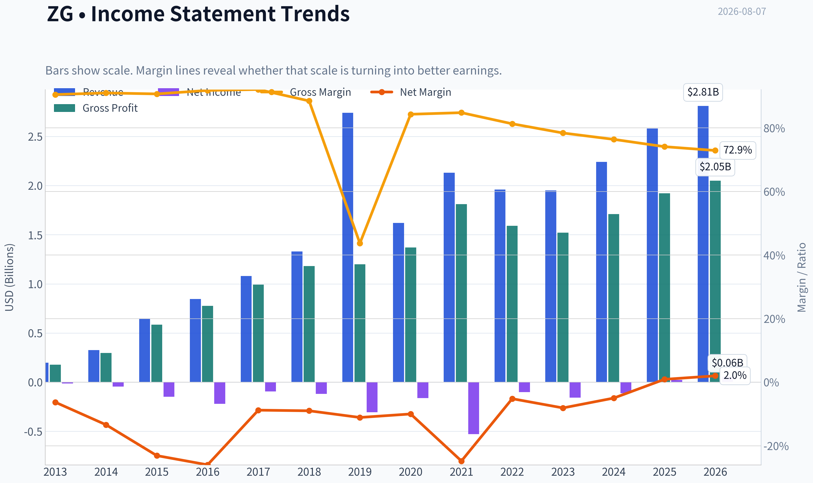

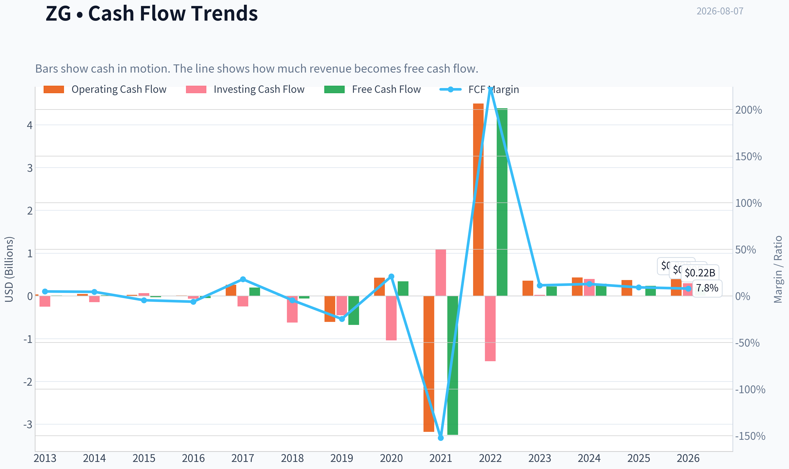

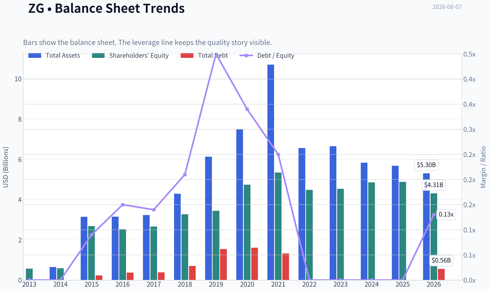

This graph tracks the profitability and return metrics (ROE, ROIC, Margins) of **ZG** over the past decade, highlighting capital efficiency trends.

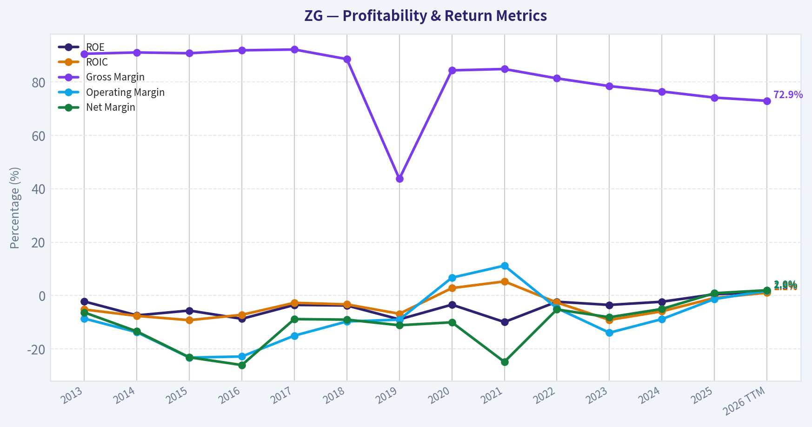

This chart illustrates the financial health of **ZG** over the last 10 years, mapping cash equivalents and free cash flow against total obligations (Debt).

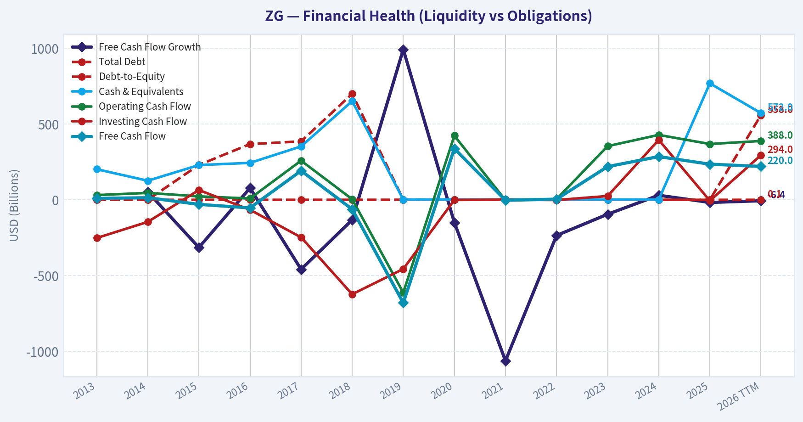

This breakdown chart from <em>Revenue Breakdown</em> shows the proportional composition for **ZG** - useful for understanding what drives or risks the business.

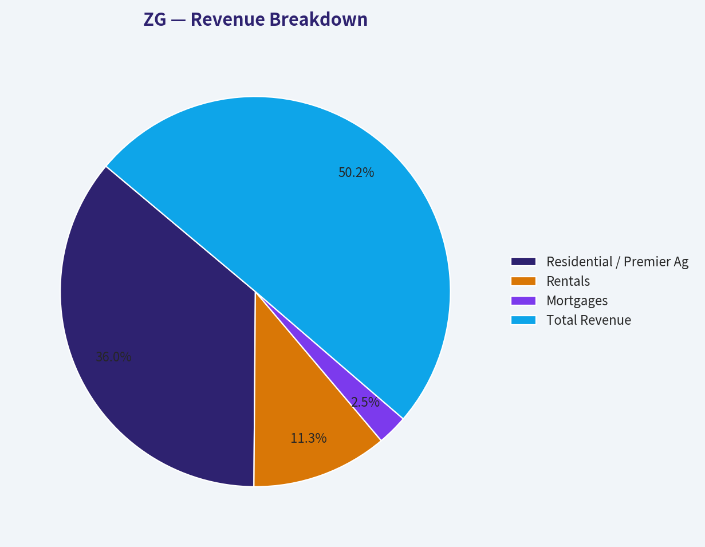

---

### Intrinsic Value Analysis (Buffett)

> *Following Warren Buffett's value investing philosophy: Circle of Competence, Economic Moat, Management Quality, and Margin of Safety.*

#### Intrinsic Value Snapshot

Price is what you pay. Intrinsic value is what the business may be worth based on the cash it can create for owners over time. We show a range, not one magic number.

- Current Price: $33.95
- Value Range (conservative to optimistic across both DCF methods): $2.92 to $195.74

##### Owner Earnings (Buffett Method)
- Net Income: $23,000,000.00
- Depreciation & Amortization: $272,000,000.00
- Capital Expenditures: $-133,000,000.00
- Working Capital Changes: $-337,000,000.00
- Owner Earnings: $499,000,000.00

##### Intrinsic Value
###### Buffett Method
Uses owner earnings. Stricter, and usually more conservative.
- Conservative: $75.20
- Average: $75.20
- Optimistic: $195.74
- Discount Rate: 10.0%

###### Cash Flow Method
Uses free cash flow. Better for companies spending heavily today to grow tomorrow.
- Conservative: $2.92
- Average: $34.79
- Optimistic: $41.69
- Discount Rate: 10.0%

ANALYST STANCE: **WATCH**

#### Zillow Group, Inc. Class A (ZG) - Buffett-Style Value Analysis

| Item | Current Snapshot |
|---|---:|
| Current Price | $34.00 |
| Market Cap | $7.63B |
| P/E | 147.6x |
| ROE | 0.5% |
| Gross Margin | 74.1% |
| Revenue Growth YoY | 15.5% |
| FCF Yield | 3.1% |
| Current Ratio | 3.13x |
| Headline Intrinsic Value | $75.20 |
| Headline Margin of Safety | 54.9% |
| Reverse-DCF Implied Growth | ~7.2% per year for 10 years |

**Key Takeaways:** Zillow is a high-gross-margin, asset-light marketplace business with a nationally recognized consumer brand. The valuation looks attractive on the headline owner-earnings model, but reported returns on equity and accounting earnings remain weak. This is a "right business, prove the economics" situation rather than a clean Buffett-style compounder today.

---

#### 1. Factor Scorecard

| Factor | Score / 5 | Evidence |
|---|---:|---|
| Circle of Competence & Business Simplicity | 3.7 | Zillow makes money mainly by matching high-intent home shoppers, renters, and mortgage customers with real estate professionals, property managers, and lenders. The model is understandable, but housing cycles, agent advertising demand, mortgage rates, and evolving commission rules add forecasting difficulty. |
| Moat Test | 3.8 | Zillow has a powerful consumer brand, search habit, data asset, and marketplace traffic advantage. However, listings are broadly available through MLS systems, agents can multi-home ad spend, and CoStar/Homes.com is competing aggressively. |
| Management Quality & Capital Allocation | 3.0 | Management has shown discipline by exiting the failed iBuying model, but that episode was costly. Capital allocation has improved toward an asset-light marketplace model, though high stock-based compensation and still-low returns reduce the score. |
| Industry Structure | 3.0 | Online real estate portals benefit from scale and consumer traffic, but the housing market is cyclical, transaction volumes are rate-sensitive, and competition for agent advertising dollars is intense. |
| Gate 5: Quality/Solvency Hard Floor | Not Tripped | Revenue is growing, free cash flow is positive, current ratio is strong, and there is no evidence of financial distress combined with weak solvency. |

**Key Takeaways:** Zillow scores well on brand, traffic, and business understandability, but it does not yet score like a finished compounder because capital returns remain modest. The hard solvency floor is not triggered. The investment debate is not survival; it is whether Zillow can convert its consumer position into durable, high-return owner earnings.

---

#### 2. Moat Analysis

| Moat Source | Assessment | Evidence |
|---|---|---|
| Intangible Assets / Brand | Strong | Zillow is one of the best-known U.S. residential real estate brands. "Zestimate" and Zillow search behavior create consumer mindshare that is hard to replicate. Gross margin of 74.1% supports meaningful intangible value. |
| Switching Costs | Moderate | Consumers have low switching costs, and agents can shift ad spend. However, Zillow's lead flow, CRM integrations, ShowingTime assets, and buyer intent data increase stickiness for real estate professionals. |
| Cost Advantage | Moderate | Zillow's scale traffic lowers customer acquisition cost versus smaller portals. Still, large competitors can spend heavily to challenge this advantage. |
| Network Effects | Moderate to Strong | More consumers attract more agents and advertisers; more agent participation improves monetization. But listings are not exclusive, limiting the strength of the network effect. |
| Moat Rating | Wide but Not Impregnable | Zillow has a real marketplace moat, but monetization durability must be proven through higher ROIC and sustained FCF growth. |

**Key Takeaways:** Zillow's moat is real because home buyers and renters begin their search on platforms with trusted brands and broad inventory. The weakness is that the supply side is not locked up exclusively, so Zillow must keep earning advertiser dollars through traffic quality and measurable lead conversion. The moat is wide enough to matter, but not yet wide enough to ignore execution risk.

---

#### 3. Management Quality Assessment

| Question | Assessment |
|---|---|
| Do they think like owners? | Mixed to positive. Zillow's leadership has shifted the company back toward a capital-light marketplace after the iBuying misstep, which is directionally owner-friendly. |
| Are they candid? | Positive. Exiting Zillow Offers was painful but rational; acknowledging and stopping a value-destructive strategy is preferable to doubling down. |
| Are they rational capital allocators? | Mixed. The pivot away from balance-sheet-heavy home flipping was correct. Acquisitions such as ShowingTime and workflow tools could deepen the platform, but the company still needs to demonstrate consistently high returns on invested capital. |
| Biggest concern | Stock-based compensation, low GAAP profitability, and the historical iBuying error keep this below a top-tier Buffett management score. |

**Key Takeaways:** Management deserves credit for abandoning a flawed capital-intensive strategy and returning focus to the marketplace. However, Buffett-style capital allocation requires a long record of high-return reinvestment and per-share value creation. Zillow is improving, but the proof is still ahead.

---

#### 4. Financial Summary

| Period | Revenue | Growth | Gross Margin | Net Income | FCF / FCF Yield | ROE | Notes |
|---|---:|---:|---:|---:|---:|---:|---|
| FY2022 | ~$1.96B | Post-iBuying reset | ~High 70s / low 80s | Loss | Positive to modest | Negative | Business reset after exiting home-flipping operations. |
| FY2023 | ~$1.95B | ~Flat | ~High 70s | Loss | Positive | Negative | Marketplace stabilized, but GAAP profitability remained weak. |
| FY2024 | ~$2.24B | ~15% | ~High 70s | Loss | Positive | Negative | Residential, rentals, and mortgages improved. |
| TTM / Latest | ~$2.58B implied | 15.5% YoY | 74.1% | ~$52M implied | ~$237M / 3.1% | 0.5% | Positive earnings and FCF, but still low capital returns. |

**Key Takeaways:** Zillow's revenue has re-accelerated after the iBuying exit, and the gross margin profile is attractive. The key weakness is not sales growth or brand relevance; it is the gap between marketplace potential and actual reported profitability. Free cash flow is positive, but the current FCF yield is not yet compelling enough by itself.

---

#### 5. Owner Earnings Calculation

Using Buffett's framework:

`Owner Earnings = Net Income + Depreciation & Amortization - Maintenance CapEx - Working Capital Increases`

| Component | Latest Approximate Amount |
|---|---:|
| Net Income | ~$52M |
| Add: Depreciation & Amortization | ~$190M |
| Less: Maintenance CapEx | ~($45M) |
| Add / Less: Working Capital Release or Investment | ~$40M |
| Estimated Owner Earnings | ~$237M |
| Owner Earnings Per Share | ~$1.05 |
| Owner Earnings Yield at $34 | ~3.1% |

**Key Takeaways:** Zillow is now generating positive owner earnings, but the yield is still modest at the current price. The investment case depends on those owner earnings compounding materially as housing activity normalizes and Zillow improves monetization. Today's cash earnings alone do not yet make the stock an obvious bargain.

---

#### 6. Three-Scenario DCF Valuation

Assumptions: estimated owner earnings of ~$237M, roughly 224M shares, and a 10% discount rate.

| Scenario | Growth Assumption | Intrinsic Value / Share | Upside / Downside vs. $34 |
|---|---:|---:|---:|
| A: No Growth | 0% perpetuity | ~$10.55 | -69% |
| B: GDP Growth | 3% perpetuity | ~$15.50 | -54% |
| C: Historical / Platform Growth | 8% for 10 years, then 3% terminal | ~$22.50 | -34% |
| Research Pack Headline Model | Cyclical owner-earnings DCF | $75.20 | +121% |
| Research Pack FCF Model | FCF-based DCF | $34.79 | +2% |
| Research Pack Damodaran FCFF Model | FCFF model | Negative | Not supportive |

**Key Takeaways:** The valuation picture is unusually wide. Simple current-owner-earnings math does not justify the current price, while the cyclically adjusted owner-earnings model indicates substantial upside. This means the stock is not a classic low-risk bargain; the upside depends on Zillow converting its traffic moat into much higher normalized cash flow.

---

#### 7. Margin of Safety Analysis

| Valuation Lens | Value / Share | Margin of Safety vs. $34 | Interpretation |
|---|---:|---:|---|
| No-Growth Owner Earnings | ~$10.55 | Negative | Current earnings power alone is insufficient. |
| GDP-Growth Owner Earnings | ~$15.50 | Negative | Conservative DCF does not support purchase. |
| Platform-Growth DCF | ~$22.50 | Negative | Even decent growth from today's owner earnings is not enough. |
| FCF DCF | $34.79 | ~2% | Stock is near fair value on FCF. |
| Headline Cyclical Owner-Earnings DCF | $75.20 | 54.9% | Attractive if normalized housing and monetization assumptions prove correct. |
| Reverse DCF | Implies ~7.2% growth | Plausible | The market is not demanding heroic growth, but execution still matters. |

**Key Takeaways:** Zillow's margin of safety is strong only if one accepts a normalized cyclical earnings recovery. On current cash earnings, the margin of safety is thin to negative. The reverse-DCF is encouraging because the market-implied growth rate is plausible, but Buffett-style conviction requires more evidence of durable high-return conversion.

---

#### 8. Final Buffett Scorecard

| Criterion | Weight | Score / 5 | Weighted Contribution |
|---|---:|---:|---:|
| Moat Width & Durability | 25% | 3.8 | 0.95 |
| Valuation / Margin of Safety | 20% | 3.1 | 0.62 |
| Capital Returns - ROIC vs. WACC | 15% | 1.8 | 0.27 |
| Business Understanding & Predictability | 12% | 3.7 | 0.44 |
| Management Quality & Capital Allocation | 12% | 3.0 | 0.36 |
| Reinvestment Runway | 8% | 4.0 | 0.32 |
| Balance Sheet Strength | 4% | 4.3 | 0.17 |
| Industry Structure | 4% | 3.0 | 0.12 |
| Final Weighted Score | 100% | - | **3.25 / 5.00** |

**Key Takeaways:** Zillow has the ingredients of a valuable platform: brand, traffic, gross margin, and a large addressable market. The score is held back by low current returns on capital and a valuation that depends heavily on normalized future cash flow rather than present earnings. This places Zillow in WATCH territory rather than ADVOCATE territory.

---

#### 9. Investment Stance

| Stance | Conviction | Rationale |
|---|---|---|
| **WATCH** | Medium | Zillow is a strong consumer internet real estate franchise with a credible moat and a large reinvestment runway, but current ROE, ROIC, and owner-earnings yield are not yet Buffett-quality. The stock could be attractive if normalized owner earnings rise meaningfully or if the price offers a clearer margin of safety. |

**Final View:** Zillow is a good business trying to become a wonderful business. The brand and marketplace position are worth monitoring closely, and the reverse-DCF assumptions are not unreasonable. However, until Zillow demonstrates sustained high-return cash generation, I would keep it on the watchlist rather than advocate purchase at $34.
#### Valuation Bridge

This bridge places the current market price beside each intrinsic value lens so readers can see whether upside depends on one method or shows up across several methods.

| Scenario | Intrinsic Value / Share |
| --- | ---: |
| Buffett Method | $75.20 |
| Cash Flow Method | $34.79 |
| Damodaran Method | $-125.51 |
| Current Price | $33.95 |

#### Key Takeaways

If one method is far above the others, the upside case depends on a specific modelling assumption. When several methods cluster together, the valuation story is more robust.

#### Valuation Visuals

This comparison chart from *Latest Earnings Snapshot* stacks current figures against historical benchmarks for **ZG**, making it easy to see where the company trades relative to its own averages.

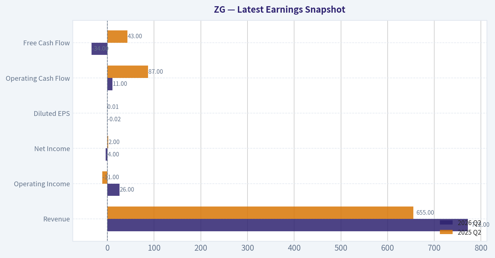

This comparison chart from *Current Versus Historical Average Comparison* stacks current figures against historical benchmarks for **ZG**, making it easy to see where the company trades relative to its own averages.

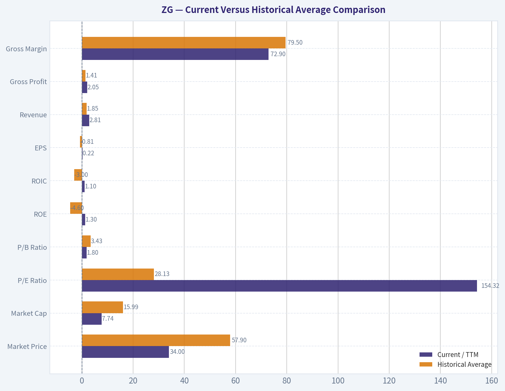

This comparison chart from *Buffett-Style Owner Earnings DCF* stacks current figures against historical benchmarks for **ZG**, making it easy to see where the company trades relative to its own averages.

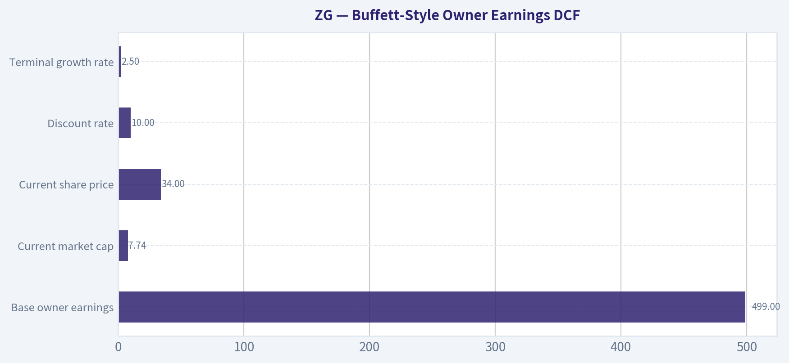

This comparison chart from *Intrinsic Value Cross-Check From Deterministic Pack* stacks current figures against historical benchmarks for **ZG**, making it easy to see where the company trades relative to its own averages.

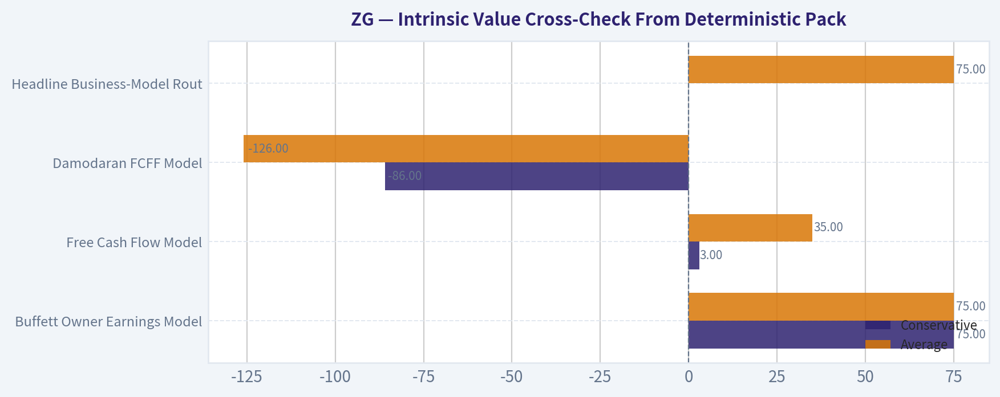

This comparison chart from *Zillow Group, Inc. Class A (ZG) - Buffett-Style Value Analysis* stacks current figures against historical benchmarks for **ZG**, making it easy to see where the company trades relative to its own averages.

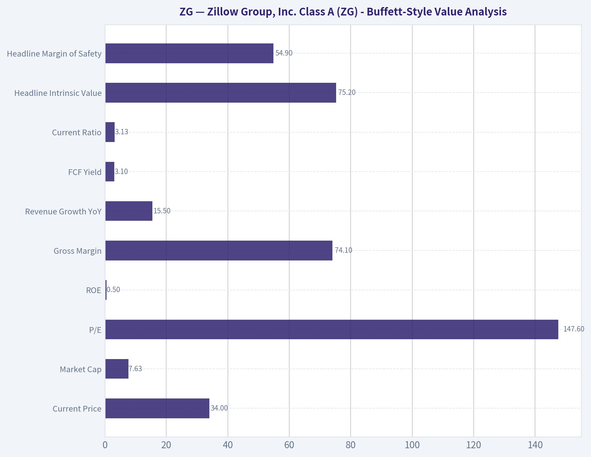

---

### Trend & Growth Analysis (Lynch/Druckenmiller/Fisher)

> *Following Peter Lynch's GARP, Stanley Druckenmiller's macro-aware approach, and Philip Fisher's scuttlebutt methodology.*

ANALYST STANCE: **WATCH**

#### Zillow Group, Inc. (ZG) - Growth Inflection Analysis

Zillow is a high-quality consumer internet brand with a massive housing-related TAM, strong gross margins, and meaningful upside if the U.S. housing cycle normalizes. But today, the setup is not yet a clear Lynch-style fast-grower entry: revenue growth is mid-teens, valuation is demanding on earnings, macro remains housing-rate sensitive, and recent analyst target cuts suggest near-term expectations have reset lower. I would **watch for evidence of accelerating revenue, operating leverage, and housing transaction recovery** before advocating aggressively.

---

#### 1. Lynch Classification

| Category | Assessment |
|---|---|
| Lynch category | **Borderline Fast Grower / Cyclical Growth Platform** |
| Current YoY revenue growth | **15.5%** |
| Gross margin | **74.1%** |
| P/E | **147.6x** |
| FCF yield | **3.1%** |
| ROE | **0.5%** |
| Current ratio | **3.13x** |
| Growth investor fit | **Interesting, but not yet high-conviction** |

**Key Takeaways:** Zillow has the gross margin profile of a strong digital platform, but its current growth rate is only at the lower end of the "fast grower" range. The business is also tied to the housing transaction cycle, making it less clean than a pure software compounder. For Lynch-style investors, this is a "know the story and wait for the turn" stock rather than an obvious buy today.

---

#### 2. The Story in 3 Bullets

- **Zillow is the default digital front door for U.S. housing.** Consumers use it to search homes, apartments, mortgage options, and agent connections.
- **The growth thesis is a housing "super app."** Zillow wants to capture more of the home-buying, renting, financing, touring, and agent-matching journey rather than just monetize listings traffic.
- **The inflection depends on housing normalization.** If mortgage rates fall, home inventory improves, and transaction volumes recover, Zillow's marketplace revenue and operating leverage could accelerate.

---

#### 3. TAM Analysis and 10x Test

| Item | Assessment |
|---|---|
| Core markets | Residential real estate advertising, agent leads, rentals, mortgage, transaction services |
| TAM direction | Large, cyclical, and expandable if Zillow monetizes more of the transaction stack |
| Current revenue base | Not provided in research pack; market cap is **$7.63B** |
| 10x revenue test | Likely passes only if Zillow expands beyond advertising into transactions, rentals, financing, and seller services |
| Market share constraint | Zillow can likely grow meaningfully while remaining a modest share of total U.S. housing-related economics |
| TAM quality | **Large but macro-sensitive** |

**Key Takeaways:** Zillow's TAM is enormous because U.S. housing is one of the largest consumer markets in the economy. However, the company's ability to 10x depends on monetizing more than web traffic and agent advertising. The most attractive version of the story requires Zillow to become a broader transaction platform, not just a real estate portal.

---

#### 4. Revenue Growth Trend

| Metric | Current Signal |
|---|---|
| YoY revenue growth | **15.5%** |
| Growth classification | Moderate-to-fast, not hypergrowth |
| Trend quality | Insufficient data to confirm acceleration |
| Pattern interpretation | **Stable/moderate growth, not yet a proven inflection** |
| Growth concern | Housing transaction volumes remain macro constrained |
| Growth upside | Rate cuts, inventory growth, rentals, mortgages, and integrated services |

**Key Takeaways:** Zillow is growing, but current growth does not yet scream "inflection." A true growth-stock re-rating would require revenue growth to move from the mid-teens toward 20% or higher while margins also improve. The next few quarters matter because they will show whether Zillow is merely recovering with housing or actually taking more wallet share.

---

#### 5. Unit Economics

| Metric | Available Signal | Interpretation |
|---|---:|---|
| Gross margin | **74.1%** | Strong digital marketplace economics |
| FCF yield | **3.1%** | Positive cash generation, but not cheap on cash flow |
| ROE | **0.5%** | Low accounting profitability |
| LTV/CAC | Not disclosed in pack | Cannot score precisely |
| NRR | Not applicable / not disclosed | Zillow is not a classic SaaS model |
| Rule of 40 | Approx. revenue growth **15.5%** + FCF margin unavailable | Cannot calculate fully from provided data |

**Key Takeaways:** Zillow's gross margin is the clearest sign of platform quality. But the low ROE and limited unit-economics disclosure reduce confidence in near-term profitability leverage. For a growth investor, the key question is whether Zillow can turn its strong traffic position into durable free cash flow growth.

---

#### 6. Inflection Point Assessment

| Inflection Type | Evidence | Rating |
|---|---|---|
| Product cycle inflection | Housing super-app strategy, rentals, mortgage, touring, agent tools | **Potential** |
| Market share inflection | Zillow remains a leading consumer real estate destination | **Positive but unconfirmed** |
| Margin inflection | High gross margin creates leverage potential, but ROE is low | **Watch** |
| TAM inflection | TAM expands if Zillow captures more transaction services | **Positive** |
| Competitive inflection | No clear evidence of major competitor collapse | **Neutral** |
| Macro inflection | Highly sensitive to mortgage rates and housing turnover | **Not yet confirmed** |

**Key Takeaways:** Zillow has several possible inflection levers, but none are fully proven from the current data. The most important one is macro: a lower-rate housing recovery could make Zillow's growth look much better. The company has optionality, but investors need evidence that this optionality is converting into faster revenue and margin expansion.

---

#### 7. Macro Setup Evaluation - Druckenmiller Lens

| Macro Factor | Current Read | Impact on ZG |
|---|---|---|
| Interest rates | Still important for housing affordability | Major swing factor |
| Housing turnover | Cyclically depressed versus normal periods | Headwind today, upside if normalizes |
| Consumer balance sheet | Mixed affordability environment | Neutral to negative |
| Secular trend | Digitization of real estate transactions | Positive |
| Macro timing | Potential recovery setup, but not yet clean | **Watch** |

**Key Takeaways:** Zillow is a macro-aware growth stock. If rates fall and transaction activity improves, Zillow could see operating leverage quickly. But until housing turnover clearly improves, the stock remains exposed to a cyclical drag that pure software or AI names do not face.

---

#### 8. Fisher 15-Point Score

| Fisher Point | Score / 5 | Comment |
|---|---:|---|
| Market potential | 5 | Housing TAM is very large |
| New product determination | 4 | Super-app strategy and adjacent products |
| R&D effectiveness | 3 | Product innovation exists, but payoff still developing |
| Sales organization | 4 | Strong agent and marketplace relationships |
| Profit margin quality | 3 | Gross margin strong; net profitability weak |
| Margin improvement | 3 | Potential, but not yet decisive |
| Labor/personnel relations | 3 | No major issue flagged in provided data |
| Executive relations | 3 | No major issue flagged |
| Management depth | 3 | Experienced, but execution burden is high |
| Cost analysis/accounting | 3 | Low ROE keeps this neutral |
| Unique advantages | 4 | Brand, traffic, data, consumer mindshare |
| Long-range profit outlook | 4 | Attractive if monetization expands |
| Dilution risk | 3 | Not flagged as severe in pack |
| Candor in difficulties | 3 | Neutral from available data |
| Management integrity | 3 | Neutral from available data |
| **Total** | **51 / 75** | **Average to good, not outstanding** |

**Key Takeaways:** Fisher would likely admire Zillow's brand, consumer reach, and long-term market opportunity. But he would also demand clearer proof that product investments are translating into superior profitability. The score lands in the average-to-good range because the qualitative opportunity is strong, while financial execution is still not fully proven.

---

#### 9. Valuation Analysis

| Valuation Metric | Current Data | Interpretation |
|---|---:|---|
| Current price | **$34** | Starting point |
| Market cap | **$7.63B** | Mid-cap growth/platform valuation |
| P/E | **147.6x** | Expensive on current earnings |
| PEG proxy | **~9.5x** using P/E / revenue growth | Not attractive by Lynch standards |
| FCF yield | **3.1%** | Reasonable but not a bargain |
| Headline intrinsic value | **$75.20** | Implies **54.9% margin of safety** vs. price |
| FCF model value | **$34.79** | Roughly near current price |
| Damodaran FCFF value | **-$125.51** | Indicates model sensitivity / profitability concern |
| Reverse DCF | Price implies **~7.2% annual growth for 10 years** | Expectations are not extreme |

**Key Takeaways:** Zillow looks expensive on earnings but less demanding on a reverse-DCF basis. The wide valuation spread is important: one model implies major upside, another implies fair value, and another is deeply negative. That means the investment case is highly sensitive to assumptions about housing recovery, margins, and long-term monetization.

---

#### 10. Scenario View

| Scenario | Assumption | Investment Implication |
|---|---|---|
| Bear case | Housing remains sluggish; revenue growth stays low-to-mid teens; margins disappoint | Stock may stay range-bound or underperform |
| Base case | Housing gradually normalizes; Zillow compounds revenue in mid-teens with modest leverage | Current price is reasonable, but not screaming cheap |
| Bull case | Rates fall, transactions recover, super-app monetization works, revenue accelerates above 20% | Stock could re-rate materially |
| Ten-bagger case | Zillow becomes a dominant end-to-end housing transaction platform | Possible but requires major execution and TAM capture |

**Key Takeaways:** Zillow has a believable bull case, but it is not yet the base case. The stock needs a combination of macro recovery and company-specific execution to become a true ten-bagger candidate. At today's evidence level, the risk-reward is interesting but not yet compelling enough for an aggressive stance.

---

#### 11. Growth Investor Scorecard

| Criterion | Weight | Score / 5 | Weighted Score |
|---|---:|---:|---:|
| The Story | 10% | 3.7 | 0.37 |
| TAM & Runway | 20% | 4.0 | 0.80 |
| Revenue Growth | 20% | 3.2 | 0.64 |
| Unit Economics | 15% | 2.8 | 0.42 |
| Competitive Position | 10% | 4.0 | 0.40 |
| Management Quality | 10% | 3.3 | 0.33 |
| Macro Setup | 5% | 2.7 | 0.14 |
| Profitability Path | 5% | 2.7 | 0.14 |
| Valuation | 5% | 2.5 | 0.13 |
| **Total** | **100%** |  | **3.36 / 5.00** |

**Key Takeaways:** Zillow scores well on TAM, brand, and strategic optionality, but weaker on valuation, macro timing, and demonstrated profitability. The total score lands in the WATCH zone. This is a stock to monitor closely for an inflection, not one that currently deserves maximum growth-investor conviction.

---

#### 12. Position Size Stance

| Investor Type | Suggested Stance |
|---|---|
| Existing holder | Hold / monitor for acceleration |
| New growth investor | Watchlist or small starter only |
| High-conviction growth portfolio | Not yet a top position |
| Position size view | **0% to 2% starter**, increase only if revenue accelerates and margins improve |

**Key Takeaways:** Zillow is investable as an optionality position, but not yet as a core growth holding. The better setup would be a confirmed housing recovery plus evidence that Zillow's newer products are scaling. For now, patience is the higher-probability approach.

---

#### 13. Key Catalysts and Risks

| Catalysts | Risks |
|---|---|
| Falling mortgage rates | Prolonged housing affordability pressure |
| Higher home inventory and transaction volume | Revenue growth stuck in mid-teens or lower |
| Rentals and mortgage monetization | Weak operating leverage despite high gross margin |
| Improved agent advertising demand | Competition from CoStar/Homes.com, Redfin, Realtor.com, brokerages |
| Product adoption across touring, financing, and transaction tools | High P/E leaves little room for earnings disappointment |
| Analyst sentiment stabilizing after recent target cuts | Strategic execution risk in becoming a true housing super app |

**Key Takeaways:** The upside catalysts are real, especially if the housing cycle turns. But the risks are equally clear: Zillow is not cheap on earnings, and a slow housing market can delay the thesis. The stock needs evidence of acceleration before it deserves an ADVOCATE rating.

---

#### Bottom Line

Zillow has the ingredients of a future growth inflection: a dominant consumer brand, large TAM, high gross margins, and exposure to a potentially improving housing cycle. However, current revenue growth of **15.5%**, a **147.6x P/E**, low **0.5% ROE**, and recent analyst target cuts make the near-term setup too mixed for a high-conviction recommendation.

**Final stance: WATCH.** I would upgrade only if Zillow shows clear revenue acceleration toward 20%+, improving free cash flow conversion, and evidence that its housing super-app strategy is monetizing beyond traditional advertising.

---

### Market Technical Analysis

ANALYST STANCE: **WATCH**

#### ZG Technical Report - Data Through 2026-08-06

ZG is in a **long-term downtrend with a short-term rebound attempt under stress**. The stock has fallen sharply over the past year, but the June-July base near the low $30s produced a tradable rebound into early August. That rebound was disrupted by the large 2026-08-06 gap-down session, which pushed price back below the 10-day EMA while still leaving it slightly above the 50-day SMA and VWMA. This makes ZG a **watchlist candidate rather than a clean long setup**: the stock needs to prove that the $33 area can hold after the volatility shock.

| Item | Latest Reading / Observation | Trading Interpretation |
|---|---:|---|
| Last available close | $33.76 on 2026-08-06 | Price recovered from an intraday low of $30.57, but still closed below the prior day's $36.89 |
| 1-year trend | Down from $81.11 on 2025-08-07 to $33.76 | Major structural bear trend remains intact |
| Recent rebound zone | Late July low near $29.56 to Aug. 4 high/close near $37.03 | Strong rebound attempt, but now challenged |
| Latest volume | 3.36M shares | Very elevated; signals institutional-level activity or event-driven selling |
| Near-term posture | Price below 10 EMA but above 50 SMA/VWMA | Short-term momentum damaged, medium-term base not fully broken |
| Preferred stance | WATCH | Wait for confirmation above resistance or breakdown below support |

**Key Takeaways:** ZG remains deeply damaged on a long-term basis, but the stock has been trying to build a base around the low $30s. The 2026-08-06 session was important because heavy volume and a large gap down interrupted the recent recovery. Traders should avoid assuming the rebound is intact until price reclaims short-term resistance.

---

#### Selected Indicators and Why They Matter

I selected **8 complementary indicators**: `close_10_ema`, `close_50_sma`, `close_200_sma`, `macd`, `rsi`, `atr`, `boll_lb`, and `vwma`.

| Indicator | Latest Value | Why It Is Relevant for ZG Now |
|---|---:|---|
| 10 EMA | 34.55 | Captures whether the recent rebound still has short-term momentum |
| 50 SMA | 33.32 | Helps define the current medium-term base and nearby support |
| 200 SMA | 50.35 | Confirms the dominant long-term trend, which remains bearish |
| MACD | 0.62 | Shows whether rebound momentum is still improving or starting to fade |
| RSI | 50.14 | Measures whether momentum is neutral, overbought, or oversold |
| ATR | 1.95 | Critical for risk control because volatility has expanded sharply |
| Bollinger Lower Band | 29.38 | Identifies the lower edge of the recent volatility range and panic-support area |
| VWMA | 33.45 | Confirms whether volume-weighted buyers are supporting price near current levels |

**Key Takeaways:** The selected indicators show that ZG is not in a simple bullish or bearish condition. Long-term trend indicators remain bearish, but short- and medium-term indicators are clustered near the current price. That means the next move around the $33-$35 area could be decisive.

---

#### Trend Structure: Long-Term Bearish, Short-Term Recovery Under Pressure

ZG's long-term chart remains weak. The stock is far below its 200-day SMA of **$50.35**, while the 200-day average itself has been declining steadily, falling from about **$54.50 on 2026-07-08** to **$50.35 on 2026-08-06**. That confirms the larger trend is still bearish, not merely sideways.

The 50-day SMA, however, is more nuanced. It has declined from **$36.53 on 2026-07-08** to **$33.32 on 2026-08-06**, showing the medium-term trend has also been weak. But the current close of **$33.76** is still slightly above the 50-day average. That creates a possible technical battleground: if price holds above the 50 SMA, the base remains alive; if it loses that level decisively, the failed-rebound scenario becomes more likely.

| Trend Measure | Latest Value | Price Relationship | Interpretation |
|---|---:|---:|---|
| Close | $33.76 | - | Latest available price |
| 10 EMA | $34.55 | Price is below by about 2.3% | Short-term momentum has weakened |
| 50 SMA | $33.32 | Price is above by about 1.3% | Medium-term support is still barely intact |
| 200 SMA | $50.35 | Price is below by about 33.0% | Long-term trend remains strongly bearish |
| VWMA | $33.45 | Price is above by about 0.9% | Volume-weighted support is nearby but fragile |

**Key Takeaways:** ZG is still in a major long-term downtrend because it trades far below the 200-day moving average. However, the stock is hovering just above the 50-day SMA and VWMA, which makes the current $33 area technically important. A sustained hold above this zone would keep the rebound alive, while a break below it would likely shift control back to sellers.

---

#### Momentum: Rebound Improved, Then Stalled

The MACD has improved substantially over the past month, rising from deeply negative readings in early July to a positive reading of **0.62** on 2026-08-06. That shows the late-July rebound had real momentum behind it. However, the latest MACD reading declined from **0.73 on 2026-08-05**, which suggests the upside impulse may be starting to lose strength.

RSI tells a similar story. It rose into the mid-60s on August 4 and August 5, showing strong but not overbought momentum. Then it fell sharply to **50.14** on August 6. This is not an oversold reading; instead, it indicates momentum has reset back to neutral after a failed push higher.

| Momentum Indicator | Recent Peak | Latest Value | Interpretation |
|---|---:|---:|---|
| MACD | 0.73 on 2026-08-05 | 0.62 | Still positive, but beginning to roll over |
| RSI | 65.42 on 2026-08-04 | 50.14 | Momentum reset from bullish to neutral |
| 10 EMA | 34.73 on 2026-08-05 | 34.55 | Short-term trend has started to soften |
| Close | $36.89 on 2026-08-05 | $33.76 | Price damage was meaningful despite intraday recovery |

**Key Takeaways:** Momentum improved during the late-July rebound, but the August 6 reversal changed the tone. MACD remains positive, yet it has started to lose altitude, and RSI has fallen back to neutral. This means buyers need to respond quickly, or the rebound may transition into a failed-rally setup.

---

#### Volatility and Risk: ATR Spike Requires Wider Stops and Smaller Size

ATR rose to **1.95**, up from roughly **1.58-1.68** through much of July. Relative to the latest close of **$33.76**, ATR is approximately **5.8% of price**, which is high. That means normal daily movement is large enough to stop out tight positions even if the trade thesis is not invalidated.

The August 6 candle was especially important: ZG opened at **$31.12**, traded as low as **$30.57**, and closed at **$33.76** on very heavy volume. The intraday rebound from the low was constructive, but the gap down from the prior close was still a serious warning. This is a volatility expansion event, not a quiet consolidation.

| Volatility / Range Marker | Value | Trading Meaning |
|---|---:|---|
| ATR | 1.95 | Elevated daily range risk |
| ATR as % of close | ~5.8% | Position sizing should be conservative |
| Bollinger Lower Band | 29.38 | Lower panic-support reference |
| Aug. 6 intraday low | $30.57 | Near-term support created by reversal attempt |
| Aug. 6 volume | 3.36M | Confirms the move occurred with unusually high participation |

**Key Takeaways:** ZG is moving with expanded volatility, so tight stops may be unreliable. The $30.50 to $29.40 area is an important downside reference because it combines the recent panic low with the lower Bollinger Band. Risk management is especially important here because the stock can move several percentage points in a single session.

---

#### Key Levels to Watch

The most important support zone is now **$33.45-$33.32**, where the VWMA and 50-day SMA are clustered. The latest close of **$33.76** is only slightly above this area, so there is very little margin for error. If ZG breaks below this zone and cannot reclaim it quickly, the August rebound would look increasingly vulnerable.

On the upside, the first meaningful recovery zone is around **$34.55**, the 10-day EMA. A close back above that level would show short-term buyers are trying to repair the damage. Above that, **$36.90-$37.10** becomes the key resistance zone because it marks the recent high area before the gap-down session.

| Zone | Level / Range | Role | What It Would Signal |
|---|---:|---|---|
| Immediate support | $33.45-$33.32 | VWMA and 50 SMA cluster | Holding this keeps the base intact |
| Short-term resistance | $34.55 | 10 EMA | Reclaiming it would improve near-term momentum |
| Breakout resistance | $36.90-$37.10 | Recent rebound high area | A close above this would repair much of the Aug. 6 damage |
| Deeper support | $30.57 | Aug. 6 intraday low | Losing this would weaken the rebound structure |
| Major lower support | $29.38-$29.56 | Bollinger lower band and late-July low area | Break below this would suggest renewed downside trend pressure |
| Long-term resistance | $50.35 | 200 SMA | Far above current price; confirms structural overhead supply |

**Key Takeaways:** The $33 area is the immediate decision zone for ZG. If price holds above it and reclaims the 10 EMA, the rebound can continue. If price loses $33 and then $30.50, sellers would likely regain control.

---

#### Trading Interpretation

ZG is best treated as a **high-volatility watchlist setup**, not a confirmed long. The late-July rebound showed meaningful improvement, and the stock is still slightly above the 50-day SMA and VWMA. However, the sharp August 6 gap down, the close below the 10 EMA, and the failure near $37 all argue against aggressive buying without confirmation.

For bullish traders, the cleaner setup would be a close back above **$34.55**, followed by strength toward **$36.90-$37.10**. For bearish or risk-averse traders, a failure below **$33.32** would be an early warning, while a break below **$30.57** would materially damage the base.

| Scenario | Trigger | Bias | Practical Read |
|---|---|---|---|
| Bullish repair | Close back above $34.55 | Improving | Short-term momentum begins to recover |
| Bullish confirmation | Close above $37.10 | Stronger watch-to-long signal | Failed gap-down risk decreases |
| Neutral chop | Price holds $33.32 but stays below $34.55 | Wait | Base survives, but momentum remains uncertain |
| Bearish warning | Close below $33.32 | Caution | 50 SMA/VWMA support fails |
| Bearish breakdown | Move below $30.57, especially on volume | Avoid / bearish | Rebound structure likely broken |

**Key Takeaways:** ZG needs confirmation before it becomes attractive on the long side. The bullish case depends on reclaiming the 10 EMA and then challenging the recent $37 area. Until that happens, the stock remains a volatile watch rather than a high-conviction buy.

---

### Options Market Analysis

> *Reading options flow - put/call ratios, IV skew, and unusual activity - to gauge institutional positioning and event-driven risk.*

ANALYST STANCE: **WATCH**

#### ZG Options Market Sentiment Report
*Options data as of 2026-08-07*

#### 1. Put/Call Ratio Analysis

| Expiration | Call OI | Put OI | Put/Call OI Ratio | Call Volume | Put Volume | Put/Call Volume Ratio | Read |
|---|---:|---:|---:|---:|---:|---:|---|
| 2026-08-21 | 2,208 | 2,209 | 1.00 | 64 | 129 | 2.02 | Mild bearish / hedging |
| 2026-09-18 | 437 | 481 | 1.10 | 7 | 59 | 8.43 | Bearish flow, but thin volume |
| 2026-11-20 | 921 | 1,187 | 1.29 | 24 | 229 | 9.54 | Bearish / protective positioning |
| **Near-Term Total** | **3,566** | **3,877** | **1.09** | **95** | **417** | **4.39** | **Bearish skew in activity** |

**Key Takeaways:** ZG's near-term put/call open interest ratio is **1.09**, meaning put positioning is above the historical neutral baseline of roughly **0.7**. The more important signal is the **put/call volume ratio of 4.39**, showing that current trading activity is heavily tilted toward puts. However, absolute volume is not especially high, so this should be treated as a cautious bearish/hedging signal rather than a high-conviction institutional alarm.

The open interest profile is modestly defensive across all listed expirations, with put/call OI ratios rising from **1.00** in August to **1.29** in November. That suggests traders are carrying more downside protection farther out on the calendar. The very high put/call volume ratios in September and November are notable, but the small call-volume base exaggerates the ratio.

---

#### 2. Implied Volatility Assessment

| Expiration | ATM Call IV | ATM Put IV | Call-Put IV Spread | IV Read |
|---|---:|---:|---:|---|
| 2026-08-21 | 54.5% | 51.7% | Calls +2.8 pts | Moderately elevated, slight call richness |
| 2026-09-18 | 55.5% | 50.1% | Calls +5.4 pts | Calls priced richer than puts |
| 2026-11-20 | 60.4% | 53.5% | Calls +6.9 pts | Higher longer-dated IV, call-side richness |

**Key Takeaways:** ATM implied volatility is running in the **low-to-high 50% range**, which is relatively elevated in absolute terms but not extreme for a smaller, more volatile equity like ZG. Interestingly, ATM calls are priced with higher IV than ATM puts across all three expirations, which does **not** show classic downside panic. This creates a mixed volatility picture: option volume leans bearish, but IV pricing does not show a steep put-skew fear signal.

Strike-level OTM skew data was not provided, so a full comparison of **OTM put IV versus OTM call IV** cannot be completed. Based on available ATM IV, the market is not obviously paying up for downside crash protection. Instead, there is mild call-side IV richness, which may reflect upside optionality demand, covered-call dynamics, or simply wide/illiquid option pricing.

No specific near-term catalyst, such as earnings or a major company event, was provided in the dataset. If ZG has an upcoming earnings release, the elevated near-term IV may partially reflect event premium.

---

#### 3. Unusual Options Activity

| Unusual Activity Screen | Result |
|---|---|
| Contracts with volume greater than 5x open interest | None detected |
| Fresh directional sweep evidence | Not observed |
| Institutional-style flow signal | Weak / unavailable |
| Retail speculation signal | Not clearly present |

**Key Takeaways:** There were **no contracts where volume exceeded 5x open interest**, so the data does not show obvious fresh unusual options activity. That reduces confidence in any aggressive directional interpretation. The bearish tilt is coming from aggregate put volume and put-heavy open interest, not from a standout institutional-looking trade.

Because no unusual contracts were flagged, there is no clear single strike or expiration showing fresh conviction. This makes the flow look more like broad hedging or low-liquidity bearish positioning rather than a concentrated "smart money" bet. For ZG, this is important because options liquidity appears relatively thin.

---

#### 4. Open Interest Concentration and Gamma / Pinning Risk

| Expiration | Total OI | Call OI Share | Put OI Share | Pinning / Gamma Read |
|---|---:|---:|---:|---|
| 2026-08-21 | 4,417 | 50.0% | 50.0% | Balanced OI; no clear directional gamma wall from aggregate data |
| 2026-09-18 | 918 | 47.6% | 52.4% | Light OI; weak pinning signal |
| 2026-11-20 | 2,108 | 43.7% | 56.3% | More put-heavy; possible downside hedge concentration |
| **Total** | **7,443** | **47.9%** | **52.1%** | Mildly put-heavy, but not extreme |

**Key Takeaways:** Open interest is most concentrated in the **2026-08-21** expiration, with over **4,400 contracts** outstanding and an almost perfectly balanced call/put split. The November expiration is more put-heavy, suggesting traders are maintaining longer-dated downside exposure. However, strike-level open interest was not provided, so specific max-pain levels, pinning strikes, or gamma walls cannot be identified.

From the aggregate data, there is no obvious large call wall or put wall that would strongly anchor price near a specific strike. The August expiration could still create pinning effects if OI is clustered around one or two strikes, but that cannot be confirmed from the available dataset. Overall gamma-read confidence is low.

---

#### 5. Overall Options Sentiment Signal

| Category | Signal | Explanation |
|---|---|---|
| Put/Call Ratios | Bearish | OI ratio of **1.09** and volume ratio of **4.39** show a defensive tilt |
| IV Level | Moderately elevated | ATM IV in the **50%-60%** range suggests meaningful expected movement |
| IV Skew | Not bearish based on ATM data | Calls have higher ATM IV than puts, so no clear downside panic is visible |
| Unusual Activity | Neutral / weak | No volume > 5x OI contracts detected |
| Liquidity / Confidence | Low-to-moderate confidence | Absolute volume is thin, reducing reliability |
| **Overall Signal** | **BEARISH, low-to-moderate conviction** | Put activity dominates, but lack of unusual flow and call-side IV richness temper the signal |

**Key Takeaways:** The overall options signal for ZG is **BEARISH**, primarily because put volume is running far ahead of call volume and put open interest is above neutral. That said, the signal is not highly aggressive because there is no unusual options activity, no confirmed put-skew panic, and overall trading volume is relatively thin. This looks more like cautious hedging or modest bearish positioning than a decisive institutional downside bet.

#### Bottom Line

ZG options are leaning **bearish / defensive**, with traders showing more interest in puts than calls across near-term expirations. The strongest evidence is the **4.39 near-term put/call volume ratio**, while the main caveat is the absence of notable unusual activity and the lack of strike-level OI detail. I would treat the options market as a **watch signal for downside risk**, not a standalone reason to assume a major selloff.

---

## Research Team Commentary

> *The Research Manager synthesizes the Bull vs Bear debate into action-free commentary. This is a pre-risk view, not the final stance.*

Temporary fallback for Research Manager

Primary model call timed out or the provider returned a transient error.
Trigger: TimeoutError: Research Manager exceeded 420s without producing a result

Interim stance: WATCH until a fresh pass is available.

Available evidence from the current analyst handoff bundle:
Analyst: Fundamentals Analyst
Stance: WATCH
Sections: Year Financial Metrics for ZG | Year Financial Metrics | Profitability Metrics
- Price: $33.95
- P/E: 147.61
- ROE: 0.5%
- Gross margin: 74.1%
- Return on Equity (ROE): 0.5%
- Return on Invested Capital (ROIC): -0.8%
- Return on Assets (ROA): 0.4%
- Gross Margin: 74.1%

Analyst: Value Analyst
- ANALYST STANCE: WATCH #### Zillow Group, Inc.
- Class A (ZG) - Buffett-Style Value Analysis Key Takeaways: Zillow is a high-gross-margin, asset-light marketplace business with a nationally recognized consumer brand.
- The valuation looks attractive on the headline owner-earnings model, but reported returns on equity and accounting earnings remain weak.

Analyst: Growth Analyst
- Zillow is the default digital front door for U.S. housing. Consumers use it to search homes, apartments, mortgage options, and agent connections.
- The growth thesis is a housing "super app." Zillow wants to capture more of the home-buying, renting, financing, touring, and agent-matching journey rather than just monetize listings traffic.
- The inflection depends on housing normalization. If mortgage rates fall, home inventory improves, and transaction volumes recover, Zillow's marketplace revenue and operating leverage could accelerate.

Analyst: Market Analyst
- ANALYST STANCE: WATCH #### ZG Technical Report - Data Through 2026-08-06 ZG is in a long-term downtrend with a short-term rebound attempt under stress.
- The stock has fallen sharply over the past year, but the June-July base near the low $30s produced a tradable rebound into early August.
- That rebound was disrupted by the large 2026-08-06 gap-down session, which pushed price back below the 10-day EMA while still leaving it slightly above the 50-day SMA and VWMA.

Reference: Latest Earnings...

Final stance: WATCH

---

## Value Investing Team Commentary

> *The Investor translates the research view into an investment thesis before risk review. This is still not the final stance.*

Zillow (ZG) presents a classic case of a **wonderful business with a currently troubled scorecard**. To a disciplined value investor, Zillow is no longer the erratic merchant of houses (the failed iBuying experiment); it has returned to its roots as a high-margin, asset-light toll bridge for the American real estate industry.

Here is an analysis through the lens of a business owner, incorporating selective contrarian thinking:

### 1. The Business Quality: A "Digital Front Door" with High Tolls
Zillow possesses one of the most durable competitive advantages in the modern digital economy: **top-of-mind brand dominance**. When Americans think of real estate, they "Zillow" it. This brand strength creates a massive network effect; agents must be where the eyeballs are, and the eyeballs are consistently on Zillow.

The **74.1% gross margin** is the "North Star" of this analysis. It confirms that the underlying business-selling leads, software, and advertising-is incredibly efficient. The current **0.5% ROE and negative ROIC** are not reflections of a bad business, but rather a business in a **cyclical deep-freeze** (the frozen U.S. housing market) and a company still digesting the operational pivot away from capital-intensive home flipping.

### 2. The Management Pivot: Learning from Mistake
A key Buffett principle is management's ability to admit error and reallocate capital. Zillow's decision to shutter "Zillow Offers" was a painful but necessary admission that they lack a competitive advantage in pricing physical real estate at scale. By returning to the "Housing Super App" model, they are playing to their strengths: **data, traffic, and platform economics.**

However, the "Super App" narrative requires skepticism. Converting search traffic into mortgage and title revenue is historically difficult. We are looking for management to prove they can treat shareholders as partners by controlling Stock-Based Compensation (SBC), which often masks true "Owner Earnings."

### 3. Selective Contrarian Thinking: The Value of a "Frozen" Market
The market is currently fearful of Zillow because transaction volumes in U.S. housing are at multi-decade lows due to the "lock-in effect" of high mortgage rates.
*   **The Crowd Sees:** A 147 P/E ratio and a stagnant housing market.
*   **The Value Investor Sees:** A dominant platform whose "intrinsic value" is being obscured by a temporary macroeconomic bottleneck.

The time to buy a toll bridge is not when the traffic is at a record high and the price is at a premium; it is when the road is under construction and the crowd thinks the cars will never return. Zillow's platform is the infrastructure. When the housing market eventually thaws-driven by the inevitable "3 Ds" (Death, Divorce, and Debt)-Zillow's operating leverage will likely be explosive.

### 4. Valuation and Margin of Safety
At $33.95, the stock is trading at a significant discount from its highs, but the **Quality-Scaled Margin of Safety** remains thin due to the lack of current GAAP earnings.
A reverse-DCF suggests the market is pricing in a long-term recovery, but the recent **gap-down on August 6th** indicates that the market's patience is wearing thin regarding near-term guidance. From a value perspective, we don't buy just because a stock is "down"; we buy when the price implies a growth rate significantly lower than what the franchise's moat can plausibly deliver.

### 5. Technical and Sentiment Caveat
The technical report of a "long-term downtrend" and a "large gap-down" suggests that institutional "weak hands" are still exiting. As contrarians, we don't catch falling knives unless they hit the floor of intrinsic value. The $30-$33 range is an interesting psychological base, but the fundamental ROIC needs to show a "turn" toward positivity to justify a major capital commitment.

### Final Assessment
Zillow is a **monopoly-lite** platform sitting in a cyclical trough. While the business quality is high, the "Owner Earnings" are currently being eaten by the macro environment and internal reinvestment. We want to own this business, but we want to see the "bleeding" stop in the profitability metrics (ROE/ROIC) before moving from observation to ownership.

ANALYST STANCE: **WATCH**

---

## Deep Values Commentary

> *The Risk Management Team debates and the Risk Judge provides the final action-free verdict. This section determines the final ADVOCATE / WATCH / AVOID stance.*

#### Final Stance Scorecard

This scorecard converts the final research view into a weighted decision frame. It does not replace the narrative judgement, but it makes the main drivers of the verdict easier to scan.

| Criterion | Score | Weight | Commentary |
| --- | ---: | ---: | --- |
| Business Quality | 2.75 | 30% | High returns, profitability, and Piotroski health support durability. |
| Valuation Support | 1.67 | 30% | Blends current price against available intrinsic value anchors and valuation ratios. |
| Financial Strength | 5.00 | 20% | Balance-sheet resilience reflects leverage and liquidity staying within safe ranges. |
| Growth Durability | 3.33 | 20% | Recent revenue, earnings, and free cash flow growth indicate how durable expansion looks. |
| TOTAL / FINAL STANCE | 2.99 | 100% | WATCH |

#### Key Takeaways

The weighted score lands at **2.99 / 5.0**, while the final stance remains **WATCH**. This is useful as a quick calibration aid rather than a mechanical signal.

#### Risk Summary

Higher scores indicate more risk pressure. The watch threshold is a simple guardrail: above it, the position needs tighter monitoring or a wider margin of safety.

| Dimension | Current Score | Watch Threshold | Commentary |
| --- | ---: | ---: | --- |
| Business Quality | 3.25 | 3.00 | High returns, profitability, and Piotroski health support durability. |
| Valuation Support | 4.33 | 3.00 | Blends current price against available intrinsic value anchors and valuation ratios. |
| Financial Strength | 1.00 | 3.00 | Balance-sheet resilience reflects leverage and liquidity staying within safe ranges. |
| Growth Durability | 2.67 | 3.00 | Recent revenue, earnings, and free cash flow growth indicate how durable expansion looks. |

#### Key Takeaways

This view helps readers separate *where* the risk sits: valuation, business quality, balance sheet, or growth durability. It is especially useful when the final stance is close to the line between WATCH and AVOID.
