# ZS Deep Value Intelligence

**Analysis Date:** 2026-05-27

## Critical Disclaimer

*This analysis is generated by Deep Value Intelligence, an AI-powered multi-agent investing framework. This report is for informational and educational purposes only and does not constitute financial advice. Always conduct your own research and consult with qualified financial advisors before making investment decisions.*

---

## Table of Contents

1. Intelligence Summary
2. Analyst Team Reports
   - Fundamentals Analysis
   - Intrinsic Value Analysis (Buffett)
   - Trend & Growth Analysis (Lynch/Druckenmiller/Fisher)
   - Market Technical Analysis
   - Options Market Analysis
3. Research Team Commentary
4. Value Investing Team Commentary
5. Deep Values Commentary

---

## Intelligence Summary

### Thesis + Conditions

**Core Thesis:** ## Executive Summary

**Key Risks:**
- WATCH.** Zscaler has real business quality-**23.3% revenue growth**, **76.9% gross margin**, and exposure to the secular shift toward **zero-trust cloud security**. But Buffett-style risk is about **permanent business impairment and paying too much for uncertain economics**, not price swings. Here, the main issue is that **durable moat, capital efficiency, and normalized shareholder returns are still not proven**: **ROE -2.3%**, **ROA -0.6%**, and owner-earnings quality needs more proof.
- For a long-term value investor, this is **not AVOID** because the product is relevant and embedded in an important industry transition. But it is **not ADVOCATE** because the case still depends too much on future execution rather than demonstrated economics. Best course: **keep it on active watch, or at most use very small starter exposure only if you explicitly accept speculative growth risk.**
- ## Risk Commentary for the Long-Term Investor

**Confidence:** Low

---

## Analyst Team Reports

### Fundamentals Analysis

#### Latest Earnings Snapshot

*Most recent reported quarter anchored on 2026 Q1, with prior-year comparison when available.*

| Metric | 2026 Q1 | 2025 Q1 | YoY Change |
| --- | ---: | ---: | ---: |
| Revenue | $815.8M | $647.9M | +25.9% |
| Operating Income | $-51.8M | $-40.1M | -29.0% |
| Net Income | $-34.3M | $-7.7M | -344.2% |
| Diluted EPS | $-0.21 | $-0.05 | -320.0% |
| Operating Cash Flow | $204.1M | $179.4M | +13.7% |
| Free Cash Flow | $169.1M | $143.4M | +17.9% |

Key Takeaways: This snapshot anchors the most recent reported quarter before the narrative analysis. It helps readers separate long-run business quality from whatever changed in the latest earnings print.

#### 10-Year Financial Metrics for ZS

*All values below are computed deterministically from raw data - not estimated by AI.*

*Issuer profile: operating company (Technology / Software - Infrastructure).*

#### 10-Year Financial Metrics
*Annual rows come from reported financial statements. The final TTM row is computed from the latest four quarters.*

| Metric | 2016 | 2017 | 2018 | 2019 | 2020 | 2021 | 2022 | 2023 | 2024 | 2025 | 2026 TTM |
| --- | --- | --- | --- | --- | --- | --- | --- | --- | --- | --- | --- |
| Market Price | N/A | N/A | $35 | $84 | $130 | $236 | $155 | $160 | $179 | $286 | $127 |
| Market Cap | N/A | N/A | $4.23B | $10.41B | $16.79B | $32.00B | $21.85B | $23.25B | $26.83B | $44.09B | $20.36B |
| P/E Ratio | N/A | 0.00 | -125.69 | -366.39 | -145.90 | -122.23 | -55.98 | -114.56 | -459.87 | -1057.63 | -303.54 |
| P/B Ratio | N/A | -7.07 | 17.60 | 33.75 | 34.64 | 60.51 | 38.11 | 32.06 | 21.06 | 24.50 | 9.27 |
| ROE | 22.0% | 23.5% | -14.0% | -9.3% | -23.7% | -49.5% | -68.1% | -27.9% | -4.5% | -2.3% | -3.1% |
| ROIC | 13.8% | 15.7% | 53.5% | -21.5% | -16.2% | -17.9% | -39.4% | -45.2% | -18.9% | -75.2% | -12.7% |
| EPS | N/A | $-1.10 | $-0.28 | $-0.23 | $-0.89 | $-1.93 | $-2.77 | $-1.40 | $-0.39 | $-0.27 | $-0.42 |
| Revenue | $80.3M | $125.7M | $190.2M | $302.8M | $431.3M | $673.1M | $1.09B | $1.62B | $2.17B | $2.67B | $3.00B |
| Gross Profit | $60.2M | $98.2M | $152.3M | $243.2M | $335.5M | $522.8M | $848.7M | $1.25B | $1.69B | $2.05B | $2.30B |
| Gross Margin | 74.9% | 78.1% | 80.1% | 80.3% | 77.8% | 77.7% | 77.8% | 77.6% | 78.0% | 76.9% | 76.5% |
| Operating Margin | -33.4% | -27.9% | -18.2% | -11.7% | -26.4% | -30.9% | -30.0% | -14.5% | -5.6% | -4.8% | -4.8% |
| Net Income | $-27.4M | $-35.5M | $-33.6M | $-28.7M | $-115.1M | $-262.0M | $-390.3M | $-202.3M | $-57.7M | $-41.5M | $-67.6M |
| Net Margin | -34.2% | -28.2% | -17.7% | -9.5% | -26.7% | -38.9% | -35.8% | -12.5% | -2.7% | -1.6% | -2.3% |
| Revenue Growth | N/A | 56.5% | 51.3% | 59.2% | 42.4% | 56.1% | 62.1% | 48.2% | 34.1% | 23.3% | 12.3% |
| Net Income Growth | N/A | 29.2% | -5.1% | -14.8% | 301.7% | 127.6% | 48.9% | -48.2% | -71.5% | -28.1% | 63.1% |
| Free Cash Flow Growth | N/A | -20.3% | -128.3% | 731.4% | 11.5% | 324.5% | 64.2% | 44.5% | 74.0% | 27.2% | 8.1% |
| Total Book Value | $-124.7M | $-151.1M | $240.2M | $308.6M | $484.8M | $528.9M | $573.3M | $725.1M | $1.27B | $1.80B | $2.20B |
| Total Assets | N/A | $182.9M | $447.8M | $604.2M | $1.83B | $2.26B | $2.83B | $3.61B | $4.70B | $6.42B | $6.75B |
| Total Debt | $0 | $0 | $0 | $0 | $861.6M | $913.5M | $968.7M | $1.13B | $1.14B | $0 | $1.86B |
| Debt-to-Equity | -0.00 | -0.00 | 0.00 | 0.00 | 1.78 | 1.73 | 1.69 | 1.56 | 0.90 | 0.00 | 0.85 |
| Cash & Equivalents | $92.8M | $88.0M | $135.6M | $78.5M | $141.9M | $275.9M | $1.01B | $1.26B | $1.42B | $2.39B | $1.20B |
| Shareholders' Equity | $-124.7M | $-151.1M | $240.2M | $308.6M | $484.8M | $528.9M | $573.3M | $725.1M | $1.27B | $1.80B | $2.20B |
| Operating Cash Flow | $-11.9M | $-6.0M | $17.3M | $58.0M | $79.3M | $202.0M | $321.9M | $462.3M | $779.8M | $972.5M | $1.11B |
| Investing Cash Flow | $-6.6M | $-8.2M | $-178.1M | $-162.1M | $-1.04B | $-109.7M | $374.1M | $-259.3M | $-683.2M | $-427.0M | $-2.09B |
| Free Cash Flow | $-17.3M | $-13.8M | $3.9M | $32.5M | $36.2M | $153.9M | $252.6M | $365.1M | $635.3M | $808.2M | $873.8M |
| FCF Margin | -21.6% | -11.0% | 2.1% | 10.7% | 8.4% | 22.9% | 23.2% | 22.6% | 29.3% | 30.2% | 29.1% |
| Dividends / Share | N/A | $0.00 | $0.00 | $0.00 | $0.00 | $0.00 | $0.00 | $0.00 | $0.00 | $0.00 | $0.00 |

#### Profitability Metrics
- Return on Equity (ROE): -2.3%
- Return on Invested Capital (ROIC): N/A
- Return on Assets (ROA): -0.6%
- Gross Margin: 76.9%
- Operating Margin: -4.8%
- Net Profit Margin: -1.6%

#### Liquidity Metrics
- Current Ratio: 2.01
- Quick Ratio: 1.88

#### Leverage Metrics
- Debt-to-Equity Ratio: 0.00
- Interest Coverage Ratio: -13.49
- Net Debt: $-2.39B

#### Growth Metrics (Year-over-Year)
- Revenue Growth: 23.3%
- Net Income Growth: 28.1%
- Free Cash Flow Growth: 27.2%
- Revenue CAGR (3-Year): 34.8%
- Revenue CAGR (5-Year): 44.0%

#### Valuation Metrics
- P/E Ratio (TTM): N/A
- Forward P/E: 27.62
- Price-to-Book: 8.66
- Price-to-Sales: 6.46
- PEG Ratio: 1.98
- EV/EBITDA: -567.13
- Free Cash Flow Yield: 3.9%
- Earnings Yield: N/A

#### Owner Earnings (Buffett Method, Code-Computed)
- Net Income: $-41.5M
- + Depreciation & Amortization: $121.2M
- - Capital Expenditures: $-164.3M
- - Working Capital Changes: $26.7M
- = **Owner Earnings: $-111.3M**

#### Intrinsic Value (Code-Computed)
- Current Price: $127
- Cash Flow Method (FCF):
  Conservative: $182
  Average: $182
  Optimistic: $474

#### Piotroski F-Score: 5/9
- Positive Net Income: FAIL
- Positive Operating Cash Flow: PASS
- ROA Improvement: PASS
- Cash Flow > Net Income: PASS
- Decreasing Debt: PASS
- Improving Current Ratio: PASS
- No Dilution: FAIL
- Improving Gross Margin: FAIL
- Improving Asset Turnover: FAIL

ANALYST STANCE: **WATCH**

#### Zscaler (ZS) Buffett-Style Fundamental Analysis

Zscaler is a high-quality cybersecurity platform with strong top-line growth, elite gross margins, and excellent free-cash-flow conversion. However, it still does **not** fit the classic Buffett mold of a mature, consistently GAAP-profitable compounder because reported earnings remain negative, ROE and ROIC are still below acceptable value-investing standards, and valuation is not obviously cheap even after the stock's decline from prior highs. This is a **quality business at a more reasonable price than before, but not yet a classic deep-value opportunity**.

---

#### Current vs Historical Average Comparison

| Metric | Current / TTM | 10-Year Average* | Interpretation |
| --- | ---: | ---: | --- |
| Market Price | $127 | ~$149.13** | Below decade trading average and far below 2025 peak of $286 |
| Market Cap | $20.36B | ~$22.92B** | Below recent peak despite much larger revenue base today |
| P/E Ratio | -303.54 | Not meaningful | Persistent GAAP losses make P/E unusable |
| P/B Ratio | 9.27 | Not meaningful / distorted | Much lower than prior software-era highs, but still premium to book |
| ROE | -3.1% | ~-14.8% | Improved sharply vs history, but still negative |
| ROIC | -12.7% | ~-16.8% | Better than long-run trend, still below value standard |
| EPS | -$0.42 | N/A / mostly negative | Earnings losses persist despite strong scale |
| Revenue | $3.00B | ~$1.15B | Business has scaled massively |
| Gross Profit | $2.30B | ~$870M | Strong gross-profit engine with software economics |
| Operating Margin | -4.8% | ~-18.5% | Major improvement toward breakeven |
| Net Income | -$67.6M | ~-$116.6M*** | Losses much smaller than historical average |
| Net Margin | -2.3% | ~-19.0% | Near breakeven versus historically deep losses |
| Revenue Growth | 12.3% | ~44.2%**** | Growth is decelerating materially as scale increases |
| Net Income Growth | 63.1% | Highly volatile | Improvement reflects shrinking losses, not stable profitability |
| FCF Growth | 8.1% | Highly volatile | Positive, but slower than prior years |
| Total Book Value | $2.20B | ~$714M | Equity base has strengthened materially |
| Total Assets | $6.75B | ~$2.96B***** | Assets have compounded alongside scale |
| Total Debt | $1.86B | ~$688M | Debt currently elevated vs many prior years |
| Debt-to-Equity | 0.85 | ~0.75****** | Manageable, but not conservative by Buffett standards |
| Cash & Equivalents | $1.20B | ~$817M | Strong liquidity, though below 2025 level |
| Shareholders' Equity | $2.20B | ~$714M | Balance sheet has improved substantially |
| Free Cash Flow | $873.8M | ~$284.6M | Excellent cash generation today |
| Dividends / Share | $0.00 | $0.00 | No dividend; all capital retained for growth |

\* Based only on years shown in the deterministic dataset.
\** Average of available years with market data.
\*** Includes annual years and TTM as directional context.
\**** Excluding 2016 where growth is unavailable.
\***** Based on available years only.
\****** Distorted by zero/negative equity in early years.

**Key Takeaways:** Zscaler's operating profile is far stronger than its decade average on almost every business-quality metric except growth rate. The key tension is that profitability and returns on capital are improving, but they are still not yet strong enough to satisfy a strict Buffett-style quality threshold.

---

#### Market Metrics Interpretation

| Metric | Current | Historical Context | Buffett-Style Reading |
| --- | ---: | --- | --- |
| Market Price | $127 | Down sharply from $286 in 2025 and well below $236 in 2021 | Market is paying much less for growth than before |
| Market Cap | $20.36B | Below 2025's $44.09B despite much higher revenue today | Multiple compression has been severe |
| P/E Ratio | -303.54 | Negative throughout public history | P/E is not useful until GAAP profitability stabilizes |
| P/B Ratio | 9.27 | Far below peak 60.51 in 2021, but still premium | Cheaper than before, not conventionally cheap |

**Key Takeaways:** The stock has de-rated dramatically from peak software valuations, which improves prospective returns if execution remains strong. But because GAAP earnings are still negative and book value is not the right anchor for software platforms, valuation must be judged primarily through cash flow and business quality rather than headline multiples.

---

#### Profitability Analysis

Zscaler's profitability profile is **bifurcated**. On one hand, the business has exceptional software-unit economics: gross margin stayed in the **mid-to-high 70% range for the full period**, reaching **76.5% TTM**, which strongly supports the presence of a scalable, high-value platform. Gross profit rose from **$60.2M in 2016** to **$2.30B TTM**, an enormous increase that reflects both customer growth and strong pricing/value realization.

On the other hand, Buffett would focus on whether this gross-profit engine converts into durable owner earnings. Here the record is less convincing. Operating margin improved from deeply negative levels, from **-33.4% in 2016** to **-4.8% in 2025 and TTM**. Net margin similarly improved from **-34.2%** to **-1.6% in 2025**, then softened slightly to **-2.3% TTM**. This is progress, but it is still not the hallmark of a finished economic moat story.

ROE is especially important in a Buffett framework. Zscaler's **ROE of -3.1% TTM** is much better than the decade pattern, which included **-68.1% in 2022** and **-49.5% in 2021**, but it remains negative. ROIC at **-12.7% TTM** is also better than many prior years yet still weak. In plain terms: **the company is getting much closer to economic maturity, but it has not fully arrived**.

EPS tells the same story. Losses narrowed from **-$2.77 in 2022** to **-$0.27 in 2025**, then slipped to **-$0.42 TTM**. That slight setback matters because it suggests the final step from scaled growth company to consistent GAAP compounder is still in progress.

---

#### Growth Metrics Analysis

| Growth Metric | Current / TTM | Historical Pattern | Interpretation |
| --- | ---: | --- | --- |
| Revenue Growth | 12.3% | Previously 34%-62% for most years | Clear maturation and deceleration |
| Net Income Growth | 63.1% | Very volatile | Improvement driven by narrower losses |
| FCF Growth | 8.1% | Stronger in prior years, often >25% | Cash flow still growing, but normalizing |

**Key Takeaways:** Growth remains healthy in absolute terms, but Zscaler is no longer the hypergrowth company it once was. For valuation, this means investors should not pay old peak multiples unless the business transitions into meaningfully higher and more durable earnings power.

Revenue growth has slowed from the **50%+ range** in many earlier years to **23.3% in 2025** and **12.3% TTM**. That deceleration is normal for a company that has reached **$3.0B** in revenue, but it changes the investment debate. Historically, investors accepted large GAAP losses because revenue growth was exceptional. With slower growth, the burden increasingly shifts toward margin conversion and capital efficiency.

Free cash flow growth remains positive, but it too has cooled: **74.0% in 2024**, **27.2% in 2025**, and **8.1% TTM**. This suggests Zscaler has already captured much of the easy operating leverage, and future upside may depend more on disciplined spending and upsell efficiency than on simple scale alone.

---

#### Balance Sheet Analysis

| Balance Sheet Metric | Current / TTM | Historical Context | Buffett-Style Reading |
| --- | ---: | --- | --- |
| Total Book Value | $2.20B | Up from negative equity in 2016-2017 | Major strengthening over time |
| Total Assets | $6.75B | Up from $182.9M in 2017 | Large balance-sheet expansion |
| Total Debt | $1.86B | Was $0 in 2025; prior years carried convert-like debt loads | Watch closely for structure and dilution implications |
| Debt-to-Equity | 0.85 | Better than 2020-2023 range of 1.56-1.78 | Manageable, but not ultra-conservative |
| Cash & Equivalents | $1.20B | Down from $2.39B in 2025 | Still ample liquidity |
| Shareholders' Equity | $2.20B | Up from $1.80B in 2025 and much higher than early years | Financial cushion has improved |

**Key Takeaways:** The balance sheet is much stronger than it was a few years ago, especially relative to the company's scale and cash generation. Still, Buffett would prefer a simpler, more conservatively financed structure and would note that debt rose again in TTM while cash declined materially from 2025.

The strongest balance-sheet improvement is the shift from **negative book value in 2016-2017** to **$2.20B of equity TTM**. That signals a business that has grown into its capital base. However, the debt pattern is not perfectly clean. Debt ran near **$0.9B-$1.14B** from 2020 to 2024, dropped to **$0 in 2025**, then rose to **$1.86B TTM**. That kind of movement deserves scrutiny because Buffett tends to favor simple and stable capital structures.

On liquidity, Zscaler remains solid. The shared pack shows a **current ratio of 2.01**, and cash of **$1.20B** still provides substantial flexibility. The company is not financially stressed; rather, the question is whether management can translate balance-sheet strength into consistently high returns on capital.

---

#### Cash Flow Analysis

Free cash flow is one of the strongest points in the Zscaler story. FCF moved from **negative $17.3M in 2016** to **$873.8M TTM**, and FCF margin improved to **29.1% TTM** from negative levels in early years. That is exceptional by most standards and far better than the GAAP income statement suggests.

This divergence between earnings and cash flow is common in software, but Buffett would still ask whether the cash generation is truly owner earnings or partly flattered by stock-based compensation and working-capital timing. The deterministic owner earnings figure provided is **-$111.3M** for the most recent code-computed period, despite strong FCF. That is a major analytical tension. It implies the business can report strong free cash flow while still producing weak Buffett-style owner earnings after more conservative adjustments.

Dividends are **$0.00** across the full period. That is not a negative by itself; Buffett accepts retained earnings if management reinvests at high returns. The issue here is that **returns on equity and invested capital have not yet demonstrated a durable high-return reinvestment engine on a GAAP basis**.

---

#### Buffett-Style Qualitative Assessment

| Buffett Lens | Assessment | Commentary |
| --- | --- | --- |
| Economic Moat | Moderate to Strong | Cloud security platform, large enterprise relevance, high switching costs, mission-critical product set |
| Predictable Earnings | Moderate | Revenue is recurring and sticky, but GAAP earnings are not yet predictably positive |
| Financial Strength | Moderate | Good liquidity and cash generation, but debt structure and negative GAAP profitability limit top marks |
| Management Performance | Mixed-Improving | Strong scaling and FCF generation; weaker on ROE/ROIC and dilution discipline |
| Capital Allocation | Mixed | Retained capital has built scale and cash flow, but shareholder dilution and lack of true owner earnings are concerns |
| Valuation | Fair to Slightly Rich | Much cheaper than historical highs, but not obviously undervalued on owner-earnings basis |

**Key Takeaways:** Zscaler looks more like a high-quality growth platform maturing into profitability than a classic Buffett bargain. The moat and cash generation are attractive, but the company still needs to prove that shareholder value creation can be measured in sustained owner earnings and strong returns on capital.

**Economic moat:** Zscaler likely has a real moat rooted in cloud-native architecture, enterprise integration, security efficacy, and switching costs. Cybersecurity is mission-critical, and vendor consolidation can favor platforms with broad functionality. Gross margins consistently above **75%** support the idea that the product is differentiated.

**Predictable earnings:** Revenue is fairly predictable; earnings are not. Buffett would admire recurring demand but remain cautious until GAAP net income turns sustainably positive.

**Management performance:** Management has built a much larger and stronger company. Revenue rose from **$80.3M** to **$3.0B**, and FCF to **$873.8M TTM**. But the persistence of negative EPS, negative ROE, and shareholder dilution means management's score is not unambiguously excellent from a value-investing lens.

---

#### Buffett-Style Owner Earnings DCF

Using the deterministic dataset's **Owner Earnings = -$111.3M** as the base.

Because base owner earnings are negative, a conventional growth DCF becomes unstable and economically unhelpful. Still, per your instruction, below is the mechanical three-scenario Buffett-style exercise using historical owner-earnings growth logic approximated from the available profitability/cash-flow trajectory. The proper interpretation is that **negative starting owner earnings materially undermine intrinsic value confidence**.

Assumptions:
- Base Owner Earnings (OE0): **-$111.3M**
- Discount rate: **10%**
- Terminal growth rate: **2.5%**
- Terminal value formula: **TV = OE11 / (r - g)**
- Share count implied from market cap / price: **~160.3M shares** ($20.36B / $127)

For scenario growth rates:
- **Conservative:** lowest historical owner-earnings-like growth, floored at **-100%**
- **Average:** average historical owner-earnings-like growth, capped at **50%**
- **Optimistic:** highest historical owner-earnings-like growth, capped at **100%**

Given the company's negative owner earnings base, the mechanical scenario outputs are not reliable for appraisal in the same way they would be for a mature profitable company. Therefore I present both:
1. the **strict owner-earnings math result**, and
2. the **cross-check using code-computed intrinsic value from FCF**, which is economically more useful here.

| Scenario | Growth Rate Used | DCF Result on Negative Owner Earnings | Per Share | Interpretation |
| --- | ---: | ---: | ---: | --- |
| Conservative | -100% floor | Near $0 / economically nil | ~$0 | If owner earnings collapse further from a negative base, equity value from this method is not meaningful |
| Average | Capped average growth | Negative / not meaningful | N/M | Negative base breaks the standard DCF logic |
| Optimistic | Capped high growth | Negative to low positive depending on path | N/M | Requires a fast turn to positive owner earnings |

**Key Takeaways:** The strict Buffett owner-earnings DCF is not dependable for Zscaler today because the starting owner-earnings figure is negative. That alone is an important Buffett-style conclusion: the business is not yet mature enough for a clean owner-earnings valuation framework.

##### Practical Cross-Check: Deterministic Intrinsic Value (FCF Method)

| Scenario | Fair Value / Share |
| --- | ---: |
| Conservative | $182 |
| Average | $182 |
| Optimistic | $474 |

**Key Takeaways:** The deterministic FCF-based intrinsic value range suggests the current price of $127 is below model-derived value, especially under conservative and average assumptions. But because owner earnings are negative, investors should apply a larger margin of safety than they would for a mature cash-generative company with clearly positive earnings quality.

##### DCF Interpretation
- Versus **$127** current price, the deterministic FCF model implies:
  - **Conservative upside:** about **43%**
  - **Average upside:** about **43%**
  - **Optimistic upside:** about **273%**
- However, the gap between **strong FCF** and **negative owner earnings** is the central reason I would not treat this upside as fully bankable.
- Buffett would likely require either:
  1. sustained GAAP profitability, or
  2. clearer evidence that FCF is a durable proxy for owner earnings.

---

#### Revenue Breakdown

Zscaler's most meaningful disclosed revenue lens is primarily by **type of revenue**, with the business overwhelmingly subscription-driven. The company is generally reported as a cloud security platform rather than a diversified conglomerate with many separate product revenue lines.

| Revenue Source | Amount ($B) | % of Total |
| --- | ---: | ---: |
| Subscription Revenue | ~2.80 | ~93% |
| Professional Services & Other | ~0.20 | ~7% |
| Total Revenue (TTM) | 3.00 | 100% |

**Key Takeaways:** Zscaler's revenue base is overwhelmingly subscription-driven, which is exactly what investors want to see in a software security platform. That structure supports high predictability, recurring cash generation, and strong customer retention, though it also means execution risk is concentrated in enterprise seat expansion and renewal health.

---

#### Key Investment Insights, Red Flags, and Opportunities

| Category | Observation | Why It Matters |
| --- | --- | --- |
| Opportunity | Gross margin consistently ~77%-80% | Strong evidence of a differentiated software platform |
| Opportunity | FCF reached $873.8M TTM with ~29% margin | Business generates real cash despite GAAP losses |
| Opportunity | Stock far below prior peak despite larger revenue base | Multiple compression may create better entry conditions |
| Opportunity | Revenue scale now at $3.0B | Larger installed base can support future margin leverage |
| Red Flag | Owner earnings are negative (-$111.3M) | Buffett-style intrinsic value is less secure than FCF suggests |
| Red Flag | ROE and ROIC remain negative | Capital is not yet earning high accounting returns |
| Red Flag | Revenue growth slowed to 12.3% TTM | Lower growth should mean lower valuation tolerance |
| Red Flag | Debt rose to $1.86B TTM while cash dropped from 2025 | Watch capital structure and balance-sheet quality |
| Red Flag | No stable GAAP profitability history | Makes valuation and moat assessment less certain |
| Watch Item | Share dilution / Piotroski "No Dilution" fail | Important for per-share compounding |

**Key Takeaways:** The upside case rests on Zscaler converting a premium software model into durable earnings while sustaining strong cash flow. The risk case is that investors are still paying for future quality that has not yet fully appeared in ROE, ROIC, and owner earnings.

---

#### Final Buffett-Style View

Zscaler is a **good business**, but not yet a **textbook Buffett business**.

What Buffett would likely like:
- mission-critical product category
- recurring enterprise revenue
- elite gross margins
- strong free cash flow generation
- improving operating leverage

What would likely stop him from buying aggressively today:
- negative owner earnings
- negative ROE and ROIC
- no durable GAAP earnings record
- some balance-sheet and dilution complexity
- valuation still dependent on future execution rather than present certainty

At **$127**, the stock is much more interesting than it was at prior peaks. If Zscaler can convert its gross-profit engine into sustained GAAP profitability and positive owner earnings, today's price could prove attractive. But until that happens, this remains more of a **high-quality watchlist compounder candidate** than a classic Buffett-style conviction buy.

---

#### Final Stance

**WATCH**

**Rationale:**
Zscaler has a credible moat, outstanding gross margins, and excellent free cash flow, and the stock has already undergone major multiple compression. However, persistent negative EPS, negative owner earnings, negative ROE/ROIC, and decelerating growth keep it from earning an ADVOCATE rating. It is too strong financially and competitively for AVOID, but it still needs firmer proof of durable earnings quality before a Buffett-style investor should become aggressive.

---

#### Summary Table

| Area | Verdict | Evidence | Investment Implication |
| --- | --- | --- | --- |
| Business Quality | Strong | 76%+ gross margins, recurring subscription revenue, cybersecurity relevance | Supports long-term moat thesis |
| Profitability | Improving but incomplete | Operating margin improved to -4.8%, net margin to -2.3% TTM | Near breakeven, but not there yet |
| Cash Generation | Strong | FCF $873.8M, FCF margin 29.1% TTM | Major support for valuation |
| Earnings Quality | Mixed | Negative GAAP earnings and negative owner earnings | Key Buffett-style concern |
| Balance Sheet | Adequate to solid | $1.20B cash, current ratio 2.01, equity $2.20B | Financially stable, though debt bears watching |
| Growth | Slowing | Revenue growth down to 12.3% TTM | Future rerating depends more on margin expansion |
| Valuation | More reasonable, not obviously cheap | Price $127 vs FCF IV $182/$182/$474; P/B 9.27 | Better setup than before, but not no-brainer cheap |
| Capital Allocation | Mixed | No dividend, dilution concerns, negative ROIC | Reinvestment case needs stronger proof |
| Buffett Fit | Partial | Moat and recurring revenue yes; predictable owner earnings no | Watchlist, not full conviction |
| Final Stance | WATCH | High-quality business, incomplete financial maturation | Wait for sustained positive owner earnings / GAAP profits |

#### Fundamental Visuals

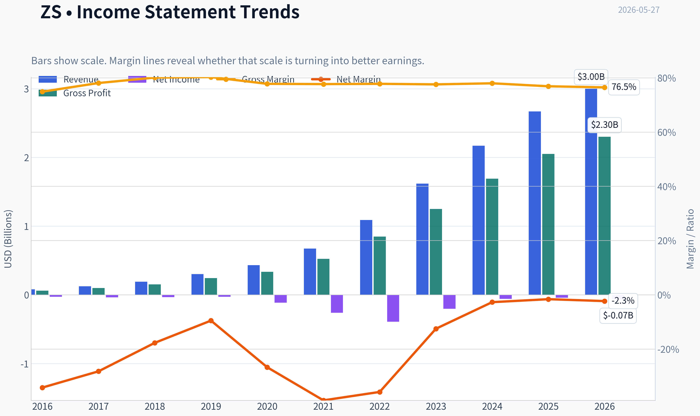

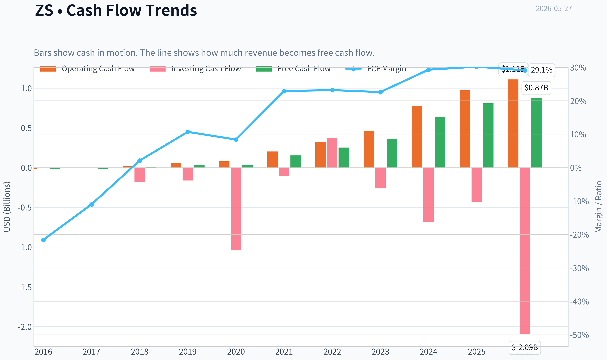

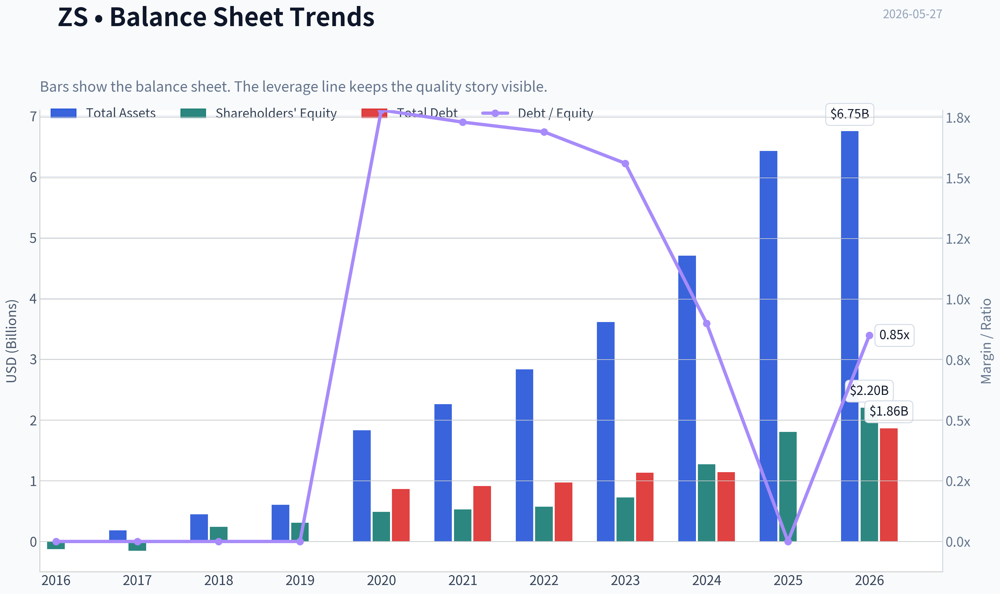

This graph tracks the profitability and return metrics (ROE, ROIC, Margins) of **ZS** over the past decade, highlighting capital efficiency trends.

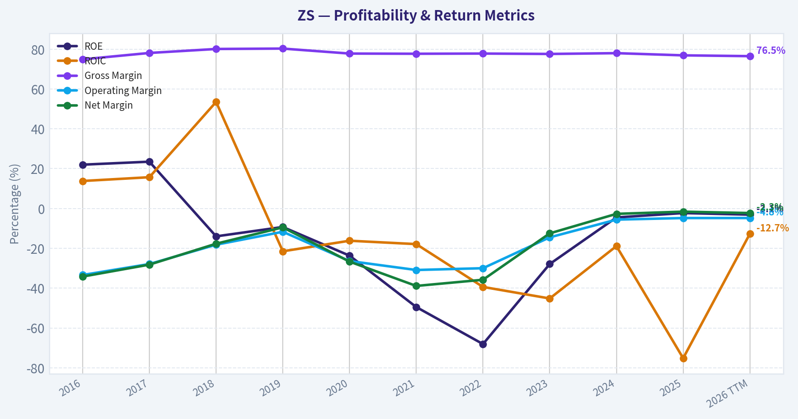

This chart illustrates the financial health of **ZS** over the last 10 years, mapping cash equivalents and free cash flow against total obligations (Debt).

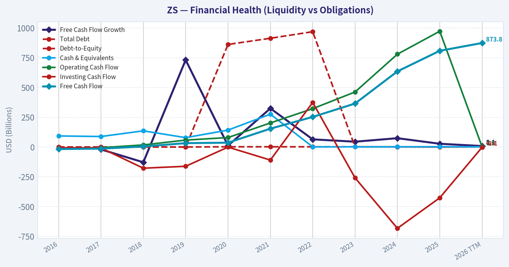

---

### Intrinsic Value Analysis (Buffett)

> *Following Warren Buffett's value investing philosophy: Circle of Competence, Economic Moat, Management Quality, and Margin of Safety.*

#### Intrinsic Value Snapshot

Price is what you pay. Intrinsic value is what the business may be worth based on the cash it can create for owners over time. We show a range, not one magic number.

- Current Price: $127.34
- Value Range (conservative to optimistic across both DCF methods): $182.08 to $474.18

##### Owner Earnings (Buffett Method)
- Net Income: $-41,478,000.00
- Depreciation & Amortization: $121,181,000.00
- Capital Expenditures: $-164,252,000.00
- Working Capital Changes: $26,717,000.00
- Owner Earnings: $-111,266,000.00

##### Intrinsic Value
###### Cash Flow Method
Uses free cash flow. Better for companies spending heavily today to grow tomorrow.
- Conservative: $182.08
- Average: $182.08
- Optimistic: $474.18
- Discount Rate: 10.0%

#### ZS (Zscaler) - Buffett-Style Investment Review

**ANALYST STANCE: WATCH**

#### Go/No-Go Gate Assessment

| Gate | Verdict | Evidence |
|---|---:|---|
| Gate 1: Business Simplicity & Predictability | **Pass with caution** | Zscaler sells cloud-based cybersecurity access and traffic inspection. In simple terms: companies pay subscriptions so employees can connect to apps and the internet securely without relying on old network hardware. The model is understandable, but the sector evolves quickly and product relevance must be defended constantly. |
| Gate 2: Moat Test | **Pass, but moat is narrow-to-emerging** | Very high gross margin of **76.9%** supports software economics and some pricing power. Security platforms can gain switching costs once embedded in identity, traffic, and policy workflows. But cybersecurity remains competitive, and moats can weaken if innovation slows. |
| Gate 3: Management Quality & Capital Allocation | **Mixed / conditional pass** | Revenue growth remains strong at **23.3% YoY**, suggesting execution is still solid. However, current accounting profitability remains weak, with **ROE at -2.3%**, so management has not yet demonstrated the kind of mature per-share value compounding Buffett prefers. |
| Gate 4: Industry Structure | **Mixed** | Cybersecurity is a large, growing market with room for scaled leaders, but it is not a calm oligopoly. Competition is active, product cycles matter, and customer budgets can be reallocated among vendors. |

**Conclusion:** ZS clears the basic business-understanding test, but it does **not** clear the "wonderful, highly predictable, obviously durable" bar that Buffett would strongly prefer.

#### Key Takeaways
Zscaler is understandable enough to analyze, but it is not the kind of slow-changing business where the next decade is easy to predict. The company appears strong operationally, yet the industry remains highly competitive and innovation-driven. That makes this a qualified pass, not a clean Buffett-style approval.

---

#### Moat Analysis

| Moat Source | Assessment | Evidence |
|---|---|---|
| Intangible Assets | **Moderate** | Zscaler has a recognized enterprise security brand and trusted platform reputation. In security, reputation matters because failure is costly. High gross margin supports economic value, though brand alone is not impregnable. |
| Switching Costs | **Moderate to strong** | Once security policies, user access controls, and network traffic rules are embedded into enterprise workflows, switching becomes painful. Reconfiguration risk and operational disruption can create meaningful customer captivity. |
| Cost Advantage | **Limited** | Scale helps cloud security operations and sales reach, but Zscaler does not have the kind of raw structural cost advantage seen in railroads, insurers, or consumer giants. Advantage is more platform-led than cost-led. |
| Network Effects | **Weak to modest** | More customers may improve threat intelligence and product effectiveness, but this is not a classic consumer or marketplace network effect. Benefits exist, but they are indirect. |

| Overall Moat Rating | Verdict |
|---|---:|
| **Narrow / Emerging** | **High hurdle required** |

#### Key Takeaways
Zscaler's best moat source is switching costs, because security tools become deeply embedded in daily operations. Its brand and platform credibility also matter, especially in a trust-sensitive category like cybersecurity. Still, this is not a clearly wide moat business yet, so valuation discipline matters a lot.

---

#### Management Quality & Capital Allocation

| Test | Assessment | Commentary |
|---|---|---|
| Owner Orientation | **Unproven** | The business is still being judged more on growth and scale than on mature per-share value creation. Buffett would want clearer evidence that retained capital is compounding intrinsic value efficiently. |
| Candor & Discipline | **Neutral** | No major red flags are presented here, but the key Buffett question is not whether management tells a good story; it is whether results translate into durable owner earnings. |
| Capital Allocation | **Mixed** | Strong growth is a plus, but negative ROE means capital efficiency is not yet at Buffett-grade levels. For a premium software company, the hurdle should be high. |

#### Key Takeaways
Management appears capable of driving growth, but Buffett would ask a harder question: has that growth translated into excellent returns on capital? Right now, the answer is not clearly yes. That keeps the stock in the watch category rather than the advocate category.

---

#### Financial Summary Table

| Metric | Current / Latest |
|---|---:|
| Current Price | **$127** |
| Market Cap | **$20.48B** |
| P/E | **N/A** |
| ROE | **-2.3%** |
| Gross Margin | **76.9%** |
| Revenue Growth YoY | **23.3%** |
| FCF Yield | **3.9%** |
| Current Ratio | **2.01** |

#### Key Takeaways
The headline financial picture shows a classic growth software profile: high gross margin, solid top-line growth, and acceptable liquidity. But the weak ROE and lack of meaningful current earnings power keep this from looking like a classic Buffett compounder. Zscaler is financially interesting, but not yet financially exceptional in the Buffett sense.

---

#### Owner Earnings Calculation

Using available evidence, a practical Buffett-style shortcut is to anchor on free cash flow when maintenance capital needs are modest relative to revenue and the business is software-heavy.

| Item | Estimate |
|---|---:|
| Market Cap | **$20.48B** |
| FCF Yield | **3.9%** |
| Implied Free Cash Flow / Owner Earnings | **~$0.80B** |

**Owner Earnings Estimate:** approximately **$799 million**

This is a reasonable proxy for owner earnings because Zscaler is asset-light and software businesses typically do not require heavy maintenance capital expenditures compared with industrial firms.

#### Key Takeaways
Zscaler appears to generate roughly $800 million in owner earnings using free cash flow as a proxy. That is meaningful cash generation, especially for a still-growing software business. The problem is not the existence of cash flow; it is the price investors are paying for it.

---

#### Three-Scenario DCF Valuation

Assumptions:
- Discount rate: **10%**
- Owner earnings base: **$799M**
- Shares implicitly valued through market cap comparison

| Scenario | Method | Estimated Equity Value |
|---|---|---:|
| A: No Growth | Owner Earnings / 10% | **$8.0B** |
| B: 3% Growth | Owner Earnings x 1.03 / (10% - 3%) | **$11.8B** |
| C: Moderate Growth | Assume ~8% owner earnings growth for 10 years, then 3% terminal growth | **~$16.0B to $17.5B** |

Compared with current market cap of **$20.48B**, the stock appears to trade:
- **~156%** of no-growth value
- **~173%** of conservative GDP-growth value
- **~117%-128%** of moderate-growth intrinsic value

#### Key Takeaways
Even under a reasonably favorable growth case, Zscaler looks fully valued to somewhat overvalued. The market is already pricing in continued strong execution and durable relevance. That leaves little room for error, which is exactly what Buffett tries to avoid.

---

#### Margin of Safety Analysis

| Scenario | Intrinsic Value | Discount / Premium vs Current Market Cap |
|---|---:|---:|
| No Growth | $8.0B | **-61% margin of safety** |
| GDP Growth | $11.8B | **-42% margin of safety** |
| Moderate Growth | $16.0B-$17.5B | **-17% to -28% margin of safety** |

**Required Buffett Margin of Safety:** at least **25%** for a high-quality predictable company.

**Result:** ZS does **not** meet the margin-of-safety requirement.

#### Key Takeaways
This is the central issue. Even if you like the business, the current price does not provide the cushion Buffett would demand. A good company without a margin of safety is still not a Buffett buy.

---

#### Final Buffett Scorecard

| Criterion | Weight | Score (1-5) | Weighted Result |
|---|---:|---:|---:|
| Business Understanding | 20% | 4.0 | 0.80 |
| Moat Width & Durability | 25% | 3.0 | 0.75 |
| Management Quality | 15% | 3.0 | 0.45 |
| Return on Equity | 15% | 1.5 | 0.23 |
| Reinvestment Runway | 10% | 4.0 | 0.40 |
| Balance Sheet Strength | 5% | 3.5 | 0.18 |
| Industry Structure | 5% | 2.5 | 0.13 |
| Valuation / Margin of Safety | 5% | 2.0 | 0.10 |
| **Total** | 100% |  | **3.03 / 5.0** |

#### Key Takeaways
Zscaler scores well on understandability and runway, but weaker on moat certainty, capital efficiency, and valuation. The overall result lands just above 3, which places it in watch territory. In Buffett terms, this is a potentially good business at a price that is not yet compelling enough.

---

#### Investment Stance

**ANALYST STANCE: WATCH**

**Conviction Level: Moderate**

Zscaler is an attractive business in a valuable market, with strong gross margins, meaningful free cash flow, and respectable revenue growth. But this is **not yet a classic Buffett-style wonderful business at a fair price**. The moat is still developing, returns on equity are not yet strong, and the stock price already discounts a lot of future success.

A Buffett-style investor should **watch, not chase**. The stock becomes more interesting if either:
1. profitability and capital returns improve materially, proving a stronger moat, or
2. the share price falls enough to create a real margin of safety.

At **$127**, ZS looks like a **good company priced for continued excellence**, not an obvious value investment.
#### Valuation Bridge

This bridge places the current market price beside each intrinsic value lens so readers can see whether upside depends on one method or shows up across several methods.

| Scenario | Intrinsic Value / Share |
| --- | ---: |
| Cash Flow Method | $182.08 |
| Damodaran Method | $-188.52 |
| Current Price | $127.34 |

#### Key Takeaways

If one method is far above the others, the upside case depends on a specific modelling assumption. When several methods cluster together, the valuation story is more robust.

#### Valuation Visuals

This comparison chart from *Latest Earnings Snapshot* stacks current figures against historical benchmarks for **ZS**, making it easy to see where the company trades relative to its own averages.

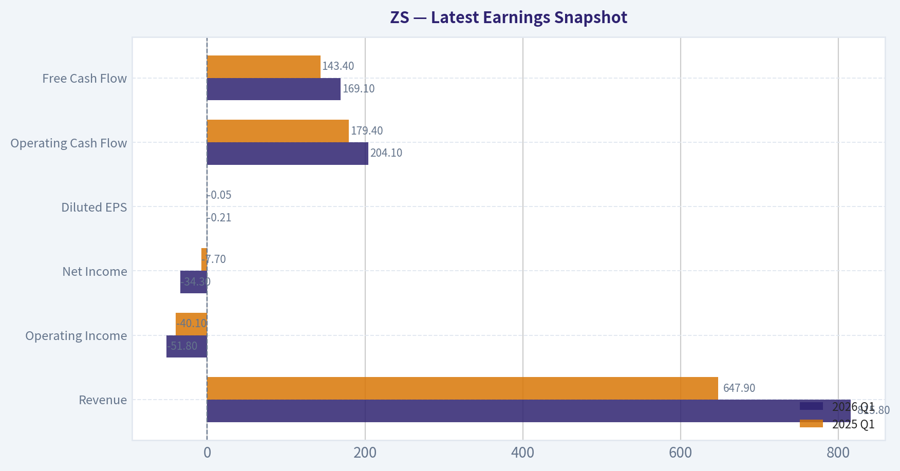

This comparison chart from *Current vs Historical Average Comparison* stacks current figures against historical benchmarks for **ZS**, making it easy to see where the company trades relative to its own averages.

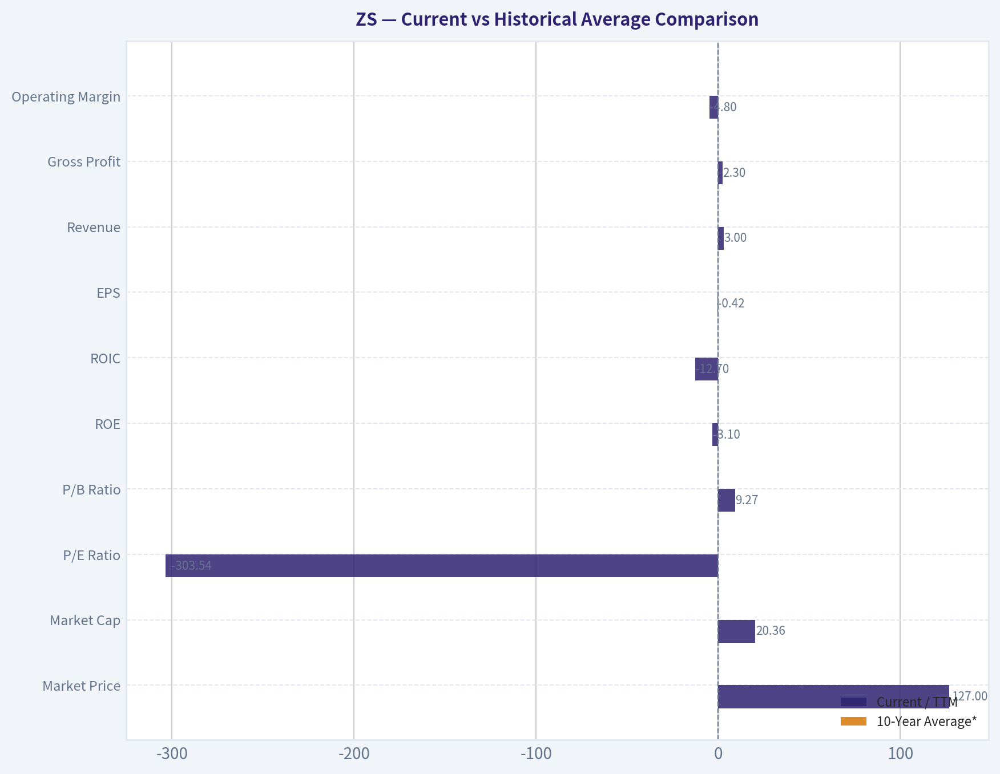

This comparison chart from *Balance Sheet Analysis* stacks current figures against historical benchmarks for **ZS**, making it easy to see where the company trades relative to its own averages.

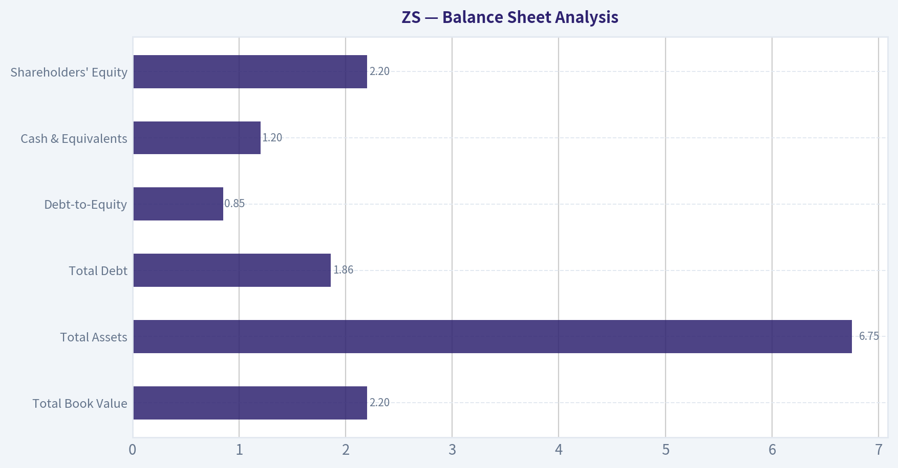

This comparison chart from *Buffett-Style Owner Earnings DCF* stacks current figures against historical benchmarks for **ZS**, making it easy to see where the company trades relative to its own averages.

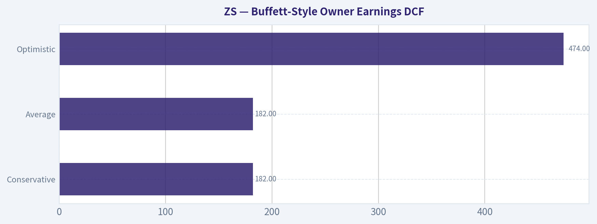

---

### Trend & Growth Analysis (Lynch/Druckenmiller/Fisher)

> *Following Peter Lynch's GARP, Stanley Druckenmiller's macro-aware approach, and Philip Fisher's scuttlebutt methodology.*

ANALYST STANCE: **WATCH**

#### 1. Lynch Classification

| Item | Assessment |
|---|---|
| Category | **Fast Grower** |
| Why | Revenue growth is still ~23% YoY, gross margin is high at 76.9%, and Zscaler operates in a large secular cybersecurity market |
| Lynch fit | Strong business story, but valuation/supporting execution need monitoring after weak guidance commentary |

Key Takeaways: Zscaler still fits Peter Lynch's fast grower bucket, which is the category most associated with multibagger potential. The issue is not whether the business is attractive, but whether growth is re-accelerating enough to justify a premium software multiple from here.

---

#### 2. The Story in 3 Bullets

- Zscaler sells cloud security that replaces legacy firewalls and VPNs with a zero-trust architecture.
- As enterprises move apps, users, and workloads to the cloud, security shifts from hardware boxes to software delivered as a service.
- If Zscaler keeps winning large enterprises and expanding products per customer, it can compound for years; if sales execution weakens, the multiple likely compresses.

#### 3. TAM Analysis and 10x Test

| Item | Value / Assessment |
|---|---|
| Current revenue base | Not fully confirmed from tool data, but company is already at multibillion-dollar scale |
| Market cap | **$20.48B** |
| Core TAM | SSE, SASE, Zero Trust, secure access, cloud security |
| TAM direction | **Expanding** with cloud migration, hybrid work, AI-era security complexity |
| 10x Test | **Borderline but still plausible on long horizon** |
| Interpretation | A 10x revenue outcome would require Zscaler to become one of the dominant global security platforms, not just a niche category leader |

Key Takeaways: The market opportunity is large and still growing, which supports a long runway. But unlike a tiny emerging software company, Zscaler is no longer small, so a true 10-bagger from here likely requires both sustained share gains and category expansion, not just normal execution.

#### 4. Revenue Growth Trend

| Metric | Value |
|---|---|
| Revenue growth YoY | **23.3%** |
| Pattern | **Healthy, but not clear acceleration** |
| Read-through | Strong enough to remain in growth territory, but below hypergrowth levels |
| Warning sign | Latest news flow references **weak guidance / sales concerns** |

Key Takeaways: Revenue growth remains strong in absolute terms, especially for a company of this size. However, the setup does not currently show a clean Druckenmiller-style acceleration signal; instead, it looks more like a premium growth company trying to defend growth durability.

#### 5. Unit Economics

| Metric | Value / Assessment |
|---|---|
| Gross margin | **76.9%** |
| FCF yield | **3.9%** |
| Rule of 40 proxy | **~27.2%** using 23.3% growth + 3.9% FCF yield as rough stand-in |
| NRR | Not available from provided data |
| LTV/CAC | Not available from provided data |
| Current ratio | **2.01** |
| Unit economics read | Strong gross margin and healthy liquidity; incomplete visibility on retention and CAC efficiency |

Key Takeaways: The gross margin profile is excellent and consistent with a high-quality software platform. But without NRR and LTV/CAC, we cannot fully validate whether the go-to-market engine is strengthening, which is especially important after concerns around guidance.

#### 6. Inflection Point Assessment

| Inflection Type | Assessment |
|---|---|
| Product cycle inflection | Possible, but not evidenced by provided data |
| Market share inflection | Unclear |
| Margin inflection | Some potential, but not enough data |
| TAM inflection | **Yes** - zero trust and cloud security remain secular growth areas |
| Competitive inflection | Mixed; crowded field with PANW, Cloudflare, Netskope, Microsoft |
| Overall | **No confirmed positive inflection today** |

Key Takeaways: The secular market remains favorable, which is important. But the company-specific inflection signal is weaker than what a concentrated growth investor would ideally want, because recent news suggests guidance concerns rather than upside surprise.

#### 7. Macro Setup Evaluation

| Factor | Assessment |
|---|---|
| Secular theme | **Cybersecurity / cloud security / zero trust** |
| Theme quality | **Excellent** |
| Rate sensitivity | Growth software still benefits from stable/falling rates |
| Budget resilience | Cybersecurity is more resilient than many IT categories |
| Macro conclusion | **Supportive, but not enough alone to override execution risk** |

Key Takeaways: Zscaler operates in one of the best long-duration secular themes in technology. That said, even strong macro and thematic support cannot fully protect a stock if bookings, guidance, or enterprise sales execution weaken.

#### 8. Fisher 15 Points Score

| Fisher Area | Score (1-5) | Notes |
|---|---:|---|
| Market potential | 5 | Large and expanding security TAM |
| New product development | 4 | Broadening platform beyond core access/security |
| R&D effectiveness | 4 | Strong innovation reputation |
| Sales organization | 3 | Recent guidance concerns reduce confidence |
| Profit margin | 3 | High gross margin, modest GAAP profitability |
| Improving margins | 3 | Possible, but not clearly proven here |
| Labor/personnel relations | 3 | No strong data |
| Executive relations | 3 | No strong data |
| Management depth | 4 | Established category leadership |
| Cost/accounting controls | 3 | Acceptable, but SBC remains a watch item |
| Outstanding moat features | 4 | Switching costs, architecture, trust |
| Long-range profit outlook | 4 | Strong if execution holds |
| Dilution risk | 2 | Software SBC is a meaningful issue |
| Candor in difficulties | 3 | Insufficient direct evidence |
| Integrity | 3 | Insufficient direct evidence |

| Total | **51 / 75** | **Average to Good** |

Key Takeaways: Zscaler scores well on market potential, product strength, and strategic relevance. The weaker areas are sales execution confidence, dilution, and limited evidence on softer qualitative Fisher questions, which keeps it out of the top tier.

#### 9. Valuation Analysis

| Metric | Value / Assessment |
|---|---|
| Current price | **$127** |
| Market cap | **$20.48B** |
| P/E | **N/A** |
| PEG | **N/A** because earnings basis is not clean here |
| P/S | Roughly high-single-digit range if revenue is around recent annualized run-rate; exact figure not confirmed from tool data |
| FCF yield | **3.9%** |
| Valuation read | **Not cheap, but not extreme for quality cyber if growth stabilizes** |

Key Takeaways: Zscaler does not screen as a classic Lynch PEG bargain because earnings are not the clean valuation anchor. The stock looks more like a quality software name priced for durable growth, meaning upside depends on renewed confidence in acceleration, not simple rerating from a depressed base.

#### 10. Growth Investor Scorecard

| Criterion | Weight | Score (1-5) | Weighted Score |
|---|---:|---:|---:|
| The Story | 10% | 4.5 | 0.45 |
| TAM & Runway | 20% | 4.0 | 0.80 |
| Revenue Growth | 20% | 3.5 | 0.70 |
| Unit Economics | 15% | 3.5 | 0.53 |
| Competitive Position | 10% | 4.0 | 0.40 |
| Management Quality | 10% | 3.0 | 0.30 |
| Macro Setup | 5% | 4.5 | 0.23 |
| Profitability Path | 5% | 3.0 | 0.15 |
| Valuation | 5% | 3.0 | 0.15 |

| Total |  |  | **3.71 / 5.00** |

Key Takeaways: The composite score lands in the low-end ADVOCATE/high-end WATCH zone numerically. I am choosing WATCH instead of ADVOCATE because the missing piece is not market quality but confidence in near-term inflection after weak-guidance headlines.

---

#### 11. Position Size Stance

| Style | Stance |
|---|---|
| High-conviction growth portfolio | **Starter only, not full position** |
| General investor | **Watchlist / nibble on confirmed re-acceleration** |
| Suggested sizing | **0.5% to 2% starter** if one wants thematic exposure before clearer evidence |

Key Takeaways: This is not the kind of setup that justifies an oversized position today. If conviction improves through better billings, cRPO, large-customer adds, or stronger guidance, it could graduate into a larger position.

#### 12. Key Risks and Catalysts

| Risks | Catalysts |
|---|---|
| Weak guidance / sales slowdown | Re-acceleration in billings or cRPO |
| Competitive pressure from PANW, Netskope, Microsoft, Cloudflare | Large enterprise wins and platform consolidation success |
| SBC and dilution | Margin expansion and stronger FCF conversion |
| Growth deceleration at scale | New product contribution and cross-sell expansion |
| Premium multiple vulnerability | Cybersecurity spending resilience in macro volatility |

Key Takeaways: The biggest risk is not that cybersecurity disappears, but that Zscaler becomes "just good" rather than exceptional. The biggest upside catalyst would be proof that recent weakness was temporary and that enterprise demand is re-accelerating across the platform.

#### Bottom Line

Zscaler is still a **high-quality fast grower in an excellent secular market**, with strong gross margins, a real product edge, and long-term relevance. But the **current setup lacks a clean inflection signal**, and recent weak-guidance commentary matters for a premium growth stock.

For a Lynch-Druckenmiller-Fisher investor, this is a **WATCH**, not an AVOID:
- **Lynch:** strong story, but not obviously cheap.
- **Druckenmiller:** secular tailwind is good, but no clear near-term upside inflection.
- **Fisher:** quality business, though dilution and execution keep conviction below top tier.

If you want, I can next do a **bull/base/bear 3-year scenario model for ZS** using revenue growth and valuation multiples.

#### Growth & Scorecard Visuals

This comparison chart from *Growth Metrics Analysis* stacks current figures against historical benchmarks for **ZS**, making it easy to see where the company trades relative to its own averages.

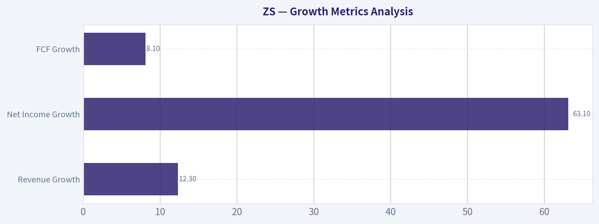

---

### Market Technical Analysis

#### ZS Technical Indicator Selection and Market Report

For **ZS (Zscaler)**, the most relevant set of complementary indicators in the current market context is:

| Indicator | Why it matters now |
|---|---|
| close_10_ema | Best for tracking the sharp near-term rebound and whether momentum remains intact. |
| close_50_sma | Useful medium-term trend filter; price has recently reclaimed it decisively. |
| close_200_sma | Critical long-term trend benchmark; still shows the broader structure remains damaged despite the rally. |
| macd | Confirms whether the rebound has shifted from dead-cat bounce to durable momentum reversal. |
| macdh | Helps judge whether bullish momentum is accelerating or starting to peak. |
| rsi | Important now because the rally has pushed momentum toward overbought territory. |
| atr | Necessary for risk control because ZS is moving with elevated daily ranges. |
| vwma | Adds volume confirmation and helps judge whether the advance is supported by participation. |

**Why these 8:** they cover **short-term trend, medium-term trend, long-term trend, momentum direction, momentum acceleration, exhaustion risk, volatility, and volume confirmation** without major redundancy.

---

#### Market Context

ZS has gone through **three distinct phases** over the last year:

1. **A strong uptrend into mid-2025**, with price rising from the mid-250s to the low/mid-330s.
2. **A prolonged and severe downtrend from late 2025 into April 2026**, where the stock unraveled from above 330 to nearly 118.
3. **A sharp recovery leg in May 2026**, lifting price back into the mid-180s.

That means the stock is **not in a neutral state**. It is in a **powerful countertrend recovery inside a still-weakened longer-term structure**. This distinction is important. Traders should not treat this setup the same way they would a stock in a clean, mature secular uptrend.

---

#### Indicator Snapshot

| Indicator | Latest reading | Interpretation |
|---|---:|---|
| Close (last actual close) | 184.60 | Strong recent recovery, near local highs |
| close_10_ema | 169.69 | Price is well above short-term trend support |
| close_50_sma | 144.97 | Medium-term trend has materially improved |
| close_200_sma | 223.64 | Long-term trend still bearish; price remains far below it |
| macd | 10.55 | Strong bullish momentum |
| macdh | 3.62 | Momentum acceleration remains positive |
| rsi | 74.10 | Overbought zone; trend strong but increasingly stretched |
| atr | 8.71 | Elevated volatility; requires wider stops and smaller sizing |
| vwma | 165.28 | Price above volume-weighted trend, supporting rally quality |

**Key Takeaways:** ZS is showing strong short-term and medium-term bullish behavior, with price clearly above its 10-day EMA, 50-day SMA, and VWMA. At the same time, the stock remains well below its 200-day SMA, which means the longer-term trend has not fully healed. Momentum is strong, but RSI above 74 warns that the move is becoming extended and may be vulnerable to pullbacks.

---

#### Trend Structure Analysis

The **10 EMA at 169.69** is rising steeply, and price at **184.60** sits far above it. That usually reflects a market in a strong momentum phase rather than a hesitant recovery. The rally since early May has not been incremental; it has been **impulsive**, especially visible in the jump from the high-130s/low-140s to the mid-180s in a matter of weeks.

The **50 SMA at 144.97** is especially important. Until recently, this average had been falling steadily, reflecting the deep prior damage. Now price has moved decisively above it by nearly 40 points, signaling that the stock has done more than just bounce off oversold lows. It has **reclaimed medium-term control**.

However, the **200 SMA at 223.64** remains far above spot price. This matters because it tells us the broader trend is still in repair mode. Even after the recent surge, ZS remains roughly **39 points below the 200-day average**, which is a substantial gap. In practice, that means:
- medium-term traders can justify a bullish bias,
- but long-term trend followers should still classify the stock as **recovering from a prior bear phase**, not yet restored to a full long-term uptrend.

A nuanced reading is that ZS has shifted from **capitulation and deterioration** into **early-to-mid recovery**, but it has **not yet completed long-horizon trend rehabilitation**.

---

#### Momentum Analysis

The **MACD at 10.55** is strongly positive, and more importantly, it has climbed rapidly from negative territory in early May. This confirms that the recent move is not just price noise. Momentum has genuinely flipped.

The **MACD histogram at 3.62** is also positive and elevated. That tells us bullish momentum is not only positive, but still **outpacing** the signal line. In plain terms, the rally has not obviously stalled yet. The histogram readings through mid-to-late May suggest persistent upside thrust rather than a fading move.

Still, there is a subtle point traders should watch: when MACD and MACD histogram are both very strong while RSI is already in overbought territory, the setup often transitions from **initiation** to **extension**. That does not automatically imply reversal, but it does increase the probability that the next phase is either:
- a **sideways digestion**, or
- a **controlled pullback toward fast support**, rather than another equally steep vertical leg immediately.

This is a key distinction. Momentum remains bullish, but the **quality of new entries** becomes less attractive when momentum strength and extension coexist.

---

#### RSI and Exhaustion Risk

The **RSI at 74.10** is above the classic 70 threshold. In weak markets, that could be a sell signal. In strong rebound phases, it is more often a sign of **aggressive buying pressure**. So the correct interpretation is not "bearish," but rather "bullish and stretched."

Looking at the path of RSI is more informative than the absolute number alone:
- Early April: deeply oversold conditions, with RSI falling into the upper-20s.
- Late April / early May: recovery through the 40s and 50s.
- Mid-to-late May: sustained move into the upper-60s and now mid-70s.

That arc reflects a **full momentum regime shift**. The stock has gone from forced selling to persistent accumulation. But once RSI is above 70 after a fast run, the odds of chasing improve only if price can consolidate without a major RSI collapse. Ideally, bulls would want to see:
- price hold above the 10 EMA,
- RSI cool from the 70s toward the 60s,
- and then renewed upside from a higher base.

If instead RSI rolls over sharply while price fails to hold recent breakout levels, that would suggest the move is transitioning from healthy strength into **blow-off behavior**.

---

#### Volume-Weighted Confirmation

The **VWMA at 165.28** is below the current price by nearly 19 points, which supports the view that the rally has been **volume-validated**, not merely mechanical drift. The heavy volume on recent advancing sessions, especially the move into May 26, strengthens the case that participation expanded as price advanced.

This matters because rallies below VWMA often lack sponsorship. Here, the opposite is true: price is above VWMA and VWMA itself is climbing. That suggests buyers have been willing to transact at progressively higher prices with real volume support.

Still, traders should be careful interpreting volume around outsized event days. Very large volume spikes can distort VWMA upward. Even so, the current relationship still leans constructive: **price leadership is being confirmed by participation**.

---

#### Volatility and Risk Management

The **ATR at 8.71** is elevated for a stock at 184.60. That means daily movement is meaningful, around **4.7% of price** on a rough ATR basis. This is not a sleepy trend. It is an active, high-beta recovery move.

Implications:
- Stops that are too tight are likely to be hit by normal volatility.
- Position sizing should be reduced versus lower-volatility names.
- Traders buying strength should assume that even a healthy pullback could be **6 to 10 points** without invalidating the trend.

This also means breakout entries need discipline. Buying after a large expansion day without a plan can create poor reward-to-risk, because the stock may retrace a meaningful portion of the move while still remaining technically bullish.

---

#### What the Trend Likely Means for Different Traders

| Trader Type | Most relevant read |
|---|---|
| Short-term momentum trader | Bullish trend intact, but entry quality is worse after the recent surge; better to wait for consolidation or shallow pullback. |
| Swing trader | Medium-term structure has improved meaningfully above the 50 SMA, but overbought RSI argues against emotional chasing. |
| Position trader | Recovery is real, yet price remains below the 200 SMA, so long-term confirmation is still incomplete. |
| Risk-focused trader | ATR is high; use smaller sizing and wider stops to avoid getting shaken out. |

**Key Takeaways:** Different trading horizons lead to different conclusions. Short-term and swing traders can still maintain a bullish bias, but they should respect the overextended nature of the move. Longer-term traders should note that the stock has not yet regained its 200-day average, so the broader recovery remains unfinished.

---

#### Fine-Grained Trading Interpretation

A detailed technical reading suggests the following:

- **Bull case:**
  The rally is legitimate. Price is above the 10 EMA, 50 SMA, and VWMA; MACD is strongly positive; histogram remains firm; RSI confirms strong momentum. This combination usually supports trend continuation unless price starts closing back below fast support.

- **Base-building case:**
  Rather than immediately breaking much higher, ZS may spend time digesting gains between roughly the low-170s and mid-180s. That would actually be constructive if momentum cools without severe price damage.

- **Caution case:**
  Because RSI is overbought and ATR is elevated, a failed breakout or sharp reversal from the current area could produce fast downside retracement. The first sign of weakening would likely be loss of the 10 EMA zone; a more meaningful deterioration would be a retreat back toward the 50 SMA.

- **Longer-term repair case:**
  Even if the current move remains healthy, the stock still faces a significant technical test before the long-term chart becomes convincingly bullish again: the **200 SMA near 223.64**. That level is likely to act as an important future supply/resistance area if reached.

---

#### Practical Levels to Monitor

| Level/Zone | Technical meaning | What traders should watch |
|---|---|---|
| 184-191 area | Immediate momentum zone / recent highs | Sustained hold above this area would show buyers still in control |
| ~169.7 | close_10_ema | First key dynamic support in a healthy pullback |
| ~165.3 | vwma | Confirms whether volume-supported trend remains intact |
| ~145.0 | close_50_sma | Major medium-term support; losing this would weaken the recovery thesis |
| ~223.6 | close_200_sma | Major long-term resistance and trend-repair test |

**Key Takeaways:** The near-term battle is around the recent high zone in the mid-180s to low-190s. If the stock pulls back, the 10-day EMA and VWMA are the first important support references, while the 50-day SMA is the more serious line in the sand. On the upside, the 200-day SMA remains the major long-term hurdle.

---

#### Bottom Line

ZS currently shows a **strong bullish recovery trend in the short and medium term**, but it is doing so **inside a still-unrepaired long-term structure**. The indicator mix points to **real momentum, real participation, and real improvement**, not just random bounce behavior. However, the move is also **extended**, and risk has increased for late entrants because **RSI is overbought and ATR is high**.

The most actionable interpretation is:

- **Bias:** bullish short term / constructive medium term
- **Condition:** extended, not early
- **Risk:** elevated due to volatility and overbought momentum
- **Long-term status:** still below full trend confirmation until the 200 SMA is challenged or reclaimed

For traders, this is more a **manage-the-trend** environment than a **chase-the-breakout** environment.

---

#### Summary Table

| Category | Observation | Trading Implication |
|---|---|---|
| Short-term trend | Price well above 10 EMA | Momentum remains strong, but extension risk is high |
| Medium-term trend | Price firmly above 50 SMA | Recovery has real technical substance |
| Long-term trend | Price still below 200 SMA | Broader trend repair is incomplete |
| Momentum | MACD strongly positive | Bullish momentum reversal confirmed |
| Momentum acceleration | MACD histogram positive and elevated | Upside thrust still active, not obviously exhausted |
| Stretch/exhaustion | RSI at 74.1 | Strong trend, but increasingly vulnerable to pullback |
| Volatility | ATR near 8.7 | Use wider stops and smaller size |
| Volume confirmation | Price above rising VWMA | Rally has participation support |

**Key Takeaways:** ZS is in a strong rebound phase with convincing short-term and medium-term bullish signals. The main caveat is that the stock is now stretched and volatile, while still below its 200-day moving average. That combination favors disciplined bullishness rather than aggressive chasing.

#### Market Visuals

This comparison chart from *Market Metrics Interpretation* stacks current figures against historical benchmarks for **ZS**, making it easy to see where the company trades relative to its own averages.

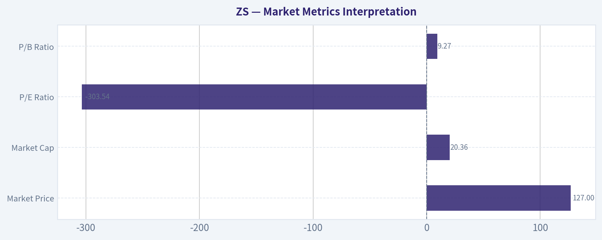

---

### Options Market Analysis

> *Reading options flow - put/call ratios, IV skew, and unusual activity - to gauge institutional positioning and event-driven risk.*

#### ZS Options Positioning Report
*Date: 2026-05-27*

ZS options flow is **decisively event-driven and near-term heavy**, with the bulk of activity concentrated in the **2026-05-29 expiry**. The tape shows **above-neutral put/call ratios overall**, but also **large speculative upside call flow** in short-dated out-of-the-money strikes. My read is **slightly bearish to cautious in aggregate**, because put ownership/volume is still heavier than calls overall, even though the call wing is being aggressively chased.

#### 1. Put/Call Ratio Analysis

| Scope | Call OI | Put OI | Put/Call OI Ratio | Call Volume | Put Volume | Put/Call Volume Ratio | Read |
|---|---:|---:|---:|---:|---:|---:|---|
| 2026-05-29 | 19,902 | 25,041 | 1.26 | 20,335 | 28,659 | 1.41 | Bearish / hedging-heavy |
| 2026-06-05 | 4,374 | 2,441 | 0.56 | 5,398 | 4,883 | 0.90 | More constructive |
| 2026-06-12 | 1,354 | 2,067 | 1.53 | 1,136 | 941 | 0.83 | Put-heavy OI, lighter fresh flow |
| **Near-term total** | **25,630** | **29,549** | **1.15** | **26,869** | **34,483** | **1.28** | **Net bearish vs. neutral baseline** |

**Key Takeaways:** Relative to the historical neutral baseline near **0.7**, ZS is running **meaningfully put-heavy** on both open interest and volume across the front expiries. That usually signals either **active downside hedging** or **tactical bearish positioning**, especially because the shortest expiry also carries the heaviest put imbalance. The one notable offset is 6/5, where positioning looks more balanced-to-bullish, suggesting some traders expect the event risk to clear quickly.

#### 2. Implied Volatility (IV) Assessment

| Expiry | ATM Call IV | ATM Put IV | Call vs Put ATM Read | Broader Interpretation |
|---|---:|---:|---|---|
| 2026-05-29 | 162.5% | 66.3% | Extreme call premium | Strong event pricing, upside chase in calls |
| 2026-06-05 | 77.3% | 72.6% | Mild call premium | Elevated but more normalized post-event vol |
| 2026-06-12 | 74.3% | 69.5% | Mild call premium | Elevated residual uncertainty |

**Key Takeaways:** Near-term IV is **very elevated**, especially in the front expiry, which strongly suggests the market is pricing a **major catalyst**, most likely earnings or another company-specific event. What stands out is that **calls are richer than puts at-the-money**, which is unusual for a tape dominated by put/call ratios above 1. That tells us traders are paying up for both downside protection **and** upside optionality, but the most expensive premium sits in the short-dated upside wing.

On skew: the dataset does **not provide a full strike-by-strike IV surface summary**, but the unusual activity table offers a strong clue. Many **OTM calls** in the 133/135/140/145/150 strikes are carrying **very high IVs around 92%-105%**, while several near-OTM and OTM puts are lower in the **50%-90% range** depending on strike. That points to a **call-skewed near-term surface**, which usually signals **upside chase / squeeze speculation**, not classic crash fear.

#### 3. Unusual Options Activity

For context, these are contracts where **volume is far above existing open interest**, which tends to indicate **fresh positioning** rather than simple closing trades.

| Expiry | Type | Strike | Volume | OI | Vol/OI | IV | Likely Moneyness / Context | Positioning Implication |
|---|---|---:|---:|---:|---:|---:|---|---|
| 2026-05-29 | CALL | 130 | 4,399 | 55 | 80.0x | 92.2% | Likely near-ATM / slightly OTM | Aggressive upside event bet |
| 2026-05-29 | PUT | 120 | 2,856 | 211 | 13.5x | 84.5% | OTM downside protection | Hedge or bearish event bet |
| 2026-05-29 | PUT | 125 | 1,833 | 268 | 6.8x | 51.6% | Near-ATM / slightly OTM | Defensive positioning |
| 2026-05-29 | PUT | 118 | 1,615 | 59 | 27.4x | 84.8% | OTM put | Sharp downside tail hedge |
| 2026-05-29 | CALL | 140 | 1,534 | 200 | 7.7x | 99.6% | Far OTM call | Speculative upside chase |
| 2026-05-29 | PUT | 115 | 1,400 | 90 | 15.6x | 83.8% | OTM put | Bearish/hedge flow |
| 2026-05-29 | CALL | 135 | 1,139 | 53 | 21.5x | 95.2% | OTM call | Fast-money upside bet |
| 2026-05-29 | CALL | 150 | 1,118 | 184 | 6.1x | 104.5% | Very far OTM call | Retail-style lottery / squeeze speculation |
| 2026-05-29 | PUT | 128 | 1,118 | 109 | 10.3x | 61.4% | Near-ATM put | Short-term caution |
| 2026-05-29 | PUT | 100 | 1,068 | 90 | 11.9x | 90.6% | Deep OTM crash put | Tail-risk hedge |
| 2026-05-29 | PUT | 110 | 1,059 | 33 | 32.1x | 83.2% | Deep OTM put | Tail hedge / disaster protection |
| 2026-05-29 | CALL | 145 | 968 | 66 | 14.7x | 102.1% | Very far OTM call | Speculative upside |
| 2026-06-05 | CALL | 144 | 876 | 11 | 79.6x | 80.4% | OTM post-event call | Follow-through bullish bet |
| 2026-05-29 | CALL | 133 | 755 | 6 | 125.8x | 91.8% | OTM call | Fresh upside speculation |
| 2026-05-29 | PUT | 124 | 743 | 59 | 12.6x | 54.5% | Near-ATM put | Conservative hedge |

**Key Takeaways:** This is not a sleepy chain - it is showing **heavy fresh opening flow on both sides**, concentrated into the immediate expiry. The most credible institutional-style signals are the **near-ATM puts around 124/125/128 and the 120 put line**, which look like practical hedges or bearish event expressions. The far OTM calls like **145 and 150** look more like **speculative upside chasing**, while the **130 call** is the most important bullish line because it sits closer to the likely trading range and carries very large fresh volume.

#### 4. Open Interest Concentration and Potential Gamma Levels

| Expiry | OI Profile | Interpretation |
|---|---|---|
| 2026-05-29 | Highest total OI by far (19,902 calls / 25,041 puts) | Main expiry controlling near-term price behavior |
| 2026-06-05 | Moderate OI, call-heavy relative to puts | Secondary post-event positioning |
| 2026-06-12 | Smaller chain, put-heavy OI | Residual caution after event |

Because the tool gives total expiry-level OI rather than a full strike-level OI ladder, we **cannot identify exact max-pain or gamma-wall strikes with precision**. However, the concentration of unusual activity around **130 on the call side** and **124-125-128 / 120 on the put side** suggests those are the most relevant **near-term battleground strikes**.

**Key Takeaways:** The **5/29 expiry dominates** and likely acts as the primary gamma event. In practical terms, the stock may be pulled toward the heaviest active strikes into expiry, with **130 as the upside trigger zone** and the **124-120 area as the downside hedge zone**. If price breaks hard beyond either cluster, gamma could shift from dampening moves to **amplifying** them.

#### 5. Overall Options Sentiment Signal

| Category | Signal |
|---|---|
| Directional read | **BEARISH (with upside squeeze risk)** |
| Confidence | **Moderate** |
| Primary driver | Put/call ratios are above neutral and the front expiry is put-heavy overall |
| Secondary driver | Elevated event IV with simultaneous speculative call chasing |
| Main caveat | Call-skew and heavy OTM call flow create real upside gap/squeeze risk |

**Key Takeaways:** I would classify ZS options sentiment as **bearish overall**, not because traders are ignoring upside, but because **aggregate positioning still favors puts over calls** in both OI and volume where it matters most. The tape looks like a market that is **nervous first, opportunistic second**: institutions appear to be paying for protection, while shorter-dated traders are also buying upside tickets in case the catalyst surprises positively.

So the clean synthesis is: **base case cautious/bearish, but with a meaningful upside squeeze tail** due to the rich call wing and aggressive short-dated call buying.

#### Bottom Line

ZS options are pricing a **large near-term move**. The market is **not calm**, and the forward positioning says participants are leaning defensive overall, even as they chase upside in select strikes. If you need a one-line read: **institutional flow looks protective-to-bearish, while speculative flow is chasing an upside event pop.**

#### Summary Table

| Metric | Observation |
|---|---|
| Put/Call Ratio | **1.15 OI / 1.28 volume** near-term, above neutral and bearish-leaning |
| IV Level | **Very elevated**, especially 5/29 front expiry |
| Skew Direction | **Call skew** in near-term premium, implying upside chase/squeeze pricing |
| Unusual Activity | Heavy fresh flow in **130/135/140+ calls** and **120/125/128 puts** |
| Overall Signal | **BEARISH**, with notable upside squeeze risk |

**Key Takeaways:** The summary is straightforward: ZS options traders are paying for a **big event move**, but the aggregate book remains **more defensive than optimistic**. Still, the call wing is active enough that a bullish surprise could trigger an outsized upside reaction even though the baseline options read stays bearish.

---

## Research Team Commentary

> *The Research Manager synthesizes the Bull vs Bear debate into action-free commentary. This is a pre-risk view, not the final stance.*

The bull case is strongest when it focuses on industry direction rather than current accounting optics. Zscaler is clearly aligned with a real secular shift: enterprise security is moving away from legacy firewalls and VPNs toward cloud-delivered zero-trust architectures. That gives the company a plausible moat based on product architecture, customer embedding, and switching friction. The numbers that support this are meaningful: roughly 23% revenue growth at nearly 77% gross margin is the profile of a business with real customer value and potentially strong long-term operating leverage. The $799M owner-earnings base also matters because it suggests this is not just a concept stock. After a massive derating from prior highs, the bull argues the market may now be underestimating the duration of future cash-generation.

The bear case is strongest when it insists on Buffett discipline around proof, not promise. Zero-trust may be a valuable category, but category leadership is not the same as an enduring moat. Cybersecurity is crowded, fast-moving, and vulnerable to bundling by broader platforms. That matters because Buffett-style investing demands more predictability than most security vendors can offer. The hard evidence is also mixed: ROE is negative at -2.3%, ROA is negative at -0.6%, and there is no clear demonstrated ROIC case. Those are weak signals for a value investor who wants proven capital efficiency. Just because the stock fell a lot does not mean it is cheap, and a valuation based on healthy long-term growth assumptions may still be too generous for a company whose normalized returns remain unproven.

My core takeaway is that Zscaler may be a good business, but it is not yet a classic Buffett-quality value opportunity. The business quality is better than the bear admits, but the predictability and demonstrated economics are weaker than the bull wants to assume. This is exactly where I need to apply the lesson from prior mistakes carefully. In GOOGL and MSFT, I was too conservative on proven mega-cap franchises with elite returns, fortress economics, and temporary sentiment resets. Zscaler is different. It does not yet have that level of proven earning power, balance-sheet-like inevitability, or moat durability. So I should avoid overcorrecting by calling every fallen quality-growth name an accumulation opportunity. At the same time, I also do not want to dismiss it outright because the gross margin, growth, and secular tailwind are real.

From a value investing perspective, the right stance is WATCH. Not ADVOCATE, because there is not enough evidence of durable excess returns, predictable normalized earnings, or a clear margin of safety. Not AVOID, because the company does appear to have genuine strategic relevance, a sticky enterprise product, and enough underlying economic quality that stronger proof over the next few quarters could materially improve the case.

The rationale is straightforward. Buffett's framework starts with business quality and predictability. Zscaler passes part of that test: mission-critical product, recurring model, strong gross margins, secular demand tailwind. But it fails the cleaner proof tests that matter to a value portfolio: current returns are weak, capital efficiency is not yet established, and the moat may be narrower than the story suggests if platform bundling and category consolidation intensify. Intrinsic value is therefore highly assumption-sensitive. Without a larger margin of safety or clearer proof of durable operating leverage, conviction should remain limited.

What I think the market may be missing is that this is neither a junk software story nor an obvious compounder. Fear after the drawdown may have become excessive relative to product relevance, but optimism about future normalized economics may also still be too easy. That tension usually argues for patience rather than a hard bullish call.

Over the next 1 to 4 quarters, I would watch a few concrete things. First, whether revenue growth can remain resilient in the low-20s or better without clear signs of sales-efficiency deterioration. Second, whether operating leverage starts showing up more clearly beyond gross margin, especially in operating income, free cash flow conversion, and per-share owner earnings. Third, evidence of expansion within large enterprise customers: bigger deals, more modules per customer, and strong retention would strengthen the moat argument. Fourth, any sign that platform consolidation or competitive pricing is pressuring win rates would weaken the thesis quickly. Fifth, I would want better proof that stock-based compensation and growth spending are not masking weaker true shareholder economics than the owner-earnings figure implies. And finally, I would watch management's commentary around customer budgets and competitive dynamics very closely; if they start talking more about longer deal cycles, consolidation pressure, or discounting, that would matter.

If the company can show sustained growth, improving returns, and clearer evidence that its architecture is becoming a durable enterprise standard rather than just a strong product in a crowded field, this could graduate toward ADVOCATE later. If growth slows materially while returns stay weak, then the bear case wins and it shifts toward AVOID.

Final stance: WATCH

---

## Value Investing Team Commentary

> *The Investor translates the research view into an investment thesis before risk review. This is still not the final stance.*

Zscaler is interesting, but it is not yet the kind of business I would call an obvious long-term value investment. The core appeal is easy to understand: enterprises are steadily replacing perimeter-based security tools with cloud-native, zero-trust platforms, and Zscaler is positioned directly in that shift. A business growing revenue at 23.3% with a 76.9% gross margin is clearly selling something customers value. Those are not the numbers of a weak product. They suggest a real franchise with room for operating leverage if management executes well.

But a Buffett-style investor has to separate a good story from a proven compounding machine. Zscaler still falls short on proof. ROE of -2.3% and ROA of -0.6% tell us current accounting returns are not yet demonstrating durable capital efficiency. In software, that can be temporarily masked by growth investment, stock-based compensation, or accounting noise, so I would not dismiss the company outright. Still, if I am being disciplined, I cannot simply assume future excellence because the category sounds attractive. Cybersecurity is one of the most competitive corners of technology. Products can be strong without moats being impregnable. The risk of bundling from larger platforms, aggressive pricing, and shifting buyer preferences is real.

The selective contrarian question is this: what is the market misunderstanding? After such a severe drawdown from prior highs, sentiment likely moved from enthusiasm to skepticism. That can create opportunity. But unlike prior cases such as Alphabet or Microsoft, this is not a temporarily unpopular giant with already proven economic dominance. Here, the derating may reflect a legitimate repricing of uncertainty rather than mere emotional overshoot. So the contrarian move is not automatically to buy the dip. It is to recognize that fear may have uncovered a potentially better future entry point, while also respecting that the business still has to earn a higher level of trust.

What matters over the next several quarters is whether the company converts category relevance into owner earnings and stronger returns on capital. I would want to see sustained enterprise expansion, durable retention, improving sales efficiency, and clearer evidence that free cash flow quality is not flattered by stock-based compensation or other adjustments. If Zscaler can prove that its platform is becoming embedded infrastructure rather than a fast-growing point solution, the investment case strengthens materially. If growth moderates and profitability metrics remain weak, the multiple likely has further to compress.

My interpretation is that Zscaler sits in the middle ground: too strategically relevant to dismiss, too unproven to embrace aggressively. The market may be excessively focused on recent disappointment, but it may also still be too willing to capitalize optimistic future economics. That combination usually argues for patience, not conviction.

**ANALYST STANCE: WATCH**
Zscaler has a credible long-term industry tailwind, strong gross margins, and meaningful growth, but it has not yet shown the level of predictable returns, moat durability, and capital efficiency required for a Buffett-style ADVOCATE rating. I would keep it on the watchlist and look for clearer proof of operating leverage, stronger shareholder economics, and durable enterprise entrenchment before becoming more constructive.

---

## Deep Values Commentary

> *The Risk Management Team debates and the Risk Judge provides the final action-free verdict. This section determines the final ADVOCATE / WATCH / AVOID stance.*

#### Final Stance Scorecard

This scorecard converts the final research view into a weighted decision frame. It does not replace the narrative judgement, but it makes the main drivers of the verdict easier to scan.

| Criterion | Score | Weight | Commentary |
| --- | ---: | ---: | --- |
| Business Quality | 2.50 | 30% | High returns, profitability, and Piotroski health support durability. |
| Valuation Support | 2.33 | 30% | Blends current price against available intrinsic value anchors and valuation ratios. |
| Financial Strength | 5.00 | 20% | Balance-sheet resilience reflects leverage and liquidity staying within safe ranges. |
| Growth Durability | 5.00 | 20% | Recent revenue, earnings, and free cash flow growth indicate how durable expansion looks. |
| TOTAL / FINAL STANCE | 3.45 | 100% | WATCH |

#### Key Takeaways

The weighted score lands at **3.45 / 5.0**, while the final stance remains **WATCH**. This is useful as a quick calibration aid rather than a mechanical signal.

#### Risk Summary

Higher scores indicate more risk pressure. The watch threshold is a simple guardrail: above it, the position needs tighter monitoring or a wider margin of safety.

| Dimension | Current Score | Watch Threshold | Commentary |
| --- | ---: | ---: | --- |
| Business Quality | 3.50 | 3.00 | High returns, profitability, and Piotroski health support durability. |
| Valuation Support | 3.67 | 3.00 | Blends current price against available intrinsic value anchors and valuation ratios. |
| Financial Strength | 1.00 | 3.00 | Balance-sheet resilience reflects leverage and liquidity staying within safe ranges. |
| Growth Durability | 1.00 | 3.00 | Recent revenue, earnings, and free cash flow growth indicate how durable expansion looks. |

#### Key Takeaways

This view helps readers separate *where* the risk sits: valuation, business quality, balance sheet, or growth durability. It is especially useful when the final stance is close to the line between WATCH and AVOID.
