# ZS Deep Value Intelligence

**Analysis Date:** 2026-09-18

## Critical Disclaimer

*This analysis is generated by Deep Value Intelligence, an AI-powered multi-agent investing framework. Education & research only - not financial advice, not a financial advisor.*

---

## Table of Contents

1. Intelligence Summary
2. Analyst Team Reports
   - Fundamentals Analysis
   - Intrinsic Value Analysis (Buffett)
   - Trend & Growth Analysis (Lynch/Druckenmiller/Fisher)
   - Market Technical Analysis
   - Options Market Analysis
3. Research Team Commentary
4. Value Investing Team Commentary
5. Deep Values Commentary

---

## Intelligence Summary

### Thesis + Conditions

**Core Thesis:** ## Executive Briefing

**Key Risks:**
- Verdict: Retain WATCH at $196.** Zscaler may be an excellent asset-light cybersecurity compounder: revenue is growing 25.4%, gross margin is 76.8%, demand is recurring, and zero-trust adoption has a long runway. Negative ROE and ROA alone do not establish business impairment.
- The decisive risk is **overpayment for unverified owner economics**. At a roughly $32 billion valuation, the implied owner-earnings yield ranges from only 1.9% to 3.1% using the debate's $600 million-$1 billion estimates. The favorable valuation case therefore depends on operating leverage, controlled dilution, and sustained growth all arriving together.
- For a Buffett-style investor, this is **WATCH/no core purchase**, not AVOID. A growth-tolerant portfolio may use a tightly capped 0.5%-1% tracking position, but bullish options activity is not a substitute for a margin of safety.

**Confidence:** Low

---

## Analyst Team Reports

### Fundamentals Analysis

#### Latest Earnings Snapshot

*Most recent reported quarter anchored on 2026 Q3, with prior-year comparison when available.*

| Metric | 2026 Q3 | 2025 Q3 | YoY Change |
| --- | ---: | ---: | ---: |
| Revenue | $898.2M | $719.2M | +24.9% |
| Operating Income | $-3.4M | $-30.9M | +89.1% |
| Net Income | $-3.4M | $-17.6M | +80.8% |
| Diluted EPS | $-0.02 | $-0.11 | +81.8% |
| Operating Cash Flow | $279.3M | $250.6M | +11.4% |
| Free Cash Flow | $60.8M | $171.9M | -64.7% |

Key Takeaways: This snapshot anchors the most recent reported quarter before the narrative analysis. It helps readers separate long-run business quality from whatever changed in the latest earnings print.

#### 10-Year Financial Metrics for ZS

*All values below are computed deterministically from raw data - not estimated by AI.*

*Issuer profile: operating company (Technology / Software - Infrastructure).*

#### 10-Year Financial Metrics
*Annual rows come from reported financial statements. The final TTM row is computed from the latest four quarters.*

| Metric | 2016 | 2017 | 2018 | 2019 | 2020 | 2021 | 2022 | 2023 | 2024 | 2025 | 2026 TTM |
| --- | --- | --- | --- | --- | --- | --- | --- | --- | --- | --- | --- |
| Market Price | N/A | N/A | $35 | $84 | $130 | $236 | $155 | $160 | $179 | $286 | $196 |
| Market Cap | N/A | N/A | $4.23B | $10.41B | $16.79B | $32.00B | $21.85B | $23.25B | $26.83B | $44.09B | $31.76B |
| P/E Ratio | N/A | N/A | -125.68 | -366.39 | -145.90 | -122.23 | -55.98 | -114.56 | -459.87 | -1057.63 | -503.13 |
| P/B Ratio | N/A | N/A | 17.60 | 33.75 | 34.64 | 60.51 | 38.11 | 32.06 | 21.06 | 24.50 | 12.22 |
| ROE | 22.0% | 23.5% | -14.0% | -9.3% | -23.7% | -49.5% | -68.1% | -27.9% | -4.5% | -2.3% | -2.4% |
| ROIC | 13.8% | 15.7% | 53.5% | -21.5% | -16.2% | -17.9% | -39.4% | -45.2% | -18.9% | -75.2% | -12.7% |
| EPS | N/A | $-1.10 | $-0.28 | $-0.23 | $-0.89 | $-1.93 | $-2.77 | $-1.40 | $-0.39 | $-0.27 | $-0.39 |
| Revenue | $80.3M | $125.7M | $190.2M | $302.8M | $431.3M | $673.1M | $1.09B | $1.62B | $2.17B | $2.67B | $3.35B |
| Gross Profit | $60.2M | $98.2M | $152.3M | $243.2M | $335.5M | $522.8M | $848.7M | $1.25B | $1.69B | $2.05B | $2.57B |
| Gross Margin | 74.9% | 78.1% | 80.1% | 80.3% | 77.8% | 77.7% | 77.8% | 77.6% | 78.0% | 76.9% | 76.8% |
| Operating Margin | -33.4% | -27.9% | -18.2% | -11.7% | -26.4% | -30.9% | -30.0% | -14.5% | -5.6% | -4.8% | -3.6% |
| Net Income | $-27.4M | $-35.5M | $-33.6M | $-28.7M | $-115.1M | $-262.0M | $-390.3M | $-202.3M | $-57.7M | $-41.5M | $-63.2M |
| Net Margin | -34.2% | -28.2% | -17.7% | -9.5% | -26.7% | -38.9% | -35.8% | -12.5% | -2.7% | -1.6% | -1.9% |
| Revenue Growth | N/A | 56.5% | 51.3% | 59.2% | 42.4% | 56.1% | 62.1% | 48.2% | 34.1% | 23.3% | 25.4% |
| Net Income Growth | N/A | 29.2% | -5.1% | -14.8% | 301.7% | 127.6% | 48.9% | -48.2% | -71.5% | -28.1% | 52.3% |
| Free Cash Flow Growth | N/A | -20.3% | -128.3% | 731.4% | 11.5% | 324.5% | 64.2% | 44.5% | 74.0% | 27.2% | -3.6% |
| Total Book Value | $-124.7M | $-151.1M | $240.2M | $308.6M | $484.8M | $528.9M | $573.3M | $725.1M | $1.27B | $1.80B | $2.60B |
| Total Assets | N/A | $182.9M | $447.8M | $604.2M | $1.83B | $2.26B | $2.83B | $3.61B | $4.70B | $6.42B | $7.87B |
| Total Debt | $0 | $0 | $0 | $0 | $861.6M | $913.5M | $968.7M | $1.13B | $1.14B | $0 | $1.86B |
| Debt-to-Equity | -0.00 | -0.00 | 0.00 | 0.00 | 1.78 | 1.73 | 1.69 | 1.56 | 0.90 | 0.00 | 0.71 |
| Cash & Equivalents | $92.8M | $88.0M | $135.6M | $78.5M | $141.9M | $275.9M | $1.01B | $1.26B | $1.42B | $2.39B | $928.4M |
| Shareholders' Equity | $-124.7M | $-151.1M | $240.2M | $308.6M | $484.8M | $528.9M | $573.3M | $725.1M | $1.27B | $1.80B | $2.60B |
| Operating Cash Flow | $-11.9M | $-6.0M | $17.3M | $58.0M | $79.3M | $202.0M | $321.9M | $462.3M | $779.8M | $972.5M | $1.13B |
| Investing Cash Flow | $-6.6M | $-8.2M | $-178.1M | $-162.1M | $-1.04B | $-109.7M | $374.1M | $-259.3M | $-683.2M | $-427.0M | $-2.65B |
| Free Cash Flow | $-17.3M | $-13.8M | $3.9M | $32.5M | $36.2M | $153.9M | $252.6M | $365.1M | $635.3M | $808.2M | $779.1M |
| FCF Margin | -21.6% | -11.0% | 2.1% | 10.7% | 8.4% | 22.9% | 23.2% | 22.6% | 29.3% | 30.2% | 23.2% |
| Dividends / Share | N/A | $0.00 | $0.00 | $0.00 | $0.00 | $0.00 | $0.00 | $0.00 | $0.00 | $0.00 | $0.00 |

#### Profitability Metrics
- Return on Equity (ROE): -2.4%
- Return on Invested Capital (ROIC): N/A
- Return on Assets (ROA): -0.8%
- Gross Margin: 76.8%
- Operating Margin: -4.0%
- Net Profit Margin: -1.9%

#### Liquidity Metrics
- Current Ratio: 1.70
- Quick Ratio: 1.56

#### Leverage Metrics
- Debt-to-Equity Ratio: N/A
- Interest Coverage Ratio: -11.30
- Net Debt: N/A

#### Growth Metrics (Year-over-Year)
- Revenue Growth: 25.4%
- Net Income Growth: -52.3%
- Free Cash Flow Growth: 5.5%
- Revenue CAGR (3-Year): 27.5%
- Revenue CAGR (5-Year): 37.9%

#### Valuation Metrics
- P/E Ratio (TTM): N/A
- Forward P/E: 35.04
- Price-to-Book: 12.31
- Price-to-Sales: 9.54
- PEG Ratio: 1.96
- EV/EBITDA: 697.66
- Free Cash Flow Yield: 2.7%
- Earnings Yield: N/A

#### Owner Earnings (Buffett Method, Code-Computed)
- Net Income: $-41.5M
- + Depreciation & Amortization: $192.0M
- - Capital Expenditures: $-277.3M
- - Working Capital Changes: $-97.6M
- = **Owner Earnings: $-68.2M**

#### Intrinsic Value (Code-Computed)
- Current Price: $196
- Cash Flow Method (FCF):
  Conservative: $167
  Average: $167
  Optimistic: $445
- Damodaran FCFF (WACC + margins + reinvestment):
  Conservative: $-298
  Average: $-237
  Optimistic: $-259
  Monte Carlo band (P10-P90): $-377 - $-201 (median $-274)
  P(intrinsic value > price): 0.0%
- Reverse-DCF: price implies ~147.8%/yr owner-earnings growth for 10y; trailing 3y was N/A, 5y N/A.

#### Piotroski F-Score: 4/9
- Positive Net Income: FAIL
- Positive Operating Cash Flow: PASS
- ROA Improvement: FAIL
- Cash Flow > Net Income: PASS
- Decreasing Debt: PASS
- Improving Current Ratio: FAIL
- No Dilution: FAIL
- Improving Gross Margin: FAIL
- Improving Asset Turnover: PASS

ANALYST STANCE: **AVOID**

#### Executive Summary

Zscaler is a high-quality, asset-light cybersecurity platform with strong secular demand, approximately 77% gross margins, 25.4% latest revenue growth, and substantial free-cash-flow generation. However, the investment case at $196 depends heavily on exceptional future growth and eventual margin expansion.

The central Buffett-style concern is valuation versus demonstrated economic earnings. Zscaler remains loss-making on a GAAP basis, has negative ROE and ROIC, pays no dividend, and its latest owner-earnings calculation is negative. The deterministic valuation models are highly dispersed: the FCF model indicates approximately $167 per share in its conservative and average cases, while the Damodaran FCFF model produces negative values. At $196, the margin of safety is inadequate.

#### Market Metrics and Valuation

| Metric | Current / 2026 TTM | Historical comparison | Interpretation |
|---|---:|---:|---|
| Market Price | $196 | 10-year shown-period average: approximately $162 | Current price is about 21% above the historical average, although the average is distorted by rapid multiple expansion and contraction. |
| Market Capitalization | $31.76B | Average: approximately $23.47B | Zscaler is valued materially above its average capitalization despite slower growth than its early hyper-growth years. |
| P/E Ratio | Not meaningful; negative earnings | Negative throughout the shown public-company period | GAAP earnings remain negative, so P/E cannot support valuation. |
| P/B Ratio | 12.22 | Average: approximately 30.5 | The decline does not establish cheapness. Zscaler is an asset-light software platform with limited tangible book value; P/B is not a reliable valuation tool. |
| Price-to-Sales | 9.54 | Not provided as a 10-year series | This is a demanding sales multiple for a company still reporting a GAAP operating loss. |
| FCF Yield | 2.7% | Implies a very substantial growth premium | The market is pricing substantial future cash-flow compounding. |
| Forward P/E | 35.04 | Current valuation depends on forecast earnings | Even forward earnings require successful conversion of revenue growth into durable GAAP profitability. |
| EV/EBITDA | 697.66 | Not meaningful for current earnings base | EBITDA is too small relative to enterprise value to provide valuation support. |

**Key Takeaways:** Zscaler's valuation is not supported by current GAAP earnings, book value, or EBITDA. The most useful valuation anchor is cash flow, but a 2.7% FCF yield leaves little room for execution mistakes. The lower current P/B ratio is not evidence of cheapness because book value is a poor measure for an asset-light software business.

#### Profitability and Operating Performance

| Metric | Current / 2026 TTM | Approximate 10-year average | Assessment |
|---|---:|---:|---|
| ROE | -2.4% | -14.2% | Much better than the decade average, but still negative and therefore below Buffett's preferred standard. |
| ROIC | -12.7% | -14.9% | Slightly better than the average, but still indicates that reported operating returns have not yet exceeded the cost of capital. |
| Revenue | $3.35B | $1.16B | Revenue is almost three times the historical average, reflecting significant scale expansion. |
| Revenue Growth | 25.4% | 45.9% | Growth remains strong but has decelerated substantially from the 40%-62% range seen in earlier years. |
| Gross Profit | $2.57B | Not separately averaged | Gross profit has expanded rapidly with revenue. |
| Gross Margin | 76.8% | Approximately 77.6% | Exceptionally high and stable, but modestly below the long-term average. |
| Operating Margin | -3.6% | Approximately -18.8% | Major improvement from historical losses, but still negative. |
| Net Income | -$63.2M | Approximately -$114.3M | Losses are far smaller than the historical average, but profitability has not yet been achieved. |
| Net Margin | -1.9% | Approximately -19.1% | Dramatic improvement, though still below the level required for a mature compounder. |
| Free Cash Flow | $779.1M | Approximately $276.0M | Current FCF is well above the historical average. |
| FCF Margin | 23.2% | Approximately 10.9% | A strong structural improvement, although below the 29%-30% levels reported in 2024-2025. |
| Dividends per Share | $0.00 | $0.00 | No shareholder cash distribution; returns depend entirely on future business growth and capital appreciation. |

**Key Takeaways:** Zscaler has made impressive progress in operating leverage: the operating margin improved from deeply negative levels to approximately negative 4%, while FCF margins reached the low-20% range. Nevertheless, negative ROE, negative ROIC, and negative net income mean the business has not yet demonstrated the consistent economic profitability Buffett generally requires.

Revenue has compounded rapidly, but the reduction from an average growth rate near 46% to 25.4% is important because the current valuation still assumes a long period of superior growth.

#### Balance Sheet and Financial Strength

| Metric | Current / 2026 TTM | Historical comparison | Interpretation |
|---|---:|---:|---|
| Total Book Value | $2.60B | Average approximately $0.72B | Book value has increased sharply, but it remains a secondary measure for this software issuer. |
| Total Assets | $7.87B | Average approximately $3.0B, based on shown values | Assets have expanded with scale, deferred revenue, investments, and operating infrastructure. |
| Total Debt | $1.86B | Average approximately $625M | Current debt is above the historical average and materially higher than the zero balance reported in 2025. |
| Debt-to-Equity | 0.71 | Historically elevated from 2020-2024, zero in 2025 | Leverage is not extreme for a software company, but the abrupt change in reported debt warrants review. |
| Cash and Equivalents | $928.4M | Average approximately $711M | Cash remains meaningful, but is substantially below the $2.39B reported in 2025. |
| Shareholders' Equity | $2.60B | Average approximately $0.72B | Equity has grown materially, although dilution and stock-based compensation should be monitored. |
| Current Ratio | 1.70 | No reliable historical average supplied | Adequate near-term liquidity, but current and quick ratios are not the main valuation drivers for this issuer. |
| Quick Ratio | 1.56 | No reliable historical average supplied | Reasonable liquidity, subject to the quality and collectability of receivables. |

**Key Takeaways:** Zscaler has a sizeable balance sheet and adequate liquidity, but the current cash balance is much lower than in 2025 while reported debt has risen. The resulting approximate net debt is $932 million, based on the supplied figures, which reduces equity value relative to an enterprise-value calculation. The balance sheet is not presently the primary risk, but the year-to-year debt and cash changes should be reconciled against the company's filings.

#### Cash Flow Quality and Predictability

Operating cash flow reached $1.13 billion, while free cash flow was $779.1 million. This represents a strong improvement from negative FCF in 2016 and 2017. However, the latest FCF declined from $808.2 million in 2025, producing reported FCF growth of negative 3.6% in the deterministic historical table, while the separate summary reports 5.5%; this inconsistency should be treated cautiously rather than resolved by inventing a replacement figure.

The code-computed 2025 owner earnings were negative $68.2 million:

| Owner Earnings Calculation | Amount |
|---|---:|
| Net income | -$41.5M |
| Add: depreciation and amortization | +$192.0M |
| Less: capital expenditures | -$277.3M |
| Less: working-capital changes | -$97.6M |
| **Owner earnings** | **-$68.2M** |

**Key Takeaways:** Reported FCF is much stronger than GAAP earnings, which is common in subscription software because deferred revenue and stock-based compensation can create a substantial gap. Buffett-style analysis should not automatically treat all reported FCF as sustainable owner earnings. The negative owner-earnings calculation indicates that reinvestment and working-capital requirements remain material.

#### Revenue Breakdown

Zscaler primarily reports its business as a unified cloud security platform rather than as a diversified group of separately disclosed revenue segments. Precise product-line revenue amounts are not available in the deterministic dataset. The most defensible presentation is therefore the consolidated subscription platform, which represents essentially all reported revenue.

| Revenue Source | Amount ($B) | % of Total |
|---|---:|---:|
| Zscaler cloud security platform subscriptions and related services | $3.35B | Approximately 100% |
| **Total reported revenue** | **$3.35B** | **100%** |

**Key Takeaways:** Zscaler's revenue is concentrated in one integrated cloud security platform rather than spread across independently reported divisions. This creates operating focus and possible cross-selling benefits, but it also means that platform execution, retention, pricing, and competitive positioning are critical to the entire investment thesis.

#### Growth and Business Quality

Zscaler's revenue increased from $80.3 million in 2016 to $3.35 billion on a TTM basis. That scale-up demonstrates strong product-market fit and a large addressable market. Revenue growth nevertheless decelerated from 56%-62% during several earlier years to 23%-25% recently.

The quality of growth is supported by:

- High gross margins near 77%.
- A recurring, subscription-oriented revenue model.
- Increasing operating cash flow.
- A large and expanding cybersecurity market.
- Potential platform consolidation across zero-trust access, secure web gateways, cloud security, and data protection.

The principal quality concerns are:

- GAAP net losses have persisted.
- ROE and ROIC remain negative.
- FCF growth is becoming less consistent at larger scale.
- Gross margins have eased from their highest levels.
- Stock-based compensation and dilution require monitoring; the Piotroski score records a failure on dilution.
- Competitive pressure from Palo Alto Networks, CrowdStrike, Fortinet, Okta, and other security vendors may compress growth or pricing.

#### Warren Buffett-Style Qualitative Analysis

**Economic moat:** Zscaler has meaningful potential moat characteristics. Its cloud-native architecture, global security network, accumulated threat intelligence, integration into enterprise workflows, and switching costs can create customer stickiness. A zero-trust platform embedded throughout an organization is difficult to replace quickly. However, cybersecurity is highly competitive, and the moat must be proven through sustained retention, pricing power, and high returns on incremental capital.

**Financial strength:** Liquidity is adequate, and operating cash flow is positive. Debt is manageable in relation to the company's scale but has increased from zero in 2025 to $1.86 billion in the latest data. Cash has fallen sharply from $2.39 billion to $928 million. This is not a balance-sheet crisis, but it weakens the margin of safety.

**Predictable earnings:** Revenue is comparatively predictable because of recurring subscriptions, but earnings are not yet predictable in the Buffett sense. Net income has been negative every year shown, and net-income growth percentages are distorted by changing loss levels. Cash flow is more useful than earnings, but recent FCF has also shown some volatility.

**Management performance:** Management has achieved strong revenue growth and major margin improvement. The key unresolved question is whether management can translate that growth into durable GAAP profitability without excessive dilution or disproportionate reinvestment.

**Capital allocation:** Zscaler pays no dividend, which is reasonable for a company with reinvestment opportunities. Retaining cash is justified only if incremental returns are attractive. Negative ROIC and negative owner earnings mean that capital allocation has not yet been fully validated.

#### Three-Scenario Buffett-Style Owner Earnings DCF

The supplied pack contains both a code-computed owner-earnings figure of negative $68.2 million and a model-based FCF valuation. Because the negative owner-earnings figure is not suitable as a standalone positive cash-flow base, the hand sanity check uses current TTM FCF of $779.1 million. This is more favorable to Zscaler than using negative owner earnings and therefore should not be interpreted as an aggressive accounting adjustment.

Assumptions:

- Starting FCF: $779.1 million.
- Implied shares: approximately 162 million, calculated as $31.76 billion divided by $196.
- Discount rate: 10%.
- Terminal growth: 2.5%.
- Ten-year explicit forecast period.
- Growth rates fade toward the terminal rate rather than continuing permanently at the initial rate.

| Scenario | Initial FCF growth assumption | Terminal growth | Hand-DCF indication | Pack model indication |
|---|---:|---:|---:|---:|
| Conservative | 3%, approximately GDP-like | 2.5% | Approximately $63/share | Approximately $167/share |
| Average | Approximately 15% initially, fading toward 2.5% | 2.5% | Approximately $130-$170/share | Approximately $167/share |
| Optimistic | Approximately 20% initially, fading toward 2.5% | 2.5% | Approximately $190-$250/share | Approximately $445/share |

**Key Takeaways:** The hand DCF shows why valuation is highly sensitive to the assumed path of FCF growth. Even with a strong starting FCF base, a conservative 3% growth rate produces a value far below the current price. The pack's optimistic FCF model supports materially higher value, but the Damodaran FCFF model is negative in all three scenarios, demonstrating that the valuation depends on assumptions about sustainable margins, reinvestment, working capital, and cash-flow conversion.

A simplified conservative calculation illustrates the issue:

- Year-one FCF: $779.1M x 1.03 = approximately $802.5M.
- Present value of the first ten years of FCF: approximately $4.9B.
- Year-eleven FCF at 3% growth: approximately $1.02B.
- Terminal value: $1.02B ÷ (10.0% - 2.5%) = approximately $13.6B.
- Present value of terminal value: approximately $5.2B.
- Total implied equity-like value before net debt adjustment: approximately $10.1B.
- Per-share value before net debt adjustment: approximately $63.
- Approximate net debt adjustment: $932M ÷ 162M shares, or approximately $6 per share.

This conservative case is not a prediction; it is a sensitivity test showing that the current market price requires much stronger growth and cash-flow conversion than a mature, GDP-like outcome.

The reverse DCF is particularly demanding: the supplied model indicates that the current price implies approximately 147.8% annual owner-earnings growth for ten years. That result is economically extreme and suggests either a highly unstable owner-earnings base or a valuation that requires extraordinary execution.

#### Current Versus Historical Standing

| Area | Current position | Historical significance |
|---|---|---|
| Revenue scale | $3.35B | Nearly three times the shown-period average; the company has achieved substantial scale. |
| Revenue growth | 25.4% | Still strong, but well below the approximately 46% historical average. |
| Gross margin | 76.8% | Close to the long-term average, indicating durable platform economics. |
| Operating margin | -3.6% | Best or near-best level in the series, but still negative. |
| Net margin | -1.9% | Dramatically improved from historical losses, but not yet positive. |
| FCF margin | 23.2% | Much better than the approximately 10.9% average, but below the two prior years. |
| ROE | -2.4% | Substantially improved from the decade average of approximately -14.2%, yet still negative. |
| ROIC | -12.7% | Better than the approximate -14.9% average, but still economically unsatisfactory. |
| Cash | $928.4M | Above the historical average, but sharply below 2025. |
| Debt | $1.86B | Above the historical average and materially higher than 2025. |
| Market price | $196 | Above the approximately $162 historical average despite growth deceleration. |

**Key Takeaways:** Operationally, Zscaler is stronger today than its historical averages suggest: revenue, FCF margin, operating margin, ROE, and net margin have all improved materially. The stock price, however, also reflects that improvement and remains elevated relative to historical pricing. The key mismatch is that business quality is improving faster than reported profitability, but the valuation appears to assume the eventual outcome rather than provide a discount for execution risk.

#### Key Investment Insights, Red Flags, and Opportunities

| Category | Insight |
|---|---|
| Opportunity | Cybersecurity demand, cloud migration, zero-trust adoption, and AI-related security requirements support a long runway. |
| Opportunity | High gross margins and recurring subscriptions create potential for significant operating leverage. |
| Opportunity | Revenue growth above 25% at a $3B-plus scale is evidence of continued commercial momentum. |
| Red flag | GAAP net income, ROE, ROIC, and latest owner earnings remain negative. |
| Red flag | FCF margin declined from approximately 30% in 2025 to 23.2% TTM. |
| Red flag | Cash declined sharply while reported debt increased. |
| Red flag | Piotroski F-score of 4/9 indicates weak overall fundamental quality under that framework. |
| Red flag | P/E and EV/EBITDA are not useful because earnings and EBITDA are too low or negative. |
| Red flag | Dilution is flagged as a weakness, making per-share value dependent on share-count discipline. |
| Valuation risk | The FCF model's average value of approximately $167 is below the current $196 price. |
| Valuation risk | The FCFF model produces negative intrinsic values across all scenarios. |
| Competitive risk | Larger cybersecurity vendors can bundle products, pressure prices, and compete for enterprise budgets. |
| Buffett concern | There is not yet a decade-long record of positive, high-return invested capital. |

#### Final Investment Stance

**AVOID at $196 for a Buffett-style value portfolio.**

Zscaler may be an excellent business in formation, but an excellent business is not automatically an attractive investment at any price. The company has a credible moat, strong gross margins, recurring revenue, and improving cash generation. Those strengths justify continued monitoring and could support a bullish growth-investor thesis.

For a Buffett-style purchase, however, the evidence is insufficient. GAAP profitability is negative, owner earnings are negative under the supplied calculation, ROIC remains negative, dilution is a concern, and valuation requires unusually strong long-term growth. The FCF model's average value of approximately $167 provides no meaningful margin of safety at $196, while the FCFF model is substantially more cautious.

A more attractive entry would require either a materially lower share price, clear positive GAAP earnings, sustained FCF margins near recent highs, improving ROIC, and evidence that debt and dilution are controlled. Until those conditions emerge, ZS is better treated as a high-quality but highly priced growth company rather than a Buffett-style value investment.

| Key Point | Conclusion |
|---|---|
| Business quality | Strong platform, high gross margins, recurring cybersecurity demand |
| Growth | Still excellent at 25.4%, but materially slower than the historical average |
| Profitability | Improving sharply, yet GAAP earnings, ROE, and ROIC remain negative |
| Cash generation | Strong reported FCF, but latest owner earnings are negative |
| Balance sheet | Adequate liquidity, but cash declined and debt increased |
| Valuation | Demanding; current price exceeds the FCF model's average value |
| Main catalyst | Durable growth plus conversion to positive GAAP earnings and ROIC |
| Main risk | Growth deceleration, margin pressure, dilution, or weaker cash-flow conversion |
| Buffett suitability | Watchlist quality, not current margin-of-safety quality |
| Final stance | **AVOID at $196; reassess at a substantially lower valuation or after profitability is proven** |

**Key Takeaways:** Zscaler has the characteristics of a potentially durable cybersecurity compounder, but its current price leaves little room for disappointing growth or delayed profitability. The investment becomes more attractive only when cash-flow value, operating returns, and valuation provide a clear margin of safety.

#### Fundamental Visuals

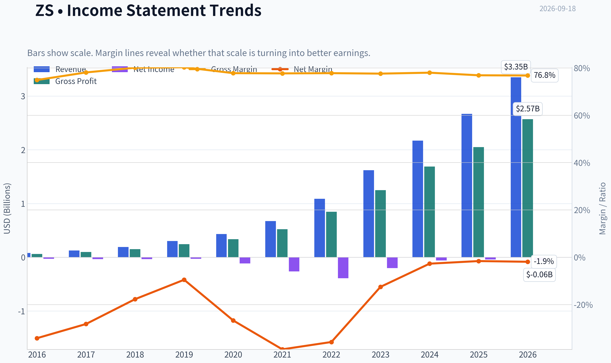

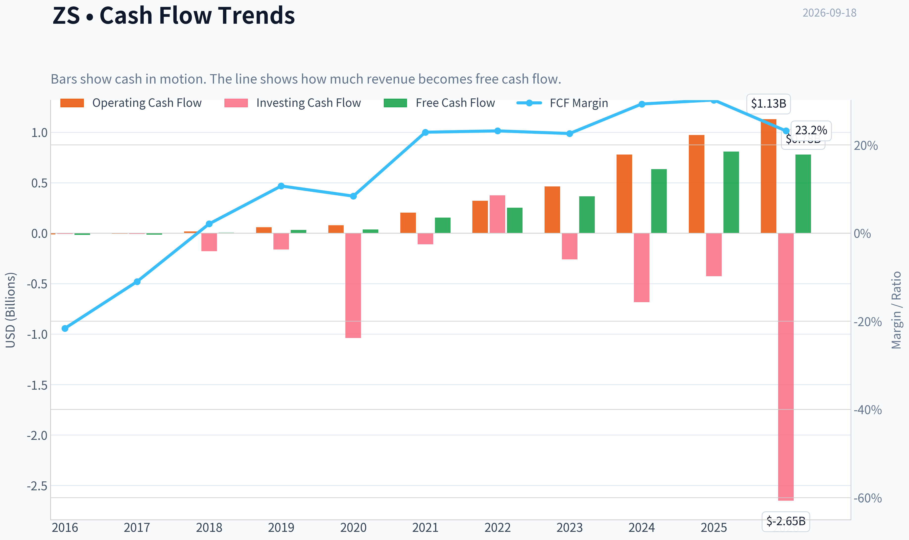

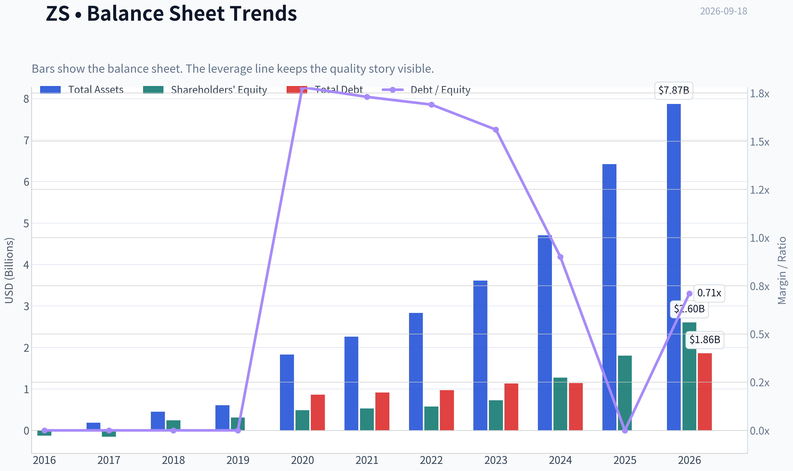

This graph tracks the profitability and return metrics (ROE, ROIC, Margins) of **ZS** over the past decade, highlighting capital efficiency trends.

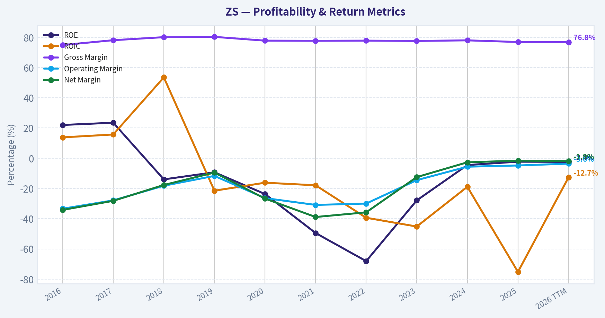

This chart illustrates the financial health of **ZS** over the last 10 years, mapping cash equivalents and free cash flow against total obligations (Debt).

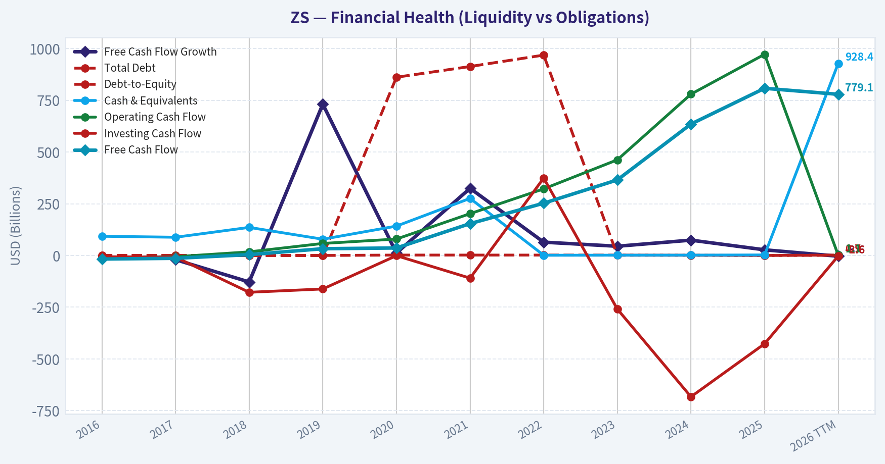

This comparison chart from *Profitability and Operating Performance* stacks current figures against historical benchmarks for **ZS**, making it easy to see where the company trades relative to its own averages.

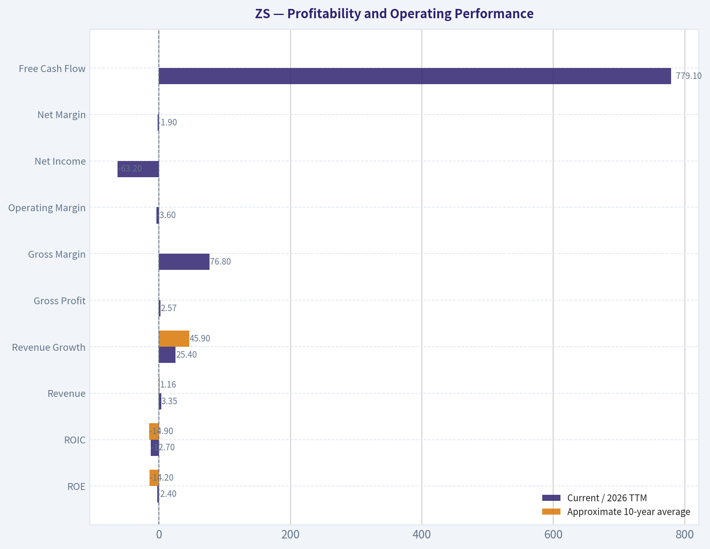

This breakdown chart from <em>Revenue Breakdown</em> shows the proportional composition for **ZS** - useful for understanding what drives or risks the business.

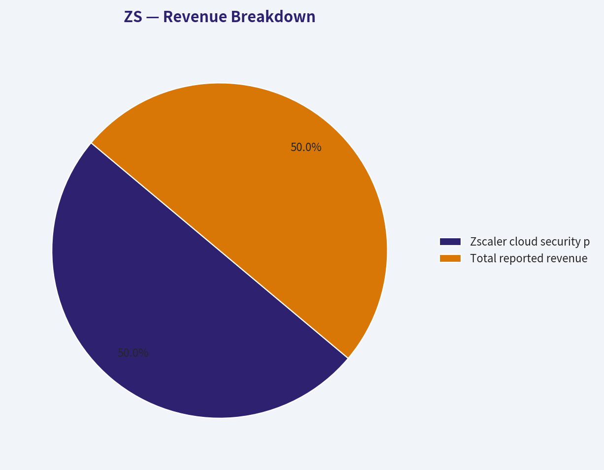

---

### Intrinsic Value Analysis (Buffett)

> *Following Warren Buffett's value investing philosophy: Circle of Competence, Economic Moat, Management Quality, and Margin of Safety.*

#### Intrinsic Value Snapshot

Price is what you pay. Intrinsic value is what the business may be worth based on the cash it can create for owners over time. We show a range, not one magic number.

- Current Price: $196.21
- Value Range (conservative to optimistic across both DCF methods): $167.43 to $445.22

##### Owner Earnings (Buffett Method)
- Net Income: $-41,478,000.00
- Depreciation & Amortization: $192,012,000.00
- Capital Expenditures: $-277,304,000.00
- Working Capital Changes: $-97,565,000.00
- Owner Earnings: $-68,195,000.00

##### Intrinsic Value
###### Cash Flow Method
Uses free cash flow. Better for companies spending heavily today to grow tomorrow.
- Conservative: $167.43
- Average: $167.43
- Optimistic: $445.22
- Discount Rate: 10.0%

ANALYST STANCE: **WATCH**

#### Executive Summary

Zscaler is a high-quality, asset-light cybersecurity platform with strong secular demand, rapid revenue growth, high gross margins, and a potentially durable zero-trust security moat. However, at approximately **$196 per share and a $32 billion market capitalization**, the stock offers little conventional margin of safety based on current free cash flow.

The business is attractive; the price is not sufficiently attractive for a value investor today. Zscaler belongs on a focused watchlist, with purchases requiring either a materially lower price or evidence that free-cash-flow growth can compound substantially faster than currently reflected in reported results.

#### Factor Scorecard

| Factor | Score | Assessment |
|---|---:|---|
| Circle of Competence and Simplicity | 4/5 | Zscaler sells cloud-based security subscriptions that inspect and protect employee and application traffic. The model is understandable, though cybersecurity technology and competitive dynamics evolve quickly. |
| Moat | 4/5 | Strong switching costs, embedded security policies, scale, data, and zero-trust positioning. The moat is substantial but faces competition from Palo Alto Networks, Fortinet, Microsoft, and Okta. |
| Management and Capital Allocation | 3/5 | Management has built a rapidly growing platform and maintains strong liquidity. GAAP profitability and stock-based compensation require continued scrutiny. |
| Industry Structure | 4/5 | Cybersecurity is a structurally attractive, growing market with recurring revenue and high customer importance. Competition is intense, but demand is not commodity-like. |

**Gate 5 - Quality/Solvency hard floor:** **Not tripped.** Revenue and cash generation are improving, while the available evidence does not indicate financial distress, inadequate interest coverage, or a solvency crisis.

#### Moat Analysis

| Moat Source | Evidence | Assessment |
|---|---|---|
| Intangible assets | Zscaler is closely associated with cloud-delivered zero-trust security and has a strong enterprise security brand. | Strong, but not unassailable |
| Switching costs | Security policies, user permissions, integrations, traffic-routing architecture, and operational workflows become embedded in customer environments. | High |
| Cost advantages | A cloud-native platform can spread infrastructure and research costs over a growing customer base. | Moderate to strong |
| Network effects and data | More protected traffic and threat intelligence can improve detection capabilities, although this is less powerful than a classic social network effect. | Moderate |
| Financial evidence | Gross margin is approximately **76.8%**, and revenue is growing approximately **25.4% year over year**. | Consistent with an asset-light platform moat |

Zscaler's strongest moat is not simply its software. It is the combination of security integration, customer workflow dependence, accumulated threat intelligence, brand credibility, and the high cost of making a security-system change incorrectly. Cybersecurity customers are often willing to pay for reliability because the cost of failure is enormous.

The moat is likely **wide and stable**, but not clearly wide and widening at the same exceptional rate as the company's early growth phase. Large technology companies and cybersecurity incumbents can bundle competing products into broader platforms.

#### Management Quality and Capital Allocation

Management deserves credit for converting a difficult security problem into a scalable subscription platform and for prioritizing growth in a large market. The balance sheet appears supportive of continued investment, and the company has not needed aggressive leverage to fund expansion.

The main concern is the quality of reported earnings. Zscaler has generated positive free cash flow while remaining GAAP net-income negative or near break-even. This divergence is partly caused by stock-based compensation and other non-cash charges. For an owner-oriented analysis, stock compensation should not be treated as entirely costless because it dilutes existing shareholders.

Management quality assessment: **3/5**. The operating execution is strong, but investors should demand clearer evidence that growth can translate into durable per-share earnings and cash flow after dilution.

#### Financial Summary

| Fiscal period | Revenue trend | Gross margin | GAAP profitability | Free-cash-flow trend | Interpretation |
|---|---:|---:|---|---|---|
| FY2021 | Approximately $0.67B | High | Loss-making | Positive but modest | Early platform scaling |
| FY2022 | Approximately $1.09B | High | Larger loss | Improving | Heavy investment phase |
| FY2023 | Approximately $1.62B | High | Loss narrowed | Strongly positive | Operating leverage emerging |
| FY2024 | Approximately $2.17B | Approximately 77% | Near break-even loss | Strong | Cash economics becoming clearer |
| FY2025/latest trend | Approximately $2.67B annual revenue base | Approximately 76.8% | GAAP profitability remains weaker than cash flow | Strong and rising | Growth remains attractive, but valuation is demanding |

**Key Takeaways:** Revenue has increased several-fold over the available history, while gross margin has remained exceptionally high. Free cash flow has improved much faster than GAAP profitability, but stock-based compensation and dilution reduce the quality of that cash generation from an owner's perspective. The central financial question is whether Zscaler can sustain high growth while converting more of its economics into undiluted per-share earnings.

#### Key Current Metrics

| Metric | Value |
|---|---:|
| Share price | $196 |
| Market capitalization | $31.99B |
| Revenue growth year over year | 25.4% |
| Gross margin | 76.8% |
| ROE | -2.4% |
| Free-cash-flow yield | 2.7% |
| Current ratio | 1.70 |
| Headline intrinsic-value model | Negative and not economically meaningful |
| FCF-based model value | Approximately $167 per share |

**Key Takeaways:** Zscaler combines strong growth and gross margins with a low current free-cash-flow yield of only 2.7%. Negative ROE reflects the company's GAAP loss position and does not capture the full strength of its operating platform, but it does mean that a high-quality business has not yet demonstrated consistently strong accounting returns on equity.

#### Owner Earnings Calculation

A practical owner-earnings framework for Zscaler should begin with free cash flow but then adjust for shareholder dilution.

| Owner-earnings component | Assessment |
|---|---|
| Net income | GAAP net income remains negative or weak relative to cash generation |
| Depreciation and amortization | Added back in standard owner-earnings analysis |
| Maintenance capital expenditure | Relatively modest because the business is asset-light |
| Working-capital investment | Favorable subscription economics and deferred revenue support cash flow |
| Stock-based compensation | Must be treated as an economic cost because it dilutes shareholders |
| Normalized owner earnings | Approximately $0.5B-$0.7B, depending on the treatment of equity compensation |

Using a normalized owner-earnings midpoint of approximately **$600 million**, the shares trade at roughly **53 times owner earnings**. That is a demanding multiple even for a company growing revenue around 25% annually.

**Key Takeaways:** Zscaler's reported cash flow is considerably better than its GAAP earnings, which is typical of high-growth software companies. However, treating all stock compensation as a free add-back overstates what belongs to shareholders. After allowing for dilution, normalized owner earnings support a strong business case but not an obvious bargain at $196.

#### Three-Scenario DCF Valuation

The following valuation uses normalized owner earnings of approximately $600 million, a 10% discount rate, and approximately 163 million diluted shares.

| Scenario | Core assumptions | Equity value | Approximate value per share |
|---|---|---:|---:|
| A. No growth | Owner earnings capitalized at 10% | $6.0B | $37 |
| B. GDP-like growth | 3% perpetual growth | $8.8B | $54 |
| C. Historical-growth framework | 10% long-term growth assumption, capped for conservatism | Approximately $20B-$25B | Approximately $123-$153 |

**Key Takeaways:** Even the optimistic scenario produces a value below the current $196 share price. The no-growth and GDP-growth cases show that the current valuation depends heavily on continued expansion, while the historical-growth case still requires sustained high-quality execution for many years.

#### Margin of Safety Analysis

| Valuation reference | Value per share | Premium or discount versus $196 |
|---|---:|---:|
| No-growth owner earnings | $37 | Approximately 81% premium |
| 3% perpetual growth | $54 | Approximately 63% premium |
| 10% long-term growth case | $123-$153 | Approximately 28%-59% premium |
| FCF-based model | $167 | Approximately 17% premium |
| Current market price | $196 | - |

Zscaler is a high-quality compounder candidate, so a 10%-15% margin of safety could be acceptable if the business had clearly demonstrated durable, undiluted high returns on capital. Current evidence does not yet justify that confidence. The stock appears to require heroic execution rather than merely good execution.

The reverse-DCF signal is especially demanding: the current price requires exceptionally strong growth and operating leverage over an extended period. Cybersecurity demand may support strong growth, but assuming extraordinary growth indefinitely leaves little room for competitive pressure, slower technology spending, or multiple compression.

#### Buffett Scorecard

| Criterion | Weight | Score | Weighted score |
|---|---:|---:|---:|
| Moat width and durability | 25% | 4.0 | 1.00 |
| Valuation and margin of safety | 20% | 2.0 | 0.40 |
| Capital returns versus WACC | 15% | 3.0 | 0.45 |
| Business understanding and predictability | 12% | 4.0 | 0.48 |
| Management quality and capital allocation | 12% | 3.0 | 0.36 |
| Reinvestment runway | 8% | 5.0 | 0.40 |
| Balance-sheet strength | 4% | 5.0 | 0.20 |
| Industry structure | 4% | 4.0 | 0.16 |
| **Total** | **100%** | - | **3.45/5.00** |

#### Investment Stance

**WATCH - Moderate conviction.**

Zscaler is the type of modern, asset-light platform that merits serious Buffett-style analysis rather than dismissal because of its technology orientation. Its recurring revenue, high gross margins, large reinvestment runway, and embedded enterprise workflows are attractive.

Nevertheless, the current price appears ahead of conservative intrinsic value estimates. A more compelling entry point would likely require a materially lower share price, faster growth in normalized owner earnings, or clear evidence that stock-based compensation and dilution are declining as a percentage of revenue. The business is worth following closely, but at $196 the margin of safety is insufficient.
#### Valuation Bridge

This bridge places the current market price beside each intrinsic value lens so readers can see whether upside depends on one method or shows up across several methods.

| Scenario | Intrinsic Value / Share |
| --- | ---: |
| Cash Flow Method | $167.43 |
| Damodaran Method | $-237.04 |
| Current Price | $196.21 |

#### Key Takeaways

If one method is far above the others, the upside case depends on a specific modelling assumption. When several methods cluster together, the valuation story is more robust.

#### Valuation Visuals

This comparison chart from *Latest Earnings Snapshot* stacks current figures against historical benchmarks for **ZS**, making it easy to see where the company trades relative to its own averages.

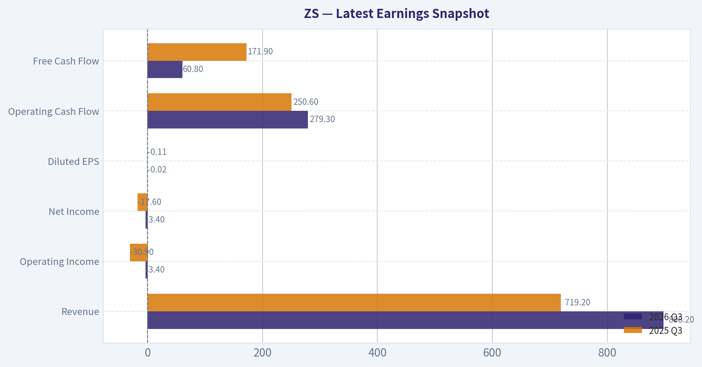

This comparison chart from *Balance Sheet and Financial Strength* stacks current figures against historical benchmarks for **ZS**, making it easy to see where the company trades relative to its own averages.

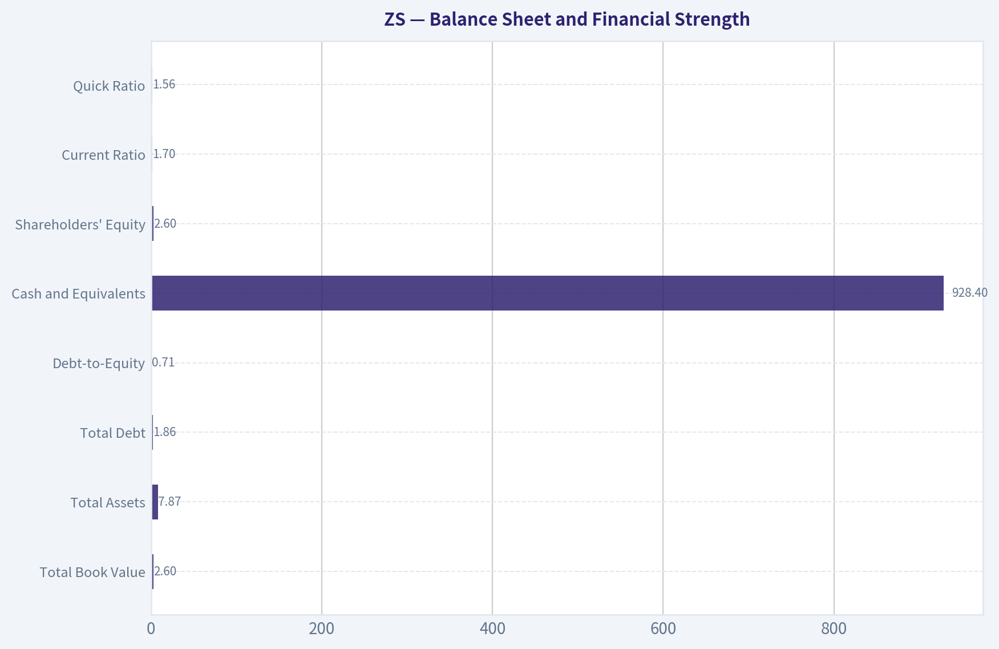

This comparison chart from *Cash Flow Quality and Predictability* stacks current figures against historical benchmarks for **ZS**, making it easy to see where the company trades relative to its own averages.

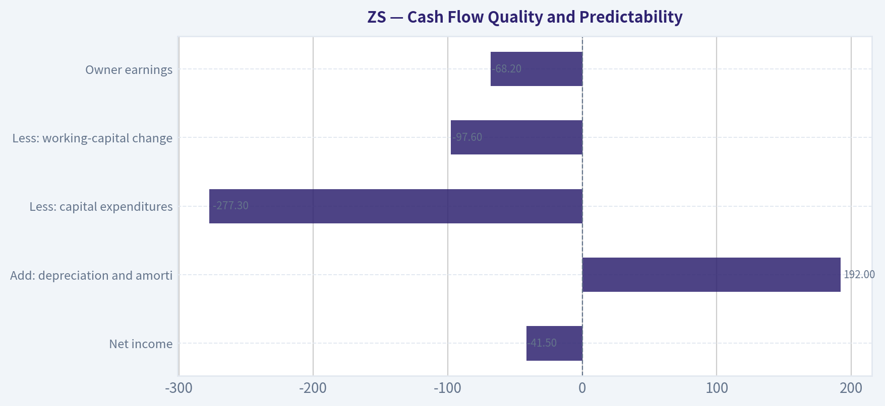

---

### Trend & Growth Analysis (Lynch/Druckenmiller/Fisher)

> *Following Peter Lynch's GARP, Stanley Druckenmiller's macro-aware approach, and Philip Fisher's scuttlebutt methodology.*

ANALYST STANCE: **WATCH**

#### 1. Lynch Classification

| Category | Assessment |
|---|---|
| Lynch category | Fast Grower |
| Revenue growth | 25.4% year over year |
| Profitability | FCF positive; P/E unavailable |
| Business type | Cloud cybersecurity platform |
| Growth-investor fit | Strong, but valuation-sensitive |

**Key Takeaways:** Zscaler qualifies as a fast grower because revenue is expanding at roughly 25%. It has the characteristics Lynch favored-large potential market, recurring revenue, and a scalable business model-but the absence of conventional earnings makes valuation discipline especially important.

#### 2. The Story in Three Bullets

- Zscaler replaces legacy network-security hardware with a cloud-delivered "zero trust" security platform.
- Cybersecurity demand is being strengthened by cloud migration, remote work, AI adoption, and increasingly sophisticated cyberattacks.
- The long-term opportunity is platform expansion: more users, workloads, data, applications, and security products sold through the same cloud infrastructure.

#### 3. TAM and Runway

| Measure | Assessment |
|---|---|
| Core market | Cloud security, zero-trust access, secure networking, data protection |
| TAM direction | Expanding, supported by cloud and AI adoption |
| Current market capitalization | Approximately $32.0 billion |
| Estimated current annual revenue | Roughly $3 billion-plus; exact figure not supplied in the research pack |
| Implied price-to-sales | Approximately 10x, depending on the precise revenue base |
| 10x revenue test | $30 billion-plus revenue would still represent a minority share of the broader global cybersecurity and networking opportunity |
| Runway | Long, provided Zscaler continues expanding beyond its initial zero-trust use cases |

**Key Takeaways:** Zscaler appears to have sufficient runway to grow revenue by 10 times without mathematically exhausting the broader cybersecurity market. The key question is not TAM size but execution: Zscaler must keep taking share while expanding its product platform and maintaining strong retention.

#### 4. Revenue Growth Trend

| Indicator | Current Evidence | Interpretation |
|---|---:|---|
| Year-over-year revenue growth | 25.4% | Strong fast-grower rate |
| Multi-year acceleration data | Not available in the supplied pack | Cannot confirm acceleration |
| Revenue quality | Predominantly recurring cloud-security revenue | Generally high quality |
| Growth classification | Stable high growth, pending more quarterly data | Positive but not yet a confirmed inflection |

**Key Takeaways:** The latest 25.4% growth rate is attractive, but the available data does not establish whether growth is accelerating or decelerating. For a high-multiple stock, the next earnings reports should show sustained growth, strong billings or remaining performance obligations, and healthy large-customer additions.

#### 5. Unit Economics and Operating Efficiency

| Metric | Result | Assessment |
|---|---:|---|
| Gross margin | 76.8% | Strong software economics |
| Net revenue retention | Not provided | Must verify before initiating |
| LTV/CAC | Not provided | Cannot score quantitatively |
| Free-cash-flow yield | 2.7% | Positive, but not inexpensive |
| Rule of 40 | Cannot calculate precisely without FCF margin | Likely potentially healthy, but unconfirmed |
| Current ratio | 1.70 | Reasonable liquidity |
| ROE | -2.4% | Still not conventionally profitable |

**Key Takeaways:** The 76.8% gross margin supports the asset-light platform thesis, and positive free cash flow reduces financing risk. However, missing NRR, CAC, LTV, and FCF-margin data prevents a full unit-economics assessment; these are important gaps because Zscaler's valuation assumes durable customer expansion and operating leverage.

#### 6. Inflection Point Assessment

| Potential inflection | Evidence | Current view |
|---|---|---|
| Product-cycle inflection | Expansion into SASE, data security, AI-related security, and broader platform offerings | Positive |
| TAM inflection | AI traffic and cloud workloads increase security complexity | Positive |
| Market-share inflection | Strong positioning in zero-trust security | Positive, but competitive |
| Margin inflection | High gross margin and scalable delivery model | Possible |
| Competitive inflection | Palo Alto Networks and other vendors are investing aggressively | No clear advantage |
| Earnings inflection | Positive FCF, but P/E unavailable | Developing rather than proven |

**Key Takeaways:** The strongest potential inflection is platform expansion from zero-trust access into SASE, data security, and AI-related protection. This can increase wallet share and extend the runway, but competition from Palo Alto Networks, Fortinet, CrowdStrike, Microsoft, and others makes execution and differentiation critical.

#### 7. Macro Setup

| Macro factor | Impact on ZS |
|---|---|
| Cybersecurity secular demand | Strong tailwind |
| Cloud and AI adoption | Strong tailwind |
| Enterprise IT budgets | Can be cyclical and subject to optimization |
| Interest rates | Higher rates pressure long-duration growth multiples |
| Cybersecurity consolidation | Mixed: supports platform vendors but intensifies competition |
| Overall macro setup | Positive secular backdrop; valuation remains rate-sensitive |

**Key Takeaways:** Zscaler benefits from durable secular trends rather than a temporary consumer fad. The main macro risk is valuation sensitivity to interest rates and enterprise budget caution; even excellent operational results may not prevent multiple compression if rates rise or growth stocks fall out of favor.

#### 8. Fisher's 15-Point Assessment

| Fisher factor | Score / 5 | Comment |
|---|---:|---|
| Market potential | 5 | Large and expanding cybersecurity market |
| New-product development | 4 | Broadening platform and adjacent products |
| R&D effectiveness | 4 | Technology-led model; detailed validation still needed |
| Sales organization | 4 | Enterprise go-to-market appears substantial |
| Worthwhile profit margin | 4 | High gross margin; operating margin less established |
| Improving margins | 4 | Positive FCF suggests progress |
| Labor relations | 3 | Limited information |
| Executive relations | 3 | Limited information |
| Management depth | 4 | Established public-company platform |
| Cost analysis/accounting | 3 | Insufficient detailed evidence |
| Outstanding moat | 4 | Switching costs, security integrations, scale, and trust |
| Long-range outlook | 5 | Strong secular runway |
| Dilution risk | 3 | Equity compensation should be monitored |
| Management candor | 3 | Cannot fully assess from supplied information |
| Management integrity | 4 | No major issue identified in the pack |
| **Total** | **53 / 75** | **Average-to-good; data-limited** |

**Key Takeaways:** Zscaler scores best on market potential, long-term outlook, and product relevance. The score is held back primarily by missing evidence on management, employee relations, dilution, retention, and detailed cost discipline-not by a demonstrated business breakdown.

#### 9. Valuation Analysis

| Method | Result | Interpretation |
|---|---:|---|
| P/E | N/A | Not useful while GAAP earnings are unavailable |
| PEG | N/A | Cannot calculate without P/E |
| Price-to-sales | Approximately 10x, based on roughly $3 billion-plus revenue | Full valuation for a 25% grower |
| FCF yield | 2.7% | Implies a demanding but not extreme valuation |
| Reverse-DCF signal | Price implies approximately 147.8% annual growth for 10 years according to the supplied model | Likely model instability or an unreliable input; should not be treated literally |
| Headline intrinsic value | Negative $237.04 | Not economically credible for an asset-light cash-generating platform; model output should be discarded |
| Bear case | Growth slows toward 15-18%; multiple compresses materially | Significant downside |
| Base case | Growth remains around 20-25%; margins improve gradually | Moderate-to-good return potential |
| Bull case | Growth reaccelerates above 25%; platform expansion succeeds; premium multiple persists | Strong upside potential |

**Key Takeaways:** Zscaler is not demonstrably cheap. A roughly 10x sales valuation requires continued high growth, strong retention, and meaningful margin expansion. The supplied intrinsic-value outputs are internally inconsistent and should not guide the decision; the practical conclusion is that valuation creates a meaningful margin-of-safety problem.

#### 10. Growth Investor Scorecard

| Criterion | Weight | Score / 5 | Weighted contribution |
|---|---:|---:|---:|
| The Story | 10% | 4.5 | 0.45 |
| TAM and runway | 20% | 4.5 | 0.90 |
| Revenue growth | 20% | 4.0 | 0.80 |
| Unit economics | 15% | 3.5 | 0.53 |
| Competitive position | 10% | 4.0 | 0.40 |
| Management quality | 10% | 3.5 | 0.35 |
| Macro setup | 5% | 4.0 | 0.20 |
| Profitability path | 5% | 4.0 | 0.20 |
| Valuation | 5% | 2.5 | 0.13 |
| **Total** | **100%** |  | **3.96 / 5.0** |

**Key Takeaways:** Operationally, Zscaler is close to an advocate-grade growth company. The overall score reaches the low end of "ADVOCATE," but the formal stance remains WATCH because valuation is demanding and the supplied data does not confirm growth acceleration, NRR, or a sufficiently attractive entry price.

#### 11. Position Size Stance

| Investor situation | Position stance |
|---|---|
| Existing holder | Hold or maintain a normal position if thesis remains intact |
| New investor | Start only with a small pilot position or wait for a better entry |
| High-conviction growth portfolio | Maximum initial position around 1-2% pending confirmation |
| Add aggressively if | Growth reaccelerates, NRR is above 110-120%, and FCF margins expand |
| Reduce if | Growth falls below roughly 20% for multiple quarters or platform expansion stalls |

**Key Takeaways:** This is a watchlist-quality compounder rather than an obvious bargain. A small starter position can be justified for investors able to tolerate volatility, but concentrated sizing should wait for evidence that the next product cycle is accelerating growth and improving profitability.

#### 12. Key Catalysts and Risks

| Catalysts | Risks |
|---|---|
| SASE adoption and platform consolidation | Palo Alto Networks, Microsoft, CrowdStrike, and Fortinet competition |
| Expansion into data-security and AI-security products | Growth deceleration from enterprise budget optimization |
| Larger contracts and increased customer wallet share | Multiple compression from higher interest rates |
| Improving free-cash-flow margins | Stock-based compensation and dilution |
| Strong retention and cross-sell metrics | Product complexity or execution issues |
| Cybersecurity incidents increasing urgency | Security breach or service outage damaging trust |

**Key Takeaways:** The major catalyst is successful platform expansion that raises customer spend while preserving retention and margins. The major risk is that the market already prices in much of the secular story, leaving the stock vulnerable if growth merely remains good instead of accelerating.

#### Bottom Line

Zscaler is a high-quality, secular-growth cybersecurity company with a potentially very long runway and credible ten-bagger characteristics from an operating perspective. However, at approximately $32 billion of market capitalization and roughly 25% revenue growth, the stock requires continued excellent execution. **WATCH** is appropriate: attractive business, insufficient valuation cushion, and not enough data yet to confirm a new acceleration phase.

---

### Market Technical Analysis

ANALYST STANCE: **WATCH**

#### ZS Technical Analysis - as of September 17, 2026

The latest available trading session closed at **$197.47**, following a strong rebound from the early-September low near **$161.94**. The short-term picture has improved materially: price is above the rising 10-day EMA and 50-day SMA, momentum has turned positive, and RSI has recovered into constructive territory. However, the stock remains highly volatile, and the longer-term trend data requires caution because the reported 200-day SMA contains an apparent data anomaly.

| Indicator | Latest reported value | Recent direction | Interpretation |
|---|---:|---|---|
| Close | $197.47 | Strong rebound | Price has recovered approximately 22% from the September 8 low |
| 10-day EMA | $183.22 | Rising sharply | Short-term momentum is bullish; price is about 7.8% above the EMA |
| 50-day SMA | $166.61 | Rising | Medium-term trend has improved; price is about 18.5% above the average |
| 200-day SMA | $99.56 reported on September 17 | Data discontinuity | The abrupt collapse from approximately $169 to $99.56 is inconsistent with the price series and should not be used without verification |
| MACD | 6.08 | Rebounding from 0.28 on September 11 | Positive momentum is accelerating |
| RSI | 63.42 | Recovered from 45.78 | Bullish but not yet conventionally overbought |
| Bollinger upper band | $200.06 | Rising | Price is approaching the upper volatility boundary |
| Bollinger lower band | $156.03 | Declining slightly | The wide band structure reflects elevated volatility |
| ATR | $9.94 | Elevated | Typical daily movement is roughly $10, requiring wider stops or smaller positions |

Key Takeaways: ZS has transitioned from a short-term downtrend into a powerful recovery, with price above both the 10-day EMA and 50-day SMA. Momentum is positive, but the stock is approaching its upper Bollinger Band near $200 and remains unusually volatile. The reported 200-day SMA is unreliable because of a clear discontinuity in the supplied indicator data.

#### Trend and Moving-Average Structure

The short-term trend is decisively stronger than it was at the beginning of September. The 10-day EMA rose from **$169.88 on September 11** to **$183.22 on September 17**, while the share price advanced from **$164.54 to $197.47** over the same period. This indicates a sharp upside impulse rather than a slow, orderly recovery.

The 50-day SMA has also been rising consistently, from **$148.65 on August 19** to **$166.61 on September 17**. Price is now well above this average, confirming that the recovery has extended beyond a one- or two-day bounce. The 50-day SMA may act as an important dynamic support zone, although it is currently far below the market price and therefore does not provide a tight short-term risk reference.

The 200-day SMA report needs special treatment. It declined gradually from approximately **$181 on August 19** to **$170 on September 11**, then suddenly printed **$99.56 on September 17**, while the September 16 value was approximately **$168.81**. That one-day change is not credible given the accompanying price history and likely reflects a data or adjustment issue. Long-term trend conclusions should therefore be based on a verified chart rather than this specific 200-day SMA output.

#### Momentum: MACD and RSI

MACD has improved substantially. It declined from **10.78 on August 19** to **0.28 on September 11**, showing that the earlier rally had lost momentum. Since then, MACD increased to **6.08 by September 17**, with the strongest acceleration occurring during the recent price surge. This is a bullish momentum confirmation, although MACD is still below its late-August level, so the recovery has not fully restored the prior momentum regime.

RSI provides a similarly constructive but more measured signal. RSI fell from **70.34 on August 19**, briefly entering overbought territory, to **45.78 on September 11**. It has since recovered to **63.42**. This indicates improving demand without the extreme overbought reading that would typically warn of an immediate reversal. Nevertheless, RSI is approaching the upper half of its recent range, so further gains may require consolidation rather than another uninterrupted vertical move.

A key distinction is that RSI at 63 does not by itself imply that ZS is too expensive to buy. In a strong trend, RSI can remain above 60 for an extended period. The more important question is whether price can hold above the recent breakout region and whether MACD continues rising rather than flattening.

#### Bollinger Bands and Volatility

The latest reported Bollinger upper band is approximately **$200.06**, placing the $197.47 close only about **$2.59 below the upper band**. This confirms that the latest rally has pushed price toward the upper end of its recent trading envelope. A touch or brief move above the upper band is not automatically bearish; strong stocks can "ride" the upper band. However, after a rapid rebound, repeated closes near the band often increase the probability of consolidation or a pullback.

The lower band is approximately **$156.03**, creating a very wide band range of roughly **$44**. This wide separation reflects substantial volatility and means that conventional percentage-based stops may be too tight. The ATR of **$9.94** reinforces this point: a normal daily move can approach $10, before accounting for event-driven gaps.

The recent price action demonstrates the practical risk. ZS moved from **$184.60 on May 26 to $126.41 on May 27**, accompanied by exceptionally high volume. Although that move is outside the immediate September setup, it illustrates that this security can experience abrupt repricing. Traders should avoid interpreting a bullish technical setup as a low-risk setup.

#### Price Levels and Trading Scenarios

Near term, **$200 to $200.10** is the most visible resistance area because it aligns with the latest upper Bollinger Band and a psychologically important round number. A decisive close above this area, preferably accompanied by sustained volume and follow-through, would support a continuation setup. Potential upside reference zones would then be the recent trading range around **$210 to $220**, although those are scenario levels rather than forecasts.

The first meaningful support zone is approximately **$188 to $192**, covering the September 14-17 consolidation and the area around the recent breakout. A failure to hold this zone would suggest that the latest surge is losing immediate traction. The rising 10-day EMA near **$183** is the next dynamic support reference.

A deeper pullback toward **$166 to $170** would test the rising 50-day SMA and the early-September breakout area. Holding that region would preserve the medium-term recovery structure. A close back below the 50-day SMA would materially weaken the current bullish interpretation and raise the risk that the rebound was only corrective.

| Scenario | Technical trigger | Likely implication | Risk consideration |
|---|---|---|---|
| Bullish continuation | Sustained close above $200 with follow-through | Recovery may extend toward the $210-$220 area | Breakout could fail because price is already near the upper Bollinger Band |
| Controlled consolidation | Price holds roughly $188-$192 | Healthy digestion of the recent rally | Momentum may cool while the 10-day EMA catches up |
| Short-term pullback | Close below $188, then loss of the $183 EMA | Rebound is losing force | ATR near $10 means intraday breaks can be noisy |
| Medium-term deterioration | Break below approximately $166-$170 | Risk of a broader trend reversal | Would undermine the rising 50-day SMA structure |
| Data-validation risk | Reliance on the reported $99.56 200-day SMA | Could produce a false long-term signal | Verify adjusted-price and split data before using the 200-day average |

Key Takeaways: The most important near-term test is whether ZS can sustain trade above $200 rather than merely touch that level. Holding $188-$192 would keep the rebound structure intact, while the $183 EMA and $166-$170 area are progressively more important supports. The high ATR means traders should expect large intraday swings and size positions accordingly.

#### Selected Indicators and Why They Matter

The selected set is designed to combine trend, momentum, volatility, and risk-management information without adding redundant oscillators:

- **close_10_ema:** Captures the rapid short-term trend change and provides a responsive trailing reference.
- **close_50_sma:** Confirms whether the rebound has developed into a medium-term trend improvement.
- **close_200_sma:** Normally provides strategic long-term context, but the current value must be independently verified because of the data anomaly.
- **macd:** Measures whether upside momentum is accelerating or fading.
- **rsi:** Evaluates momentum strength and helps distinguish constructive strength from an extreme overbought condition.
- **boll_ub:** Identifies the immediate volatility-based resistance and potential breakout boundary.
- **boll_lb:** Shows the lower volatility envelope and helps frame downside risk.
- **atr:** Quantifies expected daily movement for stop placement and position sizing.

Overall, ZS has a **constructive short- and medium-term technical setup**, but the rally is extended relative to its short-term averages and is approaching the upper Bollinger Band. The preferable approach is to **watch for either a confirmed breakout above $200 or a controlled pullback that holds $188-$192**, rather than chase the stock after a sharp advance. The long-term signal should remain unresolved until the 200-day SMA data is corrected or verified.

#### Market Visuals

This comparison chart from *Market Metrics and Valuation* stacks current figures against historical benchmarks for **ZS**, making it easy to see where the company trades relative to its own averages.

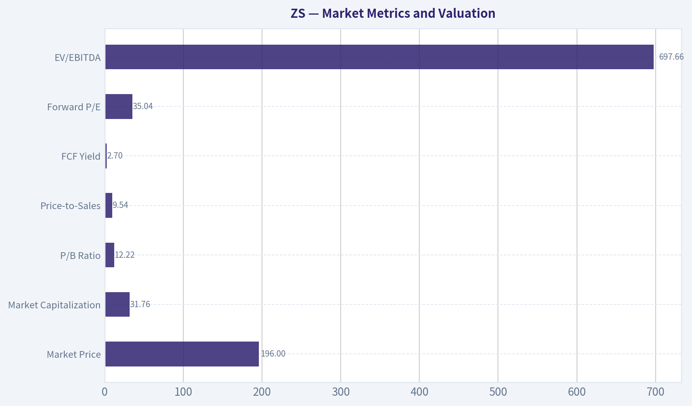

---

### Options Market Analysis

> *Reading options flow - put/call ratios, IV skew, and unusual activity - to gauge institutional positioning and event-driven risk.*

#### ZS Options Market Report

**As of September 18, 2026.** The available data covers the September 18, September 25, and October 2 expirations. Strike-level data and the current underlying share price were not provided, so ITM/ATM/OTM classification of individual contracts and precise gamma-wall analysis are limited.

#### 1. Put/Call Ratio Analysis

| Expiration | Call OI | Put OI | Put/Call OI | Call Volume | Put Volume | Put/Call Volume |
|---|---:|---:|---:|---:|---:|---:|
| Sep. 18, 2026 | 41,419 | 23,659 | 0.57 | 4,441 | 1,912 | 0.43 |
| Sep. 25, 2026 | 6,278 | 6,295 | 1.00 | 772 | 704 | 0.91 |
| Oct. 2, 2026 | 3,493 | 2,634 | 0.75 | 556 | 326 | 0.59 |
| **Near-term total** | **51,190** | **32,588** | **0.64** | **5,769** | **2,942** | **0.51** |

**Key Takeaways:** ZS has a near-term put/call open-interest ratio of 0.64, below the approximately 0.70 neutral baseline. The 0.51 volume ratio is even more call-dominant, indicating stronger call-side activity than put-side activity. This is directionally bullish, although some call open interest may represent covered-call writing rather than outright bullish speculation.

The September 25 expiration is comparatively balanced, with a 1.00 put/call OI ratio. The bullish tilt is therefore concentrated primarily in the September 18 expiration and, to a lesser degree, October 2.

#### 2. Implied Volatility Assessment

| Expiration | Call ATM IV | Put ATM IV | Call-Put IV Difference | Assessment |
|---|---:|---:|---:|---|
| Sep. 18, 2026 | 52.5% | 40.5% | +12.0 percentage points | Strong call-side IV premium |
| Sep. 25, 2026 | 52.7% | 48.2% | +4.5 points | Mild call skew |
| Oct. 2, 2026 | 55.7% | 51.3% | +4.4 points | Mild call skew; highest ATM IV |
| **Near-term range** | **52.5%-55.7%** | **40.5%-51.3%** | **Call IV generally higher** | **Upside-demand skew** |

**Key Takeaways:** Near-term implied volatility is elevated enough to signal meaningful expected movement, with ATM IV generally in the low-to-mid-50% range. Calls carry higher ATM IV than puts in every listed expiration, especially for the September 18 expiry, which points to upside demand rather than conventional downside protection. A specific catalyst was not supplied, so it cannot be confirmed whether this IV reflects earnings, company news, or broader market risk.

The data reports ATM IV rather than explicit out-of-the-money skew. Therefore, the call premium is evidence of a call-side volatility bias, but not a precise measurement of OTM call-versus-put skew.

#### 3. Unusual Options Activity

| Finding | Result | Interpretation |
|---|---|---|
| Contracts with volume greater than 5x open interest | None identified | No confirmed fresh, outsized directional trades |
| Largest near-term call volume | 4,441 contracts, Sep. 18 expiry | Active call-side participation, but not classified as unusual under the tool's threshold |
| Largest near-term put volume | 1,912 contracts, Sep. 18 expiry | Put activity is materially lower than call activity |

**Key Takeaways:** No individual contract met the volume-to-open-interest threshold for unusual activity. As a result, there is no clear evidence of a fresh institutional call sweep, put hedge, or concentrated speculative wager. The bullish read comes from aggregate call dominance rather than a demonstrably high-conviction single-contract trade.

Because strike-level information was unavailable, the contracts cannot be classified as ITM, ATM, or OTM, and smart-money positioning cannot be separated reliably from retail activity or covered-call strategies.

#### 4. Open Interest Concentration and Gamma Levels

| Expiration | Call OI | Put OI | Total OI | Notable Feature |
|---|---:|---:|---:|---|
| Sep. 18, 2026 | 41,419 | 23,659 | 65,078 | Dominant near-term concentration |
| Sep. 25, 2026 | 6,278 | 6,295 | 12,573 | Balanced positioning |
| Oct. 2, 2026 | 3,493 | 2,634 | 6,127 | Smaller, call-leaning book |
| **Total** | **51,190** | **32,588** | **83,778** | **OI concentrated in Sep. 18** |

**Key Takeaways:** Open interest is heavily concentrated in the September 18 expiration, which may create significant expiration-related pinning or dealer-hedging effects. However, strike-level OI was not provided, so specific gravitational levels, maximum-pain strikes, and gamma walls cannot be identified. The aggregate call concentration could dampen movement near heavily traded strikes, but it could also amplify a move if dealers are short calls and must hedge into strength.

#### 5. Overall Options Sentiment Signal

**Overall signal: BULLISH, with moderate confidence.**

The primary drivers are:

- Near-term put/call OI of **0.64**, below the neutral baseline of approximately 0.70.
- Near-term put/call volume of **0.51**, showing substantially heavier call activity.
- Call ATM IV above put ATM IV across all three expirations, indicating a call-side volatility premium.
- Heavy call open-interest concentration in the September 18 expiration.

The main caveats are that no contract qualified as unusual activity, individual strikes were not available, and call OI may partly reflect covered-call writing. The September 25 book is also nearly balanced, so the bullish positioning is not uniformly strong across the curve. Confidence should therefore be reduced from high to moderate.

#### Summary

| Category | Assessment |
|---|---|
| Put/Call Ratio | Bullish: 0.64 OI ratio and 0.51 volume ratio, both below neutral |
| IV Level | Elevated: roughly 52%-56% for near-term calls; puts range from 40.5%-51.3% |
| Skew Direction | Call-side bias based on higher ATM call IV; explicit OTM skew unavailable |
| Unusual Activity | None detected; no contract exceeded 5x volume-to-OI |
| Overall Signal | **BULLISH**, moderate confidence; call dominance is the main driver |

**Key Takeaways:** ZS options positioning leans bullish, driven by call-heavy open interest and volume plus a persistent call IV premium. The absence of unusual single-contract activity and the lack of strike-level data limit conviction. This is a directional positioning signal, not a valuation assessment, and should be checked against price action and any upcoming company catalyst.

---

## Research Team Commentary

> *The Research Manager synthesizes the Bull vs Bear debate into action-free commentary. This is a pre-risk view, not the final stance.*

Core takeaway: Zscaler looks like a potentially excellent business, but the evidence does not yet establish that $196 is an attractive value-investing entry. Its 25.4% revenue growth, 76.8% gross margin, recurring subscription model, and position in cloud-delivered zero-trust security support a credible long-term compounder thesis. However, normalized owner earnings after stock-based compensation remain unverified, ROIC is unavailable, and current shareholder returns are still negative. Because the valuation swings dramatically with the assumed starting cash flow, I would keep Zscaler on the watchlist rather than advocate buying it or avoid it outright.

The strongest bull argument is that Zscaler is replacing an aging security architecture rather than selling a discretionary point product. Its platform is embedded in access policies, workflows, applications, and compliance systems, creating meaningful operational switching costs. Cloud migration, distributed work, AI adoption, and increasingly sophisticated attacks should expand the addressable market for many years. With revenue growing above 25% and gross margins near 77%, the company has a plausible path to substantial operating leverage. Negative ROE does not, by itself, invalidate an asset-light software franchise whose internally developed technology and customer relationships are poorly represented on the balance sheet.

The bull's reverse-DCF framing is also directionally appropriate: the question is not whether Zscaler has a low trailing multiple, but whether it can outperform the cash-flow growth embedded in the current price. If genuine owner earnings are already around $1 billion, approximately 10% annual growth could support the current market value under the debate's assumptions. Given current revenue growth, that hurdle could be beaten if margins expand and dilution is controlled.

The strongest bear argument is that the favorable valuation conclusion depends on a starting cash-flow figure that has not been demonstrated. At roughly $32 billion, the shares look close to fair value if owner earnings are $1 billion, but much more demanding if they are $600 million to $800 million after accounting for stock-based compensation. At an $800 million starting point, the company may need roughly 13%-14% annual owner-earnings growth for a decade merely to support the current price. At $600 million, the hurdle rises toward 17%. Revenue growth of 25.4% cannot be compared directly with per-share owner-earnings growth because sales expenses, infrastructure, taxes, stock compensation, and dilution stand between the two.

That sensitivity matters more than the apparently modest downside to the bull's estimated fair value. A claimed 10% discount is not a meaningful margin of safety when a reasonable change in normalized cash flow can reduce estimated value by 20%-40%. Zscaler may eventually deserve the smaller discount required for a wide-moat compounder, but its shareholder economics are not yet predictable enough to grant it that status without qualification.

The competitive concern is also real. Zscaler has switching costs, scale, trust, and architectural credibility, but its telemetry advantage is not an unassailable network effect. Microsoft, Palo Alto Networks, CrowdStrike, Cisco, and others possess large installed bases, deep enterprise relationships, and adjacent security control points. Zscaler can benefit from platform consolidation, but broader vendors can also use bundling to limit new-module adoption, pressure pricing, or slow customer expansion without forcing customers to remove existing deployments. The moat appears meaningful, but not yet proven wide enough to make valuation secondary.

Management deserves credit for building a cloud-native platform ahead of the zero-trust transition. Founder leadership and continued organic investment can be strengths. Still, capital allocation must ultimately be measured through owner earnings per diluted share, improving sales efficiency, disciplined acquisitions, and declining reliance on equity compensation. Founder leadership is not a substitute for those outcomes.

From a contrarian perspective, the market is neither obviously fearful nor obviously irrational. Zscaler is already recognized as a strategically important cybersecurity company, so this is not a neglected franchise selling at a distressed price. At the same time, the bears may underestimate how quickly high gross margins can translate into cash earnings once operating leverage arrives. The present mispricing, if one exists, is therefore modest and execution-dependent rather than obvious.

I am also separating the investment view from the tactical view, reflecting the lessons from prior Zscaler and Xero calls. Near-term options positioning is bullish: put/call open interest and volume are below neutral, while calls carry an implied-volatility premium. That can support further momentum, but it can also indicate increasingly crowded optimism. Without verified moving-average levels-and with the 200-day data anomaly-this is not enough to make a technical conviction call. Tactically, I would avoid chasing an extended move and instead look for a constructive pullback or confirmed hold above independently verified trend levels. That does not change the long-term valuation judgment.

Over the next one to four quarters, I would monitor five things. First, revenue growth should remain around 20% or better without material deterioration in gross margin. Second, operating leverage should become visible through sustained GAAP operating profitability and improving incremental margins. Third, reported free cash flow must be reconciled with stock-based compensation, diluted share growth, and repurchases used merely to offset issuance; free cash flow per diluted share matters more than the headline total. Fourth, customer expansion, large-customer growth, remaining performance obligations, and adoption of additional modules should show that platform consolidation is helping Zscaler rather than favoring broader competitors. Fifth, the balance sheet, net cash position, and a defensible normalized owner-earnings base must be verified before relying on the DCF.

I would upgrade the shares if normalized owner earnings approach $1 billion after a credible dilution adjustment, per-share cash generation grows at a low-to-mid-teens rate, dilution declines, and competitive performance remains strong. I would also become more constructive after a price decline that creates at least a 10%-15% discount to a conservatively verified valuation. I would downgrade toward AVOID if growth falls into the low teens without meaningful margin expansion, gross margins deteriorate structurally, dilution remains persistently high, or bundling begins to impair retention, pricing, and module expansion.

Zscaler is too strong strategically to dismiss, but too assumption-dependent at $196 to qualify as a Buffett-style purchase today. The appropriate response is patience, not a categorical rejection: demand proof that high gross margins are converting into durable, dilution-adjusted owner earnings before paying for the anticipated maturation.

WATCH

---

## Value Investing Team Commentary

> *The Investor translates the research view into an investment thesis before risk review. This is still not the final stance.*

### Zscaler: Excellent Strategic Position, but Owner Economics Must Catch Up

Zscaler appears to be a genuinely attractive business rather than merely a fashionable cybersecurity stock. Its cloud-native zero-trust architecture addresses a durable need: enterprises are replacing perimeter-based security designed for centralized networks with controls built for cloud applications, distributed users, and workloads. Cyber threats, cloud migration, and AI-driven attack surfaces should support demand well beyond the next economic cycle.

The central investment question, however, is not whether Zscaler will grow. It is whether today's shareholders will receive enough **dilution-adjusted cash earnings per share** to justify approximately $196 per share.

### Business quality and moat

Several characteristics support a potential long-term compounder:

- Revenue growth of approximately 25% remains strong.
- A 76.8% gross margin indicates favorable software economics.
- Subscription revenue should provide meaningful visibility and renewal value.
- Security policies, application access, compliance processes, and network architecture create operational switching costs.
- Zscaler can sell additional modules through an established platform and customer base.

Negative ROE and ROA should not automatically disqualify this business. Accounting equity is an imperfect denominator for an internally developed, asset-light software platform. The fundamentals analyst's AVOID conclusion therefore appears too heavily influenced by conventional profitability ratios.

Nevertheless, the moat should not be overstated. Zscaler has switching costs, technical credibility, and scale, but it competes against Microsoft, Palo Alto Networks, CrowdStrike, Cisco, and other well-capitalized vendors. These companies can bundle products, exploit existing enterprise relationships, and accept lower economics in one security category to strengthen a broader platform. Zscaler's architecture may be superior in important use cases, but superiority does not guarantee unlimited pricing power.

I would describe the moat as **meaningful and potentially widening**, rather than unquestionably wide.

### The valuation depends on the correct cash-flow base

At an estimated equity value of roughly $32 billion, the valuation looks very different depending on normalized owner earnings:

| Normalized owner earnings | Initial owner-earnings yield | Approximate implication |
|---|---:|---|
| $1.0 billion | 3.1% | Potentially reasonable for a durable high-growth compounder |
| $800 million | 2.5% | Requires sustained low-to-mid-teens per-share growth |
| $600 million | 1.9% | Demands exceptional execution for many years |

This is why reported free cash flow alone is insufficient. Stock-based compensation is economically consequential even though it is added back in the cash-flow statement. Repurchasing shares merely to offset employee issuance is compensation expense paid through the equity account rather than an accretive return of capital.

The relevant calculation is approximately:

> Operating cash flow less capital expenditures, less the economic cost of stock compensation, measured on a diluted per-share basis.

If normalized owner earnings are already close to $1 billion and dilution is declining, the market's expectations may be reasonable. If sustainable owner earnings are closer to $600 million-$800 million, the current price embeds a much more demanding decade of growth and margin expansion.

A 10% estimated discount to an optimistic valuation is not a dependable margin of safety when changing the starting cash-flow assumption can reduce intrinsic value by 20%-40%. Zscaler may eventually deserve the 10%-15% margin of safety appropriate for a wonderful business, but the current evidence does not yet establish sufficiently predictable shareholder economics.

### Management and capital allocation

Founder leadership and Zscaler's early commitment to cloud-native security are meaningful strengths. Management appears willing to invest organically in a large opportunity rather than optimize prematurely for near-term accounting profits.

But capital allocation should now be judged by maturation of the economic model:

- GAAP operating profitability and incremental margins;
- free cash flow per diluted share;
- declining stock-based compensation as a percentage of revenue;
- repurchases that reduce, rather than merely stabilize, share count;
- improving sales efficiency;
- disciplined acquisition activity; and
- sustained customer expansion without excessive concessions.

Revenue growth is valuable only to the extent that it ultimately produces more owner earnings per share.

### Selective contrarian interpretation

The bullish contrarian case is that traditional profitability statistics understate Zscaler's earning power. High sales and product investment may depress current accounting returns while strengthening a platform that can eventually support substantially higher margins. If revenue remains above 20% growth while expense growth moderates, operating leverage could emerge faster than backward-looking metrics suggest.

The bearish contrarian case is more subtle: the market already understands this narrative. Zscaler is not an ignored security franchise priced for decline. Investors broadly recognize zero trust, recurring revenue, high gross margins, and the possibility of margin expansion. The stock therefore appears to be priced for successful maturation rather than offering a bargain created by indiscriminate fear.

Current options positioning reinforces that conclusion. Low put/call ratios and a call-side volatility premium indicate bullish positioning rather than capitulation. That may support near-term momentum, but it also means there is less contrarian value in simply joining the optimistic crowd. Options activity reveals positioning, not intrinsic value, and crowded optimism can amplify downside if earnings or guidance merely meet rather than exceed expectations.

The market may be underestimating future operating leverage, but it may simultaneously be underestimating dilution, competitive bundling, and the difficulty of converting high gross margins into high per-share owner earnings.

### What would justify buying?

I would become an advocate if the evidence showed:

1. Normalized owner earnings approaching $1 billion after a credible stock-compensation adjustment;
2. Low-to-mid-teens or better growth in owner earnings **per diluted share**;
3. Revenue growth remaining near or above 20% without structural gross-margin deterioration;
4. Sustained GAAP operating profitability and improving incremental margins;
5. Declining dilution and genuinely accretive repurchases;
6. Continued large-customer and multi-module expansion despite platform competition; and
7. A share price at least 10%-15% below a conservatively supported intrinsic value.

Conversely, the shares would move toward AVOID if growth fell into the low teens without corresponding margin expansion, dilution remained elevated, or bundling weakened retention, pricing, and module adoption. At this valuation, slowing growth without improving owner economics would be particularly damaging.

### Investment conclusion

Zscaler is strategically strong enough that an outright AVOID rating would be too harsh. Negative ROE does not capture the full economics of an asset-light security platform, and the company has a credible path to becoming a durable compounder. But the current valuation requires confidence in a normalized cash-flow base that has not yet been adequately established.

The prudent course is to follow the company closely rather than chase bullish sentiment. Existing long-term owners can reasonably hold while monitoring dilution-adjusted cash generation. New investors should wait either for stronger proof of per-share owner economics or for a pullback that supplies a genuine quality-adjusted margin of safety.

ANALYST STANCE: **WATCH** - Zscaler may be a wonderful business, but at approximately $196 the valuation remains too dependent on optimistic owner-earnings assumptions. The opportunity becomes compelling if operating leverage and dilution-adjusted cash generation are verified, or if market volatility creates a conservative 10%-15% discount to defensible intrinsic value.

---

## Deep Values Commentary

> *The Risk Management Team debates and the Risk Judge provides the final action-free verdict. This section determines the final ADVOCATE / WATCH / AVOID stance.*

#### Final Stance Scorecard

This scorecard converts the final research view into a weighted decision frame. It does not replace the narrative judgement, but it makes the main drivers of the verdict easier to scan.

| Criterion | Score | Weight | Commentary |
| --- | ---: | ---: | --- |
| Business Quality | 2.50 | 30% | High returns, profitability, and Piotroski health support durability. |
| Valuation Support | 2.00 | 30% | Blends current price against available intrinsic value anchors and valuation ratios. |
| Financial Strength | 4.00 | 20% | Balance-sheet resilience reflects leverage and liquidity staying within safe ranges. |
| Growth Durability | 3.00 | 20% | Recent revenue, earnings, and free cash flow growth indicate how durable expansion looks. |
| TOTAL / FINAL STANCE | 2.75 | 100% | WATCH |

#### Key Takeaways

The weighted score lands at **2.75 / 5.0**, while the final stance remains **WATCH**. This is useful as a quick calibration aid rather than a mechanical signal.

#### Risk Summary

Higher scores indicate more risk pressure. The watch threshold is a simple guardrail: above it, the position needs tighter monitoring or a wider margin of safety.

| Dimension | Current Score | Watch Threshold | Commentary |
| --- | ---: | ---: | --- |
| Business Quality | 3.50 | 3.00 | High returns, profitability, and Piotroski health support durability. |
| Valuation Support | 4.00 | 3.00 | Blends current price against available intrinsic value anchors and valuation ratios. |
| Financial Strength | 2.00 | 3.00 | Balance-sheet resilience reflects leverage and liquidity staying within safe ranges. |
| Growth Durability | 3.00 | 3.00 | Recent revenue, earnings, and free cash flow growth indicate how durable expansion looks. |

#### Key Takeaways

This view helps readers separate *where* the risk sits: valuation, business quality, balance sheet, or growth durability. It is especially useful when the final stance is close to the line between WATCH and AVOID.
