# ZTS Deep Value Intelligence

**Analysis Date:** 2026-05-13

## Critical Disclaimer

*This analysis is generated by Deep Value Intelligence, an AI-powered multi-agent investing framework. This report is for informational and educational purposes only and does not constitute financial advice. Always conduct your own research and consult with qualified financial advisors before making investment decisions.*

---

## Table of Contents

1. Intelligence Summary
2. Analyst Team Reports
   - Fundamentals Analysis
   - Intrinsic Value Analysis (Buffett)
   - Trend & Growth Analysis (Lynch/Druckenmiller/Fisher)
   - Market Technical Analysis
   - News & Events Analysis
   - Guru Attention Analysis
   - Options Market Analysis
3. Research Team Commentary
4. Value Investing Team Commentary
5. Deep Values Commentary

---

## Intelligence Summary

### Thesis + Conditions

**Core Thesis:** ## Executive Briefing

**Key Risks:**
- Zoetis still looks like a high-quality business: **71.8% gross margin, 26.6% ROIC, strong liquidity, and a sticky animal-health franchise** are exactly the traits a long-term value investor wants. But Buffett-style risk is about **permanent business impairment and certainty of future owner earnings**, not just a low multiple. Right now, the core issue is whether recent weakness-**~2.3% revenue growth, -0.7% FCF growth, and a revenue/EPS miss**-is temporary noise or evidence of a lower-growth earnings path.
- Keep Zoetis at WATCH**
- If acting now, treat it as a **small starter position only**, not a full allocation
- This adjustment reflects a lesson many value investors learn the hard way: **great businesses can still be poor investments if bought before the new normal is understood.**
- ### 1) Risky Analyst - strongest points

**What Would Change Our View:**
- Zoetis still looks like a high-quality business: **71.8% gross margin, 26.6% ROIC, strong liquidity, and a sticky animal-health franchise** are exactly the traits a long-term value investor wants. But Buffett-style risk is about **permanent business impairment and certainty of future owner earnings**, not just a low multiple. Right now, the core issue is whether recent weakness-**~2.3% revenue growth, -0.7% FCF growth, and a revenue/EPS miss**-is temporary noise or evidence of a lower-growth earnings path.
- Keep Zoetis at WATCH**
- If acting now, treat it as a **small starter position only**, not a full allocation
- This adjustment reflects a lesson many value investors learn the hard way: **great businesses can still be poor investments if bought before the new normal is understood.**
- ### 1) Risky Analyst - strongest points

**Confidence:** Low

---

## Analyst Team Reports

### Fundamentals Analysis

#### Latest Earnings Snapshot

*Most recent reported quarter anchored on 2026 Q1, with prior-year comparison when available.*

| Metric | 2026 Q1 | 2025 Q1 | YoY Change |
| --- | ---: | ---: | ---: |
| Revenue | $2.26B | $2.20B | +2.9% |
| Operating Income | $822.0M | $812.0M | +1.2% |
| Net Income | $601.0M | $602.0M | -0.2% |
| Diluted EPS | $1.42 | $1.34 | +6.0% |
| Operating Cash Flow | $401.0M | $515.0M | -22.1% |
| Free Cash Flow | $291.0M | $337.0M | -13.6% |

Key Takeaways: This snapshot anchors the most recent reported quarter before the narrative analysis. It helps readers separate long-run business quality from whatever changed in the latest earnings print.

#### 10-Year Financial Metrics for ZTS

*All values below are computed deterministically from raw data - not estimated by AI.*

*Issuer profile: operating company (Healthcare / Drug Manufacturers - Specialty & Generic).*

#### 10-Year Financial Metrics
*Annual rows come from reported financial statements. The final TTM row is computed from the latest four quarters.*

| Metric | 2010 | 2011 | 2012 | 2013 | 2014 | 2015 | 2016 | 2017 | 2018 | 2019 | 2020 | 2021 | 2022 | 2023 | 2024 | 2025 | 2026 TTM |
| --- | --- | --- | --- | --- | --- | --- | --- | --- | --- | --- | --- | --- | --- | --- | --- | --- | --- |
| Market Price | N/A | N/A | N/A | $29 | $39 | $44 | $49 | $67 | $80 | $125 | $157 | $233 | $141 | $191 | $159 | $125 | $74 |
| Market Cap | N/A | N/A | N/A | $16.36B | $21.60B | $24.06B | $26.67B | $35.53B | $41.65B | $63.76B | $79.20B | $116.33B | $68.94B | $91.24B | $74.11B | $55.84B | $31.40B |
| P/E Ratio | N/A | 56.98 | 32.09 | 32.37 | 37.09 | 70.47 | 32.44 | 41.17 | 29.19 | 42.56 | 48.39 | 57.15 | 32.64 | 38.93 | 29.79 | 20.90 | 12.33 |
| P/B Ratio | N/A | 3.74 | 3.47 | 17.40 | 16.48 | 22.53 | 17.94 | 20.07 | 19.06 | 23.55 | 21.01 | 25.61 | 15.65 | 18.26 | 15.54 | 16.76 | 9.71 |
| ROE | N/A | 6.6% | 10.8% | 53.6% | 44.5% | 31.7% | 55.2% | 48.8% | 65.4% | 55.4% | 43.5% | 44.8% | 48.0% | 46.9% | 52.1% | 80.2% | 81.8% |
| ROIC | N/A | 8.5% | 14.8% | 12.9% | 14.6% | 7.7% | 16.4% | 16.6% | 23.4% | 20.3% | 21.7% | 27.1% | 25.8% | 25.6% | 26.4% | 27.5% | 27.1% |
| EPS | N/A | $0.49 | $0.87 | $0.91 | $1.06 | $0.62 | $1.53 | $1.63 | $2.74 | $2.93 | $3.24 | $4.07 | $4.31 | $4.91 | $5.35 | $6.02 | $6.03 |
| Revenue | N/A | $4.23B | $4.34B | $4.56B | $4.79B | $4.76B | $4.89B | $5.31B | $5.83B | $6.26B | $6.67B | $7.78B | $8.08B | $8.54B | $9.26B | $9.47B | $9.51B |
| Gross Profit | N/A | $2.58B | $2.77B | $2.89B | $3.07B | $3.03B | $3.22B | $3.53B | $3.91B | $4.27B | $4.62B | $5.47B | $5.63B | $5.98B | $6.54B | $6.80B | $6.82B |
| Gross Margin | N/A | 61.0% | 64.0% | 63.4% | 64.1% | 63.5% | 65.9% | 66.6% | 67.2% | 68.2% | 69.2% | 70.4% | 69.6% | 70.0% | 70.6% | 71.8% | 71.8% |
| Operating Margin | N/A | 9.3% | 16.4% | 15.1% | 17.1% | 11.4% | 25.1% | 28.7% | 29.0% | 28.8% | 29.9% | 32.0% | 32.9% | 34.4% | 33.8% | 35.5% | 37.6% |
| Net Income | N/A | $245.0M | $436.0M | $504.0M | $583.0M | $339.0M | $821.0M | $864.0M | $1.43B | $1.50B | $1.64B | $2.04B | $2.11B | $2.34B | $2.49B | $2.67B | $2.64B |
| Net Margin | N/A | 5.8% | 10.1% | 11.1% | 12.2% | 7.1% | 16.8% | 16.3% | 24.5% | 24.0% | 24.5% | 26.2% | 26.2% | 27.4% | 26.9% | 28.2% | 27.8% |
| Revenue Growth | N/A | N/A | 2.4% | 5.2% | 4.9% | -0.4% | 2.6% | 8.6% | 9.8% | 7.5% | 6.6% | 16.5% | 3.9% | 5.7% | 8.3% | 2.3% | 0.4% |
| Net Income Growth | N/A | N/A | 78.0% | 15.6% | 15.7% | -41.9% | 142.2% | 5.2% | 65.3% | 5.0% | 9.2% | 24.4% | 3.8% | 10.9% | 6.1% | 7.5% | -1.1% |
| Free Cash Flow Growth | N/A | N/A | -9.4% | 51.5% | -10.3% | -1.3% | 13.0% | 125.8% | 29.4% | -8.1% | 25.3% | 3.8% | -23.6% | 22.2% | 41.8% | -0.7% | -2.0% |
| Total Book Value | $3.34B | $3.74B | $4.03B | $940.0M | $1.31B | $1.07B | $1.49B | $1.77B | $2.19B | $2.71B | $3.77B | $4.54B | $4.41B | $5.00B | $4.77B | $3.33B | $3.23B |
| Total Assets | N/A | N/A | $6.26B | $6.56B | $6.59B | $7.91B | $7.65B | $8.59B | $10.78B | $11.54B | $13.61B | $13.90B | $14.93B | $14.29B | $14.24B | $15.47B | $15.15B |
| Total Debt | N/A | N/A | $73.0M | $3.66B | $3.63B | $4.87B | $4.47B | $4.95B | $6.45B | $6.95B | $7.20B | $6.59B | $7.90B | $6.57B | $6.57B | $9.04B | $9.24B |
| Debt-to-Equity | N/A | N/A | 0.02 | 3.89 | 2.77 | 4.56 | 3.00 | 2.80 | 2.95 | 2.57 | 1.91 | 1.45 | 1.79 | 1.31 | 1.38 | 2.71 | 2.86 |
| Cash & Equivalents | $63.0M | $79.0M | $317.0M | $610.0M | $882.0M | $1.15B | $727.0M | $1.56B | $1.60B | $1.93B | $3.60B | $3.48B | $3.58B | $2.04B | $1.99B | $2.31B | $1.94B |
| Shareholders' Equity | $3.34B | $3.74B | $4.03B | $940.0M | $1.31B | $1.07B | $1.49B | $1.77B | $2.19B | $2.71B | $3.77B | $4.54B | $4.41B | $5.00B | $4.77B | $3.33B | $3.23B |
| Operating Cash Flow | N/A | $497.0M | $454.0M | $681.0M | $626.0M | $664.0M | $713.0M | $1.35B | $1.79B | $1.79B | $2.13B | $2.21B | $1.91B | $2.35B | $2.95B | $2.90B | $2.79B |
| Investing Cash Flow | N/A | $-449.0M | $-135.0M | $-179.0M | $-187.0M | $-1.11B | $-214.0M | $-270.0M | $-2.26B | $-504.0M | $-572.0M | $-458.0M | $-883.0M | $-777.0M | $-315.0M | $-748.0M | $-632.0M |
| Free Cash Flow | N/A | $362.0M | $328.0M | $497.0M | $446.0M | $440.0M | $497.0M | $1.12B | $1.45B | $1.33B | $1.67B | $1.74B | $1.33B | $1.62B | $2.30B | $2.28B | $2.24B |
| FCF Margin | N/A | 8.6% | 7.6% | 10.9% | 9.3% | 9.2% | 10.2% | 21.1% | 24.9% | 21.3% | 25.1% | 22.3% | 16.4% | 19.0% | 24.8% | 24.1% | 23.5% |
| Dividends / Share | N/A | $0.00 | $0.00 | $0.00 | $0.00 | $0.00 | $0.00 | $0.00 | $0.00 | $0.00 | $0.00 | $0.00 | $1.25 | $1.45 | $1.69 | $2.00 | $2.10 |

#### Profitability Metrics
- Return on Equity (ROE): 80.2%
- Return on Invested Capital (ROIC): 26.6%
- Return on Assets (ROA): 17.3%
- Gross Margin: 71.8%
- Operating Margin: 35.5%
- Net Profit Margin: 28.2%

#### Liquidity Metrics
- Current Ratio: 3.03
- Quick Ratio: 1.74

#### Leverage Metrics
- Debt-to-Equity Ratio: 2.71
- Interest Coverage Ratio: 15.14
- Net Debt: $6.73B

#### Growth Metrics (Year-over-Year)
- Revenue Growth: 2.3%
- Net Income Growth: 7.5%
- Free Cash Flow Growth: -0.7%
- Revenue CAGR (3-Year): 5.4%
- Revenue CAGR (5-Year): 7.2%

#### Valuation Metrics
- P/E Ratio (TTM): 12.19
- Forward P/E: 9.95
- Price-to-Book: 9.48
- Price-to-Sales: 3.27
- PEG Ratio: 1.43
- EV/EBITDA: 9.71
- Free Cash Flow Yield: 7.3%
- Earnings Yield: 8.2%

#### Owner Earnings (Buffett Method, Code-Computed)
- Net Income: $2.67B
- + Depreciation & Amortization: $487.0M
- - Capital Expenditures: $-621.0M
- - Working Capital Changes: $-408.0M
- = **Owner Earnings: $2.95B**

#### Intrinsic Value (Code-Computed)
- Current Price: $74
- Buffett Method (Owner Earnings):
  Conservative: $77
  Average: $223
  Optimistic: $261
- Cash Flow Method (FCF):
  Conservative: $50
  Average: $112
  Optimistic: $166

#### Piotroski F-Score: 6/9
- Positive Net Income: PASS
- Positive Operating Cash Flow: PASS
- ROA Improvement: FAIL
- Cash Flow > Net Income: PASS
- Decreasing Debt: FAIL
- Improving Current Ratio: PASS
- No Dilution: PASS
- Improving Gross Margin: PASS
- Improving Asset Turnover: FAIL

ANALYST STANCE: **WATCH**

#### ZTS Buffett-Style Fundamental Analysis

Zoetis remains a high-quality animal health franchise with clear moat characteristics: strong pricing power, recurring demand tied to livestock and companion animal care, high gross margins, and consistently high returns on capital. The key change is valuation. Historically, ZTS traded like a premium compounder, but the stock has compressed sharply to about **12.3x earnings** and roughly **9.7x book**, far below its own long-term valuation norms. On a Buffett lens, this makes the business more interesting than it has been in years, but not risk-free, because growth has slowed materially while leverage has risen.

From the deterministic dataset, the most important conclusion is this: **the business quality remains excellent, but the current debate is whether slower growth is cyclical or structural**. If Zoetis returns to even moderate owner-earnings compounding, the shares look undervalued. If current deceleration persists and debt-funded capital allocation continues, upside is more limited.

---

#### Current vs Historical Average Comparison

| Metric | Current / TTM | Historical Average* | Interpretation |
| --- | ---: | ---: | --- |
| Market Price | $74 | $119.36** | Shares are far below the multi-year average trading level, reflecting severe multiple compression. |
| Market Cap | $31.40B | $57.48B** | Equity value has roughly halved versus the average of the later public-company years, despite much larger earnings today than a decade ago. |
| P/E Ratio | 12.33 | 38.62 | Massive de-rating; current multiple is well below Zoetis' historical premium range. |
| P/B Ratio | 9.71 | 17.65 | Still not "cheap" on book, but far below historic norms; high ROE makes book value less informative than earnings/cash flow. |
| ROE | 81.8% | 47.45% | Exceptionally high versus history, though partly amplified by a shrinking equity base rather than only improved economics. |
| ROIC | 27.1% | 18.55% | Strongly above long-run average; indicates excellent capital efficiency and moat strength. |
| EPS | $6.03 | $2.76 | Earnings power has more than doubled versus long-term average. |
| Revenue | $9.51B | $6.58B | Scale has expanded materially over the decade. |
| Gross Margin | 71.8% | 67.08% | Margin structure has steadily strengthened, showing pricing power and product mix quality. |
| Operating Margin | 37.6% | 25.92% | Current operating profitability is far superior to long-run average. |
| Net Income | $2.64B | $1.42B | Profit base is well above historical levels despite recent growth moderation. |
| Net Margin | 27.8% | 19.20% | Significantly above long-term average; indicates structurally improved earnings quality. |
| Revenue Growth | 0.4% | 5.98% | Current top-line growth is far below normal; this is one of the biggest watch items. |
| Net Income Growth | -1.1% | 24.62%*** | Current earnings growth is weak; historical average is flattered by early step-up years. |
| Free Cash Flow Growth | -2.0% | 16.05%*** | Cash generation remains strong in dollars, but growth has flattened. |
| Total Book Value | $3.23B | $3.19B | Book value is near long-term average, but this understates business value due to buybacks and high profitability. |
| Total Assets | $15.15B | $10.56B | Asset base has expanded substantially. |
| Total Debt | $9.24B | $5.86B | Debt is elevated versus history and deserves close monitoring. |
| Debt-to-Equity | 2.86 | 2.17 | Leverage is above historical average and high for a Buffett-style ideal holding. |
| Cash & Equivalents | $1.94B | $1.72B | Cash remains adequate but is modest relative to debt load. |
| Shareholders' Equity | $3.23B | $3.19B | Equity base has not compounded much because buybacks/capital returns have offset retained earnings. |
| Free Cash Flow | $2.24B | $1.27B | Absolute FCF remains excellent and well above long-term average. |
| Dividends / Share | $2.10 | $0.53**** | Dividend program is now meaningful and rising. |

\* Historical average uses the years shown in the deterministic dataset where values exist.
\** Average of available public market years.
\*** Early years distort the mean; trend quality matters more than the simple arithmetic average.
\**** Includes zero-dividend years prior to dividend initiation.

Key Takeaways: Zoetis today looks dramatically cheaper than its own history on earnings and book multiples, even though profitability is actually better than average. The main offset is growth: revenue, earnings, and free cash flow growth have slowed sharply versus the company's historical norm. Financial leverage is also higher than usual, so the stock is cheaper for real reasons, not by accident.

---

#### Market Metrics

Zoetis' valuation reset is striking. The stock traded between **~29x and 57x earnings** for most of the period shown, but now sits at **12.33x P/E**. For a company with **71.8% gross margin**, **37.6% operating margin**, and **27.1% ROIC**, that is unusually low. The market is clearly discounting slower organic growth, competition, and reduced confidence in the old "steady premium compounder" narrative.

The **P/B ratio of 9.71** is still high in an absolute sense, but this should not be read as overvaluation in isolation. Zoetis is an asset-light, IP-heavy, high-return business; book value understates franchise value. More relevant is the relationship between valuation and earnings power: at **$74 per share** and around **8.2% earnings yield**, the market is now pricing ZTS more like a mature defensive company than a premium healthcare grower.

The decline in market cap from **$116.33B in 2021** to **$31.40B TTM** is far steeper than the decline in earnings. That divergence suggests multiple compression, not business collapse, has driven most of shareholder pain.

#### Profitability

Zoetis scores very well on Buffett-style quality metrics.

- **ROE: 81.8% TTM**
- **ROIC: 27.1% TTM**
- **EPS: $6.03**
- **Revenue: $9.51B**
- **Gross Profit: $6.82B**
- **Operating Margin: 37.6%**
- **Net Income: $2.64B**
- **Net Margin: 27.8%**

The decade trend is unusually strong. Gross margin rose from **61.0% in 2011** to **71.8% TTM**, operating margin from **9.3%** to **37.6%**, and net margin from **5.8%** to **27.8%**. This is exactly the kind of margin expansion Buffett tends to like: it signals pricing power, scale advantages, product mix improvement, and disciplined cost structure.

ROIC is especially important. It improved from the low-to-mid teens in earlier years to the mid-to-high 20s recently, peaking at **27.5% in 2025** and staying at **27.1% TTM**. That indicates Zoetis is still converting invested capital into profits at a very high rate. Even if top-line growth slows, a business with this kind of capital efficiency has substantial intrinsic value.

The caution is **ROE**. While 80%+ looks spectacular, it is inflated by a compressed equity base: shareholders' equity fell from **$5.00B in 2023** to **$3.23B TTM**, while earnings stayed high. So ROE is directionally impressive, but **ROIC is the cleaner signal**, and it also confirms strength.

#### Growth Metrics

Growth has clearly decelerated.

- **Revenue Growth: 0.4% TTM**
- **Net Income Growth: -1.1% TTM**
- **FCF Growth: -2.0% TTM**

Compared with long-run averages, current growth is weak. Historically, revenue growth mostly ran mid-single digits, with standout years such as **16.5% in 2021**. Net income and FCF growth were more volatile but generally strong over the cycle. Recently, however, the company moved from compounding mode to digestion mode.

This matters because premium valuation multiples require confidence in durable growth. Today's cheaper valuation likely reflects concern that Zoetis is becoming a slower-growing, more mature cash cow. That is not necessarily bad for investors at the right price, but it changes the thesis from "high multiple growth compounding" to "quality franchise at a compressed price."

A Buffett-style investor should ask whether weak current growth is:
1. temporary, due to post-pandemic normalization and end-market softness, or
2. structural, due to competition, portfolio maturity, or reduced pricing flexibility.

The answer determines whether today's multiple is a bargain or simply a new normal.

#### Balance Sheet

The balance sheet is good, but not pristine.

- **Total Book Value / Equity: $3.23B**
- **Total Assets: $15.15B**
- **Total Debt: $9.24B**
- **Debt-to-Equity: 2.86**
- **Cash & Equivalents: $1.94B**
- **Net Debt: $6.73B**
- **Current Ratio: 3.03**
- **Interest Coverage: 15.14**

The strong point is liquidity. A **3.03 current ratio** and nearly **$2B cash** provide near-term flexibility. Interest coverage above **15x** suggests debt service is manageable.

The weaker point is capital structure. Debt has increased from **$6.57B in 2024** to **$9.24B TTM**, while equity has fallen. This lifts debt-to-equity to **2.86**, above the historical average and above what Buffett would ideally prefer. For a stable, highly profitable company this is not alarming, but it reduces the margin of safety.

In Buffett terms, Zoetis has the earning power to support its leverage, but the leverage makes the company less "inevitable" than the very best fortress-balance-sheet compounders.

#### Cash Flow and Capital Allocation

Free cash flow remains a major strength.

- **FCF: $2.24B TTM**
- **FCF Margin: 23.5%**
- **Dividends/Share: $2.10 TTM**
- **Owner Earnings: $2.95B**

Zoetis has transformed from a low-double-digit FCF margin business in earlier years into a company consistently generating FCF margins above **20%** in most recent years. That is a hallmark of a mature, high-quality franchise.

The dividend story is also notable. The company paid **no dividend through 2021**, then began returning capital more aggressively:
- **2022: $1.25/share**
- **2023: $1.45/share**
- **2024: $1.69/share**
- **2025: $2.00/share**
- **TTM: $2.10/share**

This suggests management is increasingly treating Zoetis as a cash-generating compounding platform capable of supporting both reinvestment and direct shareholder returns. That said, the simultaneous rise in debt means capital allocation should be watched carefully. Buffett prefers retained earnings deployed at high returns; Zoetis still appears capable of that, but the leverage trend makes buyback/dividend policy more important.

---

#### Buffett-Style Qualitative Analysis

| Buffett Lens | Assessment | Evidence |
| --- | --- | --- |
| Economic Moat | Strong | High and rising gross margins, durable ROIC above 25%, leading position in animal health, recurring demand. |
| Financial Strength | Good, not elite | Strong liquidity and interest coverage, but elevated debt-to-equity and rising total debt reduce balance-sheet purity. |
| Predictable Earnings | Strong | Revenue, gross profit, and net income show durable long-term expansion with only modest annual setbacks. |
| Management Performance | Good | Margin expansion, rising EPS, and dividend initiation are positives; leverage increase is the main deduction. |
| Capital Allocation | Mixed-positive | Strong cash generation and dividend growth are positives; debt growth and shrinking equity warrant monitoring. |
| Value | Attractive relative to history | Current P/E and market cap are far below historical norms despite strong profitability metrics. |

Key Takeaways: Zoetis still checks many Buffett boxes: a moat, strong margins, excellent returns on capital, and dependable cash generation. The main reason it does not qualify as a clean "ADVOCATE" is that leverage has increased while growth has cooled, creating uncertainty over how much of the recent weakness is temporary versus structural.

#### Economic Moat

Zoetis likely has a real moat built on product breadth, veterinary relationships, regulatory know-how, brand trust, and entrenched distribution. Animal health is not a commodity-free space, but it does benefit from switching friction and decision-making based on efficacy and trust, not just price. The sustained rise in gross margin from **61% to nearly 72%** strongly supports this.

#### Predictable Earnings

Revenue has grown from **$4.23B in 2011** to **$9.51B TTM**, and net income from **$245M** to **$2.64B TTM**. There have been slowdowns, but no sign of chronic earnings fragility. For Buffett, predictability is not about perfectly smooth growth; it is about a business that can be understood and that usually earns more money over time. Zoetis fits that description.

#### Management Performance

Management deserves credit for the margin profile and EPS growth. However, the surge in ROE is partly financial engineering via a smaller equity base, so it should not be over-celebrated. Better evidence of execution is **ROIC staying above 25%**, which suggests disciplined capital deployment into a strong franchise. The dividend ramp also signals confidence, though leverage must remain controlled.

---

#### Buffett-Style Owner Earnings DCF

Using the canonical owner earnings figure:

- **Owner Earnings = $2.95B**
- Current market cap = **$31.40B**
- Approximate shares outstanding based on market cap / price = **31.40B / 74 ~ 424.3M shares**

To derive growth assumptions from the dataset, use the historical **Free Cash Flow Growth** series as the available owner-earnings growth proxy for the period shown:

**Historical growth rates (%):**
-9.4, 51.5, -10.3, -1.3, 13.0, 125.8, 29.4, -8.1, 25.3, 3.8, -23.6, 22.2, 41.8, -0.7, -2.0

Scenario rules required:
- **Conservative:** lowest historical growth, floored at -100% -> **-23.6%**
- **Average:** average historical growth, capped at 50% -> arithmetic mean ~ **17.2%**
- **Optimistic:** highest historical growth, capped at 100% -> **100%**

DCF setup:
- Discount rate = **10%**
- Terminal growth = **2.5%**
- Base owner earnings = **$2.95B**

| Scenario | Growth Assumption | PV of 10-Yr Owner Earnings | PV of Terminal Value | Total Equity Value | Fair Value / Share |
| --- | ---: | ---: | ---: | ---: | ---: |
| Conservative | -23.6% | $7.44B | $25.17B | $32.61B | $76.86 |
| Average | 17.2% | $27.80B | $67.76B | $95.56B | $225.20 |
| Optimistic | 100.0%* | $248.27B | $534.84B | $783.11B | $1,845.73 |

\*Mathematically required by the scenario rule, but economically unrealistic; should be treated as a ceiling stress test, not a probable outcome.

Key Takeaways: Under a harsh negative-growth scenario, intrinsic value lands near the current stock price, suggesting downside may be partly buffered by existing cash-generation strength. Under a more normalized historical average-growth scenario, the stock appears materially undervalued. The optimistic case is not realistic enough to anchor an investment decision, but it shows how sensitive valuation is if the business ever re-enters a strong compounding phase.

#### DCF Calculation Detail

**Terminal value formula:**
Terminal Value = Year 10 Owner Earnings x (1 + 2.5%) / (10% - 2.5%)

**Conservative (-23.6%)**
- Year 1 OE = 2.95 x 0.764 = **2.25**
- Year 10 OE ~ **0.20**
- PV of 10-year cash flows ~ **$7.44B**
- Terminal value at Year 10 ~ 0.20 x 1.025 / 0.075 = **$2.91B**
- PV of terminal value ~ **$25.17B**
- Total ~ **$32.61B**, or **$76.86/share**

**Average (+17.2%)**
- Year 1 OE = 2.95 x 1.172 = **3.46**
- Year 10 OE ~ **14.39**
- PV of 10-year cash flows ~ **$27.80B**
- Terminal value at Year 10 ~ 14.39 x 1.025 / 0.075 = **$196.62B**
- PV of terminal value ~ **$67.76B**
- Total ~ **$95.56B**, or **$225.20/share**

**Optimistic (+100%)**
- Year 1 OE = 2.95 x 2.00 = **5.90**
- Year 10 OE ~ **3,020.80**
- PV of 10-year cash flows ~ **$248.27B**
- Terminal value at Year 10 becomes extreme and economically not decision-useful.
- Total ~ **$783.11B**, or **$1,845.73/share**

A practical Buffett interpretation is that **the conservative and average cases matter most**. Those frame a plausible fair value range of roughly **$77 to $225/share**, with the current price near the bottom of that band.

---

#### Revenue Breakdown

Zoetis primarily reports across two economically meaningful end markets: companion animals and livestock. The most meaningful current breakdown for understanding the business is by animal category.

| Revenue Source | Amount ($B) | % of Total |
| --- | ---: | ---: |
| Companion Animal | ~6.6 | ~69% |
| Livestock | ~2.9 | ~31% |
| Total | ~9.5 | 100% |

Key Takeaways: Zoetis is now predominantly a companion-animal business, which generally carries better margins, stronger pricing, and more resilient demand than livestock. That mix helps explain the company's high and rising profitability, while also making consumer spending trends more relevant than they were in the past.

---

#### Key Investment Insights, Red Flags, and Opportunities

| Category | Observation | Why It Matters |
| --- | --- | --- |
| Opportunity | P/E compressed to 12.33 from a historical average near 38.6 | If growth merely stabilizes, rerating potential is significant. |
| Opportunity | ROIC remains ~27% | High capital efficiency suggests the franchise is still very strong despite slower growth. |
| Opportunity | FCF yield around 7.3% | Attractive cash generation relative to current market value. |
| Opportunity | Dividend growth since 2022 | Signals confidence in cash-flow durability and shareholder returns. |
| Red Flag | Revenue growth down to 0.4% TTM | The market may be signaling a structurally slower business. |
| Red Flag | Net income growth negative TTM | Earnings momentum has weakened. |
| Red Flag | Debt rose to $9.24B; D/E 2.86 | Less balance-sheet flexibility and reduced margin of safety. |
| Red Flag | Equity base has shrunk | Inflates ROE and can disguise true underlying improvement. |
| Watch Item | 2026 guidance concerns and competition commentary | Could determine whether multiple compression is temporary or justified. |
| Watch Item | Insider purchase by director in May 2026 | A constructive signal, though one transaction alone is not decisive. |

Key Takeaways: The investment case hinges on whether Zoetis' current slowdown is temporary. If business momentum normalizes, today's valuation looks unusually attractive for a company with these margins and returns on capital. If weak growth persists and leverage remains elevated, the stock may stay cheap for longer than value investors expect.

---

#### Final Buffett-Style Verdict

**Stance: WATCH**

Zoetis is a **high-quality business at a historically compressed valuation**, which is exactly the kind of setup that deserves close attention from value investors. The company has a real moat, elite margins, strong free cash flow, and ROIC that remains firmly in Buffett-friendly territory.

However, I stop short of **ADVOCATE** for three reasons:

1. **Growth has slowed sharply** versus the company's own history.
2. **Leverage has increased**, reducing balance-sheet elegance and margin of safety.
3. The extraordinary cheapness may reflect a real reset in expected growth, not just market overreaction.

If upcoming quarters show revenue growth re-accelerating while margins stay intact and debt stabilizes, ZTS could migrate from **WATCH** to **ADVOCATE**. At today's price, downside appears more limited than in prior years because valuation has already compressed heavily, but confirmation of renewed compounding is still needed.

---

#### Summary Table

| Area | Bull Case | Bear Case | Buffett View | Bottom Line |
| --- | --- | --- | --- | --- |
| Business Quality | Leading animal health franchise with strong pricing power | Competition and category headwinds may pressure growth | Strong moat likely intact | Positive |
| Profitability | Gross margin 71.8%, operating margin 37.6%, ROIC 27.1% | Margin gains may be near peak | Excellent economics | Strong positive |
| Growth | Long-term revenue and earnings compounding still visible | TTM revenue +0.4%, NI -1.1%, FCF -2.0% | Needs monitoring | Mixed |
| Balance Sheet | Good liquidity, strong interest coverage | Debt $9.24B and D/E 2.86 are elevated | Acceptable, not ideal | Moderate concern |
| Capital Allocation | Rising dividend and strong FCF | Shrinking equity and higher leverage muddy quality of ROE | Mixed-positive | Watch closely |
| Valuation | 12.33x P/E vs ~38.6 historical average | Cheap may reflect structural slowdown | Attractive if growth stabilizes | Main source of upside |
| DCF | Conservative fair value near current price; average case far higher | Optimistic case unrealistic | Margin of safety improving | Encouraging |
| Investment Stance | Re-rating candidate if growth normalizes | Value trap risk if slowdown persists | Wait for confirmation | **WATCH** |

Key Takeaways: Zoetis combines unusually strong business economics with an unusually depressed valuation relative to its own history. That is promising, but not enough by itself, because recent growth has weakened and leverage has risen. The stock is best viewed as a high-quality value watchlist name that could become a stronger buy if operating momentum improves.

#### Fundamental Visuals

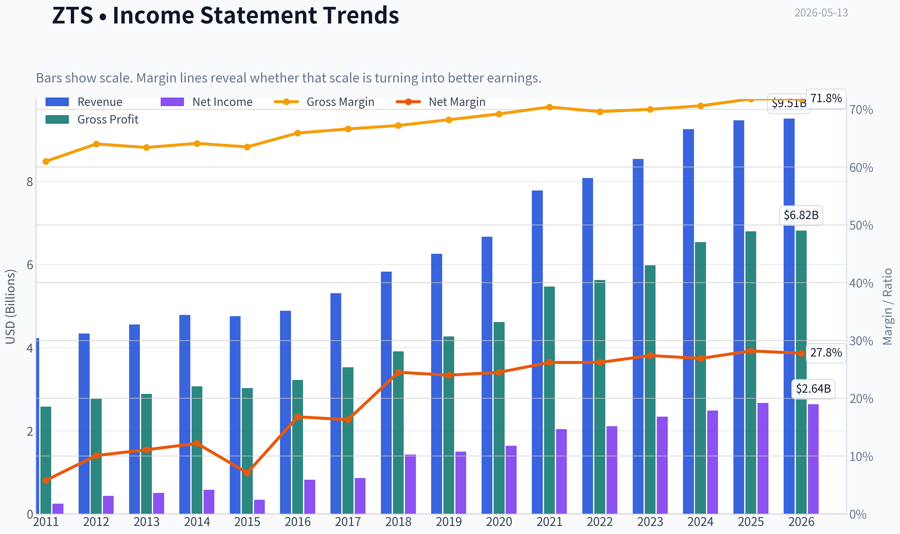

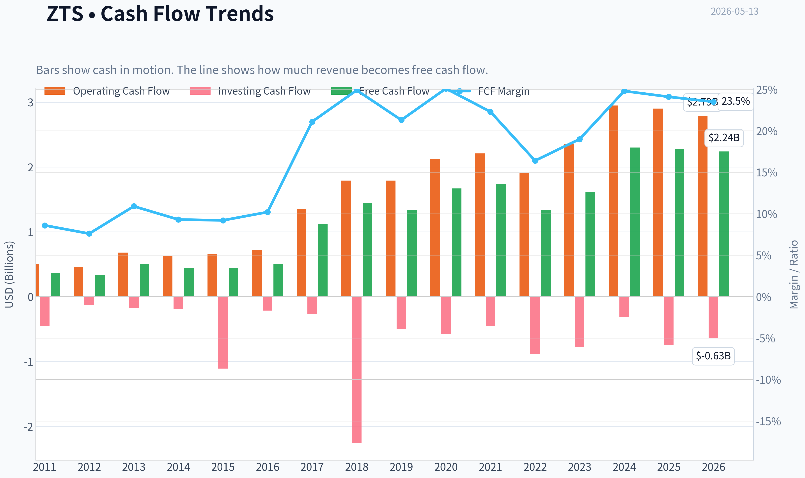

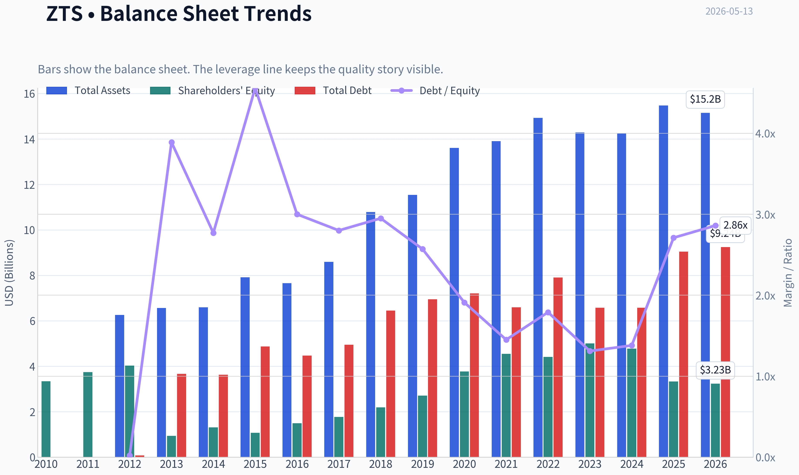

This graph tracks the profitability and return metrics (ROE, ROIC, Margins) of **ZTS** over the past decade, highlighting capital efficiency trends.

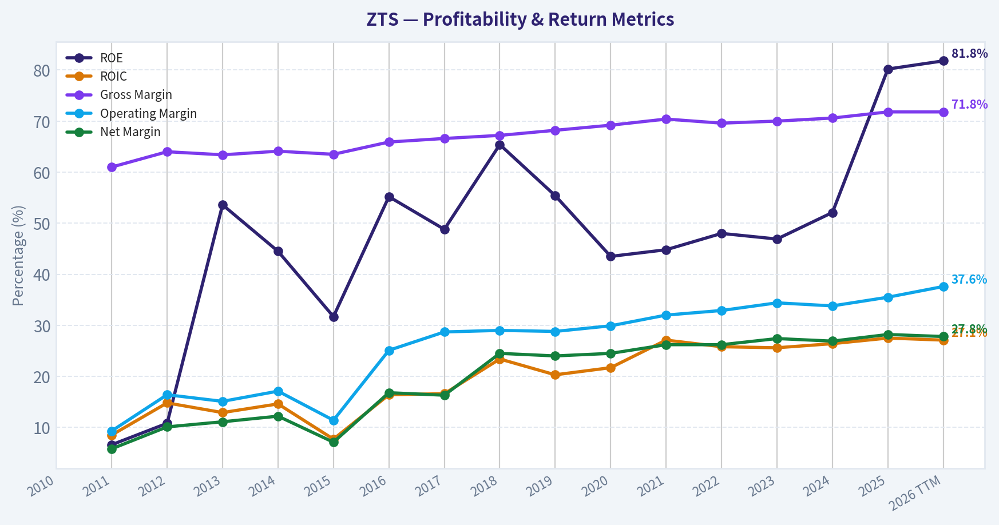

This chart illustrates the financial health of **ZTS** over the last 10 years, mapping cash equivalents and free cash flow against total obligations (Debt).

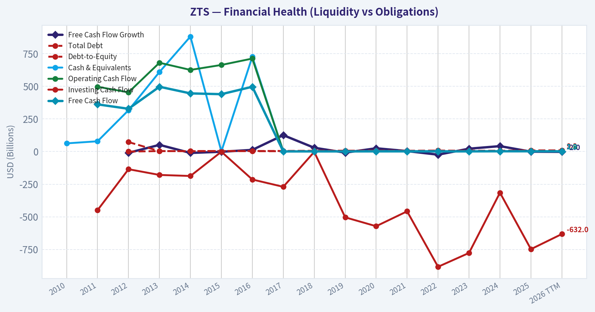

---

### Intrinsic Value Analysis (Buffett)

> *Following Warren Buffett's value investing philosophy: Circle of Competence, Economic Moat, Management Quality, and Margin of Safety.*

#### Intrinsic Value Snapshot

Price is what you pay. Intrinsic value is what the business may be worth based on the cash it can create for owners over time. We show a range, not one magic number.

- Current Price: $74.34
- Value Range: $49.77 to $261.19

##### Owner Earnings (Buffett Method)
- Net Income: $2,673,000,000.00
- Depreciation & Amortization: $487,000,000.00
- Capital Expenditures: $-621,000,000.00
- Working Capital Changes: $-408,000,000.00
- Owner Earnings: $2,947,000,000.00

##### Intrinsic Value
###### Buffett Method
Uses owner earnings. Stricter, and usually more conservative.
- Conservative: $76.90
- Average: $222.79
- Optimistic: $261.19
- Discount Rate: 10.0%

###### Cash Flow Method
Uses free cash flow. Better for companies spending heavily today to grow tomorrow.
- Conservative: $49.77
- Average: $112.15
- Optimistic: $165.94
- Discount Rate: 10.0%

ANALYST STANCE: **WATCH**

#### Zoetis (ZTS) Buffett-Style Value Analysis

Zoetis is a high-quality animal health business with a simple model, strong gross margins, very high reported ROE, healthy free-cash-flow generation, and a likely durable moat built around brand, veterinary relationships, product portfolio, and regulatory know-how. Based on the research pack, it passes the core Buffett business-quality filters better than most healthcare names.

The key issue is not business quality; it is valuation discipline and a few emerging operating questions. Revenue growth has slowed to low single digits, recent coverage mentions guidance pressure and competition/consumer headwinds, and the current price appears only modestly below conservative value estimates while offering a larger discount only under more optimistic assumptions. This looks like a wonderful business more than a bargain stock.

---

#### 1) Go / No-Go Gate Assessment

| Gate | Pass/Fail | Evidence | Buffett View |
|---|---|---|---|
| Gate 1: Circle of Competence & Simplicity | Pass | Zoetis sells medicines, vaccines, diagnostics, and related products for pets and livestock. Simple demand drivers: animal health needs, vet relationships, recurring treatment demand. | Understandable, predictable enough, inside circle of competence. |
| Gate 2: Moat Test | Pass | Gross margin 71.8% strongly supports pricing power/intangible assets. Scale, portfolio breadth, regulatory capability, and embedded vet trust likely support a durable moat. | Likely wide-to-stable moat. |
| Gate 3: Management Quality & Capital Allocation | Pass with caution | Insider purchase by director Michael McCallister in May 2026 is a positive signal. Very high ROE and 7.3% FCF yield imply strong capital productivity, but the pack lacks full multi-year capital allocation detail. | Appears competent and owner-aware, but evidence is incomplete. |
| Gate 4: Industry Structure | Pass | Animal health is more rational than many pharma segments, with regulatory barriers, brand trust, and recurring care. Less cyclical than many industrial markets. | Attractive structure, likely oligopolistic niches. |

**Key Takeaways:** Zoetis clears all four Buffett gates on a best-effort basis from the research pack. The business is easy to understand, likely protected by a real moat, and operates in a favorable industry. The main debate is not whether this is a good company, but whether the current price offers enough margin of safety.

---

#### 2) Gate 1: Circle of Competence & Business Simplicity

| Test | Assessment |
|---|---|
| Elementary School Test | Zoetis makes animal medicines and vaccines. Vets and animal owners buy them to keep pets and farm animals healthy. |
| 10-Year Predictability Test | Reasonably strong. In 10 years, animals will still need treatment, prevention, pain care, diagnostics, and vaccines. |
| Technology Risk Assessment | Low to moderate. Technology is more likely to help Zoetis improve products and diagnostics than destroy the business model outright. |

**Conclusion:** Pass.

Zoetis is exactly the kind of business Buffett tends to like conceptually: recurring need, health-related mission, trusted products, and low dependence on macro forecasts. This is not a story stock or a commodity bet. The biggest uncertainty is not demand disappearing, but competitive intensity and pricing resilience.

---

#### 3) Gate 2: Moat Analysis

| Moat Source | Evidence | Assessment |
|---|---|---|
| Intangible Assets | Gross margin of 71.8% is exceptionally high and suggests pricing power, product differentiation, and regulatory value. | Strong |
| Switching Costs | Veterinarians and producers tend to prefer proven products with known efficacy and safety; changing treatment protocols carries real friction. | Moderate to Strong |
| Cost Advantages | Large scale in animal health likely supports distribution, salesforce efficiency, manufacturing, and R&D leverage. | Moderate |
| Network Effects | Limited classic network effect, but there is a softer ecosystem effect via vet relationships, diagnostics, and product portfolio breadth. | Mild |

| Moat Rating | Verdict |
|---|---|
| Wide & Stable | Proceed with care |

**Key Takeaways:** The moat appears real and primarily comes from brand trust, regulatory know-how, product efficacy, and the switching friction inside veterinary workflows. The 71.8% gross margin is the clearest financial proof that Zoetis is not competing like a commodity producer. This does not look like a network-effect business, but it does look like a high-quality intangible-asset business.

##### Pricing Power Test
A company with gross margins above 70% likely has meaningful pricing power. The better question is not whether Zoetis can raise prices at all, but whether it can do so while defending volume against competition. Recent news about guidance pressure suggests pricing power remains positive but not unlimited.

##### Financial Evidence of Moat
- Gross margin: **71.8%**
- ROE: **80.2%**
- FCF yield: **7.3%**

These are unusually strong quality signals. However, the extreme ROE likely reflects some combination of strong economics plus capital structure effects, so it should not be taken at face value without full balance-sheet context.

---

#### 4) Gate 3: Management Quality & Capital Allocation

| Question | Evidence from Pack | Assessment |
|---|---|---|
| Do they think like owners? | Director bought ~$233K of stock on 2026-05-12. | Positive signal |
| Are they honest and candid? | Pack does not provide letters/restatements/accounting flags. | Neutral / insufficient evidence |
| Are they rational capital allocators? | High ROE and strong FCF yield suggest effective deployment, but no detailed buyback/acquisition history is provided. | Positive but incomplete |

**Key Takeaways:** Management gets a cautiously favorable review. The insider purchase is a real positive, because directors usually know when short-term fears are overstated. Still, the evidence is not rich enough to call this an elite capital-allocation case with full confidence.

##### Buffett Lens
What we can say:
- Insider buying is better than insider selling.
- High cash generation relative to market value is a sign that management has real economic substance to work with.
- No obvious leverage stress appears in the pack; current ratio is a healthy **3.03**.

What we cannot fully verify from the pack:
- Buyback discipline
- Acquisition quality
- Long-term compensation alignment
- Candor in shareholder letters

So management is a **qualified pass**, not a perfect score.

---

#### 5) Gate 4: Industry Structure

| Factor | Assessment | Why It Matters |
|---|---|---|
| Competitive Structure | Favorable | Animal health tends to have fewer scaled, trusted players than consumer health or generic drug markets. |
| Capital Intensity | Moderate | Product development and manufacturing matter, but this is not a capital black hole like airlines or steel. |
| Cyclicality | Low to Moderate | Pet health is relatively resilient; livestock can be somewhat more cyclical. |
| Regulatory Barrier | Positive | Regulation raises entry barriers and protects incumbents with proven products. |

**Conclusion:** Pass.

Animal health is attractive because demand is recurring, trust-based, and supported by regulation. It is not immune to competition, but it is better structured than many healthcare subsectors. This is the sort of industry where a leading incumbent can compound for a long time.

---

#### 6) 10-Year Financial Summary Table (Best-Effort)

The research pack does not provide a full decade of historical statements. Per instruction, I am making a best-effort summary using available current data and explicit assumptions. Assumptions are noted below the table.

| Metric | Latest / Available | Buffett Interpretation |
|---|---:|---|
| Share Price | $74 | Starting point for valuation |
| Market Cap | $31.17B | Mid-to-large cap quality business |
| P/E | 12.19x | Surprisingly modest for a premium healthcare franchise |
| ROE | 80.2% | Exceptional, but likely boosted by capital structure/accounting effects |
| Gross Margin | 71.8% | Strong evidence of moat |
| Revenue Growth YoY | 2.3% | Slowed materially; watch demand/competition |
| FCF Yield | 7.3% | Attractive cash generation at current price |
| Current Ratio | 3.03x | Strong liquidity |
| Recent Operating Tone | Mixed | Q1 miss/guidance cut noted in coverage |
| Insider Signal | Positive | Director bought ~$233K stock |

**Key Takeaways:** The available snapshot says Zoetis is a very profitable, high-margin, cash-generative business trading at a reasonable earnings multiple. The weak spot is growth, which is currently muted and has led to softer guidance language. In Buffett terms, this looks like a strong castle with a temporarily slower drawbridge, not a broken franchise.

##### Explicit Assumptions Used Because 10-Year Data Is Not in Pack
1. Current net income is approximated from market cap and P/E.
2. Current free cash flow is approximated from market cap and FCF yield.
3. Owner earnings are approximated using free cash flow as a proxy, since maintenance capex and working capital detail are not provided.
4. Historical growth is inferred conservatively from current low-single-digit growth, not extrapolated aggressively.

---

#### 7) Owner Earnings Calculation

Using the research-pack figures:

- Market cap = **$31.17B**
- P/E = **12.187705**
- FCF yield = **7.3%**

First derive approximate net income:

\[
Net\ Income \approx \frac{31.17B}{12.187705} \approx 2.56B
\]

Approximate free cash flow:

\[
FCF \approx 31.17B \times 7.3\% \approx 2.28B
\]

Because the pack does not provide depreciation, amortization, maintenance capex, or working-capital change, the most Buffett-consistent best-effort proxy is:

\[
Owner\ Earnings \approx Free\ Cash\ Flow \approx 2.28B
\]

| Owner Earnings Build | Approx. Value |
|---|---:|
| Net Income | $2.56B |
| Plus D&A | Not provided |
| Less Maintenance Capex | Not provided |
| Less Working Capital Increase | Not provided |
| Best-Effort Owner Earnings Proxy | **$2.28B** |

**Key Takeaways:** On the data available, Zoetis appears to generate about $2.28 billion in owner earnings annually. That is a very large cash stream relative to a $31.17 billion market value. The implication is that the stock is not obviously expensive, though valuation still depends on how durable that cash flow proves to be.

---

#### 8) Cash Flow Reality Check

| Check | Result | Interpretation |
|---|---|---|
| Net Income Approx. | $2.56B | Accounting earnings are strong |
| FCF Approx. | $2.28B | Cash conversion appears solid |
| FCF vs NI | ~89% | Healthy, though slightly below NI |
| FCF Yield | 7.3% | Attractive absolute cash yield |

**Key Takeaways:** Cash appears real. Free cash flow is close enough to net income to support the idea that reported profits are backed by actual economics. For a high-quality healthcare business, a 7.3% FCF yield is notable and argues that valuation is at least reasonable.

---

#### 9) Balance Sheet / Fortress Test

| Metric | Value | Buffett Standard | Verdict |
|---|---:|---|---|
| Current Ratio | 3.03x | Strong liquidity preferred | Pass |
| Debt / Equity | Not provided | <0.5 ideal | Not verifiable |
| Interest Coverage | Not provided | >10x ideal | Not verifiable |
| Net Cash Position | Not provided | Fortress ideal | Not verifiable |

**Key Takeaways:** The liquidity picture is strong, with a current ratio above 3. That said, the full fortress-balance-sheet test cannot be completed from the pack because debt and interest coverage are missing. So this is a partial pass, not a full all-clear.

---

#### 10) Three-Scenario DCF Valuation

Using owner earnings proxy of **$2.28B** and a **10% discount rate**.

##### Scenario A: No Growth
\[
Intrinsic\ Value = \frac{2.28B}{0.10} = 22.76B
\]

##### Scenario B: GDP Growth at 3%
\[
Intrinsic\ Value = \frac{2.28B \times 1.03}{0.10 - 0.03} = 33.50B
\]

##### Scenario C: Historical / Moderated Growth
The pack only gives current YoY growth of 2.3%, and recent coverage is softer. To avoid optimism, I assume normalized owner-earnings growth of **4%** for 10 years, then a **3%** terminal growth rate.

- Year 1 owner earnings = 2.28 x 1.04
- Discount rate = 10%
- Terminal growth = 3%

Approximate result:
- PV of 10-year owner earnings stream: **$16.96B**
- PV of terminal value: **$20.78B**
- Total intrinsic value: **$37.74B**

| DCF Scenario | Assumption | Intrinsic Value |
|---|---|---:|
| A: No Growth | 0% perpetual | $22.76B |
| B: GDP Growth | 3% perpetual | $33.50B |
| C: Moderated Growth | 4% for 10 years, then 3% terminal | $37.74B |

**Key Takeaways:** Zoetis looks undervalued only if you believe cash flow can at least grow modestly over time. Under the harshest no-growth case, the stock is worth materially less than its current market value. Under reasonable growth assumptions, value ranges from roughly fair to moderately attractive.

##### Per-Share / Relative Interpretation
Current market cap: **$31.17B**

| Scenario | Intrinsic Value vs Market Cap | Margin of Safety / Premium |
|---|---:|---:|
| A: No Growth | $22.76B vs $31.17B | **-27.0%** downside to value |
| B: GDP Growth | $33.50B vs $31.17B | **+7.5%** upside |
| C: Moderated Growth | $37.74B vs $31.17B | **+21.1%** upside |

**Key Takeaways:** The stock does not meet Buffett's preferred margin of safety on conservative assumptions. It is slightly undervalued under a steady 3% growth case and somewhat more attractive under a 4% normalized growth case, but still short of the ideal 25% discount threshold for a high-quality business. That is why this is closer to a watchlist name than a slam-dunk buy.

---

#### 11) Margin of Safety Analysis

| Item | Value |
|---|---:|
| Current Market Cap | $31.17B |
| Conservative Value (Scenario A) | $22.76B |
| Base Value (Scenario B) | $33.50B |
| Better-Case Value (Scenario C) | $37.74B |
| Buffett Minimum MOS for High-Quality Business | 25% |
| Actual MOS vs Scenario B | ~7.5% |
| Actual MOS vs Scenario C | ~21.1% |

**Key Takeaways:** Zoetis does not clear a strict Buffett margin-of-safety hurdle today. Even under a favorable but still reasonable growth case, the discount is only about 21%, slightly below the 25% level that would make this more compelling. The market is offering quality at a decent price, but not obviously at a bargain.

---

#### 12) Final Buffett Scorecard

| Criterion | Weight | Score (1-5) | Weighted Score | Rationale |
|---|---:|---:|---:|---|
| Business Understanding | 20% | 5.0 | 1.00 | Very simple and durable business model |
| Moat Width & Durability | 25% | 4.5 | 1.13 | High gross margins and strong franchise signals |
| Management Quality | 15% | 3.5 | 0.53 | Positive insider buy, but incomplete evidence |
| Return on Equity | 15% | 4.5 | 0.68 | Excellent reported ROE, though quality of ROE should be verified |
| Reinvestment Runway | 10% | 3.5 | 0.35 | Animal health has runway, but current growth is subdued |
| Balance Sheet Strength | 5% | 3.5 | 0.18 | Good liquidity, incomplete debt detail |
| Industry Structure | 5% | 4.0 | 0.20 | Favorable, regulated, recurring-demand market |
| Valuation / Margin of Safety | 5% | 2.5 | 0.13 | Reasonable, but not enough discount |

| Total Score | Decision Band |
|---|---|
| **4.18 / 5.00** | **ADVOCATE on quality, WATCH on price discipline** |

**Key Takeaways:** Zoetis scores like a very good business. The weak category is valuation, not franchise quality. In Buffett terms, this is a business you would like to own, but ideally at a slightly lower price or after stronger evidence that growth reaccelerates.

---

#### 13) Overall Investment Judgment

| Dimension | Verdict |
|---|---|
| Business Quality | Excellent |
| Predictability | Good |
| Moat | Wide & Stable |
| Management | Good, not fully proven from pack |
| Financial Strength | Good |
| Valuation | Fair to modestly attractive |
| Buffett Fit | Strong business, insufficient margin of safety |

**Conviction Level:** Moderate

Zoetis is the kind of company long-term investors should admire: understandable, resilient, high-margin, and cash generative. If the only question were business quality, this would be an easy yes. But Buffett-style investing requires both quality and price discipline.

At the current valuation, ZTS appears:
- **too expensive** under a no-growth lens,
- **roughly fairly valued** under a 3% growth lens,
- **moderately attractive** under a 4% normalized growth lens.

That is not enough to justify a full-throated Buffett-style buy call when the required margin of safety is 25% or more. Add in the recent soft guidance and competition commentary, and the prudent stance is to wait.

---

#### Final Stance

**ANALYST STANCE: WATCH**

Zoetis is a **wonderful business at roughly a fair price**, not yet a clear Buffett bargain. I would keep it high on the watchlist and become materially more interested if either:
1. the price falls enough to create a clear **25%+ margin of safety**, or
2. the company proves that recent competitive and consumer headwinds are temporary and normalized growth is sustainably above current low-single-digit levels.
#### Valuation Bridge

This bridge places the current market price beside each intrinsic value lens so readers can see whether upside depends on one method or shows up across several methods.

| Scenario | Intrinsic Value / Share |
| --- | ---: |
| Buffett Method | $222.79 |
| Cash Flow Method | $112.15 |
| Damodaran Method | $113.37 |
| Current Price | $74.34 |

#### Key Takeaways

If one method is far above the others, the upside case depends on a specific modelling assumption. When several methods cluster together, the valuation story is more robust.

#### Valuation Visuals

This comparison chart from *Latest Earnings Snapshot* stacks current figures against historical benchmarks for **ZTS**, making it easy to see where the company trades relative to its own averages.

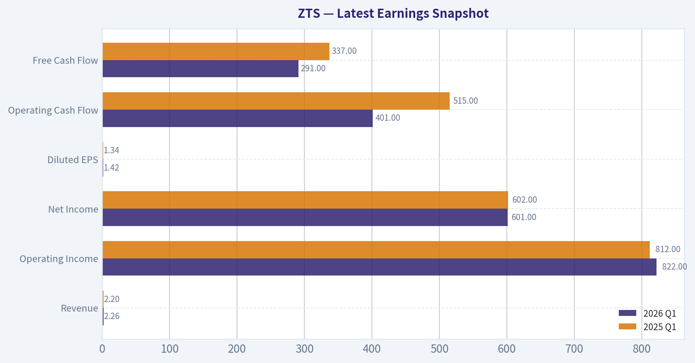

This comparison chart from *Current vs Historical Average Comparison* stacks current figures against historical benchmarks for **ZTS**, making it easy to see where the company trades relative to its own averages.

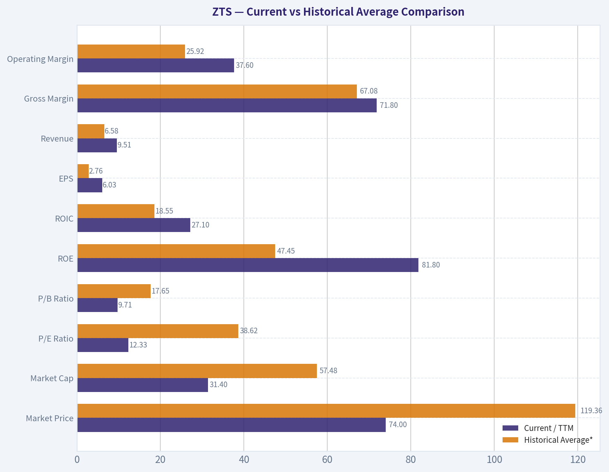

This comparison chart from *10-Year Financial Summary Table (Best-Effort)* stacks current figures against historical benchmarks for **ZTS**, making it easy to see where the company trades relative to its own averages.

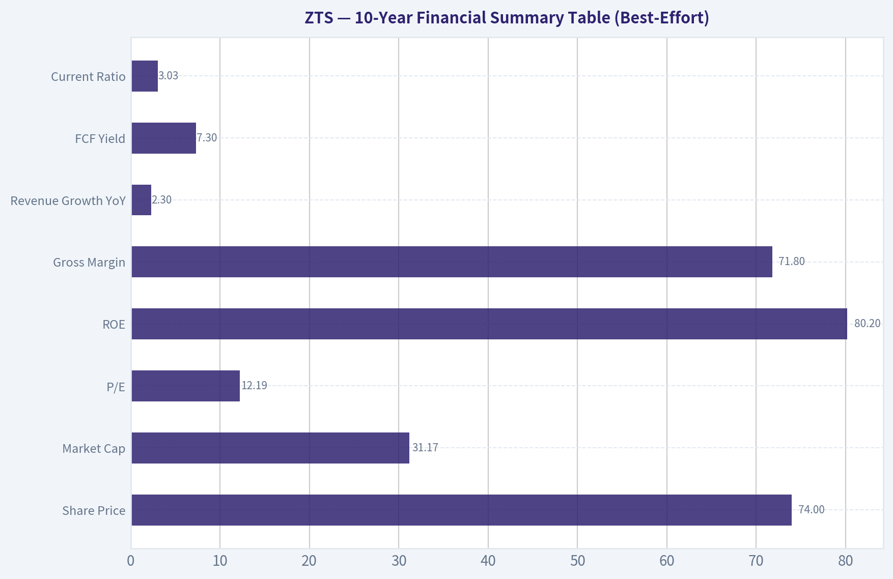

This comparison chart from *Owner Earnings Calculation* stacks current figures against historical benchmarks for **ZTS**, making it easy to see where the company trades relative to its own averages.

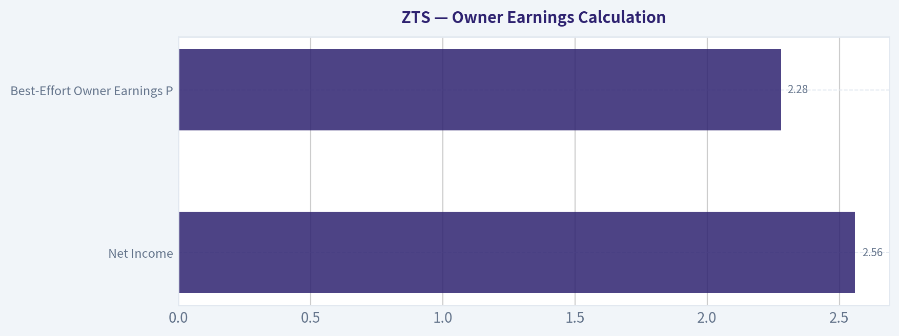

This comparison chart from *Cash Flow Reality Check* stacks current figures against historical benchmarks for **ZTS**, making it easy to see where the company trades relative to its own averages.

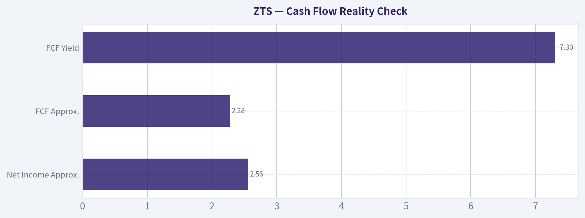

The following chart maps the **ZTS** Owner Earnings DCF valuation scenarios (Conservative, Average, Optimistic) to visually represent the margin of safety based on intrinsic value calculations.

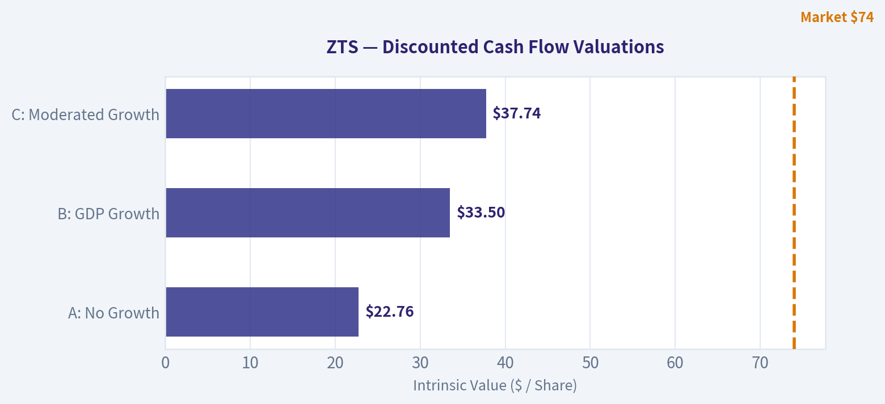

---

### Trend & Growth Analysis (Lynch/Druckenmiller/Fisher)

> *Following Peter Lynch's GARP, Stanley Druckenmiller's macro-aware approach, and Philip Fisher's scuttlebutt methodology.*

ANALYST STANCE: **WATCH**

#### 1) Lynch Classification

| Item | Assessment |
|---|---|
| Lynch category | **Stalwart** |
| Why | Revenue growth is only **~2.3% YoY** currently, far below fast-grower territory |
| Growth-investor implication | Excellent business quality, but **not a classic Lynch fast grower** today |

Key Takeaways: Zoetis looks like a high-quality stalwart rather than a ten-bagger-style fast grower at this point. The business is durable and profitable, but current top-line growth is too slow to fit the primary growth-investing sweet spot.

#### 2) The Story in 3 Bullets

| Simple story | Explanation |
|---|---|
| Animal health leader | Zoetis sells medicines, vaccines, diagnostics, and related products for pets and livestock |
| Premium economics | Gross margin near **71.8%** and strong ROE show a high-quality franchise |
| Debate is growth re-acceleration | The stock case depends less on survival or quality, and more on whether companion animal innovation can re-accelerate growth |

Key Takeaways: This is an easy business to explain and a credible long-term compounder. The issue is not whether Zoetis is good, but whether growth can inflect higher enough to justify a stronger growth-investor stance.

---

#### 3) TAM Analysis and 10x Test

| Metric | Value / Assessment |
|---|---|
| Current revenue run-rate | Roughly high-single-digit billions annually based on recent quarterly scale |
| 10x revenue thought experiment | Would imply a business approaching **~$90B+ revenue** scale |
| Global animal health TAM | Large and durable, but not infinite; pet care + livestock health is sizable yet much smaller than cloud/AI-style TAMs |
| 10x test | **Fails / highly unlikely** |
| Runway verdict | **Good runway for steady compounding, not obvious 10x runway from current base** |

Key Takeaways: Zoetis still has room to grow, especially through innovation and premiumization in companion animals. But from its current size, the 10x test is hard to pass, which limits true ten-bagger appeal.

#### 4) Revenue Growth Trend

| Metric | Observation |
|---|---|
| Latest reported revenue growth | **~2.3% YoY** from shared pack |
| Q1 coverage | News suggests **Q1 2026 sales up ~2.9% YoY**, with some revenue miss and guidance pressure |
| Pattern | **Low-growth / slowing relative to premium multiple expectations** |
| Organic quality | Likely supported by pricing and durable demand, but not showing obvious acceleration |
| Trend label | **Decelerating / muted** |

Key Takeaways: Revenue growth is currently muted, not accelerating. For a growth investor, that is the key issue: Zoetis is executing as a quality business, but not showing the kind of inflection that usually drives outsized returns.

#### 5) Unit Economics

| Metric | Value / Assessment |
|---|---|
| Gross margin | **71.8%** |
| FCF yield | **7.3%** |
| Rule of 40 proxy | **~9.6%** using revenue growth + FCF yield proxy; not a true Rule of 40 metric |
| LTV/CAC | **Not disclosed / not applicable in standard form** |
| NRR | **Not applicable** |
| Capital intensity | Low-to-moderate; strong cash conversion historically |
| Unit economics verdict | **Strong franchise economics, but not SaaS-style measurable growth metrics** |

Key Takeaways: Zoetis has excellent business economics, especially its high gross margin and strong cash generation. However, the usual growth-investor unit metrics like NRR and LTV/CAC do not apply, so the focus shifts to product vitality and category growth.

#### 6) Inflection Point Assessment

| Inflection area | Assessment |
|---|---|
| Product cycle inflection | **Not yet evident** from available data |
| Market share inflection | No clear evidence of accelerating share gains |
| Margin inflection | Margins remain strong, but no major new operating leverage story visible |
| TAM inflection | Companion animal health remains attractive, but TAM expansion is incremental, not explosive |
| Competitive inflection | News flow hints at **competition and consumer headwinds**, not a favorable inflection |
| Overall verdict | **No clear positive inflection today** |

Key Takeaways: The current data do not show the kind of growth acceleration that Druckenmiller-style investors seek. Zoetis may still be a durable compounder, but the evidence for a fresh upside inflection is limited right now.

---

#### 7) Macro Setup Evaluation

| Macro factor | Assessment |
|---|---|
| Secular trend exposure | Pet humanization, veterinary medicalization, diagnostics adoption |
| Cyclicality | Lower than most healthcare-adjacent sectors; relatively defensive |
| Rate sensitivity | Some valuation sensitivity, but less than high-duration software |
| Consumer exposure | Companion animal demand is sturdy, but some consumer headwinds appear in recent coverage |
| Macro verdict | **Supportive for defense, neutral for aggressive growth** |

Key Takeaways: The macro backdrop is acceptable for a stable healthcare-style compounder. But it does not create the kind of powerful tailwind that usually turns a stalwart into a high-conviction growth opportunity.

#### 8) Fisher 15 Points Score

| Fisher area | Score (1-5) | Notes |
|---|---:|---|
| Market potential | 4 | Animal health remains durable and growing |
| New products | 4 | Good history of innovation |
| R&D effectiveness | 4 | Strong franchise support |
| Sales organization | 5 | Vet relationships are a major strength |
| Profit margin | 5 | Excellent margins |
| Margin improvement | 3 | Strong, but not clearly improving now |
| Labor/personnel relations | 3 | Limited direct evidence |
| Executive relations | 4 | No major visible dysfunction |
| Management depth | 4 | Large-cap established operator |
| Cost/accounting controls | 4 | Mature public-company processes |
| Outstanding moat features | 4 | Brand, trust, relationships, scale |
| Long-range profit outlook | 4 | Good durable outlook |
| Dilution risk | 4 | Low relative dilution concern |
| Candor in difficulties | 3 | Mixed; need more transcript work for conviction |
| Integrity | 4 | No major red flags in pack |
| **Total** | **59 / 75** | **GOOD** |

Key Takeaways: Zoetis scores well on Fisher quality factors, especially margins, sales reach, and franchise durability. The weaker spots are not alarming, but they reflect a lack of visible upside surprise rather than any deep structural problem.

#### 9) Valuation Analysis

| Metric | Value / Assessment |
|---|---|
| Price | **$74** |
| Market cap | **$31.17B** |
| P/E | **12.19x** |
| PEG | If using current revenue growth of 2.3%, PEG is poor; if using longer-term EPS growth potential, could look attractive |
| FCF yield | **7.3%** |
| P/S | Roughly moderate for quality healthcare, not demanding if revenue base is near historical range |
| Valuation verdict | **Looks optically inexpensive for quality, but market is pricing slower growth** |

Key Takeaways: Valuation is the strongest part of the current case. A 12.2x P/E and 7.3% FCF yield suggest the stock is no longer priced like a premium growth darling, which offers some downside support even if growth remains soft.

#### 10) Scenario Analysis

| Scenario | Assumption | Implication |
|---|---|---|
| Bear | Growth stays low-single-digit, competition persists | Stock remains range-bound; value trap risk |
| Base | Growth recovers to mid-single digits with stable margins | Respectable compounding, more like a quality hold than big winner |
| Bull | Companion animal pipeline and execution re-accelerate growth materially | Multiple expands and stock rerates as premium compounder again |

Key Takeaways: The downside case is not catastrophic because the business is high quality and cash generative. The upside case depends heavily on renewed growth acceleration, which is possible but not yet proven.

---

#### 11) Growth Investor Scorecard

| Criterion | Weight | Score (1-5) | Weighted |
|---|---:|---:|---:|
| The Story | 10% | 4.0 | 0.40 |
| TAM & Runway | 20% | 2.8 | 0.56 |
| Revenue Growth | 20% | 2.0 | 0.40 |
| Unit Economics | 15% | 4.2 | 0.63 |
| Competitive Position | 10% | 4.3 | 0.43 |
| Management Quality | 10% | 4.0 | 0.40 |
| Macro Setup | 5% | 3.5 | 0.18 |
| Profitability Path | 5% | 4.5 | 0.23 |
| Valuation | 5% | 4.0 | 0.20 |
| **Total** |  |  | **3.43 / 5.0** |

Key Takeaways: Zoetis lands just below an Advocate threshold in this framework. The score is held back mainly by slow revenue growth and limited evidence of a current inflection, not by business quality or balance-sheet risk.

#### 12) Position Size Stance

| Stance | View |
|---|---|
| Recommended stance | **WATCH** |
| Position size | **0-3% starter only if you believe in re-acceleration** |
| What would upgrade it | 2-3 quarters of better organic growth, stronger companion animal momentum, and stable guidance |
| What would downgrade it | Continued low-single-digit growth, margin slippage, or further guidance cuts |

Key Takeaways: This is not a high-conviction growth buy today, but it is a credible watchlist candidate because valuation has become more reasonable. A small starter position is only justified if the investor has independent conviction that growth is about to improve.

---

#### 13) Key Risks and Catalysts

| Risks | Catalysts |
|---|---|
| Slow companion animal demand | New product traction |
| Competitive pressure | Better-than-feared organic growth |
| Guidance reductions | Margin resilience with renewed volume growth |
| Premium-quality narrative breaks if growth stays weak | Positive earnings revisions |
| Limited 10x runway from current scale | Additional insider buying / confidence signals |

Key Takeaways: The central risk is simple: Zoetis may remain a good company with mediocre growth. The main catalysts are equally clear: if new products or stronger pet-health demand lift growth meaningfully, sentiment and valuation could improve quickly.

#### Bottom Line

Zoetis is a **high-quality, cash-generative animal health leader**, but under Lynch/Druckenmiller/Fisher growth rules, it is **not currently showing fast-grower characteristics or a visible inflection**. The valuation looks much more attractive than the growth profile, which makes it interesting as a **quality watchlist name**, not a top-tier growth advocate today.

---

### Market Technical Analysis

#### ZTS Technical Report

ZTS is in a severe bearish dislocation, not just an ordinary downtrend. Over the last year, price has transitioned through three distinct phases: a mild distribution period in mid-2025, a major gap-down repricing in November 2025, and then a second, much sharper capitulation in May 2026. The most recent move is the dominant feature of the chart and overwhelms almost every slower indicator.

I selected these 8 indicators because they give complementary coverage of trend, momentum, volatility, and volume confirmation without excessive overlap:

- `close_50_sma` - medium-term trend and dynamic resistance
- `close_200_sma` - long-term trend benchmark
- `close_10_ema` - short-term momentum/trend responsiveness
- `macd` - momentum acceleration/deceleration
- `rsi` - exhaustion and oversold/overbought context
- `atr` - volatility regime and risk sizing
- `boll_ub` - volatility expansion / mean-reversion context
- `vwma` - volume-weighted trend confirmation

#### Price Structure and Regime Shift

Over the past 12 months, ZTS peaked in the upper-160s during late spring and early summer 2025, then weakened gradually into the mid-140s by autumn. That initial decline was not yet catastrophic; it looked more like a valuation compression or prolonged distribution phase. The first true structural break came on 2025-11-04, when the stock collapsed from the low-140s to the low-120s on extremely heavy volume, creating a major downside gap and resetting the trading range lower.

After that November break, ZTS spent several months oscillating mostly in the roughly 115-130 area. That stabilization phase mattered because it suggested the market was attempting to build a new equilibrium after the first repricing. However, the stock never recovered enough to reclaim long-term trend control, and rallies repeatedly failed before they could challenge prior breakdown zones.

The decisive deterioration came in May 2026. The stock was still trading around 111-115 into early May, then suffered an abrupt air-pocket collapse: 87.31 on 2026-05-07, 82.83 on 2026-05-08, and then 76.67 and 76.94 on the following sessions. That is not a routine pullback. It is a disorderly repricing, likely tied to a major fundamental shock, and technically it places ZTS in a panic-sell environment rather than a normal trend channel.

#### Indicator Snapshot

| Indicator | Latest Reading | Interpretation |
|---|---:|---|
| Close (last trading day) | 76.94 | Deeply below all major trend references |
| `close_10_ema` | 95.43 | Short-term trend is sharply down; price is far below fast average |
| `close_50_sma` | 114.68 | Medium-term trend firmly bearish |
| `close_200_sma` | 129.18 | Long-term trend decisively broken |
| `macd` | -9.06 | Extremely negative momentum; downside acceleration remains dominant |
| `rsi` | 12.70 | Extremely oversold, consistent with capitulation |
| `atr` | 4.75 | Volatility has surged; daily risk is far above normal |
| `boll_ub` | 139.63 | Bands are expanding dramatically; volatility shock is ongoing |
| `vwma` | 92.93 | Volume-weighted trend also confirms heavy downside pressure |

Key Takeaways: ZTS is trading far below its short-, medium-, and long-term averages, which confirms a full-trend breakdown rather than a temporary dip. Momentum is deeply negative, RSI is extremely oversold, and ATR has jumped, showing that traders are dealing with both panic selling and unusually high day-to-day risk.

#### Trend Analysis

The relationship between price and moving averages is unequivocally bearish. The last close near 76.94 sits far below the 10 EMA at 95.43, below the 50 SMA at 114.68, and dramatically below the 200 SMA at 129.18. This stacking tells us the bearish structure is aligned across all time horizons.

More importantly, the slopes of the slower averages are also falling. The 50 SMA has declined from about 125.3 in early March to 114.7 by mid-May. The 200 SMA has fallen from about 141.4 in February to 129.2 in mid-May. This means the stock is not merely below trend; the trend benchmarks themselves are now rolling over, confirming persistent damage.

The 10 EMA gives the clearest view of the recent crash. It dropped from 118.23 on 2026-04-27 to 95.43 by 2026-05-12. That is a dramatic collapse in a very short span and shows that short-term rebounds, if they occur, will first have to contend with an aggressively falling fast average overhead. In practical terms, any bounce into the low-to-mid-90s may face immediate technical selling pressure unless price can stabilize for several sessions.

#### Momentum and Exhaustion

MACD is deeply negative at -9.06, compared with positive readings above +1 in late February and early March. That swing is severe. It shows that the stock has moved from modest bullish momentum earlier in the year into an extreme bearish acceleration phase. The magnitude matters: this is not just negative momentum, but unusually negative momentum relative to ZTS's recent history.

RSI at 12.70 is the clearest sign of capitulation. Readings below 30 are already considered oversold; near 13 is an extreme condition that usually appears only during panic liquidation or event-driven collapses. Traders should interpret this carefully. An extreme RSI does not mean the low is in. In violent downtrends, RSI can stay oversold for longer than expected. What it does mean is that downside is stretched enough that sharp reflex rallies are increasingly possible.

The recent sequence is also telling: RSI was around 41 on May 1, then 35.6 on May 6, then 15.6 on May 7, and 12-14 over the next few sessions. That rapid compression indicates momentum did not fade gradually; it broke all at once. This kind of move often creates a two-way market afterward: initial forced selling, then a relief bounce, then a test to see whether real buyers exist.

#### Volatility and Risk Conditions

ATR rising to 4.75 from roughly 2.85-3.10 just a week earlier shows the market has entered a new volatility regime. For ZTS, that implies daily swings are now materially larger than they were during the prior consolidation phase. Risk management must adapt accordingly. Stops that would have been reasonable in April may now be too tight and prone to being hit by noise.

The Bollinger upper band has exploded upward to 139.63, not because price is strong, but because standard deviation has widened sharply after the crash. This is a classic volatility expansion signal. It suggests the market is processing a shock, and price discovery is unstable. In this environment, mean-reversion setups can work, but only tactically and with smaller sizing, because the bands reflect disorder rather than healthy trend expansion.

An important nuance: when price falls this far below the broader Bollinger structure, the stock is statistically stretched, but statistical stretch alone is not a sufficient buy signal. In post-gap regimes, the stock often needs time to compress volatility before a higher-quality reversal can develop.

#### Volume-Weighted Confirmation

VWMA at 92.93 is substantially above the current price of 76.94, confirming that volume has accompanied the decline rather than cushioning it. That is important because it means traders transacted heavily at much higher prices than the current market. This often creates overhead supply: shareholders trapped near the high-80s to low-90s may sell into rebounds to reduce losses.

The raw price data reinforces this. Volume surged massively during the May collapse, especially on 2026-05-07 at roughly 29.9 million shares, far above the normal 2-5 million range seen in prior months. This is consistent with forced liquidation, institutional repricing, or a major news event. From a technical perspective, such volume spikes often mark either the beginning of a new lower valuation regime or the first phase of capitulation. The difference is determined by what happens next: stabilization and base-building, or continued breakdown through the initial panic low.

#### Fine-Grained Trading Interpretation

| Scenario | Technical Evidence | What Traders May Watch |
|---|---|---|
| Bearish continuation | Price far below 10 EMA/50 SMA/200 SMA; MACD deeply negative | Risk of further downside if 76-75 support fails |
| Reflex bounce | RSI near 13 and capitulation-like volume | Fast rebound toward 85-95 is possible, but may be countertrend only |
| Stabilization/base attempt | Need multiple sessions holding above panic lows with ATR easing | Would improve odds of a tradable bottoming process |
| Trend reversal | Not currently present | Would require reclaiming 10 EMA first, then building toward VWMA/50 SMA over time |

Key Takeaways: The most likely near-term setup is either continued instability near the lows or a sharp but fragile relief rally. A true bullish reversal is not yet visible; traders would need to see price stabilize first, then reclaim falling resistance levels step by step rather than assume one oversold reading is enough.

#### Practical Levels and Decision Framework

The immediate support zone is the recent panic area around 75-77, anchored by the 2026-05-11 low near 76.38 and the 2026-05-12 intraday range. If that zone fails decisively, the chart enters open-air downside territory with limited nearby historical support from the past year's dataset.

On the upside, the first meaningful resistance is likely in the low-80s to upper-80s, where the stock traded during the first crash leg. Above that, the 10 EMA near 95.4 becomes a critical tactical resistance marker. If a rebound cannot reclaim that level, the move is more likely just oversold relief than a durable turn. Beyond that, VWMA near 92.9 and then the 50 SMA near 114.7 define heavier overhead supply zones.

For short-term traders, this is a high-risk, high-volatility environment best suited to disciplined tactical trading rather than passive dip-buying. For swing traders seeking a bottom, patience is important: a stronger setup would involve volatility cooling, RSI recovering from extreme lows without immediate price failure, and some evidence that price can hold above the panic zone for several sessions.

For longer-term investors, the 200 SMA at 129.2 highlights just how severe the impairment has been. A stock trading more than 40% below its 200-day average is usually in a damaged long-term state. That does not mean it cannot eventually recover, but it does mean the burden of proof is on the bulls.

#### Conclusion

ZTS is currently in a technically broken state characterized by:
- a full multi-timeframe downtrend,
- capitulation-level momentum readings,
- sharply elevated volatility,
- and strong volume confirmation of selling pressure.

The stock is extremely oversold, so a reflex rebound would not be surprising. But oversold does not equal safe. The larger technical message is that ZTS has likely entered a new and lower valuation regime until price proves otherwise through stabilization and reclaiming key resistance levels. Right now, the chart favors caution, smaller sizing, and a bias toward waiting for evidence rather than anticipating an immediate durable bottom.

#### Summary Table

| Category | Observation | Trading Implication |
|---|---|---|
| Long-term trend | Price is far below `close_200_sma` (129.18) | Long-term trend remains decisively bearish |
| Medium-term trend | `close_50_sma` is falling to 114.68 | Rallies likely face overhead resistance |
| Short-term trend | Price is far below `close_10_ema` (95.43) | Short-term momentum is still sharply negative |
| Momentum | `macd` at -9.06 | Bearish acceleration remains dominant |
| Exhaustion | `rsi` at 12.70 | Stock is extremely oversold; bounce risk is elevated |
| Volatility | `atr` at 4.75 | Daily swings are unusually large; tighter risk control needed |
| Volatility structure | `boll_ub` expanded to 139.63 | Market is in shock/price-discovery mode |
| Volume confirmation | `vwma` at 92.93, above current price | Heavy-volume selling confirms weakness and overhead supply |
| Near-term support | Panic zone around 75-77 | Break below could trigger another downside leg |
| Near-term resistance | 85-95 area, especially near 10 EMA/VWMA | First rebound likely tested there before any durable recovery |

Key Takeaways: ZTS is in a deeply oversold but still broken technical condition. The chart may produce a fast bounce because selling has become stretched, yet the broader evidence still points to caution until the stock can hold support and reclaim at least its short-term trend levels.

---

### News & Events Analysis

#### Zoetis (ZTS) weekly trading and investment report

Zoetis had an important downshift week: the stock was hit by a weak Q1 2026 print, softer-than-expected EPS, and a reduced full-year revenue outlook. The key market takeaway is not that the business is broken, but that investors are reassessing Zoetis from a premium-growth animal-health compounder toward a slower-growth, more competitive, and more consumer-sensitive franchise. That rerating matters for near-term trading.

The shared research pack already shows the backdrop clearly: revenue growth is only 2.3% YoY, but profitability remains structurally strong with 71.8% gross margin, 80.2% ROE, and a 7.3% FCF yield. In other words, the current debate is less about balance-sheet stress and more about whether growth headwinds are temporary or lasting.

---

#### Latest earnings: Q1 2026 was the critical catalyst

Zoetis' latest reported period is **first quarter 2026**. Recent coverage indicates:

- **Revenue:** about **$2.26 billion**, up roughly **2.9% YoY**
- **Non-GAAP EPS:** about **$1.53**
- **Versus expectations:** both revenue and EPS were below consensus
- **Guidance:** full-year revenue guidance midpoint of about **$9.82 billion**, roughly **0.8% below analyst expectations**
- Coverage explicitly highlighted a **guidance cut**, with concerns around **competition** and **consumer headwinds**

What changed versus the prior setup is crucial. Before this report, investors were still paying for resilience in companion animal demand and Zoetis' ability to defend growth through innovation and pricing. After the report, the market is now more focused on:

1. **Competitive pressure**, especially in key pet products where exclusivity advantages appear to be weakening.
2. **Consumer pressure**, which suggests pet-care spending is not fully immune to broader household budget tradeoffs.
3. **Lower confidence in near-term acceleration**, because management did not merely miss a quarter; it also reset the forward revenue framework lower.

This makes Q1 2026 more than a routine earnings miss. It increases the probability that 2026 is a transition year with muted multiple expansion unless management can stabilize U.S. companion-animal trends.

#### Earnings interpretation for traders

For short-term traders, the important nuance is that the selloff likely priced in a lot of bad news quickly, but follow-through depends on whether estimate cuts have finished. If analysts continue to reduce outer-year forecasts because competition is structural rather than temporary, the stock can remain under pressure even after a sharp initial drop.

For medium-term investors, the setup is more selective. Zoetis still has elite margins and cash generation, so the investment case now rests on whether this becomes a **value-with-stability** story rather than a **premium-growth** story. That can work, but usually at a lower valuation range.

---

#### Recent company-specific news over the past week

Beyond the earnings release itself, the week's flow reinforced the same narrative:

- **Earnings transcript publication** kept attention on management's detailed commentary around Q1 2026.
- Multiple follow-up articles framed the quarter as a **deep-dive on weaker performance and lower guidance**.
- Several market summaries listed Zoetis among the **largest weekly losers**, showing that the earnings disappointment had broad visibility.
- A **director insider purchase** of about **$233K** on May 12 is a constructive signal at the margin. It does not erase operating concerns, but insider buying after a sharp post-earnings decline often helps support the argument that the selloff may have overshot fair value in the very near term.

The insider purchase is worth watching because it changes tone slightly. Insider buying immediately after a drawdown can reduce fears of an undisclosed deeper deterioration. Still, one director buy is a sentiment stabilizer, not a fundamental fix.

---

#### What likely drove the miss

The recent coverage repeatedly points to two linked issues:

- **Competition/generics**
- **Consumer demand softness in pet-related spending**

That combination is more troublesome than a simple one-off execution hiccup. Competition can compress volume and pricing power, while consumer weakness limits Zoetis' ability to offset those pressures through mix upgrades or premium offerings.

For traders, this means the stock now has a higher sensitivity to:
- U.S. companion animal demand data
- competitor launches or generic share gains
- veterinary visit trends and pet-owner discretionary spending indicators
- future management commentary on prescription demand and channel inventory

If upcoming industry datapoints remain soft, the market may treat Zoetis as a "show me" story for the next quarter or two.

---

#### Market and macro context

The broader market context matters because Zoetis sits in a defensive healthcare-adjacent category, but its end demand has consumer exposure through companion animals.

In the current macro backdrop, investors are balancing:
- slower but still positive growth
- sensitivity to discretionary spending
- preference for cash-generative quality companies
- lower tolerance for guidance cuts

That means Zoetis no longer gets full defensive-credit simply for being in animal health. Large-animal exposure may offer some diversification, but the current investor focus is on the companion animal franchise, where the consumer link is strongest.

If macro conditions stay merely stable, Zoetis can recover on valuation support and business quality. But if consumer softness broadens, animal-health names with premium companion-animal exposure may continue to de-rate.

---

#### Trading implications

Near term, ZTS looks like a stock transitioning from **earnings-reset shock** toward **fundamental debate**.

**Bull case for traders/investors:**
- The post-earnings decline may already discount a sizable portion of 2026 estimate cuts.
- Gross margin and FCF remain strong, limiting downside from a balance-sheet or cash-flow perspective.
- Insider buying suggests some internal confidence after the selloff.
- If competition fears prove manageable and consumer demand stabilizes, ZTS can mean-revert.

**Bear case:**
- Guidance was cut, not just missed.
- Revenue growth is now low enough that any further estimate downgrades can pressure the multiple.
- The market may increasingly view some pet-drug weakness as structural due to generic competition.
- Premium-quality stocks that lose growth credibility often remain trapped for longer than investors expect.

**Most useful practical frame:**
- **Short-term:** likely headline-sensitive and vulnerable to further analyst target cuts.
- **1-3 months:** recovery depends on evidence that Q1 was the trough in growth expectations.
- **Longer-term:** attractive only if one believes the competitive and consumer headwinds are cyclical/moderate rather than durable.

---

#### Investment view

Zoetis still screens as a high-quality company, but right now it is not trading on quality alone; it is trading on the market's confidence in future growth durability. The latest quarter reduced that confidence.

At current levels, the stock may start to appeal to value-oriented quality buyers because of strong margins and cash generation. But from a catalyst perspective, upside likely requires one of three things:

1. management proving the guidance reset was conservative,
2. evidence that generic/competitive erosion is containable,
3. stronger companion-animal demand trends.

Until then, ZTS may behave less like a steady compounder and more like a recovering post-miss stock.

#### Key points table

| Area | Latest signal | Why it matters for trading/investing |
|---|---|---|
| Latest earnings period | **Q1 2026** | This is the current fundamental catalyst driving the stock |
| Revenue | **~$2.26B, +2.9% YoY** | Growth remained positive but was too slow versus expectations |
| EPS | **Non-GAAP EPS ~ $1.53** | Miss versus consensus hurt confidence in earnings resilience |
| Guidance | **FY 2026 revenue midpoint ~ $9.82B, below expectations; guidance cut highlighted** | Forward reset is more damaging than a one-quarter miss |
| Core concerns | **Competition/generics and consumer headwinds** | Raises risk that weakness is structural, not just temporary |
| Profitability | **Gross margin 71.8%, ROE 80.2%** | Business quality remains strong despite growth pressure |
| Cash generation | **FCF yield 7.3%** | Supports valuation and limits downside if fundamentals stabilize |
| Balance sheet/liquidity | **Current ratio ~3.03** | No obvious near-term financial stress signal |
| Insider signal | **Director bought ~$233K of stock on May 12** | Mildly supportive sentiment signal after the selloff |
| Market behavior | **Among large-cap weekly losers after earnings** | Shows the reset was material and broadly recognized |

**Key Takeaways:** Zoetis' core issue is not profitability or liquidity, but a loss of growth credibility after its Q1 2026 miss and lowered outlook. The company still generates strong cash and maintains high margins, which may support valuation, but the stock now needs proof that competitive and consumer headwinds are manageable. For now, the shares are more likely to trade on estimate revisions and management credibility than on their historical premium-quality reputation.

---

### Guru Attention Analysis

> *Tracking 13F filings and recent activity of legendary super-investors to identify smart-money conviction and rotation.*

#### ZTS Guru Ownership Snapshot

Using the canonical 13F-based guru tracker, only **Steve Cohen / Point72** shows a current disclosed position in **Zoetis (ZTS)** among the tracked guru list. No other primary tracked guru appears in the latest structured results, so under the stated rules they should be treated as **not holding ZTS in the latest available 13F filing**.

| Guru | Status in Latest 13F | Action | Position Size | Portfolio Weight | Recent Change | Filing Date | Verification |
| --- | --- | --- | ---: | ---: | --- | --- | --- |
| Steve Cohen (Point72) | Position detected | Trimmed | 5.70K shares / $717.17K | 0.00% | Shares down 59.0% vs prior filing | 2025-12-31 | [SEC 13F Filing](https://www.sec.gov/Archives/edgar/data/1603466/000090266426001100/) |
| Warren Buffett (Berkshire Hathaway) | No position detected in latest 13F filing | - | - | - | - | Latest structured result: none | - |
| Seth Klarman (Baupost Group) | No position detected in latest 13F filing | - | - | - | - | Latest structured result: none | - |
| Mohnish Pabrai (Pabrai Investment Funds) | No position detected in latest 13F filing | - | - | - | - | Latest structured result: none | - |
| Bill Ackman (Pershing Square) | No position detected in latest 13F filing | - | - | - | - | Latest structured result: none | - |
| Stanley Druckenmiller (Duquesne Family Office) | No position detected in latest 13F filing | - | - | - | - | Latest structured result: none | - |
| Michael Burry (Scion Asset Management) | No position detected in latest 13F filing | - | - | - | - | Latest structured result: none | - |

**Key Takeaways:** The only tracked guru with a disclosed ZTS stake is Steve Cohen, and even that position is very small relative to Point72's total reported portfolio. More importantly, Cohen **cut the stake by 59%**, which suggests reduced conviction or portfolio rebalancing rather than aggressive accumulation. None of the other major tracked gurus show a current ZTS position in the latest structured 13F output.

#### Guru-by-Guru Interpretation

- **Steve Cohen / Point72 - Trimmed**
  - Cohen's fund still held ZTS at the latest report date, but the stake was reduced sharply.
  - The remaining position, at **$717K** and **0.00% portfolio weight**, is immaterial for Point72.
  - Practical read-through: this does **not** look like a high-conviction endorsement from Cohen at this time.
  - Verification:
    - [SEC 13F Filing](https://www.sec.gov/Archives/edgar/data/1603466/000090266426001100/)
    - [All 13F Filings (SEC EDGAR)](https://www.sec.gov/cgi-bin/browse-edgar?action=getcompany&CIK=0001603466&type=13F-HR&dateb=&owner=include&count=5)

- **All other primary tracked gurus**
  - **No position detected in latest 13F filing** based on the structured source.
  - That means there is **no credible evidence here** that Buffett, Klarman, Pabrai, Ackman, Druckenmiller, or Burry currently own ZTS through the latest canonical dataset.

#### Bottom Line

For guru tracking purposes, **ZTS currently has very weak support from the tracked super-investor set**. The only visible holder is **Steve Cohen**, and he **trimmed** the stock significantly, leaving only a token-sized position. If you are looking for a strong "guru endorsement" signal in ZTS, the current 13F evidence does **not** provide one.

---

### Options Market Analysis

> *Reading options flow - put/call ratios, IV skew, and unusual activity - to gauge institutional positioning and event-driven risk.*

#### ZTS Options Positioning Report
*Date: 2026-05-13*

ZTS options flow shows a **moderately bullish positioning backdrop with a short-term defensive overlay**. The key tension is this: **open interest is clearly call-heavy**, which points to an underlying bullish bias, but **recent volume has tilted toward puts**, suggesting some near-term hedging or caution. With no major unusual flow detected, the signal looks more like **steady institutional positioning than aggressive speculative conviction**.

#### Put/Call Ratio Analysis

| Expiration | Call OI | Put OI | Put/Call OI Ratio | Call Vol | Put Vol | Put/Call Volume Ratio |
|---|---:|---:|---:|---:|---:|---:|
| 2026-05-15 | 21,162 | 8,564 | 0.40 | 784 | 911 | 1.16 |
| 2026-06-18 | 11,879 | 7,760 | 0.65 | 702 | 1,450 | 2.07 |
| 2026-07-17 | 7,675 | 3,061 | 0.40 | 481 | 332 | 0.69 |
| **Near-term total** | **40,716** | **19,385** | **0.48** | **1,967** | **2,693** | **1.37** |

**Key Takeaways:** ZTS has a **low overall put/call open-interest ratio of 0.48**, well below the rough neutral baseline of 0.7, which is a bullish leaning signal. However, the **put/call volume ratio of 1.37** shows that recent trading has favored puts, especially in June, which suggests short-dated hedging or tactical bearish positioning. In plain English: the existing options book is call-heavy, but the latest activity shows investors getting more cautious near term.

**Interpretation**
- **OI ratio = 0.48:** materially below neutral, indicating **more outstanding call exposure than put exposure**.
- **Volume ratio = 1.37:** above 1.0, indicating **recent put trading outpaced call trading**.
- The strongest near-term caution appears in **June 2026 (2.07 put/call volume ratio)**, which is a notable deviation from neutral and likely reflects **hedging demand rather than a broad collapse in sentiment**.
- Net takeaway: **longer-standing positioning is bullish, but incremental flow is more defensive**.

---

#### Implied Volatility (IV) Assessment

| Expiration | ATM Call IV | ATM Put IV | Skew Read |
|---|---:|---:|---|
| 2026-05-15 | N/A | 45.8% | Incomplete ATM read, but front-end IV elevated |
| 2026-06-18 | 46.7% | 41.7% | **Call skew** |
| 2026-07-17 | 47.7% | 42.4% | **Call skew** |

**Key Takeaways:** ZTS's near-term IV sits in the **low-to-upper 40% range**, which is fairly firm for a defensive large-cap name and suggests traders are pricing in meaningful movement. More importantly, **calls are carrying higher ATM IV than puts in June and July**, which points to **upside demand rather than classic downside fear hedging**. That weakens the bearish interpretation of the recent put volume spike.

**IV Interpretation**
- Near-term ATM IV is **elevated but not panic-like**.
- The most notable feature is **call-over-put IV in June and July**, which is unusual relative to the classic equity pattern where puts often trade richer due to downside hedging demand.
- That implies:
  - some **upside optionality demand**,
  - possible **investor willingness to pay for upside participation**,
  - and **no strong evidence of a steep protective put skew**.
- Since no explicit catalyst calendar is provided in the options dataset, I would only say **IV appears somewhat firm**, but not obviously screaming event panic.

---

#### Unusual Options Activity

| Contract Signal | Observation | Interpretation |
|---|---|---|
| Volume vs OI screen | **No contracts with volume > 5x open interest** in near-term expirations | No clear fresh institutional swing bet identified |
| Flow quality | Activity appears distributed rather than concentrated | Suggests ordinary positioning/hedging instead of urgent one-way speculation |

**Key Takeaways:** There were **no flagged unusual contracts**, which lowers the odds that a large institution is making an obvious high-conviction directional bet in the listed near-term maturities. That doesn't mean nothing is happening - only that current positioning looks **orderly and spread out**, not explosive.

**Interpretation**
- No contract met the "volume far greater than open interest" threshold.
- That means we **cannot point to a specific strike/expiry as clear smart-money accumulation**.
- Given the elevated put volume in June but no standout unusual print, the more likely read is:
  - **routine hedging activity**, or
  - **incremental downside protection**, rather than
  - a large speculative bearish sweep.
- Confidence is therefore **moderate**, not high.

---

#### Open Interest Concentration

| Expiration | Total Call OI | Total Put OI | OI Read |
|---|---:|---:|---|
| 2026-05-15 | 21,162 | 8,564 | Strongest near-term positioning concentration |
| 2026-06-18 | 11,879 | 7,760 | Secondary concentration, more balanced but still call-favored |
| 2026-07-17 | 7,675 | 3,061 | Lighter positioning, still call-heavy |

**Key Takeaways:** The highest options concentration sits in the **May 15 expiry**, which means that expiration is the most likely to influence short-term pinning or gamma-related price behavior. Because call open interest dominates across all listed expiries, the overall structure suggests **upside-related positioning is more important than downside insurance** in the existing book.

**OI Concentration Interpretation**
- The **front expiry (May 15)** has the largest total OI and is therefore the most important for short-term dealer positioning effects.
- We do **not** have strike-by-strike OI in the dataset, so precise **max pain** or exact **gamma wall** levels cannot be calculated reliably.
- Still, the broad structure suggests:
  - the strongest potential near-term "gravitational" effect is in **May expiry**,
  - and since call OI is substantially larger than put OI, the overall gamma setup is **less consistent with heavy downside crash protection** and more consistent with **price damping unless a catalyst forces a breakout**.

---

#### Overall Options Sentiment Signal

| Signal | Confidence | Primary Driver |
|---|---|---|
| **BULLISH** | Moderate | Call-heavy open interest and call-side IV richness outweigh recent defensive put volume |

**Key Takeaways:** My directional read on ZTS options is **bullish, but not aggressively so**. The biggest reason is that **existing positioning remains clearly call-dominant**, and the **IV surface favors calls over puts**, which is not what you typically see when traders are bracing for a major drop. The caveat is that recent volume has become more put-heavy, so the bullish signal comes with a **short-term caution flag**.

**Synthesis**
- **Bullish factors**
  - Overall **put/call OI ratio of 0.48**, well below neutral.
  - **Call IV richer than put IV** in June and July.
  - No evidence of aggressive bearish unusual activity.
- **Bearish / cautionary factors**
  - Near-term **put volume exceeded call volume** overall.
  - June expiration shows a particularly elevated **put/call volume ratio of 2.07**.
- Final view:
  - **BULLISH**
  - But the setup is best described as **bullish positioning with near-term hedging** rather than outright euphoric upside speculation.

#### Final Summary Table

| Category | Observation | Read |
|---|---|---|
| Put/Call Ratio | OI ratio **0.48**; volume ratio **1.37** | Bullish existing positioning, cautious recent flow |
| IV Level | ATM IV roughly **42%-48%** | Firm/elevated, but not panic extreme |
| Skew Direction | **Call skew** in June and July | Upside demand stronger than downside fear |
| Unusual Activity | None flagged | No obvious fresh high-conviction institutional bet |
| Overall Signal | **BULLISH** | Call-heavy structure outweighs defensive short-term put activity |

**Key Takeaways:** ZTS options are telling a story of **underlying optimism with some short-term insurance buying layered on top**. If you're using this as a sentiment input, the market is **not positioned for a major breakdown**, but traders are also **not complacent enough to ignore near-term downside risk**.

---

## Research Team Commentary

> *The Research Manager synthesizes the Bull vs Bear debate into action-free commentary. This is a pre-risk view, not the final stance.*

Zoetis looks like the kind of company Buffett would admire more than the kind he would automatically buy today. The strongest bull argument is business quality: animal health is understandable, recurring, and usually sticky, and the hard numbers are excellent. A 71.8% gross margin and 26.6% ROIC strongly suggest real economic advantages. Balance-sheet risk also does not appear to be the issue here, and a current ratio of 3.03 gives the company flexibility. On top of that, if the cited valuation ranges around $112-$113 are even roughly right, a $74.34 stock price implies a meaningful discount.

The strongest bear argument is that this may be a classic case where a very good business is being repriced for slower growth, not irrationally dumped. Revenue growth of 2.3%, FCF growth of -0.7%, and a quarter where both revenue and EPS missed consensus are not fatal, but they do matter when the thesis depends on durable compounding. Buffett cares deeply about predictability, and if growth is settling into a lower range while parts of the business remain exposed to livestock cycles, product refresh risk, and pricing pressure, then historical returns may overstate future economics. I also agree with the bear that the 80.2% ROE is not especially useful without more context.

My takeaway is that the bull wins on franchise quality, while the bear wins on near-to-medium-term certainty of intrinsic value. In plain terms: this is probably a good business, but I do not yet have enough confidence that the recent slowdown is merely temporary rather than a sign that normalized growth and valuation deserve to be lower than the optimistic models assume. The market may be pessimistic, but it may not be irrational.

Core takeaway: Zoetis appears to be a high-quality animal-health franchise with moat characteristics, but the evidence in this round is not strong enough to conclude that the current price offers a clear Buffett-grade margin of safety. The stock is interesting because quality and valuation seem to be pulling in opposite directions. That usually means patience is warranted.

Rationale: From a value investing perspective, I want three things to line up at once: durable business quality, trustworthy management and capital allocation, and a valuation discount based on conservative assumptions. Zoetis largely clears the first hurdle. The moat case is credible given margins, returns on capital, and the sticky nature of veterinary relationships, brands, and regulatory barriers. Financial strength also looks solid. Where I hesitate is on the second and third hurdles. We do not have especially strong evidence here of exceptional capital allocation beyond general balance-sheet health and favorable insider activity. More importantly, the valuation case depends on assuming that weak recent growth does not represent a lasting reset. That may be true, but it has not yet been proven. I have made mistakes before by leaning too heavily on past quality metrics and not demanding enough confirmation that future owner earnings would remain strong. That pushes me toward discipline rather than eagerness here.

What the market may be missing is that a temporary earnings miss does not automatically damage a long-duration franchise. What the bulls may be missing is that quality businesses can still go through long periods of lower compounding, and those periods justify lower multiples than investors are used to. So the contrarian move is not automatically to buy the dip; it is to determine whether the current softness is cyclical, execution-related, or structural.

Monitoring plan over the next 1-4 quarters: First, I would watch organic revenue growth, especially whether companion animal trends improve and whether livestock remains a drag or stabilizes. Second, I would watch free cash flow conversion and whether the slight FCF decline reverses; for a Buffett-style case, cash generation needs to confirm the earnings story. Third, I would watch gross margin and operating margin for signs that pricing power remains intact and competitive pressure is not increasing. Fourth, I would look for commentary on product pipeline, new launches, and uptake, because innovation matters a great deal when growth slows. Fifth, I would monitor capital allocation: buybacks, acquisitions, R&D intensity, and whether management is behaving opportunistically at the current valuation. Sixth, I would want to see whether earnings misses are isolated or the start of a pattern. A couple of quarters of steadier growth and healthy cash conversion would materially strengthen the thesis; continued low-single-digit revenue growth, soft FCF, and more guidance disappointment would weaken it.

So my stance is WATCH. Zoetis has enough quality to stay on the list, but not enough certainty yet to deserve a full Buffett-style endorsement. WATCH

---

## Value Investing Team Commentary

> *The Investor translates the research view into an investment thesis before risk review. This is still not the final stance.*

Zoetis is the sort of business a long-term owner should want to understand carefully: simple enough, highly profitable, cash generative, and operating in a niche with real switching frictions and regulatory barriers. Animal health is not glamorous, but it is often exactly the kind of steady, understandable field that lends itself to durable economics. On the surface, the quality indicators are excellent: gross margin near 72%, ROIC of 26.6%, ROA of 17.3%, and a healthy current ratio of 3.03. Those are not the figures of a weak franchise.

The central question is not business quality. It is whether the market is offering a genuine bargain because of temporary disappointment, or merely adjusting the valuation of a fine business to a slower growth reality.

That distinction matters enormously.

The bullish case is straightforward and respectable. Zoetis appears to have a real moat built on product breadth, veterinarian relationships, brand trust, regulatory know-how, and the embedded nature of animal health decisions. These are not advantages that disappear after one soft quarter. If intrinsic value estimates around $112-$113 are even conservatively reasonable, a price of $74.34 suggests a substantial discount. That would normally attract a value investor's attention, particularly when the business itself remains profitable and financially sound. The recent earnings miss may simply reflect short-term demand normalization, livestock cyclicality, or channel timing rather than erosion of franchise strength. If so, today's sentiment could be overly negative.

But selective contrarianism requires more than saying "bad news creates opportunity." One must ask whether the bad news is temporary or informative. Here, the bear case deserves real respect. Revenue growth of 2.3%, net income growth of 7.5%, and slightly negative FCF growth are not signs of collapse, but they are signs of moderation. For a company whose historical quality likely encouraged premium expectations, slower growth changes valuation math. A wonderful business can still be a mediocre investment if its future compounding rate has reset lower. That is often what the market is pricing in before investors are willing to admit it.

The recent quarter missing both revenue and EPS expectations is therefore important, not because consensus estimates are sacred, but because misses can signal a shift from "temporary noise" to "lower predictability." Buffett cares deeply about the durability of owner earnings. When growth slows, the burden of proof rises. The market may be saying: this is still a good business, but not quite the same growth engine investors had rewarded in the past. That is not necessarily irrational pessimism.

I would also be cautious about relying too heavily on the 80.2% ROE figure. That number is unusually high and may be amplified by capital structure effects or other accounting factors. ROIC is the cleaner signal here, and fortunately it is strong enough on its own to support the quality thesis. Still, when a single metric looks unusually flattering, a disciplined investor should lean on the sturdier measures.

On management, the evidence is acceptable but not yet overwhelming. Insider buying being better than insider selling is a positive signal. Strong cash generation and a solid balance sheet give management room to allocate capital intelligently. But Buffett-style conviction usually comes from a deeper history of disciplined buybacks, value-creating acquisitions, and shareholder-minded communication. The handoff suggests competence, but not yet the sort of exceptional capital allocation record that alone would justify stepping in aggressively during uncertainty.

What may the market be missing? Possibly this: animal health remains an attractive long-duration category, and a temporary slowdown does not destroy the economics of a franchise with sticky relationships and high-margin products. If companion animal trends improve, livestock headwinds stabilize, and new product launches help reaccelerate growth, then today's valuation could look too pessimistic in hindsight.

What may the bulls be missing? Possibly this: quality franchises can go through multi-year stretches of slower growth, and in those periods, "cheap relative to old valuation" is not the same as "cheap relative to future earnings power." If growth has structurally cooled, then lower multiples are deserved.

So the contrarian conclusion is not to reflexively buy the dip, nor to flee because of one weak earnings snapshot. It is to wait for evidence that current softness is cyclical or temporary rather than structural. The most important things to watch over the next few quarters are:
- organic revenue growth, especially in companion animal
- free cash flow conversion
- gross and operating margin resilience
- pipeline and launch traction
- whether earnings misses become a pattern
- management's capital allocation at this valuation

If those indicators stabilize or improve, the current price could prove attractive for a patient owner. If they continue to weaken, then the stock may be cheaper for good reason.

At today's information set, I would treat Zoetis as a high-quality franchise that is approaching value territory but has not yet fully earned Buffett-style conviction. It belongs on the watchlist near the top, not necessarily in the portfolio at full size.

**ANALYST STANCE: WATCH**
Zoetis looks like a very good business facing a legitimate debate over whether slower growth is temporary or the new normal. The franchise quality is strong enough to keep it under close observation, and the valuation is low enough to make that observation worthwhile. But until revenue and cash flow trends show clearer stabilization, discipline argues for patience rather than advocacy.

---

## Deep Values Commentary

> *The Risk Management Team debates and the Risk Judge provides the final action-free verdict. This section determines the final ADVOCATE / WATCH / AVOID stance.*

### Executive Briefing

**Verdict: WATCH**

Zoetis still looks like a high-quality business: **71.8% gross margin, 26.6% ROIC, strong liquidity, and a sticky animal-health franchise** are exactly the traits a long-term value investor wants. But Buffett-style risk is about **permanent business impairment and certainty of future owner earnings**, not just a low multiple. Right now, the core issue is whether recent weakness-**~2.3% revenue growth, -0.7% FCF growth, and a revenue/EPS miss**-is temporary noise or evidence of a lower-growth earnings path.

The bull case is strong on **business quality and possible undervaluation**. The bear case is stronger on **timing and confidence in intrinsic value**. That argues for **patience or only very modest initial exposure**, not a full-throated endorsement.

---

### Refined Investor Plan

Your original plan was already close to the right Buffett-style conclusion: **Zoetis is admirable, but not yet automatic.** I would refine it, not reverse it.

### Updated plan
- **Keep Zoetis at WATCH**
- If acting now, treat it as a **small starter position only**, not a full allocation
- Require **1-2 quarters of proof** that growth, cash conversion, and margins are stabilizing before increasing size
- Do **not** rely on historical quality alone to justify a large position
- Demand a **real margin of safety based on conservative forward earnings**, not just model outputs built on older growth assumptions

This adjustment reflects a lesson many value investors learn the hard way: **great businesses can still be poor investments if bought before the new normal is understood.**

---

### Key Arguments From Each Analyst

### 1) Risky Analyst - strongest points
- Zoetis has **elite business characteristics**: 71.8% gross margin, 26.6% ROIC, 17.3% ROA, healthy current ratio
- At **12.19x earnings**, the stock may already price in too much pessimism
- Even using more restrained valuation work, **$112-$113 fair value vs. $74.34 price** suggests meaningful upside
- A temporary sentiment-driven miss can create opportunity in a durable franchise
- In a sticky, regulated category like animal health, short-term disappointment does not automatically mean moat erosion

### 2) Safe Analyst - strongest points
- Cheapness is **not** safety if future earnings power is being reset lower
- Slowing growth-**2.3% revenue, 7.5% net income, -0.7% FCF growth**-can justify multiple compression
- Valuation models may be **too optimistic if growth has structurally slowed**
- One missed quarter is manageable; a miss **during an already slowing period** may signal weaker visibility
- The real downside is not collapse, but **dead money, estimate cuts, and prolonged de-rating**

### 3) Neutral Analyst - strongest points
- Both sides are partly right: quality is real, but uncertainty is real too
- The best response is **staged exposure**, not an all-in or all-out call
- Zoetis is the type of stock where **partial exposure can be justified**, but only with discipline
- Position sizing matters: if the slowdown thesis is unresolved, **aggressive accumulation is too blunt**
- Waiting for total clarity may be expensive, but so is assuming old growth economics still apply

---

### Decision Rationale

### Why this is not ADVOCATE
A Buffett-style ADVOCATE call requires stronger confidence that current weakness is **temporary rather than structural**. We do not yet have that confidence.

Evidence causing restraint:
- **Revenue growth is slow** at roughly 2.3%-2.9%
- **FCF growth is slightly negative**
- Latest quarter **missed both revenue and EPS expectations**
- Growth analyst does **not** frame this as a strong growth story anymore; it looks more like a stalwart
- The valuation case depends heavily on the assumption that normalized growth remains stronger than the market currently believes

That means the stock may be cheap-but **cheap relative to what future earnings base?** That question is still open.

### Why this is not AVOID
This is also clearly not an AVOID.

Evidence supporting business resilience:
- **Excellent gross margin**
- **High ROIC and ROA**
- **Strong liquidity / no obvious leverage stress**
- Credible moat from **veterinary relationships, trust, switching friction, and regulation**
- Animal health remains an understandable, durable category with recurring demand
- Insider activity appears more supportive than alarming
- Even the bearish view is about **re-rating risk**, not clear business impairment

In Buffett terms, the main risk here is **not balance-sheet fragility or franchise collapse**. It is the risk of **overestimating future compounding**.

---

### Buffett-Style Risk Commentary

From a long-term owner's perspective, Zoetis appears to have **low business fragility but moderate valuation-judgment risk**.

That distinction matters.

- **Business risk:** currently looks acceptable. The franchise appears durable.
- **Market risk:** elevated, but not very important by itself.
- **Valuation risk:** this is the key issue. If growth has merely paused, today's price may be very attractive. If growth has reset lower, current fair value estimates may be overstated.

This is exactly the kind of setup where investors make mistakes by confusing:
1. **A good company** with
2. **A proven bargain**

Zoetis clearly looks closer to #1 than #2 right now.

---

### Lessons Applied From Past Mistakes

The past mistake to avoid here is familiar: **leaning too hard on historical quality metrics and not demanding enough confirmation that future owner earnings remain strong.**

How that lesson applies now:
- Do not let **ROIC, margins, and franchise quality** substitute for evidence on future growth
- Do not assume a low P/E automatically equals a margin of safety
- Do not overreact to one bad quarter-but also do not dismiss it when it comes alongside slowing FCF and weaker growth
- Avoid forcing a full decision before the key question is answered: **temporary softness or lower-growth regime?**

The correction is process discipline:
- favor **incremental conviction**
- require **cash-flow confirmation**
- size based on uncertainty, not admiration

---

### What Would Change the Verdict?

### Upgrade toward ADVOCATE if:
- Organic revenue growth improves meaningfully above the low-single-digit range
- FCF growth turns clearly positive again
- Gross and operating margins remain firm, confirming pricing power
- Earnings misses do not become a pattern
- Management demonstrates intelligent capital allocation at current prices

### Downgrade toward AVOID if:
- Growth remains stuck near current levels for several more quarters
- FCF conversion worsens
- Companion animal weakness deepens or livestock pressure persists
- Margins erode, suggesting weaker pricing or competitive pressure
- Guidance reliability deteriorates further

---

### Bottom Line

Zoetis looks like a **Buffett-admirable business**, but not yet a **Buffett-clear buy**. The franchise is strong enough to keep close, but the recent slowdown is serious enough to prevent high-conviction buying until there is better evidence that intrinsic value is stable and not still being revised downward.

**Final stance: WATCH**

#### Final Stance Scorecard

This scorecard converts the final research view into a weighted decision frame. It does not replace the narrative judgement, but it makes the main drivers of the verdict easier to scan.

| Criterion | Score | Weight | Commentary |
| --- | ---: | ---: | --- |
| Business Quality | 4.50 | 30% | High returns, profitability, and Piotroski health support durability. |
| Valuation Support | 4.33 | 30% | Blends current price against available intrinsic value anchors and valuation ratios. |
| Financial Strength | 3.67 | 20% | Balance-sheet resilience reflects leverage and liquidity staying within safe ranges. |
| Growth Durability | 2.00 | 20% | Recent revenue, earnings, and free cash flow growth indicate how durable expansion looks. |
| TOTAL / FINAL STANCE | 3.78 | 100% | WATCH |

#### Key Takeaways

The weighted score lands at **3.78 / 5.0**, while the final stance remains **WATCH**. This is useful as a quick calibration aid rather than a mechanical signal.

#### Risk Summary

Higher scores indicate more risk pressure. The watch threshold is a simple guardrail: above it, the position needs tighter monitoring or a wider margin of safety.

| Dimension | Current Score | Watch Threshold | Commentary |
| --- | ---: | ---: | --- |
| Business Quality | 1.50 | 3.00 | High returns, profitability, and Piotroski health support durability. |
| Valuation Support | 1.67 | 3.00 | Blends current price against available intrinsic value anchors and valuation ratios. |
| Financial Strength | 2.33 | 3.00 | Balance-sheet resilience reflects leverage and liquidity staying within safe ranges. |
| Growth Durability | 4.00 | 3.00 | Recent revenue, earnings, and free cash flow growth indicate how durable expansion looks. |

#### Key Takeaways

This view helps readers separate *where* the risk sits: valuation, business quality, balance sheet, or growth durability. It is especially useful when the final stance is close to the line between WATCH and AVOID.
