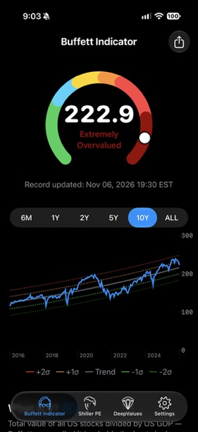
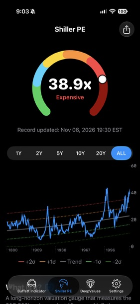
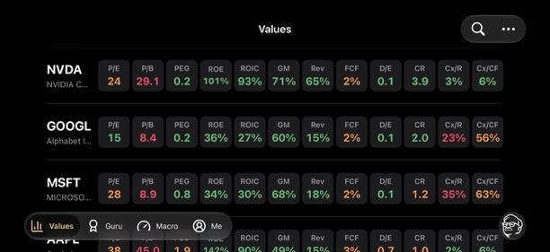
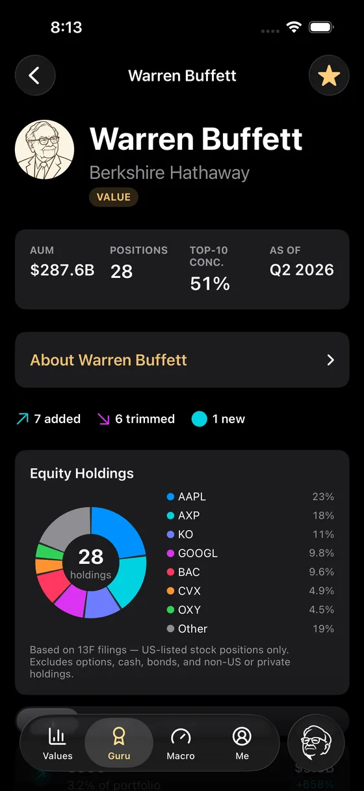
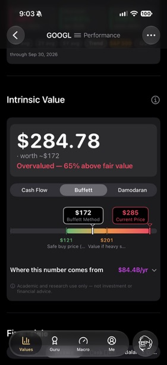
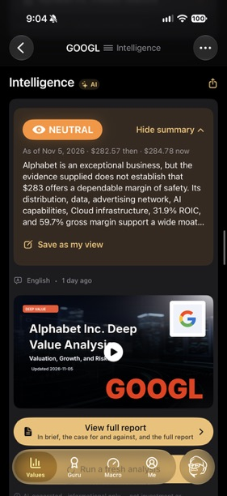
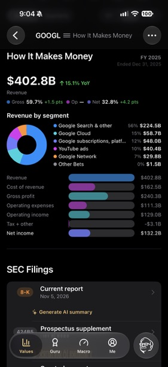

Hi everybody,

I'm Ivy, co-founder of DeepValues.

Over the past year our community has grown faster than our ability to answer it. Questions arrive under the videos, in podcast reviews, by email, and inside the app. Some are about a company. Some are about the market. A surprising number are about us: what we believe, how we think, why we built the things we built. We read all of them. We answer fewer than we would like.

So we are trying something different. Starting today, we will write The Moat Memo for our community.

These memos are a place to put down what we are thinking about markets, businesses, and investing. More importantly, they will record *why* we thought it, at the time we thought it. A view that is written down and dated can be checked later. That is uncomfortable, and it is the point.

If you disagree with something here, even better. Write back. The memos we most want to write are the ones that start a conversation.

## What we believe

Before talking about where the market stands, it is worth saying what we believe, because everything else follows from it.

Our thinking has been shaped by people who spent their lives thinking about businesses, value, risk, and human behaviour: Ben Graham, Warren Buffett, Charlie Munger, Howard Marks, Seth Klarman, Li Lu, Mohnish Pabrai, John Bogle, and many others.

The basic idea is almost embarrassingly simple. **A share of stock is a piece of a business. Whoever owns the share owns that piece.**

Once you believe that, the first question is no longer where the price goes tomorrow. It is a longer list, and a more useful one.

What kind of business am I buying, and would I want to own it for ten years? How does it make money? What protects it, and will that protection last? Does management allocate capital intelligently, and can I trust them? How much cash does the business produce for its owners, and what is its record of producing it? Is the world better for it existing? What is it worth?

And, last:

**What price am I being asked to pay for it?**

This way of thinking has survived many decades, many cycles, and more change in technology and the economy than anyone predicted. It is the framework we trust most. We do not claim it is the only one that works.

The trouble is that something simple in principle becomes very complicated in practice.

Warren Buffett has read annual reports almost every day for six decades. How many of us can do that? Understanding one company properly means a 10-K, several 10-Qs, earnings-call transcripts, footnotes, debt schedules, stock-compensation disclosures, capital-expenditure plans, segment economics, and years of cash-flow statements. Then you have to decide which of those numbers actually matter.

For a hedge fund with a research team, that is the job. For most people, it is not. People have careers, families, children, businesses to run, and lives outside the stock market. We do not think being a thoughtful investor should require becoming a full-time analyst.

We also believe something a little blunter. Wall Street works for Wall Street. It was never built to work for you.

That is the reason we built DeepValues. The goal is easy to say and hard to do: give an individual investor as much of the capability of a professional research team as we can, grounded in Buffett's principles, and make it simple enough to use on a phone in the ten minutes you actually have. Not so you can trade more. So you can ask better questions before you invest, understand the answers, and get on with your life.

## Starting with one simple question

Our first product was the Buffett Indicator, and it answers one question: **is the stock market as a whole expensive right now, or cheap?** Put plainly, if I put my savings into the S&P 500 today, am I paying a lot, or a little?

The idea comes from Buffett's 2001 essay in *Fortune*, where he compared the total value of U.S. stocks with the size of the U.S. economy and called it "probably the best single measure of where valuations stand at any given moment". In the same breath he listed its limitations. [Buffett's original essay](https://www.berkshirehathaway.com/2001ar/FortuneMagazine%20DEC%2010%202001.pdf). Buffett used gross national product; our version uses GDP, a close cousin. [How our indicator is calculated](https://app.deepvalues.ai/en/indicators/buffett).

The appeal is its simplicity. You can start thinking about the price of the market without building a model first.

We put that gauge into the Buffett Indicator app, for [iPhone](https://apps.apple.com/us/app/buffett-indicator/id6747404614) and for [Android](https://play.google.com/store/apps/details?id=com.luluventures.bubblewatch.android&referrer=utm_source%3Dmoatmemo%26utm_medium%3Dmemo%26utm_campaign%3Dmemo1), where it is called Buffett Indicator & Shiller PE.

One gauge cannot answer every investment question. But it gives you a place to begin, and a reason to pause.

As of **November 6, 2026**, the Buffett Indicator reads **222.9%**. In plain English, U.S. stocks are valued at about 2.2 times what the U.S. economy produces in a year. The app puts that reading in its "Extremely Overvalued" band, well above the long-run trend. [DeepValues market dashboard](https://app.deepvalues.ai/en/indicators).

*The Buffett Indicator app on November 6, 2026, at 19:30 EST.*

For us, that is a reason to be careful about the returns we expect. For any stream of future cash flows, paying more today leaves less for the buyer. A business can keep growing for years while its shareholders earn disappointing returns, if they paid too much at the start.

The indicator cannot tell us what the market will return over the next ten years, and its simplicity is also its weakness. Many U.S. companies earn their money abroad, while GDP counts only what is produced at home. The ratio ignores interest rates, and it says nothing about how profitable today's companies are compared with those of thirty years ago. Comparisons across decades are less clean than the chart makes them look. [Limitations of the Buffett Indicator](https://www.currentmarketvaluation.com/models/buffett-indicator.php).

So we look at a second gauge, the **Shiller P/E**, also called CAPE. It compares the price of the S&P 500 with its average inflation-adjusted earnings over the past ten years, which smooths out unusually good and bad years. [CAPE methodology](https://www.frbsf.org/research-and-insights/publications/economic-letter/2020/10/assessing-recent-stock-market-valuation-with-macro-data/).

On the same date it reads **38.9 times earnings**, more than twice its long-run average of about 17.5. It is close to the 38.6 of November 2021 and below the 44.2 of December 1999. Whichever way you read it, we are at the expensive end of history. [Current reading and historical average](https://www.multpl.com/shiller-pe), [monthly series](https://www.multpl.com/shiller-pe/table/by-month).

*The Shiller P/E on November 6, 2026, at 19:30 EST, with the full series since 1880.*

CAPE has its own limits. It looks backwards; the next decade's earnings may not resemble the last. The shift from dividends to buybacks changes how older readings compare with newer ones. And the historical average is not a price target the market owes us. [Shiller's data notes](https://shillerdata.com/), [research on CAPE's changing history](https://rpc.cfainstitute.org/blogs/enterprising-investor/2024/cape-is-high-should-you-care).

Still, the pattern across a century of data is hard to ignore: higher starting CAPE readings have gone with lower inflation-adjusted returns over the following decade. The range of outcomes is wide, so this argues for modest expectations, not a forecast. [Research on CAPE and subsequent returns](https://www.frbsf.org/research-and-insights/publications/economic-letter/2020/10/assessing-recent-stock-market-valuation-with-macro-data/).

What does that mean for how we invest? Conservative assumptions. Selectivity about the businesses we own. A real margin of safety between our estimate of value and the price we pay. And resisting the pull to assume that recent strong returns simply continue.

An expensive market can still contain attractive businesses, and an expensive market can stay expensive for years. These gauges tell us the starting price. They do not tell us when the next decline arrives.

**Valuation is not a clock. It is a starting point.**

## From the market to the business

From that starting point, we wanted the same clarity about a single business: how it earns money, how it uses capital, and what investors are paying for those economics.

Take financial ratios. Inside DeepValues we show return on equity and return on invested capital, price to earnings and price to book, gross margin, revenue growth, free cash flow, debt to equity, and a few more, side by side for every company on your list.

Each number is a compressed answer to an important question. ROIC asks how productively the company turns capital into profit. Debt to equity asks how much the company owes relative to what its owners have put in, one view of financial risk. A valuation multiple asks how much investors are already paying for all of that.

No single ratio is the answer. Each is one more angle on the business. Put enough angles together and the shape becomes clear.

*The Values screen. The figures are the app's at the time of the screenshot, shown to illustrate the layout.*

## Learning from great investors

Every quarter, large investment firms report their U.S. stock holdings in a 13F filing. We track how those holdings change from one quarter to the next for the investors we most want to learn from: Buffett, Li Lu, Seth Klarman, Howard Marks, and others. [Guru tracking](https://app.deepvalues.ai/en/gurus).

A 13F is a snapshot taken at quarter end and filed up to 45 days later. It leaves out short positions and anything outside U.S. stocks. It does not tell you why a position changed, or whether the manager's mind has changed since. [SEC guidance on Form 13F](https://www.sec.gov/rules-regulations/staff-guidance/frequently-asked-questions-about-form-13f).

We treat these filings as clues, not instructions. When a great investor makes a large move, the useful question is not *should I buy this too?* It is:

**What might they be seeing that I have not seen yet?**

Then the research starts. That is far more interesting than imitation.

*Berkshire Hathaway's reported holdings as of Q2 2026: what was added, trimmed and new since the previous filing.*

## What is the business actually worth?

Sooner or later every investing question comes back to value. A wonderful company can be a terrible investment at the wrong price, and an ordinary business can be a very good one at a low enough price.

That is why we built the intrinsic value calculator. It forces us past labels like "great company", "cheap stock" or "AI winner" and makes us put assumptions behind the words. How much cash can the business produce? How fast can it reasonably grow? How much must be reinvested to get there? What return should an owner demand? And how much room is left between that estimate and today's price?

We use three approaches, because intrinsic value is an estimate, not a fact handed down from above: a free-cash-flow model, Buffett-style owner earnings, and Aswath Damodaran's framework. When they land near each other, that is useful. When they disagree sharply, the disagreement itself is information. And when they agree, that is a reason to look harder, not proof that we are right, because different models can share the same mistake.

The purpose is to make our assumptions visible, so they can be argued with.

*Alphabet on November 6, 2026: a share price of $284.78 against a Buffett-method estimate of about $172, with the cash-flow and Damodaran views one tap away. We show it because the assumptions are on the screen. Whether you agree with them is exactly the conversation we want.*

## A research team in your pocket

All of this led to Deep Value Intelligence, probably the clearest expression of what we are trying to build.

When a company reports, the headline arrives in seconds. Revenue beat. Earnings missed. Guidance raised. Stock moved. Very often the information that matters is not in the headline. It is three layers down.

What happened to margins? Where did the cash actually go? Is free cash flow up because the business got better, or because working capital swung its way this quarter? How much stock compensation is being added back to "adjusted" earnings, and what does that do to the people who already own the shares? What changed in the risk factors? Did a footnote quietly change its wording? Is that capital spending maintenance, or is it building future earning power? What did management stress this quarter that it did not mention last quarter?

Those are the questions a good analyst asks. Our research system asks them of every company it covers. It reads the filings, the call transcripts, the historical financials and the supporting disclosures, builds the bull case and the bear case, and writes a report with the sources behind each conclusion, so you can check it. Then it reads the report to you, in your language, if you would rather listen on the way to work.

*Alphabet's research summary of November 5, 2026, with the briefing video and the full report behind it.*

And then we try to turn all of that into something a human being can take in at a glance. Instead of asking you to work through hundreds of pages, we want you to be able to see: How does this company make money? What changed? What matters? What could go wrong? And what might the business be worth?

Sometimes a picture does that better than any table. A financial statement is intimidating as five hundred lines of accounting. Show where revenue comes from, how it turns into profit, and how profit differs from cash, and the economics start to make sense.

*"How It Makes Money": Alphabet's fiscal 2025 revenue by segment and the path from revenue through costs to net income. This is the income statement; net income is not the same as cash paid to shareholders.*

That is what we mean by simplification: doing the analysis in full, then removing everything that stands between the analysis and the investor.

## Keeping the market in context

Alongside the two valuation gauges, DeepValues tracks the VIX, investor sentiment, Treasury yields and the Federal Reserve's balance sheet. [All the gauges](https://app.deepvalues.ai/en/indicators). Each answers a different question: what volatility the options market is pricing, how fearful or greedy individual investors are, what a risk-free return looks like today, and whether the central bank is adding or draining liquidity. Together they are a dashboard, not a verdict.

## Why build these little tools?

Finance has a habit of making simple ideas sound complicated. Sometimes the complexity is real. Often it is not.

We believe serious investing takes serious work. We do not believe every investor has to do every piece of that work by hand.

If we can take twenty years of financial statements and reduce them to the three trends that matter. If we can take a 200-page filing and surface the five things that changed. If we can take a valuation model and make its assumptions visible. If we can take a 13F and turn it into a question worth investigating. If we can take the price of the entire U.S. stock market and show it on one gauge.

Then maybe we make good investing a little more accessible, and thoughtful investing a little easier to practise.

Because for most individual investors, the scarce resource is not intelligence. It is time.

And if one of these tools makes someone stop for ten seconds before buying and ask, **"What am I actually buying, what is it worth, and what am I paying for it?"**, then it has done its job.

Thank you for reading the first one. Tell us what you think, and what you want the next memo to be about.

Ivy
Co-founder, DeepValues
team@deepvalues.ai

### A brief note

These memos reflect our personal views and opinions at the time of writing. They are shared for informational and educational purposes only and are not investment, financial, legal, or tax advice, nor a recommendation to buy or sell any security.

We may own, buy, or sell securities discussed in these letters, and our views may change as facts, prices, or circumstances change. Please do your own research and make investment decisions based on your own circumstances and judgment. Investing involves risk, including the possible loss of principal.
