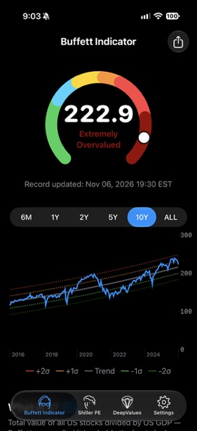
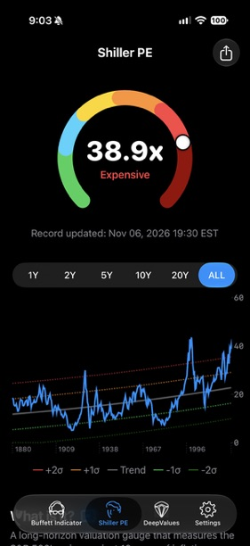
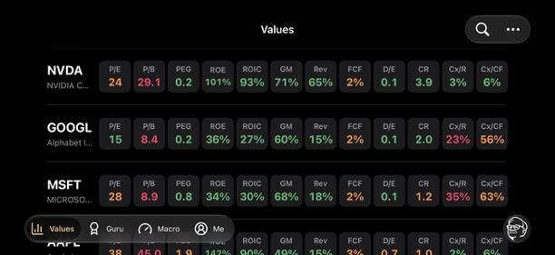
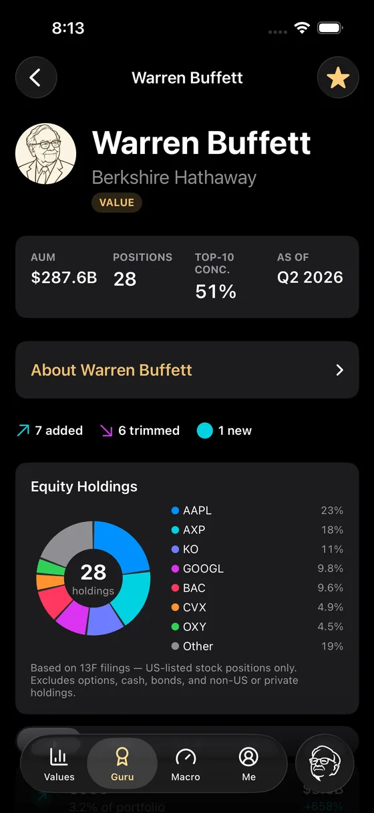
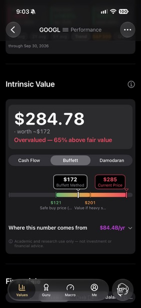
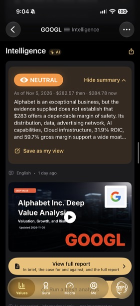
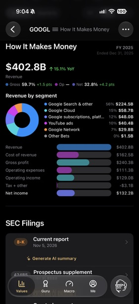

大家好，

我是 Ivy，DeepValues 的联合创始人。

过去一年，我们的社区长得比我们回答问题的速度还快。问题从视频下面、播客评论里、邮件里、App 里涌进来。有的问一家公司，有的问市场，还有不少是在问我们自己：你们相信什么？你们怎么想？为什么要做这些东西？每一条我们都读了，回复的却远比我们希望的少。

所以我们想换一种方式。从今天起，我们给社区写《护城河备忘录》。

这些备忘录是一个地方，用来记下我们对市场、对企业、对投资的想法。更重要的是，记下我们*当时为什么*那样想。一个写下来并注明日期的观点，日后是可以被检验的。这让人不舒服，而这正是目的。

如果你不同意这里的某一段，那更好。请写回来。我们最想写的备忘录，是能引出一场对话的那种。

## 我们相信什么

在谈市场现在站在哪里之前，先说清楚我们相信什么，因为后面的一切都由此而来。

影响我们思考的，是那些把一生用来思考企业、价值、风险和人性的人：本杰明·格雷厄姆、沃伦·巴菲特、查理·芒格、霍华德·马克斯、塞思·卡拉曼、李录、莫尼什·帕伯莱、约翰·博格，还有许多其他人。

基本的想法简单得近乎尴尬：**一股股票，就是一家企业的一部分。谁持有这一股，谁就拥有这一部分。**

一旦相信这一点，第一个问题就不再是“明天股价往哪儿走”，而是一张更长、也更有用的清单：

我买的是一家什么样的企业？我愿意持有它十年吗？它怎么赚钱？是什么在保护它，这种保护还能维持多久？管理层会不会聪明地配置资本？我能信任他们吗？这家企业能为股东产生多少现金，过去的记录如何？世界因为它的存在而更好了吗？它值多少钱？

最后一个问题：

**我被要求为它付出什么价格？**

这套思考方式经历了几十年、许多个周期，以及远超任何人预料的技术与经济变迁。它是我们最信任的框架。我们并不主张它是唯一行得通的方法。

麻烦在于，原理上很简单的事，到了实践中会变得非常复杂。

巴菲特六十年来几乎每天都在读年报。我们当中有几个人做得到？真正看懂一家公司，意味着读完 10-K、几份 10-Q、业绩电话会的文字稿、脚注、债务明细、股权激励披露、资本开支计划、分部经济，以及好几年的现金流量表。然后你还得判断，这么多数字里到底哪几个真正重要。

对一家有研究团队的对冲基金来说，这就是工作本身。对大多数人来说不是。人们有职业、有家庭、有孩子、有要经营的生意，有股市之外的人生。我们不认为，做一个认真的投资者，就必须先成为一个全职分析师。

我们还相信一件更直白的事：华尔街为华尔街工作。它从来不是为你而建的。

这就是我们做 DeepValues 的原因。目标说起来容易、做起来难：把一个专业研究团队的能力，尽可能多地交到个人投资者手里，以巴菲特的原则为根基，并且简单到可以在手机上、在你真正拥有的那十分钟里用起来。不是为了让你交易得更多，而是为了让你在投资之前问出更好的问题，看懂答案，然后继续过自己的生活。

## 从一个简单的问题开始

我们的第一个产品是巴菲特指标，它只回答一个问题：**整个股市现在是贵，还是便宜？**说得再直白一点：如果今天把积蓄投进标普 500，我付的是高价，还是低价？

这个想法来自巴菲特 2001 年在《财富》杂志上的文章。他把美国股市的总市值和美国经济的规模放在一起比较，称之为“在任何时点衡量估值水平的、大概是最好的单一指标”。同一篇文章里，他也列出了它的局限。[巴菲特的原文](https://www.berkshirehathaway.com/2001ar/FortuneMagazine%20DEC%2010%202001.pdf)。巴菲特用的是国民生产总值（GNP），我们的版本用国内生产总值（GDP），两者是近亲。[我们的指标怎么算](https://app.deepvalues.ai/zh/indicators/buffett)。

它的吸引力在于简单。你不必先搭一个模型，就可以开始思考市场的价格。

我们把这个仪表做进了 Buffett Indicator App，有 [iPhone 版](https://apps.apple.com/us/app/buffett-indicator/id6747404614)和 [Android 版](https://play.google.com/store/apps/details?id=com.luluventures.bubblewatch.android&referrer=utm_source%3Dmoatmemo%26utm_medium%3Dmemo%26utm_campaign%3Dmemo1)（Android 上叫 Buffett Indicator & Shiller PE）。

一个仪表回答不了所有的投资问题。但它给你一个起点，和一个停下来想一想的理由。

截至 **2026 年 11 月 6 日**，巴菲特指标读数为 **222.9%**。用大白话说，美国股市的总市值大约是美国经济一年产出的 2.2 倍。App 把这个读数放在“极度高估”区间，远在长期趋势线之上。[DeepValues 市场仪表盘](https://app.deepvalues.ai/zh/indicators)。

*Buffett Indicator App，2026 年 11 月 6 日美东时间 19:30。*

对我们来说，这是对预期回报保持谨慎的理由。对同一串未来现金流，今天付得越多，留给买家的回报就越少。一家企业可以连续多年增长，而它的股东却回报平平，只因为当初买得太贵。

这个指标说不出未来十年市场会有多少回报，它的简单也正是它的弱点。许多美国公司在海外赚钱，而 GDP 只统计国内的产出。这个比率不考虑利率，也不说明今天的公司比三十年前的公司赚钱能力强了多少。跨越几十年的比较，远没有图上看起来那么干净。[巴菲特指标的局限](https://www.currentmarketvaluation.com/models/buffett-indicator.php)。

所以我们再看第二个仪表：**席勒市盈率**，也叫 CAPE。它把标普 500 的价格和过去十年经通胀调整后的平均盈利相比，这样可以抹平特别好和特别差的年份。[CAPE 的计算方法](https://www.frbsf.org/research-and-insights/publications/economic-letter/2020/10/assessing-recent-stock-market-valuation-with-macro-data/)。

同一天，它的读数是 **38.9 倍**，是长期平均值（约 17.5 倍）的两倍多。它接近 2021 年 11 月的 38.6 倍，低于 1999 年 12 月的 44.2 倍。不管怎么读，我们都处在历史上最贵的一端。[当前读数与历史均值](https://www.multpl.com/shiller-pe)，[逐月序列](https://www.multpl.com/shiller-pe/table/by-month)。

*席勒市盈率，2026 年 11 月 6 日美东时间 19:30，附 1880 年以来的完整序列。*

CAPE 也有自己的局限。它向后看，下一个十年的盈利未必像上一个十年。从分红转向回购，也改变了新旧读数之间的可比性。而且，历史均值不是市场欠我们的目标价。[席勒的数据说明](https://shillerdata.com/)，[关于 CAPE 历史变化的研究](https://rpc.cfainstitute.org/blogs/enterprising-investor/2024/cape-is-high-should-you-care)。

尽管如此，一个世纪的数据里有一个很难忽视的规律：起点 CAPE 越高，随后十年经通胀调整的回报往往越低。结果的区间很宽，所以它支持的是更温和的预期，而不是一个预测。[CAPE 与后续回报的研究](https://www.frbsf.org/research-and-insights/publications/economic-letter/2020/10/assessing-recent-stock-market-valuation-with-macro-data/)。

这对我们怎么投资意味着什么？保守的假设。对持有的企业更挑剔。在我们对价值的估计和付出的价格之间，留出真正的安全边际。以及，抵抗住那种“近几年的强劲回报会一直延续”的惯性。

一个昂贵的市场里仍然可能有诱人的企业，一个昂贵的市场也可能一贵就是好几年。这两个仪表告诉我们的是起点价格，而不是下一次下跌什么时候来。

**估值不是一只钟，它是一个起点。**

## 从市场走到企业

从这个起点出发，我们想对一家具体的企业也有同样的清晰：它怎么赚钱，怎么使用资本，投资者又在为这些经济特征付出什么价格。

就说财务比率。在 DeepValues 里，我们把净资产收益率和投入资本回报率、市盈率和市净率、毛利率、营收增速、自由现金流、负债权益比，以及另外几项，为你清单上的每一家公司并排放在一起。

每一个数字，都是对一个重要问题的压缩回答。ROIC 问的是：这家公司把资本变成利润的效率有多高。负债权益比问的是：相对于股东投入的钱，公司欠了多少，这是看财务风险的一个角度。估值倍数问的是：投资者已经在为这一切付出多少。

没有哪一个比率是答案。每一个都是看这家企业的又一个角度。角度够多了，轮廓就清楚了。

*Values 页面。数字是截图当时 App 里的数据，用来展示版式。*

## 向伟大的投资者学习

每个季度，大型投资机构都会通过 13F 文件申报它们持有的美国股票。我们追踪这些持仓从一个季度到下一个季度的变化，对象是我们最想学习的那些人：巴菲特、李录、塞思·卡拉曼、霍华德·马克斯，以及其他人。[大师追踪](https://app.deepvalues.ai/zh/gurus)。

13F 是季度末的一张快照，最晚可以在 45 天后才提交。它不包含空头仓位，也不包含美股以外的任何东西。它不会告诉你一个仓位为什么变了，也不会告诉你这位经理人的想法此后有没有改变。[SEC 关于 13F 的说明](https://www.sec.gov/rules-regulations/staff-guidance/frequently-asked-questions-about-form-13f)。

我们把这些文件当作线索，而不是指令。当一位伟大的投资者做出一个大动作，有用的问题不是“我是不是也该买”，而是：

**他们看到了什么，是我还没看到的？**

然后，研究才真正开始。这比模仿有意思得多。

*伯克希尔·哈撒韦截至 2026 年第二季度的申报持仓：相比上一次申报，哪些加了、哪些减了、哪些是新的。*

## 这家企业到底值多少钱？

投资的每一个问题，早晚都会回到价值上来。一家了不起的公司，在错误的价格上可以是一笔糟糕的投资；一家平平无奇的企业，在足够低的价格上也可以是一笔很好的投资。

这就是我们做内在价值计算器的原因。它逼着我们越过“好公司”“便宜股”“AI 赢家”这些标签，把假设放到词语后面：这家企业能产生多少现金？合理的增速是多少？要达到那里需要再投入多少？一个股东应该要求多少回报？这个估计和今天的价格之间，还留着多少空间？

我们用三种方法，因为内在价值是一个估计，而不是从天上传下来的事实：一个自由现金流模型、巴菲特式的股东盈余，以及达摩达兰的框架。三个结果落在一起，有参考价值；分歧很大，分歧本身就是信息。而当它们一致时，那是更仔细看的理由，而不是我们对了的证明，因为不同的模型可能犯着同一个错误。

目的是让我们的假设看得见，这样才能被争论。

*2026 年 11 月 6 日的 Alphabet：股价 284.78 美元，巴菲特法估值约 172 美元，现金流法和达摩达兰法的结果一点即达。我们把它放在这里，是因为假设就在屏幕上。你同不同意这些假设，正是我们想要的那场对话。*

## 口袋里的研究团队

这一切把我们带到了 Deep Value Intelligence，它大概是我们想做的事情最清楚的表达。

一家公司发财报，标题几秒钟就到了：营收超预期、盈利不及预期、指引上调、股价大动。可真正重要的信息常常不在标题里，而在往下三层的地方。

利润率怎么了？现金到底去了哪里？自由现金流上升，是因为生意变好了，还是因为这个季度营运资金恰好往有利的方向摆了一下？有多少股权激励被加回到“调整后”盈利里，这对已经持股的人意味着什么？风险因素改了什么？哪条脚注悄悄换了措辞？那笔资本开支是维持性的，还是在建造未来的盈利能力？管理层这个季度强调了什么，是上个季度没提的？

这些是一个好分析师会问的问题。我们的研究系统对它覆盖的每一家公司都问这些问题。它读文件、读电话会文字稿、读历史财务数据和配套披露，分别搭出多头和空头的论证，然后写成一份报告，每一个结论后面都有来源，你可以去核对。然后，如果你更愿意在上班路上听，它会用你的语言把报告读给你听。

*2026 年 11 月 5 日的 Alphabet 研究摘要，后面是简报视频和完整报告。*

然后，我们再试着把这一切变成一个人一眼能看进去的东西。我们不想让你翻几百页文件，而是想让你直接看到：这家公司怎么赚钱？什么变了？什么重要？什么可能出错？这家企业可能值多少钱？

有时候，一张图比任何表格都管用。一份财务报表，摆成五百行会计科目时令人生畏。把营收从哪里来、怎么变成利润、利润又和现金有什么不同画出来，经济逻辑就开始说得通了。

*“How It Makes Money”：Alphabet 2025 财年按分部拆分的营收，以及从营收经各项成本到净利润的路径。这是利润表，净利润并不等于付给股东的现金。*

这就是我们所说的简化：把分析完整地做完，然后拿掉横在分析和投资者之间的一切。

## 把市场放回背景里

除了两个估值仪表，DeepValues 还追踪 VIX、投资者情绪、美国国债收益率和美联储的资产负债表。[全部仪表](https://app.deepvalues.ai/zh/indicators)。每一个回答不同的问题：期权市场在为多大的波动定价，个人投资者有多贪婪或多恐惧，今天的无风险回报是多少，央行是在注入还是在抽走流动性。合在一起，它们是一块仪表盘，不是一个判决。

## 为什么要做这些小工具？

金融有一个习惯：把简单的想法说得很复杂。有时候复杂是真的，更多时候不是。

我们相信认真的投资需要认真的工作。我们不相信每一个投资者都必须亲手做完其中的每一步。

如果我们能把二十年的财务报表，压缩成真正重要的三条趋势；如果我们能从一份两百页的文件里，找出变了的那五件事；如果我们能把一个估值模型的假设摆在明处；如果我们能把一份 13F 变成一个值得追问的问题；如果我们能把整个美国股市的价格，放在一个仪表上。

那也许，我们就能让好的投资离普通人近一点，让认真的投资更容易被实践。

因为对大多数个人投资者来说，稀缺的不是智力，而是时间。

如果这些工具中的某一个，能让一个人在买入之前停下十秒钟，问自己一句：**“我到底在买什么，它值多少钱，我在为它付多少钱？”**那它就完成了任务。

谢谢你读完第一篇。告诉我们你怎么想，也告诉我们下一篇你想读什么。

Ivy
DeepValues 联合创始人
team@deepvalues.ai

### 一点说明

这些备忘录反映的是我们写作当时的个人观点与看法，仅供信息与学习之用，不构成投资、财务、法律或税务建议，也不构成买卖任何证券的推荐。

我们可能持有、买入或卖出文中讨论的证券，我们的观点也可能随事实、价格或环境的变化而改变。请自行研究，并根据你自己的情况和判断做出投资决定。投资有风险，包括可能损失本金。
